{0}------------------------------------------------

# 8-channel 12-/16-bit Configurable IDAC/VDAC with On-Chip Reference

## **FEATURES**

- ▶ Octal channel, configurable as any combination of VDAC or IDAC
- ▶ Guaranteed monotonicity :  $\pm 1 \text{ LSB}_{16}$  Max DNL
- ▶ 50mA output current drive for IDAC and VDAC modes
- ▶ 70mV max headroom for VDAC mode
- ▶ 0.25V max headroom for IDAC mode
- ▶ 2.5V internal voltage reference, 3ppm/°C typical
- ▶ Device addressable SPI interface
- ▶ Output supply range: +1.71V to +5.5V
- ▶ Diagnostic monitoring for output voltage, output current, and die temperature
- ▶ Ultra small form factor: 2.1mm × 2.2mm, 25-ball WLCSP
- ▶ Operating temperature range: -40 °C to +125 °C

## **APPLICATIONS**

- ▶ Optical networking
- ▶ Instrumentation
- ▶ Data acquisition
- ▶ Automatic test equipment
- ▶ Process control and industrial automation

## **GENERAL DESCRIPTION**

The AD5711R/AD5710R feature eight 12-/16-bit DAC channels that can be independently configured as either a current output digital-to-analog converter (IDAC) or a voltage output digital-to-analog converter (VDAC). The AD5711R/AD5710R include an integrated 2.5V, 3ppm/°C reference.

When the AD5711R/AD5710R outputs are configured as an IDAC, the output current range is 0mA to 50mA. When configured as a VDAC, the output voltage range is 0V to VREF or 0V to  $2 \times VREF$ .

The AD5711R/AD5710R are available in a [25-ball wafer level chip scale packaging \(WLCSP\)](#) and are specified over the -40°C to +125°C temperature range.

**Table 1. Family Models**

| Model   | Description                                                    |
|---------|----------------------------------------------------------------|
| AD5710R | 16-bit configurable IDAC/VDAC with integrated 2.5 V reference. |
| AD5711R | 12-bit configurable IDAC/VDAC with integrated 2.5 V reference. |

## **FUNCTIONAL BLOCK DIAGRAM**

![Functional block diagram of the AD5711R/AD5710R. The diagram shows an 8-channel architecture. On the left, control pins include CS, SCLK, SDI, SDO, RESET, and LDAC. The internal logic consists of an 'INTERFACE LOGIC' block that feeds into 'n' parallel channels. Each channel contains an 'INPUT REGISTER', a 'DAC REGISTER', and an 'IDAC/VDAC' output stage. The IDAC/VDAC stages are connected to a common VREF and VDD. On the right, output pins include IOUT0, IOUT7, and a multiplexed MUX_OUT. The MUX_OUT is controlled by a 'MUX' block that selects from various internal and external sources: OUTx_VMON, OUTx_IMON, PVDDx, and AGND. Power pins at the top include IOVDD, AVDD, GND, VREF, PVDD0, and PVDD1. Address pins A1 and A0 are at the bottom left.](img/24029b85683e6c5b14e96022cd9b6ff6_img.jpg)

Functional block diagram of the AD5711R/AD5710R. The diagram shows an 8-channel architecture. On the left, control pins include CS, SCLK, SDI, SDO, RESET, and LDAC. The internal logic consists of an 'INTERFACE LOGIC' block that feeds into 'n' parallel channels. Each channel contains an 'INPUT REGISTER', a 'DAC REGISTER', and an 'IDAC/VDAC' output stage. The IDAC/VDAC stages are connected to a common VREF and VDD. On the right, output pins include IOUT0, IOUT7, and a multiplexed MUX\_OUT. The MUX\_OUT is controlled by a 'MUX' block that selects from various internal and external sources: OUTx\_VMON, OUTx\_IMON, PVDDx, and AGND. Power pins at the top include IOVDD, AVDD, GND, VREF, PVDD0, and PVDD1. Address pins A1 and A0 are at the bottom left.

**Figure 1. Functional Block Diagram**

{1}------------------------------------------------

# **TABLE OF CONTENTS**

|                                                  |    |                                                |    |
|--------------------------------------------------|----|------------------------------------------------|----|
| Features.....                                    | 1  | SPI Frame Synchronization.....                 | 32 |
| Applications.....                                | 1  | Instruction Phase.....                         | 32 |
| General Description.....                         | 1  | Data Phase.....                                | 32 |
| Functional Block Diagram.....                    | 1  | Multibyte Registers.....                       | 32 |
| Electrical Characteristics.....                  | 4  | Single Instruction Mode.....                   | 33 |
| DC Specifications.....                           | 4  | Streaming Mode.....                            | 34 |
| AC Specifications.....                           | 6  | Device Addressing.....                         | 35 |
| Digital Interface Timing.....                    | 8  | Device Status Errors.....                      | 36 |
| Absolute Maximum Ratings.....                    | 11 | Cyclic Redundancy Check (CRC) Error            |    |
| Thermal Resistance.....                          | 11 | Detection.....                                 | 36 |
| ESD Caution.....                                 | 11 | Device Reset.....                              | 37 |
| Pin Configuration and Function Descriptions..... | 12 | Applications Information.....                  | 38 |
| Typical Performance Characteristics.....         | 13 | Power Supply Recommendations.....              | 38 |
| Terminology.....                                 | 22 | Microprocessor Interfacing.....                | 38 |
| Theory of Operation.....                         | 24 | Layout Guidelines and Assembly Guidelines..... | 38 |
| Digital-to-Analog Converter.....                 | 24 | Thermal Considerations.....                    | 38 |
| Voltage Reference.....                           | 25 | Registers.....                                 | 40 |
| Integrated Multiplexer.....                      | 25 | Register Summary.....                          | 40 |
| DAC Core Functions.....                          | 28 | Register Details.....                          | 42 |
| LDAC Function.....                               | 28 | Outline Dimensions.....                        | 60 |
| DAC Update.....                                  | 28 | Ordering Guide.....                            | 60 |
| Digital Interface.....                           | 32 |                                                |    |

## **REVISION HISTORY**

### **3/2026—Rev. B to Rev. C**

|                                                                                                             |    |
|-------------------------------------------------------------------------------------------------------------|----|
| Changed Master to Controller and Slave to Target (Throughout).....                                          | 1  |
| Added Integrated Multiplexer for Multidevice Addressing Section and Figure 57; Renumbered Sequentially..... | 26 |
| Changes to Device Addressing Section.....                                                                   | 35 |
| Changes to Table 17.....                                                                                    | 40 |
| Added Multiplexer Group Select Register Section, Figure 96, and Table 37; Renumbered Sequentially.....      | 50 |
| Changes to Multiplexer Input Select Register Section.....                                                   | 50 |

### **1/2026—Rev. A to Rev. B**

|                                                                                                                                                                                                                    |    |
|--------------------------------------------------------------------------------------------------------------------------------------------------------------------------------------------------------------------|----|
| Added AD5711R (Universal).....                                                                                                                                                                                     | 1  |
| Changes to General Description Section.....                                                                                                                                                                        | 1  |
| Added Table 1; Renumbered Sequentially.....                                                                                                                                                                        | 1  |
| Changes to Table 2.....                                                                                                                                                                                            | 4  |
| Digital-to-Analog Glitch Impulse and Digital-to-Analog Glitch Peak, VDAC Specifications Parameter; Digital-to-Analog Glitch Impulse and Digital-to-Analog Glitch Peak, IDAC Specifications Parameter, Table 3..... | 6  |
| Change to Figure 6 Caption.....                                                                                                                                                                                    | 13 |
| Added Figure 7; Renumbered Sequentially.....                                                                                                                                                                       | 13 |
| Changes to Figure 8.....                                                                                                                                                                                           | 13 |
| Added Figure 9.....                                                                                                                                                                                                | 13 |
| Changes to Figure 27, Figure 28, and Figure 29.....                                                                                                                                                                | 16 |
| Change to Figure 30.....                                                                                                                                                                                           | 17 |
| Change to Digital-to-Analog Converter Section.....                                                                                                                                                                 | 24 |

{2}------------------------------------------------

## **TABLE OF CONTENTS**

|                                                   |    |
|---------------------------------------------------|----|
| Change to IDAC Channels Section.....              | 24 |
| Changes to Multibyte Registers Section.....       | 32 |
| Added Table 12.....                               | 33 |
| Change to Table 13.....                           | 35 |
| Changes to Table 22.....                          | 44 |
| Changes to Table 23.....                          | 44 |
| Changes to DAC Register Section and Table 41..... | 54 |
| Change to Table 48.....                           | 58 |
| Changes to Ordering Guide.....                    | 60 |

### **1/2026—Rev. 0 to Rev. A**

|                                                      |    |
|------------------------------------------------------|----|
| Changes to Table 3.....                              | 8  |
| Changes to Figure 21 and Figure 22.....              | 15 |
| Changes to Streaming Mode Section and Figure 69..... | 34 |
| Change to Table 14.....                              | 39 |

### **10/2025—Revision 0: Initial Version**

{3}------------------------------------------------

## ELECTRICAL CHARACTERISTICS

## DC SPECIFICATIONS

AVDD = 2.7V to 5.5V, PVDDx = 2.7V to AVDD for VDAC channels, PVDDx = 1.71V to AVDD for IDAC channels, IOVDD = 1.08V to 1.98V, VREF = 2.5V (internal or external), all specifications are at T<sub>J</sub> = -40°C to +125°C. Typical specifications at T<sub>A</sub> = 25°C, unless otherwise noted. R<sub>L</sub> = 2kΩ, C<sub>L</sub> = 200pF for VDAC channels. R<sub>L</sub> = 50Ω for IDAC channels. No capacitor on VREF.

Table 2. DC Specifications

| Parameter                                    | Min    | Typ   | Max      | Unit              | Test Conditions/Comments                                                                                  |
|----------------------------------------------|--------|-------|----------|-------------------|-----------------------------------------------------------------------------------------------------------|
| VDAC STATIC PERFORMANCE                      |        |       |          |                   |                                                                                                           |
| Resolution                                   |        |       |          |                   |                                                                                                           |
| AD5711R                                      | 12     |       |          | Bits              |                                                                                                           |
| AD5710R                                      | 16     |       |          | Bits              |                                                                                                           |
| Integral Nonlinearity (INL) <sup>1</sup>     |        |       |          |                   |                                                                                                           |
| AD5711R                                      | -0.625 |       | +0.625   | LSB <sub>12</sub> |                                                                                                           |
| AD5710R                                      | -10    |       | +10      | LSB <sub>16</sub> |                                                                                                           |
| Differential Nonlinearity (DNL) <sup>1</sup> |        |       |          |                   |                                                                                                           |
| AD5711R                                      | -0.25  |       | +0.25    | LSB <sub>12</sub> |                                                                                                           |
| AD5710R                                      | -1     |       | +1       | LSB <sub>16</sub> | Guaranteed monotonic                                                                                      |
| Zero-Code Error                              | -4.6   | 1.5   | +4.6     | mV                |                                                                                                           |
| Offset Error <sup>2</sup>                    | -5.2   | 1.4   | +5.2     | mV                |                                                                                                           |
| Gain Error                                   | -0.3   | 0.02  | +0.3     | % of FSR          | Range = 0 to VREF                                                                                         |
|                                              |        | 0.04  |          | % of FSR          | Range = 0 to 2 × VREF                                                                                     |
| Total Unadjusted Error (TUE)                 | -0.34  | ±0.08 | +0.34    | % of FSR          | Range = 0 to VREF                                                                                         |
|                                              | -0.16  | ±0.04 | 0.16     | % of FSR          | Range = 0 to 2 × VREF                                                                                     |
| Offset Error Drift                           |        | 1.5   |          | µV/°C             | Range = 0 to VREF                                                                                         |
|                                              |        | 2.5   |          | µV/°C             | Range = 0 to 2 × VREF                                                                                     |
| Gain Error Drift                             |        | 18    |          | ppm/°C            | Range = 0 to VREF                                                                                         |
|                                              |        | 25    |          | ppm/°C            | Range = 0 to 2 × VREF                                                                                     |
| DC Power Supply Rejection Ratio (PSRR)       |        |       |          |                   |                                                                                                           |
| AVDD                                         |        | 33    |          | µV/V              | DAC code = midscale, AVDD = 5V ± 10%                                                                      |
| PVDD                                         |        | 16    |          | µV/V              | DAC code = midscale, PVDD = 5V ± 10%                                                                      |
| DC Crosstalk                                 |        |       |          |                   |                                                                                                           |
| VDAC to VDAC                                 |        | 4.5   |          | µV                | Due to single channel, full-scale output change, internal reference, and range = 0 to VREF                |
|                                              |        | 35    |          | µV/mA             | Due to single channel, from -10mA to +10mA load current change, internal reference, and range = 0 to VREF |
|                                              |        | 14    |          | µV                | Due to powering down (per channel), internal reference, and range = 0 to VREF                             |
| IDAC to VDAC                                 |        | 168   |          | µV                | Due to single channel, full-scale output change, internal reference, and range = 0 to VREF                |
|                                              |        | 298   |          | µV                | Due to powering down (per channel), internal reference, and range = 0 to VREF                             |
| VDAC OUTPUT CHARACTERISTICS                  |        |       |          |                   |                                                                                                           |
| Output Voltage Range                         | 0      |       | VREF     | V                 | Range = 0 to VREF                                                                                         |
|                                              | 0      |       | 2 × VREF | V                 | Range = 0 to 2 × VREF                                                                                     |
| Short Circuit Current                        |        | 50    |          | mA                | Sourcing                                                                                                  |
|                                              |        | 10    |          | mA                | Sinking                                                                                                   |
| Capacitive Load Stability                    |        | 2     |          | nF                | R <sub>L</sub> = ∞                                                                                        |
|                                              |        | 10    |          | nF                | R <sub>L</sub> ≤ 2kΩ                                                                                      |
| Load Regulation                              |        | 200   |          | µV/mA             | PVDD = 5V ± 10%, DAC code = midscale, -30mA ≤ I <sub>OUT</sub> ≤ +30mA                                    |

{4}------------------------------------------------

## ELECTRICAL CHARACTERISTICS

Table 2. DC Specifications (Continued)

| Parameter                                      | Min    | Typ  | Max    | Unit              | Test Conditions/Comments                                                           |
|------------------------------------------------|--------|------|--------|-------------------|------------------------------------------------------------------------------------|
|                                                |        | 200  |        | µV/mA             | PVDD = 3V ± 10%, DAC code = midscale, -20mA ≤ I <sub>OUT</sub> ≤ +20mA             |
| Headroom                                       | 70     | 50   |        | mV                | Source current = 20mA                                                              |
| Footroom                                       | 250    | 120  |        | mV                | Sink current = 10mA                                                                |
| Output Impedance                               |        | 10   |        | Ω                 | Output close to VDD or GND                                                         |
| Power-Up Time                                  |        | 4.5  |        | µs                | Exiting power-down mode, AVDD = PVDD = 5V                                          |
| IDAC STATIC PERFORMANCE                        |        |      |        |                   |                                                                                    |
| Resolution                                     |        |      |        |                   |                                                                                    |
| AD5711R                                        | 12     |      |        | Bits              |                                                                                    |
| AD5710R                                        | 16     |      |        | Bits              |                                                                                    |
| INL <sup>1</sup>                               |        |      |        |                   |                                                                                    |
| AD5711R                                        |        | ±0.5 |        | LSB <sub>12</sub> |                                                                                    |
| AD5710R                                        |        | ±8   |        | LSB <sub>16</sub> |                                                                                    |
| DNL <sup>1</sup>                               | -1     |      | +1     | LSB               | Guaranteed monotonic                                                               |
| Offset Error <sup>2</sup>                      |        | 82   |        | µA                |                                                                                    |
| Gain Error                                     |        | 5.5  |        | % of FSR          | FSR = 52mA nominal                                                                 |
| Offset Error Drift                             |        | 0.14 |        | µA/°C             |                                                                                    |
| Gain Error Drift                               |        | 20   |        | ppm/°C            |                                                                                    |
| DC PSRR                                        |        |      |        |                   |                                                                                    |
| AVDD                                           |        | 1.2  |        | µA/V              | DAC code = midscale, AVDD = 5V ± 10%                                               |
|                                                |        | 1.5  |        | µA/V              | DAC code = midscale, AVDD = 3.3V ± 10%                                             |
| PVDD                                           |        | 23   |        | µA/V              | DAC code = midscale, PVDD = 5V ± 10%                                               |
|                                                |        | 12.5 |        | µA/V              | DAC code = midscale, PVDD = 1.8V ± 10%                                             |
| DC Crosstalk                                   |        |      |        |                   |                                                                                    |
| IDAC to IDAC                                   |        | 3    |        | µA                | Due to single channel, full-scale output change, and internal reference            |
|                                                |        | 5    |        | µA                | Due to powering down (per channel), and internal reference                         |
| VDAC to IDAC                                   |        | 0.1  |        | µA                | Due to single channel, full-scale output change, and internal reference            |
|                                                |        | 0.5  |        | µA                | Due to powering down (per channel), internal reference, and VDAC range = 0 to VREF |
| IDAC OUTPUT CHARACTERISTICS                    |        |      |        |                   |                                                                                    |
| Output Current Range                           | 0      |      | >50    | mA                |                                                                                    |
| Dropout Voltage                                |        |      | 250    | mV                | Output current = FS                                                                |
| Power-Up Time                                  |        | 4    |        | µs                | Exiting power-down mode, AVDD = PVDD = 5V                                          |
| REFERENCE INPUT                                |        |      |        |                   |                                                                                    |
| Reference Input Current                        |        | 387  |        | µA                | VREF = 5.5V                                                                        |
|                                                |        | 682  |        | µA                | VREF = 5.5V and VDAC range = 0 to 2 × VREF                                         |
| Reference Input Voltage                        |        | 2.5  |        | V                 |                                                                                    |
| Reference Input Impedance                      |        | 14.3 |        | kΩ                |                                                                                    |
|                                                |        | 8.1  |        | kΩ                | VDAC range = 0 to 2 × VREF                                                         |
| REFERENCE OUTPUT                               |        |      |        |                   |                                                                                    |
| VREF Output                                    | 2.4925 | 2.5  | 2.5075 | V                 |                                                                                    |
| Voltage Reference Temperature Coefficient (TC) |        | 3    |        | ppm/°C            |                                                                                    |
| Output Impedance                               |        | 0.04 |        | Ω                 |                                                                                    |
| Load Regulation Sourcing                       |        | 40   |        | µV/mA             | At ambient temperature                                                             |
| Output Current Load Capability                 |        | +7   |        | mA                | Sourcing, AVDD ≥ 3V                                                                |
|                                                |        | 400  |        | µA                | Sinking                                                                            |

{5}------------------------------------------------

## ELECTRICAL CHARACTERISTICS

Table 2. DC Specifications (Continued)

| Parameter                               | Min         | Typ  | Max         | Unit | Test Conditions/Comments                                      |
|-----------------------------------------|-------------|------|-------------|------|---------------------------------------------------------------|
| Line Regulation                         |             | 13.4 |             | μV/V | At ambient temperature                                        |
| Thermal Hysteresis                      |             | 2.6  |             | ppm  | First cycle                                                   |
|                                         |             | 2.7  |             | ppm  | Additional cycles                                             |
| INTEGRATED MULTIPLEXER                  |             |      |             |      |                                                               |
| Output Voltage Range                    | 0           |      | PVDD        | V    |                                                               |
| Output Current                          |             | ±9   |             | mA   |                                                               |
| Output Impedance                        |             | 0.54 |             | Ω    |                                                               |
| Offset Error                            |             | 50   |             | mV   |                                                               |
| Maximum Capacitive Load                 |             | 10   |             | nF   |                                                               |
| LOGIC INPUTS                            |             |      |             |      |                                                               |
| Input Current                           |             |      | 1           | μA   | Per pin, leakage current                                      |
| Input Low Voltage (V <sub>IL</sub> )    |             |      | 0.3 × IOVDD | V    |                                                               |
| Input High Voltage (V <sub>IH</sub> )   | 0.7 × IOVDD |      |             | V    |                                                               |
| Pin Capacitance                         |             | 1.3  |             | pF   |                                                               |
| LOGIC OUTPUTS SERIAL DATA OUT (SDO)     |             |      |             |      |                                                               |
| Output Low Voltage (V <sub>OL</sub> )   |             |      | 0.4         | V    | I <sub>SINK</sub> = 1μA                                       |
| Output High Voltage (V <sub>OH</sub> )  | IOVDD – 0.4 |      |             | V    | I <sub>SOURCE</sub> = 1μA                                     |
| Floating State Output Capacitance       |             | 1.2  |             | pF   |                                                               |
| POWER REQUIREMENTS                      |             |      |             |      |                                                               |
| IOVDD                                   | 1.08        |      | 1.98        | V    |                                                               |
| I <sub>LOGIC</sub>                      |             | 16   |             | μA   | Static Inputs, V <sub>IH</sub> = IOVDD, V <sub>IL</sub> = GND |
| AVDD                                    | 2.7         |      | 5.5         | V    |                                                               |
| PVDDx                                   | 1.71        |      | AVDD        | V    |                                                               |
| I <sub>AVDD</sub>                       |             |      |             |      |                                                               |
| Normal Mode                             |             | 1.75 |             | mA   | External reference = 2.5V                                     |
|                                         |             | 2.64 | 2.76        | mA   | Internal reference                                            |
| Power-Down                              |             | 1.05 | 1.8         | mA   | Internal reference                                            |
|                                         |             | 690  |             | μA   | External reference = 2.5V                                     |
| I <sub>PVDD0</sub> , I <sub>PVDD1</sub> |             | 2.3  |             | mA   | IDAC output at zero scale                                     |
|                                         |             | 0.8  |             | μA   | IDAC output = high-Z                                          |
|                                         |             | 0.55 |             | mA   | VDAC output at zero scale                                     |
|                                         |             | 0.35 |             | μA   | VDAC output = 15kΩ to GND                                     |

<sup>1</sup> Linearity for the AD5711R is defined from Code 16 to Code 4079 and for the AD5710R is defined from Code 256 to Code 65279 for VDAC and IDAC channels.

<sup>2</sup> Offset error is measured at Code 406 for VDAC channels and Code 16 for IDAC channels for the AD5711R, and at Code 6503 for VDAC channels and Code 255 for IDAC channels for the AD5710R.

### AC SPECIFICATIONS

AVDD = 2.7V to 5.5 V, PVDDx = 2.7V to AVDD for VDAC channels, PVDDx = 1.71V to AVDD for IDAC channels, 1.08V ≤ IOVDD ≤ 1.98V, VREF = 2.5V (internal or external), and all specifications are at T<sub>J</sub> = –40°C to +125°C. Typical at T<sub>A</sub> = 25°C, unless otherwise noted. R<sub>L</sub> = 2kΩ to GND, C<sub>L</sub> = 200pF to GND for VDAC channels. R<sub>L</sub> = 50Ω to GND for IDAC channels. No capacitor on VREF.

Table 3. AC Specifications

| Parameter                    | Min | Typ | Max | Unit | Test Conditions/Comments                                          |
|------------------------------|-----|-----|-----|------|-------------------------------------------------------------------|
| VDAC SPECIFICATIONS          |     |     |     |      |                                                                   |
| Output Voltage Settling Time |     | 7   |     | μs   | ¼ to ¾ scale and vice versa with settling to ±2 LSB <sub>16</sub> |
| Slew Rate                    |     | 0.7 |     | V/μs | 10% FSR to 90% FSR and vice versa                                 |

{6}------------------------------------------------

## ELECTRICAL CHARACTERISTICS

Table 3. AC Specifications (Continued)

| Parameter                                          | Min | Typ  | Max | Unit   | Test Conditions/Comments                                                                          |
|----------------------------------------------------|-----|------|-----|--------|---------------------------------------------------------------------------------------------------|
| Digital-to-Analog Glitch Impulse                   |     | 1    |     | nV-sec | Code change from 0xC000 to 0xBFFF and vice versa, AD5710R (internal reference, range = 0 to VREF) |
| Digital-to-Analog Glitch Peak                      |     | 1.5  |     | mV     | Code change from 0xC000 to 0xBFFF and vice versa, AD5710R (internal reference, range = 0 to VREF) |
| Digital Feedthrough (Voltage Peak)                 |     |      |     |        | Internal reference and range = 0 to VREF                                                          |
|                                                    |     | 0.04 |     | mV     | OUT1, OUT2 , OUT3, OUT5, OUT6, and OUT7 as victim channels                                        |
|                                                    |     | 0.7  |     | mV     | OUT0 and OUT4 as victim channels                                                                  |
| VDAC-to-VDAC Crosstalk (Voltage Peak) <sup>1</sup> |     |      |     |        | Internal reference and range = 0 to VREF                                                          |
| Digital                                            |     | 0.05 |     | mV     | OUT1, OUT2 , OUT3, OUT5, OUT6, and OUT7 as victim channels                                        |
|                                                    |     | 0.7  |     | mV     | OUT0 and OUT4 as victim channels                                                                  |
| Analog                                             |     | 1.1  |     | mV     | Adjacent channels <sup>2</sup>                                                                    |
|                                                    |     | 0.2  |     | mV     | Non adjacent channels <sup>2</sup>                                                                |
| DAC-to-DAC                                         |     | 1.1  |     | mV     | OUT1 and OUT5 as victim channels, with OUT0 and OUT4 as attackers respectively                    |
|                                                    |     | 0.3  |     | mV     | OUT0, OUT2 , OUT3, OUT4, OUT6, and OUT7 as victim channels                                        |
| IDAC-to-VDAC Crosstalk (Voltage Peak) <sup>3</sup> |     |      |     |        | Internal reference and range = 0 to VREF                                                          |
| Analog                                             |     | 5    |     | mV     | Adjacent channels <sup>2</sup>                                                                    |
|                                                    |     | 0.2  |     | mV     | Non adjacent channels <sup>2</sup>                                                                |
| DAC-to-DAC                                         |     | 3    |     | mV     | Adjacent channels <sup>2</sup>                                                                    |
|                                                    |     | 0.2  |     | mV     | Non adjacent channels <sup>2</sup>                                                                |
| Mux-to-VDAC Crosstalk <sup>4</sup>                 |     | 0.09 |     | mV     | OUT1, OUT2 , OUT3, OUT4, OUT5, and OUT7 as victim channels                                        |
|                                                    |     | 1.3  |     | mV     | OUT0 and OUT4 as victim channels                                                                  |
| Output Noise Spectral Density                      |     |      |     |        | DAC code = midscale, 10kHz                                                                        |
|                                                    |     | 68   |     | nV/√Hz | Range = 0 to VREF and external reference                                                          |
|                                                    |     | 84   |     | nV/√Hz | Range = 0 to 2 × VREF and external reference                                                      |
|                                                    |     | 107  |     | nV/√Hz | Range = 0 to VREF and internal reference                                                          |
|                                                    |     | 131  |     | nV/√Hz | Range = 0 to 2 × VREF and internal reference                                                      |
| Output Noise                                       |     | 15   |     | μV p-p | 0.1Hz to 10Hz, range = 0 to VREF                                                                  |
|                                                    |     | 25   |     | μV p-p | 0.1Hz to 10Hz, range = 0 to 2 × VREF                                                              |
| PVDDx AC PSRR                                      |     | -93  |     | dB     | 10Hz, range = 0 to VREF or range = 0 to 2 × VREF                                                  |
|                                                    |     | -79  |     | dB     | 100Hz, range = 0 to VREF or range = 0 to 2 × VREF                                                 |
|                                                    |     | -59  |     | dB     | 1kHz, range = 0 to VREF or range = 0 to 2 × VREF                                                  |
| IDAC SPECIFICATIONS                                |     |      |     |        |                                                                                                   |
| Output Current Settling Time                       |     | 17.5 |     | μs     | ¼ to ¾ scale with settling to ±2 LSB <sub>16</sub>                                                |
| Slew Rate                                          |     | 18   |     | mA/μs  | 10% FSR to 90% FSR and vice versa                                                                 |
| Digital-to-Analog Glitch Impulse                   |     | 15   |     | pA-sec | Code change from 0xC000 to 0xBFFF and vice versa, AD5710R (internal reference, range = 0 to VREF) |
| Digital-to-Analog Glitch Peak                      |     | 40   |     | μA     | Code change from 0xC000 to 0xBFFF and vice versa, AD5710R (internal reference, range = 0 to VREF) |
| Digital Feedthrough (Current Peak)                 |     |      |     |        | Internal reference and range = 0 to VREF                                                          |
|                                                    |     | 2.5  |     | μA     | OUT1, OUT2 , OUT3, OUT5, OUT6, and OUT7 as victim channels                                        |
|                                                    |     | 35   |     | μA     | OUT0 and OUT4 as victim channels                                                                  |
| IDAC-to-IDAC Crosstalk (Current Peak)              |     |      |     |        | Internal reference and range = 0 to VREF                                                          |
| Digital                                            |     | 2.4  |     | μA     | OUT1, OUT2 , OUT3, OUT5, OUT6, and OUT7 as victim channels                                        |
|                                                    |     | 35   |     | μA     | OUT0 and OUT4 as victim channels                                                                  |
| Analog                                             |     | 130  |     | μA     | OUT1 and OUT5 as victim channels, with OUT0 and OUT4 as attackers respectively                    |
|                                                    |     | 12   |     | μA     | OUT0, OUT2 , OUT3, OUT4, OUT6, and OUT7 as victim channels                                        |
| DAC-to-DAC                                         |     | 9.4  |     | μA     | OUT0, OUT2 , OUT3, OUT4, OUT6, and OUT7 as victim channels                                        |

{7}------------------------------------------------

## ELECTRICAL CHARACTERISTICS

Table 3. AC Specifications (Continued)

| Parameter                                       | Min | Typ  | Max | Unit   | Test Conditions/Comments                                                                                                   |
|-------------------------------------------------|-----|------|-----|--------|----------------------------------------------------------------------------------------------------------------------------|
|                                                 |     | 65   |     | μA     | OUT1 and OUT5 as victim channels, with OUT0 and OUT4 as attackers respectively |
| VDAC-to-IDAC Crosstalk (Current Peak)           |     |      |     |        | Internal reference and range = 0 to VREF |
| Analog                                          |     | 6.5  |     | μA     | OUT0, OUT2 , OUT3, OUT4, OUT6, and OUT7 as victim channels                                                                 |
|                                                 |     | 20.5 |     | μA     | OUT1 and OUT5 as victim channels, with OUT0 and OUT4 as attackers respectively                                             |
| DAC-to-DAC                                      |     | 1.3  |     | μA     | OUT0, OUT2 , OUT3, OUT4, OUT6, and OUT7 as victim channels                                                                 |
|                                                 |     | 18.6 |     | μA     | OUT1 and OUT5 as victim channels, with OUT0 and OUT4 as attackers respectively                                             |
| Output Noise Spectral Density                   |     |      |     |        | DAC code = midscale                                                                                                        |
|                                                 |     | 4.1  |     | nA/√Hz | f = 1kHz and external reference                                                                                            |
|                                                 |     | 3.1  |     | nA/√Hz | f = 10kHz and external reference                                                                                           |
| Output Noise                                    |     | 1.15 |     | μA p-p | 0.1Hz to 10Hz                                                                                                              |
| PVDDx AC PSRR                                   |     | -97  |     | dB     | 100Hz                                                                                                                      |
|                                                 |     | -85  |     | dB     | 1kHz                                                                                                                       |
|                                                 |     | -46  |     | dB     | 100kHz                                                                                                                     |
| VOLTAGE REFERENCE OUTPUT                        |     |      |     |        |                                                                                                                            |
| Output Voltage Noise                            |     | 22   |     | μV p-p | 0.1Hz to 10Hz                                                                                                              |
| Output Voltage Noise Density                    |     | 93   |     | nV/√Hz | f = 10kHz                                                                                                                  |

- 1 Crosstalk measurements are computed as the average of all attacker channels affecting a specific victim, from zero code to full scale transition, or vice versa, on the attacker channel.
- 2 Adjacent channels are defined within the same PVDD supply domain. Channels CH0 to CH3 share PVDD0 and are considered adjacent only to each other, and channels CH4 to CH7 share PVDD1 and are adjacent only to each other.
- 3 Impact caused by a code change in an IDAC channel on the output of a VDAC channel.
- 4 The peak glitch seen on the VDAC channels when any channel is monitored through MUX\_OUT\_SELECT Register.

### DIGITAL INTERFACE TIMING

All input signals are specified for a standalone device with rise time (t<sub>R</sub>) = fall time (t<sub>F</sub>) = 1ns/V (10% to 90% of IOVDD) and timed from a voltage level of (V<sub>IL</sub> + V<sub>IH</sub>)/2. AVDD = 2.7V to 5.5V, 1.08V ≤ IOVDD ≤ 1.98V. VREF = 2.5V. All specifications are at T<sub>J</sub> = −40°C to +125°C, unless otherwise noted.

Table 4. Digital Interface Timing Specifications

| Parameter              | Test Conditions / Comments                                                                      | Min             | Typ                  | Max             | Units |
|------------------------|-------------------------------------------------------------------------------------------------|-----------------|----------------------|-----------------|-------|
| t <sub>1</sub> (Write) | SCLK cycle period (write)                                                                       | 20 <sup>1</sup> |                      |                 | ns    |
| t <sub>1</sub> (Read)  | SCLK cycle period (read)                                                                        | 40 <sup>2</sup> |                      |                 | ns    |
| t <sub>1</sub>         | SCLK cycle period                                                                               |                 |                      | 80 <sup>3</sup> | ns    |
| t <sub>2</sub>         | SCLK high time                                                                                  |                 | t <sub>1</sub> × 0.5 |                 | ns    |
| t <sub>3</sub>         | SCLK low time                                                                                   |                 | t <sub>1</sub> × 0.5 |                 | ns    |
| t <sub>4</sub>         | SCLK rising edge to $\overline{\text{CS}}$ falling edge                                         | 10              |                      |                 | ns    |
| t <sub>5</sub>         | $\overline{\text{CS}}$ falling edge to SCLK rising edge setup time                              | 7               |                      |                 | ns    |
| t <sub>6</sub>         | SCLK rising edge to $\overline{\text{CS}}$ rising edge, $\overline{\text{LDAC}}$ idle high mode | 4               |                      |                 | ns    |
| t <sub>7</sub>         | $\overline{\text{CS}}$ rising edge to SCLK rising edge                                          | 6               |                      |                 | ns    |
| t <sub>8</sub>         | Data hold time                                                                                  | 2               |                      |                 | ns    |
| t <sub>9</sub>         | Data setup time                                                                                 | 5               |                      |                 | ns    |
| t <sub>10</sub>        | $\overline{\text{CS}}$ high time (single, combined, or all channel update)                      | 10              |                      |                 | ns    |
| t <sub>11</sub>        | SCLK falling edge to SDO data available                                                         |                 |                      | 9               | ns    |
| t <sub>12</sub>        | SCLK falling edge to SDO data remains valid                                                     |                 |                      | 10              | ns    |

{8}------------------------------------------------

## ELECTRICAL CHARACTERISTICS

Table 4. Digital Interface Timing Specifications (Continued)

| Parameter              | Test Conditions / Comments                                                                   | Min | Typ  | Max | Units |
|------------------------|----------------------------------------------------------------------------------------------|-----|------|-----|-------|
| t <sub>13</sub>        | $\overline{\text{CS}}$ rising edge to SDO disabled                                           |     |      | 9   | ns    |
| t <sub>14</sub>        | SCLK falling edge to SDO enabled                                                             |     |      | 10  | ns    |
| t <sub>OUT_SYNC</sub>  | Last SCLK rising edge to VOUT transition start (VDAC mode)                                   |     | 1.06 |     | μs    |
|                        | Last SCLK rising edge to IOUT transition start (IDAC mode)                                   |     | 2.41 |     | μs    |
| t <sub>RESET</sub>     | $\overline{\text{RESET}}$ low pulse width                                                    | 160 |      |     | ns    |
| t <sub>OUT_RESET</sub> | $\overline{\text{RESET}}$ falling edge to OUT transition start                               |     | 3.6  |     | μs    |
| t <sub>SPI_RDY</sub>   | $\overline{\text{RESET}}$ rising edge to serial peripheral interface (SPI) transaction begin |     |      | 167 | μs    |

- <sup>1</sup>

Equivalent to 50MHz for write operation only.
- <sup>2</sup>

Equivalent to 25MHz for read operation only.
- <sup>3</sup>

Only applicable for input and DAC register updates while in streaming mode with LOOP\_COUNT > 0. Refer to the [Streaming Mode](#) section for more details.

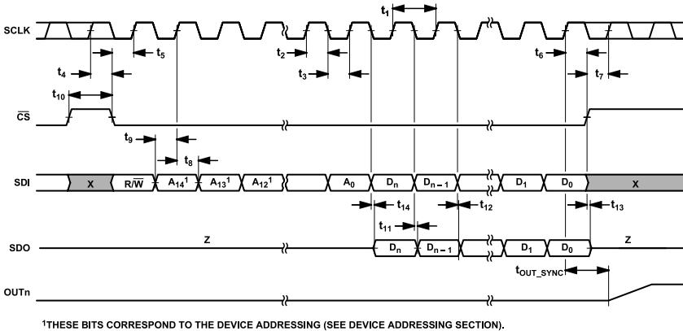

The diagram illustrates the timing for serial read and write operations. It shows the relationship between the Serial Clock (SCLK), Chip Select (CS), Serial Data Input (SDI), Serial Data Output (SDO), and the output signal (OUTn). Key timing parameters include t<sub>1</sub> (SCLK period), t<sub>2</sub> (SCLK high/low time), t<sub>3</sub> (SCLK rise/fall time), t<sub>4</sub> (CS to SCLK), t<sub>5</sub> (SCLK to CS), t<sub>6</sub> (CS to SCLK), t<sub>7</sub> (CS rise/fall time), t<sub>8</sub> (SDI to SCLK), t<sub>9</sub> (SCLK to SDI), t<sub>10</sub> (CS to SDI), t<sub>11</sub> (SDO to SCLK), t<sub>12</sub> (SCLK to SDO), t<sub>13</sub> (CS to SDO), t<sub>14</sub> (SDI to SDO), and t<sub>OUT\_SYNC</sub> (SCLK to OUTn). The SDI line shows a sequence of R/W, A<sub>14</sub><sup>1</sup>, A<sub>13</sub><sup>1</sup>, A<sub>12</sub><sup>1</sup>, A<sub>0</sub>, D<sub>n</sub>, D<sub>n-1</sub>, ..., D<sub>1</sub>, D<sub>0</sub>. The SDO line shows a sequence of Z, D<sub>n</sub>, D<sub>n-1</sub>, ..., D<sub>1</sub>, D<sub>0</sub>, Z. The OUTn signal transitions at the end of the data sequence. A note states: <sup>1</sup>THESE BITS CORRESPOND TO THE DEVICE ADDRESSING (SEE DEVICE ADDRESSING SECTION).

Timing diagram for Serial Read and Write Operation showing SCLK, CS, SDI, SDO, and OUTn signals with various timing parameters.

Figure 2. Serial Read and Write Operation

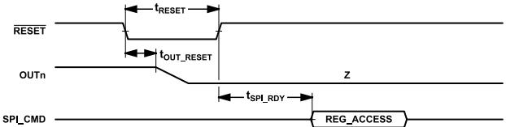

The diagram illustrates the timing for the reset operation. It shows the relationship between the  $\overline{\text{RESET}}$  signal, the output signal (OUTn), and the SPI command (SPI\_CMD). Key timing parameters include t<sub>RESET</sub> (RESET low pulse width), t<sub>OUT\_RESET</sub> (RESET falling edge to OUTn transition start), and t<sub>SPI\_RDY</sub> (RESET rising edge to SPI transaction begin). The SPI\_CMD signal shows a 'REG\_ACCESS' transaction starting after t<sub>SPI\_RDY</sub>.

Timing diagram for Reset Timing showing RESET, OUTn, and SPI\_CMD signals with parameters t\_RESET, t\_OUT\_RESET, and t\_SPI\_RDY.

Figure 3. Reset Timing

Table 5. DAC Update Timing Specifications

| Parameter       | Test Conditions / Comments                                           | Min | Typ | Max | Units |
|-----------------|----------------------------------------------------------------------|-----|-----|-----|-------|
| t <sub>L1</sub> | $\overline{\text{LDAC}}$ low pulse width                             | 120 |     |     | ns    |
| t <sub>L2</sub> | $\overline{\text{LDAC}}$ falling edge to SPI DAC update              | 640 |     |     | ns    |
| t <sub>L3</sub> | SPI DAC update to $\overline{\text{LDAC}}$ falling edge              | 640 |     |     | ns    |
| t <sub>L4</sub> | $\overline{\text{LDAC}}$ falling edge to VOUT transition (VDAC mode) |     | 0.6 |     | μs    |
|                 | $\overline{\text{LDAC}}$ falling edge to IOUT transition (IDAC mode) |     | 2.6 |     | μs    |

{9}------------------------------------------------

## ELECTRICAL CHARACTERISTICS

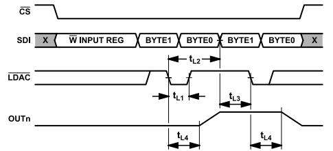

The timing diagram illustrates the LDAC operation. The  $\overline{\text{CS}}$  signal is active low. The SDI signal shows a sequence of bits: a high-impedance state (X), followed by the  $\overline{\text{W}}$  INPUT REG, then BYTE1, BYTE0, BYTE1, and BYTE0, ending with another high-impedance state (X). The LDAC signal is a pulse that coincides with the second BYTE0. The OUTn signal shows the digital-to-analog conversion output. Timing parameters are defined as follows:  $t_{L1}$  is the time from the falling edge of LDAC to the start of the output transition;  $t_{L2}$  is the time from the falling edge of LDAC to the end of the output transition;  $t_{L3}$  is the time from the rising edge of LDAC to the start of the output transition; and  $t_{L4}$  is the time from the rising edge of LDAC to the end of the output transition. A small '004' label is present at the bottom right of the diagram.

Timing diagram for LDAC operation showing signals:  $\overline{\text{CS}}$ , SDI, LDAC, and OUTn with timing parameters  $t_{L1}$ ,  $t_{L2}$ ,  $t_{L3}$ , and  $t_{L4}$ .

Figure 4.  $\overline{\text{LDAC}}$  Operation Timing

{10}------------------------------------------------

### ABSOLUTE MAXIMUM RATINGS

**Table 6. Absolute Maximum Ratings**

| Parameter                                              | Rating                                            |
|--------------------------------------------------------|---------------------------------------------------|
| AVDD to GND                                            | −0.3V to +6.5V                                    |
| PVDDx to GND                                           | −0.3V to +6.5V or AVDD + 0.3V, whichever is less  |
| IOVDD to GND                                           | −0.3V to +2.1V                                    |
| OUTn to GND                                            | −0.3V to +6.5V or PVDD + 0.3V, whichever is less. |
| VREF <sup>1</sup> to GND                               | −0.3V to +6.5V or AVDD + 0.3V, whichever is less  |
| Digital Input/Output Voltage to GND                    | −0.3V to +2.1V or IOVDD + 0.3V, whichever is less |
| Temperature                                            |                                                   |
| Operating Junction Temperature Range                   | −40°C to +125°C                                   |
| Storage Temperature Range                              | −65°C to +150°C                                   |
| Absolute Maximum Junction Temperature                  | 150°C                                             |
| Reflow Soldering Peak Temperature, Pb-Free (J-STD-020) | 260°C                                             |

<sup>1</sup> Configured as the reference input pin.

Stresses at or above those listed under Absolute Maximum Ratings may cause permanent damage to the product. This is a stress rating only; functional operation of the product at these or any other conditions above those indicated in the operational section of this specification is not implied. Operation beyond the maximum operating conditions for extended periods may affect product reliability.

### THERMAL RESISTANCE

Thermal performance is directly linked to printed circuit board (PCB) design and operating environment. Careful attention to PCB thermal design is required, in particular for applications where high maximum power dissipation exists.

$\theta_{JA}$  and  $\theta_{JB}$  are mainly used to compare the thermal performance of the device package with other semiconductor packages, assuming all listed test conditions are similar. They can also be used as a first-order approximation of the junction temperature in a system environment.

For WLCSP devices, using  $\Psi_{JB}$  or  $\Psi_{JT}$  is a more appropriate method to estimate the worst-case junction temperature in the system environment, provided that an accurate thermal measurement is available—either near the device under test (DUT) on the board or directly on the top surface of the package during system operation.

**Table 7. Thermal Resistance**

| Package Type               | $\theta_{JA}$ | $\theta_{JB}$ | $\theta_{JC}$ | $\Psi_{JT}$ | $\Psi_{JB}$ | Unit |
|----------------------------|---------------|---------------|---------------|-------------|-------------|------|
| 25-ball WLCSP <sup>1</sup> | 51.8          | 16            | 2.3           | 3.7         | 16          | °C/W |

<sup>1</sup> Simulation values on JEDEC 2S2P board with 4 thermal vias, still air (0m/sec airflow).

### ESD CAUTION


ESD Caution symbol: A hand with a finger touching a small object, with a lightning bolt symbol above it, indicating electrostatic discharge.

**ESD (electrostatic discharge) sensitive device.** Charged devices and circuit boards can discharge without detection. Although this product features patented or proprietary protection circuitry, damage may occur on devices subjected to high energy ESD. Therefore, proper ESD precautions should be taken to avoid performance degradation or loss of functionality.

{11}------------------------------------------------

## PIN CONFIGURATION AND FUNCTION DESCRIPTIONS

![Figure 5. WLCSP Pin Configuration. A top-down view of the 5x5 WLCSP package for AD5711R/AD5710R. Pin 1 is at the top left, labeled 'BALL A1 INDICATOR'. The pins are arranged in a 5x5 grid. Row A: Pin 1 (MUX_OUT), Pin 2 (OUT3), Pin 3 (OUT2), Pin 4 (OUT1), Pin 5 (LDAC). Row B: Pin 1 (AVDD), Pin 2 (PVDD0), Pin 3 (GND), Pin 4 (OUT0), Pin 5 (SCLK). Row C: Pin 1 (A1), Pin 2 (A0), Pin 3 (IOVDD), Pin 4 (RESET), Pin 5 (SDO). Row D: Pin 1 (VREF), Pin 2 (PVDD1), Pin 3 (GND), Pin 4 (OUT4), Pin 5 (CS). Row E: Pin 1 (GND), Pin 2 (OUT7), Pin 3 (OUT6), Pin 4 (OUT5), Pin 5 (SDI).](img/27b06ec9f42b5d727a2630f61a5f1861_img.jpg)

Figure 5. WLCSP Pin Configuration. A top-down view of the 5x5 WLCSP package for AD5711R/AD5710R. Pin 1 is at the top left, labeled 'BALL A1 INDICATOR'. The pins are arranged in a 5x5 grid. Row A: Pin 1 (MUX\_OUT), Pin 2 (OUT3), Pin 3 (OUT2), Pin 4 (OUT1), Pin 5 (LDAC). Row B: Pin 1 (AVDD), Pin 2 (PVDD0), Pin 3 (GND), Pin 4 (OUT0), Pin 5 (SCLK). Row C: Pin 1 (A1), Pin 2 (A0), Pin 3 (IOVDD), Pin 4 (RESET), Pin 5 (SDO). Row D: Pin 1 (VREF), Pin 2 (PVDD1), Pin 3 (GND), Pin 4 (OUT4), Pin 5 (CS). Row E: Pin 1 (GND), Pin 2 (OUT7), Pin 3 (OUT6), Pin 4 (OUT5), Pin 5 (SDI).

Figure 5. WLCSP Pin Configuration

Table 8. Pin Function Descriptions

| WLCSP          | Mnemonic | Type | Description                                                                                                                                                                                                                                                                                             |
|----------------|----------|------|---------------------------------------------------------------------------------------------------------------------------------------------------------------------------------------------------------------------------------------------------------------------------------------------------------|
| D1             | VREF     | AI/O | 2.5V Voltage Reference Input/Output. By default, the VREF pin is configured as an input. When the internal reference is enabled, this pin provides a 2.5V reference output.<br>By default, no decoupling capacitor is needed from this pin to GND for specified performance in internal reference mode. |
| A1             | MUX_OUT  | AO   | Analog Multiplexer Output. This pin is used to monitor internal die temperature, output voltages, and output current of a selected channel.                                                                                                                                                             |
| A2             | OUT3     | AO   | Analog Voltage Output from VDAC 3/Current Output of IDAC 3.                                                                                                                                                                                                                                             |
| A3             | OUT2     | AO   | Analog Voltage Output from VDAC 2/Current Output of IDAC 2.                                                                                                                                                                                                                                             |
| A4             | OUT1     | AO   | Analog Voltage Output from VDAC 1/Current Output of IDAC 1.                                                                                                                                                                                                                                             |
| B4             | OUT0     | AO   | Analog Voltage Output from VDAC 0/Current Output of IDAC 0.                                                                                                                                                                                                                                             |
| B1             | AVDD     | S    | Power Supply Input. Bypass to GND with a 0.1µF capacitor.                                                                                                                                                                                                                                               |
| B2             | PVDD0    | S    | PVDD Supply Voltage Input for the IDAC/VDAC Channels (OUT0 to OUT3).                                                                                                                                                                                                                                    |
| D2             | PVDD1    | S    | PVDD Supply Voltage Input for the IDAC/VDAC Channels (OUT4 to OUT7).                                                                                                                                                                                                                                    |
| D5             | $\overline{\text{CS}}$ | DI   | Active Low Control Input. This is the frame synchronization signal for the input data.                                                                                                                                                                                                                  |
| C3             | IOVDD    | DI   | Logic Power Supply. IOVDD must be between 1.08V and 1.98V. This pin supplies power to the serial interface circuit blocks on the device. Bypass to GND with a 0.1µF capacitor.                                                                                                                          |
| C5             | SDO      | DO   | Serial Data Output. A readback operation provides data on this output pin as a serial data stream. Data is clocked out on the falling edge of SCLK and is valid on the rising edge of SCLK.                                                                                                             |
| E5             | SDI      | DI   | Serial Data Input. Data to be written to the device is provided on this input and is clocked into the register on the rising edge of SCLK.                                                                                                                                                              |
| B5             | SCLK     | DI   | Serial Clock Input. Data transfers at rates of up to 50MHz for write operation and 25MHz for read operation.                                                                                                                                                                                            |
| E1, B3, and D3 | GND      | S    | Ground Reference Point for All Circuitry on the Device.                                                                                                                                                                                                                                                 |
| D4             | OUT4     | AO   | Analog Voltage Output from VDAC 4/Current Output of IDAC 4.                                                                                                                                                                                                                                             |
| E4             | OUT5     | AO   | Analog Voltage Output from VDAC 5/Current Output of IDAC 5.                                                                                                                                                                                                                                             |
| E3             | OUT6     | AO   | Analog Voltage Output from VDAC 6/Current Output of IDAC 6.                                                                                                                                                                                                                                             |
| E2             | OUT7     | AO   | Analog Voltage Output from VDAC 7/Current Output of IDAC 7.                                                                                                                                                                                                                                             |
| C4             | $\overline{\text{RESET}}$ | DI   | Asynchronous Reset. Active low logic input, low level triggered.                                                                                                                                                                                                                                        |
| A5             | $\overline{\text{LDAC}}$ | DI   | Asynchronous Load DAC. Active low logic input, falling edge sensitive.                                                                                                                                                                                                                                  |
| C2             | A0       | DI   | Logic Input: Programmable Address Bit 0.                                                                                                                                                                                                                                                                |
| C1             | A1       | DI   | Logic Input: Programmable Address Bit 1.                                                                                                                                                                                                                                                                |

{12}------------------------------------------------

## TYPICAL PERFORMANCE CHARACTERISTICS

All typical performance characteristics are under the following conditions unless otherwise specified in the figures: AVDD = 5V, PVDD = 5V, VLOGIC = 1.8V, VREF = 2.5V internal, and TA = 25°C. For VDAC channels RL = 2kΩ to GND, CL = 200pF to GND. For IDAC channels RL = 50Ω to GND.


Figure 6: INL Error vs. Code, AD5710R. This line graph plots INL error in LSB16 against digital code from 0 to 65536. Three data series are shown: VDAC with RANGE = VREF (blue), VDAC with RANGE = 2 x VREF (green), and IDAC (red). The IDAC series shows a significant U-shaped error curve, while the VDAC series remain relatively flat near zero error.

Figure 6. INL Error vs. Code, AD5710R


Figure 9: DNL Error vs. Code, AD5711R. This line graph plots DNL error in LSB12 against digital code from 0 to 4096. Three data series are shown: VDAC with RANGE = 2 x VREF (blue), VDAC with RANGE = VREF (green), and IDAC (red). The IDAC series shows high-frequency noise and larger error magnitude compared to the VDAC series.

Figure 9. DNL Error vs. Code, AD5711R


Figure 7: INL Error vs. Code, AD5711R. This line graph plots INL error in LSB12 against digital code from 0 to 4096. Three data series are shown: VDAC with RANGE = VREF (blue), VDAC with RANGE = 2 x VREF (green), and IDAC (red). The IDAC series shows a U-shaped error curve, while the VDAC series are flat near zero error.

Figure 7. INL Error vs. Code, AD5711R


Figure 10: INL Error vs. Temperature. This line graph plots INL error in LSB16 against temperature from -40 to 125 °C. Three data series are shown: IDAC (blue), VDAC (green), and IDAC (red). The IDAC series show a positive temperature coefficient, while the VDAC series show a slight negative coefficient. A circle highlights the VDAC data point at 84 °C.

Figure 10. INL Error vs. Temperature


Figure 8: DNL Error vs. Code, AD5710R. This line graph plots DNL error in LSB16 against digital code from 0 to 65536. Three data series are shown: VDAC with RANGE = 2 x VREF (blue), VDAC with RANGE = VREF (green), and IDAC (red). The IDAC series shows significant noise and larger error magnitude than the VDAC series.

Figure 8. DNL Error vs. Code, AD5710R

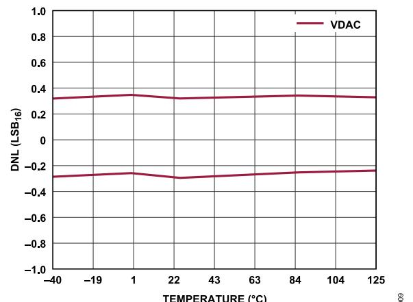

Figure 11: DNL Error vs. Temperature. This line graph plots DNL error in LSB16 against temperature from -40 to 125 °C. One data series is shown: VDAC (red). The error remains relatively constant and small across the temperature range.

Figure 11. DNL Error vs. Temperature

{13}------------------------------------------------

## TYPICAL PERFORMANCE CHARACTERISTICS


Figure 12: INL Error vs. Supply Voltage. A line graph showing INL (LSB16) on the y-axis ranging from -32.0 to 32.0, and PVDD SUPPLY VOLTAGE (V) on the x-axis ranging from 1.7 to 5.5. Two data series are shown: VDAC (blue line) and IDAC (red line). VDAC is relatively flat near 0. IDAC shows a slight positive slope from approximately -12.8 at 1.7V to -6.4 at 5.5V. A small oval highlights the IDAC line at the lower voltage end.

Figure 12. INL Error vs. Supply Voltage


Figure 15: Gain Error vs. Supply Voltage. A line graph showing VDAC GAIN ERROR (% OF FSR) on the y-axis ranging from -0.3 to 0.3, and PVDD SUPPLY VOLTAGE (V) on the x-axis ranging from 2.5 to 5.5. A single data series for VDAC (black line) is shown, which is nearly horizontal at approximately -0.08%.

Figure 15. Gain Error vs. Supply Voltage


Figure 13: DNL Error vs. Supply Voltage. A line graph showing DNL (LSB16) on the y-axis ranging from -1.0 to 1.0, and PVDD SUPPLY VOLTAGE (V) on the x-axis ranging from 2.5 to 5.5. Two data series are shown: VDAC (blue line) and IDAC (red line). VDAC is relatively flat near 0. IDAC shows a slight positive slope from approximately -0.4 at 2.5V to -0.2 at 5.5V.

Figure 13. DNL Error vs. Supply Voltage


Figure 16: Offset Error vs. Temperature. A line graph with two y-axes. The left y-axis is VDAC OFFSET ERROR (mV) from -5 to 5. The right y-axis is IDAC OFFSET ERROR (μA) from 15 to 145. The x-axis is TEMPERATURE (°C) from -45 to 125. Two data series are shown: VDAC (blue line) and IDAC (red line). VDAC offset error is approximately 1 mV. IDAC offset error is approximately 41 μA.

Figure 16. Offset Error vs. Temperature


Figure 14: Gain Error vs. Temperature. A line graph showing VDAC GAIN ERROR (% OF FSR) on the y-axis ranging from -0.3 to 0.3, and TEMPERATURE (°C) on the x-axis ranging from -45 to 125. A single data series for VDAC (black line) is shown, which is nearly horizontal at approximately -0.08%.

Figure 14. Gain Error vs. Temperature


Figure 17: Offset Error vs. Supply Voltage. A line graph with two y-axes. The left y-axis is VDAC OFFSET ERROR (mV) from -5 to 5. The right y-axis is IDAC OFFSET ERROR (μA) from 15 to 145. The x-axis is PVDD SUPPLY VOLTAGE (V) from 1.5 to 5.5. Two data series are shown: VDAC (blue line) and IDAC (red line). VDAC offset error is approximately 1 mV. IDAC offset error is approximately 41 μA.

Figure 17. Offset Error vs. Supply Voltage

{14}------------------------------------------------

## TYPICAL PERFORMANCE CHARACTERISTICS

![Figure 18: Dropout Across Different PVDD Supply Ranges. A line graph showing IDAC output current (mA) on the y-axis (0 to 60) versus dropout voltage PVDDX - VOUTX (mV) on the x-axis (0 to 300). Three curves are shown for different PVDD supply voltages: 1.71V (red), 3.3V (blue), and 5.5V (green). All curves show a linear increase in current with dropout voltage until they reach a plateau at approximately 55 mA. The 5.5V curve reaches the plateau at the lowest dropout voltage, followed by 3.3V and then 1.71V.](img/0a8d173734e4e46c344178e8d21bcbc3_img.jpg)

Figure 18: Dropout Across Different PVDD Supply Ranges. A line graph showing IDAC output current (mA) on the y-axis (0 to 60) versus dropout voltage PVDDX - VOUTX (mV) on the x-axis (0 to 300). Three curves are shown for different PVDD supply voltages: 1.71V (red), 3.3V (blue), and 5.5V (green). All curves show a linear increase in current with dropout voltage until they reach a plateau at approximately 55 mA. The 5.5V curve reaches the plateau at the lowest dropout voltage, followed by 3.3V and then 1.71V.

Figure 18. Dropout Across Different PVDD Supply Ranges


Figure 21: IDDD vs. Temperature. A line graph showing current (mA) on the y-axis (0 to 5) versus temperature (°C) on the x-axis (-40 to 125). It displays current consumption for different operating modes: IDAC mode (AVDD and PVDD) and VDAC mode (AVDD and PVDD). In IDAC mode, current is relatively constant around 3-4.5 mA. In VDAC mode, current is lower, around 1-1.5 mA. The graph also shows curves for internal and external VREF.

Figure 21. IDDD vs. Temperature


Figure 19: VDAC Source and Sink Capability at RANGE = VREF. A line graph showing output voltage (V) on the y-axis (-1 to 6) versus output current (mA) on the x-axis (-25 to 65). It plots three curves: MS, RANGE = VREF (red), ZS + 100, RANGE = VREF (blue), and FS - 100, RANGE = VREF (green). The curves show the voltage range over which the VDAC can source or sink current while maintaining the VREF range setting.

Figure 19. VDAC Source and Sink Capability at RANGE = VREF


Figure 22: IDDD vs. Supply Voltage. A line graph showing current (mA) on the y-axis (0 to 5) versus supply voltage (V) on the x-axis (1.7 to 5.5). It shows current consumption for IDAC and VDAC modes across different supply voltages. Current consumption generally increases slightly with supply voltage, with IDAC mode consuming more than VDAC mode.

Figure 22. IDDD vs. Supply Voltage


Figure 20: VDAC Source and Sink Capability at RANGE = 2 x VREF. A line graph showing output voltage (V) on the y-axis (-1 to 6) versus output current (mA) on the x-axis (-25 to 65). It plots three curves: MS, RANGE = 2 x VREF (yellow), ZS + 100, RANGE = 2 x VREF (black), and FS - 100, RANGE = 2 x VREF (purple). The curves show the voltage range over which the VDAC can source or sink current while maintaining the 2 x VREF range setting.

Figure 20. VDAC Source and Sink Capability at RANGE = 2 x VREF


Figure 23: VDAC Output Settling Time. A line graph showing VDAC output voltage (V) on the y-axis (0 to 2.0) versus time (μs) on the x-axis (-3 to 6). It shows the settling time for eight different output channels (OUT0 to OUT7) when the output is changed from 1/4 to 3/4 scale. All channels show a very similar, fast settling response, reaching the target voltage within approximately 2.5 μs.

Figure 23. VDAC Output Settling Time

{15}------------------------------------------------

## TYPICAL PERFORMANCE CHARACTERISTICS


Figure 24: IDAC Output Settling Time. A line graph showing IDAC output current (mA) on the y-axis (0 to 50) versus time (μs) on the x-axis (-3 to 6). The graph shows seven curves (OUT0 to OUT7) that are constant at approximately 13 mA until t=0, then rise sharply to approximately 40 mA by t=2 μs and remain stable. Text in the graph: OUT = 1/4 TO 3/4 SCALE, R\_LOAD = 50Ω.

Figure 24. IDAC Output Settling Time


Figure 27: Digital-to-Analog Glitch Impulse Ascending. A dual-axis graph showing VDAC amplitude (mV) on the left y-axis (-10 to 10) and IDAC amplitude (μA) on the right y-axis (-100 to 100) versus time (μs) on the x-axis (-5 to 5). It shows a positive impulse at t=0. Text in graph: AD5710R, AD5711R, AC COUPLED.

Figure 27. Digital-to-Analog Glitch Impulse Ascending


Figure 25: VDAC Output Settling Time at Various Capacitive Loads. A line graph showing VDAC output voltage (V) on the y-axis (0 to 2.50) versus time (μs) on the x-axis (15 to 35). Multiple curves represent different capacitive loads (0.2nF to 47nF). All curves rise from ~0.65V to ~1.85V starting at t=20 μs. Text in graph: AVDD = PVDD = 3.3V, R\_L = 2kΩ.

Figure 25. VDAC Output Settling Time at Various Capacitive Loads


Figure 28: Digital-to-Analog Glitch Impulse Descending. A dual-axis graph showing VDAC amplitude (mV) on the left y-axis (-2 to 10) and IDAC amplitude (μA) on the right y-axis (-30 to 150) versus time (μs) on the x-axis (-5 to 5). It shows a negative impulse at t=0. Text in graph: AD5710R, AD5711R, AC COUPLED.

Figure 28. Digital-to-Analog Glitch Impulse Descending


Figure 26: IDAC and VDAC Channel Exiting Power-Down to Midscale. A dual-axis graph showing IDAC output current (mA) on the left y-axis (0 to 35) and output voltage (V) on the right y-axis (0 to 5) versus time (μs) on the x-axis (-1 to 10). It shows a transition from power-down to midscale. Text in graph: OUT = 0.5 x FS, IDAC R\_LOAD = 50Ω, VDAC R\_LOAD = 2kΩ, C\_LOAD = 200pF.

Figure 26. IDAC and VDAC Channel Exiting Power-Down to Midscale


Figure 29: IDAC and VDAC Digital Feedthrough, OUT1 and OUT2. A dual-axis graph showing IDAC output current (μA) on the left y-axis (-10 to 10) and VDAC output voltage (μV) on the right y-axis (-200 to 200) versus time (μs) on the x-axis (-34 to 5). It shows high-frequency noise. Text in graph: OUTPUT = 0.5 x FS, ATTACKER CHANNELS = ZS TO FS.

Figure 29. IDAC and VDAC Digital Feedthrough, OUT1 and OUT2

{16}------------------------------------------------

## TYPICAL PERFORMANCE CHARACTERISTICS

![Figure 30: IDAC and VDAC Digital Feedthrough, OUT0 and OUT4. This line graph plots IDAC output current (µA) and VDAC output voltage (mV) against time (µs). The x-axis ranges from -34 to 5 µs. The left y-axis for IDAC ranges from -400 to 400 µA, and the right y-axis for VDAC ranges from -5 to 5 mV. The plot shows a steady-state oscillation for VOUT0 (red) and IOUT0 (yellow) around 0, while VOUT4 (cyan) and IOUT4 (green) show a high-frequency oscillation between approximately -100 and 100 µA and -1 and 1 mV. Text in the plot area specifies: 'OUTPUT = 0.5 x FS', 'ATTACKERS CHANNELS = FS'.](img/fed39b841ae2dce01088b84bfc1e2789_img.jpg)

Figure 30: IDAC and VDAC Digital Feedthrough, OUT0 and OUT4. This line graph plots IDAC output current (µA) and VDAC output voltage (mV) against time (µs). The x-axis ranges from -34 to 5 µs. The left y-axis for IDAC ranges from -400 to 400 µA, and the right y-axis for VDAC ranges from -5 to 5 mV. The plot shows a steady-state oscillation for VOUT0 (red) and IOUT0 (yellow) around 0, while VOUT4 (cyan) and IOUT4 (green) show a high-frequency oscillation between approximately -100 and 100 µA and -1 and 1 mV. Text in the plot area specifies: 'OUTPUT = 0.5 x FS', 'ATTACKERS CHANNELS = FS'.

Figure 30. IDAC and VDAC Digital Feedthrough, OUT0 and OUT4

![Figure 33: VDAC Analog Crosstalk, OUT0. This line graph plots VDAC output voltage (mV) against time (µs). The x-axis ranges from -1 to 7 µs. The y-axis ranges from -15 to 15 mV. It shows the response of VOUT0 (red) and IOUT0 (yellow) to changes in attacker channels VOUT1 (cyan), VOUT2 (green), IOUT1 (dark blue), and IOUT2 (orange). VOUT0 remains near 0, while IOUT0 shows a significant negative excursion reaching about -11 mV between 3 and 4 µs. Text in the plot area specifies: 'VOUT0 (VICTIM) = 0.5 x FS', 'ATTACKER CHANNELS = ZS TO FS'.](img/a706c91f074ac2840c161a3d4a7c0f91_img.jpg)

Figure 33: VDAC Analog Crosstalk, OUT0. This line graph plots VDAC output voltage (mV) against time (µs). The x-axis ranges from -1 to 7 µs. The y-axis ranges from -15 to 15 mV. It shows the response of VOUT0 (red) and IOUT0 (yellow) to changes in attacker channels VOUT1 (cyan), VOUT2 (green), IOUT1 (dark blue), and IOUT2 (orange). VOUT0 remains near 0, while IOUT0 shows a significant negative excursion reaching about -11 mV between 3 and 4 µs. Text in the plot area specifies: 'VOUT0 (VICTIM) = 0.5 x FS', 'ATTACKER CHANNELS = ZS TO FS'.

Figure 33. VDAC Analog Crosstalk, OUT0

![Figure 31: IDAC and VDAC Digital Crosstalk, OUT0. This line graph plots IDAC output current (µA) and VDAC output voltage (mV) against time (µs). The x-axis ranges from -0.5 to 4.0 µs. The left y-axis for IDAC ranges from -200 to 200 µA, and the right y-axis for VDAC ranges from -5 to 5 mV. It shows the response of VOUT0 (red) and IOUT0 (yellow) to changes in attacker channel VOUT1 (cyan). VOUT0 shows a negative excursion to about -40 µA, while IOUT0 shows a large negative excursion to about -120 µA. Text in the plot area specifies: 'OUT0 (VICTIM) = 0.5 x FS', 'ATTACKERS CHANNELS = ZS TO FS'.](img/250cf77a1cd51989da09fca796b3e4ea_img.jpg)

Figure 31: IDAC and VDAC Digital Crosstalk, OUT0. This line graph plots IDAC output current (µA) and VDAC output voltage (mV) against time (µs). The x-axis ranges from -0.5 to 4.0 µs. The left y-axis for IDAC ranges from -200 to 200 µA, and the right y-axis for VDAC ranges from -5 to 5 mV. It shows the response of VOUT0 (red) and IOUT0 (yellow) to changes in attacker channel VOUT1 (cyan). VOUT0 shows a negative excursion to about -40 µA, while IOUT0 shows a large negative excursion to about -120 µA. Text in the plot area specifies: 'OUT0 (VICTIM) = 0.5 x FS', 'ATTACKERS CHANNELS = ZS TO FS'.

Figure 31. IDAC and VDAC Digital Crosstalk, OUT0


Figure 34: IDAC Analog Crosstalk, OUT0. This line graph plots IDAC output current (µA) against time (µs). The x-axis ranges from -1 to 10 µs. The y-axis ranges from -100 to 100 µA. It shows the response of IOUT0 (yellow) to changes in attacker channels VOUT1 (cyan), VOUT2 (green), IOUT1 (dark blue), and IOUT2 (orange). IOUT0 shows small oscillations around 0 µA. Text in the plot area specifies: 'IOUT0 (VICTIM) = 0.5 x FS', 'ATTACKER CHANNELS = ZS TO FS'.

Figure 34. IDAC Analog Crosstalk, OUT0

![Figure 32: IDAC and VDAC Digital Crosstalk, OUT4. This line graph plots IDAC output current (mA) and VDAC output voltage (mV) against time (µs). The x-axis ranges from -0.5 to 4.0 µs. The left y-axis for IDAC ranges from -200 to 200 mA, and the right y-axis for VDAC ranges from -8 to 8 mV. It shows the response of VOUT0 (red) and IOUT0 (yellow) to changes in attacker channel IOUT4 (green). VOUT0 shows a positive excursion to about 40 mA, while IOUT0 shows a large positive excursion to about 100 mA. Text in the plot area specifies: 'OUT4 (VICTIM) = 0.5 x FS', 'ATTACKER CHANNELS = ZS TO FS'.](img/a3ee9a6f9fa9251ee0cac2d16e67e620_img.jpg)

Figure 32: IDAC and VDAC Digital Crosstalk, OUT4. This line graph plots IDAC output current (mA) and VDAC output voltage (mV) against time (µs). The x-axis ranges from -0.5 to 4.0 µs. The left y-axis for IDAC ranges from -200 to 200 mA, and the right y-axis for VDAC ranges from -8 to 8 mV. It shows the response of VOUT0 (red) and IOUT0 (yellow) to changes in attacker channel IOUT4 (green). VOUT0 shows a positive excursion to about 40 mA, while IOUT0 shows a large positive excursion to about 100 mA. Text in the plot area specifies: 'OUT4 (VICTIM) = 0.5 x FS', 'ATTACKER CHANNELS = ZS TO FS'.

Figure 32. IDAC and VDAC Digital Crosstalk, OUT4

![Figure 35: VDAC Analog Crosstalk, OUT5. This line graph plots VDAC output voltage (mV) against time (µs). The x-axis ranges from 0 to 10 µs. The y-axis ranges from -30 to 30 mV. It shows the response of VOUT5 (red) and IOUT5 (yellow) to changes in attacker channels VOUT4 (cyan), VOUT6 (green), VOUT7 (dark blue), IOUT4 (orange), IOUT6 (black), and IOUT7 (purple). VOUT5 remains near 0, while IOUT5 shows a significant negative excursion reaching about -18 mV between 4 and 5 µs. Text in the plot area specifies: 'VOUT5 (VICTIM) = 0.5 x FS', 'ATTACKER CHANNELS = ZS TO FS'.](img/163e5be3ffce95041586d5e1685cefad_img.jpg)

Figure 35: VDAC Analog Crosstalk, OUT5. This line graph plots VDAC output voltage (mV) against time (µs). The x-axis ranges from 0 to 10 µs. The y-axis ranges from -30 to 30 mV. It shows the response of VOUT5 (red) and IOUT5 (yellow) to changes in attacker channels VOUT4 (cyan), VOUT6 (green), VOUT7 (dark blue), IOUT4 (orange), IOUT6 (black), and IOUT7 (purple). VOUT5 remains near 0, while IOUT5 shows a significant negative excursion reaching about -18 mV between 4 and 5 µs. Text in the plot area specifies: 'VOUT5 (VICTIM) = 0.5 x FS', 'ATTACKER CHANNELS = ZS TO FS'.

Figure 35. VDAC Analog Crosstalk, OUT5

{17}------------------------------------------------

## TYPICAL PERFORMANCE CHARACTERISTICS


Figure 36: IDAC Analog Crosstalk, OUT5. A line graph showing IDAC output current in microamperes (µA) over time in microseconds (µs). The y-axis ranges from -400 to 400 µA, and the x-axis ranges from -1 to 11 µs. The victim channel is IOUT5 at 0.5 FS. Attacker channels are ZS to FS, specifically VOUT4, VOUT6, IOUT4, and IOUT6. The graph shows significant crosstalk spikes from the attacker channels, particularly IOUT4 and IOUT6, reaching up to 160 µA and down to -160 µA around 6-7 µs.

Figure 36. IDAC Analog Crosstalk, OUT5


Figure 39: VDAC DAC-to-DAC Crosstalk, OUT5. A line graph showing VDAC output voltage in millivolts (mV) over time in microseconds (µs). The y-axis ranges from -15 to 15 mV, and the x-axis ranges from -0.5 to 6.5 µs. The victim channel is VOUT5 at 0.5 FS. Attacker channels are ZS to FS, specifically VOUT4, IOUT4, IOUT6, and IOUT7. The graph shows crosstalk voltage spikes from the attacker channels, with peaks around 3 mV and troughs around -8 mV between 0.5 and 3.5 µs.

Figure 39. VDAC DAC-to-DAC Crosstalk, OUT5


Figure 37: VDAC DAC-to-DAC Crosstalk, OUT0. A line graph showing VDAC output voltage in millivolts (mV) over time in microseconds (µs). The y-axis ranges from -15 to 15 mV, and the x-axis ranges from -0.5 to 5.5 µs. The victim channel is VOUT0 at 0.5 FS. Attacker channels are ZS to FS, specifically VOUT1 and IOUT1. The graph shows a negative voltage sag from the attacker channels, reaching approximately -6 mV between 0.6 and 2.2 µs.

Figure 37. VDAC DAC-to-DAC Crosstalk, OUT0


Figure 40: IDAC DAC-to-DAC Crosstalk, OUT4. A line graph showing IDAC output current in microamperes (µA) over time in microseconds (µs). The y-axis ranges from -400 to 400 µA, and the x-axis ranges from -0.5 to 1.5 µs. The victim channel is IOUT4 at 0.5 FS. Attacker channels are ZS to FS, specifically VOUT0 and IOUT0. The graph shows a positive current spike from the attacker channels, reaching approximately 80 µA around 0.1 µs.

Figure 40. IDAC DAC-to-DAC Crosstalk, OUT4


Figure 38: IDAC DAC-to-DAC Crosstalk, OUT0. A line graph showing IDAC output current in microamperes (µA) over time in microseconds (µs). The y-axis ranges from -200 to 200 µA, and the x-axis ranges from -0.5 to 4.0 µs. The victim channel is IOUT0 at 0.5 FS. Attacker channels are ZS to FS, specifically IOUT1 and VOUT1. The graph shows a negative current spike from the attacker channels, reaching approximately -100 µA around 0.1 µs.

Figure 38. IDAC DAC-to-DAC Crosstalk, OUT0


Figure 41: VDAC 0.1Hz to 10Hz (1/f) Noise. A line graph showing output voltage in microvolts (µV) over time in seconds (s). The y-axis ranges from -30 to 30 µV, and the x-axis ranges from 0 to 30 s. The graph shows high-frequency noise on the output voltage. Test conditions: AVDD = PVDD = 5.5V, VOUT0 = MIDSCALE, RLOAD = 2kΩ, CLOAD = 200pF. Two traces are shown: VOUT0, RANGE = VREF (red) and VOUT0, RANGE = 2 x VREF (blue).

Figure 41. VDAC 0.1Hz to 10Hz (1/f) Noise

{18}------------------------------------------------

## TYPICAL PERFORMANCE CHARACTERISTICS


Figure 42: IDAC 0.1Hz to 10Hz (1/f) Noise. A line graph showing IDAC output current noise in nA over a 30-second period. The y-axis ranges from -50 to 50 nA, and the x-axis ranges from 0 to 30 seconds. The plot shows a noisy signal centered around 0 nA. Test conditions: AVDD = PVDD = 5.5V, IOUT0 = 0.5 x FS.

Figure 42. IDAC 0.1Hz to 10Hz (1/f) Noise


Figure 45: Internal Reference NSD. A log-log plot of VREF output noise spectral density in nV/√Hz versus frequency in Hz. The y-axis ranges from 0 to 700 nV/√Hz, and the x-axis ranges from 10 Hz to 10 MHz. The noise decreases with frequency, leveling off around 100 Hz. Test conditions: AVDD = PVDD = 3.3V, RANGE = VREF, NO CAP LOAD.

Figure 45. Internal Reference NSD


Figure 43: VDAC and IDAC Noise Spectral Density (NSD). A log-log plot showing the noise spectral density for VDAC and IDAC outputs in nV/√Hz and nA/√Hz versus frequency in Hz. The left y-axis is VDAC output NSD (0 to 400 nV/√Hz), the right y-axis is IDAC output NSD (0 to 30 nA/√Hz), and the x-axis is frequency (10 Hz to 10 MHz). Both signals decrease with frequency. Test conditions: AVDD = PVDD = 3.3V, OUT0 = 0.5 x FS, NO REFERENCE CAP LOAD.

Figure 43. VDAC and IDAC Noise Spectral Density (NSD)


Figure 46: Hardware Reset. A plot showing the transition of VOUT0, RESET, and IOUT0 during a hardware reset. The left y-axis is VOLTAGE (V) from -1.0 to 4.0, and the right y-axis is IDAC OUTPUT CURRENT (mA) from -10 to 40. The x-axis is TIME (μs) from -5.0 to 20.0. Test condition: OUT0 = 0.5 x FS.

Figure 46. Hardware Reset


Figure 44: MUX\_OUT NSD. A log-log plot of MUX\_OUT noise spectral density in nV/√Hz versus frequency in Hz. The y-axis ranges from 0 to 1000 nV/√Hz, and the x-axis ranges from 10 Hz to 10 MHz. The noise decreases with frequency. Test conditions: AVDD = PVDD = 3.3V, VOUT0 = 0.5 x FS, NO REFERENCE CAP LOAD.

Figure 44. MUX\_OUT NSD


Figure 47: VREF vs. Temperature for 23 Devices. A plot showing the deviation from typical VREF in mV versus temperature in °C for 23 individual devices. The y-axis ranges from -7.5 to 7.5 mV, and the x-axis ranges from -40 to 125 °C. Most devices show a slight positive or negative drift with temperature.

Figure 47. VREF vs. Temperature for 23 Devices

{19}------------------------------------------------

## TYPICAL PERFORMANCE CHARACTERISTICS


Figure 48: VREF vs. Load Current. A line graph showing VREF (V) on the y-axis (2.4925 to 2.5075) versus LOAD CURRENT (mA) on the x-axis (-6 to 0). Three curves are shown for different AVDD values: 2.7V (red), 3.3V (blue), and 5.5V (green). All curves are nearly horizontal, indicating high stability of VREF across the load current range. The legend also notes 'RANGE = VREF'.

Figure 48. VREF vs. Load Current


Figure 51: MUX\_OUT Error vs. Output Current. A line graph showing MUX\_OUT VOLTAGE ERROR (mV) on the y-axis (-10 to 10) versus VDAC OUTPUT CURRENT (mA) on the x-axis (-10 to 50). The graph shows a single curve for AVDD = PVDD = 5.5V, RANGE = VREF, and VOUT = 0.5 x FS. The error is near zero across the entire current range.

Figure 51. MUX\_OUT Error vs. Output Current


Figure 49: VREF vs. AVDD. A line graph showing VREF (V) on the y-axis (2.4925 to 2.5075) versus AVDD (V) on the x-axis (2.7 to 5.5). Three curves are shown for different PVDD values: 1.71V (red), 5.5V (green), and 2.7V (blue). The curves are nearly horizontal, showing that VREF is stable over the AVDD range.

Figure 49. VREF vs. AVDD


Figure 52: MUX\_OUT to VOUTx Glitch. A graph showing VDAC OUTPUT VOLTAGE, AC COUPLED (mV) and VOLTAGE (V) on the y-axis (-2.0 to 3.0) versus TIME (μs) on the x-axis (-5 to 25). It illustrates a glitch event when the MUX\_OUT channel changes from POWERDOWN to VOLTAGE MONITOR CH0. The graph includes traces for CS (yellow), VOUT0 (VICTIM) = FS (red), and various monitor channels.

Figure 52. MUX\_OUT to VOUTx Glitch


Figure 50: MUX\_OUT vs. Output Voltage Transient, Rising. A graph showing OUTPUT VOLTAGE (V) on the y-axis (0 to 2.5) versus TIME (μs) on the x-axis (-5 to 9). It shows the rising transient response of VOUT0 (red) and VMON0 (blue) when the output voltage is changed from 0x4000 to 0xC000. AVDD and PVDD are both 5V.

Figure 50. MUX\_OUT vs. Output Voltage Transient, Rising


Figure 53: AVDD AC PSRR vs. Frequency. A log-log plot showing AC PSRR (dB) on the y-axis (-120 to -10) versus FREQUENCY (Hz) on the x-axis (10 to 1M). Three curves are shown: VOUT, RANGE = VREF (red), VOUT, RANGE = 2 x VREF (blue), and IOUT (black). The PSRR is approximately -80 dB at 10 Hz and degrades to about -20 dB at 1 MHz. Test conditions: AVDD = 5V ± 100mV, PVDD = 4.5V, OUT = 0.5 x FS, VOUT RLOAD = 2kΩ, IOUT RLOAD = 50Ω.

Figure 53. AVDD AC PSRR vs. Frequency

{20}------------------------------------------------

## TYPICAL PERFORMANCE CHARACTERISTICS


AC PSRR (dB)

AVDD = 5.5V  
PVDD = 5V ± 100mV  
OUT = 0.5 × FS  
VOUT R<sub>LOAD</sub> = 2kΩ  
IOUT R<sub>LOAD</sub> = 50Ω

— VOUT, RANGE = VREF  
— VOUT, RANGE = 2 × VREF  
— IOUT

FREQUENCY (Hz)

| Frequency (Hz) | VOUT, RANGE = VREF (dB) | VOUT, RANGE = 2 × VREF (dB) | IOUT (dB) |
|----------------|-------------------------|-----------------------------|-----------|
| 10             | -90                     | -90                         | -90       |
| 100            | -80                     | -85                         | -95       |
| 1k             | -60                     | -70                         | -90       |
| 10k            | -40                     | -55                         | -70       |
| 100k           | -20                     | -45                         | -50       |
| 1M             | -10                     | -30                         | -25       |

Graph of AC PSRR (dB) vs. Frequency (Hz) for PVDD. The graph shows three curves: VOUT, RANGE = VREF (red), VOUT, RANGE = 2 x VREF (black), and IOUT (teal). Test conditions: AVDD = 5.5V, PVDD = 5V ± 100mV, OUT = 0.5 x FS, VOUT RLOAD = 2kΩ, IOUT RLOAD = 50Ω. The x-axis is logarithmic from 10 Hz to 1 MHz. The y-axis is linear from -120 dB to -10 dB.

Figure 54. PVDD AC PSRR vs. Frequency

{21}------------------------------------------------

## TERMINOLOGY

### Relative Accuracy or Integral Nonlinearity (INL)

For the DAC, relative accuracy or integral nonlinearity is a measurement of the maximum deviation, in LSBs, from a straight line passing through the endpoints of the DAC transfer function.

### Differential Nonlinearity (DNL)

Differential nonlinearity is the difference between the measured change and the ideal 1 LSB change between any two adjacent codes.

### Offset Error

Offset error is a measure of the difference between the actual output  $V_{OUT}$  or  $I_{OUT}$  and the ideal output  $V_{OUT}$  or  $I_{OUT}$  expressed in mV or  $\mu A$  in the linear region of the transfer function. It can be negative or positive.

### Offset Error Drift

Offset error drift is a measurement of the change in offset error with a change in temperature. For a IDAC output, the offset error drift is expressed in  $\mu A/^\circ C$  and for VDAC output is expressed as  $\mu V/^\circ C$ .

### Gain Error

Gain error is a measure of the span error of the DAC. It is the deviation in slope of the DAC transfer characteristic from the ideal expressed as % of FSR.

### Gain Error Drift

Gain error drift is a measurement of the change in gain error with a change in temperature. The gain error drift is expressed in ppm/ $^\circ C$ .

### Zero-Code Error

Zero-code error measures the deviation from the ideal value at zero scale, at  $25^\circ C$ . The error is expressed in mV for the  $V_{OUT}$  channel.

### DC PSRR and AC PSRR

DC PSRR quantifies how variations in the power supply affect the DAC output. It is defined as the ratio of the change in output voltage ( $V_{OUT}$ ) or output current ( $I_{OUT}$ ) to the change in supply voltage, measured at the DAC's midscale output. For  $V_{OUTX}$ , DC PSRR is expressed in mV/V and for  $I_{OUTX}$  it is expressed in  $\mu A/V$ , with  $PVDDx$  varied independently by  $\pm 10\%$ . The AC PSRR is measured in dB by injecting a  $\pm 100mV$  peak-to-peak AC sweep signal onto  $PVDDx$ .

### Output Settling Time

Output voltage settling time is the amount of time it takes for the output of a DAC to settle to a specified level for a given step change.

### Digital-to-Analog Glitch Impulse

Digital-to-analog glitch impulse is the impulse injected into the analog output when the input code in the DAC register changes

state. For VDAC, the glitch is normally specified as the area in nV·s and is measured when the digital input code changes by 1 LSB. For IDAC, it is specified as the area in nA·s under the same condition.

### Output Noise Spectral Density

Noise spectral density is a measurement of the internally generated random noise. Noise is measured at the DAC output when it is loaded with the midscale code. For VDAC is measured in  $nV/\sqrt{Hz}$  and for IDAC is measured in  $nA/\sqrt{Hz}$ .

### Total Unadjusted Error (TUE)

Total unadjusted error (TUE) is a measure of the total output error versus the ideal. The ideal output is based on an exact 5.000V reference. TUE consists of all the various error sources, namely INL error, offset error, and gain error and it is guaranteed over the temperature and supply range.

### Voltage Reference Temperature Coefficient (TC)

Voltage reference TC is a measure of the change in the reference output voltage with a change in temperature. The reference TC is calculated using the box method, which defines the TC as the maximum change in the reference output over a given temperature range expressed in ppm/ $^\circ C$ , as shown in the following equation:

$$TC = \left( \frac{V_{REF\_MAX} - V_{REF\_MIN}}{V_{REF\_NOM} \times TEMP\_RANGE} \right) \times 10^6 \quad (1)$$

- ▶ where:
- ▶  $V_{REF\_MAX}$  is the maximum reference output measured over the total temperature range.
- ▶  $V_{REF\_MIN}$  is the minimum reference output measured over the total temperature range.
- ▶  $V_{REF\_NOM}$  is the nominal reference output voltage, 2.5V.
- ▶  $TEMP\_RANGE$  is the specified temperature range,  $-40^\circ C$  to  $+125^\circ C$ .

### DC Crosstalk

DC crosstalk is the DC change in the output level of one DAC in response to a change in the output of another DAC. It is measured with a full-scale output change on one DAC while monitoring another DAC kept at midscale. It is expressed in  $\mu V$  for VDAC and  $\mu A$  for IDAC.

### Digital Feedthrough

Digital feedthrough is a measure of the impulse injected into the analog output of the DAC from the digital inputs of the DAC, but it is measured when the DAC output is not updated. For the IDAC, digital feedthrough is specified as the peak output glitch current in  $\mu A$ , measured during a full-scale code change on the data bus, which means from all 0s to all 1s and from all 1s to all 0s. For the VDAC, digital feedthrough is specified as the peak output glitch voltage in  $\mu V$ .

{22}------------------------------------------------

## TERMINOLOGY

## DIGITAL CROSSTALK

Digital crosstalk is the energy of the glitch impulse transferred to the output of one DAC at midscale in response to a full-scale code change (from all 0s to all 1s and vice versa) in the input register of another DAC. For a current-output DAC, digital crosstalk is specified as the current peak current of the output glitch in  $\mu\text{A}$ . For a voltage-output DAC, it is specified as the peak voltage of the output glitch in  $\mu\text{V}$ . Both are measured on one DAC channel at a time.

### DAC-TO-DAC CROSSTALK

DAC-to-DAC crosstalk refers to the energy of the glitch impulse that is transferred to the output of one DAC when a digital code change is loaded into the DAC register of another channel, resulting in a corresponding analog output change. For a current-output DAC, this crosstalk is measured as the peak of the current output glitch in  $\mu\text{A}$ . For a voltage-output DAC, it is measured as the peak of the voltage output glitch in  $\mu\text{V}$ . Both measurements are taken during a full-scale change on one DAC output, by writing directly to the DAC register while monitoring the other DAC output, which is held at midscale.

### ANALOG CROSSTALK

Analog crosstalk refers to the glitch impulse transferred to the output of one DAC when a digital code change is loaded into the input register of another channel and its output is updated via an LDAC transition. It is measured by applying a full-scale code change (from all 0s to all 1s and vice versa) to the input register of the active channel, performing an LDAC update, and monitoring the output of the channel whose code remains unchanged. It is expressed as the peak current in  $\mu\text{A}$  for a current-output DAC and as the peak voltage in  $\mu\text{V}$  for a voltage-output DAC.

{23}------------------------------------------------

# THEORY OF OPERATION

### DIGITAL-TO-ANALOG CONVERTER

The AD5711R/AD5710R are low power, 8-channel, 12-/16-bit DAC channels that operate on analog supply voltages of 2.7V to 5.5V for AVDD, 1.71V to AVDD for PVDD0/1 and interface logic supply IOVDD of 1.08V to 1.98V. Each channel can be configured as VDAC or IDAC. A group of four DAC channels, OUT[3:0], is powered by PVDD0 and another group of four DAC channels, OUT[7:4], is powered by PVDD1.

The device has a 3ppm/°C, 2.5V on-chip reference and incorporates various functions such as load DAC, device reset, output monitoring, and die temperature monitoring. A simplified block diagram of a DAC channel is shown in Figure 55.

The AD5711R/AD5710R offer a versatile 4-wire serial interface compatible with classic SPI. See the Digital Interface section for more details.

![Figure 55. DAC Channel Block Diagram. The diagram shows a block diagram of a DAC channel. It starts with an 'INPUT REGISTER' connected to a 'DAC REGISTER'. The 'DAC REGISTER' is controlled by 'REFERENCE_CONTROL_0[SEL]' and 'CHN_VMODE_EN[VMODE_EN_CHx]'. The 'DAC REGISTER' feeds into a 'DAC CORE', which also receives 'REFERENCE_CONTROL_0[SEL]'. The 'DAC CORE' output goes to an 'AMP' (amplifier). The 'AMP' is controlled by 'OUTPUT_OPERATING_MODE_x[MODE_CHx]' and 'OUTPUT_CONTROL_0[RANGE]'. The 'AMP' output is the final output, labeled 'VOUTn/IOUTn'.](img/5132b3a97ac70fe4765c1e07e66b72b3_img.jpg)

Figure 55. DAC Channel Block Diagram. The diagram shows a block diagram of a DAC channel. It starts with an 'INPUT REGISTER' connected to a 'DAC REGISTER'. The 'DAC REGISTER' is controlled by 'REFERENCE\_CONTROL\_0[SEL]' and 'CHN\_VMODE\_EN[VMODE\_EN\_CHx]'. The 'DAC REGISTER' feeds into a 'DAC CORE', which also receives 'REFERENCE\_CONTROL\_0[SEL]'. The 'DAC CORE' output goes to an 'AMP' (amplifier). The 'AMP' is controlled by 'OUTPUT\_OPERATING\_MODE\_x[MODE\_CHx]' and 'OUTPUT\_CONTROL\_0[RANGE]'. The 'AMP' output is the final output, labeled 'VOUTn/IOUTn'.

Figure 55. DAC Channel Block Diagram

### IDAC Channels

The AD5711R/AD5710R integrate eight 12-/16-bit current-output DAC (IDAC) channels. Each channel is configured as an IDAC by default and is capable of sourcing currents up to 50mA.

The input coding to the DAC is straight binary. The conversion of the digital input code to the ideal output voltage is given by the following equation:

$$I_{OUTn} = \left( \frac{D}{2^N} \right) \times 50 \text{ mA} \quad (2)$$

where:

$I_{OUTn}$  is the output current sourced through the load at the selected DAC channel n.

$D$  is the decimal equivalent of the straight binary code that is loaded into the DAC register.

$N$  is the DAC resolution in bits.

By default, the output of any channel is configured as IDAC in high-Z mode and the output stage of each channel is powered down. Alternatively, each channel can be configured as IDAC output by setting the corresponding CHx\_VMODE\_EN bit to 0. The output of each channel can be enabled by writing 2'b00 to MODE\_CH\_x bits corresponding to each channel.

### VDAC Channels

The device contains eight buffered VDAC channels capable of sourcing 50mA and sinking 10mA current independently. VDAC channels have a shared gain bit OUTPUT\_CONTROL\_0, that sets the output range to 0V to VREF or 0V to 2 × VREF. Consequently, it is not possible to set different output ranges on a per channel basis.

The input coding to the DAC is straight binary. The conversion of the digital input code to the ideal output voltage is given by the following equation:

$$V_{OUTn} = V_{REF} \times \left( \frac{D}{2^N} \right) \times G \quad (3)$$

where:

$V_{OUTn}$  is the output voltage seen at the selected DAC channel n.

$V_{REF}$  is the voltage present on the VREF pin. For internal reference,  $V_{REF} = 2.5V$ .

$D$  is the decimal equivalent of the straight binary code that is loaded into the DAC register.

$N$  is the DAC resolution in bits.

$G$  is the gain of the output amplifier.  $G = 1$  if OUTPUT\_CONTROL\_0, Bit 2 (range) = 0 (default), and  $G = 2$  if OUTPUT\_CONTROL\_0, Bit 2 (range) = 1.

By default, the output of any channel is configured as IDAC in high-Z mode. Each channel can be configured as VDAC output by setting the corresponding CHx\_VMODE\_EN bit to 1. The DAC output has an effective output resistance of 15kΩ to GND during the shutdown state. The output of each channel can be enabled by writing 2'b00 to MODE\_CH\_x bits corresponding to each channel.

### Output Voltage Limitation Due to PVDD

When PVDD is configured below the selected VDAC output range, the output voltage of the channel is limited and clamps just below PVDD, regardless of the applied full-scale digital code. In such conditions, the device cannot achieve the full-scale output voltage of 2.5V for an output range of VREF or 5V for an output range of 2 × VREF.

### DAC Operating Modes

Upon power-up or following a power-on reset, all channel outputs default to a high-impedance (high-Z) state while operating in IDAC mode. In this state, the output stage of each channel is powered down. To enable output, the corresponding channel must be configured by writing 2'b00 to the MODE\_CH\_x bits.

By default, each channel is configured as an IDAC. To switch a channel to VDAC mode, set the VMODE\_EN\_CHn bit for the respective channel. Prior to transitioning between IDAC and VDAC modes, the DAC register for the corresponding channel must be cleared to 0x0000.

Note that in power-down mode, VDAC channels exhibit an effective internal output resistance of approximately 15 kΩ to GND.

{24}------------------------------------------------

## THEORY OF OPERATION

Table 9. AD5711R/AD5710R Operating Modes

| Output State                | MODE_CH_n[1:0] |
|-----------------------------|----------------|
| Normal operation            | 2'b00          |
| Power-down state            | Others         |
| ▶ High-Z state in IDAC mode |                |
| ▶ 15kΩ to GND in VDAC mode  |                |

Entering into the power-down state of any DAC channel does not affect other register settings or the read and write capability of those registers of the respective DAC channel. The input or DAC registers can still be updated but do not reflect on the DAC output pins, except during switching between DAC output modes.

### Recommended Switching Flow: IDAC Mode and VDAC Mode

Figure 56 shows the recommended switching procedures between VDAC and IDAC modes, including their enabling and disabling operations.

![Figure 56: Recommended Switching Between Operating Modes and VDAC/IDAC Modes. The diagram shows a flow between VDAC and IDAC modes. VDAC mode is defined by CHN_VMODE_EN [VMODE_EN_CHn] = 1 AND OUTPUT_OPERATING_MODE_0[MODE_CH_n] = 2'b00. IDAC mode is defined by CHN_VMODE_EN [VMODE_EN_CHn] = 0 AND OUTPUT_OPERATING_MODE_0[MODE_CH_n] = 2'b00. The diagram shows that switching from VDAC to IDAC mode requires setting the DAC register to zero code before switching. Switching from IDAC to VDAC mode is not recommended. The diagram also shows that the DAC register can be loaded with any value, and the DAC register can be set to zero code before switching. The diagram includes a legend: Green double-headed arrow: DAC REGISTER CAN BE LOADED WITH ANY VALUE; Blue double-headed arrow: SET DAC REGISTER TO ZERO CODE BEFORE SWITCHING; Red double-headed arrow: NOT RECOMMENDED.](img/e7c6a6e4c3047dac05a3b92e396e9794_img.jpg)

Figure 56: Recommended Switching Between Operating Modes and VDAC/IDAC Modes. The diagram shows a flow between VDAC and IDAC modes. VDAC mode is defined by CHN\_VMODE\_EN [VMODE\_EN\_CHn] = 1 AND OUTPUT\_OPERATING\_MODE\_0[MODE\_CH\_n] = 2'b00. IDAC mode is defined by CHN\_VMODE\_EN [VMODE\_EN\_CHn] = 0 AND OUTPUT\_OPERATING\_MODE\_0[MODE\_CH\_n] = 2'b00. The diagram shows that switching from VDAC to IDAC mode requires setting the DAC register to zero code before switching. Switching from IDAC to VDAC mode is not recommended. The diagram also shows that the DAC register can be loaded with any value, and the DAC register can be set to zero code before switching. The diagram includes a legend: Green double-headed arrow: DAC REGISTER CAN BE LOADED WITH ANY VALUE; Blue double-headed arrow: SET DAC REGISTER TO ZERO CODE BEFORE SWITCHING; Red double-headed arrow: NOT RECOMMENDED.

Figure 56. Recommended Switching Between Operating Modes and VDAC/IDAC Modes

### VOLTAGE REFERENCE

The device has an on-chip, buffered, 2.5V, 3ppm/°C reference available at the VREF pin that is capable of sourcing external loads up to +5mA.

By default, upon power-up or after a power-on reset, the VREF pin is configured as an input pin, and an external reference voltage must be provided. The internal reference can be enabled by setting Bit 0 (SEL) in the REFERENCE\_CONTROL\_0 register to 1. It is recommended to place the external reference IC on the same supply as the AD5711R/AD5710R such that VREF is always less than or equal to AVDD during power-up.

When operating with the internal reference, the device meets specified performance without the need for an external capacitor on the VREF pin.

### INTEGRATED MULTIPLEXER

The device contains a 27:1 analog multiplexer that can output a voltage on the MUX\_OUT pin that is a representative of either the output voltage or the output current of a chosen channel, or the internal die temperature of the device. A voltage output represents the full scale range of the monitor channel that can be selected by configuring the SEL bits on the MUX\_OUT\_SELECT register. An invalid write to the SEL bits is ignored, and the SEL value does not change.

The following signals can be routed to the MUX\_OUT output:

- ▶ OUTx\_VMON output voltages
- ▶ OUTx\_IMON output through a sense resistor
- ▶ Supply rail voltages
- ▶ Internal die temperature

By default, the MUX\_OUT is powered down. The available channel selections and their corresponding register field values are listed in Table 10.

Table 10. Multiplexer Channels Options

| SEL Field | MUX_OUT                             |
|-----------|-------------------------------------|
| 0         | Power down (default)                |
| 1         | Voltage monitor, CH0                |
| 2         | Current monitor through RSENSE, CH0 |
| 3         | PVDD0 for CH0                       |
| 4         | Voltage monitor, CH1                |
| 5         | Current monitor through RSENSE, CH1 |
| 6         | PVDD0 for CH1                       |
| 7         | Voltage monitor, CH2                |
| 8         | Current monitor through RSENSE, CH2 |
| 9         | PVDD0 for CH2                       |
| 10        | Voltage monitor, CH3                |
| 11        | Current monitor through RSENSE, CH3 |
| 12        | PVDD0 for CH3                       |
| 13        | Voltage monitor, CH4                |
| 14        | Current monitor through RSENSE, CH4 |
| 15        | PVDD1 for CH4                       |
| 16        | Voltage monitor, CH5                |
| 17        | Current monitor through RSENSE, CH5 |
| 18        | PVDD1 for CH5                       |
| 19        | Voltage monitor, CH6                |
| 20        | Current monitor through RSENSE, CH6 |
| 21        | PVDD1 for CH6                       |
| 22        | Voltage monitor, CH7                |
| 23        | Current monitor through RSENSE, CH7 |
| 24        | PVDD1 for CH7                       |
| 25        | Die Temperature                     |

{25}------------------------------------------------

## THEORY OF OPERATION

**Table 10. Multiplexer Channels Options (Continued)**

| SEL Field | MUX_OUT |
|-----------|---------|
| 26        | AGND    |

The corresponding full-scale output voltages for each monitored channel are provided in [Table 11](#).

**Table 11. Full Scale Output Voltages**

| MUX_OUT Channel                     | Full Scale Output (V) |
|-------------------------------------|-----------------------|
| Current Monitor through RSENSE, CHx | PVDD                  |
| Voltage Monitor, CHx                | VREF or 2 × VREF      |
| Supply Voltage, PVDDx for CHx       | PVDD                  |
| Die Temperature at 125°C            | 0.61                  |

### Voltage Monitor Channels

The transfer function of the integrated multiplexer, when voltage output monitor channel is selected, is given by the following equations.

For VDAC mode with OUTPUT\_CONTROL\_0, Bit 2 (range) = 0

$$V_{MEAS} = MUX\_OUT \tag{4}$$

For VDAC mode with OUTPUT\_CONTROL\_0, Bit 2 (range) = 1

$$V_{MEAS} = 2 \times MUX\_OUT \tag{5}$$

where:

VMEAS is the measured voltage output of the selected channel.  
MUX\_OUT is the voltage output on the MUX\_OUT pin in volts.

A voltage output of VREF represents the full scale range of the DAC channel being monitored regardless of the OUTPUT\_CONTROL\_0, Bit 2 (range) value.

### Current Monitor Channels

When the MUX\_OUT pin is configured to monitor the current of the OUTx channel, the transfer function depends on the value of the sense resistor (RSENSE). The relationship is typically expressed as the following equation:

$$I_{OUTX} = \frac{PVDDx - MUX\_OUT(V)}{R_{SENSE}} \tag{6}$$

where:

MUX\_OUT is the voltage at the MUX\_OUT pin in volts.

PVDDx is the supply voltage.

RSENSE is the internal sense resistor, with value of 1.84Ω ±10% nominal tolerance.

PVDDx can be measured directly at the supply pin or using the MUX\_OUT function. Using the known value of the internal sense resistor RSENSE and the measured MUX\_OUT voltage, the output current IOUTx can be calculated using [Equation 6](#).

### Die Temperature Monitor

The internal die temperature can also be monitored through the MUX\_OUT pin by setting the SEL bits to 0x19. The transfer function used to derive the measured temperature is given by the following equation:

$$T_{MEAS} = \frac{MUX\_OUT(V) - 0.434V}{1.774mV/^\circ C} + 25^\circ C \tag{7}$$

where:

TMEAS is the measured internal die temperature in °C.

MUX\_OUT is the voltage at the MUX\_OUT pin in volts.

### Supply Voltages Monitor

The supplies PVDD0 and PVDD1 can be monitored through the MUX\_OUT pin by setting the corresponding SEL bits. The transfer function is given by the following equation:

$$V_{PVDDX} = MUX\_OUT \tag{8}$$

where MUX\_OUT is the voltage output on the MUX\_OUT pin in volts.

### Integrated Multiplexer for Multidevice Addressing

The MUX\_OUT pin can be configured independently for each device in a system where multiple devices share a common SPI interface but use different device addresses. To configure the MUX output for a specific device, first write the device address into the GROUP\_SEL bits of the MUX\_OUT\_GROUP\_SELECT register to establish the configuration context. Then, write the desired selection code to the SEL bits of the MUX\_OUT\_SELECT register to route the chosen internal signal to the MUX\_OUT pin. The device context defined by MUX\_OUT\_GROUP\_SELECT must remain active while writing to MUX\_OUT\_SELECT to ensure that the configuration applies to the intended device. Any write to MUX\_OUT\_SELECT is ignored by a device if the value in its GROUP\_SEL bits does not match its device address. For configuring the device address, refer to the [Device Addressing](#) section.

[Figure 57](#) shows an example configuration with four devices on the same SPI interface, where the MUX\_OUT pin of each device is connected to a multiplexed ADC.

{26}------------------------------------------------

## THEORY OF OPERATION

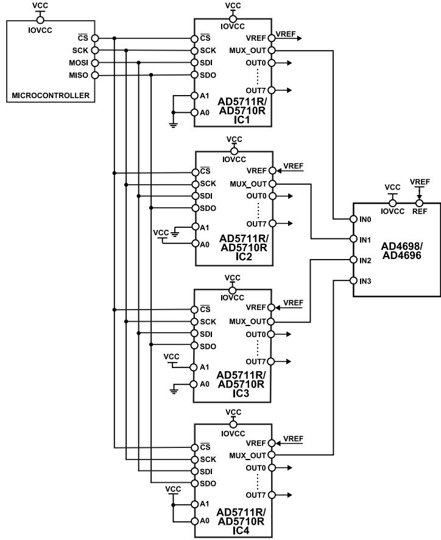

Figure 57. MUX_OUT Configuration for Four Devices with Different Device Addresses

{27}------------------------------------------------

# DAC CORE FUNCTIONS

Each DAC channel has an individual input register and a DAC register, as shown in [Figure 1](#). Both registers are accessible through the serial interface. The DAC register stores digital code equivalent to the DAC output voltage while the input register acts as a temporary staging register before being passed on to the DAC register. With the LDAC function, one or more DAC registers can be updated in parallel with the data held in the input registers.

The DAC registers can be written to directly, in which case the corresponding output updates immediately without the need for a hardware or software LDAC. Directly writing to the DAC register does not affect the data stored in the input register.

Writing to the MULTI\_INPUT\_CH register allows one or more input registers to be updated in a single write operation. The MULTI\_INPUT\_SEL\_0 register determines which channel's input register can be updated with the data written to the MULTI\_INPUT\_CH register. See the [DAC Update](#) section for additional information.

Similarly, writing to the MULTI\_DAC\_CH register allows one or more DAC registers to be updated in a single write operation. MULTI\_DAC\_INPUT\_SEL\_0 determines which DAC register can be updated with the data written to the MULTI\_DAC\_CH register. See the [DAC Update](#) section for more information.

To ensure that the DAC update is successful, DAC register updates should only occur once every 640ns. Refer to  $t_{L2}$  and  $t_{L3}$  from [Table 4](#). An error flag is asserted when a DAC update write is unsuccessful, which can be checked by reading the UPDATE\_ERR bit on the STATUS\_CONTROL\_0 register.

## LDAC FUNCTION

The LDAC function is used to initiate the transfer of the contents of input registers of the selected channels to the corresponding DAC registers, thereby updating one or more OUT pins at the same time. The LDAC function can be executed by hardware through the  $\overline{\text{LDAC}}$  pin or by software through SW\_LDAC\_TRIG\_A or SW\_LDAC\_TRIG\_B registers. Both hardware and software LDAC perform the same function.

### Hardware LDAC

The AD5711R/AD5710R have an active low  $\overline{\text{LDAC}}$  pin that is falling edge sensitive. If the  $\overline{\text{LDAC}}$  signal is brought low, the selected input

register contents are transferred to corresponding DAC register. If the  $\overline{\text{LDAC}}$  is held low when writing to the device, the input registers appear transparent, and when an input register is written to, the DAC register is updated with the contents of the input register at the same time. When  $\overline{\text{LDAC}}$  is held high, DAC codes can be written to any input registers without affecting the DAC output.

The  $\overline{\text{LDAC}}$  is used to determine the DAC channels to be updated from the input registers of the corresponding DAC channels when  $\overline{\text{LDAC}}$  is active low or asserted. By default, all DAC channels are selected and the HLD\_EN\_CH\_n bitfields contain a 1b'1. A 1b'0 set on a HLD\_EN\_CH\_n bitfield disables the hardware LDAC feature for the corresponding DAC channel.

### Software LDAC

The software LDAC function is synonymous to an  $\overline{\text{LDAC}}$  falling edge. It provides a way to initiate a transfer of content between input registers of the selected DAC channels to corresponding DAC registers through the serial interface via writing 1b'1 to SLD\_TRIG\_A bit on the SW\_LDAC\_TRIG\_A register or to the SLD\_TRIG\_B bit on the SW\_LDAC\_TRIG\_B register.

The SW\_LDAC\_EN\_0 register is used to determine the DAC channels to be updated from the corresponding input registers when a software LDAC is performed. By default, all DAC channels are selected and the SLD\_EN\_CH\_n bitfields contain a 1b'1. A 1b'0 set in a SLD\_EN\_CH\_n bitfield disables the software LDAC feature for the corresponding DAC channel.

## DAC UPDATE

There are multiple methods for updating the DAC\_CHn registers that directly affect the VDAC and IDAC outputs. [Figure 58](#) applies when unique data is written to one or more channels, with variations depending on whether the update is immediate or controlled using the hardware or software LDAC. [Figure 59](#) applies when the same data is written to multiple channels, allowing for immediate or simultaneous updates or controlled updates using either the hardware or software LDAC. The appropriate method depends on whether a single channel or multiple channels are being updated, whether the data is unique or the same, and the configuration of the LDAC signal.

{28}------------------------------------------------

## DAC CORE FUNCTIONS

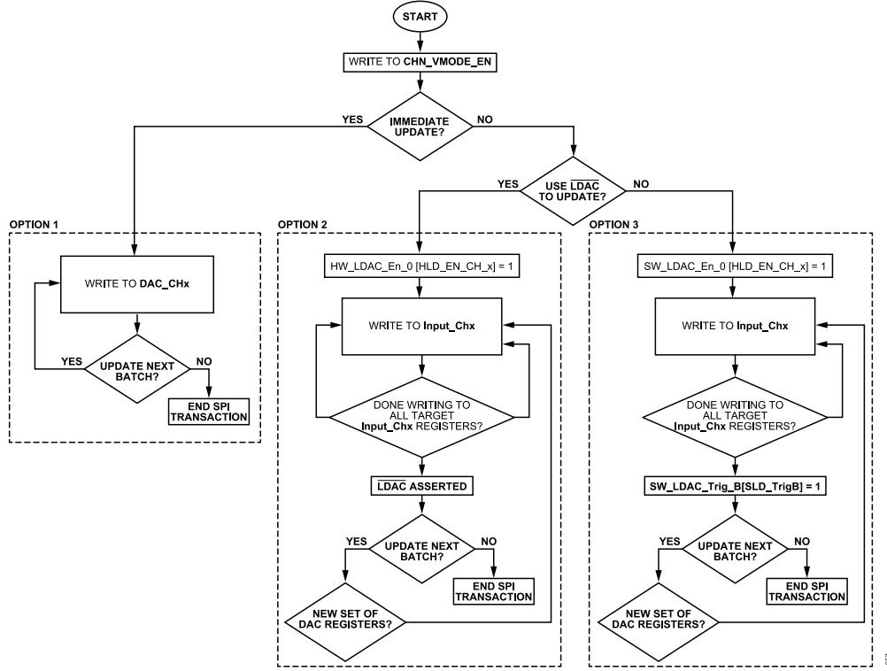

```
graph TD
    START([START]) --> CHN_VMODE_EN[WRITE TO CHN_VMODE_EN]
    CHN_VMODE_EN --> IMMEDIATE_UPDATE{IMMEDIATE UPDATE?}
    IMMEDIATE_UPDATE -- YES --> OPTION1
    IMMEDIATE_UPDATE -- NO --> USE_LDAC_TO_UPDATE{USE LDAC TO UPDATE?}
    USE_LDAC_TO_UPDATE -- YES --> OPTION2
    USE_LDAC_TO_UPDATE -- NO --> OPTION3

    subgraph OPTION1 [OPTION 1]
        OPTION1_START[WRITE TO DAC_CHx] --> UPDATE_NEXT_BATCH1{UPDATE NEXT BATCH?}
        UPDATE_NEXT_BATCH1 -- YES --> OPTION1_START
        UPDATE_NEXT_BATCH1 -- NO --> END_SPI_TRANSACTION1[END SPI TRANSACTION]
    end

    subgraph OPTION2 [OPTION 2]
        OPTION2_START[HW_LDAC_En_0 [HLD_EN_CHx] = 1] --> WRITE_TO_INPUT_CHx2[WRITE TO Input_Chx]
        WRITE_TO_INPUT_CHx2 --> DONE_WRITE_TO_INPUT_CHx2{DONE WRITING TO ALL TARGET Input_Chx REGISTERS?}
        DONE_WRITE_TO_INPUT_CHx2 -- YES --> LDAC_ASSERTED[LDAC ASSERTED]
        LDAC_ASSERTED --> UPDATE_NEXT_BATCH2{UPDATE NEXT BATCH?}
        UPDATE_NEXT_BATCH2 -- YES --> NEW_SET_OF_DAC_REGISTERS2{NEW SET OF DAC REGISTERS?}
        NEW_SET_OF_DAC_REGISTERS2 -- YES --> WRITE_TO_INPUT_CHx2
        UPDATE_NEXT_BATCH2 -- NO --> END_SPI_TRANSACTION2[END SPI TRANSACTION]
    end

    subgraph OPTION3 [OPTION 3]
        OPTION3_START[SW_LDAC_En_0 [HLD_EN_CHx] = 1] --> WRITE_TO_INPUT_CHx3[WRITE TO Input_Chx]
        WRITE_TO_INPUT_CHx3 --> DONE_WRITE_TO_INPUT_CHx3{DONE WRITING TO ALL TARGET Input_Chx REGISTERS?}
        DONE_WRITE_TO_INPUT_CHx3 -- YES --> SW_LDAC_TRIG_B[SW_LDAC_Trig_B [SLD_TrigB] = 1]
        SW_LDAC_TRIG_B --> UPDATE_NEXT_BATCH3{UPDATE NEXT BATCH?}
        UPDATE_NEXT_BATCH3 -- YES --> NEW_SET_OF_DAC_REGISTERS3{NEW SET OF DAC REGISTERS?}
        NEW_SET_OF_DAC_REGISTERS3 -- YES --> WRITE_TO_INPUT_CHx3
        UPDATE_NEXT_BATCH3 -- NO --> END_SPI_TRANSACTION3[END SPI TRANSACTION]
    end
```

Flowchart for DAC Update Options 1, 2, and 3.

Figure 58. DAC Update Flowchart for Option1, Option 2, and Option 3

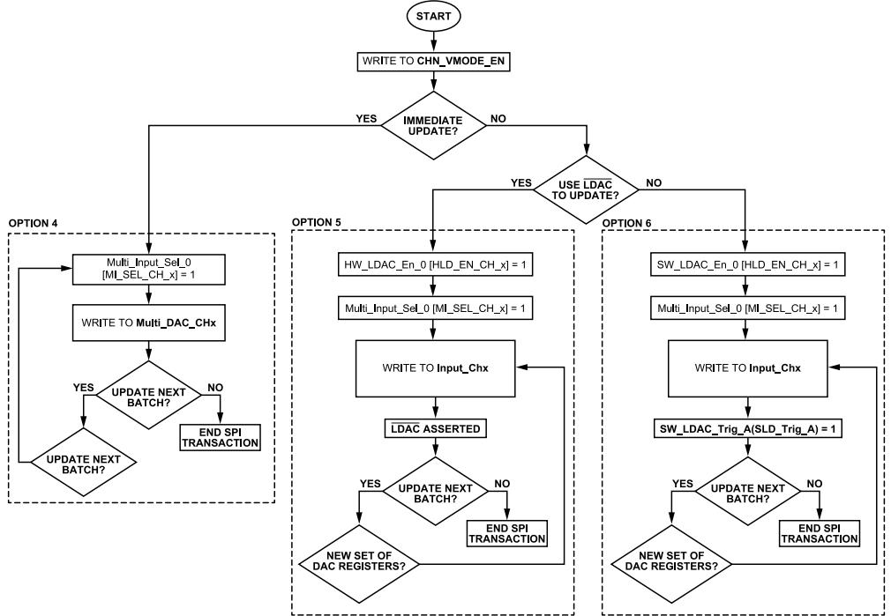

```
graph TD
    START([START]) --> CHN_VMODE_EN[WRITE TO CHN_VMODE_EN]
    CHN_VMODE_EN --> IMMEDIATE_UPDATE{IMMEDIATE UPDATE?}
    IMMEDIATE_UPDATE -- YES --> OPTION4
    IMMEDIATE_UPDATE -- NO --> USE_LDAC_TO_UPDATE{USE LDAC TO UPDATE?}
    USE_LDAC_TO_UPDATE -- YES --> OPTION5
    USE_LDAC_TO_UPDATE -- NO --> OPTION6

    subgraph OPTION4 [OPTION 4]
        OPTION4_START[Multi_Input_Sel_0 [MI_SEL_CHx] = 1] --> WRITE_TO_MULTI_DAC_CHx[WRITE TO Multi_DAC_CHx]
        WRITE_TO_MULTI_DAC_CHx --> UPDATE_NEXT_BATCH4_1{UPDATE NEXT BATCH?}
        UPDATE_NEXT_BATCH4_1 -- YES --> OPTION4_START
        UPDATE_NEXT_BATCH4_1 -- NO --> END_SPI_TRANSACTION4[END SPI TRANSACTION]
        UPDATE_NEXT_BATCH4_1 -- YES --> UPDATE_NEXT_BATCH4_2{UPDATE NEXT BATCH?}
    end

    subgraph OPTION5 [OPTION 5]
        OPTION5_START[HW_LDAC_En_0 [HLD_EN_CHx] = 1] --> Multi_Input_Sel_0[Multi_Input_Sel_0 [MI_SEL_CHx] = 1]
        Multi_Input_Sel_0 --> WRITE_TO_INPUT_CHx5[WRITE TO Input_Chx]
        WRITE_TO_INPUT_CHx5 --> LDAC_ASSERTED[LDAC ASSERTED]
        LDAC_ASSERTED --> UPDATE_NEXT_BATCH5{UPDATE NEXT BATCH?}
        UPDATE_NEXT_BATCH5 -- YES --> NEW_SET_OF_DAC_REGISTERS5{NEW SET OF DAC REGISTERS?}
        NEW_SET_OF_DAC_REGISTERS5 -- YES --> WRITE_TO_INPUT_CHx5
        UPDATE_NEXT_BATCH5 -- NO --> END_SPI_TRANSACTION5[END SPI TRANSACTION]
    end

    subgraph OPTION6 [OPTION 6]
        OPTION6_START[SW_LDAC_En_0 [HLD_EN_CHx] = 1] --> Multi_Input_Sel_0[Multi_Input_Sel_0 [MI_SEL_CHx] = 1]
        Multi_Input_Sel_0 --> WRITE_TO_INPUT_CHx6[WRITE TO Input_Chx]
        WRITE_TO_INPUT_CHx6 --> SW_LDAC_TRIG_A[SW_LDAC_Trig_A [SLD_TrigA] = 1]
        SW_LDAC_TRIG_A --> UPDATE_NEXT_BATCH6{UPDATE NEXT BATCH?}
        UPDATE_NEXT_BATCH6 -- YES --> NEW_SET_OF_DAC_REGISTERS6{NEW SET OF DAC REGISTERS?}
        NEW_SET_OF_DAC_REGISTERS6 -- YES --> WRITE_TO_INPUT_CHx6
        UPDATE_NEXT_BATCH6 -- NO --> END_SPI_TRANSACTION6[END SPI TRANSACTION]
    end
```

Flowchart for DAC Update Options 4, 5, and 6.

Figure 59. DAC Update Flowchart for Option 4, Option 5, and Option 6

{29}------------------------------------------------

## DAC CORE FUNCTIONS

### Option 1 (Immediate Update, Unique Data, No LDAC, and Single and Multiple Channels)

Option 1 allows the immediate update of DAC\_CHn registers after writing the whole 16-bit data. An LDAC is not required, and it is applicable to both single channel and multiple channel updates in single instruction or stream modes.

A single instruction is sent with the descending mode selected. The higher address of the multibyte register is called on the instruction phase (0xD3 : DAC\_CH0 register, followed by two 8-bit data) that updates the output immediately after the last SCLK.

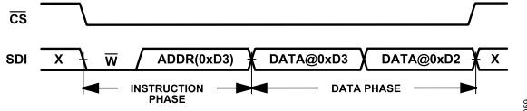

Timing diagram for Option 1 showing CS, SDI, and SCLK signals for writing to the DAC\_CH0 register.

Figure 60. Option 1 Example: Write to the DAC\_CH0 Register, Single Instruction Mode, and Address Descending

### Option 2 (Controlled Update, Unique Data, Hardware LDAC, and Single and Multiple Channels)

Option 2 allows controlled update timing of the DAC\_CHn registers from the INPUT\_CHn registers through a hardware LDAC.

This option is applicable to both single channel and multiple channel updates in single instruction or stream modes.

A single instruction is sent to write to the HW\_LDAC\_EN\_0 register, enabling a hardware LDAC for the selected channels. Then a stream mode is initiated, in default descending mode, writing to the INPUT\_CH7 first up to INPUT\_CH0. The LDAC is asserted at the end of the stream updating the DAC registers and the DAC output (if the correct LDAC timing is observed).

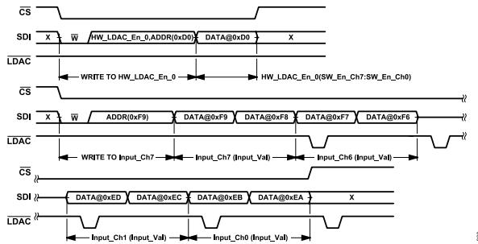

Timing diagram for Option 2 showing CS, SDI, LDAC, and SCLK signals for writing to INPUT\_CH7 to INPUT\_CH0 registers with hardware LDAC.

Figure 61. Option 2 Example: Write to the INPUT\_CH7 to INPUT\_CH0 Registers, Hardware LDAC Enabled, Stream Mode, and Address Descending

### Option 3 (Controlled Update, Unique Data, Software LDAC, and Single and Multiple Channels)

Option 3 allows controlled update timing of the DAC\_CHn registers from the INPUT\_CHn registers through the software LDAC.

This option is applicable to both single channel and multiple channel updates in single instruction and stream modes.

This option is similar to Option 2, except a software LDAC function is used instead of a hardware LDAC. The SW\_LDAC\_EN\_0 register determines which channel gets affected by a software LDAC command. The DAC registers and DAC outputs are updated with the input data written after the last SCLK of the SW LDAC command.

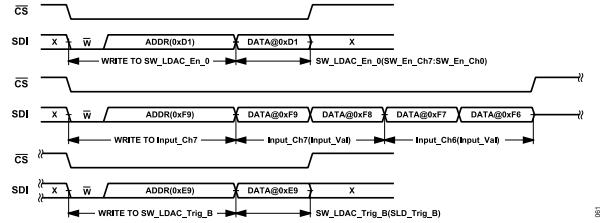

Timing diagram for Option 3 showing CS, SDI, and SCLK signals for writing to INPUT\_CH7 and INPUT\_CH6 registers with software LDAC.

Figure 62. Option 3 Example: Write to the INPUT\_CH7 and INPUT\_CH6 Registers with a Software LDAC, Stream Mode, and Address Descending

### Option 4 (Immediate Update, Same Data, No LDAC, and Multiple Channels)

Option 4 allows the immediate and simultaneous update of multiple DAC\_CHn registers identified by MULTI\_DAC\_SEL\_0 (MD\_SEL\_CH\_n) bitfields with the same data. Data is contained in MULTI\_DAC\_CH register and the update is initiated after writing the whole 16-bit data. An LDAC is not required.

Option 4 is ideal for multiple channel updates in both single instruction and stream modes.

A write instruction is sent to the MULTI\_DAC\_SEL\_0 register, enabling multiple DAC functions for the selected channels. With stream mode descending enabled, the next commands are the data for the adjacent multibyte register 0xE3 (and 0xE2) MULTI\_DAC\_CH. Assuming that STREAM\_MODE(LOOP\_COUNT) is set to 0x3, the succeeding data stream loops back to the start address, 0xE4, and repeats the process, until CS is deasserted.

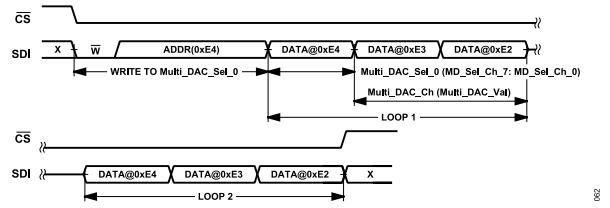

Timing diagram for Option 4 showing CS, SDI, and SCLK signals for writing to MULTI\_DAC\_CHn registers in stream mode.

Figure 63. Option 4 Example: Write to the MULTI\_DAC\_CHn Register, Stream Mode (Loop), and Address Descending

### Option 5 (Controlled Update, Same Data, Hardware LDAC, and Multiple Channels)

Option 5 allows for the controlled update timing of multiple DAC\_CHn registers identified by the MULTI\_INPUT\_SEL\_0(MI\_SEL\_CH\_n) and HW\_LDAC\_EN\_0(HLD\_EN\_CH\_n) bitfields with the same data.

{30}------------------------------------------------

## DAC CORE FUNCTIONS

Data is contained in the MULTI\_INPUT\_CHn register, and the update is initiated by providing a valid LDAC pulse.

Option 5 is ideal for multiple channel updates in both single instruction and stream modes. This option is similar to Option 2, except Option 5 makes use of the MULTI\_INPUT\_SEL\_0 and MULTI\_INPUT\_CHn registers to select and update the input registers of multiple DAC channels. The LDAC is asserted after each loop ends, updating the DAC registers and the DAC outputs (when correct LDAC is observed).

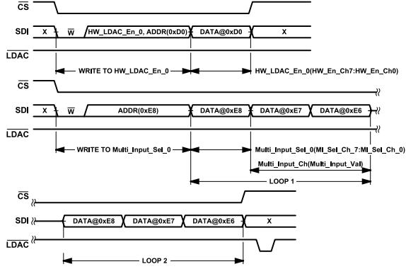

Timing diagram for Option 5 showing CS, SDI, and LDAC signals with annotations for HW\_LDAC\_en\_0, WRITE TO Multi\_Input\_Sel\_0, and LOOP 1/2.

Figure 64. Option 5 Example: Write to MULTI\_INPUT\_CHn Register with a Hardware LDAC, Stream Mode (Loop), and Address Ascending

### Option 6 (Controlled Update, Same Data, Software LDAC, and Multiple Channels)

Option 6 allows immediate and simultaneous updating of multiple DAC\_CHn registers identified by the MULTI\_INPUT\_SEL\_0(MI\_SEL\_CH\_n) and SW\_LDAC\_EN\_0(SLD\_EN\_CH\_n) bitfields with the same data. Data is contained in MULTI\_INPUT\_CHn register and is initiated through the software LDAC.

Option 6 is ideal for multiple channel updates in both single instruction and stream modes. It is similar to Option 5, except a software LDAC function is used instead of a hardware LDAC. The SW\_LDAC\_EN\_0 register determines which channel is affected by a software LDAC command.

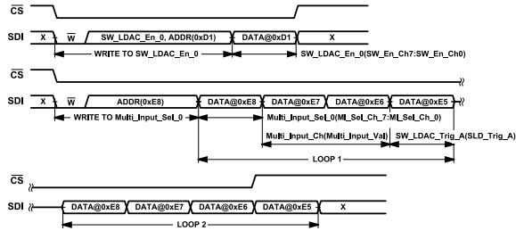

Timing diagram for Option 6 showing CS, SDI, and LDAC signals with annotations for SW\_LDAC\_en\_0, WRITE TO Multi\_Input\_Sel\_0, and LOOP 1/2.

Figure 65. Option 6 Example: Write to MULTI\_INPUT\_CHn Register with a Software LDAC, Stream Mode (Loop), and Address Ascending

{31}------------------------------------------------

# DIGITAL INTERFACE

The device uses a 4-wire serial interface ( $\overline{\text{CS}}$ , SCLK, SDI, and SDO) that is compatible with classic SPI, QSPI, and MICROWIRE interface standards, as well as most digital signal processors (DSPs).

See [Figure 2](#) for a timing diagram of a typical read-write sequence. Register read and write transactions are framed by  $\overline{\text{CS}}$ . While  $\overline{\text{CS}}$  is high, SCLK edges are ignored, and SDO is high-Z. A falling edge on  $\overline{\text{CS}}$  initiates a SPI frame. For all SPI transactions, data is shifted MSB first.

Data is sampled by the device on the rising edge of the SCLK while the data is shifted out on SDO on the falling edges of SCLK. This corresponds to SPI Mode 0 (CPOL = 0, CPHA = 0).

Communication with the device is separated into two distinct phases of operation. The first phase is the instruction phase and is used to initiate some action of the device. In the instruction phase, the register address is 15-bit wide (SHORT\_INSTRUCTION bit = 0 in the INTERFACE\_CONFIG\_B register) by default. The second phase is the data phase where the data is either passed to the device to operate on or received from the device in response to the instruction phase.

[Figure 66](#) shows a SPI write transaction using a 15-bit address in the instruction phase and eight bits for a single byte register for the data phase while [Figure 67](#) shows a SPI read transaction using a 7-bit address in the instruction phase and eight bits for the data phase.


Timing diagram for Classic SPI Write. It shows the relationship between CS, SCLK, and SDO. CS goes low to start the transaction. SCLK provides a clock. SDO shows the instruction phase (16 bits) and the data phase (8 bits). The instruction phase includes a R/W bit and a 15-bit address. The data phase contains 8 data bits (D7 to D0).

Figure 66. Classic SPI Write


Timing diagram for Classic SPI Read. It shows the relationship between CS, SCLK, and SDO. CS goes low to start the transaction. SCLK provides a clock. SDO shows the instruction phase (8 bits) and the data phase (8 bits). The instruction phase includes a Read (R) bit and a 7-bit address. The data phase contains 8 data bits (D7 to D0).

Figure 67. Classic SPI Read

## SPI FRAME SYNCHRONIZATION

The  $\overline{\text{CS}}$  pin frames data during a SPI transaction. A falling edge on the  $\overline{\text{CS}}$  enables the digital interface and initiates a SPI transaction. Each SPI transaction consists of at least one instruction phase and one data phase. For all SPI transactions, data is aligned MSB first. Deasserting the  $\overline{\text{CS}}$  during a SPI transaction terminates part or all of the data transfer and disables the digital interface. If the  $\overline{\text{CS}}$  is deasserted (returned high) after one or more registers are written, completed registers are written or read, but any partially written register is aborted. [Figure 66](#) and [Figure 67](#) show detailed timing diagrams for performing register reads and writes via the SPI interface.

## INSTRUCTION PHASE

Every SPI frame starts with the instruction phase. The instruction phase immediately follows the falling edge of the  $\overline{\text{CS}}$  that initiates the SPI transaction. The instruction phase consists of a read/write bit (R/ $\overline{\text{W}}$ ) followed by a register address word. Setting R/ $\overline{\text{W}}$  low initiates a write instruction, whereas setting R/ $\overline{\text{W}}$  high initiates a read instruction. The register address word specifies the address of the register to be accessed. The register address word is 15 bits in length by default. If required, enable 7-bit addressing with the SHORT\_INSTRUCTION bit on the INTERFACE\_CONFIG\_B register. See the [Interface Configuration B Register](#) section for additional information.

### DATA PHASE

The data phase immediately follows the instruction phase (as shown in [Figure 66](#) and [Figure 67](#)). The data phase can include the data for a single-byte register, a multibyte register, or multiple registers.

If the data phase of a SPI write transaction does not include the entire byte of data for the register being updated, the contents of the register are not updated, and the INTERFACE\_STATUS\_A register, Bit 4 (CLOCK\_COUNT\_ERR) is set.

## MULTIBYTE REGISTERS

Besides the one byte registers, the AD5711R/AD5710R also contain registers with two bytes of data stored in adjacent addresses that are referred to as multibyte registers. When writing to a multibyte register, all bytes must be accessed in a single SPI transaction. For this reason, the INTERFACE\_CONFIG\_C, Bit 5 (STRICT\_REGISTER\_ACCESS) is read only and set to 1. A write transaction to a multibyte register takes effect after the 16th SCLK edge of the data phase.

For the 12-bit parts, the four least significant bits (LSBs) are ignored and are set to 0 internally (see [Table 12](#)).

The address of a multibyte register always depends on the INTERFACE\_CONFIG\_A, Bit 5 (ADDR\_ASCENSION). With addresses descending, the first byte accessed in the data phase must be the most significant byte of the multibyte register, and each subsequent byte corresponds to the data in the next lowest address. With addresses ascending, the first byte accessed in the data phase must be the least significant byte of the multibyte register, and each subsequent byte corresponds to the data in the next highest address.

For example, the DAC\_CH0 register is two bytes long, and the addresses of its least significant byte and most significant byte are 0xD2 and 0xD3, respectively. [Figure 68](#) and [Figure 69](#) show read transactions of this register for address ascending and descending mode, respectively.

{32}------------------------------------------------

## DIGITAL INTERFACE


Timing diagram for Figure 68: Multibyte Read in Ascending Mode. It shows the relationship between CS, SDI, and SDO. CS is low during the transaction. SDI shows a read (R) command, an address (ADDR(0xD2)), and two bytes of data (DATA@0xD2, DATA@0xD3). SDO shows the address and the two bytes of data. The transaction is divided into an INSTRUCTION PHASE and a DATA PHASE.

Figure 68. Multibyte Read in Ascending Mode


Timing diagram for Figure 69: Multibyte Read in Descending Mode. It shows the relationship between CS, SDI, and SDO. CS is low during the transaction. SDI shows a read (R) command, an address (ADDR(0xD3)), and two bytes of data (DATA@0xD3, DATA@0xD2). SDO shows the address and the two bytes of data. The transaction is divided into an INSTRUCTION PHASE and a DATA PHASE.

Figure 69. Multibyte Read in Descending Mode

Address direction is selected with the INTERFACE\_CONFIG\_A, Bit 5 (ADDR\_ASCENSION). If this bit is set to 0, the address decrements after each byte is accessed. If this bit is set to 1, the address increments after each byte is accessed. If a SPI write transaction to a multibyte register is attempted on a per byte basis, the register contents are not updated on the device, and the INTERFACE\_STATUS\_A, Bit 1 (REGISTER\_PARTIAL\_ACCESS\_ERR) is set.

This device contains the following multibyte registers: DAC\_CHn, INPUT\_CHn, MULTI\_DAC\_CH, and MULTI\_INPUT\_CH.

### SINGLE INSTRUCTION MODE

When the INTERFACE\_CONFIG\_B, Bit 7 (SINGLE\_INST) is set to 1, streaming mode is disabled, and single instruction mode is enabled. In single instruction mode, the data phase consists of data for a single register, and each data phase must be followed by a new instruction phase (even if  $\overline{\text{CS}}$  remains low). Single instruction mode allows the digital host to quickly read from and write to registers with nonadjacent addresses in a single SPI frame (see Figure 70), whereas streaming mode only allows either reading or writing to contiguous registers without pulsing  $\overline{\text{CS}}$  high to initiate a new instruction phase.

When accessing multibyte registers in single instruction mode, data phase should include all two bytes or 16 SCLK cycles, and the register address order is dependent on the INTERFACE\_CONFIG\_A, Bit 5 (ADDR\_ASCENSION).

Table 12. Multibyte Registers, Data Phase

| Model            | MSB         |    |    |    |    |    |   |   | LSB        |   |   |   |   |   |   |   |
|------------------|-------------|----|----|----|----|----|---|---|------------|---|---|---|---|---|---|---|
|                  | 15          | 14 | 13 | 12 | 11 | 10 | 9 | 8 | 7          | 6 | 5 | 4 | 3 | 2 | 1 | 0 |
| AD5710R (16-bit) | DATA [15:8] |    |    |    |    |    |   |   | DATA [7:0] |   |   |   |   |   |   |   |
| AD5711R (12-bit) | DATA [15:8] |    |    |    |    |    |   |   | DATA [7:4] |   |   |   | 0 | 0 | 0 | 0 |

![Timing diagram for Figure 70: Single Instruction Mode. It shows the relationship between CS, SDI, and SDO. CS is low during the transaction. SDI shows a write (W) command, an address (ADDR(0xE5)), two bytes of data (DATA@0xE5, DATA@0xE6), a read (R) command, an address (ADDR(0xE7)), two bytes of data (DATA@0xE7, DATA@0xE6), a write (W) command, an address (ADDR(0xD3)), and two bytes of data (DATA@0xD3, DATA@0xD2). SDO shows the data for each phase. The transaction is divided into multiple INSTRUCTION PHASES and DATA PHASES.](img/0668098f95df8ed3c74c0cb82619c140_img.jpg)

Timing diagram for Figure 70: Single Instruction Mode. It shows the relationship between CS, SDI, and SDO. CS is low during the transaction. SDI shows a write (W) command, an address (ADDR(0xE5)), two bytes of data (DATA@0xE5, DATA@0xE6), a read (R) command, an address (ADDR(0xE7)), two bytes of data (DATA@0xE7, DATA@0xE6), a write (W) command, an address (ADDR(0xD3)), and two bytes of data (DATA@0xD3, DATA@0xD2). SDO shows the data for each phase. The transaction is divided into multiple INSTRUCTION PHASES and DATA PHASES.

Figure 70. Single Instruction Mode

{33}------------------------------------------------

## DIGITAL INTERFACE

### STREAMING MODE

When the INTERFACE\_CONFIG\_B, Bit 7 (SINGLE\_INST) bit is set to 0, single instruction mode is disabled, and streaming mode is enabled. In streaming mode, multiple registers with adjacent addresses can be accessed with a single instruction phase and data phase, allowing efficient access of contiguous regions of memory (for example, during initial device configuration). The streaming mode is selected by default.

When in streaming mode, each SPI frame consists of a single instruction phase, and the following data phase contains data for multiple registers with adjacent addresses. A starting register address is specified by the digital host in the instruction phase, and this address is automatically incremented or decremented (based on the address direction setting) after each byte of data is accessed. Therefore, the data phase can be multiple bytes long, and each consecutive byte of read or write data corresponds to the next highest or lowest register address (for ascending and descending address direction, respectively).

When writing to a multibyte register in streaming mode with address ascending, the least significant byte of the register must be addressed in the instruction phase and data must be provided starting from the least significant byte in the data phase. When writing to a multibyte register in streaming mode with the address descending, the user must start addressing the most significant byte of the register in the instruction phase and provide data starting from the most significant byte in the data phase.

When reading from a multibyte register in streaming mode with address descending, read back the data starting from the most significant byte. When reading from a multibyte register in streaming mode with address ascending, read back data starting from the least significant byte.

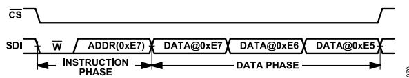

Timing diagram for Figure 71: Streaming Mode SPI Transfer, showing CS, SDI, and data bytes (ADDR(0xE7), DATA@0xE7, DATA@0xE6, DATA@0xE5) during instruction and data phases.

Figure 71. Streaming Mode SPI Transfer

The STREAM\_MODE register can be used to specify a set of consecutive registers to loop through in the data phase (see the

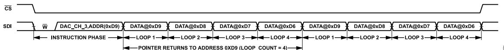

Timing diagram for Figure 72: Looping Enabled with LOOP\_COUNT = 4, showing CS, SDI, and data bytes (DAC\_CH\_3, ADDR(0xD9), DATA@0xD9, DATA@0xD8, DATA@0xD7, DATA@0xD6) with multiple loops (LOOP 1 to LOOP 4) and a pointer return to address 0xD9.

Figure 72. Looping Enabled with LOOP\_COUNT = 4

Stream Mode Register section). Looping allows the digital host to repeatedly read from or write to a set of registers as efficiently as possible.

If LOOP\_COUNT is set to 0, looping is disabled, and the following occurs:

- If the address direction is set to descending, the address decrements until it reaches Address 0x00. On the subsequent byte access, the address is set to the highest valued byte address available (0xFF).
► If the address direction is set to ascending, the address increments until it reaches the highest valued byte address available (0xFF). On the subsequent byte access, the address is reset to 0x00.

If LOOP\_COUNT is set to a value other than 0, looping is enabled, and the value in LOOP\_COUNT sets the number of bytes to be accessed in a single data phase before the byte address resets to the one specified in the instruction phase. The LOOP\_COUNT value must correspond to the number of actual bytes involved in the loop, which may differ from the number of registers addressed if some are multibyte registers.

The value of the LOOP\_COUNT bits can be kept or returned to the default value of 0 when the frame transaction is completed, that is, the CS is brought high. The LOOP\_COUNT behavior is controlled by the KEEP\_STREAM\_LENGTH\_VAL bit. If the user wants the programmed value to hold indefinitely, the user must first set the KEEP\_STREAM\_LENGTH\_VAL bit to 1 before programming the LOOP\_COUNT bits.

When using LOOP\_COUNT, be aware of the DAC update timings mentioned in the DAC Core Functions section. Additionally, while in streaming mode with LOOP\_COUNT > 0, the SCLK frequency must be configured with a minimum of 12.5MHz for the following conditions:

- SPI write to the INPUT\_CHn and MULTI\_INPUT\_CH registers while keeping LDAC low for the entire duration of the SPI frame.
► SPI write to and read back from the DAC\_CHn and MULTI\_DAC\_CH registers for the entire duration of the SPI frame.

{34}------------------------------------------------

## DIGITAL INTERFACE

## DEVICE ADDRESSING

The AD5711R/AD5710R devices have two address pins (A[1:0]) in the WLCSP package. With four unique addresses, it is possible to keep a maximum of four devices on the same SPI bus as shown in Figure 73. Care should be taken to ensure that every device on the same SPI bus has unique device address on the address pins.

To communicate with any AD5711R/AD5710R, the instruction phase in the SPI frame has three MSB Bits A[14:12] which correspond to the device addresses as mentioned in Figure 2 and Table 13. It is possible to select and write to a specific device using the corresponding address bits in the instruction phase. A SPI read

transaction must address a specific device to read out data on the SDO line. The AD5711R/AD5710R ignore the SPI read and write transactions where the address pins are not matched with the address bits in the instruction phase.

Table 13. Device Addressing Truth Table

| Address Pins, A[1:0] | Device Identity | Address Bits, A[14:12], in Instruction Phase |
|----------------------|-----------------|----------------------------------------------|
| 0 0                  | 0               | 0 0 0                                        |
| 0 1                  | 1               | 0 0 1                                        |
| 1 0                  | 2               | 0 1 0                                        |
| 1 1                  | 3               | 0 1 1                                        |


Schematic diagram showing a microcontroller connected to four AD5711R/AD5710R devices (U0, U1, U2, U3) on a single SPI bus. The microcontroller's SCK, MOSI, and MISO pins are connected to the corresponding pins on all four devices. The chip select (CS) pins are connected to the microcontroller's CS pin. The address pins A1 and A0 are connected to the microcontroller's address pins. The diagram shows how the devices are addressed on the same bus.

Figure 73. Communication with Multiple AD5711R/AD5710R Devices on a Single SPI Bus

{35}------------------------------------------------

## DIGITAL INTERFACE

When multiple AD5711R/AD5710R are connected to the same SPI bus, especially on the SDO line, the capacitive load increases due to the input capacitance of each device connected on the bus and the PCB trace capacitance. This increased capacitance slows down the signal transitions (rise and fall times), which can cause the data on the SDO line to not settle in time before the host samples it on the next clock edge. It is, therefore, recommended to reduce the SCLK frequency to allow more time for the SDO to settle after a transition.

## DEVICE STATUS ERRORS

The AD5711R/AD5710R have an INTERFACE\_STATUS\_A register that contains all the status bits related to the digital interface. These status bits are set based on the actions related to the SPI transactions, until explicitly clearly by writing a 1 to the bit location to clear the status bit.

#### Partial Register Access Error

The REGISTER\_PARTIAL\_ACCESS\_ERR bit in the INTERFACE\_STATUS\_A register is set when a multibyte register is accessed for read or write partially, which means that the transaction ends before all the bytes of a multibyte register have been accessed. To clear this error, write 1 to the REGISTER\_PARTIAL\_ACCESS\_ERR bit.

#### Invalid/No CRC Received Error

The CRC\_ERR bit in the INTERFACE\_STATUS\_A register is set when the CRC is enabled and the CRC byte in the SPI transaction is missing or does not match the calculated value. To clear this error, write 1 to this bit. Note that because the CRC is enabled, this SPI transaction must have a valid CRC code to succeed.

#### Clock Counting Error

The error reported in the CLOCK\_COUNT\_ERR bit is produced when the number of SCLK cycles is not in accordance with the amount required to shift a multiple of eight bits.

#### Interface Not Ready Status

The NOT\_READY\_ERR bit in the INTERFACE\_STATUS\_A register is not an error. It is a status bit that can be polled to know when the device is ready to receive data from the host. This bit is a read or write one to clear (R/W1C) type of bit and can be cleared by writing 1 to it.

### CYCLIC REDUNDANCY CHECK (CRC) ERROR DETECTION

The AD5711R/AD5710R DAC features an optional cyclic redundancy check (CRC) to provide error detection for SPI transactions between the digital host and the DAC (target). The CRC error detection is disabled by default. CRC error detection allows the SPI host and targets to detect bit transfer errors with significant

reliability. The CRC algorithm involves using a seed value and polynomial division to generate a CRC code. The controller and target both calculate the CRC code independently to determine the validity of transferred data.

This DAC uses the CRC-8 standard with the following polynomial:

$$x^8 + x^2 + x + 1 \quad (9)$$

CRC error detection is enabled with the CRC\_EN and CRC\_EN\_B bits in the INTERFACE\_CONFIG\_C register. The value of CRC\_EN is only updated if CRC\_EN\_B is set to the CRC\_EN inverted value in the same register write instruction. Therefore, to enable the CRC, the CRC\_EN must be set to 0b01 while CRC\_EN\_B is set to 0b10 in the same write transaction.

To disable the CRC, the CRC\_EN must be set to 0b00 and the CRC\_EN\_B is set to 0b11 in the same write transaction.

Writing inverted values to two separate fields reduces the chances of CRC being enabled in error. The  $\overline{CS}$  must be brought high at the end of the enable/disable write. The first CRC code must be included after the register write/read data, immediately following the register write transaction enabling the CRC. A register write transaction that disables the CRC must still include the CRC code on SDI, but the following transaction does not require the CRC code.

Figure 74 and Figure 75 show how a CRC code is appended to the write or read, respectively, for the digital host or DAC to validate the data. For register writes, the digital host must generate the CRC using the calculation described in Equation 9. For register reads, the host must also send the correct CRC byte that is checked by the DAC. The first byte of data sent contributes to the CRC calculation. Therefore, a value of 0x00 is recommended. In the same read transaction, the DAC provides the CRC code for the digital host to verify.

When accessing multibyte registers with the CRC error detection enabled, the CRC code is placed after all bytes of register data.

![Timing diagram for SPI Write with CRC Enabled. It shows the relationship between the Chip Select (CS), Serial Data In (SDI), and Serial Data Out (SDO) lines. The transaction is divided into an Instruction Phase and a Data Phase. In the Instruction Phase, CS is low, and SDI shows a 'W' (Write) signal followed by the 'REGISTER ADDRESS'. In the Data Phase, CS is high, and SDI shows 'REGISTER DATA' and a 'CRC BYTE'. SDO shows 'Z' (High Impedance) during the Instruction Phase and the 'CRC BYTE' during the Data Phase. The diagram is labeled with 'CS', 'SDI', 'SDO', 'INSTRUCTION PHASE', 'DATA PHASE', and 'CRC BYTE'.](img/d0703aa3d4cb275167aff5263eccd7b7_img.jpg)

Timing diagram for SPI Write with CRC Enabled. It shows the relationship between the Chip Select (CS), Serial Data In (SDI), and Serial Data Out (SDO) lines. The transaction is divided into an Instruction Phase and a Data Phase. In the Instruction Phase, CS is low, and SDI shows a 'W' (Write) signal followed by the 'REGISTER ADDRESS'. In the Data Phase, CS is high, and SDI shows 'REGISTER DATA' and a 'CRC BYTE'. SDO shows 'Z' (High Impedance) during the Instruction Phase and the 'CRC BYTE' during the Data Phase. The diagram is labeled with 'CS', 'SDI', 'SDO', 'INSTRUCTION PHASE', 'DATA PHASE', and 'CRC BYTE'.

Figure 74. SPI Write with CRC Enabled

![Timing diagram for SPI Read with CRC Enabled. It shows the relationship between the Chip Select (CS), Serial Data In (SDI), and Serial Data Out (SDO) lines. The transaction is divided into an Instruction Phase and a Data Phase. In the Instruction Phase, CS is low, and SDI shows an 'R' (Read) signal followed by the 'REGISTER ADDRESS'. In the Data Phase, CS is high, and SDI shows 'REGISTER DATA' and a 'CRC BYTE'. SDO shows 'Z' (High Impedance) during the Instruction Phase, 'REGISTER DATA' during the Data Phase, and a 'CRC BYTE' at the end of the Data Phase. The diagram is labeled with 'CS', 'SDI', 'SDO', 'INSTRUCTION PHASE', 'DATA PHASE', and 'CRC BYTE'.](img/b4e21145f6f11eb241aca331c4d1c867_img.jpg)

Timing diagram for SPI Read with CRC Enabled. It shows the relationship between the Chip Select (CS), Serial Data In (SDI), and Serial Data Out (SDO) lines. The transaction is divided into an Instruction Phase and a Data Phase. In the Instruction Phase, CS is low, and SDI shows an 'R' (Read) signal followed by the 'REGISTER ADDRESS'. In the Data Phase, CS is high, and SDI shows 'REGISTER DATA' and a 'CRC BYTE'. SDO shows 'Z' (High Impedance) during the Instruction Phase, 'REGISTER DATA' during the Data Phase, and a 'CRC BYTE' at the end of the Data Phase. The diagram is labeled with 'CS', 'SDI', 'SDO', 'INSTRUCTION PHASE', 'DATA PHASE', and 'CRC BYTE'.

Figure 75. SPI Read with CRC Enabled

When the CRC error detection is enabled, the DAC does not update its register contents in response to a register write transaction unless it receives a valid CRC code at the end of the register data on the SDI. If the CRC code is invalid, or the digital host fails to

{36}------------------------------------------------

## DIGITAL INTERFACE

transmit the CRC code, the AD5711R/AD5710R do not update its register contents, and the CRC\_ERR flag in the INTERFACE\_STATUS\_A register is set. The CRC\_ERR flag is write-1-to-clear (W1C) and the correct CRC is required for the write to clear to take effect.

Table 14 shows the seed value used in the CRC code calculation and how it is transmitted for both single instruction mode and streaming mode. When using single instruction mode, every CRC

code in a SPI frame uses 0xA5 as the seed value to prevent stuck at fault conditions for Address 0x0000.

When using the streaming mode, the first CRC code in a SPI frame also uses 0xA5 as the seed value, but subsequent CRC codes in the same frame are calculated using the LSB of the register address being accessed in the SPI transaction as the seed value.

Table 14. CRC Seed Values

| SPI Transaction Type | Pin | Single Instruction Mode                               | Streaming Mode                                        |                                                                                                         |
|----------------------|-----|-------------------------------------------------------|-------------------------------------------------------|---------------------------------------------------------------------------------------------------------|
|                      |     |                                                       | First Data Phase                                      | Subsequent Data Phases                                                                                  |
| Read                 | SDI | CRC seed = 0xA5, instruction phase, write data = 0x00 | CRC seed = 0xA5, instruction phase, write data = 0x00 | Write data = 0x00 to the least significant byte of address, CRC byte sent after each multibyte register |
|                      | SDO | CRC seed = 0xA5, instruction phase, read data         | CRC seed = 0xA5, instruction phase, read data         | Read data from the least significant byte of address, CRC byte received after each multibyte register   |
| Write                | SDI | CRC seed = 0xA5, instruction phase, write data        | CRC seed = 0xA5, instruction phase, write data        | Write data to the least significant byte of address, CRC byte sent after each multibyte register        |
|                      | SDO | CRC seed = 0xA5, instruction phase, read data = 0x00  | CRC seed = 0xA5, instruction phase, read data = 0x00  | Read data = 0x00, CRC byte received after each multibyte register                                       |

## DEVICE RESET

The device requires a minimum of 167μs between any reset event and a register read/write transaction as shown in Figure 3, and represented by tSPI\_RDY in Table 4. If a SPI transaction is attempted before the device is ready, it may not succeed, and the NOT\_READY\_ERR bit in the INTERFACE\_STATUS\_A register is set. See Device Status Errors for more information about NOT\_READY\_ERR bit.

The AD5711R/AD5710R offer three reset mechanisms: power-on reset (POR), hardware reset, and software reset via the serial interface.

### Software Reset

The INTERFACE\_CONFIG\_A register includes two control bits, SW\_RESET and RESET\_SW used to initiate a software reset through the serial interface. Both bits must be set simultaneously within the same data phase to successfully trigger the reset. Once the software reset transaction is completed, the device performs a POR sequence followed by digital core initialization. All registers are reset to their default values, except for the INTERFACE\_CONFIG\_A register, which retains its current configuration.

### Power-On Reset (POR)

A POR signal is generated when the supply voltage first crosses the nominal threshold of 2.5V on AVDD. The POR resets the state of the user programmable registers if the supply voltage on AVDD drops below this threshold. On power-up, all registers are reset to their default values. Meanwhile, the POR circuit ensures that the output stages of all DAC channels are powered down (see the DAC Operating Modes section) until the output operating mode for the channel is changed.

### Hardware Reset

RESET is an active low signal that is low level triggered. Asserting RESET sets the device into the POR state. While RESET is asserted, all SPI transactions and LDAC pulses are ignored, and the SDO output is in a high-Z state. When the RESET is deasserted, the digital core initialization is performed, and all registers are reset to their default values.

{37}------------------------------------------------

# APPLICATIONS INFORMATION

## POWER SUPPLY RECOMMENDATIONS

The AD5711R/AD5710R do not have any restrictions for power supply sequencing. The outputs are maintained at POR state with a known pull-down resistance until proper register configurations are set.

The application module is very limited in terms of space, therefore it is necessary to reduce both the number of external components and their size without compromising functional or specification requirements. Typically, capacitor values are considered with a ±5% tolerance unless otherwise specified.

Table 15. External Passive Components

| Pin Name | Passive Components Required             |
|----------|-----------------------------------------|
| AVDD     | 0.1µF \|\| 10µF capacitor per pin to AGND |
| PVDDx    | 0.1µF \|\| 10µF capacitor per pin to AGND |
| IOVDD    | 0.1µF capacitor to AGND                 |

## MICROPROCESSOR INTERFACING

Microprocessor interfacing to the AD5711R/AD5710R is via a serial bus that uses a standard protocol compatible with DSPs and microcontrollers. The communication channel requires a 4-wire serial interface consisting of a clock signal (SCLK), a data input signal (MISO), a data output signal (MOSI), and a synchronization signal (SS).

The SPI interface of the AD5711R/AD5710R is designed for easy connection to industry-standard DSPs and microcontrollers. Figure 76 shows the AD5711R/AD5710R connected to the ADuCM320. The ADuCM320 has an integrated SPI port that can be connected directly to the SPI pins of the AD5711R/AD5710R.

![Schematic diagram showing the SPI interface between the ADuCM320 and the AD5711R/AD5710R. The ADuCM320 pins are: P0.3/IRQ0/CS0/PLACLK0/PLAI[3], P0.0/SCLK0/PLAI[0], P0.2/MOSI0/PLAI[2], P0.1/MISO0/PLAI[1], P1.4/PWM2/SCLK1/PLAO[10], and P1.5/PWM3/MISO1/PLAO[11]. The AD5711R/AD5710R pins are: CS, SCLK, SDI, SDO, RESET, and LDAC. Arrows indicate the signal flow: CS from ADuCM320 to AD5711R; SCLK from ADuCM320 to AD5711R; SDI from AD5711R to ADuCM320; SDO from ADuCM320 to AD5711R; RESET from ADuCM320 to AD5711R; and LDAC from ADuCM320 to AD5711R.](img/187bba66c887c745c512add37a577c5e_img.jpg)

Schematic diagram showing the SPI interface between the ADuCM320 and the AD5711R/AD5710R. The ADuCM320 pins are: P0.3/IRQ0/CS0/PLACLK0/PLAI[3], P0.0/SCLK0/PLAI[0], P0.2/MOSI0/PLAI[2], P0.1/MISO0/PLAI[1], P1.4/PWM2/SCLK1/PLAO[10], and P1.5/PWM3/MISO1/PLAO[11]. The AD5711R/AD5710R pins are: CS, SCLK, SDI, SDO, RESET, and LDAC. Arrows indicate the signal flow: CS from ADuCM320 to AD5711R; SCLK from ADuCM320 to AD5711R; SDI from AD5711R to ADuCM320; SDO from ADuCM320 to AD5711R; RESET from ADuCM320 to AD5711R; and LDAC from ADuCM320 to AD5711R.

Figure 76. ADuCM320 SPI Interface

## LAYOUT GUIDELINES AND ASSEMBLY GUIDELINES

The PCB level reliability of the device is directly linked to the PCB type and design used. Using a PCB material that matches the coefficient of thermal expansion (CTE) of the silicon (for example,

ceramic) provides the optimal mechanical performance. For organic material PCBs (for example, FR4) where the CTE is different from that of the silicon, the use of underfill can increase the mechanical performance. For organic PCB thickness >0.8mm, consider using underfill. Particular attention must be given to the underfill material selection to match the material properties with the application use conditions.

Consider using low alpha material in the system assembly to reduce the soft error rate (SER).

The AN-617 Application Note provides information on PCB layout and assembly for the WLCSP.

## THERMAL CONSIDERATIONS

The device has an absolute maximum junction temperature of 150°C and a maximum operating junction temperature (T<sub>J\_MAX</sub>) of 125°C (see the Absolute Maximum Ratings section). To meet the specified performance, the AD5711R/AD5710R must be operated at a junction temperature no greater than 125°C. The junction temperature is directly affected by the power dissipated across the AD5711R/AD5710R and the ambient temperature.

Most of the power dissipation of the AD5711R/AD5710R comes from the IOUT channels. The DC Specifications section specifies the output current ranges for each IOUT channel and the maximum power supply voltages. It is important to understand the effects of power dissipation on the package and the effects the package has on the junction temperature. The part is packaged in a 25-ball, 2.143mm × 2.193mm × 0.500mm WLCSP. The thermal resistance values are specified in Table 7. Table 16 provides examples of the maximum allowed power dissipation, the maximum allowed ambient temperature, and the maximum board temperature under certain specified conditions.

{38}------------------------------------------------

# APPLICATIONS INFORMATION

**Table 16. Thermal Considerations for AD5711R/AD5710R WLCSP Package**

| Parameter                   | Description                                                                                                                                                                                                                                                                                                                                                                                                                                                                                                                                                                                                                                                                                                                                                                                                                                                                                                                                                                                                                                                                                                                                                                                                                                                                                                                                                                                                                                                                                                                                          |
|-----------------------------|------------------------------------------------------------------------------------------------------------------------------------------------------------------------------------------------------------------------------------------------------------------------------------------------------------------------------------------------------------------------------------------------------------------------------------------------------------------------------------------------------------------------------------------------------------------------------------------------------------------------------------------------------------------------------------------------------------------------------------------------------------------------------------------------------------------------------------------------------------------------------------------------------------------------------------------------------------------------------------------------------------------------------------------------------------------------------------------------------------------------------------------------------------------------------------------------------------------------------------------------------------------------------------------------------------------------------------------------------------------------------------------------------------------------------------------------------------------------------------------------------------------------------------------------------|
| Maximum Power Dissipation   | <p>When the operating ambient temperature is known (<math>T_A</math>), <math>\theta_{JA}</math> can be used to estimate the maximum allowed power dissipation (<math>P_{DISS\_MAX}</math>) starting from the maximum operating junction temperature (<math>T_{J\_MAX}</math>). For example, if <math>T_A = 85^\circ C</math>,</p> $P_{DISS\_MAX} = \frac{T_{J\_MAX} - T_A}{\theta_{JA}} = \frac{125^\circ C - 85^\circ C}{51.8^\circ C/W} = 772.20mW \quad (10)$ <p>When the board temperature near the DUT is known (<math>T_B</math> measured using a temperature sensor near the DUT on the same board), <math>\Psi_{JB}</math> can be used to better estimate the maximum allowed power dissipation (<math>P_{DISS\_MAX}</math>). For example, if <math>T_B = 95^\circ C</math>,</p> $P_{DISS\_MAX} = \frac{T_{J\_MAX} - T_B}{\Psi_{JB}} = \frac{125^\circ C - 95^\circ C}{16^\circ C/W} = 1.87W \quad (11)$ <p>Using the preceding equation, calculate the AD5711R/AD5710R <math>P_{DISS}</math> as follows, and confirm <math>P_{DISS}</math> is lower than the allowed <math>P_{DISS\_MAX}</math>.</p> <p>Supplies conditions chosen as follows:</p> <ul style="list-style-type: none"> <li><math>R_{LOAD} = 25\Omega</math> and <math>PVDDx = 1.71V</math>, per channel.</li> <li>AD5711R/AD5710R quiescent power dissipation = <math>0.8\mu A \times 1.71V = 1.368\mu W</math></li> <li>IOUT0 current: 50mA, power dissipation = 23mW</li> <li><math>P_{DISS} = 1.368\mu W</math> (quiescent) + 23mW (active) = 23.001mW (Total)</li> </ul> |
| Maximum Ambient Temperature | <p>Maximum allowed ambient temperature, when dissipating 23.001mW across the AD5711R/AD5710R is</p> $T_{A\_MAX} = T_{J\_MAX} - (P_{DISS} \times \theta_{JA}) = 125^\circ C - (23.001mW \times 51.8^\circ C/W) = 123.80^\circ C \quad (12)$                                                                                                                                                                                                                                                                                                                                                                                                                                                                                                                                                                                                                                                                                                                                                                                                                                                                                                                                                                                                                                                                                                                                                                                                                                                                                                           |
| Maximum Board Temperature   | <p>Maximum allowed board temperature, when dissipating 23.001mW across the AD5711R/AD5710R is</p> $T_{B\_MAX} = T_{J\_MAX} - (P_{DISS} \times \Psi_{JB}) = 125^\circ C - (23.001mW \times 16^\circ C/W) = 124.63^\circ C \quad (13)$                                                                                                                                                                                                                                                                                                                                                                                                                                                                                                                                                                                                                                                                                                                                                                                                                                                                                                                                                                                                                                                                                                                                                                                                                                                                                                                 |

{39}------------------------------------------------

## REGISTERS

The AD5711R/AD5710R have programmable user configuration registers that are used to configure the device. [Table 17](#) contains the complete list of the user configuration registers.

The access column specifies whether the register comprises only of read only bits (R) or a mix of read only and read/write bits (R/W). Read only bits cannot be overwritten by a SPI write transaction, whereas read/write bits can. The error flags in the

INTERFACE\_STATUS\_A and STATUS\_CONTROL\_0 registers are also read or write 1 to clear (R/W1C) and are only reset when a SPI write transaction writes a 1 to their location.

The [Register Summary](#) and the [Register Details](#) sections show the size of the register and its bit fields. See the [Multibyte Registers](#) section for a detailed description of how multibyte registers can be accessed.

## REGISTER SUMMARY

Table 17. AD5711R/AD5710R Register Summary

| Reg  | Name                    | Bits  | Bit 7            | Bit 6       | Bit 5                  | Bit 4           | Bit 3                 | Bit 2                  | Bit 1                       | Bit 0       | Reset | Access |  |  |  |  |  |  |  |  |  |  |  |  |
|------|-------------------------|-------|------------------|-------------|------------------------|-----------------|-----------------------|------------------------|-----------------------------|-------------|-------|--------|--|--|--|--|--|--|--|--|--|--|--|--|
| 0x00 | INTERFACE_CONFIG_A      | [7:0] | SW_RESET         | RESERVED    | ADDR_ASCENSION         | SDO_ENABLE      | RESERVED              |                        |                             | RESET_SW    | 0x10  | R/W    |  |  |  |  |  |  |  |  |  |  |  |  |
| 0x01 | INTERFACE_CONFIG_B      | [7:0] | SINGLE_INST      | RESERVED    |                        |                 | SHORT_INSTRUCTION     | RESERVED               |                             |             | 0x00  | R/W    |  |  |  |  |  |  |  |  |  |  |  |  |
| 0x02 | DEVICE_CONFIG           | [7:0] | RESERVED         |             |                        |                 |                       |                        | OPERATING_MODES             |             | 0x00  | R      |  |  |  |  |  |  |  |  |  |  |  |  |
| 0x03 | CHIP_TYPE               | [7:0] | RESERVED         |             |                        |                 | CHIP_TYPE             |                        |                             |             | 0x08  | R      |  |  |  |  |  |  |  |  |  |  |  |  |
| 0x04 | PRODUCT_ID_L            | [7:0] | PRODUCT_ID[7:0]  |             |                        |                 |                       |                        |                             |             | 0x08  | R      |  |  |  |  |  |  |  |  |  |  |  |  |
| 0x05 | PRODUCT_ID_H            | [7:0] | PRODUCT_ID[15:8] |             |                        |                 |                       |                        |                             |             | 0x00  | R      |  |  |  |  |  |  |  |  |  |  |  |  |
| 0x06 | CHIP_GRADE              | [7:0] | GRADE            |             |                        |                 | DEVICE_REVISION       |                        |                             |             | 0x01  | R      |  |  |  |  |  |  |  |  |  |  |  |  |
| 0x0A | SCRATCH_PAD             | [7:0] | SCRATCH_VALUE    |             |                        |                 |                       |                        |                             |             | 0x00  | R/W    |  |  |  |  |  |  |  |  |  |  |  |  |
| 0x0B | SPI_REVISION            | [7:0] | SPI_TYPE         |             | VERSION                |                 |                       |                        |                             |             | 0x84  | R      |  |  |  |  |  |  |  |  |  |  |  |  |
| 0x0C | VENDOR_L                | [7:0] | VID[7:0]         |             |                        |                 |                       |                        |                             |             | 0x56  | R      |  |  |  |  |  |  |  |  |  |  |  |  |
| 0x0D | VENDOR_H                | [7:0] | VID[15:8]        |             |                        |                 |                       |                        |                             |             | 0x04  | R      |  |  |  |  |  |  |  |  |  |  |  |  |
| 0x0E | STREAM_MODE             | [7:0] | LOOP_COUNT       |             |                        |                 |                       |                        |                             |             | 0x00  | R/W    |  |  |  |  |  |  |  |  |  |  |  |  |
| 0x0F | TRANSFER_CONFIG         | [7:0] | RESERVED         |             |                        |                 |                       | KEEP_STREAM_LENGTH_VAL | RESERVED                    |             | 0x00  | R/W    |  |  |  |  |  |  |  |  |  |  |  |  |
| 0x10 | INTERFACE_CONFIG_C      | [7:0] | CRC_ENABLE       |             | STRICT_REGISTER_ACCESS | RESERVED        | ACTIVE_INTERFACE_MODE |                        | CRC_ENABLEB                 |             | 0x23  | R/W    |  |  |  |  |  |  |  |  |  |  |  |  |
| 0x11 | INTERFACE_STATUS_A      | [7:0] | NOT_READY_ERR    | RESERVED    |                        | CLOCK_COUNT_ERR | CRC_ERR               | RESERVED               | REGISTER_PARTIAL_ACCESS_ERR | RESERVED    | 0x00  | R/W    |  |  |  |  |  |  |  |  |  |  |  |  |
| 0x20 | OUTPUT_OPERATING_MODE_0 | [7:0] | MODE_CH_3        |             | MODE_CH_2              |                 | MODE_CH_1             |                        | MODE_CH_0                   |             | 0xFF  | R/W    |  |  |  |  |  |  |  |  |  |  |  |  |
| 0x21 | OUTPUT_OPERATING_MODE_1 | [7:0] | MODE_CH_7        |             | MODE_CH_6              |                 | MODE_CH_5             |                        | MODE_CH_4                   |             | 0xFF  | R/W    |  |  |  |  |  |  |  |  |  |  |  |  |
| 0x2A | OUTPUT_CONTROL_0        | [7:0] | RESERVED         |             |                        |                 |                       | RANGE                  | RESERVED                    |             | 0x00  | R/W    |  |  |  |  |  |  |  |  |  |  |  |  |
| 0x3C | REFERENCE_CONTROL_0     | [7:0] | RESERVED         |             |                        |                 |                       |                        |                             | SEL         | 0x00  | R/W    |  |  |  |  |  |  |  |  |  |  |  |  |
| 0x92 | MUX_OUT_GROUP_SELECT    | [7:0] | RESERVED         |             |                        |                 |                       |                        | GROUP_SEL                   |             | 0x00  | R/W    |  |  |  |  |  |  |  |  |  |  |  |  |
| 0x93 | MUX_OUT_SELECT          | [7:0] | RESERVED         |             |                        | SEL             |                       |                        |                             |             | 0x00  | R/W    |  |  |  |  |  |  |  |  |  |  |  |  |
| 0xC2 | STATUS_CONTROL_0        | [7:0] | RESERVED         |             |                        |                 | UPDATE_ERR            | RESET_WARNING          | INTERFACE_ERR               | RESERVED    | 0x04  | R/W    |  |  |  |  |  |  |  |  |  |  |  |  |
| 0xD0 | HW_LDAC_En_0            | [7:0] | HLD_EN_CH_7      | HLD_EN_CH_6 | HLD_EN_CH_5            | HLD_EN_CH_4     | HLD_EN_CH_3           | HLD_EN_CH_2            | HLD_EN_CH_1                 | HLD_EN_CH_0 | 0xFF  | R/W    |  |  |  |  |  |  |  |  |  |  |  |  |

{40}------------------------------------------------

## REGISTERS

Table 17. AD5711R/AD5710R Register Summary (Continued)

| Reg                        | Name              | Bits   | Bit 7                 | Bit 6            | Bit 5            | Bit 4            | Bit 3            | Bit 2            | Bit 1            | Bit 0            | Reset  | Access |  |  |  |  |  |  |  |
|----------------------------|-------------------|--------|-----------------------|------------------|------------------|------------------|------------------|------------------|------------------|------------------|--------|--------|--|--|--|--|--|--|--|
| 0xD1                       | SW_LDAC_En_0      | [7:0]  | SLD_EN_C<br>H_7       | SLD_EN_C<br>H_6  | SLD_EN_C<br>H_5  | SLD_EN_C<br>H_4  | SLD_EN_CH<br>_3  | SLD_EN_C<br>H_2  | SLD_EN_C<br>H_1  | SLD_EN_C<br>H_0  | 0xFF   | R/W    |  |  |  |  |  |  |  |
| 0xD2<br>to<br>0xE0<br>by 2 | DAC_CHn           | [15:8] | DAC_VAL[15:8]         |                  |                  |                  |                  |                  |                  |                  | 0x0000 | R/W    |  |  |  |  |  |  |  |
|                            |                   | [7:0]  | DAC_VAL[7:0]          |                  |                  |                  |                  |                  |                  |                  |        |        |  |  |  |  |  |  |  |
| 0xE2                       | MULTI_DAC_CH      | [15:8] | MULTI_DAC_VAL[15:8]   |                  |                  |                  |                  |                  |                  |                  | 0x0000 | R/W    |  |  |  |  |  |  |  |
|                            |                   | [7:0]  | MULTI_DAC_VAL[7:0]    |                  |                  |                  |                  |                  |                  |                  |        |        |  |  |  |  |  |  |  |
| 0xE4                       | MULTI_DAC_SEL_0   | [7:0]  | MD_SEL_C<br>H_7       | MD_SEL_C<br>H_6  | MD_SEL_C<br>H_5  | MD_SEL_C<br>H_4  | MD_SEL_CH<br>_3  | MD_SEL_C<br>H_2  | MD_SEL_C<br>H_1  | MD_SEL_C<br>H_0  | 0xFF   | R/W    |  |  |  |  |  |  |  |
| 0xE5                       | SW_LDAC_TRIG_A    | [7:0]  | SLD_TRIG<br>_A        | RESERVED         |                  |                  |                  |                  |                  |                  | 0x00   | W      |  |  |  |  |  |  |  |
| 0xE6                       | MULTI_INPUT_CH    | [15:8] | MULTI_INPUT_VAL[15:8] |                  |                  |                  |                  |                  |                  |                  | 0x0000 | R/W    |  |  |  |  |  |  |  |
|                            |                   | [7:0]  | MULTI_INPUT_VAL[7:0]  |                  |                  |                  |                  |                  |                  |                  |        |        |  |  |  |  |  |  |  |
| 0xE8                       | MULTI_INPUT_SEL_0 | [7:0]  | MI_SEL_C<br>H_7       | MI_SEL_C<br>H_6  | MI_SEL_C<br>H_5  | MI_SEL_C<br>H_4  | MI_SEL_CH<br>_3  | MI_SEL_C<br>H_2  | MI_SEL_C<br>H_1  | MI_SEL_C<br>H_0  | 0xFF   | R/W    |  |  |  |  |  |  |  |
| 0xE9                       | SW_LDAC_TRIG_B    | [7:0]  | SLD_TRIG<br>_B        | RESERVED         |                  |                  |                  |                  |                  |                  | 0x00   | W      |  |  |  |  |  |  |  |
| 0xEA<br>to<br>0xF8<br>by 2 | INPUT_CHn         | [15:8] | INPUT_VAL[15:8]       |                  |                  |                  |                  |                  |                  |                  | 0x0000 | R/W    |  |  |  |  |  |  |  |
|                            |                   | [7:0]  | INPUT_VAL[7:0]        |                  |                  |                  |                  |                  |                  |                  |        |        |  |  |  |  |  |  |  |
| 0xFF                       | CHn_VMODE_EN      | [7:0]  | VMODE_E<br>N_CH7      | VMODE_E<br>N_CH6 | VMODE_E<br>N_CH5 | VMODE_E<br>N_CH4 | VMODE_EN<br>_CH3 | VMODE_E<br>N_CH2 | VMODE_E<br>N_CH1 | VMODE_E<br>N_CH0 | 0x00   | R/W    |  |  |  |  |  |  |  |

{41}------------------------------------------------

## REGISTERS

### REGISTER DETAILS

### Interface Configuration A Register

Interface configuration settings

![Bit layout diagram for INTERFACE_CONFIG_A register. Bits 7-0 are shown in a row: 0, 0, 0, 1, 0, 0, 0, 0. Labels point to specific bits: [7] SW_RESET (R/W) points to bit 7; [6] RESERVED points to bit 6; [5] ADDR_ASCENSION (R/W) points to bit 5; [4] SDO_ENABLE (R/W) points to bit 4; [3:1] RESERVED points to bits 3, 2, and 1; [0] RESET_SW (R/W) points to bit 0.](img/82fbb97c1145cac89ac72dd080fad17a_img.jpg)

Bit layout diagram for INTERFACE\_CONFIG\_A register. Bits 7-0 are shown in a row: 0, 0, 0, 1, 0, 0, 0, 0. Labels point to specific bits: [7] SW\_RESET (R/W) points to bit 7; [6] RESERVED points to bit 6; [5] ADDR\_ASCENSION (R/W) points to bit 5; [4] SDO\_ENABLE (R/W) points to bit 4; [3:1] RESERVED points to bits 3, 2, and 1; [0] RESET\_SW (R/W) points to bit 0.

Figure 77. Address: 0x00, Reset: 0x10, Name: INTERFACE\_CONFIG\_A

Table 18. Bit Descriptions for INTERFACE\_CONFIG\_A

| Bits  | Bit Name       | Description                                                                                                                                                                                                                                         | Reset | Access |
|-------|----------------|-----------------------------------------------------------------------------------------------------------------------------------------------------------------------------------------------------------------------------------------------------|-------|--------|
| 7     | SW_RESET       | First of Two SW_RESET Bits. This bit appears in two locations in this register. Both locations must be written at the same time to trigger a software reset of the part. All registers except for this register are reset to their default values.  | 0x0   | R/W    |
| 6     | RESERVED       | Reserved.                                                                                                                                                                                                                                           | 0x0   | R      |
| 5     | ADDR_ASCENSION | Determines Sequential Addressing Behavior.<br>0: Address is decremented by one when streaming.<br>1: Address is incremented by one when streaming.                                                                                                  | 0x0   | R/W    |
| 4     | SDO_ENABLE     | SDO Pin Enable.<br>1'b0: SDO pin disabled.<br>1'b1: SDO pin enabled (default, 4-wire).                                                                                                                                                              | 0x1   | R/W    |
| [3:1] | RESERVED       | Reserved.                                                                                                                                                                                                                                           | 0x0   | R      |
| 0     | RESET_SW       | Second of Two SW_RESET Bits. This bit appears in two locations in this register. Both locations must be written at the same time to trigger a software reset of the part. All registers except for this register are reset to their default values. | 0x0   | R/W    |

### Interface Configuration B Register

Additional interface configuration settings

![Bit layout diagram for INTERFACE_CONFIG_B register. Bits 7-0 are shown in a row: 0, 0, 0, 0, 0, 0, 0, 0. Labels point to specific bits: [7] SINGLE_INST (R/W) points to bit 7; [6:4] RESERVED points to bits 6, 5, and 4; [3] SHORT_INSTRUCTION (R) points to bit 3; [2:0] RESERVED points to bits 2, 1, and 0.](img/19d7a7ce68d3e9036613910b761c4b24_img.jpg)

Bit layout diagram for INTERFACE\_CONFIG\_B register. Bits 7-0 are shown in a row: 0, 0, 0, 0, 0, 0, 0, 0. Labels point to specific bits: [7] SINGLE\_INST (R/W) points to bit 7; [6:4] RESERVED points to bits 6, 5, and 4; [3] SHORT\_INSTRUCTION (R) points to bit 3; [2:0] RESERVED points to bits 2, 1, and 0.

Figure 78. Address: 0x01, Reset: 0x00, Name: INTERFACE\_CONFIG\_B

Table 19. Bit Descriptions for INTERFACE\_CONFIG\_B

| Bits | Bit Name    | Description                                                                                                                                            | Reset | Access |
|------|-------------|--------------------------------------------------------------------------------------------------------------------------------------------------------|-------|--------|
| 7    | SINGLE_INST | Select Streaming or Single Instruction Mode.<br>0: Streaming Mode is Enabled. The address increments/decrements as successive data bytes are received. | 0x0   | R/W    |

{42}------------------------------------------------

## REGISTERS

Table 19. Bit Descriptions for INTERFACE\_CONFIG\_B (Continued)

| Bits  | Bit Name          | Description                                                                                         | Reset | Access |
|-------|-------------------|-----------------------------------------------------------------------------------------------------|-------|--------|
|       |                   | 1: Single Instruction Mode is Enabled.                                                              |       |        |
| [6:4] | RESERVED          | Reserved.                                                                                           | 0x0   | R      |
| 3     | SHORT_INSTRUCTION | Set the Instruction Phase Address to 7 or 15 Bits.<br>0: 15-bit Addressing.<br>1: 7-bit Addressing. | 0x0   | R      |
| [2:0] | RESERVED          | Reserved.                                                                                           | 0x0   | R      |

### Device Configuration Register

![Diagram of the Device Configuration Register (0x02) showing bit fields. Bits 7-3 are [7:2] RESERVED (all 0s). Bits 2-0 are [1:0] OPERATING_MODES (R) (all 0s).](img/030c758fd425016b03290c8f11bef69d_img.jpg)

Diagram of the Device Configuration Register (0x02) showing bit fields. Bits 7-3 are [7:2] RESERVED (all 0s). Bits 2-0 are [1:0] OPERATING\_MODES (R) (all 0s).

Figure 79. Address: 0x02, Reset: 0x00, Name: DEVICE\_CONFIG

Table 20. Bit Descriptions for DEVICE\_CONFIG

| Bits  | Bit Name        | Description                 | Reset | Access |
|-------|-----------------|-----------------------------|-------|--------|
| [7:2] | RESERVED        | Reserved.                   | 0x0   | R      |
| [1:0] | OPERATING_MODES | Operating Modes. Read only. | 0x0   | R      |

#### Chip Type Register

The chip type is used to identify the family of ADI devices a given device belongs to and should be used in conjunction with the product ID to uniquely identify a given product

![Diagram of the Chip Type Register (0x03) showing bit fields. Bits 7-4 are [7:4] RESERVED (0000). Bits 3-0 are [3:0] CHIP_TYPE (R) (1000).](img/ddd86d7df6cf14d68c0faf111c1e8fae_img.jpg)

Diagram of the Chip Type Register (0x03) showing bit fields. Bits 7-4 are [7:4] RESERVED (0000). Bits 3-0 are [3:0] CHIP\_TYPE (R) (1000).

Figure 80. Address: 0x03, Reset: 0x08, Name: CHIP\_TYPE

Table 21. Bit Descriptions for CHIP\_TYPE

| Bits  | Bit Name  | Description    | Reset | Access |
|-------|-----------|----------------|-------|--------|
| [7:4] | RESERVED  | Reserved.      | 0x0   | R      |
| [3:0] | CHIP_TYPE | Precision DAC. | 0x8   | R      |

#### Product ID Low Register

Low byte of the Product ID

{43}------------------------------------------------

## REGISTERS

![Bit layout diagram for PRODUCT_ID_L register. It shows an 8-bit register with bits 7 down to 0. The values are 0, 0, 0, 0, 1, 0, 0, 0. A bracket below bits 7-0 is labeled [7:0] PRODUCT_ID[7:0] (R).](img/32ff77da4286b58c4778033acaa10836_img.jpg)

Bit layout diagram for PRODUCT\_ID\_L register. It shows an 8-bit register with bits 7 down to 0. The values are 0, 0, 0, 0, 1, 0, 0, 0. A bracket below bits 7-0 is labeled [7:0] PRODUCT\_ID[7:0] (R).

Figure 81. Address: 0x04, Reset: 0x08, Name: PRODUCT\_ID\_L

Table 22. Bit Descriptions for PRODUCT\_ID\_L

| Bits  | Bit Name        | Description                                                                                                             | Reset | Access |
|-------|-----------------|-------------------------------------------------------------------------------------------------------------------------|-------|--------|
| [7:0] | PRODUCT_ID[7:0] | This is Device Chip Type/Family. The product ID should be used in conjunction with the Chip Type to identify a product. | 0x8   | R      |

#### Product ID High Register

High byte of the Product ID

![Bit layout diagram for PRODUCT_ID_H register. It shows an 8-bit register with bits 7 down to 0. The values are 0, 0, 0, 0, 0, 0, 0, 0. A bracket below bits 7-0 is labeled [7:0] PRODUCT_ID[15:8] (R).](img/0d0897dd7f03672d186db9d56ea0d6f5_img.jpg)

Bit layout diagram for PRODUCT\_ID\_H register. It shows an 8-bit register with bits 7 down to 0. The values are 0, 0, 0, 0, 0, 0, 0, 0. A bracket below bits 7-0 is labeled [7:0] PRODUCT\_ID[15:8] (R).

Figure 82. Address: 0x05, Reset: 0x00, Name: PRODUCT\_ID\_H

Table 23. Bit Descriptions for PRODUCT\_ID\_H

| Bits  | Bit Name         | Description                                                                                                             | Reset | Access |
|-------|------------------|-------------------------------------------------------------------------------------------------------------------------|-------|--------|
| [7:0] | PRODUCT_ID[15:8] | This is Device Chip Type/Family. The product ID should be used in conjunction with the Chip Type to identify a product. | 0x0   | R      |

#### Chip Grade Register

Identifies product variations and device revisions

![Bit layout diagram for CHIP_GRADE register. It shows an 8-bit register with bits 7 down to 0. The values are 0, 0, 0, 0, 0, 0, 0, 1. Brackets below bits 7-4 and 3-0 are labeled [7:4] GRADE (R) and [3:0] DEVICE_REVISION (R) respectively.](img/6ff6e507698d693fcd1ae210ac1ab954_img.jpg)

Bit layout diagram for CHIP\_GRADE register. It shows an 8-bit register with bits 7 down to 0. The values are 0, 0, 0, 0, 0, 0, 0, 1. Brackets below bits 7-4 and 3-0 are labeled [7:4] GRADE (R) and [3:0] DEVICE\_REVISION (R) respectively.

Figure 83. Address: 0x06, Reset: 0x01, Name: CHIP\_GRADE

Table 24. Bit Descriptions for CHIP\_GRADE

| Bits  | Bit Name        | Description                           | Reset | Access |
|-------|-----------------|---------------------------------------|-------|--------|
| [7:4] | GRADE           | This is the Device Performance Grade. | 0x0   | R      |
| [3:0] | DEVICE_REVISION | This is the Device Hardware Revision. | 0x1   | R      |

#### Scratch Pad Register

This may be used to test writes and reads

{44}------------------------------------------------

## REGISTERS

![Register diagram for SCRATCH_PAD (Address: 0x0A, Reset: 0x00). It shows an 8-bit register with bits 7 through 0 all set to 0. A bracket below the register indicates that bits [7:0] are the SCRATCH_VALUE (R/W).](img/8e80de0cac529b2c3775d677c5203133_img.jpg)

Register diagram for SCRATCH\_PAD (Address: 0x0A, Reset: 0x00). It shows an 8-bit register with bits 7 through 0 all set to 0. A bracket below the register indicates that bits [7:0] are the SCRATCH\_VALUE (R/W).

Figure 84. Address: 0x0A, Reset: 0x00, Name: SCRATCH\_PAD

Table 25. Bit Descriptions for SCRATCH\_PAD

| Bits  | Bit Name      | Description                                                                                             | Reset | Access |
|-------|---------------|---------------------------------------------------------------------------------------------------------|-------|--------|
| [7:0] | SCRATCH_VALUE | Software Scratchpad. Software can write to and read from this location without any device side effects. | 0x0   | R/W    |

### SPI Revision Register

Indicates the SPI interface revision

![Register diagram for SPI_REVISION (Address: 0x0B, Reset: 0x84). It shows an 8-bit register with bits 7-6 set to 10, bits 5-4 set to 00, bit 3 set to 0, bit 2 set to 1, and bits 1-0 set to 00. Brackets below the register indicate that bits [7:6] are the SPI_TYPE (R) and bits [5:0] are the VERSION (R).](img/9edb407536d4d4d4a6ac391527af047c_img.jpg)

Register diagram for SPI\_REVISION (Address: 0x0B, Reset: 0x84). It shows an 8-bit register with bits 7-6 set to 10, bits 5-4 set to 00, bit 3 set to 0, bit 2 set to 1, and bits 1-0 set to 00. Brackets below the register indicate that bits [7:6] are the SPI\_TYPE (R) and bits [5:0] are the VERSION (R).

Figure 85. Address: 0x0B, Reset: 0x84, Name: SPI\_REVISION

Table 26. Bit Descriptions for SPI\_REVISION

| Bits  | Bit Name | Description          | Reset | Access |
|-------|----------|----------------------|-------|--------|
| [7:6] | SPI_TYPE | Always Reads as 0x2. | 0x2   | R      |
| [5:0] | VERSION  | SPI Version.         | 0x4   | R      |

#### Vendor ID Low Register

Low byte of the Vendor ID

![Register diagram for VENDOR_L (Address: 0x0C, Reset: 0x56). It shows an 8-bit register with bits 7-6 set to 01, bit 5 set to 0, bit 4 set to 1, bit 3 set to 0, bit 2 set to 1, bit 1 set to 1, and bit 0 set to 0. A bracket below the register indicates that bits [7:0] are the VID[7:0] (R).](img/252210dd01a9d2f476bfb1c284c59ccf_img.jpg)

Register diagram for VENDOR\_L (Address: 0x0C, Reset: 0x56). It shows an 8-bit register with bits 7-6 set to 01, bit 5 set to 0, bit 4 set to 1, bit 3 set to 0, bit 2 set to 1, bit 1 set to 1, and bit 0 set to 0. A bracket below the register indicates that bits [7:0] are the VID[7:0] (R).

Figure 86. Address: 0x0C, Reset: 0x56, Name: VENDOR\_L

Table 27. Bit Descriptions for VENDOR\_L

| Bits  | Bit Name | Description               | Reset | Access |
|-------|----------|---------------------------|-------|--------|
| [7:0] | VID[7:0] | Analog Devices Vendor ID. | 0x56  | R      |

#### Vendor ID High Register

High byte of the Vendor ID

{45}------------------------------------------------

## REGISTERS

![Register layout for VENDOR_H. Bits 7-0 are shown as 00000100. A bracket labeled [7:0] VID[15:8] (R) points to bits 7-0.](img/4e85fe330de2c4f5eea6de4b2a53c77f_img.jpg)

Register layout for VENDOR\_H. Bits 7-0 are shown as 00000100. A bracket labeled [7:0] VID[15:8] (R) points to bits 7-0.

Register layout for VENDOR\_H. Bits 7-0 are shown as 00000100. A bracket labeled [7:0] VID[15:8] (R) points to bits 7-0.

Figure 87. Address: 0x0D, Reset: 0x04, Name: VENDOR\_H

Table 28. Bit Descriptions for VENDOR\_H

| Bits  | Bit Name  | Description               | Reset | Access |
|-------|-----------|---------------------------|-------|--------|
| [7:0] | VID[15:8] | Analog Devices Vendor ID. | 0x4   | R      |

### Stream Mode Register

Defines the length of the loop when streaming data

![Register layout for STREAM_MODE. Bits 7-0 are shown as 00000000. A bracket labeled [7:0] LOOP_COUNT (R/W) points to bits 7-0.](img/9dc9f41d7d76c1add4b190d348cb1533_img.jpg)

Register layout for STREAM\_MODE. Bits 7-0 are shown as 00000000. A bracket labeled [7:0] LOOP\_COUNT (R/W) points to bits 7-0.

Register layout for STREAM\_MODE. Bits 7-0 are shown as 00000000. A bracket labeled [7:0] LOOP\_COUNT (R/W) points to bits 7-0.

Figure 88. Address: 0x0E, Reset: 0x00, Name: STREAM\_MODE

Table 29. Bit Descriptions for STREAM\_MODE

| Bits  | Bit Name   | Description                                                                                                                                                                                                                                                                                                                                                       | Reset | Access |
|-------|------------|-------------------------------------------------------------------------------------------------------------------------------------------------------------------------------------------------------------------------------------------------------------------------------------------------------------------------------------------------------------------|-------|--------|
| [7:0] | LOOP_COUNT | Sets the Data Byte Count Before Looping to Start Address. When streaming data, a nonzero value sets the number of data bytes written before the address loops back to the start address. A maximum of 255 bytes may be written using this approach. A value of 0x00, disables the loop back, so that addressing wraps around at the upper/lower limits of memory. | 0x0   | R/W    |

### Transfer Configuration Register

Controls the movement of data between controller and target registers

![Register layout for TRANSFER_CONFIG. Bits 7-0 are shown as 00000000. Brackets indicate [7:3] RESERVED, [2] KEEP_STREAM_LENGTH_VAL (R/W), and [1:0] RESERVED.](img/5391e1303dec02a02e7e42b5a4ffe58a_img.jpg)

Register layout for TRANSFER\_CONFIG. Bits 7-0 are shown as 00000000. Brackets indicate [7:3] RESERVED, [2] KEEP\_STREAM\_LENGTH\_VAL (R/W), and [1:0] RESERVED.

Register layout for TRANSFER\_CONFIG. Bits 7-0 are shown as 00000000. Brackets indicate [7:3] RESERVED, [2] KEEP\_STREAM\_LENGTH\_VAL (R/W), and [1:0] RESERVED.

Figure 89. Address: 0x0F, Reset: 0x00, Name: TRANSFER\_CONFIG

Table 30. Bit Descriptions for TRANSFER\_CONFIG

| Bits  | Bit Name               | Description                                                  | Reset | Access |
|-------|------------------------|--------------------------------------------------------------|-------|--------|
| [7:3] | RESERVED               | Reserved.                                                    | 0x0   | R      |
| 2     | KEEP_STREAM_LENGTH_VAL | When Set the Loop Counter Does Not Reset on CSB Rising Edge. | 0x0   | R/W    |
| [1:0] | RESERVED               | Reserved.                                                    | 0x0   | R      |

{46}------------------------------------------------

## REGISTERS

### Interface Configuration C Register

Additional interface configuration settings

![Bit layout diagram for Interface Configuration C Register. Bits 7-0 are shown in a row: 0, 0, 1, 0, 0, 0, 1, 1. Labels point to bit fields: [7:6] CRC_ENABLE (R/W) points to bits 7 and 6; [5] STRICT_REGISTER_ACCESS (R) points to bit 5; [4] RESERVED points to bit 4; [3:2] ACTIVE_INTERFACE_MODE (R) points to bits 3 and 2; [1:0] CRC_ENABLEB (R/W) points to bits 1 and 0.](img/69e5f1993021af230d08c08aac97d9df_img.jpg)

Bit layout diagram for Interface Configuration C Register. Bits 7-0 are shown in a row: 0, 0, 1, 0, 0, 0, 1, 1. Labels point to bit fields: [7:6] CRC\_ENABLE (R/W) points to bits 7 and 6; [5] STRICT\_REGISTER\_ACCESS (R) points to bit 5; [4] RESERVED points to bit 4; [3:2] ACTIVE\_INTERFACE\_MODE (R) points to bits 3 and 2; [1:0] CRC\_ENABLEB (R/W) points to bits 1 and 0.

Figure 90. Address: 0x10, Reset: 0x23, Name: INTERFACE\_CONFIG\_C

Table 31. Bit Descriptions for INTERFACE\_CONFIG\_C

| Bits  | Bit Name               | Description                                                                                                                                                                                                                                                | Reset | Access |
|-------|------------------------|------------------------------------------------------------------------------------------------------------------------------------------------------------------------------------------------------------------------------------------------------------|-------|--------|
| [7:6] | CRC_ENABLE             | CRC Enable. This is written to enable/disable the use of CRC on the interface. The CRC_EnableB bit field must also be written with the inverted value of this bit field for the CRC to be enabled.<br>0: CRC Disabled.<br>1: CRC Enabled.                  | 0x0   | R/W    |
| 5     | STRICT_REGISTER_ACCESS | Multibyte Registers Must Be Read/Written in Full. When this mode is enabled, all bytes of a multibyte register must be read/written in full.<br>0: Normal mode, no access restrictions.<br>1: Strict mode, multibyte registers require all bytes accessed. | 0x1   | R      |
| 4     | RESERVED               | Reserved.                                                                                                                                                                                                                                                  | 0x0   | R      |
| [3:2] | ACTIVE_INTERFACE_MODE  | Active Interface Mode. This is the active mode the SPI interface is operating in.<br>0:                                                                                                                                                                    | 0x0   | R      |
| [1:0] | CRC_ENABLEB            | Inverted CRC Enable. This must be written with the inverted value of the CRC_ENABLE.                                                                                                                                                                       | 0x3   | R/W    |

#### Interface Status A Register

Status bits are set to '1' to indicate an active condition and can be cleared by writing a '1' to the corresponding bit location

![Bit layout diagram for Interface Status A Register. Bits 7-0 are shown in a row: 0, 0, 0, 0, 0, 0, 0, 0. Labels point to bit fields: [7] NOT_READY_ERR (R/W1C) points to bit 7; [6:5] RESERVED points to bits 6 and 5; [4] CLOCK_COUNT_ERR (R/W) points to bit 4; [3] CRC_ERR (R/W1C) points to bit 3; [2] RESERVED points to bit 2; [1] REGISTER_PARTIAL_ACCESS_ERR (R/W1C) points to bit 1; [0] RESERVED points to bit 0.](img/659a041a7997f9eea79f4e2f3ba265a5_img.jpg)

Bit layout diagram for Interface Status A Register. Bits 7-0 are shown in a row: 0, 0, 0, 0, 0, 0, 0, 0. Labels point to bit fields: [7] NOT\_READY\_ERR (R/W1C) points to bit 7; [6:5] RESERVED points to bits 6 and 5; [4] CLOCK\_COUNT\_ERR (R/W) points to bit 4; [3] CRC\_ERR (R/W1C) points to bit 3; [2] RESERVED points to bit 2; [1] REGISTER\_PARTIAL\_ACCESS\_ERR (R/W1C) points to bit 1; [0] RESERVED points to bit 0.

Figure 91. Address: 0x11, Reset: 0x00, Name: INTERFACE\_STATUS\_A

Table 32. Bit Descriptions for INTERFACE\_STATUS\_A

| Bits  | Bit Name      | Description                                                                                                                                                | Reset | Access |
|-------|---------------|------------------------------------------------------------------------------------------------------------------------------------------------------------|-------|--------|
| 7     | NOT_READY_ERR | Device Not Ready for Transaction. This error bit is set if the user attempts to execute a SPI transaction before the completion of digital initialization. | 0x0   | R/W1C  |
| [6:5] | RESERVED      | Reserved.                                                                                                                                                  | 0x0   | R      |

{47}------------------------------------------------

## REGISTERS

Table 32. Bit Descriptions for INTERFACE\_STATUS\_A (Continued)

| Bits | Bit Name                    | Description                                                                                                                                                         | Reset | Access |
|------|-----------------------------|---------------------------------------------------------------------------------------------------------------------------------------------------------------------|-------|--------|
| 4    | CLOCK_COUNT_ERR             | Incorrect Number of Clocks Detected in a Transaction.                                                                                                               | 0x0   | R/W    |
| 3    | CRC_ERR                     | Invalid/No CRC Received. This is set when the controller fails to send a CRC or when the device calculates and checks the CRC and finds the CRC value is incorrect. | 0x0   | R/W1C  |
| 2    | RESERVED                    | Reserved.                                                                                                                                                           | 0x0   | R      |
| 1    | REGISTER_PARTIAL_ACCESS_ERR | Set When Fewer Than Expected Number of Bytes Read/Written. This bit is only valid when strict register access is enabled.                                           | 0x0   | R/W1C  |
| 0    | RESERVED                    | Reserved.                                                                                                                                                           | 0x0   | R      |

#### Output Operating Mode 0 Register

Configures the operating modes for Channel 0 to Channel 3

![Diagram of the OUTPUT_OPERATING_MODE_0 register layout. It shows an 8-bit register with bits 7 through 0. Bits 7-6 are labeled [7:6] MODE_CH_3 (R/W), bits 5-4 are [5:4] MODE_CH_2 (R/W), bits 3-2 are [3:2] MODE_CH_1 (R/W), and bits 1-0 are [1:0] MODE_CH_0 (R/W). The diagram shows all bits set to 1.](img/1316d63eca7b84e13c27f55f0027b7b5_img.jpg)

Diagram of the OUTPUT\_OPERATING\_MODE\_0 register layout. It shows an 8-bit register with bits 7 through 0. Bits 7-6 are labeled [7:6] MODE\_CH\_3 (R/W), bits 5-4 are [5:4] MODE\_CH\_2 (R/W), bits 3-2 are [3:2] MODE\_CH\_1 (R/W), and bits 1-0 are [1:0] MODE\_CH\_0 (R/W). The diagram shows all bits set to 1.

Figure 92. Address: 0x20, Reset: 0xFF, Name: OUTPUT\_OPERATING\_MODE\_0

Table 33. Bit Descriptions for OUTPUT\_OPERATING\_MODE\_0

| Bits  | Bit Name  | Description                                                                                                                                                                                                                                                                                          | Reset | Access |
|-------|-----------|------------------------------------------------------------------------------------------------------------------------------------------------------------------------------------------------------------------------------------------------------------------------------------------------------|-------|--------|
| [7:6] | MODE_CH_3 | Mode Channel 3. Output operating mode for Channel 3.<br>00: Channel Enabled.<br>01: Channel Disabled: VMODE: 15kΩ output impedance; IMODE: high-Z.<br>10: Channel Disabled: VMODE: 15kΩ output impedance; IMODE: high-Z.<br>11: Channel Disabled: VMODE: 15kΩ output impedance; IMODE: high-Z.       | 0x3   | R/W    |
| [5:4] | MODE_CH_2 | Mode Channel 2. Output operating mode for Channel 2.<br>00: Channel Enabled.<br>01: Channel Disabled: VMODE: 15kΩ output impedance; IMODE: high-Z.<br>10: Channel Disabled: VMODE: 15kΩ output impedance; IMODE: high-Z.<br>11: Channel Disabled: VMODE: 15kΩ output impedance; IMODE: high-Z.       | 0x3   | R/W    |
| [3:2] | MODE_CH_1 | Mode Channel 1. Output operating mode for Channel 1.<br>00: Channel Enabled.<br>01: Channel Disabled: : VMODE: 15kΩ output impedance; IMODE: high-Z.<br>10: Channel Disabled: : VMODE: 15kΩ output impedance; IMODE: high-Z.<br>11: Channel Disabled: : VMODE: 15kΩ output impedance; IMODE: high-Z. | 0x3   | R/W    |
| [1:0] | MODE_CH_0 | Mode Channel 0. Output operating mode for Channel 0.<br>00: Channel Enabled.<br>01: Channel Disabled: : VMODE: 15kΩ output impedance; IMODE: high-Z.<br>10: Channel Disabled: : VMODE: 15kΩ output impedance; IMODE: high-Z.<br>11: Channel Disabled: : VMODE: 15kΩ output impedance; IMODE: high-Z. | 0x3   | R/W    |

#### Output Operating Mode 1 Register

Configures the operating modes for Channel 4 to Channel 7

{48}------------------------------------------------

## REGISTERS

![Register 0x21 bit layout diagram. Bits 7-0 are shown in a row of boxes, all containing '1'. Lines connect bit ranges to labels: [7:6] MODE_CH_7 (R/W) and [5:4] MODE_CH_6 (R/W) are connected to bits 7-4; [3:2] MODE_CH_5 (R/W) is connected to bits 3-2; [1:0] MODE_CH_4 (R/W) is connected to bits 1-0.](img/8d66c9c295023a1380f9986d3663bb1e_img.jpg)

Register 0x21 bit layout diagram. Bits 7-0 are shown in a row of boxes, all containing '1'. Lines connect bit ranges to labels: [7:6] MODE\_CH\_7 (R/W) and [5:4] MODE\_CH\_6 (R/W) are connected to bits 7-4; [3:2] MODE\_CH\_5 (R/W) is connected to bits 3-2; [1:0] MODE\_CH\_4 (R/W) is connected to bits 1-0.

Figure 93. Address: 0x21, Reset: 0xFF, Name: OUTPUT\_OPERATING\_MODE\_1

Table 34. Bit Descriptions for OUTPUT\_OPERATING\_MODE\_1

| Bits  | Bit Name  | Description                                                                                                                                                                                                                                                                                    | Reset | Access |
|-------|-----------|------------------------------------------------------------------------------------------------------------------------------------------------------------------------------------------------------------------------------------------------------------------------------------------------|-------|--------|
| [7:6] | MODE_CH_7 | Mode Channel 7. Output operating mode for Channel 7.<br>00: Channel Enabled.<br>01: Channel Disabled: VMODE: 15kΩ output impedance; IMODE: high-Z.<br>10: Channel Disabled: VMODE: 15kΩ output impedance; IMODE: high-Z.<br>11: Channel Disabled: VMODE: 15kΩ output impedance; IMODE: high-Z. | 0x3   | R/W    |
| [5:4] | MODE_CH_6 | Mode Channel 6. Output operating mode for Channel 6.<br>00: Channel Enabled.<br>01: Channel Disabled: VMODE: 15kΩ output impedance; IMODE: high-Z.<br>10: Channel Disabled: VMODE: 15kΩ output impedance; IMODE: high-Z.<br>11: Channel Disabled: VMODE: 15kΩ output impedance; IMODE: high-Z. | 0x3   | R/W    |
| [3:2] | MODE_CH_5 | Mode Channel 5. Output operating mode for Channel 5.<br>00: Channel Enabled.<br>01: Channel Disabled: VMODE: 15kΩ output impedance; IMODE: high-Z.<br>10: Channel Disabled: VMODE: 15kΩ output impedance; IMODE: high-Z.<br>11: Channel Disabled: VMODE: 15kΩ output impedance; IMODE: high-Z. | 0x3   | R/W    |
| [1:0] | MODE_CH_4 | Mode Channel 4. Output operating mode for Channel 4.<br>00: Channel Enabled.<br>01: Channel Disabled: VMODE: 15kΩ output impedance; IMODE: high-Z.<br>10: Channel Disabled: VMODE: 15kΩ output impedance; IMODE: high-Z.<br>11: Channel Disabled: VMODE: 15kΩ output impedance; IMODE: high-Z. | 0x3   | R/W    |

#### Output Control 0 Register

Configures the output range for all channels

![Register 0x2A bit layout diagram. Bits 7-0 are shown in a row of boxes, all containing '0'. Lines connect bit ranges to labels: [7:3] RESERVED is connected to bits 7-3; [2] RANGE (R/W) is connected to bit 2; [1:0] RESERVED is connected to bits 1-0.](img/b4f6d3668f7e851eaff07ccf26001623_img.jpg)

Register 0x2A bit layout diagram. Bits 7-0 are shown in a row of boxes, all containing '0'. Lines connect bit ranges to labels: [7:3] RESERVED is connected to bits 7-3; [2] RANGE (R/W) is connected to bit 2; [1:0] RESERVED is connected to bits 1-0.

Figure 94. Address: 0x2A, Reset: 0x00, Name: OUTPUT\_CONTROL\_0

Table 35. Bit Descriptions for OUTPUT\_CONTROL\_0

| Bits  | Bit Name | Description                                                                                                                                                          | Reset | Access |
|-------|----------|----------------------------------------------------------------------------------------------------------------------------------------------------------------------|-------|--------|
| [7:3] | RESERVED | Reserved.                                                                                                                                                            | 0x0   | R      |
| 2     | RANGE    | Output Range. Bitfield used to configure output range for all channels.<br>1: Range 1. VMODE: Output range from 0V to 2 × VREF; IMODE: Output range from 0A to 50mA. | 0x0   | R/W    |

{49}------------------------------------------------

## REGISTERS

Table 35. Bit Descriptions for OUTPUT\_CONTROL\_0 (Continued)

| Bits  | Bit Name | Description                                                                           | Reset | Access |
|-------|----------|---------------------------------------------------------------------------------------|-------|--------|
|       |          | 0: Range 0. VMODE: Output range from 0V to VREF; IMODE: Output range from 0A to 50mA. |       |        |
| [1:0] | RESERVED | Reserved.                                                                             | 0x0   | R      |

#### Reference Control 0 Register

Configures the reference source for all channels

![Register layout diagram for REFERENCE_CONTROL_0. It shows an 8-bit register with bits 7 through 0. Bits 7-1 are grouped and labeled '[7:1] RESERVED'. Bit 0 is labeled '[0] SEL (R/W)'.](img/fd76efce549d3713543bb5ed9b023c2e_img.jpg)

Register layout diagram for REFERENCE\_CONTROL\_0. It shows an 8-bit register with bits 7 through 0. Bits 7-1 are grouped and labeled '[7:1] RESERVED'. Bit 0 is labeled '[0] SEL (R/W)'.

Figure 95. Address: 0x3C, Reset: 0x00, Name: REFERENCE\_CONTROL\_0

Table 36. Bit Descriptions for REFERENCE\_CONTROL\_0

| Bits  | Bit Name | Description                                                                                                                                                                                                                                                                                          | Reset | Access |
|-------|----------|------------------------------------------------------------------------------------------------------------------------------------------------------------------------------------------------------------------------------------------------------------------------------------------------------|-------|--------|
| [7:1] | RESERVED | Reserved.                                                                                                                                                                                                                                                                                            | 0x0   | R      |
| 0     | SEL      | Reference Select. Selects the voltage reference source for all channels<br>0: Select 0. VREF pin is an input pin, an external reference should be provided through this pin.<br>1: Select 1. VREF pin is an output pin, an internal reference is used by the part and is also available on VREF pin. | 0x0   | R/W    |

##### Multiplexer Group Select Register

Selects which die's multiplexer will be used. Each die has a separate group of multiplexer inputs.

![Register layout diagram for MUX_OUT_GROUP_SELECT. It shows an 8-bit register with bits 7 through 0. Bits 7-2 are grouped and labeled '[7:2] RESERVED'. Bits 1-0 are grouped and labeled '[1:0] GROUP_SEL (R/W)'.](img/f9528ea5b0d2cd0192b7242e5a6af969_img.jpg)

Register layout diagram for MUX\_OUT\_GROUP\_SELECT. It shows an 8-bit register with bits 7 through 0. Bits 7-2 are grouped and labeled '[7:2] RESERVED'. Bits 1-0 are grouped and labeled '[1:0] GROUP\_SEL (R/W)'.

Figure 96. Address: 0x92, Reset: 0x00, Name: MUX\_OUT\_GROUP\_SELECT

Table 37. Bit Descriptions for MUX\_OUT\_GROUP\_SELECT

| Bits  | Bit Name  | Description                                                                                                                                                                                                                                                            | Reset | Access |
|-------|-----------|------------------------------------------------------------------------------------------------------------------------------------------------------------------------------------------------------------------------------------------------------------------------|-------|--------|
| [7:2] | RESERVED  | Reserved.                                                                                                                                                                                                                                                              | 0x0   | R      |
| [1:0] | GROUP_SEL | Multiplexer Group Select. This register controls which device sends output to Mux Out.<br>00: Select Device with device address 0.<br>01: Select Device with device address 1.<br>10: Select Device with device address 2.<br>11: Select Device with device address 3. | 0x0   | R/W    |

##### Multiplexer Input Select Register

Selects which of the multiplexer's input signals is monitored on the MUX\_OUT pin. Use this register in conjunction with the MUX\_OUT\_GROUP\_SELECT register.

{50}------------------------------------------------

## REGISTERS

![Bit layout diagram for MUX_OUT_SELECT register. Bits 7-5 are shaded and labeled [7:5] RESERVED. Bits 4-0 are labeled [4:0] SEL (R/W). The register value is shown as 00000000.](img/187d05bf7ead21e1394b61320d8b3632_img.jpg)

|   |   |   |   |   |   |   |   |
|---|---|---|---|---|---|---|---|
| 7 | 6 | 5 | 4 | 3 | 2 | 1 | 0 |
| 0 | 0 | 0 | 0 | 0 | 0 | 0 | 0 |

[7:5] RESERVED
[4:0] SEL (R/W)

Bit layout diagram for MUX\_OUT\_SELECT register. Bits 7-5 are shaded and labeled [7:5] RESERVED. Bits 4-0 are labeled [4:0] SEL (R/W). The register value is shown as 00000000.

Figure 97. Address: 0x93, Reset: 0x00, Name: MUX\_OUT\_SELECT

Table 38. Bit Descriptions for MUX\_OUT\_SELECT

| Bits  | Bit Name | Description                                                                                                                                                                                                                                                                                                                                                                                                                                                                                                                                                                                                                                                                                                                                                                                                                                                                                                                                                                                                                                                                                                                                                                       | Reset | Access |
|-------|----------|-----------------------------------------------------------------------------------------------------------------------------------------------------------------------------------------------------------------------------------------------------------------------------------------------------------------------------------------------------------------------------------------------------------------------------------------------------------------------------------------------------------------------------------------------------------------------------------------------------------------------------------------------------------------------------------------------------------------------------------------------------------------------------------------------------------------------------------------------------------------------------------------------------------------------------------------------------------------------------------------------------------------------------------------------------------------------------------------------------------------------------------------------------------------------------------|-------|--------|
| [7:5] | RESERVED | Reserved.                                                                                                                                                                                                                                                                                                                                                                                                                                                                                                                                                                                                                                                                                                                                                                                                                                                                                                                                                                                                                                                                                                                                                                         | 0x0   | R      |
| [4:0] | SEL      | Multiplexer Input Select. Selects which of the multiplexer's input signals is monitored on the MUX_OUT pin. Invalid selection does not change MUX SEL value.<br>0x0: Power down. MUX_OUT pin is at unmonitored state or powered down.<br>0x1: Sense VOUT0.<br>0x2: Sense IOUT0 through a sense resistor.<br>0x3: Sense PVDD0 for DAC0.<br>0x4: Sense VOUT1.<br>0x5: Sense IOUT1 through a sense resistor.<br>0x6: Sense PVDD0 for DAC1.<br>0x7: Sense VOUT2.<br>0x8: Sense IOUT2 through a sense resistor.<br>0x9: Sense PVDD0 for DAC2.<br>0xA: Sense VOUT3.<br>0xB: Sense IOUT3 through a sense resistor.<br>0xC: Sense PVDD0 for DAC3.<br>0xD: Sense VOUT4.<br>0xE: Sense IOUT4 through a sense resistor.<br>0xF: Sense PVDD1 for DAC4.<br>0x10: Sense VOUT5.<br>0x11: Sense IOUT5 through a sense resistor.<br>0x12: Sense PVDD1 for DAC5.<br>0x13: Sense VOUT6.<br>0x14: Sense IOUT6 through a sense resistor.<br>0x15: Sense PVDD1 for DAC6.<br>0x16: Sense VOUT7.<br>0x17: Sense IOUT7 through a sense resistor.<br>0x18: Sense PVDD1 for DAC7.<br>0x19: Die temperature. Sense voltage to measure internal die temperature.<br>0x1A: MUX_OUT pin internally tied to AGND. | 0x0   | R/W    |

#### Status Control 0 Register

Event flags due to start up sequence, interface, reset, and update can be read; write 1 to clear

{51}------------------------------------------------

## REGISTERS

![Diagram of STATUS_CONTROL_0 register showing bit values and labels. Bits 7-4 are 0,0,0,0. Bit 3 is 0. Bit 2 is 1. Bit 1 is 0. Bit 0 is 0. Labels: [7:4] RESERVED, [3] UPDATE_ERR (R/W1C), [2] RESET_WARNING (R/W1C), [1] INTERFACE_ERR (R/W1C), [0] RESERVED.](img/40a8c30f7ea5ecea4912e040c97c5b9c_img.jpg)

Diagram of STATUS\_CONTROL\_0 register showing bit values and labels. Bits 7-4 are 0,0,0,0. Bit 3 is 0. Bit 2 is 1. Bit 1 is 0. Bit 0 is 0. Labels: [7:4] RESERVED, [3] UPDATE\_ERR (R/W1C), [2] RESET\_WARNING (R/W1C), [1] INTERFACE\_ERR (R/W1C), [0] RESERVED.

Figure 98. Address: 0xC2, Reset: 0x04, Name: STATUS\_CONTROL\_0

Table 39. Bit Descriptions for STATUS\_CONTROL\_0

| Bits  | Bit Name      | Description                                                                                                                                                                                             | Reset | Access |
|-------|---------------|---------------------------------------------------------------------------------------------------------------------------------------------------------------------------------------------------------|-------|--------|
| [7:4] | RESERVED      | Reserved.                                                                                                                                                                                               | 0x0   | R      |
| 3     | UPDATE_ERR    | Update Error. Status to indicate that there was an attempt to update a DAC_CHn within 640ns since the last update.<br>0: Error 0. All updates successful.<br>1: Error 1. Overlapping updates attempted. | 0x0   | R/W1C  |
| 2     | RESET_WARNING | Reset Warning. Status to indicate if the device went through a reset event.<br>0: Warning 0. Reset warning flag cleared.<br>1: Warning 1. Reset event occurred.                                         | 0x1   | R/W1C  |
| 1     | INTERFACE_ERR | Interface Error. Status to indicate an error flag is asserted in INTERFACE_STATUS_A.<br>0: Error 0. No interface error.<br>1: Error 1. Interface error.                                                 | 0x0   | R/W1C  |
| 0     | RESERVED      | Reserved.                                                                                                                                                                                               | 0x0   | R      |

#### Hardware LDAC Enable 0 Register

Enables hardware LDAC functionality for Channel 0 to Channel 7

![Diagram of HW_LDAC_EN_0 register showing bit values and labels. Bits 7-0 are all 1. Labels: [7] HLD_EN_CH_7 (R/W), [6] HLD_EN_CH_6 (R/W), [5] HLD_EN_CH_5 (R/W), [4] HLD_EN_CH_4 (R/W), [3] HLD_EN_CH_3 (R/W), [2] HLD_EN_CH_2 (R/W), [1] HLD_EN_CH_1 (R/W), [0] HLD_EN_CH_0 (R/W).](img/9e9104f9ba7eec1259a7893c6380ca1b_img.jpg)

Diagram of HW\_LDAC\_EN\_0 register showing bit values and labels. Bits 7-0 are all 1. Labels: [7] HLD\_EN\_CH\_7 (R/W), [6] HLD\_EN\_CH\_6 (R/W), [5] HLD\_EN\_CH\_5 (R/W), [4] HLD\_EN\_CH\_4 (R/W), [3] HLD\_EN\_CH\_3 (R/W), [2] HLD\_EN\_CH\_2 (R/W), [1] HLD\_EN\_CH\_1 (R/W), [0] HLD\_EN\_CH\_0 (R/W).

Figure 99. Address: 0xD0, Reset: 0xFF, Name: HW\_LDAC\_EN\_0

Table 40. Bit Descriptions for HW\_LDAC\_EN\_0

| Bits | Bit Name    | Description                                                                                                                                                                 | Reset | Access |
|------|-------------|-----------------------------------------------------------------------------------------------------------------------------------------------------------------------------|-------|--------|
| 7    | HLD_EN_CH_7 | Hardware LDAC Enable Channel 7. Enable/disable hardware LDAC functionality on Channel 7.<br>0: Disable hardware LDAC on Channel 7.<br>1: Enable hardware LDAC on Channel 7. | 0x1   | R/W    |
| 6    | HLD_EN_CH_6 | Hardware LDAC Enable Channel 6. Enable/disable hardware LDAC functionality on Channel 6.<br>0: Disable hardware LDAC on Channel 6.<br>1: Enable hardware LDAC on Channel 6. | 0x1   | R/W    |
| 5    | HLD_EN_CH_5 | Hardware LDAC Enable Channel 5. Enable/disable hardware LDAC functionality on Channel 5.                                                                                    | 0x1   | R/W    |

{52}------------------------------------------------

## REGISTERS

Table 40. Bit Descriptions for HW\_LDAC\_EN\_0 (Continued)

| Bits | Bit Name    | Description                                                                                                                                                                 | Reset | Access |
|------|-------------|-----------------------------------------------------------------------------------------------------------------------------------------------------------------------------|-------|--------|
|      |             | 0: Disable hardware LDAC on Channel 5.<br>1: Enable hardware LDAC on Channel 5.                                                                                             |       |        |
| 4    | HLD_EN_CH_4 | Hardware LDAC Enable Channel 4. Enable/disable hardware LDAC functionality on Channel 4.<br>0: Disable hardware LDAC on Channel 4.<br>1: Enable hardware LDAC on Channel 4. | 0x1   | R/W    |
| 3    | HLD_EN_CH_3 | Hardware LDAC Enable Channel 3. Enable/disable hardware LDAC functionality on Channel 3.<br>0: Disable hardware LDAC on Channel 3.<br>1: Enable hardware LDAC on Channel 3. | 0x1   | R/W    |
| 2    | HLD_EN_CH_2 | Hardware LDAC Enable Channel 2. Enable/disable hardware LDAC functionality on Channel 2.<br>0: Disable hardware LDAC on Channel 2.<br>1: Enable hardware LDAC on Channel 2. | 0x1   | R/W    |
| 1    | HLD_EN_CH_1 | Hardware LDAC Enable Channel 1. Enable/disable hardware LDAC functionality on Channel 1.<br>0: Disable hardware LDAC on Channel 1.<br>1: Enable hardware LDAC on Channel 1. | 0x1   | R/W    |
| 0    | HLD_EN_CH_0 | Hardware LDAC Enable Channel 0. Enable/disable hardware LDAC functionality on Channel 0.<br>0: Disable hardware LDAC on Channel 0.<br>1: Enable hardware LDAC on Channel 0. | 0x1   | R/W    |

#### Software LDAC Enable 0 Register

Enables software LDAC functionality for Channel 0 to Channel 7

![Diagram of the SW_LDAC_EN_0 register showing 8 bits (7-0) all set to 1. Lines connect each bit to its corresponding label: [7] SLD_EN_CH_7 (R/W), [6] SLD_EN_CH_6 (R/W), [5] SLD_EN_CH_5 (R/W), [4] SLD_EN_CH_4 (R/W), [3] SLD_EN_CH_3 (R/W), [2] SLD_EN_CH_2 (R/W), [1] SLD_EN_CH_1 (R/W), and [0] SLD_EN_CH_0 (R/W).](img/458fdbcb4015a4ee90bd84809afc4aac_img.jpg)

Diagram of the SW\_LDAC\_EN\_0 register showing 8 bits (7-0) all set to 1. Lines connect each bit to its corresponding label: [7] SLD\_EN\_CH\_7 (R/W), [6] SLD\_EN\_CH\_6 (R/W), [5] SLD\_EN\_CH\_5 (R/W), [4] SLD\_EN\_CH\_4 (R/W), [3] SLD\_EN\_CH\_3 (R/W), [2] SLD\_EN\_CH\_2 (R/W), [1] SLD\_EN\_CH\_1 (R/W), and [0] SLD\_EN\_CH\_0 (R/W).

Figure 100. Address: 0xD1, Reset: 0xFF, Name: SW\_LDAC\_EN\_0

Table 41. Bit Descriptions for SW\_LDAC\_EN\_0

| Bits | Bit Name    | Description                                                                                                                                                                 | Reset | Access |
|------|-------------|-----------------------------------------------------------------------------------------------------------------------------------------------------------------------------|-------|--------|
| 7    | SLD_EN_CH_7 | Software LDAC Enable Channel 7. Enable/disable software LDAC functionality on Channel 7.<br>0: Disable software LDAC on Channel 7.<br>1: Enable software LDAC on Channel 7. | 0x1   | R/W    |
| 6    | SLD_EN_CH_6 | Software LDAC Enable Channel 6. Enable/disable software LDAC functionality on Channel 6.<br>0: Disable software LDAC on Channel 6.<br>1: Enable software LDAC on Channel 6. | 0x1   | R/W    |
| 5    | SLD_EN_CH_5 | Software LDAC Enable Channel 5. Enable/disable software LDAC functionality on Channel 5.<br>0: Disable software LDAC on Channel 5.<br>1: Enable software LDAC on Channel 5. | 0x1   | R/W    |
| 4    | SLD_EN_CH_4 | Software LDAC Enable Channel 4. Enable/disable software LDAC functionality on Channel 4.<br>0: Disable software LDAC on Channel 4.<br>1: Enable software LDAC on Channel 4. | 0x1   | R/W    |

{53}------------------------------------------------

## REGISTERS

Table 41. Bit Descriptions for SW\_LDAC\_EN\_0 (Continued)

| Bits | Bit Name    | Description                                                                                                                                                                 | Reset | Access |
|------|-------------|-----------------------------------------------------------------------------------------------------------------------------------------------------------------------------|-------|--------|
| 3    | SLD_EN_CH_3 | Software LDAC Enable Channel 3. Enable/disable software LDAC functionality on Channel 3.<br>0: Disable software LDAC on Channel 3.<br>1: Enable software LDAC on Channel 3. | 0x1   | R/W    |
| 2    | SLD_EN_CH_2 | Software LDAC Enable Channel 2. Enable/disable software LDAC functionality on Channel 2.<br>0: Disable software LDAC on Channel 2.<br>1: Enable software LDAC on Channel 2. | 0x1   | R/W    |
| 1    | SLD_EN_CH_1 | Software LDAC Enable Channel 1. Enable/disable software LDAC functionality on Channel 1.<br>0: Disable software LDAC on Channel 1.<br>1: Enable software LDAC on Channel 1. | 0x1   | R/W    |
| 0    | SLD_EN_CH_0 | Software LDAC Enable Channel 0. Enable/disable software LDAC functionality on Channel 0.<br>0: Disable software LDAC on Channel 0.<br>1: Enable software LDAC on Channel 0. | 0x1   | R/W    |

#### DAC Register

12-/16-bit data defines the output of OUTn pin, where n is the channel number

- DAC\_CH0: 0xD2-0xD3
- DAC\_CH1: 0xD4-0xD5
- DAC\_CH2: 0xD6-0xD7
- DAC\_CH3: 0xD8-0xD9
- DAC\_CH4: 0xDA-0xDB
- DAC\_CH5: 0xDC-0xDD
- DAC\_CH6: 0xDE-0xDF
- DAC\_CH7: 0xE0-0xE1

![Register layout diagram for DAC_CHn. It shows a 16-bit register with bits 15 down to 0. Bits 15-8 are grouped as [15:8] DAC_VAL (R/W) and bits 7-0 are grouped as [7:0] DAC_VAL (R/W). The entire register is labeled [15:0] DAC_VAL (R/W).](img/605ad256780bc1b6022dfb65a6e24a3b_img.jpg)

Register layout diagram for DAC\_CHn. It shows a 16-bit register with bits 15 down to 0. Bits 15-8 are grouped as [15:8] DAC\_VAL (R/W) and bits 7-0 are grouped as [7:0] DAC\_VAL (R/W). The entire register is labeled [15:0] DAC\_VAL (R/W).

Figure 101. Address: 0xD2 to 0xE0 (Increments of 2), Reset: 0x0000, Name: DAC\_CHn

Table 42. Bit Descriptions for DAC\_CHn

| Bits   | Bit Name | Description                                                                                               | Reset | Access |
|--------|----------|-----------------------------------------------------------------------------------------------------------|-------|--------|
| [15:0] | DAC_VAL  | DAC Value. The 12-/16-bit data defines the voltage or current of OUTn pin, where n is the channel number. | 0x0   | R/W    |

#### Multiple DAC Register

Data written to this register also writes all DAC\_CHn selected in MULTI\_DAC\_Sel\_0

![Register layout diagram for MULTI_DAC_VAL. It shows a 16-bit register with bits 15 down to 0. Bits 15-8 are grouped as [15:8] MULTI_DAC_VAL (R/W) and bits 7-0 are grouped as [7:0] MULTI_DAC_VAL (R/W). The entire register is labeled [15:0] MULTI_DAC_VAL (R/W).](img/1230eaa9d75a09d7e7b8509931e9190e_img.jpg)

Register layout diagram for MULTI\_DAC\_VAL. It shows a 16-bit register with bits 15 down to 0. Bits 15-8 are grouped as [15:8] MULTI\_DAC\_VAL (R/W) and bits 7-0 are grouped as [7:0] MULTI\_DAC\_VAL (R/W). The entire register is labeled [15:0] MULTI\_DAC\_VAL (R/W).

Figure 102. Address: 0xE2, Reset: 0x0000, Name: MULTI\_DAC\_CH

{54}------------------------------------------------

## REGISTERS

Table 43. Bit Descriptions for MULTI\_DAC\_CH

| Bits   | Bit Name      | Description                                                                                                                    | Reset | Access |
|--------|---------------|--------------------------------------------------------------------------------------------------------------------------------|-------|--------|
| [15:0] | MULTI_DAC_VAL | Multiple DAC Value. Data written to all DAC_CHn selected in MULTI_DAC_Sel_0. Read data always returns the latest data written. | 0x0   | R/W    |

#### Multiple DAC Select 0 Register

Select which DAC\_CHn is written when a write operation is executed on Multi\_DAC\_CH; applies DAC\_CH0 to DAC\_CH7 only

![Diagram of the MUTLI_DAC_SEL_0 register showing 8 bits (7-0) all set to 1. Lines connect each bit to its corresponding MD_SEL_CH label: [7] MD_SEL_CH_7 (R/W), [6] MD_SEL_CH_6 (R/W), [5] MD_SEL_CH_5 (R/W), [4] MD_SEL_CH_4 (R/W), [3] MD_SEL_CH_3 (R/W), [2] MD_SEL_CH_2 (R/W), [1] MD_SEL_CH_1 (R/W), and [0] MD_SEL_CH_0 (R/W).](img/3e2dcee303cecdd31b7f9ec0d8942fed_img.jpg)

Diagram of the MUTLI\_DAC\_SEL\_0 register showing 8 bits (7-0) all set to 1. Lines connect each bit to its corresponding MD\_SEL\_CH label: [7] MD\_SEL\_CH\_7 (R/W), [6] MD\_SEL\_CH\_6 (R/W), [5] MD\_SEL\_CH\_5 (R/W), [4] MD\_SEL\_CH\_4 (R/W), [3] MD\_SEL\_CH\_3 (R/W), [2] MD\_SEL\_CH\_2 (R/W), [1] MD\_SEL\_CH\_1 (R/W), and [0] MD\_SEL\_CH\_0 (R/W).

Figure 103. Address: 0xE4, Reset: 0xFF, Name: MUTLI\_DAC\_SEL\_0

Table 44. Bit Descriptions for MULTI\_DAC\_SEL\_0

| Bits | Bit Name    | Description                                                                                                                                                                                                                                                                                                         | Reset | Access |
|------|-------------|---------------------------------------------------------------------------------------------------------------------------------------------------------------------------------------------------------------------------------------------------------------------------------------------------------------------|-------|--------|
| 7    | MD_SEL_CH_7 | Multiple DAC Select CHannel 7. If selected, write operation on MULTI_DAC_CH also writes DAC_CH7 with the same data. If deselected, write operation on MULTI_DAC_CH does not affect DAC_CH7.<br>0: MD Sel 0. Deselect DAC_CH7 for MULTI_DAC_CH operation.<br>1: MD Sel 1. Select DAC_CH7 for MULTI_DAC_CH operation. | 0x1   | R/W    |
| 6    | MD_SEL_CH_6 | Multiple DAC Select CHannel 6. If selected, write operation on MULTI_DAC_CH also writes DAC_CH6 with the same data. If deselected, write operation on MULTI_DAC_CH does not affect DAC_CH6.<br>0: MD Sel 0. Deselect DAC_CH6 for MULTI_DAC_CH operation.<br>1: MD Sel 1. Select DAC_CH6 for MULTI_DAC_CH operation. | 0x1   | R/W    |
| 5    | MD_SEL_CH_5 | Multiple DAC Select CHannel 5. If selected, write operation on MULTI_DAC_CH also writes DAC_CH5 with the same data. If deselected, write operation on MULTI_DAC_CH does not affect DAC_CH5.<br>0: MD Sel 0. Deselect DAC_CH5 for MULTI_DAC_CH operation.<br>1: MD Sel 1. Select DAC_CH5 for MULTI_DAC_CH operation. | 0x1   | R/W    |
| 4    | MD_SEL_CH_4 | Multiple DAC Select CHannel 4. If selected, write operation on MULTI_DAC_CH also writes DAC_CH4 with the same data. If deselected, write operation on MULTI_DAC_CH does not affect DAC_CH4.<br>0: MD Sel 0. Deselect DAC_CH4 for MULTI_DAC_CH operation.<br>1: MD Sel 1. Select DAC_CH4 for MULTI_DAC_CH operation. | 0x1   | R/W    |
| 3    | MD_SEL_CH_3 | Multiple DAC Select CHannel 3. If selected, write operation on MULTI_DAC_CH also writes DAC_CH3 with the same data. If deselected, write operation on MULTI_DAC_CH does not affect DAC_CH3.<br>0: MD Sel 0. Deselect DAC_CH3 for MULTI_DAC_CH operation.<br>1: MD Sel 1. Select DAC_CH3 for MULTI_DAC_CH operation. | 0x1   | R/W    |
| 2    | MD_SEL_CH_2 | Multiple DAC Select CHannel 2. If selected, write operation on MULTI_DAC_CH also writes DAC_CH2 with the same data. If deselected, write operation on MULTI_DAC_CH does not affect DAC_CH2.<br>0: MD Sel 0. Deselect DAC_CH2 for MULTI_DAC_CH operation.<br>1: MD Sel 1. Select DAC_CH2 for MULTI_DAC_CH operation. | 0x1   | R/W    |
| 1    | MD_SEL_CH_1 | Multiple DAC Select CHannel 1. If selected, write operation on MULTI_DAC_CH also writes DAC_CH1 with the same data. If deselected, write operation on MULTI_DAC_CH does not affect DAC_CH1.<br>0: MD Sel 0. Deselect DAC_CH1 for MULTI_DAC_CH operation.<br>1: MD Sel 1. Select DAC_CH1 for MULTI_DAC_CH operation. | 0x1   | R/W    |

{55}------------------------------------------------

### REGISTERS

Table 44. Bit Descriptions for MULTI\_DAC\_SEL\_0 (Continued)

| Bits | Bit Name    | Description                                                                                                                                                                                                                                                                                                         | Reset | Access |
|------|-------------|---------------------------------------------------------------------------------------------------------------------------------------------------------------------------------------------------------------------------------------------------------------------------------------------------------------------|-------|--------|
| 0    | MD_SEL_CH_0 | Multiple DAC Select CHannel 0. If selected, write operation on MULTI_DAC_CH also writes DAC_CH0 with the same data. If deselected, write operation on MULTI_DAC_CH does not affect DAC_CH0.<br>0: MD Sel 0. Deselect DAC_CH0 for MULTI_DAC_CH operation.<br>1: MD Sel 1. Select DAC_CH0 for MULTI_DAC_CH operation. | 0x1   | R/W    |

#### Software LDAC Trigger A Register

Initiates transfer of INPUT\_CHn to DAC\_CHn and takes effect on enabled channels identified by SW\_LDAC\_EN\_0 only (this register is a copy of SW\_LDAC\_TRIG\_B)

![Register layout diagram for SW_LDAC_TRIG_A. It shows an 8-bit register with bits 7 down to 0. Bit 7 is labeled [7] SLD_TRIG_A (W). Bits 6 through 0 are grouped together and labeled [6:0] RESERVED. The diagram shows bit 7 as a single bit and bits 6-0 as a 3-bit field.](img/0997dbaa9dfecedd60029d70b53327b8_img.jpg)

Register layout diagram for SW\_LDAC\_TRIG\_A. It shows an 8-bit register with bits 7 down to 0. Bit 7 is labeled [7] SLD\_TRIG\_A (W). Bits 6 through 0 are grouped together and labeled [6:0] RESERVED. The diagram shows bit 7 as a single bit and bits 6-0 as a 3-bit field.

Figure 104. Address: 0xE5, Reset: 0x00, Name: SW\_LDAC\_TRIG\_A

Table 45. Bit Descriptions for SW\_LDAC\_TRIG\_A

| Bits  | Bit Name   | Description                                                                                                                                                                  | Reset | Access |
|-------|------------|------------------------------------------------------------------------------------------------------------------------------------------------------------------------------|-------|--------|
| 7     | SLD_TRIG_A | Software LDAC Trigger A. When set, initiates transfer of INPUT_CHn to DAC_CHn, where n is the channel number as enabled by SW_LDAC_EN_0. Writing 0 does not have any effect. | 0x0   | W      |
| [6:0] | RESERVED   | Reserved.                                                                                                                                                                    | 0x0   | R      |

#### Multiple Input Register

Data written to this register also writes all INPUT\_CHn selected in MULTI\_INPUT\_SEL\_0; read data always return the latest data written

![Register layout diagram for MULTI_INPUT_VAL. It shows a 16-bit register with bits 15 down to 0. The entire 16-bit range is labeled [15:0] MULTI_INPUT_VAL (R/W). The diagram shows bits 15-0 as a single 16-bit field.](img/15906392337ec83a921988b52f102a44_img.jpg)

Register layout diagram for MULTI\_INPUT\_VAL. It shows a 16-bit register with bits 15 down to 0. The entire 16-bit range is labeled [15:0] MULTI\_INPUT\_VAL (R/W). The diagram shows bits 15-0 as a single 16-bit field.

Figure 105. Address: 0xE6, Reset: 0x0000, Name: MULTI\_INPUT\_CH

Table 46. Bit Descriptions for MULTI\_INPUT\_CH

| Bits   | Bit Name        | Description                                                                                                                                | Reset | Access |
|--------|-----------------|--------------------------------------------------------------------------------------------------------------------------------------------|-------|--------|
| [15:0] | MULTI_INPUT_VAL | Multiple Input Value. Data to be written to all INPUT_CHn selected in Multi_INPUT_SEL_0. Read data always returns the latest data written. | 0x0   | R/W    |

#### Multiple Input Select 0 Register

Select which MULTI\_INPUT\_SEL\_CHn is written during a write operation on MULTI\_INPUT\_CH; this applies only to MULTI\_INPUT\_SEL\_CH0 to MULTI\_INPUT\_SEL\_CH7

{56}------------------------------------------------

## REGISTERS

![Register layout diagram for MULTI_INPUT_SEL_0. It shows an 8-bit register with bits 7 down to 0. Each bit is set to 1. Lines connect each bit to its corresponding bit name: [7] MI_SEL_CH_7 (R/W), [6] MI_SEL_CH_6 (R/W), [5] MI_SEL_CH_5 (R/W), [4] MI_SEL_CH_4 (R/W), [3] MI_SEL_CH_3 (R/W), [2] MI_SEL_CH_2 (R/W), [1] MI_SEL_CH_1 (R/W), and [0] MI_SEL_CH_0 (R/W).](img/7ed5d5770331f31ade15439a21c31425_img.jpg)

Register layout diagram for MULTI\_INPUT\_SEL\_0. It shows an 8-bit register with bits 7 down to 0. Each bit is set to 1. Lines connect each bit to its corresponding bit name: [7] MI\_SEL\_CH\_7 (R/W), [6] MI\_SEL\_CH\_6 (R/W), [5] MI\_SEL\_CH\_5 (R/W), [4] MI\_SEL\_CH\_4 (R/W), [3] MI\_SEL\_CH\_3 (R/W), [2] MI\_SEL\_CH\_2 (R/W), [1] MI\_SEL\_CH\_1 (R/W), and [0] MI\_SEL\_CH\_0 (R/W).

Figure 106. Address: 0xE8, Reset: 0xFF, Name: MULTI\_INPUT\_SEL\_0

Table 47. Bit Descriptions for MULTI\_INPUT\_SEL\_0

| Bits | Bit Name    | Description                                                                                                                                                                                                                                                                                                                                                                 | Reset | Access |
|------|-------------|-----------------------------------------------------------------------------------------------------------------------------------------------------------------------------------------------------------------------------------------------------------------------------------------------------------------------------------------------------------------------------|-------|--------|
| 7    | MI_SEL_CH_7 | Multiple Input Select Channel 7. If selected, write operation on MULTI_INPUT_CH also writes INPUT_CH7 with the same data. If deselected, write operation on MULTI_DAC_CH does not affect INPUT_CH7.<br>0: MI Sel 0. Deselect INPUT_CH7 for MULTI_INPUT_CH operation.<br>1: MI Sel 1. Select INPUT_CH7 for MULTI_INPUT_CH operation.                                         | 0x1   | R/W    |
| 6    | MI_SEL_CH_6 | Multiple Input Select Channel 6. If selected, write operation on MULTI_INPUT_CH also writes INPUT_CH6 with the same data. If deselected, write operation on MULTI_DAC_CH does not affect INPUT_CH6.<br>0: MI Sel 0. Deselect INPUT_CH6 for MULTI_INPUT_CH operation.<br>1: MI Sel 1. Select INPUT_CH6 for MULTI_INPUT_CH operation.                                         | 0x1   | R/W    |
| 5    | MI_SEL_CH_5 | Multiple Input Select Channel 5. If selected, write operation on MULTI_INPUT_CH also writes INPUT_CH5 with the same data. If deselected, write operation on MULTI_DAC_CH does not affect INPUT_CH5.<br>0: MI Sel 0. Deselect INPUT_CH5 for MULTI_INPUT_CH operation.<br>1: MI Sel 1. Select INPUT_CH5 for MULTI_INPUT_CH operation.                                         | 0x1   | R/W    |
| 4    | MI_SEL_CH_4 | Multiple Input Select Channel 4. If selected, write operation on MULTI_INPUT_CH also writes INPUT_CH4 with the same data. If deselected, write operation on MULTI_DAC_CH does not affect INPUT_CH4.<br>0: MI Sel 0. Deselect INPUT_CH4 for MULTI_INPUT_CH operation.<br>1: MI Sel 1. Select INPUT_CH4 for MULTI_INPUT_CH operation.                                         | 0x1   | R/W    |
| 3    | MI_SEL_CH_3 | Multiple Input Select Channel 3. If selected, write operation on MULTI_INPUT_CH also writes INPUT_CH3 with the same data. If deselected, write operation on MULTI_DAC_CH does not affect INPUT_CH3.<br>0: MI Sel 0. Deselect INPUT_CH3 for MULTI_INPUT_CH operation.<br>1: MI Sel 1. Select INPUT_CH3 for MULTI_INPUT_CH operation.                                         | 0x1   | R/W    |
| 2    | MI_SEL_CH_2 | Multiple Input Select Channel 2. If selected, write operation on MULTI_INPUT_CH also writes INPUT_CH2 with the same data. If deselected, write operation on MULTI_DAC_CH does not affect INPUT_CH2.<br>0: MI Sel 0. Deselect INPUT_CH2 for MULTI_INPUT_CH operation.<br>1: MI Sel 1. Select INPUT_CH2 for MULTI_INPUT_CH operation.                                         | 0x1   | R/W    |
| 1    | MI_SEL_CH_1 | Multiple Input Select Channel 1. If selected, write operation on MULTI_INPUT_CH also writes INPUT_CH1 with the same data. If deselected, write operation on MULTI_DAC_CH does not affect INPUT_CH1.<br>0: MI Sel 0. Deselect INPUT_CH1 for MULTI_INPUT_CH operation.<br>1: MI Sel 1. Select INPUT_CH1 for MULTI_INPUT_CH operation.                                         | 0x1   | R/W    |
| 0    | MI_SEL_CH_0 | Multiple Input Select Channel 0. If selected, write operation on MULTI_INPUT_CH also writes MULTI_INPUT_SEL_CH0 with the same data. If deselected, write operation on MULTI_DAC_CH does not affect MULTI_INPUT_SEL_CH0.<br>0: MI Sel 0. Deselect MULTI_INPUT_SEL_CH0 for MULTI_INPUT_CH operation.<br>1: MI Sel 1. Select MULTI_INPUT_SEL_CH0 for MULTI_INPUT_CH operation. | 0x1   | R/W    |

#### Software LDAC Trigger B Register

Initiates transfer of INPUT\_CHn to DAC\_CHn and only takes effect on enabled channels identified by SW\_LDAC\_EN\_0, SW\_LDAC\_EN\_1, SW\_LDAC\_EN\_2, and SW\_LDAC\_EN\_3 (this register is a copy of SW\_LDAC\_TRIG\_A)

{57}------------------------------------------------

## REGISTERS

![Register diagram for SW_LDAC_TRIG_B. It shows an 8-bit register with bits 7 through 0. Bit 7 is labeled [7] SLD_TRIG_B (W). Bits 6 through 0 are grouped together and labeled [6:0] RESERVED. The register value is shown as 00000000.](img/3337af75dfee8af7687b4f49914d6c93_img.jpg)

Register diagram for SW\_LDAC\_TRIG\_B. It shows an 8-bit register with bits 7 through 0. Bit 7 is labeled [7] SLD\_TRIG\_B (W). Bits 6 through 0 are grouped together and labeled [6:0] RESERVED. The register value is shown as 00000000.

Figure 107. Address: 0xE9, Reset: 0x00, Name: SW\_LDAC\_TRIG\_B

Table 48. Bit Descriptions for SW\_LDAC\_TRIG\_B

| Bits  | Bit Name   | Description                                                                                                                                                       | Reset | Access |
|-------|------------|-------------------------------------------------------------------------------------------------------------------------------------------------------------------|-------|--------|
| 7     | SLD_TRIG_B | Software LDAC Trigger B. When set, initiates transfer of INPUT_CHn to DAC_CHn, where n is the channel number as enabled by SW_LDAC_EN_0. Writing 0 has no effect. | 0x0   | W      |
| [6:0] | RESERVED   | Reserved.                                                                                                                                                         | 0x0   | R      |

#### Input Register

Writing to this register does not affect the device output; a hardware LDAC or software LDAC is required to push data from INPUT\_CHn to DAC\_CHn, which also updates the output

- INPUT\_CH0: 0xEA-0xEB
- INPUT\_CH1: 0xEC-0xED
- INPUT\_CH2: 0xEE-0xEF
- INPUT\_CH3: 0xF0-0xF1
- INPUT\_CH4: 0xF2-0xF3
- INPUT\_CH5: 0xF4-0xF5
- INPUT\_CH6: 0xF6-0xF7
- INPUT\_CH7: 0xF8-0xF9

![Register diagram for INPUT_VAL. It shows a 16-bit register with bits 15 through 0. The entire 16-bit range is labeled [15:0] INPUT_VAL (R/W). The register value is shown as 0000000000000000.](img/17439b945bd5156395c7ba15bf04f8fb_img.jpg)

Register diagram for INPUT\_VAL. It shows a 16-bit register with bits 15 through 0. The entire 16-bit range is labeled [15:0] INPUT\_VAL (R/W). The register value is shown as 0000000000000000.

Figure 108. Address: 0xEA to 0xF8 (Increments of 2), Reset: 0x0000, Name: INPUT\_CHn

Table 49. Bit Descriptions for INPUT\_CHn

| Bits   | Bit Name  | Description                                                           | Reset | Access |
|--------|-----------|-----------------------------------------------------------------------|-------|--------|
| [15:0] | INPUT_VAL | Input Value. 12-/16-bit INPUT_CHn data where n is the channel number. | 0x0   | R/W    |

#### Channel Voltage Mode Enable

![Register diagram for CHN_VMODE_EN. It shows an 8-bit register with bits 7 through 0. Each bit is individually labeled: [7] VMODE_EN_CH7 (R/W), [6] VMODE_EN_CH6 (R/W), [5] VMODE_EN_CH5 (R/W), [4] VMODE_EN_CH4 (R/W), [3] VMODE_EN_CH3 (R/W), [2] VMODE_EN_CH2 (R/W), [1] VMODE_EN_CH1 (R/W), and [0] VMODE_EN_CH0 (R/W). The register value is shown as 00000000.](img/c0f4777175572d5c52cae16fdddd70be_img.jpg)

Register diagram for CHN\_VMODE\_EN. It shows an 8-bit register with bits 7 through 0. Each bit is individually labeled: [7] VMODE\_EN\_CH7 (R/W), [6] VMODE\_EN\_CH6 (R/W), [5] VMODE\_EN\_CH5 (R/W), [4] VMODE\_EN\_CH4 (R/W), [3] VMODE\_EN\_CH3 (R/W), [2] VMODE\_EN\_CH2 (R/W), [1] VMODE\_EN\_CH1 (R/W), and [0] VMODE\_EN\_CH0 (R/W). The register value is shown as 00000000.

Figure 109. Address: 0xFF, Reset: 0x00, Name: CHN\_VMODE\_EN

{58}------------------------------------------------

## REGISTERS

Table 50. Bit Descriptions for CHN\_VMODE\_EN

| Bits | Bit Name     | Description                                                             | Reset | Access |
|------|--------------|-------------------------------------------------------------------------|-------|--------|
| 7    | VMODE_EN_CH7 | VMODE enable register..<br>0: Set DAC to IMODE.<br>1: Set DAC to VMODE. | 0x0   | R/W    |
| 6    | VMODE_EN_CH6 | VMODE enable register. <br>0: Set DAC to IMODE.<br>1: Set DAC to VMODE. | 0x0   | R/W    |
| 5    | VMODE_EN_CH5 | VMODE enable register  <br>0: Set DAC to IMODE.<br>1: Set DAC to VMODE. | 0x0   | R/W    |
| 4    | VMODE_EN_CH4 | VMODE enable register. <br>0: Set DAC to IMODE.<br>1: Set DAC to VMODE. | 0x0   | R/W    |
| 3    | VMODE_EN_CH3 | VMODE enable register. <br>0: Set DAC to IMODE.<br>1: Set DAC to VMODE. | 0x0   | R/W    |
| 2    | VMODE_EN_CH2 | VMODE enable register. <br>0: Set DAC to IMODE.<br>1: Set DAC to VMODE. | 0x0   | R/W    |
| 1    | VMODE_EN_CH1 | VMODE enable register. <br>0: Set DAC to IMODE.<br>1: Set DAC to VMODE. | 0x0   | R/W    |
| 0    | VMODE_EN_CH0 | VMODE enable register  <br>0: Set DAC to IMODE.<br>1: Set DAC to VMODE. | 0x0   | R/W    |

{59}------------------------------------------------

## Data Sheet

# AD5711R/AD5710R

---

## OUTLINE DIMENSIONS

Image: Outline Dimensions: 25-Ball Wafer Level Chip Scale Package [WLCSP] (CB-25-11)

**Figure 110. 25-Ball Wafer Level Chip Scale Package [WLCSP]  
(CB-25-11)  
Dimensions shown in millimeters.**

## ORDERING GUIDE

| Model <sup>1</sup> | Temperature Range | Package Description                         | Packing Quantity | Package Option |
|--------------------|-------------------|---------------------------------------------|------------------|----------------|
| AD5710RBCBZ-RL7    | -40 to 125°C      | 25-Ball WLCSP (2.143mm × 2.193mm × 0.500mm) | Reel, 1500       | CB-25-11       |
| AD5711RBCBZ-RL7    | -40 to 125°C      | 25-Ball WLCSP (2.143mm × 2.193mm × 0.500mm) | Reel, 1500       | CB-25-11       |

<sup>1</sup> Z=RoHS Compliant Part

  
  

**Legal Terms and Conditions**  
Information furnished by Analog Devices is believed to be accurate and reliable "as is". However, no responsibility is assumed by Analog Devices for its use, nor for any infringements of patents or other rights of third parties that may result from its use. Specifications subject to change without notice. No license is granted by implication or otherwise under any patent or patent rights of Analog Devices. Trademarks and registered trademarks are the property of their respective owners. All Analog Devices products contained herein are subject to release and availability.

[analog.com](https://www.analog.com)Rev. C | 60 of 60