{0}------------------------------------------------

Product Folder icon

Order Now icon

Technical Documents icon

Tools & Software icon

Support & Community icon

# INA190 Bidirectional, Low-Power, Zero-Drift, Wide Dynamic Range, Precision Current-Sense Amplifier With Enable

## 1 Features

- Low input bias currents: 500 pA (typ) (enables microamp current measurement)
- Low power:
  - Low supply voltage,  $V_S$ : 1.7 V to 5.5 V
  - Low shutdown current: 100 nA (max)
  - Low quiescent current: 50  $\mu$ A at 25°C (typ)
- Accuracy:
  - Common-mode rejection ratio: 132 dB (min)
  - Gain error:  $\pm 0.2\%$  (A1 device)
  - Gain drift: 7 ppm/°C (max)
  - Offset voltage,  $V_{OS}$ :  $\pm 15$   $\mu$ V (max)
  - Offset drift: 80 nV/°C (max)
- Wide common-mode voltage:  $-0.2$  V to  $+40$  V
- Bidirectional current sensing capability
- Gain options:
  - INA190A1: 25 V/V
  - INA190A2: 50 V/V
  - INA190A3: 100 V/V
  - INA190A4: 200 V/V
  - INA190A5: 500 V/V

## 2 Applications

- [Standard notebook PC](#)
- [Smartphone](#)
- [Consumer battery charger](#)
- [Baseband unit \(BBU\)](#)
- [Merchant network and server PSU](#)
- [Battery test](#)

## 3 Description

The INA190 is a low-power, voltage-output, current-shunt monitor (also called a current-sense amplifier). This device is commonly used for overcurrent protection, precision current measurement for system optimization, or in closed-loop feedback circuits. The INA190 can sense drops across shunts at common-mode voltages from  $-0.2$  V to  $+40$  V, independent of the supply voltage.

The low input bias current of the device permits the use of larger current-sense resistors, thus providing accurate current measurements in the microamp range. The low offset voltage of the zero-drift architecture extends the dynamic range of the current measurement. This feature allows for smaller sense resistors with lower power loss, while still providing accurate current measurements.

The INA190 operates from a single 1.7-V to 5.5-V power supply, and draws a maximum of 65  $\mu$ A of supply current when enabled; only 0.1  $\mu$ A when disabled. Five fixed gain options are available: 25 V/V, 50 V/V, 100 V/V, 200 V/V, or 500 V/V. The device is specified over the operating temperature range of  $-40^\circ\text{C}$  to  $+125^\circ\text{C}$ , and offered in UQFN, SC70, and SOT-23 packages.

Device Information(1)

| PART NUMBER | PACKAGE    | BODY SIZE (NOM)   |
|-------------|------------|-------------------|
| INA190      | SC70 (6)   | 2.00 mm × 1.25 mm |
|             | SOT-23 (8) | 1.60 mm × 2.90 mm |
|             | UQFN (10)  | 1.80 mm × 1.40 mm |

(1) For all available packages, see the package option addendum at the end of the datasheet.

### Typical Application

![Typical Application circuit diagram for INA190. The circuit shows a bus voltage source (–0.2 V to +40 V) connected to a load through a sense resistor RSENSE. The INA190 is configured as a current-sense amplifier with its non-inverting input (IN+) connected to the node between the bus voltage and RSENSE. Its inverting input (IN-) is connected to the node between RSENSE and the load. The output of the INA190 is connected to an ADC, which is then connected to a Microcontroller. The INA190 is powered by a supply voltage (1.7 V to 5.5 V) and has a ground (GND) connection. The output is also connected to a reference (REF) pin. The enable pin (ENABLE(1)) is shown with a switch symbol. A 0.1 μF capacitor is connected between the supply voltage and ground. A note states: (1) The ENABLE pin is available only in the DDF and RSW packages.](img/6e68b285effd3b52919aae496674e565_img.jpg)

Typical Application circuit diagram for INA190. The circuit shows a bus voltage source (–0.2 V to +40 V) connected to a load through a sense resistor RSENSE. The INA190 is configured as a current-sense amplifier with its non-inverting input (IN+) connected to the node between the bus voltage and RSENSE. Its inverting input (IN-) is connected to the node between RSENSE and the load. The output of the INA190 is connected to an ADC, which is then connected to a Microcontroller. The INA190 is powered by a supply voltage (1.7 V to 5.5 V) and has a ground (GND) connection. The output is also connected to a reference (REF) pin. The enable pin (ENABLE(1)) is shown with a switch symbol. A 0.1 μF capacitor is connected between the supply voltage and ground. A note states: (1) The ENABLE pin is available only in the DDF and RSW packages.

Important Notice icon

{1}------------------------------------------------

## Table of Contents

|          |                                              |           |           |                                                               |           |
|----------|----------------------------------------------|-----------|-----------|---------------------------------------------------------------|-----------|
| <b>1</b> | <b>Features .....</b>                        | <b>1</b>  | 7.4       | Device Functional Modes.....                                  | 16        |
| <b>2</b> | <b>Applications .....</b>                    | <b>1</b>  | <b>8</b>  | <b>Application and Implementation .....</b>                   | <b>20</b> |
| <b>3</b> | <b>Description .....</b>                     | <b>1</b>  | 8.1       | Application Information.....                                  | 20        |
| <b>4</b> | <b>Revision History.....</b>                 | <b>2</b>  | 8.2       | Typical Applications .....                                    | 25        |
| <b>5</b> | <b>Pin Configuration and Functions .....</b> | <b>3</b>  | <b>9</b>  | <b>Power Supply Recommendations .....</b>                     | <b>26</b> |
| <b>6</b> | <b>Specifications .....</b>                  | <b>4</b>  | <b>10</b> | <b>Layout.....</b>                                            | <b>27</b> |
| 6.1      | Absolute Maximum Ratings .....               | 4         | 10.1      | Layout Guidelines .....                                       | 27        |
| 6.2      | ESD Ratings.....                             | 4         | 10.2      | Layout Examples.....                                          | 27        |
| 6.3      | Recommended Operating Conditions.....        | 4         | <b>11</b> | <b>Device and Documentation Support .....</b>                 | <b>30</b> |
| 6.4      | Thermal Information .....                    | 4         | 11.1      | Documentation Support .....                                   | 30        |
| 6.5      | Electrical Characteristics.....              | 5         | 11.2      | Receiving Notification of Documentation Updates .....         | 30        |
| 6.6      | Typical Characteristics.....                 | 7         | 11.3      | Support Resources .....                                       | 30        |
| <b>7</b> | <b>Detailed Description .....</b>            | <b>13</b> | 11.4      | Trademarks .....                                              | 30        |
| 7.1      | Overview .....                               | 13        | 11.5      | Electrostatic Discharge Caution .....                         | 30        |
| 7.2      | Functional Block Diagram .....               | 13        | 11.6      | Glossary .....                                                | 30        |
| 7.3      | Feature Description.....                     | 14        | <b>12</b> | <b>Mechanical, Packaging, and Orderable Information .....</b> | <b>30</b> |

## 4 Revision History

NOTE: Page numbers for previous revisions may differ from page numbers in the current version.

### Changes from Revision C (April 2019) to Revision D

### Page

- Added DDF (SOT-23-8) package and associated content to data sheet ..... 1
- Changed gain drift and offset drift accuracy bullets to match values in the *Electrical Characteristics* table..... 1

### Changes from Revision B (September 2018) to Revision C

###### Page

- Added DCK (SC70) package to data sheet..... 1
- Changed front page for clarity .....
- Changed all instances of  $V_{VS}$  to  $V_S$  for consistency .....
- Changed section title from *Output Signal Conditioning* to *Signal Conditioning* and reworded section for clarity .....
- Changed Figure 41, *Differential Input Impedance vs Temperature*, to reflect improved device performance.....
- Changed location of *Common-Mode Voltage Transients* section from *Power Supply Recommendations* to *Application and Implementation* .....

### Changes from Revision A (June 2018) to Revision B

###### Page

- Changed device status from Advance Information to Production Data..... 1

{2}------------------------------------------------

## 5 Pin Configuration and Functions

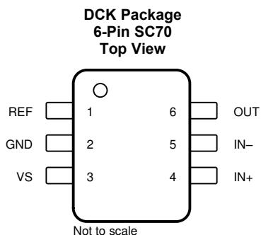

**DCK Package  
6-Pin SC70  
Top View**

Not to scale

Pinout diagram for DCK Package (6-Pin SC70) showing pins 1-6. Pin 1 is REF, 2 is GND, 3 is VS, 4 is IN+, 5 is IN-, and 6 is OUT. A circle indicates the top of the package.

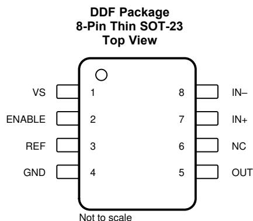

**DDF Package  
8-Pin Thin SOT-23  
Top View**

Not to scale

Pinout diagram for DDF Package (8-Pin Thin SOT-23) showing pins 1-8. Pin 1 is VS, 2 is ENABLE, 3 is REF, 4 is GND, 5 is OUT, 6 is NC, 7 is IN+, and 8 is IN-. A circle indicates the top of the package.

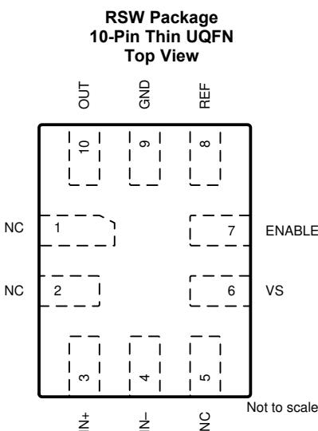

**RSW Package  
10-Pin Thin UQFN  
Top View**

Not to scale

Pinout diagram for RSW Package (10-Pin Thin UQFN) showing pins 1-10. Pin 1 is NC, 2 is NC, 3 is IN+, 4 is IN-, 5 is NC, 6 is VS, 7 is ENABLE, 8 is REF, 9 is GND, and 10 is OUT. A circle indicates the top of the package.

### Pin Functions

| PIN    |     |     |         | TYPE          | DESCRIPTION                                                                                                                                                                                                                                                                                                                                         |
|--------|-----|-----|---------|---------------|-----------------------------------------------------------------------------------------------------------------------------------------------------------------------------------------------------------------------------------------------------------------------------------------------------------------------------------------------------|
| NAME   | DCK | DDF | RSW     |               |                                                                                                                                                                                                                                                                                                                                                     |
| ENABLE | —   | 2   | 7       | Digital input | Enable pin. When this pin is driven to $V_S$ , the device is on and functions as a current sense amplifier. When this pin is driven to GND, the device is off, the supply current is reduced, and the output is placed in a high-impedance state. This pin must be driven externally, or connected to $V_S$ if not used. DDF and RSW packages only. |
| GND    | 2   | 4   | 9       | Analog        | Ground                                                                                                                                                                                                                                                                                                                                              |
| IN–    | 5   | 8   | 4       | Analog input  | Current-sense amplifier negative input. For high-side applications, connect to load side of sense resistor. For low-side applications, connect to ground side of sense resistor.                                                                                                                                                                    |
| IN+    | 4   | 7   | 3       | Analog input  | Current-sense amplifier positive input. For high-side applications, connect to bus voltage side of sense resistor. For low-side applications, connect to load side of sense resistor.                                                                                                                                                               |
| NC     | —   | 6   | 1, 2, 5 | —             | Not internally connected. Either float these pins or connect to any voltage between GND and $V_S$ .                                                                                                                                                                                                                                                 |
| OUT    | 6   | 5   | 10      | Analog output | OUT pin. This pin provides an analog voltage output that is the gained up voltage difference from the IN+ to the IN– pins, and is offset by the voltage applied to the REF pin.                                                                                                                                                                     |
| REF    | 1   | 3   | 8       | Analog input  | Reference input. Enables bidirectional current sensing with an externally applied voltage.                                                                                                                                                                                                                                                          |
| $V_S$  | 3   | 1   | 6       | Analog        | Power supply, 1.7 V to 5.5 V                                                                                                                                                                                                                                                                                                                        |

{3}------------------------------------------------

## 6 Specifications

### 6.1 Absolute Maximum Ratings

over operating free-air temperature range (unless otherwise noted)(1)

|                                     |                                           | MIN                                                                      | MAX                     | UNIT |
|-------------------------------------|-------------------------------------------|--------------------------------------------------------------------------|-------------------------|------|
| V S                      | Supply voltage                            |                                                                          | 6                       | V    |
| V IN+ , V IN- | Analog inputs: Differential (V IN+ ) – (V IN- ) (2) | –42 | 42 | V |
|  | Analog inputs: V IN+ , V IN- , with respect to GND (3) | GND – 0.3 | 42 | V |
| V ENABLE                 | ENABLE                                    | GND – 0.3                                                                | 6                       | V    |
|  | REF, OUT (3) | GND – 0.3 | (V S ) + 0.3 | V |
|                                     | Input current into any pin (3) |                                                                          | 5                       | mA   |
| T A                      | Operating temperature                     | –55                                                                      | 150                     | °C   |
| T J                      | Junction temperature                      |                                                                          | 150                     | °C   |
| T stg                    | Storage temperature                       | –65                                                                      | 150                     | °C   |

- (1) Stresses beyond those listed under *Absolute Maximum Ratings* may cause permanent damage to the device. These are stress ratings only, which do not imply functional operation of the device at these or any other conditions beyond those indicated under *Recommended Operating Conditions*. Exposure to absolute-maximum-rated conditions for extended periods may affect device reliability.
- (2) VIN+ and VIN- are the voltages at the IN+ and IN– pins, respectively.
- (3) Input voltage at any pin may exceed the voltage shown if the current at that pin is limited to 5 mA.

### 6.2 ESD Ratings

|  |  |  | VALUE | UNIT |
|---|---|---|---|---|
| V (ESD) | Electrostatic discharge | Human-body model (HBM), per ANSI/ESDA/JEDEC JS-001 (1) | ±3000 | V |
|  |  | Charged-device model (CDM), per JEDEC specification JESD22-C101 (2) | ±1000 | V |

- (1) JEDEC document JEP155 states that 500-V HBM allows safe manufacturing with a standard ESD control process.
- (2) JEDEC document JEP157 states that 250-V CDM allows safe manufacturing with a standard ESD control process.

### 6.3 Recommended Operating Conditions

over operating free-air temperature range (unless otherwise noted)

|                                     |                                | MIN       | NOM | MAX            | UNIT |
|-------------------------------------|--------------------------------|-----------|-----|----------------|------|
| V CM                     | Common-mode input range        | GND – 0.2 |     | 40             | V    |
| V IN+ , V IN- | Input pin voltage range        | GND – 0.2 |     | 40             | V    |
| V S                      | Operating supply voltage       | 1.7       |     | 5.5            | V    |
| V REF                    | Reference pin voltage range    | GND       |     | V S | V    |
| T A                      | Operating free-air temperature | –40       |     | 125            | °C   |

### 6.4 Thermal Information

| THERMAL METRIC (1) |                                              | INA190     |             |            | UNIT |
|-------------------------------|----------------------------------------------|------------|-------------|------------|------|
|                               |                                              | DCK (SC70) | DDF (SOT23) | RSW (UQFN) |      |
|                               |                                              | 6 PINS     | 8 PINS      | 10 PINS    |      |
| R θJA              | Junction-to-ambient thermal resistance       | 137.2      | 170.7       | 163.8      | °C/W |
| R θJC(top)         | Junction-to-case (top) thermal resistance    | 38.4       | 132.7       | 78.7       | °C/W |
| R θJB              | Junction-to-board thermal resistance         | 57.1       | 65.3        | 93.3       | °C/W |
| Ψ JT               | Junction-to-top characterization parameter   | 5.1        | 45.7        | 4.1        | °C/W |
| Ψ JB               | Junction-to-board characterization parameter | 56.6       | 65.2        | 92.8       | °C/W |
| R θJC(bot)         | Junction-to-case (bottom) thermal resistance | N/A        | N/A         | N/A        | °C/W |

- (1) For more information about traditional and new thermal metrics, see the [Semiconductor and IC Package Thermal Metrics](#) application report.

{4}------------------------------------------------

### 6.5 Electrical Characteristics

at  $T_A = 25^\circ\text{C}$ ,  $V_{\text{SENSE}} = V_{\text{IN}+} - V_{\text{IN}-}$ ,  $V_S = 1.8\text{ V to } 5.0\text{ V}$ ,  $V_{\text{IN}+} = 12\text{ V}$ ,  $V_{\text{REF}} = V_S / 2$ , and  $V_{\text{ENABLE}} = V_S$  (unless otherwise noted)

| PARAMETER                 |                                    | CONDITIONS                                                                                                                                                                         | MIN                | TYP                       | MAX                    | UNIT   |
|---------------------------|------------------------------------|------------------------------------------------------------------------------------------------------------------------------------------------------------------------------------|--------------------|---------------------------|------------------------|--------|
| <b>INPUT</b>              |                                    |                                                                                                                                                                                    |                    |                           |                        |        |
| CMRR                      | Common-mode rejection ratio        | $V_{\text{SENSE}} = 0\text{ mV}$ , $V_{\text{IN}+} = -0.1\text{ V to } 40\text{ V}$ , $T_A = -40^\circ\text{C to } +125^\circ\text{C}$                                             | 132                | 150                       |                        | dB     |
| $V_{\text{OS}}$           | Offset voltage, RTI (1) | $V_S = 1.8\text{ V}$ , $V_{\text{SENSE}} = 0\text{ mV}$                                                                                                                            |                    | -3                        | ±15                    | µV     |
| $dV_{\text{OS}}/dT$       | Offset drift, RTI                  | $V_{\text{SENSE}} = 0\text{ mV}$ , $T_A = -40^\circ\text{C to } +125^\circ\text{C}$                                                                                                |                    | 10                        | 80                     | nV/°C  |
| PSRR                      | Power-supply rejection ratio, RTI  | $V_{\text{SENSE}} = 0\text{ mV}$ , $V_S = 1.7\text{ V to } 5.5\text{ V}$                                                                                                           |                    | -1                        | ±5                     | µV/V   |
| $I_{\text{IB}}$           | Input bias current                 | $V_{\text{SENSE}} = 0\text{ mV}$                                                                                                                                                   |                    | 0.5                       | 3                      | nA     |
| $I_{\text{IO}}$           | Input offset current               | $V_{\text{SENSE}} = 0\text{ mV}$                                                                                                                                                   |                    | ±0.07                     |                        | nA     |
| <b>OUTPUT</b>             |                                    |                                                                                                                                                                                    |                    |                           |                        |        |
| G                         | Gain                               | A1 devices                                                                                                                                                                         |                    | 25                        |                        | V/V    |
|                           |                                    | A2 devices                                                                                                                                                                         |                    | 50                        |                        |        |
|                           |                                    | A3 devices                                                                                                                                                                         |                    | 100                       |                        |        |
|                           |                                    | A4 devices                                                                                                                                                                         |                    | 200                       |                        |        |
|                           |                                    | A5 devices                                                                                                                                                                         |                    | 500                       |                        |        |
| $E_G$ | Gain error | $V_{\text{OUT}} = 0.1\text{ V to } V_S - 0.1\text{ V}$, A1 devices |  | -0.04% | ±0.2% |  |
|  |  | A2, A3, A4 devices |  | -0.06% | ±0.3% |  |
|  |  | A5 devices |  | -0.08% | ±0.4% |  |
|                           | Gain error drift                   | $T_A = -40^\circ\text{C to } +125^\circ\text{C}$                                                                                                                                   |                    | 2                         | 7                      | ppm/°C |
|                           | Nonlinearity error                 | $V_{\text{OUT}} = 0.1\text{ V to } V_S - 0.1\text{ V}$                                                                                                                             |                    | ±0.01%                    |                        |        |
| RVRR | Reference voltage rejection ratio | $V_{\text{REF}} = 100\text{ mV to } V_S - 100\text{ mV}$ , $T_A = -40^\circ\text{C to } +125^\circ\text{C}$, A1 devices |  | ±2 | ±10 | µV/V |
|  |  | A2 devices |  | ±1 | ±6 |  |
|  |  | A3 devices |  | ±0.5 | ±4 |  |
|  |  | A4, A5 devices |  | ±0.25 | ±3 |  |
|                           | Maximum capacitive load            | No sustained oscillation                                                                                                                                                           |                    | 1                         |                        | nF     |
| <b>VOLTAGE OUTPUT</b>     |                                    |                                                                                                                                                                                    |                    |                           |                        |        |
| $V_{\text{SP}}$           | Swing to $V_S$ power-supply rail   | $V_S = 1.8\text{ V}$ , $R_L = 10\text{ k}\Omega$ to GND, $T_A = -40^\circ\text{C to } +125^\circ\text{C}$                                                                          |                    | $(V_S) - 20$              | $(V_S) - 40$           | mV     |
| $V_{\text{SN}}$           | Swing to GND                       | $V_S = 1.8\text{ V}$ , $R_L = 10\text{ k}\Omega$ to GND, $T_A = -40^\circ\text{C to } +125^\circ\text{C}$ , $V_{\text{SENSE}} = -10\text{ mV}$ , $V_{\text{REF}} = 0\text{ V}$  |                    | $(V_{\text{GND}}) + 0.05$ | $(V_{\text{GND}}) + 1$ | mV     |
| $V_{\text{ZL}}$ | Zero current output voltage | $V_S = 1.8\text{ V}$ , $R_L = 10\text{ k}\Omega$ to GND, $T_A = -40^\circ\text{C to } +125^\circ\text{C}$ , $V_{\text{SENSE}} = 0\text{ mV}$ , $V_{\text{REF}} = 0\text{ V}$, A1, A2, A3 devices |  | $(V_{\text{GND}}) + 1$ | $(V_{\text{GND}}) + 3$ | mV |
|  |  | A4 devices |  | $(V_{\text{GND}}) + 2$ | $(V_{\text{GND}}) + 4$ | mV |
|  |  | A5 devices |  | $(V_{\text{GND}}) + 3$ | $(V_{\text{GND}}) + 9$ | mV |
| <b>FREQUENCY RESPONSE</b> |                                    |                                                                                                                                                                                    |                    |                           |                        |        |
| BW                        | Bandwidth                          | A1 devices, $C_{\text{LOAD}} = 10\text{ pF}$                                                                                                                                       |                    | 45                        |                        | kHz    |
|                           |                                    | A2 devices, $C_{\text{LOAD}} = 10\text{ pF}$                                                                                                                                       |                    | 37                        |                        |        |
|                           |                                    | A3 devices, $C_{\text{LOAD}} = 10\text{ pF}$                                                                                                                                       |                    | 35                        |                        |        |
|                           |                                    | A4 devices, $C_{\text{LOAD}} = 10\text{ pF}$                                                                                                                                       |                    | 33                        |                        |        |
|                           |                                    | A5 devices, $C_{\text{LOAD}} = 10\text{ pF}$                                                                                                                                       |                    | 27                        |                        |        |
| SR                        | Slew rate                          | $V_S = 5.0\text{ V}$ , $V_{\text{OUT}} = 0.5\text{ V to } 4.5\text{ V}$                                                                                                            |                    | 0.3                       |                        | V/µs   |
| $t_s$                     | Settling time                      | From current step to within 1% of final value                                                                                                                                      |                    | 30                        |                        | µs     |

(1) RTI = referred-to-input.

{5}------------------------------------------------

### Electrical Characteristics (continued)

at  $T_A = 25^{\circ}\text{C}$ ,  $V_{\text{SENSE}} = V_{\text{IN}+} - V_{\text{IN}-}$ ,  $V_S = 1.8\text{ V to } 5.0\text{ V}$ ,  $V_{\text{IN}+} = 12\text{ V}$ ,  $V_{\text{REF}} = V_S / 2$ , and  $V_{\text{ENABLE}} = V_S$  (unless otherwise noted)

| PARAMETER                       | CONDITIONS                 |                                                                                                                | MIN              | TYP | MAX              | UNIT                   |
|---------------------------------|----------------------------|----------------------------------------------------------------------------------------------------------------|------------------|-----|------------------|------------------------|
| <b>NOISE, RTI(1)</b> |                            |                                                                                                                |                  |     |                  |                        |
|                                 | Voltage noise density      |                                                                                                                |                  | 75  |                  | nV/ $\sqrt{\text{Hz}}$ |
| <b>ENABLE</b>                   |                            |                                                                                                                |                  |     |                  |                        |
| $I_{\text{EN}}$                 | Leakage input current      | $0\text{ V} \leq V_{\text{ENABLE}} \leq V_S$                                                                   |                  | 1   | 100              | nA                     |
| $V_{\text{IH}}$                 | High-level input voltage   |                                                                                                                | $0.7 \times V_S$ |     | 6                | V                      |
| $V_{\text{IL}}$                 | Low-level input voltage    |                                                                                                                | 0                |     | $0.3 \times V_S$ | V                      |
| $V_{\text{HYS}}$                | Hysteresis                 |                                                                                                                |                  | 300 |                  | mV                     |
| $I_{\text{ODIS}}$               | Output leakage disabled    | $V_S = 5.0\text{ V}$ , $V_{\text{OUT}} = 0\text{ V to } 5.0\text{ V}$ , $V_{\text{ENABLE}} = 0\text{ V}$       |                  | 1   | 5                | μA                     |
| <b>POWER SUPPLY</b>             |                            |                                                                                                                |                  |     |                  |                        |
| $I_Q$                           | Quiescent current          | $V_S = 1.8\text{ V}$ , $V_{\text{SENSE}} = 0\text{ mV}$                                                        |                  | 48  | 65               | μA                     |
|                                 |                            | $V_S = 1.8\text{ V}$ , $V_{\text{SENSE}} = 0\text{ mV}$ , $T_A = -40^{\circ}\text{C to } +125^{\circ}\text{C}$ |                  |     | 90               | μA                     |
| $I_{\text{QDIS}}$               | Quiescent current disabled | $V_{\text{ENABLE}} = 0\text{ V}$ , $V_{\text{SENSE}} = 0\text{ mV}$                                            |                  | 10  | 100              | nA                     |

{6}------------------------------------------------

### 6.6 Typical Characteristics

at  $T_A = 25^{\circ}\text{C}$ ,  $V_S = 1.8\text{ V}$ ,  $V_{IN+} = 12\text{ V}$ ,  $V_{REF} = V_S / 2$ ,  $V_{ENABLE} = V_S$ , and for all gain options (unless otherwise noted)

**Figure 1. Input Offset Voltage Production Distribution**

**Figure 2. Offset Voltage vs Temperature**

**Figure 3. Common-Mode Rejection Production Distribution**

**Figure 4. Common-Mode Rejection Ratio vs Temperature**

**Figure 5. Gain Error Production Distribution**

**Figure 6. Gain Error Production Distribution**

A grid of six figures showing typical characteristics of the INA190. Figures 1, 3, and 5 are histograms showing the production distribution of Input Offset Voltage, Common-Mode Rejection Ratio, and Gain Error for A1 devices. Figures 2, 4, and 6 are line graphs showing the temperature dependence of these same parameters for A1, A2/A3/A4, and A2/A3/A4 devices respectively. All graphs show very low drift or variation over the temperature range of -50°C to 150°C.

{7}------------------------------------------------

### **Typical Characteristics (continued)**

at  $T_A = 25^\circ\text{C}$ ,  $V_S = 1.8\text{ V}$ ,  $V_{IN+} = 12\text{ V}$ ,  $V_{REF} = V_S / 2$ ,  $V_{ENABLE} = V_S$ , and for all gain options (unless otherwise noted)

Figure 7: Gain Error Production Distribution. A histogram showing the population distribution of gain error for A5 devices. The x-axis is 'Gain Error (%)' ranging from -0.4 to 0.4. The y-axis is 'Population'. The distribution is centered around 0% gain error, with the highest frequency between -0.12% and -0.08%.

**Figure 7. Gain Error Production Distribution**

Figure 8: Gain Error vs Temperature. A line graph showing gain error percentage versus temperature in degrees Celsius. The x-axis ranges from -50 to 150°C. The y-axis ranges from -0.2 to 0.2%. The curve is relatively flat, staying very close to 0% gain error across the temperature range.

**Figure 8. Gain Error vs Temperature**

Figure 9: Gain vs Frequency. A line graph showing gain in dB versus frequency in Hz for different gain settings (A1 to A5) at VS = 5 V. The x-axis is logarithmic from 10 Hz to 1 MHz. The y-axis ranges from -20 to 60 dB. All curves show a flat gain region followed by a roll-off at higher frequencies.

**Figure 9. Gain vs Frequency**

Figure 10: Power-Supply Rejection Ratio vs Frequency. A line graph showing the power-supply rejection ratio in dB versus frequency in Hz at VS = 5 V. The x-axis is logarithmic from 10 Hz to 1 MHz. The y-axis ranges from 0 to 140 dB. The rejection ratio is high at low frequencies and decreases as frequency increases.

**Figure 10. Power-Supply Rejection Ratio vs Frequency**

Figure 11: Common-Mode Rejection Ratio vs Frequency. A line graph showing the common-mode rejection ratio in dB versus frequency in Hz for A3 devices. The x-axis is logarithmic from 10 Hz to 1 MHz. The y-axis ranges from 40 to 160 dB. The CMRR is high at low frequencies and decreases with frequency.

**Figure 11. Common-Mode Rejection Ratio vs Frequency**

Figure 12: Output Voltage Swing vs Output Current. A two-part graph showing output voltage swing versus output current at VS = 1.8 V. The top part shows the upper swing limit, and the bottom part shows the lower swing limit. Both are plotted for -40°C, 25°C, and 125°C. The x-axis is output current from 0 to 11 mA.

**Figure 12. Output Voltage Swing vs Output Current**

{8}------------------------------------------------

### **Typical Characteristics (continued)**

at  $T_A = 25^{\circ}\text{C}$ ,  $V_S = 1.8\text{ V}$ ,  $V_{IN+} = 12\text{ V}$ ,  $V_{REF} = V_S / 2$ ,  $V_{ENABLE} = V_S$ , and for all gain options (unless otherwise noted)

Figure 13: Output Voltage Swing vs Output Current. The graph shows two sets of curves for Output Voltage Swing (V) versus Output Current (mA) at VS = 5.0 V. The top set shows the positive swing from V\_S down to V\_S-1 and V\_S-2. The bottom set shows the negative swing from GND+2 down to GND+1 and GND. Three curves are shown for temperatures of -40°C (black), 25°C (red), and 125°C (grey).

**Figure 13. Output Voltage Swing vs Output Current**

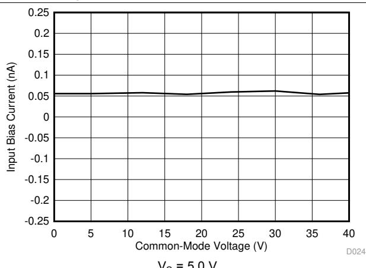

Figure 14: Input Bias Current vs Common-Mode Voltage. The graph plots Input Bias Current (nA) on the y-axis (from -0.25 to 0.25) against Common-Mode Voltage (V) on the x-axis (from 0 to 40) at VS = 5.0 V. The curve is nearly flat around 0 nA.

**Figure 14. Input Bias Current vs Common-Mode Voltage**

Figure 15: Input Bias Current vs Common-Mode Voltage (Shutdown). The graph plots Input Bias Current (nA) on the y-axis (from -0.25 to 0.25) against Common-Mode Voltage (V) on the x-axis (from 0 to 40) at V\_ENABLE = 0 V. The curve is nearly flat around 0 nA.

**Figure 15. Input Bias Current vs Common-Mode Voltage (Shutdown)**

Figure 16: Input Bias Current vs Temperature. The graph plots Input Bias Current (nA) on the y-axis (from -1 to 7) against Temperature (°C) on the x-axis (from -50 to 150). The current is near zero until about 100°C, then rises sharply to over 6 nA at 150°C.

**Figure 16. Input Bias Current vs Temperature**

Figure 17: Quiescent Current vs Temperature (Enabled). The graph plots Quiescent Current (µA) on the y-axis (from 35 to 80) against Temperature (°C) on the x-axis (from -50 to 150). Three curves are shown for VS = 1.8 V (black), 3.3 V (red), and 5.0 V (grey). All curves show a linear increase with temperature, with higher VS values resulting in higher quiescent current.

**Figure 17. Quiescent Current vs Temperature (Enabled)**

Figure 18: Quiescent Current vs Temperature (Disabled). The graph plots Quiescent Current (nA) on the y-axis (from -30 to 240) against Temperature (°C) on the x-axis (from -50 to 150) at V\_ENABLE = 0 V. Three curves are shown for VS = 1.8 V (black), 3.3 V (red), and 5.0 V (grey). The current is near zero until about 100°C, then rises sharply to over 200 nA at 150°C.

**Figure 18. Quiescent Current vs Temperature (Disabled)**

{9}------------------------------------------------

### **Typical Characteristics (continued)**

at  $T_A = 25^{\circ}\text{C}$ ,  $V_S = 1.8\text{ V}$ ,  $V_{IN+} = 12\text{ V}$ ,  $V_{REF} = V_S / 2$ ,  $V_{ENABLE} = V_S$ , and for all gain options (unless otherwise noted)

![Figure 19: Quiescent Current vs Common Mode Voltage. A line graph showing quiescent current in microamperes (µA) on the y-axis (40 to 70) versus common-mode voltage in volts (V) on the x-axis (-5 to 40). Two data series are shown: a black line for VS = 1.8 V and a red line for VS = 5 V. Both lines are nearly horizontal, indicating stable quiescent current across the voltage range. The red line is slightly higher than the black line. A label 'VS = 5.0 V' is at the bottom center. A small code 'D029' is in the bottom right corner.](img/33228b4227fa57e1477b27b9e07483e6_img.jpg)

Figure 19: Quiescent Current vs Common Mode Voltage. A line graph showing quiescent current in microamperes (µA) on the y-axis (40 to 70) versus common-mode voltage in volts (V) on the x-axis (-5 to 40). Two data series are shown: a black line for VS = 1.8 V and a red line for VS = 5 V. Both lines are nearly horizontal, indicating stable quiescent current across the voltage range. The red line is slightly higher than the black line. A label 'VS = 5.0 V' is at the bottom center. A small code 'D029' is in the bottom right corner.

**Figure 19. Quiescent Current vs Common Mode Voltage**

Figure 20: Input-Referred Voltage Noise vs Frequency. A log-log plot of input-referred voltage noise in nV/√Hz on the y-axis (10 to 100) versus frequency in Hertz (Hz) on the x-axis (10 to 100k). The noise is relatively flat at approximately 80 nV/√Hz from 10 Hz to about 10 kHz, then it drops sharply to a minimum of about 25 nV/√Hz around 30 kHz before rising again. A label 'A3 devices' is at the bottom center. A small code 'D030' is in the bottom right corner.

**Figure 20. Input-Referred Voltage Noise vs Frequency**

Figure 21: 0.1-Hz to 10-Hz Voltage Noise (Referred-To-Input). A time-domain plot of referred-to-input voltage noise in µV/div on the y-axis versus time in seconds (s) on the x-axis (1 s/div). The plot shows a noisy signal centered around zero. A label 'A3 devices' is at the bottom center. A small code 'D031' is in the bottom right corner.

**Figure 21. 0.1-Hz to 10-Hz Voltage Noise (Referred-To-Input)**

Figure 22: Step Response (10-mVPP Input Step). A time-domain plot showing the output voltage response to a step input. The y-axis has two scales: output voltage in mV/div (500 mV/div) and input voltage in mV/div (5 mV/div). The input voltage (black line) is a square wave. The output voltage (red line) follows the input with a finite rise and fall time. A label 'VS = 5.0 V, A3 devices' is at the bottom center. A small code 'D032' is in the bottom right corner.

**Figure 22. Step Response (10-mVPP Input Step)**

![Figure 23: Common-Mode Voltage Transient Response. A time-domain plot showing the transient response of the output to a common-mode voltage step. The y-axis has two scales: common-mode voltage in V/div (10 V/div) and output voltage (VOUT) in mV/div (100mV/div). The common-mode voltage (black line) is a square wave. The output voltage (red line) shows a small transient spike at the edges of the common-mode voltage steps. A label 'A3 devices' is at the bottom center. A small code 'D033' is in the bottom right corner.](img/91b7db8990b37ee7c7646b8df81bc199_img.jpg)

Figure 23: Common-Mode Voltage Transient Response. A time-domain plot showing the transient response of the output to a common-mode voltage step. The y-axis has two scales: common-mode voltage in V/div (10 V/div) and output voltage (VOUT) in mV/div (100mV/div). The common-mode voltage (black line) is a square wave. The output voltage (red line) shows a small transient spike at the edges of the common-mode voltage steps. A label 'A3 devices' is at the bottom center. A small code 'D033' is in the bottom right corner.

**Figure 23. Common-Mode Voltage Transient Response**

Figure 24: Inverting Differential Input Overload. A time-domain plot showing the output response to an inverting differential input overload. The y-axis is voltage in V/div (2 V/div). The inverting input (black line) is a square wave. The output (red line) shows a sharp transition between two levels. A label 'A3 devices' is at the bottom center. A small code 'D034' is in the bottom right corner.

**Figure 24. Inverting Differential Input Overload**

{10}------------------------------------------------

### **Typical Characteristics (continued)**

at  $T_A = 25^{\circ}\text{C}$ ,  $V_S = 1.8\text{ V}$ ,  $V_{IN+} = 12\text{ V}$ ,  $V_{REF} = V_S / 2$ ,  $V_{ENABLE} = V_S$ , and for all gain options (unless otherwise noted)

Figure 25: Noninverting Differential Input Overload. A graph showing Voltage (2 V/div) vs Time (250 µs/div). The non-inverting input (black line) is stepped from 0V to 12V and back. The output (red line) shows a temporary saturation during the high state. V\_S = 5.0 V, A3 devices. D035

**Figure 25. Noninverting Differential Input Overload**

Figure 26: Start-Up Response. A graph showing Voltage (1 V/div) vs Time (10 µs/div). The supply voltage (black line) is stepped from 0V to 5V. The output voltage (red line) shows a transient response with a small undershoot before settling. V\_S = 5.0 V, A3 devices. D036

**Figure 26. Start-Up Response**

Figure 27: Brownout Recovery. A graph showing Voltage (1 V/div) vs Time (100 µs/div). The supply voltage (black line) is stepped down and then back up. The output voltage (red line) shows a momentary loss of output during the brownout period. V\_S = 5.0 V, A3 devices. D037

**Figure 27. Brownout Recovery**

Figure 28: Enable and Disable Response. A graph showing Voltage (1 V/div) vs Time (250 µs/div). The enable signal (black line) is stepped from low to high and back. The output (red line) follows the enable signal with a slight delay. V\_S = 5.0 V, A3 devices. D038

**Figure 28. Enable and Disable Response**

Figure 29: IB+ and IB- vs Differential Input Voltage. A graph showing Input Bias Current (nA) vs Differential Input Voltage (mV). The graph plots IBP (black line) and IBN (red line) for A1 devices. Both currents increase linearly with differential input voltage. V\_S = 5.0 V, V\_REF = 2.5 V, A1 devices. D039

**Figure 29. IB+ and IB- vs Differential Input Voltage**

Figure 30: IB+ and IB- vs Differential Input Voltage. A graph showing Input Bias Current (nA) vs Differential Input Voltage (mV). The graph plots IBP (black line) and IBN (red line) for A2, A3, A4, and A5 devices. The trends are similar to Figure 29 but with different magnitudes. V\_S = 5.0 V, V\_REF = 2.5 V, A2, A3, A4, A5 devices. D047

**Figure 30. IB+ and IB- vs Differential Input Voltage**

{11}------------------------------------------------

### **Typical Characteristics (continued)**

at  $T_A = 25^\circ\text{C}$ ,  $V_S = 1.8\text{ V}$ ,  $V_{IN+} = 12\text{ V}$ ,  $V_{REF} = V_S / 2$ ,  $V_{ENABLE} = V_S$ , and for all gain options (unless otherwise noted)

![Figure 31: Output Leakage vs Output Voltage (A1, A2, and A3 Devices). This line graph plots Output Leakage Current (μA) on the y-axis (from -1 to 1.25) against Output Voltage (V) on the x-axis (from 0 to 5). Three curves are shown for different temperatures: -40°C (black), 25°C (red), and 125°C (grey). The leakage current increases linearly with output voltage, crossing zero at approximately 2.5V. The 125°C curve shows the highest leakage, while the -40°C curve shows the lowest. Test conditions: V_S = 5.0 V, V_ENABLE = 0 V, V_REF = 2.5 V.](img/dd330f8b8f6c16eae20c3a676b4eb804_img.jpg)

Figure 31: Output Leakage vs Output Voltage (A1, A2, and A3 Devices). This line graph plots Output Leakage Current (μA) on the y-axis (from -1 to 1.25) against Output Voltage (V) on the x-axis (from 0 to 5). Three curves are shown for different temperatures: -40°C (black), 25°C (red), and 125°C (grey). The leakage current increases linearly with output voltage, crossing zero at approximately 2.5V. The 125°C curve shows the highest leakage, while the -40°C curve shows the lowest. Test conditions: V\_S = 5.0 V, V\_ENABLE = 0 V, V\_REF = 2.5 V.

**Figure 31. Output Leakage vs Output Voltage (A1, A2, and A3 Devices)**

![Figure 32: Output Leakage vs Output Voltage (A4 and A5 Devices). This line graph plots Output Leakage Current (μA) on the y-axis (from -2.5 to 3) against Output Voltage (V) on the x-axis (from 0 to 5). Three curves are shown for different temperatures: 25°C (black), -40°C (red), and 125°C (grey). The leakage current increases linearly with output voltage, crossing zero at approximately 2.5V. The 125°C curve shows the highest leakage, while the -40°C curve shows the lowest. Test conditions: V_S = 5.0 V, V_ENABLE = 0 V, V_REF = 2.5 V.](img/624d9669faa18991d525fea5f0e03269_img.jpg)

Figure 32: Output Leakage vs Output Voltage (A4 and A5 Devices). This line graph plots Output Leakage Current (μA) on the y-axis (from -2.5 to 3) against Output Voltage (V) on the x-axis (from 0 to 5). Three curves are shown for different temperatures: 25°C (black), -40°C (red), and 125°C (grey). The leakage current increases linearly with output voltage, crossing zero at approximately 2.5V. The 125°C curve shows the highest leakage, while the -40°C curve shows the lowest. Test conditions: V\_S = 5.0 V, V\_ENABLE = 0 V, V\_REF = 2.5 V.

**Figure 32. Output Leakage vs Output Voltage (A4 and A5 Devices)**

![Figure 33: Output Impedance vs Frequency. This log-log plot shows Output Impedance (Ω) on the y-axis (from 0.1 to 5000) versus Frequency (Hz) on the x-axis (from 10 to 10M). Five curves represent different gain variants: A1 (black), A2 (red), A3 (grey), A4 (blue), and A5 (green). All variants show a sharp increase in output impedance starting around 10 kHz, peaking between 1 MHz and 10 MHz, and then slightly decreasing. A5 has the highest peak impedance, while A1 has the lowest. Test conditions: V_S = 5.0 V, V_CM = 0 V.](img/79d61011f426d34fb542d86176482d2c_img.jpg)

Figure 33: Output Impedance vs Frequency. This log-log plot shows Output Impedance (Ω) on the y-axis (from 0.1 to 5000) versus Frequency (Hz) on the x-axis (from 10 to 10M). Five curves represent different gain variants: A1 (black), A2 (red), A3 (grey), A4 (blue), and A5 (green). All variants show a sharp increase in output impedance starting around 10 kHz, peaking between 1 MHz and 10 MHz, and then slightly decreasing. A5 has the highest peak impedance, while A1 has the lowest. Test conditions: V\_S = 5.0 V, V\_CM = 0 V.

**Figure 33. Output Impedance vs Frequency**

{12}------------------------------------------------

## 7 Detailed Description

### 7.1 Overview

The INA190 is a low bias current, low offset, 40-V common-mode, current-sensing amplifier. The DDF SOT-23 and RSW UQFN packages also feature an enable pin. The INA190 is a specially designed, current-sensing amplifier that accurately measures voltages developed across current-sensing resistors on common-mode voltages that far exceed the supply voltage. Current is measured on input voltage rails as high as 40 V at  $V_{IN+}$  and  $V_{IN-}$ , with a supply voltage,  $V_S$ , as low as 1.7 V. When disabled, the output goes to a high-impedance state, and the supply current draw is reduced to less than 0.1  $\mu A$ . The INA190 is intended for use in both low-side and high-side current-sensing configurations where high accuracy and low current consumption are required.

### 7.2 Functional Block Diagram

![Functional block diagram of the INA190 current-sensing amplifier. The diagram shows a differential amplifier configuration. Two input terminals, IN+ and IN-, are connected to the non-inverting inputs (+) of two operational amplifiers. The outputs of these amplifiers are connected to a second-stage differential amplifier. The second-stage amplifier's output is connected to the OUT pin. A reference input (REF) is connected to the second-stage amplifier's output. The power supply pins are VS (positive supply) and GND (ground). An ENABLE pin is also shown, connected to the first-stage amplifiers. The diagram includes various internal components like capacitors, resistors, and operational amplifiers, illustrating the internal structure of the INA190.](img/4636adff5682a064f0ae5f13a1d464a6_img.jpg)

Functional block diagram of the INA190 current-sensing amplifier. The diagram shows a differential amplifier configuration. Two input terminals, IN+ and IN-, are connected to the non-inverting inputs (+) of two operational amplifiers. The outputs of these amplifiers are connected to a second-stage differential amplifier. The second-stage amplifier's output is connected to the OUT pin. A reference input (REF) is connected to the second-stage amplifier's output. The power supply pins are VS (positive supply) and GND (ground). An ENABLE pin is also shown, connected to the first-stage amplifiers. The diagram includes various internal components like capacitors, resistors, and operational amplifiers, illustrating the internal structure of the INA190.

(1) The ENABLE pin is available only in the DDF and RSW packages.

{13}------------------------------------------------

### 7.3 Feature Description

#### 7.3.1 Precision Current Measurement

The INA190 allows for accurate current measurements over a wide dynamic range. The high accuracy of the device is attributable to the low gain error and offset specifications. The offset voltage of the INA190 is less than 15 µV. In this case, the low offset improves the accuracy at light loads when  $V_{IN+}$  approaches  $V_{IN-}$ . Another advantage of low offset is the ability to use a lower-value shunt resistor that reduces the power loss in the current-sense circuit, and improves the power efficiency of the end application.

The maximum gain error of the INA190 is specified between 0.2% and 0.4% of the actual value, depending on the gain option. As the sensed voltage becomes much larger than the offset voltage, the gain error becomes the dominant source of error in the current-sense measurement. When the device monitors currents near the full-scale output range, the total measurement error approaches the value of the gain error.

#### 7.3.2 Low Input Bias Current

The INA190 is different from many current-sense amplifiers because this device offers very low input bias current. The low input bias current of the INA190 has three primary benefits.

The first benefit is the reduction of the current consumed by the device in both the enabled and disabled states. Classical current-sense amplifier topologies typically consume tens of microamps of current at the inputs. For these amplifiers, the input current is the result of the resistor network that sets the gain and additional current to bias the input amplifier. To reduce the bias current to near zero, the INA190 uses a capacitively coupled amplifier on the input stage, followed by a difference amplifier on the output stage.

The second benefit of low bias current is the ability to use input filters to reject high-frequency noise before the signal is amplified. In a traditional current-sense amplifier, the addition of input filters comes at the cost of reduced accuracy. However, as a result of the low bias currents, input filters have little effect on the measurement accuracy of the INA190.

The third benefit of low bias current is the ability to use a larger current-sense resistor. This ability allows the device to accurately monitor currents as low as 1 µA.

#### 7.3.3 Low Quiescent Current With Output Enable

The device features low quiescent current ( $I_Q$ ), while still providing sufficient small-signal bandwidth to be usable in most applications. The quiescent current of the INA190 is only 48 µA (typ), while providing a small-signal bandwidth of 35 kHz in a gain of 100. The low  $I_Q$  and good bandwidth allow the device to be used in many portable electronic systems without excessive drain on the battery. Because many applications only need to periodically monitor current, the INA190 features an enable pin that turns off the device until needed. When in the disabled state, the INA190 typically draws 10 nA of total supply current.

#### 7.3.4 Bidirectional Current Monitoring

INA190 devices can sense current flow through a sense resistor in both directions. The bidirectional current-sensing capability is achieved by applying a voltage at the REF pin to offset the output voltage. A positive differential voltage sensed at the inputs results in an output voltage that is greater than the applied reference voltage. Likewise, a negative differential voltage at the inputs results in output voltage that is less than the applied reference voltage. The output voltage of the current-sense amplifier is shown in [Equation 1](#).

$$V_{OUT} = (I_{LOAD} \times R_{SENSE} \times GAIN) + V_{REF}$$

where

- $I_{LOAD}$  is the load current to be monitored.
- $R_{SENSE}$  is the current-sense resistor.
- GAIN is the gain option of the selected device.
- $V_{REF}$  is the voltage applied to the REF pin.
- (1)

{14}------------------------------------------------

### Feature Description (continued)

#### 7.3.5 High-Side and Low-Side Current Sensing

The INA190 supports input common-mode voltages from  $-0.2\text{ V}$  to  $+40\text{ V}$ . Because of the internal topology, the common-mode range is not restricted by the power-supply voltage ( $V_S$ ). The ability to operate with common-mode voltages greater or less than  $V_S$  allows the INA190 to be used in high-side and low-side current-sensing applications, as shown in [Figure 34](#).

![Figure 34: High-Side and Low-Side Sensing Connections. The diagram shows two circuit configurations for current sensing. The top configuration is 'High-Side Sensing', where a sense resistor R_SENSE is placed between the 'Bus Supply up to +40 V' and the load. The INA190's IN+ and IN- inputs are connected to the voltage drops across R_SENSE. A note states: 'High-Side Sensing Common-mode voltage (V_CM) is bus-voltage dependent.' The bottom configuration is 'Low-Side Sensing', where a sense resistor R_SENSE is placed between the load and ground. The INA190's IN+ and IN- inputs are connected to the voltage drops across R_SENSE. A note states: 'Low-Side Sensing Common-mode voltage (V_CM) is always near ground and is isolated from bus-voltage spikes.'](img/bffdddb47fced140f8d17fdc2a29f592_img.jpg)

Figure 34: High-Side and Low-Side Sensing Connections. The diagram shows two circuit configurations for current sensing. The top configuration is 'High-Side Sensing', where a sense resistor R\_SENSE is placed between the 'Bus Supply up to +40 V' and the load. The INA190's IN+ and IN- inputs are connected to the voltage drops across R\_SENSE. A note states: 'High-Side Sensing Common-mode voltage (V\_CM) is bus-voltage dependent.' The bottom configuration is 'Low-Side Sensing', where a sense resistor R\_SENSE is placed between the load and ground. The INA190's IN+ and IN- inputs are connected to the voltage drops across R\_SENSE. A note states: 'Low-Side Sensing Common-mode voltage (V\_CM) is always near ground and is isolated from bus-voltage spikes.'

**Figure 34. High-Side and Low-Side Sensing Connections**

#### 7.3.6 High Common-Mode Rejection

The INA190 uses a capacitively coupled amplifier on the front end. Therefore, dc common-mode voltages are blocked from downstream circuits, resulting in very high common-mode rejection. Typically, the common-mode rejection of the INA190 is approximately 150 dB. The ability to reject changes in the dc common-mode voltage allows the INA190 to monitor both high- and low-voltage rail currents with very little change in the offset voltage.

#### 7.3.7 Rail-to-Rail Output Swing

The INA190 allows linear current-sensing operation with the output close to the supply rail and ground. The maximum specified output swing to the positive rail is  $V_S - 40\text{ mV}$ , and the maximum specified output swing to GND is only  $\text{GND} + 1\text{ mV}$ . The close-to-rail output swing is useful to maximize the usable output range, particularly when operating the device from a 1.8-V supply.

{15}------------------------------------------------

### 7.4 Device Functional Modes

#### 7.4.1 Normal Operation

The INA190 is in normal operation when the following conditions are met:

- The power-supply voltage ( $V_S$ ) is between 1.7 V and 5.5 V.
- The common-mode voltage ( $V_{CM}$ ) is within the specified range of  $-0.2$  V to  $+40$  V.
- The maximum differential input signal times the gain plus  $V_{REF}$  is less than the positive swing voltage  $V_{SP}$ .
- The ENABLE pin is driven or connected to  $V_S$ .
- The minimum differential input signal times the gain plus  $V_{REF}$  is greater than the zero load swing to GND,  $V_{ZL}$  (see the [Rail-to-Rail Output Swing](#) section).

During normal operation, this device produces an output voltage that is the *amplified* representation of the difference voltage from IN+ to IN– plus the voltage applied to the REF pin.

#### 7.4.2 Unidirectional Mode

This device can be configured to monitor current flowing in one direction (unidirectional) or in both directions (bidirectional) depending on how the REF pin is connected. The most common case is unidirectional where the output is set to ground when no current is flowing by connecting the REF pin to ground, as shown in [Figure 35](#). When the current flows from the bus supply to the load, the input voltage from IN+ to IN– increases and causes the output voltage at the OUT pin to increase.

![Figure 35: Typical Unidirectional Application circuit diagram. The circuit shows a bus voltage up to 40 V connected to a load and a sense resistor R sense. The current I sense flows through R sense. The INA190 is configured with its IN- pin connected to the node between the bus and R sense, and its IN+ pin connected to the node between R sense and the load. The REF pin is connected to ground. The power supply pins are connected to a supply voltage V_S (1.7 V to 5.5 V) and ground. A bypass capacitor C BYPASS (0.1 µF) is connected between the supply and ground. The output V out is shown at the OUT pin. The internal block diagram of the INA190 shows a capacitive coupled amplifier between the inputs, followed by a differential amplifier stage with feedback resistors, and a reference voltage input stage.](img/96b0240f56d14453b5da05ec30fd5c6e_img.jpg)

Figure 35: Typical Unidirectional Application circuit diagram. The circuit shows a bus voltage up to 40 V connected to a load and a sense resistor R sense. The current I sense flows through R sense. The INA190 is configured with its IN- pin connected to the node between the bus and R sense, and its IN+ pin connected to the node between R sense and the load. The REF pin is connected to ground. The power supply pins are connected to a supply voltage V\_S (1.7 V to 5.5 V) and ground. A bypass capacitor C BYPASS (0.1 µF) is connected between the supply and ground. The output V out is shown at the OUT pin. The internal block diagram of the INA190 shows a capacitive coupled amplifier between the inputs, followed by a differential amplifier stage with feedback resistors, and a reference voltage input stage.

**Figure 35. Typical Unidirectional Application**

The linear range of the output stage is limited by how close the output voltage can approach ground under zero input conditions. The zero current output voltage of the INA190 is very small and for most unidirectional applications the REF pin is simply grounded. However, if the measured current multiplied by the current sense resistor and device gain is less than the zero current output voltage then bias the REF pin to a convenient value above the zero current output voltage to get the output into the linear range of the device. To limit common-mode rejection errors, buffer the reference voltage connected to the REF pin.

A less-frequently used output biasing method is to connect the REF pin to the power-supply voltage,  $V_S$ . This method results in the output voltage saturating at 40 mV less than the supply voltage when no differential input voltage is present. This method is similar to the output saturated low condition with no differential input voltage when the REF pin is connected to ground. The output voltage in this configuration only responds to currents that develop negative differential input voltage relative to the device IN– pin. Under these conditions, when the negative differential input signal increases, the output voltage moves downward from the saturated supply voltage. The voltage applied to the REF pin must not exceed  $V_S$ .

{16}------------------------------------------------

### Device Functional Modes (continued)

Another use for the REF pin in unidirectional operation is to level shift the output voltage. [Figure 36](#) shows an application where the device ground is set to a negative voltage so currents biased to negative supplies, as seen in optical networking cards, can be measured. The GND of the INA190 can be set to negative voltages, as long as the inputs do not violate the common-mode range specification and the voltage difference between VS and GND does not exceed 5.5 V. In this example, the output of the INA190 is fed into a positive-biased ADC. By grounding the REF pin, the voltages at the output will be positive and not damage the ADC. To make sure the output voltage never goes negative, the supply sequencing must be the positive supply first, followed by the negative supply.

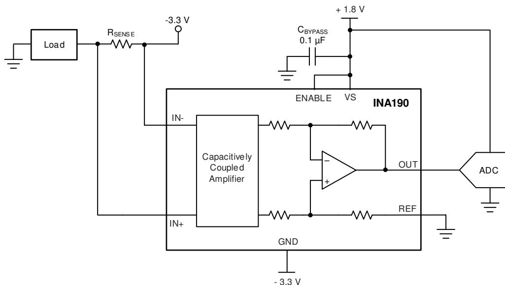

The diagram illustrates a level-shifting application for the INA190. The device's GND pin is connected to a -3.3 V supply. The VS pin is connected to a +1.8 V supply, which is also connected to the REF pin. A bypass capacitor  $C_{BYPASS}$  of 0.1  $\mu F$  is connected between VS and GND. The inputs IN+ and IN- are connected to a load and a sense resistor  $R_{SENSE}$  respectively. The internal architecture shows a 'Capacitively Coupled Amplifier' block followed by a differential amplifier stage. The output of the differential amplifier is connected to the OUT pin, which is then fed into an ADC. The ADC's reference is tied to ground. The REF pin is also connected to ground through a resistor.

Circuit diagram of INA190 level-shifting application.

**Figure 36. Using the REF Pin to Level-Shift Output Voltage**

{17}------------------------------------------------

### Device Functional Modes (continued)

#### 7.4.3 Bidirectional Mode

The INA190 devices are bidirectional current-sense amplifiers capable of measuring currents through a resistive shunt in two directions. This bidirectional monitoring is common in applications that include charging and discharging operations where the current flowing through the resistor can change directions.

![Figure 37: Bidirectional Application circuit diagram. The INA190 is configured as a bidirectional current-sense amplifier. A sense resistor (R sense) is placed in the ground line between a load and a 40 V bus. The current (I sense) flows through this resistor. The INA190's IN- pin is connected to the node between the bus and the load, while the IN+ pin is connected to the ground line after the sense resistor. The amplifier's output (V out) is connected to a reference voltage (V ref) through a switch. The reference voltage is set by a voltage divider. The INA190 is powered by a supply voltage (V s) ranging from 1.7 V to 5.5 V, with a bypass capacitor (C bypass) of 0.1 uF. The device is also connected to ground (GND).](img/77464a47f104d0d647b2414591137b64_img.jpg)

Figure 37: Bidirectional Application circuit diagram. The INA190 is configured as a bidirectional current-sense amplifier. A sense resistor (R sense) is placed in the ground line between a load and a 40 V bus. The current (I sense) flows through this resistor. The INA190's IN- pin is connected to the node between the bus and the load, while the IN+ pin is connected to the ground line after the sense resistor. The amplifier's output (V out) is connected to a reference voltage (V ref) through a switch. The reference voltage is set by a voltage divider. The INA190 is powered by a supply voltage (V s) ranging from 1.7 V to 5.5 V, with a bypass capacitor (C bypass) of 0.1 uF. The device is also connected to ground (GND).

**Figure 37. Bidirectional Application**

The ability to measure this current flowing in both directions is achieved by applying a voltage to the REF pin, as shown in [Figure 37](#). The voltage applied to REF ( $V_{REF}$ ) sets the output state that corresponds to the zero-input level state. The output then responds by increasing above  $V_{REF}$  for positive differential signals (relative to the IN- pin) and responds by decreasing below  $V_{REF}$  for negative differential signals. This reference voltage applied to the REF pin can be set anywhere between 0 V to  $V_S$ . For bidirectional applications,  $V_{REF}$  is typically set at  $V_S/2$  for equal signal range in both current directions. In some cases,  $V_{REF}$  is set at a voltage other than  $V_S/2$ ; for example, when the bidirectional current and corresponding output signal do not need to be symmetrical.

#### 7.4.4 Input Differential Overload

If the differential input voltage ( $V_{IN+} - V_{IN-}$ ) times gain exceeds the voltage swing specification, the INA190 drives its output as close as possible to the positive supply or ground, and does not provide accurate measurement of the differential input voltage. If this input overload occurs during normal circuit operation, then reduce the value of the shunt resistor or use a lower-gain version with the chosen sense resistor to avoid this mode of operation. If a differential overload occurs in a time-limited fault event, then the output of the INA190 returns to the expected value approximately 80  $\mu s$  after the fault condition is removed.

{18}------------------------------------------------

### Device Functional Modes (continued)

#### 7.4.5 Shutdown

The INA190 features an active-high ENABLE pin that shuts down the device when pulled to ground. When the device is shut down, the quiescent current is reduced to 10 nA (typ), and the output goes to a high-impedance state. In a battery-powered application, the low quiescent current extends the battery lifetime when the current measurement is not needed. When the ENABLE pin is driven to the supply voltage, the device turns back on. The typical output settling time when enabled is 130 µs.

The output of the INA190 goes to a high-impedance state when disabled. Therefore, you can connect multiple outputs of the INA190 together to a single ADC or measurement device, as shown in Figure 38.

When connected in this way, enable only one INA190 at a time, and make sure all devices have the same supply voltage.

![Circuit diagram showing two INA190 devices multiplexed together. Both devices have their IN+, IN-, and REF pins connected to ground. The OUT pins of both devices are connected to the input of a single ADC. The ADC is connected to a Microcontroller via GPIO1 and GPIO2 pins. The Microcontroller's GPIO1 is connected to the ENABLE pin of the top INA190, and its GPIO2 is connected to the ENABLE pin of the bottom INA190. Each INA190 has its VS pin connected to a 1.7 V to 5.5 V supply and its GND pin connected to ground. Each device also has a separate input section with a sense resistor (RSENSE) and a load, connected to a bus voltage (Bus Voltage1 and Bus Voltage2, both up to +40 V). A 0.1 µF capacitor is connected between the VS and GND pins of each device.](img/04f51626e2e10a16e3eb2c4b33cb2742_img.jpg)

Circuit diagram showing two INA190 devices multiplexed together. Both devices have their IN+, IN-, and REF pins connected to ground. The OUT pins of both devices are connected to the input of a single ADC. The ADC is connected to a Microcontroller via GPIO1 and GPIO2 pins. The Microcontroller's GPIO1 is connected to the ENABLE pin of the top INA190, and its GPIO2 is connected to the ENABLE pin of the bottom INA190. Each INA190 has its VS pin connected to a 1.7 V to 5.5 V supply and its GND pin connected to ground. Each device also has a separate input section with a sense resistor (RSENSE) and a load, connected to a bus voltage (Bus Voltage1 and Bus Voltage2, both up to +40 V). A 0.1 µF capacitor is connected between the VS and GND pins of each device.

**Figure 38. Multiplexing Multiple Devices With the ENABLE Pin**

{19}------------------------------------------------

## 8 Application and Implementation

###### NOTE

Information in the following applications sections is not part of the TI component specification, and TI does not warrant its accuracy or completeness. TI's customers are responsible for determining suitability of components for their purposes. Customers should validate and test their design implementation to confirm system functionality.

### 8.1 Application Information

The INA190 amplifies the voltage developed across a current-sensing resistor as current flows through the resistor to the load or ground. The high common-mode rejection of the INA190 make it usable over a wide range of voltage rails while still maintaining an accurate current measurement.

#### 8.1.1 Basic Connections

Figure 39 shows the basic connections of the INA190. Place the device as close as possible to the current sense resistor and connect the input pins (IN+ and IN-) to the current sense resistor through kelvin connections. If present, the ENABLE pin must be controlled externally or connected to VS if not used.

![Figure 39: Basic Connections for the INA190. The diagram shows the INA190 IC connected to a current sense resistor (RSENSE) and a load. The input pins (IN+ and IN-) are connected to the sense resistor. The output (OUT) is connected to an ADC, which is then connected to a Microcontroller. The REF pin is connected to the ADC reference input. The supply voltage (VS) is connected to a 0.1 µF capacitor. The ground (GND) is connected to the ADC ground. The ENABLE pin is shown with a switch symbol, indicating it can be controlled externally or connected to VS.](img/d79d33da852cb7bca3e87b400a15c3e8_img.jpg)

The diagram illustrates the basic connections for the INA190. The device is connected to a current sense resistor (RSENSE) and a load. The input pins (IN+ and IN-) are connected to the sense resistor. The output (OUT) is connected to an ADC, which is then connected to a Microcontroller. The REF pin is connected to the ADC reference input. The supply voltage (VS) is connected to a 0.1 µF capacitor. The ground (GND) is connected to the ADC ground. The ENABLE pin is shown with a switch symbol, indicating it can be controlled externally or connected to VS.

Figure 39: Basic Connections for the INA190. The diagram shows the INA190 IC connected to a current sense resistor (RSENSE) and a load. The input pins (IN+ and IN-) are connected to the sense resistor. The output (OUT) is connected to an ADC, which is then connected to a Microcontroller. The REF pin is connected to the ADC reference input. The supply voltage (VS) is connected to a 0.1 µF capacitor. The ground (GND) is connected to the ADC ground. The ENABLE pin is shown with a switch symbol, indicating it can be controlled externally or connected to VS.

- (1) The ENABLE pin is available only in the DDF and RSW packages.

NOTE: To help eliminate ground offset errors between the device and the analog-to-digital converter (ADC), connect the REF pin to the ADC reference input. When driving SAR ADCs, filter or buffer the output of the INA190 before connecting directly to the ADC.

**Figure 39. Basic Connections for the INA190**

{20}------------------------------------------------

## Application Information (continued)

#### 8.1.2 $R_{\text{SENSE}}$ and Device Gain Selection

The accuracy of any current-sense amplifier is maximized by choosing the current-sense resistor to be as large as possible. A large sense resistor maximizes the differential input signal for a given amount of current flow and reduces the error contribution of the offset voltage. However, there are practical limits as to how large the current-sense resistor can be in a given application because of the resistor size and maximum allowable power dissipation. [Equation 2](#) gives the maximum value for the current-sense resistor for a given power dissipation budget:

$$R_{\text{SENSE}} < \frac{PD_{\text{MAX}}}{I_{\text{MAX}}^2}$$

where:

- $PD_{\text{MAX}}$  is the maximum allowable power dissipation in  $R_{\text{SENSE}}$ .
- $I_{\text{MAX}}$  is the maximum current that will flow through  $R_{\text{SENSE}}$ .

(2)

An additional limitation on the size of the current-sense resistor and device gain is due to the power-supply voltage,  $V_S$ , and device swing-to-rail limitations. In order to make sure that the current-sense signal is properly passed to the output, both positive and negative output swing limitations must be examined. [Equation 3](#) provides the maximum values of  $R_{\text{SENSE}}$  and GAIN to keep the device from exceeding the positive swing limitation.

$$I_{\text{MAX}} \times R_{\text{SENSE}} \times \text{GAIN} < V_{\text{SP}} - V_{\text{REF}}$$

where:

- $I_{\text{MAX}}$  is the maximum current that will flow through  $R_{\text{SENSE}}$ .
- GAIN is the gain of the current-sense amplifier.
- $V_{\text{SP}}$  is the positive output swing as specified in the data sheet.
- $V_{\text{REF}}$  is the externally applied voltage on the REF pin.

(3)

To avoid positive output swing limitations when selecting the value of  $R_{\text{SENSE}}$ , there is always a trade-off between the value of the sense resistor and the gain of the device under consideration. If the sense resistor selected for the maximum power dissipation is too large, then it is possible to select a lower-gain device in order to avoid positive swing limitations.

The negative swing limitation places a limit on how small the sense resistor value can be for a given application. [Equation 4](#) provides the limit on the minimum value of the sense resistor.

$$I_{\text{MIN}} \times R_{\text{SENSE}} \times \text{GAIN} > V_{\text{SN}} - V_{\text{REF}}$$

where:

- $I_{\text{MIN}}$  is the minimum current that will flow through  $R_{\text{SENSE}}$ .
- GAIN is the gain of the current-sense amplifier.
- $V_{\text{SN}}$  is the negative output swing of the device (see [Rail-to-Rail Output Swing](#)).
- $V_{\text{REF}}$  is the externally applied voltage on the REF pin.

(4)

In addition to adjusting  $R_{\text{SENSE}}$  and the device gain, the voltage applied to the REF pin can be slightly increased above GND to avoid negative swing limitations.

{21}------------------------------------------------

## Application Information (continued)

#### 8.1.3 Signal Conditioning

When performing accurate current measurements in noisy environments, the current-sensing signal is often filtered. The INA190 features low input bias currents. Therefore, adding a differential mode filter to the input without sacrificing the current-sense accuracy is possible. Filtering at the input is advantageous because this action attenuates differential noise before the signal is amplified. [Figure 40](#) provides an example of how to use a filter on the input pins of the device.

![Figure 40: Filter at the Input Pins. This schematic diagram shows the INA190 amplifier in a current-sense configuration. A bus voltage (up to 40 V) is connected to a sense resistor (R sense), which is in series with a load. The current through R sense is measured by the INA190. The input pins (IN- and IN+) are connected to the nodes between R sense and the load. A differential filter is implemented at the input pins using two feedback resistors (R F) and a shunt capacitor (C F). The formula for the 3dB bandwidth is given as f_3dB = 1 / (4 * pi * R_F * C_F). The INA190 is powered by a supply voltage (V_S) ranging from 1.7 V to 5.5 V, with a bypass capacitor (C BYPASS) of 0.1 uF. The output (V OUT) is taken from the output pin, and the reference (REF) is connected to ground. The device is labeled 'Capacitively Coupled Amplifier' and 'INA190'.](img/90ddf538ef276510e2b631f7b96654e6_img.jpg)

Figure 40: Filter at the Input Pins. This schematic diagram shows the INA190 amplifier in a current-sense configuration. A bus voltage (up to 40 V) is connected to a sense resistor (R sense), which is in series with a load. The current through R sense is measured by the INA190. The input pins (IN- and IN+) are connected to the nodes between R sense and the load. A differential filter is implemented at the input pins using two feedback resistors (R F) and a shunt capacitor (C F). The formula for the 3dB bandwidth is given as f\_3dB = 1 / (4 \* pi \* R\_F \* C\_F). The INA190 is powered by a supply voltage (V\_S) ranging from 1.7 V to 5.5 V, with a bypass capacitor (C BYPASS) of 0.1 uF. The output (V OUT) is taken from the output pin, and the reference (REF) is connected to ground. The device is labeled 'Capacitively Coupled Amplifier' and 'INA190'.

**Figure 40. Filter at the Input Pins**

The differential input impedance ( $R_{DIFF}$ ) shown in [Figure 40](#) limits the maximum value for  $R_F$ . The value of  $R_{DIFF}$  is a function of the device temperature, as shown in [Figure 41](#).

*[AI figure description: curve-data table removed (values were estimated from the plot, not printed in the PDF). Read values from the image/PDF.]*

Figure 41: Differential Input Impedance vs Temperature. This line graph plots Input Impedance (MΩ) on the y-axis (ranging from 1 to 6) against Temperature (°C) on the x-axis (ranging from -50 to 150). Two data series are shown: A1 (black line) and A2, A3, A4, A5 (red line). Both series show a decrease in input impedance as temperature increases, with the A2-A5 series starting at a higher impedance (around 4.5 MΩ) than the A1 series (around 2.1 MΩ).

**Figure 41. Differential Input Impedance vs Temperature**

{22}------------------------------------------------

## Application Information (continued)

As the voltage drop across the sense resistor ( $V_{\text{SENSE}}$ ) increases, the amount of voltage dropped across the input filter resistors ( $R_F$ ) also increases. The increased voltage drop results in additional gain error. The error caused by these resistors is calculated by the resistor divider equation shown in [Equation 5](#).

$$\text{Error(\%)} = \left( 1 - \frac{R_{\text{DIFF}}}{R_{\text{SENSE}} + R_{\text{DIFF}} + (2 \times R_F)} \right) \times 100$$

where:

- $R_{\text{DIFF}}$  is the differential input impedance.
- $R_F$  is the added value of the series filter resistance. (5)

The input stage of the INA190 uses a capacitive feedback amplifier topology in order to achieve high dc precision. As a result, periodic high-frequency shunt voltage (or current) transients of significant amplitude (10 mV or greater) and duration (hundreds of nanoseconds or greater) may be amplified by the INA190, even though the transients are greater than the device bandwidth. Use a differential input filter in these applications to minimize disturbances at the INA190 output.

The high input impedance and low bias current of the INA190 provide flexibility in the input filter design without impacting the accuracy of current measurement. For example, set  $R_F = 100 \ \Omega$  and  $C_F = 22 \ \text{nF}$  to achieve a low-pass filter corner frequency of 36.2 kHz. These filter values significantly attenuate most unwanted high-frequency signals at the input without severely impacting the current sensing bandwidth or precision. If a lower corner frequency is desired, increase the value of  $C_F$ .

Filtering the input filters out differential noise across the sense resistor. If high-frequency, common-mode noise is a concern, add an RC filter from the OUT pin to ground. The RC filter helps filter out both differential and common mode noise, as well as, internally generated noise from the device. The value for the resistance of the RC filter is limited by the impedance of the load. Any current drawn by the load manifests as an external voltage drop from the INA190 OUT pin to the load input. To select the optimal values for the output filter, use [Figure 33](#) and see the [Closed-Loop Analysis of Load-Induced Amplifier Stability Issues Using ZOUT](#) application report

{23}------------------------------------------------

## Application Information (continued)

#### 8.1.4 Common-Mode Voltage Transients

With a small amount of additional circuitry, the INA190 can be used in circuits subject to transients that exceed the absolute maximum voltage ratings. The most simple way to protect the inputs from negative transients is to add resistors in series to the IN– and IN+ pins. Use resistors that are 1 k $\Omega$  or less, and limit the current in the ESD structures to less than 5 mA. For example, using 1-k $\Omega$  resistors in series with the INA190 allows voltages as low as –5 V, while limiting the ESD current to less than 5 mA. If protection from high-voltage or more-negative, common-voltage transients is needed, use the circuits shown in [Figure 42](#) and [Figure 43](#). When implementing these circuits, use only Zener diodes or Zener-type transient absorbers (sometimes referred to as *transzorbs*); any other type of transient absorber has an unacceptable time delay. Start by adding a pair of resistors as a working impedance for the Zener diode, as shown in [Figure 42](#). Keep these resistors as small as possible; most often, use around 100  $\Omega$ . Larger values can be used with an effect on gain that is discussed in the [Signal Conditioning](#) section. This circuit limits only short-term transients; therefore, many applications are satisfied with a 100- $\Omega$  resistor along with conventional Zener diodes of the lowest acceptable power rating. This combination uses the least amount of board space. These diodes can be found in packages as small as SOT-523 or SOD-523.

![Figure 42: Transient Protection Using Dual Zener Diodes. This circuit diagram shows the INA190 in a differential configuration. The input pins IN- and IN+ are connected to a load through a sense resistor RSENSE. Each input pin also has a protection network consisting of a Zener diode and a resistor RPROTECT (< 1 kΩ). The Zener diodes are oriented to clamp negative transients. The INA190 is powered by VS (1.7 V to 5.5 V) and has a bypass capacitor CBYPASS (0.1 μF) connected to its ENABLE pin. The output is taken from the OUT pin, and the reference is connected to GND.](img/5132b3a97ac70fe4765c1e07e66b72b3_img.jpg)

Figure 42: Transient Protection Using Dual Zener Diodes. This circuit diagram shows the INA190 in a differential configuration. The input pins IN- and IN+ are connected to a load through a sense resistor RSENSE. Each input pin also has a protection network consisting of a Zener diode and a resistor RPROTECT (< 1 kΩ). The Zener diodes are oriented to clamp negative transients. The INA190 is powered by VS (1.7 V to 5.5 V) and has a bypass capacitor CBYPASS (0.1 μF) connected to its ENABLE pin. The output is taken from the OUT pin, and the reference is connected to GND.

**Figure 42. Transient Protection Using Dual Zener Diodes**

In the event that low-power Zener diodes do not have sufficient transient absorption capability, a higher-power transzorb must be used. The most package-efficient solution involves using a single transzorb and back-to-back diodes between the device inputs, as shown in [Figure 43](#). The most space-efficient solutions are dual, series-connected diodes in a single SOT-523 or SOD-523 package. In either of the examples shown in [Figure 42](#) and [Figure 43](#), the total board area required by the INA190 with all protective components is less than that of an SO-8 package, and only slightly greater than that of an VSSOP-8 package.

![Figure 43: Transient Protection Using a Single Transzorb and Input Clamps. This circuit diagram is similar to Figure 42, showing the INA190 with a load and sense resistor RSENSE. The protection network between IN- and IN+ consists of a single transzorb and two back-to-back diodes. Each input pin still has its own RPROTECT (< 1 kΩ) resistor. The power supply VS is 1.7 V to 5.5 V, and a 0.1 μF bypass capacitor CBYPASS is connected to the ENABLE pin. The output and reference connections are the same as in Figure 42.](img/d3b5eac55166fc428a223bba5c46961b_img.jpg)

Figure 43: Transient Protection Using a Single Transzorb and Input Clamps. This circuit diagram is similar to Figure 42, showing the INA190 with a load and sense resistor RSENSE. The protection network between IN- and IN+ consists of a single transzorb and two back-to-back diodes. Each input pin still has its own RPROTECT (< 1 kΩ) resistor. The power supply VS is 1.7 V to 5.5 V, and a 0.1 μF bypass capacitor CBYPASS is connected to the ENABLE pin. The output and reference connections are the same as in Figure 42.

**Figure 43. Transient Protection Using a Single Transzorb and Input Clamps**

For more information, see the [Current Shunt Monitor With Transient Robustness](#) reference design.

{24}------------------------------------------------

### 8.2 Typical Applications

The low input bias current of the INA190 allows accurate monitoring of small-value currents. To accurately monitor currents in the microamp range, increase the value of the sense resistor to increase the sense voltage so that the error introduced by the offset voltage is small. The circuit configuration for monitoring low-value currents is shown in [Figure 44](#). As a result of the differential input impedance of the INA190, limit the value of  $R_{\text{SENSE}}$  to 1 k $\Omega$  or less for best accuracy.

Figure 44: Microamp Current Measurement circuit diagram. A 12V source is connected to a sense resistor (RSENSE ≤ 1 kΩ). The other end of the resistor is connected to a 'LOAD' block and the IN- input of the INA190. The IN+ input is connected to the 12V source. The INA190 is powered by a 5V supply (VS) and has its reference (REF) connected to ground. The output (OUT) is shown. The ENABLE pin is connected to the 5V supply. A 0.1 μF capacitor is connected between the VS pin and ground.

**Figure 44. Microamp Current Measurement**

#### 8.2.1 Design Requirements

The design requirements for the circuit shown in [Figure 44](#) are listed in [Table 1](#).

**Table 1. Design Parameters**

| DESIGN PARAMETER                             | EXAMPLE VALUE |
|----------------------------------------------|---------------|
| Power-supply voltage ( $V_S$ )               | 5 V           |
| Bus supply rail ( $V_{CM}$ )                 | 12 V          |
| Minimum sense current ( $I_{MIN}$ )          | 1 $\mu A$     |
| Maximum sense current ( $I_{MAX}$ )          | 150 $\mu A$   |
| Device gain (GAIN)                           | 25 V/V        |
| Reference voltage ( $V_{REF}$ )              | 0 V           |
| Amplifier current in sleep or disabled state | < 1 $\mu A$   |

{25}------------------------------------------------

#### 8.2.2 Detailed Design Procedure

The maximum value of the current-sense resistor is calculated based choice of gain, value of the maximum current the be sensed ( $I_{MAX}$ ), and the power supply voltage( $V_S$ ). When operating at the maximum current, the output voltage must not exceed the positive output swing specification,  $V_{SP}$ . Using [Equation 6](#), for the given design parameters the maximum value for  $R_{SENSE}$  is calculated to be 1.321 k $\Omega$ .

$$R_{SENSE} < \frac{V_{SP}}{I_{MAX} \times GAIN} \quad (6)$$

However, because this value exceeds the maximum recommended value for  $R_{SENSE}$ , a resistance value of 1 k $\Omega$  must be used. When operating at the minimum current value,  $I_{MIN}$  the output voltage must be greater than the swing to GND ( $V_{SN}$ ), specification. For this example, the output voltage at the minimum current is calculated using [Equation 7](#) to be 25 mV, which is greater than the value for  $V_{SN}$ .

$$V_{OUTMIN} = I_{MIN} \times R_{SENSE} \times GAIN \quad (7)$$

#### 8.2.3 Application Curve

[Figure 45](#) shows the output of the device when disabled and enabled while measuring a 40- $\mu$ A load current. When disabled, the current draw from the device supply and inputs is less than 106 nA.

Figure 45: Output Disable and Enable Response. A graph showing Voltage (1 V/div) versus Time (250 μs/div). The 'Enable' signal (black line) transitions from high to low and then back to high. The 'Output' signal (red line) follows the 'Enable' signal, showing a sharp drop to 0 V when disabled and a sharp rise back to a positive level when enabled. The output shows a small overshoot during the enable transition.

**Figure 45. Output Disable and Enable Response**

## 9 Power Supply Recommendations

The input circuitry of the INA190 accurately measures beyond the power-supply voltage,  $V_S$ . For example,  $V_S$  can be 5 V, whereas the bus supply voltage at IN+ and IN– can be as high as 40 V. However, the output voltage range of the OUT pin is limited by the voltage on the VS pin. The INA190 also withstands the full differential input signal range up to 40 V at the IN+ and IN– input pins, regardless of whether the device has power applied at the VS pin. There is no sequencing requirement for  $V_S$  and  $V_{IN+}$  or  $V_{IN-}$ .

{26}------------------------------------------------

## 10 Layout

### 10.1 Layout Guidelines

- Connect the input pins to the sensing resistor using a Kelvin or 4-wire connection. This connection technique makes sure that only the current-sensing resistor impedance is detected between the input pins. Poor routing of the current-sensing resistor commonly results in additional resistance present between the input pins. Given the very low ohmic value of the current resistor, any additional high-current carrying impedance can cause significant measurement errors.
- Place the power-supply bypass capacitor as close as possible to the device power supply and ground pins. The recommended value of this bypass capacitor is 0.1  $\mu\text{F}$ . Additional decoupling capacitance can be added to compensate for noisy or high-impedance power supplies.
- When routing the connections from the current-sense resistor to the device, keep the trace lengths as short as possible. The input filter capacitor  $C_F$  should be placed as close as possible to the input pins of the device.

### 10.2 Layout Examples

![Figure 46: Recommended Layout for SC70 (DCK) Package. This schematic diagram shows the recommended PCB layout for the INA190 in an SC70 package. The INA190 is a central 6-pin component. Pin 1 (REF) is connected to a note: 'Connect REF to GND for Unidirectional Measurement or to External Reference for Bidirectional Measurement'. Pin 2 (GND) is connected to a 'VIA to Ground Plane'. Pin 3 (VS) is connected to 'Supply Voltage (1.7 V to 5.5 V)' and a bypass capacitor 'C_BYPASS' which is also connected to a 'VIA to Ground Plane'. Pin 4 (IN+) and Pin 5 (IN-) are connected to a differential input network. This network includes a filter capacitor 'C_F' and two feedback resistors 'R_F' in parallel. A note states: 'Note: R_F and C_F are optional in low noise/ripple environments'. The differential input is connected to a shunt resistor 'RSHUNT' which is placed between two large vertical grey bars representing current leads. Pin 6 (OUT) is the 'Current Sense Output'.](img/356eb99ab9489bbd647223390a913903_img.jpg)

Figure 46: Recommended Layout for SC70 (DCK) Package. This schematic diagram shows the recommended PCB layout for the INA190 in an SC70 package. The INA190 is a central 6-pin component. Pin 1 (REF) is connected to a note: 'Connect REF to GND for Unidirectional Measurement or to External Reference for Bidirectional Measurement'. Pin 2 (GND) is connected to a 'VIA to Ground Plane'. Pin 3 (VS) is connected to 'Supply Voltage (1.7 V to 5.5 V)' and a bypass capacitor 'C\_BYPASS' which is also connected to a 'VIA to Ground Plane'. Pin 4 (IN+) and Pin 5 (IN-) are connected to a differential input network. This network includes a filter capacitor 'C\_F' and two feedback resistors 'R\_F' in parallel. A note states: 'Note: R\_F and C\_F are optional in low noise/ripple environments'. The differential input is connected to a shunt resistor 'RSHUNT' which is placed between two large vertical grey bars representing current leads. Pin 6 (OUT) is the 'Current Sense Output'.

**Figure 46. Recommended Layout for SC70 (DCK) Package**

{27}------------------------------------------------

### **Layout Examples (continued)**

![Schematic diagram of the recommended layout for the INA190 in an SOT23-8 (DDF) package. The diagram shows the 8-pin package with pins 1-8 labeled: 1. VS, 2. ENABLE, 3. REF, 4. GND, 5. OUT, 6. N.C., 7. IN+, 8. IN-. Pin 1 is connected to a supply voltage (1.7 V to 5.5 V) through a bypass capacitor CBYPASS. Pin 2 is connected to the supply voltage if not used. Pin 3 is connected to GND, with a note to connect REF to GND for unidirectional measurement or to an external reference for bidirectional measurement. Pin 4 is connected to GND via a via to the ground plane. Pin 5 is the current sense output. Pins 7 and 8 are the inputs. A feedback network consisting of a feedback capacitor CF and two feedback resistors RF is connected between the inputs. A note indicates that RF and CF are optional in low noise/ripple environments. The inputs are connected to a shunt resistor RSHUNT, which is connected to a large capacitor.](img/759c7d62402f0b4651ddce292be5bdef_img.jpg)

Supply Voltage (1.7 V to 5.5 V)

ENABLE  
Connect to VS if not used

$C_{BYPASS}$

VS

REF

GND

VIA to Ground Plane

Connect REF to GND for Unidirectional Measurement or to External Reference for Bidirectional Measurement

TI Device

8 IN-

7 IN+

6 N.C.

5 OUT

Current Sense Output

Note:  $R_F$  and  $C_F$  are optional in low noise/ripple environments

$C_F$

$R_F$

$R_F$

$R_F$

$R_{SHUNT}$

Schematic diagram of the recommended layout for the INA190 in an SOT23-8 (DDF) package. The diagram shows the 8-pin package with pins 1-8 labeled: 1. VS, 2. ENABLE, 3. REF, 4. GND, 5. OUT, 6. N.C., 7. IN+, 8. IN-. Pin 1 is connected to a supply voltage (1.7 V to 5.5 V) through a bypass capacitor CBYPASS. Pin 2 is connected to the supply voltage if not used. Pin 3 is connected to GND, with a note to connect REF to GND for unidirectional measurement or to an external reference for bidirectional measurement. Pin 4 is connected to GND via a via to the ground plane. Pin 5 is the current sense output. Pins 7 and 8 are the inputs. A feedback network consisting of a feedback capacitor CF and two feedback resistors RF is connected between the inputs. A note indicates that RF and CF are optional in low noise/ripple environments. The inputs are connected to a shunt resistor RSHUNT, which is connected to a large capacitor.

**Figure 47. Recommended Layout for SOT23-8 (DDF) Package**

{28}------------------------------------------------

### **Layout Examples (continued)**

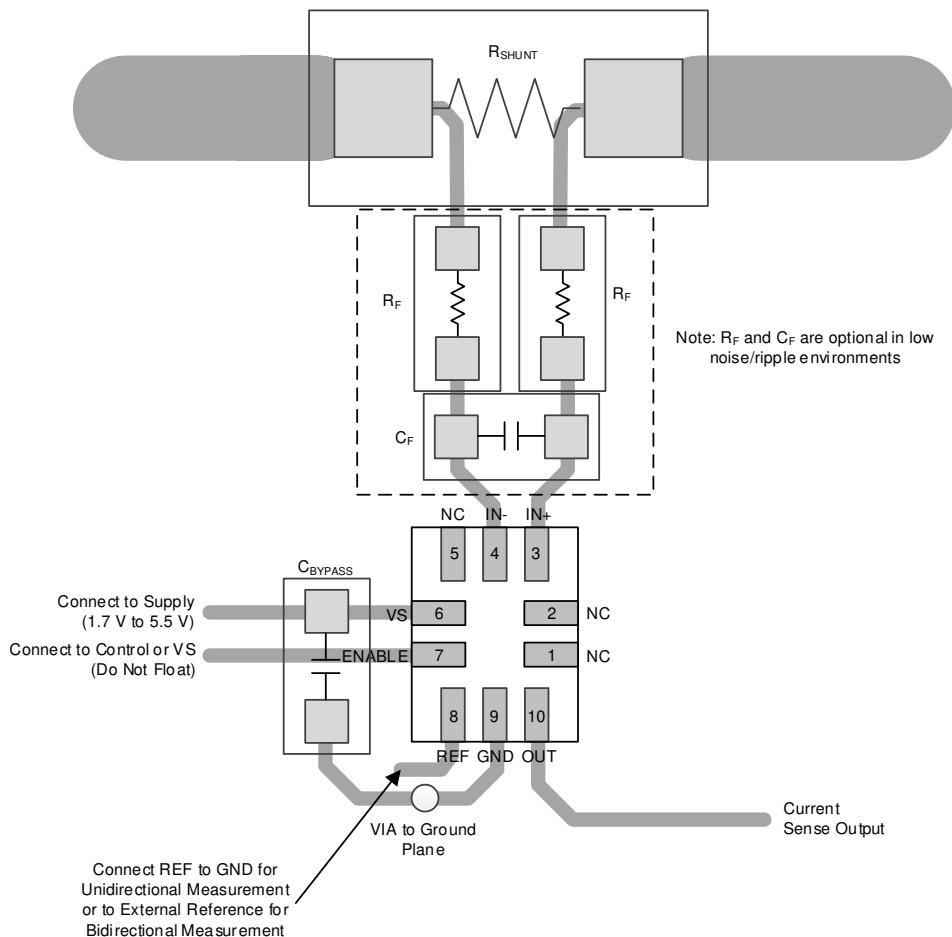

The diagram illustrates the recommended PCB layout for the INA190 in a UQFN (RSW) package. At the top, a shunt resistor  $R_{SHUNT}$  is shown connected between two large grey pads representing current sense leads. Below this, a feedback network is enclosed in a dashed box, containing two feedback resistors  $R_F$  and a feedback capacitor  $C_F$ . A note indicates: "Note:  $R_F$  and  $C_F$  are optional in low noise/ripple environments". The UQFN package is shown with pins numbered 1 through 10. Pin 5 is NC, Pin 4 is IN-, Pin 3 is IN+, Pin 2 is NC, Pin 1 is NC, Pin 8 is REF, Pin 9 is GND, and Pin 10 is OUT. Pin 6 is VS, connected to a bypass capacitor  $C_{BYPASS}$  and a supply line labeled "Connect to Supply (1.7 V to 5.5 V)". Pin 7 is ENABLE, connected to a control line labeled "Connect to Control or VS (Do Not Float)". The REF pin (8) is connected to a "VIA to Ground Plane" and a note states: "Connect REF to GND for Unidirectional Measurement or to External Reference for Bidirectional Measurement". The GND pin (9) is connected to the ground plane. The OUT pin (10) is connected to the "Current Sense Output".

PCB layout diagram for INA190 in UQFN (RSW) package showing connections for shunt resistor, feedback network, bypass capacitor, and ground plane.

**Figure 48. Recommended Layout for UQFN (RSW) Package**

{29}------------------------------------------------

## 11 Device and Documentation Support

### 11.1 Documentation Support

#### 11.1.1 Related Documentation

For related documentation see the following: Texas Instruments, [INA190EVM user's guide](#)

### 11.2 Receiving Notification of Documentation Updates

To receive notification of documentation updates, navigate to the device product folder on ti.com. In the upper right corner, click on *Alert me* to register and receive a weekly digest of any product information that has changed. For change details, review the revision history included in any revised document.

### 11.3 Support Resources

TI E2E™ support forums are an engineer's go-to source for fast, verified answers and design help — straight from the experts. Search existing answers or ask your own question to get the quick design help you need.

Linked content is provided "AS IS" by the respective contributors. They do not constitute TI specifications and do not necessarily reflect TI's views; see TI's [Terms of Use](#).

### 11.4 Trademarks

E2E is a trademark of Texas Instruments.

All other trademarks are the property of their respective owners.

### 11.5 Electrostatic Discharge Caution

Electrostatic Discharge Caution icon: a triangle with a hand and a lightning bolt inside, indicating a risk of damage from static electricity.

This integrated circuit can be damaged by ESD. Texas Instruments recommends that all integrated circuits be handled with appropriate precautions. Failure to observe proper handling and installation procedures can cause damage.

ESD damage can range from subtle performance degradation to complete device failure. Precision integrated circuits may be more susceptible to damage because very small parametric changes could cause the device not to meet its published specifications.

### 11.6 Glossary

[SLYZ022](#) — *TI Glossary*.

This glossary lists and explains terms, acronyms, and definitions.

## 12 Mechanical, Packaging, and Orderable Information

The following pages include mechanical, packaging, and orderable information. This information is the most current data available for the designated devices. This data is subject to change without notice and revision of this document. For browser-based versions of this data sheet, refer to the left-hand navigation.

{30}------------------------------------------------

## PACKAGING INFORMATION

| Orderable part number           | Status (1) | Material type (2) | Package   Pins        | Package qty   Carrier | RoHS (3) | Lead finish/ Ball material (4) | MSL rating/ Peak reflow (5) | Op temp (°C) | Part marking (6) |
|---------------------------------|---------------|----------------------|-----------------------|-----------------------|-------------|--------------------------------------|-----------------------------------|--------------|---------------------|
| <a href="#">INA190A1IDCKR</a>   | Active        | Production           | SC70 (DCK)   6        | 3000   LARGE T&R      | Yes         | NIPDAU   SN                          | Level-2-260C-1 YEAR               | -40 to 125   | 1DP                 |
| INA190A1IDCKR.A                 | Active        | Production           | SC70 (DCK)   6        | 3000   LARGE T&R      | Yes         | NIPDAU                               | Level-2-260C-1 YEAR               | -40 to 125   | 1DP                 |
| <a href="#">INA190A1IDCKT</a>   | Active        | Production           | SC70 (DCK)   6        | 250   SMALL T&R       | Yes         | NIPDAU   SN                          | Level-2-260C-1 YEAR               | -40 to 125   | 1DP                 |
| INA190A1IDCKT.A                 | Active        | Production           | SC70 (DCK)   6        | 250   SMALL T&R       | Yes         | NIPDAU                               | Level-2-260C-1 YEAR               | -40 to 125   | 1DP                 |
| <a href="#">INA190A1IDDFR</a>   | Active        | Production           | SOT-23-THIN (DDF)   8 | 3000   LARGE T&R      | Yes         | NIPDAU                               | Level-1-260C-UNLIM                | -40 to 125   | 1ZGW                |
| INA190A1IDDFR.A                 | Active        | Production           | SOT-23-THIN (DDF)   8 | 3000   LARGE T&R      | Yes         | NIPDAU                               | Level-1-260C-UNLIM                | -40 to 125   | 1ZGW                |
| INA190A1IDDFRG4                 | Active        | Production           | SOT-23-THIN (DDF)   8 | 3000   LARGE T&R      | Yes         | NIPDAU                               | Level-1-260C-UNLIM                | -40 to 125   | 1ZGW                |
| INA190A1IDDFRG4.A               | Active        | Production           | SOT-23-THIN (DDF)   8 | 3000   LARGE T&R      | Yes         | NIPDAU                               | Level-1-260C-UNLIM                | -40 to 125   | 1ZGW                |
| <a href="#">INA190A1IDDFT</a>   | Obsolete      | Production           | SOT-23-THIN (DDF)   8 | -                     | -           | Call TI                              | Call TI                           | -40 to 125   | 1ZGW                |
| <a href="#">INA190A1IRSWR</a>   | Active        | Production           | UQFN (RSW)   10       | 3000   LARGE T&R      | Yes         | NIPDAU                               | Level-1-260C-UNLIM                | -40 to 125   | 1AN                 |
| INA190A1IRSWR.A                 | Active        | Production           | UQFN (RSW)   10       | 3000   LARGE T&R      | Yes         | NIPDAU                               | Level-1-260C-UNLIM                | -40 to 125   | 1AN                 |
| INA190A1IRSWRG4                 | Active        | Production           | UQFN (RSW)   10       | 3000   LARGE T&R      | Yes         | NIPDAU                               | Level-1-260C-UNLIM                | -40 to 125   | 1AN                 |
| INA190A1IRSWRG4.A               | Active        | Production           | UQFN (RSW)   10       | 3000   LARGE T&R      | Yes         | NIPDAU                               | Level-1-260C-UNLIM                | -40 to 125   | 1AN                 |
| <a href="#">INA190A1IRSWT</a>   | Obsolete      | Production           | UQFN (RSW)   10       | -                     | -           | Call TI                              | Call TI                           | -40 to 125   | 1AN                 |
| <a href="#">INA190A2IDCKR</a>   | Active        | Production           | SC70 (DCK)   6        | 3000   LARGE T&R      | Yes         | NIPDAU   SN                          | Level-2-260C-1 YEAR               | -40 to 125   | 1DQ                 |
| INA190A2IDCKR.A                 | Active        | Production           | SC70 (DCK)   6        | 3000   LARGE T&R      | Yes         | NIPDAU                               | Level-2-260C-1 YEAR               | -40 to 125   | 1DQ                 |
| <a href="#">INA190A2IDCKRG4</a> | Active        | Production           | SC70 (DCK)   6        | 3000   LARGE T&R      | Yes         | NIPDAU                               | Level-2-260C-1 YEAR               | -40 to 125   | 1DQ                 |
| INA190A2IDCKRG4.A               | Active        | Production           | SC70 (DCK)   6        | 3000   LARGE T&R      | Yes         | NIPDAU                               | Level-2-260C-1 YEAR               | -40 to 125   | 1DQ                 |
| <a href="#">INA190A2IDCKT</a>   | Active        | Production           | SC70 (DCK)   6        | 250   SMALL T&R       | Yes         | NIPDAU   SN                          | Level-2-260C-1 YEAR               | -40 to 125   | 1DQ                 |
| INA190A2IDCKT.A                 | Active        | Production           | SC70 (DCK)   6        | 250   SMALL T&R       | Yes         | NIPDAU                               | Level-2-260C-1 YEAR               | -40 to 125   | 1DQ                 |
| <a href="#">INA190A2IDDFR</a>   | Active        | Production           | SOT-23-THIN (DDF)   8 | 3000   LARGE T&R      | Yes         | NIPDAU                               | Level-1-260C-UNLIM                | -40 to 125   | 1ZHW                |
| INA190A2IDDFR.A                 | Active        | Production           | SOT-23-THIN (DDF)   8 | 3000   LARGE T&R      | Yes         | NIPDAU                               | Level-1-260C-UNLIM                | -40 to 125   | 1ZHW                |
| <a href="#">INA190A2IDDFT</a>   | Obsolete      | Production           | SOT-23-THIN (DDF)   8 | -                     | -           | Call TI                              | Call TI                           | -40 to 125   | 1ZHW                |
| <a href="#">INA190A2IRSWR</a>   | Active        | Production           | UQFN (RSW)   10       | 3000   LARGE T&R      | Yes         | NIPDAU                               | Level-1-260C-UNLIM                | -40 to 125   | 1AM                 |
| INA190A2IRSWR.A                 | Active        | Production           | UQFN (RSW)   10       | 3000   LARGE T&R      | Yes         | NIPDAU                               | Level-1-260C-UNLIM                | -40 to 125   | 1AM                 |
| <a href="#">INA190A2IRSWT</a>   | Obsolete      | Production           | UQFN (RSW)   10       | -                     | -           | Call TI                              | Call TI                           | -40 to 125   | 1AM                 |
| <a href="#">INA190A3IDCKR</a>   | Active        | Production           | SC70 (DCK)   6        | 3000   LARGE T&R      | Yes         | NIPDAU   SN                          | Level-2-260C-1 YEAR               | -40 to 125   | 1DR                 |
| INA190A3IDCKR.A                 | Active        | Production           | SC70 (DCK)   6        | 3000   LARGE T&R      | Yes         | NIPDAU                               | Level-2-260C-1 YEAR               | -40 to 125   | 1DR                 |
| <a href="#">INA190A3IDCKT</a>   | Obsolete      | Production           | SC70 (DCK)   6        | -                     | -           | Call TI                              | Call TI                           | -40 to 125   | 1DR                 |

{31}------------------------------------------------

| Orderable part number         | Status (1) | Material type (2) | Package   Pins        | Package qty   Carrier | RoHS (3) | Lead finish/ Ball material (4) | MSL rating/ Peak reflow (5) | Op temp (°C) | Part marking (6) |
|-------------------------------|---------------|----------------------|-----------------------|-----------------------|-------------|--------------------------------------|-----------------------------------|--------------|---------------------|
| <a href="#">INA190A3IDDFR</a> | Active        | Production           | SOT-23-THIN (DDF)   8 | 3000   LARGE T&R      | Yes         | NIPDAU                               | Level-1-260C-UNLIM                | -40 to 125   | 1ZIW                |
| INA190A3IDDFR.A               | Active        | Production           | SOT-23-THIN (DDF)   8 | 3000   LARGE T&R      | Yes         | NIPDAU                               | Level-1-260C-UNLIM                | -40 to 125   | 1ZIW                |
| <a href="#">INA190A3IDDFT</a> | Obsolete      | Production           | SOT-23-THIN (DDF)   8 | -                     | -           | Call TI                              | Call TI                           | -40 to 125   | 1ZIW                |
| <a href="#">INA190A3IRSWR</a> | Active        | Production           | UQFN (RSW)   10       | 3000   LARGE T&R      | Yes         | NIPDAU                               | Level-1-260C-UNLIM                | -40 to 125   | 1AO                 |
| INA190A3IRSWR.A               | Active        | Production           | UQFN (RSW)   10       | 3000   LARGE T&R      | Yes         | NIPDAU                               | Level-1-260C-UNLIM                | -40 to 125   | 1AO                 |
| INA190A3IRSWRG4.A             | Active        | Production           | UQFN (RSW)   10       | 3000   LARGE T&R      | Yes         | NIPDAU                               | Level-1-260C-UNLIM                | -40 to 125   | 1AO                 |
| <a href="#">INA190A3IRSWT</a> | Obsolete      | Production           | UQFN (RSW)   10       | -                     | -           | Call TI                              | Call TI                           | -40 to 125   | 1AO                 |
| <a href="#">INA190A4IDCKR</a> | Active        | Production           | SC70 (DCK)   6        | 3000   LARGE T&R      | Yes         | NIPDAU   SN                          | Level-2-260C-1 YEAR               | -40 to 125   | 1DS                 |
| INA190A4IDCKR.A               | Active        | Production           | SC70 (DCK)   6        | 3000   LARGE T&R      | Yes         | NIPDAU                               | Level-2-260C-1 YEAR               | -40 to 125   | 1DS                 |
| INA190A4IDCKRG4               | Active        | Production           | SC70 (DCK)   6        | 3000   LARGE T&R      | Yes         | NIPDAU                               | Level-2-260C-1 YEAR               | -40 to 125   | 1DS                 |
| INA190A4IDCKRG4.A             | Active        | Production           | SC70 (DCK)   6        | 3000   LARGE T&R      | Yes         | NIPDAU                               | Level-2-260C-1 YEAR               | -40 to 125   | 1DS                 |
| <a href="#">INA190A4IDCKT</a> | Obsolete      | Production           | SC70 (DCK)   6        | -                     | -           | Call TI                              | Call TI                           | -40 to 125   | 1DS                 |
| <a href="#">INA190A4IDDFR</a> | Active        | Production           | SOT-23-THIN (DDF)   8 | 3000   LARGE T&R      | Yes         | NIPDAU                               | Level-1-260C-UNLIM                | -40 to 125   | 1ZJW                |
| INA190A4IDDFR.A               | Active        | Production           | SOT-23-THIN (DDF)   8 | 3000   LARGE T&R      | Yes         | NIPDAU                               | Level-1-260C-UNLIM                | -40 to 125   | 1ZJW                |
| <a href="#">INA190A4IDDFT</a> | Obsolete      | Production           | SOT-23-THIN (DDF)   8 | -                     | -           | Call TI                              | Call TI                           | -40 to 125   | 1ZJW                |
| <a href="#">INA190A4IRSWR</a> | Active        | Production           | UQFN (RSW)   10       | 3000   LARGE T&R      | Yes         | NIPDAU                               | Level-1-260C-UNLIM                | -40 to 125   | 1AP                 |
| INA190A4IRSWR.A               | Active        | Production           | UQFN (RSW)   10       | 3000   LARGE T&R      | Yes         | NIPDAU                               | Level-1-260C-UNLIM                | -40 to 125   | 1AP                 |
| <a href="#">INA190A4IRSWT</a> | Obsolete      | Production           | UQFN (RSW)   10       | -                     | -           | Call TI                              | Call TI                           | -40 to 125   | 1AP                 |
| <a href="#">INA190A5IDCKR</a> | Active        | Production           | SC70 (DCK)   6        | 3000   LARGE T&R      | Yes         | NIPDAU   SN                          | Level-2-260C-1 YEAR               | -40 to 125   | 1DT                 |
| INA190A5IDCKR.A               | Active        | Production           | SC70 (DCK)   6        | 3000   LARGE T&R      | Yes         | NIPDAU                               | Level-2-260C-1 YEAR               | -40 to 125   | 1DT                 |
| <a href="#">INA190A5IDCKT</a> | Obsolete      | Production           | SC70 (DCK)   6        | -                     | -           | Call TI                              | Call TI                           | -40 to 125   | 1DT                 |
| <a href="#">INA190A5IDDFR</a> | Active        | Production           | SOT-23-THIN (DDF)   8 | 3000   LARGE T&R      | Yes         | NIPDAU                               | Level-1-260C-UNLIM                | -40 to 125   | 1ZKW                |
| INA190A5IDDFR.A               | Active        | Production           | SOT-23-THIN (DDF)   8 | 3000   LARGE T&R      | Yes         | NIPDAU                               | Level-1-260C-UNLIM                | -40 to 125   | 1ZKW                |
| <a href="#">INA190A5IDDFT</a> | Obsolete      | Production           | SOT-23-THIN (DDF)   8 | -                     | -           | Call TI                              | Call TI                           | -40 to 125   | 1ZKW                |
| <a href="#">INA190A5IRSWR</a> | Active        | Production           | UQFN (RSW)   10       | 3000   LARGE T&R      | Yes         | NIPDAU                               | Level-1-260C-UNLIM                | -40 to 125   | 1AQ                 |
| INA190A5IRSWR.A               | Active        | Production           | UQFN (RSW)   10       | 3000   LARGE T&R      | Yes         | NIPDAU                               | Level-1-260C-UNLIM                | -40 to 125   | 1AQ                 |
| <a href="#">INA190A5IRSWT</a> | Obsolete      | Production           | UQFN (RSW)   10       | -                     | -           | Call TI                              | Call TI                           | -40 to 125   | 1AQ                 |

(1) **Status:** For more details on status, see our [product life cycle](#).

{32}------------------------------------------------

(2) **Material type:** When designated, preproduction parts are prototypes/experimental devices, and are not yet approved or released for full production. Testing and final process, including without limitation quality assurance, reliability performance testing, and/or process qualification, may not yet be complete, and this item is subject to further changes or possible discontinuation. If available for ordering, purchases will be subject to an additional waiver at checkout, and are intended for early internal evaluation purposes only. These items are sold without warranties of any kind.

(3) **RoHS values:** Yes, No, RoHS Exempt. See the [TI RoHS Statement](#) for additional information and value definition.

(4) **Lead finish/Ball material:** Parts may have multiple material finish options. Finish options are separated by a vertical ruled line. Lead finish/Ball material values may wrap to two lines if the finish value exceeds the maximum column width.

(5) **MSL rating/Peak reflow:** The moisture sensitivity level ratings and peak solder (reflow) temperatures. In the event that a part has multiple moisture sensitivity ratings, only the lowest level per JEDEC standards is shown. Refer to the shipping label for the actual reflow temperature that will be used to mount the part to the printed circuit board.

(6) **Part marking:** There may be an additional marking, which relates to the logo, the lot trace code information, or the environmental category of the part.

Multiple part markings will be inside parentheses. Only one part marking contained in parentheses and separated by a "~" will appear on a part. If a line is indented then it is a continuation of the previous line and the two combined represent the entire part marking for that device.

**Important Information and Disclaimer:** The information provided on this page represents TI's knowledge and belief as of the date that it is provided. TI bases its knowledge and belief on information provided by third parties, and makes no representation or warranty as to the accuracy of such information. Efforts are underway to better integrate information from third parties. TI has taken and continues to take reasonable steps to provide representative and accurate information but may not have conducted destructive testing or chemical analysis on incoming materials and chemicals. TI and TI suppliers consider certain information to be proprietary, and thus CAS numbers and other limited information may not be available for release.

In no event shall TI's liability arising out of such information exceed the total purchase price of the TI part(s) at issue in this document sold by TI to Customer on an annual basis.

### OTHER QUALIFIED VERSIONS OF INA190 :

- Automotive : [INA190-Q1](#)
- Enhanced Product : [INA190-EP](#)

#### NOTE: Qualified Version Definitions:

- Automotive - Q100 devices qualified for high-reliability automotive applications targeting zero defects
- Enhanced Product - Supports Defense, Aerospace and Medical Applications

{33}------------------------------------------------

### **TAPE AND REEL INFORMATION**

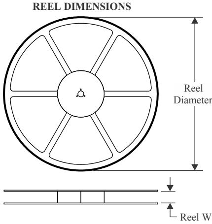

**REEL DIMENSIONS**

Reel Diameter

Reel Width (W1)

REEL DIMENSIONS diagram showing a reel with Reel Diameter and Reel Width (W1) dimensions.

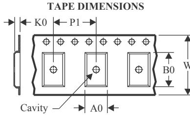

**TAPE DIMENSIONS**

K0

P1

Cavity

A0

B0

W

TAPE DIMENSIONS diagram showing a tape strip with dimensions A0, B0, K0, P1, and W.

|    |                                                           |
|----|-----------------------------------------------------------|
| A0 | Dimension designed to accommodate the component width     |
| B0 | Dimension designed to accommodate the component length    |
| K0 | Dimension designed to accommodate the component thickness |
| W  | Overall width of the carrier tape                         |
| P1 | Pitch between successive cavity centers                   |

### **QUADRANT ASSIGNMENTS FOR PIN 1 ORIENTATION IN TAPE**

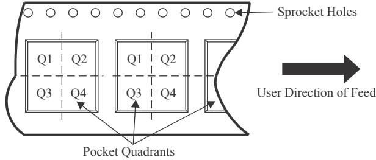

Sprocket Holes

Q1 Q2 Q3 Q4

Pocket Quadrants

User Direction of Feed

Diagram showing pocket quadrants (Q1, Q2, Q3, Q4) and sprocket holes with User Direction of Feed arrow.

\*All dimensions are nominal

| Device          | Package Type | Package Drawing | Pins | SPQ  | Reel Diameter (mm) | Reel Width W1 (mm) | A0 (mm) | B0 (mm) | K0 (mm) | P1 (mm) | W (mm) | Pin1 Quadrant |
|-----------------|--------------|-----------------|------|------|--------------------|--------------------|---------|---------|---------|---------|--------|---------------|
| INA190A1IDCKR   | SC70         | DCK             | 6    | 3000 | 178.0              | 9.0                | 2.4     | 2.5     | 1.2     | 4.0     | 8.0    | Q3            |
| INA190A1IDCKR   | SC70         | DCK             | 6    | 3000 | 180.0              | 8.4                | 2.3     | 2.55    | 1.2     | 4.0     | 8.0    | Q3            |
| INA190A1IDCKT   | SC70         | DCK             | 6    | 250  | 178.0              | 9.0                | 2.4     | 2.5     | 1.2     | 4.0     | 8.0    | Q3            |
| INA190A1IDCKT   | SC70         | DCK             | 6    | 250  | 180.0              | 8.4                | 2.3     | 2.55    | 1.2     | 4.0     | 8.0    | Q3            |
| INA190A1IDDFR   | SOT-23-THIN  | DDF             | 8    | 3000 | 180.0              | 8.4                | 3.2     | 3.2     | 1.4     | 4.0     | 8.0    | Q3            |
| INA190A1IDDFRG4 | SOT-23-THIN  | DDF             | 8    | 3000 | 180.0              | 8.4                | 3.2     | 3.2     | 1.4     | 4.0     | 8.0    | Q3            |
| INA190A1IRSWR   | UQFN         | RSW             | 10   | 3000 | 180.0              | 8.4                | 1.7     | 2.1     | 0.7     | 4.0     | 8.0    | Q1            |
| INA190A1IRSWRG4 | UQFN         | RSW             | 10   | 3000 | 180.0              | 8.4                | 1.7     | 2.1     | 0.7     | 4.0     | 8.0    | Q1            |
| INA190A2IDCKR   | SC70         | DCK             | 6    | 3000 | 180.0              | 8.4                | 2.3     | 2.55    | 1.2     | 4.0     | 8.0    | Q3            |
| INA190A2IDCKRG4 | SC70         | DCK             | 6    | 3000 | 178.0              | 9.0                | 2.4     | 2.5     | 1.2     | 4.0     | 8.0    | Q3            |
| INA190A2IDCKT   | SC70         | DCK             | 6    | 250  | 180.0              | 8.4                | 2.3     | 2.55    | 1.2     | 4.0     | 8.0    | Q3            |
| INA190A2IDDFR   | SOT-23-THIN  | DDF             | 8    | 3000 | 180.0              | 8.4                | 3.2     | 3.2     | 1.4     | 4.0     | 8.0    | Q3            |
| INA190A2IRSWR   | UQFN         | RSW             | 10   | 3000 | 180.0              | 9.5                | 1.6     | 2.0     | 0.8     | 4.0     | 8.0    | Q1            |
| INA190A3IDCKR   | SC70         | DCK             | 6    | 3000 | 180.0              | 8.4                | 2.3     | 2.55    | 1.2     | 4.0     | 8.0    | Q3            |

{34}------------------------------------------------

| Device          | Package Type | Package Drawing | Pins | SPQ  | Reel Diameter (mm) | Reel Width W1 (mm) | A0 (mm) | B0 (mm) | K0 (mm) | P1 (mm) | W (mm) | Pin1 Quadrant |
|-----------------|--------------|-----------------|------|------|--------------------|--------------------|---------|---------|---------|---------|--------|---------------|
| INA190A3IDCKR   | SC70         | DCK             | 6    | 3000 | 178.0              | 9.0                | 2.4     | 2.5     | 1.2     | 4.0     | 8.0    | Q3            |
| INA190A3IDDFR   | SOT-23-THIN  | DDF             | 8    | 3000 | 180.0              | 8.4                | 3.2     | 3.2     | 1.4     | 4.0     | 8.0    | Q3            |
| INA190A3IRSWR   | UQFN         | RSW             | 10   | 3000 | 180.0              | 9.5                | 1.6     | 2.0     | 0.8     | 4.0     | 8.0    | Q1            |
| INA190A4IDCKR   | SC70         | DCK             | 6    | 3000 | 180.0              | 8.4                | 2.3     | 2.55    | 1.2     | 4.0     | 8.0    | Q3            |
| INA190A4IDCKRG4 | SC70         | DCK             | 6    | 3000 | 178.0              | 9.0                | 2.4     | 2.5     | 1.2     | 4.0     | 8.0    | Q3            |
| INA190A4IDDFR   | SOT-23-THIN  | DDF             | 8    | 3000 | 180.0              | 8.4                | 3.2     | 3.2     | 1.4     | 4.0     | 8.0    | Q3            |
| INA190A4IRSWR   | UQFN         | RSW             | 10   | 3000 | 180.0              | 8.4                | 1.7     | 2.1     | 0.7     | 4.0     | 8.0    | Q1            |
| INA190A4IRSWR   | UQFN         | RSW             | 10   | 3000 | 180.0              | 9.5                | 1.6     | 2.0     | 0.8     | 4.0     | 8.0    | Q1            |
| INA190A5IDCKR   | SC70         | DCK             | 6    | 3000 | 180.0              | 8.4                | 2.3     | 2.55    | 1.2     | 4.0     | 8.0    | Q3            |
| INA190A5IDCKR   | SC70         | DCK             | 6    | 3000 | 178.0              | 9.0                | 2.4     | 2.5     | 1.2     | 4.0     | 8.0    | Q3            |
| INA190A5IDDFR   | SOT-23-THIN  | DDF             | 8    | 3000 | 180.0              | 8.4                | 3.2     | 3.2     | 1.4     | 4.0     | 8.0    | Q3            |
| INA190A5IRSWR   | UQFN         | RSW             | 10   | 3000 | 180.0              | 8.4                | 1.7     | 2.1     | 0.7     | 4.0     | 8.0    | Q1            |
| INA190A5IRSWR   | UQFN         | RSW             | 10   | 3000 | 180.0              | 9.5                | 1.6     | 2.0     | 0.8     | 4.0     | 8.0    | Q1            |

{35}------------------------------------------------

### **TAPE AND REEL BOX DIMENSIONS**

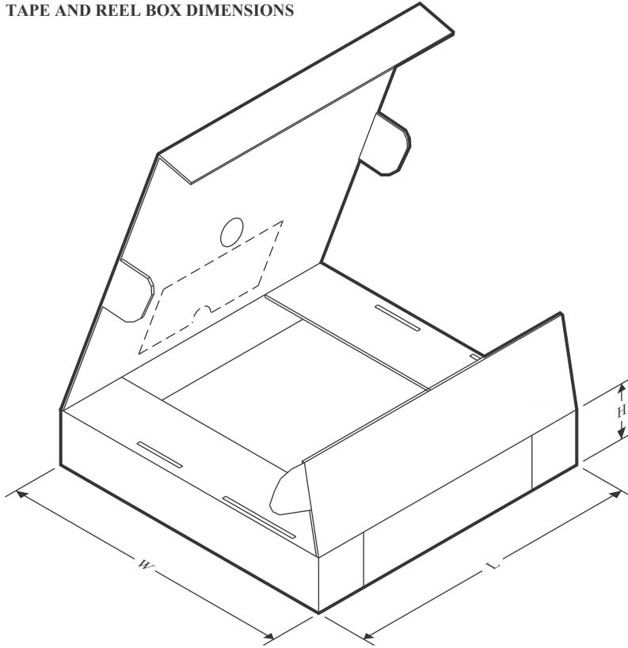

An isometric line drawing of an open rectangular box. The box is shown from a three-quarter perspective, with its lid propped open. Dimension lines with arrows indicate the following measurements: 'L' for the length of the box, 'W' for the width of the base, and 'H' for the height of the box. The drawing is a simple black-and-white line art representation.

Isometric line drawing of an open tape and reel box with dimension lines for Length (L), Width (W), and Height (H).

\*All dimensions are nominal

| Device          | Package Type | Package Drawing | Pins | SPQ  | Length (mm) | Width (mm) | Height (mm) |
|-----------------|--------------|-----------------|------|------|-------------|------------|-------------|
| INA190A1IDCKR   | SC70         | DCK             | 6    | 3000 | 180.0       | 180.0      | 18.0        |
| INA190A1IDCKR   | SC70         | DCK             | 6    | 3000 | 210.0       | 185.0      | 35.0        |
| INA190A1IDCKT   | SC70         | DCK             | 6    | 250  | 180.0       | 180.0      | 18.0        |
| INA190A1IDCKT   | SC70         | DCK             | 6    | 250  | 210.0       | 185.0      | 35.0        |
| INA190A1IDDFR   | SOT-23-THIN  | DDF             | 8    | 3000 | 210.0       | 185.0      | 35.0        |
| INA190A1IDDFRG4 | SOT-23-THIN  | DDF             | 8    | 3000 | 210.0       | 185.0      | 35.0        |
| INA190A1IRSWR   | UQFN         | RSW             | 10   | 3000 | 210.0       | 185.0      | 35.0        |
| INA190A1IRSWRG4 | UQFN         | RSW             | 10   | 3000 | 210.0       | 185.0      | 35.0        |
| INA190A2IDCKR   | SC70         | DCK             | 6    | 3000 | 210.0       | 185.0      | 35.0        |
| INA190A2IDCKRG4 | SC70         | DCK             | 6    | 3000 | 180.0       | 180.0      | 18.0        |
| INA190A2IDCKT   | SC70         | DCK             | 6    | 250  | 210.0       | 185.0      | 35.0        |
| INA190A2IDDFR   | SOT-23-THIN  | DDF             | 8    | 3000 | 210.0       | 185.0      | 35.0        |
| INA190A2IRSWR   | UQFN         | RSW             | 10   | 3000 | 189.0       | 185.0      | 36.0        |
| INA190A3IDCKR   | SC70         | DCK             | 6    | 3000 | 210.0       | 185.0      | 35.0        |
| INA190A3IDCKR   | SC70         | DCK             | 6    | 3000 | 180.0       | 180.0      | 18.0        |
| INA190A3IDDFR   | SOT-23-THIN  | DDF             | 8    | 3000 | 210.0       | 185.0      | 35.0        |
| INA190A3IRSWR   | UQFN         | RSW             | 10   | 3000 | 189.0       | 185.0      | 36.0        |
| INA190A4IDCKR   | SC70         | DCK             | 6    | 3000 | 210.0       | 185.0      | 35.0        |

{36}------------------------------------------------

| Device          | Package Type | Package Drawing | Pins | SPQ  | Length (mm) | Width (mm) | Height (mm) |
|-----------------|--------------|-----------------|------|------|-------------|------------|-------------|
| INA190A4IDCKRG4 | SC70         | DCK             | 6    | 3000 | 180.0       | 180.0      | 18.0        |
| INA190A4IDDFR   | SOT-23-THIN  | DDF             | 8    | 3000 | 210.0       | 185.0      | 35.0        |
| INA190A4IRSWR   | UQFN         | RSW             | 10   | 3000 | 210.0       | 185.0      | 35.0        |
| INA190A4IRSWR   | UQFN         | RSW             | 10   | 3000 | 189.0       | 185.0      | 36.0        |
| INA190A5IDCKR   | SC70         | DCK             | 6    | 3000 | 210.0       | 185.0      | 35.0        |
| INA190A5IDCKR   | SC70         | DCK             | 6    | 3000 | 180.0       | 180.0      | 18.0        |
| INA190A5IDDFR   | SOT-23-THIN  | DDF             | 8    | 3000 | 210.0       | 185.0      | 35.0        |
| INA190A5IRSWR   | UQFN         | RSW             | 10   | 3000 | 210.0       | 185.0      | 35.0        |
| INA190A5IRSWR   | UQFN         | RSW             | 10   | 3000 | 189.0       | 185.0      | 36.0        |

{37}------------------------------------------------

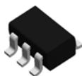

3D perspective view of the DCK0006A SOT-116 package.

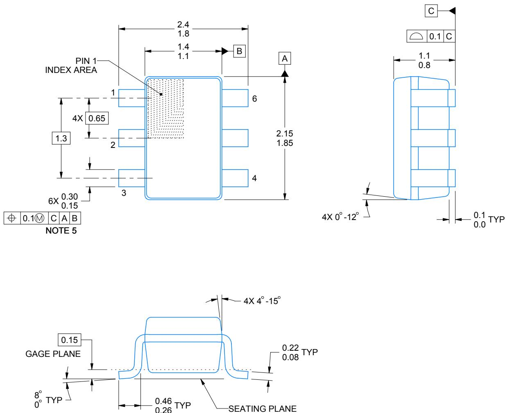

The figure shows three views of the SOT-116 package:

- Top View:** Shows the package body with pins 1, 2, 3, 4, 6, and 5. Dimensions include a total width of 2.4 mm (1.8 mm reference), a body width of 1.4 mm (1.1 mm reference), and a total length of 2.15 mm (1.85 mm reference). A 'PIN 1 INDEX AREA' is indicated. Datums A and B are defined. A feature control frame specifies a flatness of 0.1 mm relative to datum C for the top surface. Another feature control frame specifies a position of 0.1 mm relative to datums C, A, and B for the pin 1 index area.
- Side View:** Shows the package profile with a maximum height of 1.1 mm (0.8 mm reference). The pins are angled at 4X 0° -12°. A feature control frame specifies a flatness of 0.1 mm relative to datum C for the top surface. A typical pin thickness of 0.1 mm (0.0 mm reference) is shown.
- Cross-Sectional View:** Shows the package body and pins. The body thickness is 0.15 mm. The pins are angled at 4X 4° -15°. The gage plane is defined at the top of the pins, and the seating plane is at the base. Dimensions include a typical pin length of 0.22 mm (0.08 mm reference), a typical body length of 0.46 mm (0.26 mm reference), and a typical pin angle of 8° (0° reference).

Technical drawing of the SOT-116 package showing top, side, and cross-sectional views with dimensions and datums.

4214835/D 11/2024

#### NOTES:

1. All linear dimensions are in millimeters. Any dimensions in parenthesis are for reference only. Dimensioning and tolerancing per ASME Y14.5M.
2. This drawing is subject to change without notice.
3. Body dimensions do not include mold flash or protrusion. Mold flash and protrusion shall not exceed 0.15 per side.
4. Falls within JEDEC MO-203 variation AB.

{38}------------------------------------------------

### EXAMPLE BOARD LAYOUT

DCK0006A

SOT - 1.1 max height

SMALL OUTLINE TRANSISTOR

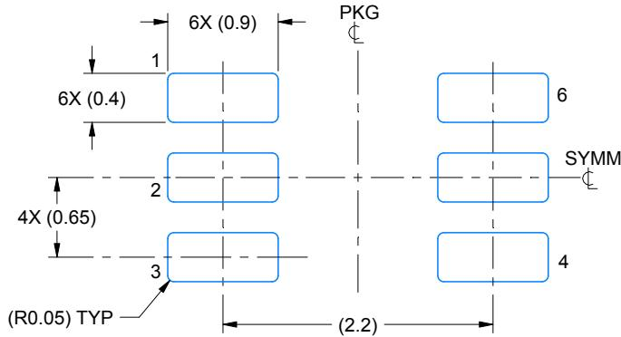

The diagram illustrates a land pattern for a 6-pin SOT package. It features a central vertical dashed line labeled 'PKG' with a centerline symbol. Six rectangular pads are arranged in two columns of three. The left column is numbered 1, 2, and 3 from top to bottom. The right column is numbered 6, 5, and 4 from top to bottom. Dimensions are provided: the pitch between pads 1 and 2 is 6X (0.4), the pitch between pads 2 and 3 is 4X (0.65), and the pitch between the columns is 6X (0.9). A dimension of (2.2) is shown between the right edges of the two columns. A corner radius of (R0.05) TYP is indicated for pad 3. A 'SYMM' centerline symbol is shown on the right side, indicating symmetry.

LAND PATTERN EXAMPLE diagram showing a 6-pin SOT package layout with dimensions.

LAND PATTERN EXAMPLE  
EXPOSED METAL SHOWN  
SCALE:18X

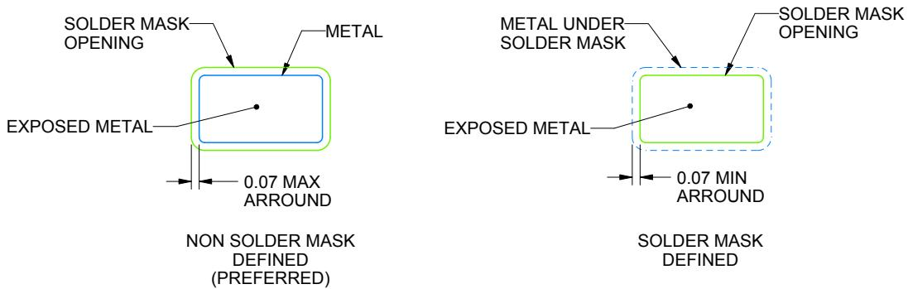

The diagram shows two methods for defining the solder mask opening around the pads. The left method, labeled 'NON SOLDER MASK DEFINED (PREFERRED)', shows a green rectangular area labeled 'SOLDER MASK OPENING' surrounding a blue rectangular area labeled 'METAL'. The distance between the green and blue areas is '0.07 MAX ARROUND'. The area inside the blue rectangle is labeled 'EXPOSED METAL'. The right method, labeled 'SOLDER MASK DEFINED', shows a dashed blue rectangular area labeled 'SOLDER MASK OPENING' surrounding a green rectangular area labeled 'METAL UNDER SOLDER MASK'. The distance between the dashed blue and green areas is '0.07 MIN ARROUND'. The area inside the green rectangle is labeled 'EXPOSED METAL'.

SOLDER MASK DETAILS diagram showing two approaches for defining the solder mask opening.

SOLDER MASK DETAILS

4214835/D 11/2024

NOTES: (continued)

- 5. Publication IPC-7351 may have alternate designs.
- 6. Solder mask tolerances between and around signal pads can vary based on board fabrication site.

{39}------------------------------------------------

### EXAMPLE STENCIL DESIGN

DCK0006A

SOT - 1.1 max height

SMALL OUTLINE TRANSISTOR

![Solder paste stencil design diagram for a 6-pin SOT package. The diagram shows a 3x2 grid of rectangular apertures. The left column is labeled 1, 2, 3 from top to bottom. The right column is labeled 6, 5, 4 from top to bottom. Dimensions include 6X (0.9) for the width of the first column, 6X (0.4) for the height of the first row, and 4X (0.65) for the height of the second row. A (R0.05) TYP. fillet is shown at the bottom left corner of the first aperture. A centerline is marked 'SYM' with a centerline symbol. A package centerline is marked 'PKG' with a centerline symbol. The distance between the centerlines of the two columns is (2.2).](img/f5deee2f3301ee351c4008283ffafbb3_img.jpg)

Solder paste stencil design diagram for a 6-pin SOT package. The diagram shows a 3x2 grid of rectangular apertures. The left column is labeled 1, 2, 3 from top to bottom. The right column is labeled 6, 5, 4 from top to bottom. Dimensions include 6X (0.9) for the width of the first column, 6X (0.4) for the height of the first row, and 4X (0.65) for the height of the second row. A (R0.05) TYP. fillet is shown at the bottom left corner of the first aperture. A centerline is marked 'SYM' with a centerline symbol. A package centerline is marked 'PKG' with a centerline symbol. The distance between the centerlines of the two columns is (2.2).

SOLDER PASTE EXAMPLE  
BASED ON 0.125 THICK STENCIL  
SCALE:18X

4214835/D 11/2024

NOTES: (continued)

- 7. Laser cutting apertures with trapezoidal walls and rounded corners may offer better paste release. IPC-7525 may have alternate design recommendations.
- 8. Board assembly site may have different recommendations for stencil design.

{40}------------------------------------------------

RSW0010A

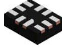

Isometric view of the UQFN package showing its 8 pins and square footprint.

### PACKAGE OUTLINE

UQFN - 0.55 mm max height

PLASTIC QUAD FLATPACK - NO LEAD

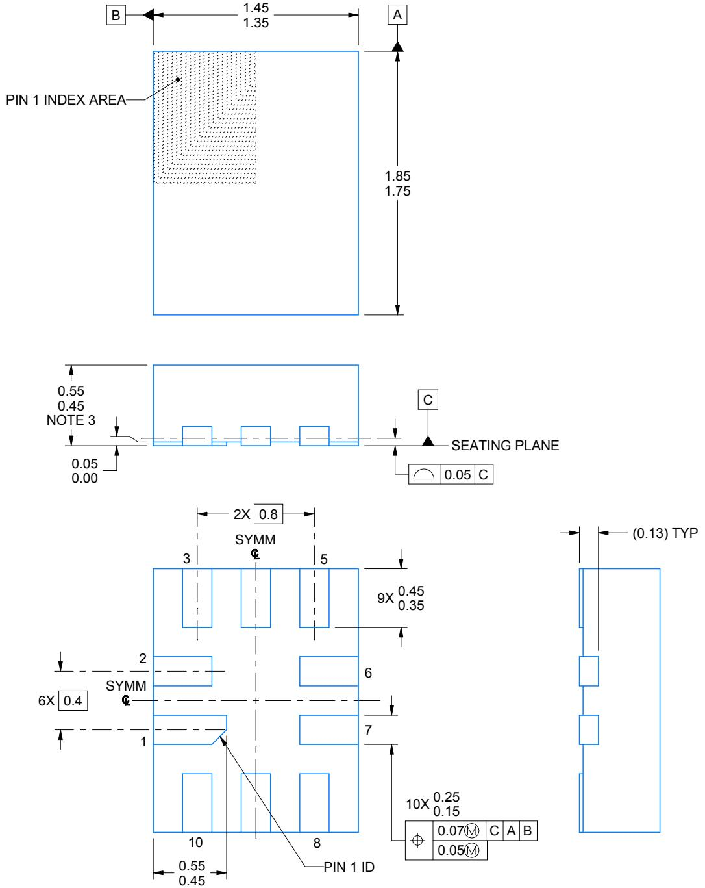

The figure shows the package outline with the following details:

- Top View:** Shows a square package with a 'PIN 1 INDEX AREA' in the top-left corner. Dimensions are 1.45 / 1.35 mm for the width and 1.85 / 1.75 mm for the length. Labels A and B indicate the corners.
- Side View:** Shows the package profile with a maximum height of 0.55 mm. It includes a 'SEATING PLANE' and a flatness tolerance of 0.05. A note reference 'NOTE 3' is present. Dimensions of 0.45 and 0.05 are also shown.
- Bottom View:** Shows the 8 pins numbered 1 through 8. Dimensions include 2X 0.8 mm for the pitch between pins 3 and 5, 9X 0.45 / 0.35 mm for the pitch between pins 2 and 6, and 6X 0.4 mm for the pitch between pins 1 and 7. A 'SYMM' (symmetry) symbol is used. A 'PIN 1 ID' (pin identification) symbol is also present. A position tolerance of 0.07 (M) and a flatness tolerance of 0.05 (M) are indicated. A dimension of 10X 0.25 / 0.15 mm is shown for the pin length.
- Side View (Right):** Shows the package profile with a dimension of (0.13) TYP.

Technical drawing of the UQFN package showing top, side, and bottom views with dimensions and tolerances.

4224897/A 03/2019

#### NOTES:

1. All linear dimensions are in millimeters. Any dimensions in parenthesis are for reference only. Dimensioning and tolerancing per ASME Y14.5M.
2. This drawing is subject to change without notice.
3. This package complies to JEDEC MO-288 variation UDEE, except minimum package height.

{41}------------------------------------------------

### EXAMPLE BOARD LAYOUT

RSW0010A

UQFN - 0.55 mm max height

PLASTIC QUAD FLATPACK - NO LEAD

![LAND PATTERN EXAMPLE diagram showing a 10-pin UQFN package layout. The package is centered on a board with dimensions (1.2) by (1.6). Pin 1 is at the top left, and pin 10 is at the top right. Symmetry lines are indicated with 'SYMM' and centerline symbols. Dimensions include 10X (0.2) for the top edge, 6X (0.4) for the left edge, and 9X (0.6) for the bottom edge. A note 'SEE SOLDER MASK DETAIL' points to the top right pin area. A small radius '(R0.05) TYP' is shown at the bottom left corner of the package.](img/838c31609fac483fa2c01c7896a2fd6d_img.jpg)

LAND PATTERN EXAMPLE diagram showing a 10-pin UQFN package layout. The package is centered on a board with dimensions (1.2) by (1.6). Pin 1 is at the top left, and pin 10 is at the top right. Symmetry lines are indicated with 'SYMM' and centerline symbols. Dimensions include 10X (0.2) for the top edge, 6X (0.4) for the left edge, and 9X (0.6) for the bottom edge. A note 'SEE SOLDER MASK DETAIL' points to the top right pin area. A small radius '(R0.05) TYP' is shown at the bottom left corner of the package.

LAND PATTERN EXAMPLE  
EXPOSED METAL SHOWN  
SCALE: 30X

![SOLDER MASK DETAILS diagram showing two options for the solder mask. The left option, 'NON SOLDER MASK DEFINED (PREFERRED)', shows a green outline for the metal edge and a blue outline for the solder mask opening, with a 0.05 MAX ALL AROUND dimension. The right option, 'SOLDER MASK DEFINED', shows a green outline for the exposed metal and a blue dashed outline for the solder mask opening, with a 0.05 MIN ALL AROUND dimension. Labels include 'METAL EDGE', 'SOLDER MASK OPENING', 'EXPOSED METAL', and 'METAL UNDER SOLDER MASK'.](img/82fbb97c1145cac89ac72dd080fad17a_img.jpg)

SOLDER MASK DETAILS diagram showing two options for the solder mask. The left option, 'NON SOLDER MASK DEFINED (PREFERRED)', shows a green outline for the metal edge and a blue outline for the solder mask opening, with a 0.05 MAX ALL AROUND dimension. The right option, 'SOLDER MASK DEFINED', shows a green outline for the exposed metal and a blue dashed outline for the solder mask opening, with a 0.05 MIN ALL AROUND dimension. Labels include 'METAL EDGE', 'SOLDER MASK OPENING', 'EXPOSED METAL', and 'METAL UNDER SOLDER MASK'.

SOLDER MASK DETAILS

4224897/A 03/2019

NOTES: (continued)

4. This package is designed to be soldered to a thermal pad on the board. For more information, see Texas Instruments literature number SLUA271 ([www.ti.com/lit/slua271](http://www.ti.com/lit/slua271)).
5. Vias are optional depending on application, refer to device data sheet. If any vias are implemented, refer to their locations shown on this view. It is recommended that vias under paste be filled, plugged or tented.

{42}------------------------------------------------

### EXAMPLE STENCIL DESIGN

RSW0010A

UQFN - 0.55 mm max height

PLASTIC QUAD FLATPACK - NO LEAD

![Solder paste stencil design diagram for a UQFN package. The diagram shows a 3x3 grid of rectangular apertures. The central aperture is labeled 'SYMM' with a centerline symbol. Apertures are numbered 1 through 10. Dimensions are provided in millimeters: 10X (0.2) for the top edge, 6X (0.4) for the middle edge, 9X (0.6) for the bottom edge, (0.7) for the top width, (1.2) for the bottom width, and (1.6) for the total height. A corner radius of (R0.05) TYP is indicated. Symmetry centerlines are shown horizontally and vertically.](img/ddee3e67e0dfc22e25188fa635a19558_img.jpg)

Solder paste stencil design diagram for a UQFN package. The diagram shows a 3x3 grid of rectangular apertures. The central aperture is labeled 'SYMM' with a centerline symbol. Apertures are numbered 1 through 10. Dimensions are provided in millimeters: 10X (0.2) for the top edge, 6X (0.4) for the middle edge, 9X (0.6) for the bottom edge, (0.7) for the top width, (1.2) for the bottom width, and (1.6) for the total height. A corner radius of (R0.05) TYP is indicated. Symmetry centerlines are shown horizontally and vertically.

SOLDER PASTE EXAMPLE  
BASED ON 0.125 MM THICK STENCIL  
SCALE: 30X

4224897/A 03/2019

NOTES: (continued)

6. Laser cutting apertures with trapezoidal walls and rounded corners may offer better paste release. IPC-7525 may have alternate design recommendations.

{43}------------------------------------------------

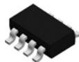

3D rendering of an 8-pin SOT-23-THIN package component

#### PACKAGE OUTLINE

# DDF0008A

**SOT-23-THIN - 1.1 mm max height**

PLASTIC SMALL OUTLINE

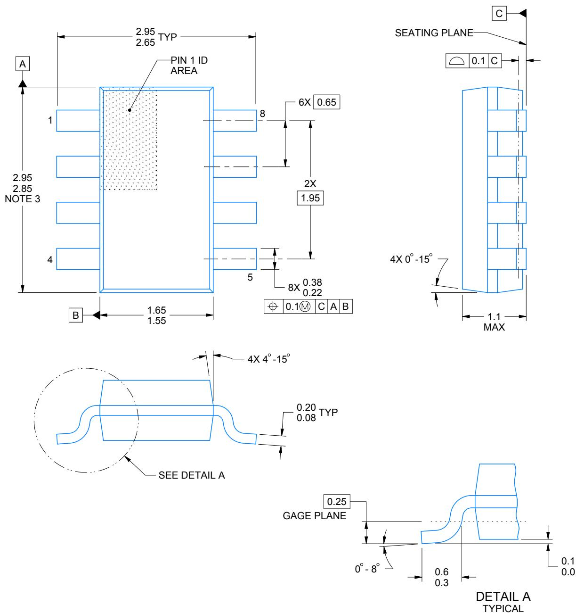

Mechanical drawing with the following views and dimensions:

- Top View:** Body width 1.65 / 1.55 mm, overall width 2.95 / 2.65 mm TYP; body length 2.95 / 2.85 mm (NOTE 3); Pin 1 ID area indicated by stippled region; Pin pitch 6X 0.65 mm, 2X 1.95 mm; Pin width 8X 0.38 / 0.22 mm with position tolerance 0.1(M) C A B; Datums A and B marked.
- Right Side View:** Height 1.1 mm MAX; Seating plane Datum C with flatness 0.1 C; draft angle 4X 0° - 15°.
- End View / Cross Section:** Molded body end angle 4X 4° - 15°; lead thickness 0.20 / 0.08 mm TYP; indicates SEE DETAIL A.
- Detail A:** Gage plane 0.25 mm; lead bend angle 0° - 8°; lead length 0.6 / 0.3 mm; standoff height 0.1 / 0.0 mm.

Technical drawing of an 8-pin SOT-23-THIN package outline showing top view, side view, end view, and Detail A with dimensions and tolerances.

4222047/E 07/2024

#### **NOTES:**

1. All linear dimensions are in millimeters. Any dimensions in parenthesis are for reference only. Dimensioning and tolerancing per ASME Y14.5M.
2. This drawing is subject to change without notice.
3. This dimension does not include mold flash, protrusions, or gate burrs. Mold flash, protrusions, or gate burrs shall not exceed 0.15 mm per side.

{44}------------------------------------------------

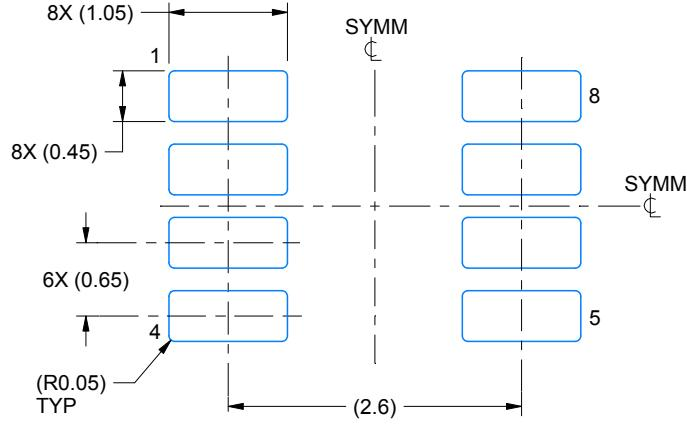

The diagram shows a land pattern for an 8-pin SOT-23-THIN package. It consists of four rectangular pads arranged in a 2x2 grid. The pads are labeled with pin numbers: 1 (top-left), 8 (top-right), 4 (bottom-left), and 5 (bottom-right). Dimensions are provided for pad pitch and pad size. The pitch between the centers of adjacent pads is 8X (1.05) horizontally and 8X (0.45) vertically. The pad size is 6X (0.65) by 6X (0.65). A corner radius of (R0.05) TYP is indicated. Symmetry lines are shown with 'SYMM' and centerline symbols. The total width of the pad array is (2.6).

LAND PATTERN EXAMPLE diagram showing a 4x4 grid of pads with dimensions and pin numbers.

LAND PATTERN EXAMPLE  
EXPOSED METAL SHOWN  
SCALE:15X

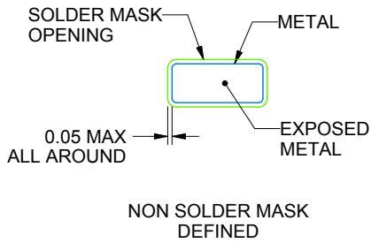

This diagram illustrates the 'NON SOLDER MASK DEFINED' approach. It shows a rectangular pad with a central dot representing the 'EXPOSED METAL'. The 'METAL' is shown as a blue outline. The 'SOLDER MASK OPENING' is indicated by a green outline. The distance between the metal and the solder mask opening is labeled '0.05 MAX ALL AROUND'.

NON SOLDER MASK DEFINED diagram showing solder mask opening and exposed metal.

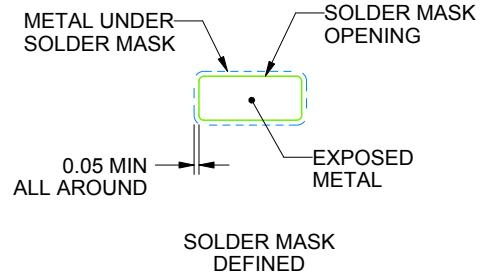

This diagram illustrates the 'SOLDER MASK DEFINED' approach. It shows a rectangular pad with a central dot representing the 'EXPOSED METAL'. The 'METAL UNDER SOLDER MASK' is shown as a blue outline. The 'SOLDER MASK OPENING' is indicated by a green outline. The distance between the metal under the mask and the mask opening is labeled '0.05 MIN ALL AROUND'.

SOLDER MASK DEFINED diagram showing metal under solder mask and exposed metal.

SOLDER MASK DETAILS

4222047/E 07/2024

NOTES: (continued)

4. Publication IPC-7351 may have alternate designs.

5. Solder mask tolerances between and around signal pads can vary based on board fabrication site.

{45}------------------------------------------------

### EXAMPLE STENCIL DESIGN

DDF0008A

SOT-23-THIN - 1.1 mm max height

PLASTIC SMALL OUTLINE

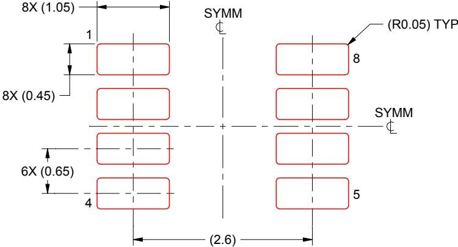

The diagram illustrates a solder paste stencil design for an 8-pin SOT-23-THIN package. It features two symmetrical columns of four rectangular solder paste areas each. The left column is labeled with pin numbers 1, 2, 3, and 4 from top to bottom. The right column is labeled with pin numbers 8, 7, 6, and 5 from top to bottom. Dimension lines indicate the following measurements: the width of each solder paste area is 8X (1.05); the vertical spacing between the centers of adjacent solder paste areas in a column is 8X (0.45); the vertical distance from the center of the first solder paste area to the center of the last area in a column is 6X (0.65); and the horizontal distance between the centers of the two columns is (2.6). Symmetry symbols (center lines with a crosshair) are shown vertically through the center of each column and horizontally between the columns. A note points to the top-right corner of the first solder paste area on the right, indicating a radius of (R0.05) TYP.

Solder paste stencil design diagram for SOT-23-THIN package.

SOLDER PASTE EXAMPLE  
BASED ON 0.125 mm THICK STENCIL  
SCALE:15X

4222047/E 07/2024

NOTES: (continued)

- 6. Laser cutting apertures with trapezoidal walls and rounded corners may offer better paste release. IPC-7525 may have alternate design recommendations.
- 7. Board assembly site may have different recommendations for stencil design.

{46}------------------------------------------------

## **IMPORTANT NOTICE AND DISCLAIMER**

TI PROVIDES TECHNICAL AND RELIABILITY DATA (INCLUDING DATASHEETS), DESIGN RESOURCES (INCLUDING REFERENCE DESIGNS), APPLICATION OR OTHER DESIGN ADVICE, WEB TOOLS, SAFETY INFORMATION, AND OTHER RESOURCES "AS IS" AND WITH ALL FAULTS, AND DISCLAIMS ALL WARRANTIES, EXPRESS AND IMPLIED, INCLUDING WITHOUT LIMITATION ANY IMPLIED WARRANTIES OF MERCHANTABILITY, FITNESS FOR A PARTICULAR PURPOSE OR NON-INFRINGEMENT OF THIRD PARTY INTELLECTUAL PROPERTY RIGHTS.

These resources are intended for skilled developers designing with TI products. You are solely responsible for (1) selecting the appropriate TI products for your application, (2) designing, validating and testing your application, and (3) ensuring your application meets applicable standards, and any other safety, security, regulatory or other requirements.

These resources are subject to change without notice. TI grants you permission to use these resources only for development of an application that uses the TI products described in the resource. Other reproduction and display of these resources is prohibited. No license is granted to any other TI intellectual property right or to any third party intellectual property right. TI disclaims responsibility for, and you fully indemnify TI and its representatives against any claims, damages, costs, losses, and liabilities arising out of your use of these resources.

TI's products are provided subject to [TI's Terms of Sale](#), [TI's General Quality Guidelines](#), or other applicable terms available either on [ti.com](#) or provided in conjunction with such TI products. TI's provision of these resources does not expand or otherwise alter TI's applicable warranties or warranty disclaimers for TI products. Unless TI explicitly designates a product as custom or customer-specified, TI products are standard, catalog, general purpose devices.

TI objects to and rejects any additional or different terms you may propose.

Copyright © 2026, Texas Instruments Incorporated

Last updated 10/2025