{0}------------------------------------------------

# FEATURES

- **Output Current: 1.1A**
- **Dropout Voltage: 310mV**
- **Low Noise: 40 $\mu$ VRMS (10Hz to 100kHz)**
- **500 $\mu$ A Quiescent Current (Adjustable Version)**
- Wide Input Voltage Range: 1.8V to 20V
- No Protection Diodes Needed
- Controlled Quiescent Current in Dropout
- Adjustable Output from 1.20V to 19.5V
- Fixed Output Voltages: 1.5V, 1.8V, 2.5V, 3.3V
- < 1 $\mu$ A Quiescent Current in Shutdown
- Stable with 10 $\mu$ F Output Capacitor
- Stable with Ceramic or Tantalum Capacitors
- Reverse-Battery Protection
- No Reverse Current
- Current Limit with Foldback Protection
- Thermal Limiting
- 5-Lead TO-220, DD-Pak, Thermally Enhanced 8-Lead MSOP and 8-Lead 3mm  $\times$  3mm DFN Packages

## APPLICATIONS

- Logic Power Supplies
- Post Regulator for Switching Supplies
- Low Noise Instrumentation

## DESCRIPTION

The **LT®1965** series are low noise, low dropout linear regulators. The devices supply 1.1A of output current with a 310mV typical dropout voltage. Operating quiescent current is 500 $\mu$ A for the adjustable version, reducing to <1 $\mu$ A in shutdown. Quiescent current is well controlled; it does not rise in dropout as with many other regulators. The LT1965 regulators have very low output noise which makes them ideal for sensitive RF and DSP supply applications.

Output voltage ranges from 1.20V to 19.5V. The LT1965 regulators are stable with output capacitors as low as 10 $\mu$ F. Internal protection circuitry includes reverse-battery protection, current limiting with foldback, thermal limiting and reverse-current protection. The LT1965 series are available in fixed output voltages of 1.5V, 1.8V, 2.5V, 3.3V, and as an adjustable device with a 1.20V reference voltage. The package offerings include the 5-lead TO-220, 5-lead DD-Pak as well as the thermally enhanced 8-lead MSOP and low profile (0.75mm) 8-lead 3mm  $\times$  3mm DFN.

LT, LT, LTC, LTM, Linear Technology and the Linear logo are registered trademarks and ThinSOT is a trademark of Linear Technology Corporation. All other trademarks are the property of their respective owners.

## TYPICAL APPLICATION

**3.3V to 2.5V Regulator**

\*CERAMIC OR TANTALUM

Circuit diagram of a 3.3V to 2.5V regulator using the LT1965-2.5. The input is connected to a voltage source with VIN > 3V TO 20V. A 10µF capacitor is connected between the input and ground. The LT1965-2.5 chip has pins labeled IN, OUT, SHDN, SENSE, and GND. The output is connected to a load with a 10µF capacitor and a 2.5V, 1.1A load. A note indicates \*CERAMIC OR TANTALUM for the output capacitor.

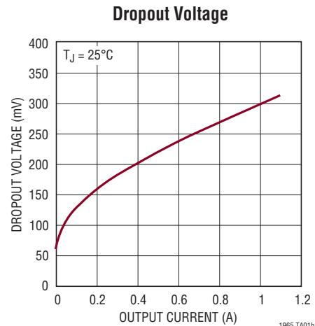

**Dropout Voltage**

*[AI figure description: curve-data table removed (values were estimated from the plot, not printed in the PDF). Read values from the image/PDF.]*

1965 TA01b

Graph of Dropout Voltage (mV) versus Output Current (A) at TJ = 25°C. The curve shows that dropout voltage increases from approximately 50mV at 0A to 310mV at 1.1A.

{1}------------------------------------------------

## LT1965 Series

## ABSOLUTE MAXIMUM RATINGS (Note 1)

|                                                     |      |                                                       |                |
|-----------------------------------------------------|------|-------------------------------------------------------|----------------|
| IN Pin Voltage .....                                | ±22V | Output Short-Circuit Duration .....                   | Indefinite     |
| OUT Pin Voltage .....                               | ±22V | Operating Junction Temperature Range (Notes 3, 5, 13) |                |
| Input to Output Differential Voltage (Note 2) ..... | ±22V | E-, I-Grades .....                                    | -40°C to 125°C |
| SENSE Pin Voltage .....                             | ±22V | H-Grade .....                                         | -40°C to 150°C |
| ADJ Pin Voltage .....                               | ±9V  | Storage Temperature Range .....                       | -65°C to 150°C |
| SHDN Pin Voltage .....                              | ±22V | Lead Temperature (Soldering, 10 sec)                  |                |
|                                                     |      | (Only for MSOP, TO-220, DD-Pak Packages) ....         | 300°C          |

## PIN CONFIGURATION

|                                                                                                                                                                                                                                                                                                                                                                                                                                                                                                                                                                              |                                                                                                                                                                                                                                                                                                                                                                                                                                                                                                                                                                        |
|------------------------------------------------------------------------------------------------------------------------------------------------------------------------------------------------------------------------------------------------------------------------------------------------------------------------------------------------------------------------------------------------------------------------------------------------------------------------------------------------------------------------------------------------------------------------------|------------------------------------------------------------------------------------------------------------------------------------------------------------------------------------------------------------------------------------------------------------------------------------------------------------------------------------------------------------------------------------------------------------------------------------------------------------------------------------------------------------------------------------------------------------------------|
| 
TOP VIEW
 
Image: Top view diagram of the 8-lead DD package showing pin 9 as an exposed pad. Pin 1 is OUT, 2 is OUT, 3 is SENSE/ADJ*, 4 is GND, 5 is GND, 6 is SHDN, 7 is IN, and 8 is IN.
 
DD PACKAGE 8-LEAD (3mm × 3mm) PLASTIC DFN
 
<math>T_{JMAX} = 150^{\circ}C</math>, <math>\theta_{JA} = 65^{\circ}C/W</math>, <math>\theta_{JC} = 3^{\circ}C/W</math>          EXPOSED PAD (PIN 9) IS GND, MUST BE SOLDERED TO PCB          *PIN 3 = SENSE FOR LT1965-1.5/LT1965-1.8/LT1965-2.5/LT1965-3.3          *PIN 3 = ADJ FOR LT1965
 | 
TOP VIEW
 
Image: Top view diagram of the 8-lead MS8E package showing pin 9 as an exposed pad. Pin 1 is OUT, 2 is OUT, 3 is SENSE/ADJ*, 4 is GND, 5 is GND, 6 is SHDN, 7 is IN, and 8 is IN.
 
MS8E PACKAGE 8-LEAD PLASTIC MSOP
 
<math>T_{JMAX} = 125^{\circ}C</math>, <math>\theta_{JA} = 60^{\circ}C/W</math>, <math>\theta_{JC} = 10^{\circ}C/W</math>          EXPOSED PAD (PIN 9) IS GND, MUST BE SOLDERED TO PCB          *PIN 3 = SENSE FOR LT1965-1.5/LT1965-1.8/LT1965-2.5/LT1965-3.3          *PIN 3 = ADJ FOR LT1965
 |
| 
FRONT VIEW
 
Image: Front view diagram of the 5-lead Q package. Pin 1 is SHDN, 2 is IN, 3 is GND, 4 is OUT, and 5 is SENSE/ADJ*. A tab on the left is labeled 'TAB IS GND'.
 
Q PACKAGE 5-LEAD PLASTIC DD-PAK
 
<math>T_{JMAX} = 150^{\circ}C</math>, <math>\theta_{JA} = 30^{\circ}C/W</math>, <math>\theta_{JC} = 3^{\circ}C/W</math>          *PIN 5 = SENSE FOR LT1965-1.5/LT1965-1.8/LT1965-2.5/LT1965-3.3          *PIN 5 = ADJ FOR LT1965
                                                                                           | 
FRONT VIEW
 
Image: Front view diagram of the 5-lead T package. Pin 1 is SHDN, 2 is IN, 3 is GND, 4 is OUT, and 5 is SENSE/ADJ*. A tab on the left is labeled 'TAB IS GND'.
 
T PACKAGE 5-LEAD PLASTIC TO-220
 
<math>T_{JMAX} = 150^{\circ}C</math>, <math>\theta_{JA} = 50^{\circ}C/W</math>, <math>\theta_{JC} = 3^{\circ}C/W</math>          *PIN 5 = SENSE FOR LT1965-1.5/LT1965-1.8/LT1965-2.5/LT1965-3.3          *PIN 5 = ADJ FOR LT1965
                                                                                     |

## ORDER INFORMATION

| LEAD FREE FINISH  | TAPE AND REEL       | PART MARKING* | PACKAGE DESCRIPTION            | TEMPERATURE RANGE |
|-------------------|---------------------|---------------|--------------------------------|-------------------|
| LT1965EDD#PBF     | LT1965EDD#TRPBF     | LCXW          | 8-Lead (3mm × 3mm) Plastic DFN | -40°C to 125°C    |
| LT1965IDD#PBF     | LT1965IDD#TRPBF     | LCXW          | 8-Lead (3mm × 3mm) Plastic DFN | -40°C to 125°C    |
| LT1965EDD-1.5#PBF | LT1965EDD-1.5#TRPBF | LDKW          | 8-Lead (3mm × 3mm) Plastic DFN | -40°C to 125°C    |
| LT1965IDD-1.5#PBF | LT1965IDD-1.5#TRPBF | LDKW          | 8-Lead (3mm × 3mm) Plastic DFN | -40°C to 125°C    |
| LT1965EDD-1.8#PBF | LT1965EDD-1.8#TRPBF | LDKY          | 8-Lead (3mm × 3mm) Plastic DFN | -40°C to 125°C    |
| LT1965IDD-1.8#PBF | LT1965IDD-1.8#TRPBF | LDKY          | 8-Lead (3mm × 3mm) Plastic DFN | -40°C to 125°C    |
| LT1965EDD-2.5#PBF | LT1965EDD-2.5#TRPBF | LDMB          | 8-Lead (3mm × 3mm) Plastic DFN | -40°C to 125°C    |
| LT1965IDD-2.5#PBF | LT1965IDD-2.5#TRPBF | LDMB          | 8-Lead (3mm × 3mm) Plastic DFN | -40°C to 125°C    |
| LT1965EDD-3.3#PBF | LT1965EDD-3.3#TRPBF | LDMD          | 8-Lead (3mm × 3mm) Plastic DFN | -40°C to 125°C    |

{2}------------------------------------------------

### ORDER INFORMATION

| LEAD FREE FINISH    | TAPE AND REEL         | PART MARKING* | PACKAGE DESCRIPTION            | TEMPERATURE RANGE |
|---------------------|-----------------------|---------------|--------------------------------|-------------------|
| LT1965IDD-3.3#PBF   | LT1965IDD-3.3#TRPBF   | LDMD          | 8-Lead (3mm × 3mm) Plastic DFN | -40°C to 125°C    |
| LT1965EMS8E#PBF     | LT1965EMS8E#TRPBF     | LTCXX         | 8-Lead Plastic MSOP            | -40°C to 125°C    |
| LT1965IMS8E#PBF     | LT1965IMS8E#TRPBF     | LTCXX         | 8-Lead Plastic MSOP            | -40°C to 125°C    |
| LT1965EMS8E-1.5#PBF | LT1965EMS8E-1.5#TRPBF | LTDKX         | 8-Lead Plastic MSOP            | -40°C to 125°C    |
| LT1965IMS8E-1.5#PBF | LT1965IMS8E-1.5#TRPBF | LTDKX         | 8-Lead Plastic MSOP            | -40°C to 125°C    |
| LT1965EMS8E-1.8#PBF | LT1965EMS8E-1.8#TRPBF | LTDKZ         | 8-Lead Plastic MSOP            | -40°C to 125°C    |
| LT1965IMS8E-1.8#PBF | LT1965IMS8E-1.8#TRPBF | LTDKZ         | 8-Lead Plastic MSOP            | -40°C to 125°C    |
| LT1965EMS8E-2.5#PBF | LT1965EMS8E-2.5#TRPBF | LTDMC         | 8-Lead Plastic MSOP            | -40°C to 125°C    |
| LT1965IMS8E-2.5#PBF | LT1965IMS8E-2.5#TRPBF | LTDMC         | 8-Lead Plastic MSOP            | -40°C to 125°C    |
| LT1965EMS8E-3.3#PBF | LT1965EMS8E-3.3#TRPBF | LTDMD         | 8-Lead Plastic MSOP            | -40°C to 125°C    |
| LT1965IMS8E-3.3#PBF | LT1965IMS8E-3.3#TRPBF | LTDMD         | 8-Lead Plastic MSOP            | -40°C to 125°C    |
| LT1965EQ#PBF        | LT1965EQ#TRPBF        | LT1965Q       | 5-Lead Plastic DD-Pak          | -40°C to 125°C    |
| LT1965IQ#PBF        | LT1965IQ#TRPBF        | LT1965Q       | 5-Lead Plastic DD-Pak          | -40°C to 125°C    |
| LT1965HQ#PBF        | LT1965HQ#TRPBF        | LT1965Q       | 5-Lead Plastic DD-Pak          | -40°C to 150°C    |
| LT1965EQ-1.5#PBF    | LT1965EQ-1.5#TRPBF    | LT1965Q-1.5   | 5-Lead Plastic DD-Pak          | -40°C to 125°C    |
| LT1965IQ-1.5#PBF    | LT1965IQ-1.5#TRPBF    | LT1965Q-1.5   | 5-Lead Plastic DD-Pak          | -40°C to 125°C    |
| LT1965EQ-1.8#PBF    | LT1965EQ-1.8#TRPBF    | LT1965Q-1.8   | 5-Lead Plastic DD-Pak          | -40°C to 125°C    |
| LT1965IQ-1.8#PBF    | LT1965IQ-1.8#TRPBF    | LT1965Q-1.8   | 5-Lead Plastic DD-Pak          | -40°C to 125°C    |
| LT1965EQ-2.5#PBF    | LT1965EQ-2.5#TRPBF    | LT1965Q-2.5   | 5-Lead Plastic DD-Pak          | -40°C to 125°C    |
| LT1965IQ-2.5#PBF    | LT1965IQ-2.5#TRPBF    | LT1965Q-2.5   | 5-Lead Plastic DD-Pak          | -40°C to 125°C    |
| LT1965EQ-3.3#PBF    | LT1965EQ-3.3#TRPBF    | LT1965Q-3.3   | 5-Lead Plastic DD-Pak          | -40°C to 125°C    |
| LT1965IQ-3.3#PBF    | LT1965IQ-3.3#TRPBF    | LT1965Q-3.3   | 5-Lead Plastic DD-Pak          | -40°C to 125°C    |
| LT1965ET#PBF        | N/A                   | LT1965T       | 5-Lead Plastic TO-220          | -40°C to 125°C    |
| LT1965IT#PBF        | N/A                   | LT1965T       | 5-Lead Plastic TO-220          | -40°C to 125°C    |
| LT1965HT#PBF        | N/A                   | LT1965T       | 5-Lead Plastic TO-220          | -40°C to 150°C    |
| LT1965ET-1.5#PBF    | N/A                   | LT1965T-1.5   | 5-Lead Plastic TO-220          | -40°C to 125°C    |
| LT1965IT-1.5#PBF    | N/A                   | LT1965T-1.5   | 5-Lead Plastic TO-220          | -40°C to 125°C    |
| LT1965ET-1.8#PBF    | N/A                   | LT1965T-1.8   | 5-Lead Plastic TO-220          | -40°C to 125°C    |
| LT1965IT-1.8#PBF    | N/A                   | LT1965T-1.8   | 5-Lead Plastic TO-220          | -40°C to 125°C    |
| LT1965ET-2.5#PBF    | N/A                   | LT1965T-2.5   | 5-Lead Plastic TO-220          | -40°C to 125°C    |
| LT1965IT-2.5#PBF    | N/A                   | LT1965T-2.5   | 5-Lead Plastic TO-220          | -40°C to 125°C    |
| LT1965ET-3.3#PBF    | N/A                   | LT1965T-3.3   | 5-Lead Plastic TO-220          | -40°C to 125°C    |
| LT1965IT-3.3#PBF    | N/A                   | LT1965T-3.3   | 5-Lead Plastic TO-220          | -40°C to 125°C    |

Consult LTC Marketing for parts specified with wider operating temperature ranges. \*Temperature grades are identified by a label on the shipping container. Consult LTC Marketing for information on nonstandard lead based finish parts.

For more information on lead free part marking, go to: <http://www.linear.com/leadfree/>  
For more information on tape and reel specifications, go to: <http://www.linear.com/tapeandreel/>

{3}------------------------------------------------

## LT1965 Series

## ELECTRICAL CHARACTERISTICS The ● denotes the specifications which apply over the full operating temperature range, otherwise specifications are at TA = 25°C. (Note 3)

| PARAMETER                                                                           | CONDITIONS                                                                                       | MIN | TYP   | MAX   | UNITS             |
|-------------------------------------------------------------------------------------|--------------------------------------------------------------------------------------------------|-----|-------|-------|-------------------|
| Minimum Input Voltage (Notes 4, 12)                                              | I LOAD = 0.5A                                                                         |     | 1.65  |       | V                 |
|                                                                                     | I LOAD = 1.1A (T J < 125°C)                                                | ●   | 1.8   | 2.3   | V                 |
|                                                                                     | I LOAD = 1A (H-Grade, T J > 125°C)                                         |     |       | 2.3   | V                 |
| Regulated Output Voltage (Note 5) | LT1965-1.5, V IN = 2.1V, I LOAD = 1mA | 1.477 | 1.5 | 1.523 | V |
|  | LT1965-1.5, 2.5 < V IN < 20V, 1mA < I LOAD < 1.1A | ● 1.455 | 1.5 | 1.545 | V |
|  | LT1965-1.8, V IN = 2.3V, I LOAD = 1mA | 1.773 | 1.8 | 1.827 | V |
|  | LT1965-1.8, 2.8 < V IN < 20V, 1mA < I LOAD < 1.1A | ● 1.746 | 1.8 | 1.854 | V |
|  | LT1965-2.5, V IN = 3V, I LOAD = 1mA | 2.462 | 2.5 | 2.538 | V |
|  | LT1965-2.5, 3.5 < V IN < 20V, 1mA < I LOAD < 1.1A | ● 2.425 | 2.5 | 2.575 | V |
|  | LT1965-3.3, V IN = 3.8V, I LOAD = 1mA | 3.25 | 3.3 | 3.35 | V |
|  | LT1965-3.3, 4.3 < V IN < 20V, 1mA < I LOAD < 1.1A | ● 3.201 | 3.3 | 3.399 | V |
| ADJ Pin Voltage (Notes 4, 5) | V IN = 2.1V, I LOAD = 1mA | 1.182 | 1.2 | 1.218 | V |
|  | 2.3V < V IN < 20V, 1mA < I LOAD < 1.1A (T J < 125°C) | ● 1.164 | 1.2 | 1.236 | V |
| | 2.3V < V IN < 20V, 1mA < I LOAD < 1A (H-Grade, T J > 125°C) | 1.158 |  | 1.236 | V |
| Line Regulation | LT1965-1.5, ΔV IN = 2.1V to 20V, I LOAD = 1mA                              | ●   | 3.5   | 9     | mV                |
|                                                                                     | LT1965-1.8, ΔV IN = 2.3V to 20V, I LOAD = 1mA                              | ●   | 4     | 10    | mV                |
|                                                                                     | LT1965-2.5, ΔV IN = 3V to 20V, I LOAD = 1mA                                | ●   | 4.5   | 11.5  | mV                |
|                                                                                     | LT1965-3.3, ΔV IN = 3.8V to 20V, I LOAD = 1mA                              | ●   | 5.5   | 16    | mV                |
|                                                                                     | LT1965, ΔV IN = 2.1V to 20V, I LOAD = 1mA (E-, I-Grades) (Note 4)          | ●   | 3     | 8     | mV                |
|                                                                                     | LT1965, ΔV IN = 2.1V to 20V, I LOAD = 1mA (H-Grade) (Note 4)               | ●   | 3     | 12    | mV                |
| Load Regulation                                                                     | LT1965-1.5, V IN = 2.5V, ΔI LOAD = 1mA to 1.1A                             |     | 5.25  | 10    | mV                |
|                                                                                     | LT1965-1.5, V IN = 2.5V, ΔI LOAD = 1mA to 1.1A                             | ●   |       | 20    | mV                |
|                                                                                     | LT1965-1.8, V IN = 2.8V, ΔI LOAD = 1mA to 1.1A                             |     | 6.25  | 12    | mV                |
|                                                                                     | LT1965-1.8, V IN = 2.8V, ΔI LOAD = 1mA to 1.1A                             | ●   |       | 24    | mV                |
|                                                                                     | LT1965-2.5, V IN = 3.5V, ΔI LOAD = 1mA to 1.1A                             |     | 8.75  | 16.5  | mV                |
|                                                                                     | LT1965-2.5, V IN = 3.5V, ΔI LOAD = 1mA to 1.1A                             | ●   |       | 33    | mV                |
|                                                                                     | LT1965-3.3, V IN = 4.3V, ΔI LOAD = 1mA to 1.1A                             |     | 11.5  | 22    | mV                |
|                                                                                     | LT1965-3.3, V IN = 4.3V, ΔI LOAD = 1mA to 1.1A                             | ●   |       | 44    | mV                |
|                                                                                     | LT1965, V IN = 2.3V, ΔI LOAD = 1mA to 1.1A (Note 4)                        |     | 4.25  | 8     | mV                |
|                                                                                     | LT1965, V IN = 2.3V, ΔI LOAD = 1mA to 1.1A (T J < 125°C)        | ●   |       | 16    | mV                |
|                                                                                     | LT1965, V IN = 2.3V, ΔI LOAD = 1mA to 1A (H-Grade, T J > 125°C) |     |       | 22    | mV                |
| Dropout Voltage V IN = V OUT(NOMINAL) (Notes 6, 7, 12)  | I LOAD = 1mA                                                                          |     | 0.055 | 0.08  | V                 |
|                                                                                     | I LOAD = 1mA                                                                          | ●   |       | 0.14  | V                 |
|                                                                                     | I LOAD = 100mA                                                                        |     | 0.12  | 0.175 | V                 |
|                                                                                     | I LOAD = 100mA                                                                        | ●   |       | 0.28  | V                 |
|                                                                                     | I LOAD = 500mA                                                                        |     | 0.21  | 0.25  | V                 |
|                                                                                     | I LOAD = 500mA                                                                        | ●   |       | 0.36  | V                 |
|                                                                                     | I LOAD = 1.1A                                                                         |     | 0.31  | 0.36  | V                 |
|                                                                                     | I LOAD = 1.1A (T J < 125°C)                                                | ●   |       | 0.49  | V                 |
| | I LOAD = 1A (H-Grade, T J > 125°C) | | | 0.49 | V |
| GND Pin Current V IN = V OUT(NOMINAL) + 1V (Notes 6, 8) | I LOAD = 0mA                                                                          | ●   | 0.5   | 1.1   | mA                |
|                                                                                     | I LOAD = 1mA                                                                          | ●   | 0.6   | 1.5   | mA                |
|                                                                                     | I LOAD = 100mA                                                                        | ●   | 2.2   | 5.5   | mA                |
|                                                                                     | I LOAD = 500mA                                                                        | ●   | 8.2   | 20    | mA                |
|                                                                                     | I LOAD = 1.1A (T J < 125°C)                                                | ●   | 21    | 40    | mA                |
|                                                                                     | I LOAD = 1A (H-Grade, T J > 125°C)                                         |     |       | 40    | mA                |
| Output Voltage Noise                                                                | C OUT = 10μF, I LOAD = 1.1A, BW = 10Hz to 100kHz                           |     | 40    |       | μV RMS |
| ADJ Pin Bias Current (Notes 4, 9)                                                |                                                                                                  |     | 1.3   | 4.5   | μA                |
| Shutdown Threshold                                                                  | V OUT = Off to On                                                                     | ●   | 0.85  | 2     | V                 |
|  | V OUT = On to Off | ● 0.2 | 0.45 |  | V |

1965fb

{4}------------------------------------------------

## ELECTRICAL CHARACTERISTICS The ● denotes the specifications which apply over the full operating temperature range, otherwise specifications are at $T_A = 25^\circ\text{C}$ . (Note 3)

| PARAMETER                        | CONDITIONS                                                                                                                                                           | MIN   | TYP  | MAX | UNITS         |
|----------------------------------|----------------------------------------------------------------------------------------------------------------------------------------------------------------------|-------|------|-----|---------------|
| SHDN Pin Current (Note 10)       | $V_{\text{SHDN}} = 0\text{V}$                                                                                                                                        |       | 0.01 | 1   | $\mu\text{A}$ |
|                                  | $V_{\text{SHDN}} = 20\text{V}$                                                                                                                                       |       | 5.5  | 10  | $\mu\text{A}$ |
| Quiescent Current in Shutdown    | $V_{\text{IN}} = 6\text{V}, V_{\text{SHDN}} = 0\text{V}$                                                                                                             |       | 0.01 | 1   | $\mu\text{A}$ |
| Ripple Rejection                 | $V_{\text{IN}} - V_{\text{OUT}} = 1.5\text{V (AVG)}, V_{\text{RIPPLE}} = 0.5\text{V}_{\text{P-P}}, f_{\text{RIPPLE}} = 120\text{Hz}, I_{\text{LOAD}} = 0.75\text{A}$ | 57    | 75   |     | dB            |
| Current Limit                    | $V_{\text{IN}} = 7\text{V}, V_{\text{OUT}} = 0$                                                                                                                      |       | 2.4  |     | A             |
|                                  | $V_{\text{IN}} = V_{\text{OUT(NOMINAL)}} + 1\text{V}, \Delta V_{\text{OUT}} = -0.1\text{V} (T_J < 125^\circ\text{C})$ (Note 6)                                       | ● 1.2 |      |     | A             |
|                                  | $V_{\text{IN}} = V_{\text{OUT(NOMINAL)}} + 1\text{V}, \Delta V_{\text{OUT}} = -0.1\text{V}, (\text{H-Grade}, T_J > 125^\circ\text{C})$ (Note 6)                      | 1.1   |      |     | A             |
| Input Reverse-Leakage Current    | $V_{\text{IN}} = -20\text{V}, V_{\text{OUT}} = 0$                                                                                                                    |       |      | 1   | mA            |
| Reverse-Output Current (Note 11) | LT1965-1.5, $V_{\text{OUT}} = 1.5\text{V}, V_{\text{IN}} = 0$                                                                                                        |       | 275  | 525 | $\mu\text{A}$ |
|                                  | LT1965-1.8, $V_{\text{OUT}} = 1.8\text{V}, V_{\text{IN}} = 0$                                                                                                        |       | 275  | 525 | $\mu\text{A}$ |
|                                  | LT1965-2.5, $V_{\text{OUT}} = 2.5\text{V}, V_{\text{IN}} = 0$                                                                                                        |       | 275  | 525 | $\mu\text{A}$ |
|                                  | LT1965-3.3, $V_{\text{OUT}} = 3.3\text{V}, V_{\text{IN}} = 0$                                                                                                        |       | 275  | 525 | $\mu\text{A}$ |
|                                  | LT1965 (Note 4), $V_{\text{OUT}} = 1.2\text{V}, V_{\text{IN}} = 0$                                                                                                   |       | 175  | 400 | $\mu\text{A}$ |

**Note 1:** Stresses beyond those listed under Absolute Maximum Ratings may cause permanent damage to the device. Exposure to any Absolute Maximum Rating condition for extended periods may affect device reliability and lifetime.

**Note 2:** Absolute maximum input to output differential voltage is not achievable with all combinations of rated IN pin and OUT pin voltages. With the IN pin at 22V, the OUT pin may not be pulled below 0V. The total measured voltage from IN to OUT must not exceed  $\pm 22\text{V}$ .

**Note 3:** The LT1965 regulators are tested and specified under pulse load conditions such that  $T_J \cong T_A$ . The LT1965E regulators are 100% tested at  $T_A = 25^\circ\text{C}$  and performance is guaranteed from  $0^\circ\text{C}$  to  $125^\circ\text{C}$ . Performance of the LT1965E over the full  $-40^\circ\text{C}$  to  $125^\circ\text{C}$  operating junction temperature range is assured by design, characterization and correlation with statistical process controls. The LT1965I regulators are guaranteed over the full  $-40^\circ\text{C}$  to  $125^\circ\text{C}$  operating junction temperature range. The LT1965H is tested at  $150^\circ\text{C}$  operating junction temperature. High junction temperatures degrade operating lifetimes. Operating lifetime is derated at junction temperatures greater than  $125^\circ\text{C}$ .

**Note 4:** The LT1965 adjustable version is tested and specified for these conditions with the ADJ connected to the OUT pin.

**Note 5:** Maximum junction temperature limits operating conditions. The regulated output voltage specification does not apply for all possible combinations of input voltage and output current. Limit the output current range if operating at the maximum input voltage. Limit the input-to-output voltage differential if operating at the maximum output current.

**Note 6:** To satisfy minimum input voltage requirements, the LT1965 adjustable version is tested and specified for these conditions with an external resistor divider (bottom 4.02k, top 4.32k) for an output voltage of 2.5V. The external resistor divider adds  $300\mu\text{A}$  of output DC load current. This external current is not factored into GND pin current.

**Note 7:** Dropout voltage is the minimum input-to-output voltage differential needed to maintain regulation at a specified output current. In dropout, the output voltage equals:  $(V_{\text{IN}} - V_{\text{DROPOUT}})$

**Note 8:** GND pin current is tested with  $V_{\text{IN}} = V_{\text{OUT(NOMINAL)}} + 1\text{V}$  and a current source load. GND pin current increases slightly in dropout. For the fixed output versions, an internal resistor divider will typically add  $100\mu\text{A}$  to the GND pin current. See GND pin current curves in the Typical Performance Characteristics section.

**Note 9:** ADJ pin bias current flows into the ADJ pin.

**Note 10:** SHDN pin current flows into the SHDN pin.

**Note 11:** Reverse-output current is tested with the IN pin grounded and the OUT pin forced to the rated output voltage. This current flows into the OUT pin and out of the GND pin.

**Note 12:** For the LT1965, LT1965-1.5 and LT1965-1.8, the minimum input voltage specification limits the dropout voltage under some output voltage/load conditions.

**Note 13:** This IC includes overtemperature protection that is intended to protect the device during momentary overload conditions. Junction temperature will exceed  $125^\circ\text{C}$  (LT1965E, LT1965I) or  $150^\circ\text{C}$  (LT1965H) when overtemperature is active. Continuous operation above the specified maximum operating junction temperature may impair device reliability.

{5}------------------------------------------------

## LT1965 Series

## TYPICAL PERFORMANCE CHARACTERISTICS

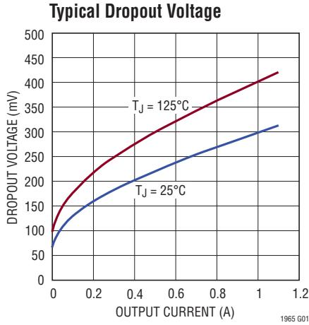

### Typical Dropout Voltage

This graph shows the typical dropout voltage in millivolts (mV) as a function of output current in amperes (A). Two curves are shown: one for a junction temperature  $T_J = 125^\circ\text{C}$  (red line) and one for  $T_J = 25^\circ\text{C}$  (blue line). Both curves show an increase in dropout voltage with increasing current, with the 125°C curve consistently higher than the 25°C curve.

*[AI figure description: curve-data table removed (values were estimated from the plot, not printed in the PDF). Read values from the image/PDF.]*

1965 G01

Graph of Typical Dropout Voltage vs Output Current for TJ = 125°C and TJ = 25°C.

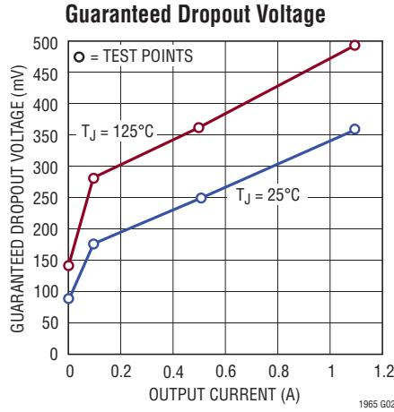

### Guaranteed Dropout Voltage

This graph shows the guaranteed dropout voltage in millivolts (mV) as a function of output current in amperes (A). Test points are marked with open circles. Two curves are shown: one for  $T_J = 125^\circ\text{C}$  (red line) and one for  $T_J = 25^\circ\text{C}$  (blue line). The guaranteed dropout voltage increases with current, with the 125°C curve being higher.

*[AI figure description: curve-data table removed (values were estimated from the plot, not printed in the PDF). Read values from the image/PDF.]*

1965 G02

Graph of Guaranteed Dropout Voltage vs Output Current for TJ = 125°C and TJ = 25°C.

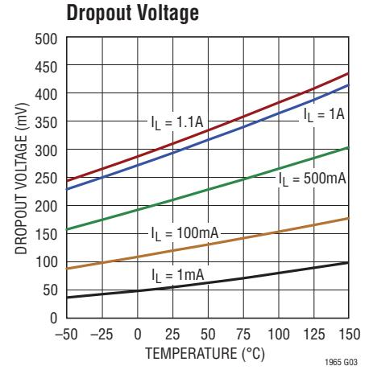

### Dropout Voltage

This graph shows the dropout voltage in millivolts (mV) as a function of temperature in degrees Celsius ( $^\circ\text{C}$ ). Five curves are shown for different load currents  $I_L$ : 1.1A (red), 1A (blue), 500mA (green), 100mA (orange), and 1mA (black). All curves show a positive temperature coefficient, with dropout voltage increasing as temperature increases.

*[AI figure description: curve-data table removed (values were estimated from the plot, not printed in the PDF). Read values from the image/PDF.]*

1965 G03

Graph of Dropout Voltage vs Temperature for various load currents.

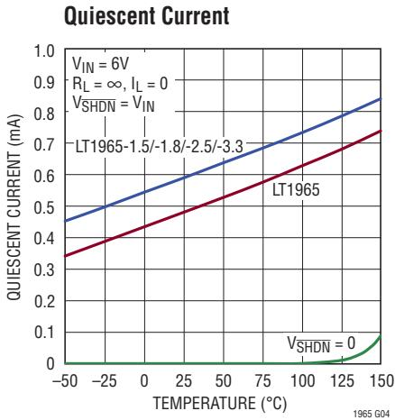

### Quiescent Current

This graph shows the quiescent current in milliamperes (mA) as a function of temperature in degrees Celsius ( $^\circ\text{C}$ ). Two main curves are shown: one for LT1965-1.5/-1.8/-2.5/-3.3 (blue line) and one for LT1965 (red line). A third curve for  $V_{\text{SHDN}} = 0$  is shown near zero. Test conditions:  $V_{\text{IN}} = 6\text{V}$ ,  $R_L = \infty$ ,  $I_L = 0$ ,  $V_{\text{SHDN}} = V_{\text{IN}}$ .

*[AI figure description: curve-data table removed (values were estimated from the plot, not printed in the PDF). Read values from the image/PDF.]*

1965 G04

Graph of Quiescent Current vs Temperature for various LT1965 models.

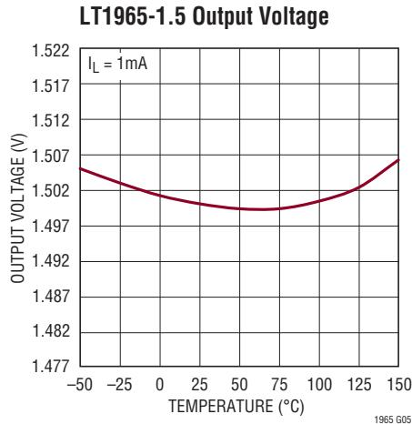

### LT1965-1.5 Output Voltage

This graph shows the output voltage in volts (V) as a function of temperature in degrees Celsius ( $^\circ\text{C}$ ) for the LT1965-1.5 model with a 1mA load current ( $I_L = 1\text{mA}$ ). The output voltage is relatively stable around 1.502V, with a slight dip around 75°C.

*[AI figure description: curve-data table removed (values were estimated from the plot, not printed in the PDF). Read values from the image/PDF.]*

1965 G05

Graph of LT1965-1.5 Output Voltage vs Temperature.

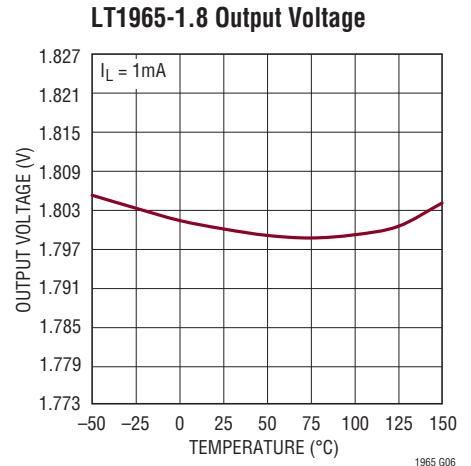

### LT1965-1.8 Output Voltage

This graph shows the output voltage in volts (V) as a function of temperature in degrees Celsius ( $^\circ\text{C}$ ) for the LT1965-1.8 model with a 1mA load current ( $I_L = 1\text{mA}$ ). The output voltage is stable around 1.802V, with a slight dip around 75°C.

*[AI figure description: curve-data table removed (values were estimated from the plot, not printed in the PDF). Read values from the image/PDF.]*

1965 G06

Graph of LT1965-1.8 Output Voltage vs Temperature.

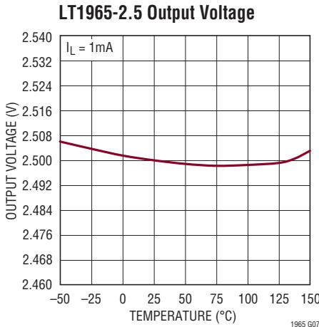

### LT1965-2.5 Output Voltage

This graph shows the output voltage in volts (V) as a function of temperature in degrees Celsius ( $^\circ\text{C}$ ) for the LT1965-2.5 model with a 1mA load current ( $I_L = 1\text{mA}$ ). The output voltage is stable around 2.500V, with a slight dip around 75°C.

*[AI figure description: curve-data table removed (values were estimated from the plot, not printed in the PDF). Read values from the image/PDF.]*

1965 G07

Graph of LT1965-2.5 Output Voltage vs Temperature.

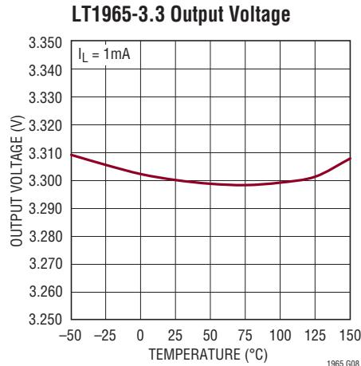

### LT1965-3.3 Output Voltage

This graph shows the output voltage in volts (V) as a function of temperature in degrees Celsius ( $^\circ\text{C}$ ) for the LT1965-3.3 model with a 1mA load current ( $I_L = 1\text{mA}$ ). The output voltage is stable around 3.300V, with a slight dip around 75°C.

*[AI figure description: curve-data table removed (values were estimated from the plot, not printed in the PDF). Read values from the image/PDF.]*

1965 G08

Graph of LT1965-3.3 Output Voltage vs Temperature.

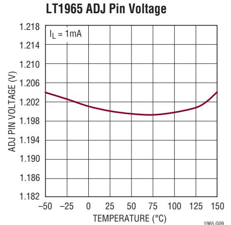

### LT1965 ADJ Pin Voltage

This graph shows the adjustment pin voltage in volts (V) as a function of temperature in degrees Celsius ( $^\circ\text{C}$ ) for the LT1965 model with a 1mA load current ( $I_L = 1\text{mA}$ ). The adjustment pin voltage is stable around 1.202V, with a slight dip around 75°C.

*[AI figure description: curve-data table removed (values were estimated from the plot, not printed in the PDF). Read values from the image/PDF.]*

1965 G09

Graph of LT1965 ADJ Pin Voltage vs Temperature.

{6}------------------------------------------------

## **TYPICAL PERFORMANCE CHARACTERISTICS**

**LT1965-1.5 Quiescent Current**

1965 G10

Graph of Quiescent Current (mA) vs Input Voltage (V) for LT1965-1.5. The graph shows a sharp increase in quiescent current at low input voltages, peaking around 1.5V, and then leveling off. Two curves are shown: VSHDN = VIN (upper) and VSHDN = 0V (lower). Conditions: TJ = 25°C, RL = infinity.

**LT1965-1.8 Quiescent Current**

1965 G11

Graph of Quiescent Current (mA) vs Input Voltage (V) for LT1965-1.8. Similar to the 1.5V version, it shows a peak in quiescent current at low input voltages. Two curves are shown: VSHDN = VIN (upper) and VSHDN = 0V (lower). Conditions: TJ = 25°C, RL = infinity.

**LT1965-2.5 Quiescent Current**

1965 G12

Graph of Quiescent Current (mA) vs Input Voltage (V) for LT1965-2.5. Shows a higher peak quiescent current at low input voltages compared to the 1.5V and 1.8V versions. Two curves are shown: VSHDN = VIN (upper) and VSHDN = 0V (lower). Conditions: TJ = 25°C, RL = infinity.

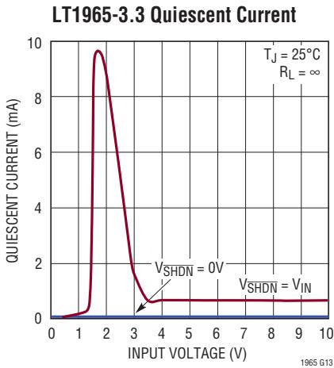

**LT1965-3.3 Quiescent Current**

1965 G13

Graph of Quiescent Current (mA) vs Input Voltage (V) for LT1965-3.3. Shows a very high peak quiescent current at low input voltages. Two curves are shown: VSHDN = VIN (upper) and VSHDN = 0V (lower). Conditions: TJ = 25°C, RL = infinity.

**LT1965 Quiescent Current**

1965 G14

Graph of Quiescent Current (mA) vs Input Voltage (V) for the general LT1965 family. The graph shows a sharp increase in quiescent current at low input voltages, leveling off around 0.5mA. Two curves are shown: VSHDN = VIN (upper) and VSHDN = 0V (lower). Conditions: TJ = 25°C, RL = 4.02k.

**LT1965-1.5 GND Pin Current (Light Load)**

1965 G15

Graph of GND Pin Current (mA) vs Input Voltage (V) for LT1965-1.5 under light load. Three curves are shown for different load conditions: RL = 30ohm, IL = 50mA; RL = 150ohm, IL = 10mA; and RL = 1.5k, IL = 1mA. All curves show a peak at low input voltages. Conditions: TJ = 25°C, VSHDN = VIN, FOR VOUT = 1.5V.

**LT1965-1.5 GND Pin Current (Heavy Load)**

1965 G16

Graph of GND Pin Current (mA) vs Input Voltage (V) for LT1965-1.5 under heavy load. Three curves are shown for different load conditions: RL = 1.363ohm, IL = 1.1A; RL = 3ohm, IL = 500mA; and RL = 15ohm, IL = 100mA. All curves show a peak at low input voltages. Conditions: TJ = 25°C, VSHDN = VIN, FOR VOUT = 1.5V.

**LT1965-1.8 GND Pin Current (Light Load)**

1965 G17

Graph of GND Pin Current (mA) vs Input Voltage (V) for LT1965-1.8 under light load. Three curves are shown for different load conditions: RL = 36ohm, IL = 50mA; RL = 180ohm, IL = 10mA; and RL = 1.8k, IL = 1mA. All curves show a peak at low input voltages. Conditions: TJ = 25°C, VSHDN = VIN, FOR VOUT = 1.8V.

**LT1965-1.8 GND Pin Current (Heavy Load)**

1965 G18

Graph of GND Pin Current (mA) vs Input Voltage (V) for LT1965-1.8 under heavy load. Three curves are shown for different load conditions: RL = 1.636ohm, IL = 1.1A; RL = 3.6ohm, IL = 500mA; and RL = 18ohm, IL = 100mA. All curves show a peak at low input voltages. Conditions: TJ = 25°C, VSHDN = VIN, FOR VOUT = 1.8V.

{7}------------------------------------------------

## LT1965 Series

## TYPICAL PERFORMANCE CHARACTERISTICS

**LT1965-2.5 GND Pin Current (Light Load)**

Graph of GND Pin Current (mA) vs Input Voltage (V) for LT1965-2.5 under light load conditions. The graph shows three curves for different load currents: 10mA (RL = 250Ω), 1mA (RL = 2.5k), and 50mA (RL = 50Ω). All curves show a peak in current around 2V input voltage. Test conditions: TJ = 25°C, VSHDN = VIN, \*FOR VOUT = 2.5V.

**LT1965-2.5 GND Pin Current (Heavy Load)**

Graph of GND Pin Current (mA) vs Input Voltage (V) for LT1965-2.5 under heavy load conditions. The graph shows three curves for different load currents: 1.1A (RL = 2.272Ω), 500mA (RL = 5Ω), and 100mA (RL = 25Ω). All curves show a peak in current around 2V input voltage. Test conditions: TJ = 25°C, VSHDN = VIN, \*FOR VOUT = 2.5V.

**LT1965-3.3 GND Pin Current (Light Load)**

Graph of GND Pin Current (mA) vs Input Voltage (V) for LT1965-3.3 under light load conditions. The graph shows three curves for different load currents: 10mA (RL = 330Ω), 1mA (RL = 3.3k), and 50mA (RL = 66Ω). All curves show a peak in current around 2V input voltage. Test conditions: TJ = 25°C, VSHDN = VIN, \*FOR VOUT = 3.3V.

**LT1965-3.3 GND Pin Current (Heavy Load)**

Graph of GND Pin Current (mA) vs Input Voltage (V) for LT1965-3.3 under heavy load conditions. The graph shows three curves for different load currents: 1.1A (RL = 3Ω), 500mA (RL = 6.6Ω), and 100mA (RL = 33Ω). All curves show a peak in current around 2V input voltage. Test conditions: TJ = 25°C, VSHDN = VIN, \*FOR VOUT = 3.3V.

**LT1965 GND Pin Current (Light Load)**

Graph of GND Pin Current (mA) vs Input Voltage (V) for LT1965 under light load conditions. The graph shows three curves for different load currents: 50mA (RL = 24Ω), 10mA (RL = 120Ω), and 1mA (RL = 1.2k). All curves show a peak in current around 2V input voltage. Test conditions: TJ = 25°C, VSHDN = VIN, \*FOR VOUT = 1.2V.

**LT1965 GND Pin Current (Heavy Load)**

Graph of GND Pin Current (mA) vs Input Voltage (V) for LT1965 under heavy load conditions. The graph shows three curves for different load currents: 1.1A (RL = 1.091Ω), 500mA (RL = 2.4Ω), and 100mA (RL = 12Ω). All curves show a peak in current around 2V input voltage. Test conditions: TJ = 25°C, VSHDN = VIN, \*FOR VOUT = 1.2V.

**GND Pin Current vs ILOAD**

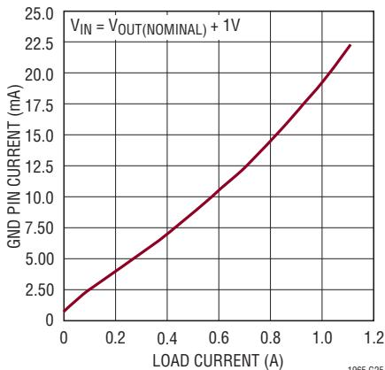

Graph of GND Pin Current (mA) vs Load Current (A). The graph shows a single curve for VIN = VOUT(NOMINAL) + 1V. The current increases linearly from approximately 1.5mA at 0A load to 22.5mA at 1.1A load.

**SHDN Pin Threshold**

Graph of SHDN Pin Threshold (V) vs Temperature (°C). The graph shows two curves: 'OFF TO ON' (red) and 'ON TO OFF' (blue). The OFF TO ON threshold starts at ~0.9V at -50°C and decreases to ~0.7V at 150°C. The ON TO OFF threshold starts at ~0.7V at -50°C and decreases to ~0.3V at 150°C.

{8}------------------------------------------------

## TYPICAL PERFORMANCE CHARACTERISTICS

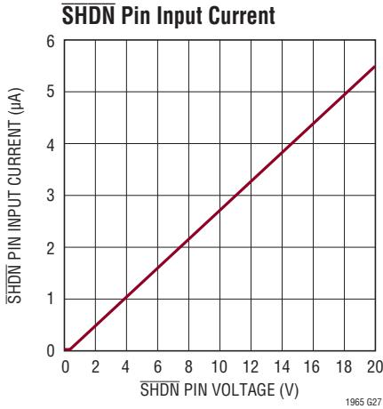

**SHDN Pin Input Current**

Y-axis: SHDN PIN INPUT CURRENT (μA) (0 to 6)  
 X-axis: SHDN PIN VOLTAGE (V) (0 to 20)  
 1965 G27

SHDN Pin Input Current graph showing current in microamperes versus voltage in volts. The graph shows a linear increase from 0V to 20V.

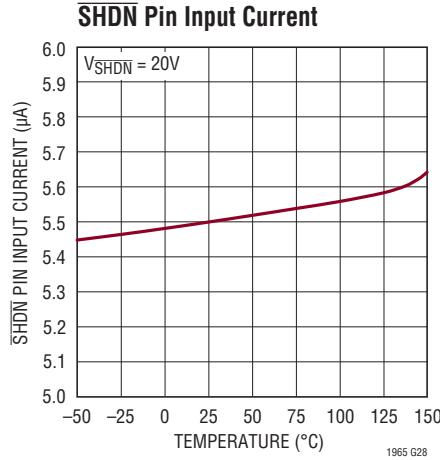

**SHDN Pin Input Current**

Y-axis: SHDN PIN INPUT CURRENT (μA) (5.0 to 6.0)  
 X-axis: TEMPERATURE (°C) (-50 to 150)  
 VSHDN = 20V  
 1965 G28

SHDN Pin Input Current graph showing current in microamperes versus temperature in degrees Celsius. The graph shows a slight increase from -50°C to 150°C.

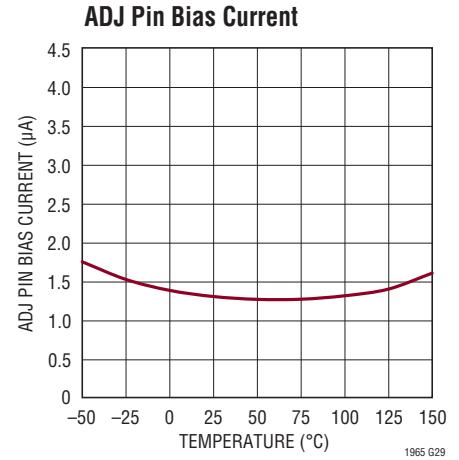

**ADJ Pin Bias Current**

Y-axis: ADJ PIN BIAS CURRENT (μA) (0 to 4.5)  
 X-axis: TEMPERATURE (°C) (-50 to 150)  
 1965 G29

ADJ Pin Bias Current graph showing current in microamperes versus temperature in degrees Celsius. The graph shows a U-shaped curve with a minimum around 75°C.

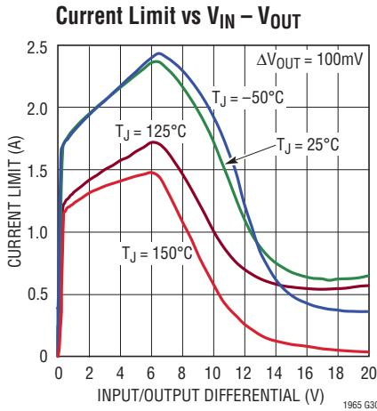

**Current Limit vs VIN - VOUT**

Y-axis: CURRENT LIMIT (A) (0 to 2.5)  
 X-axis: INPUT/OUTPUT DIFFERENTIAL (V) (0 to 20)  
 ΔVOUT = 100mV  
 Curves for TJ = -50°C, 25°C, 125°C, 150°C  
 1965 G30

Current Limit vs VIN - VOUT graph showing current limit in amperes versus input/output differential in volts for various junction temperatures.

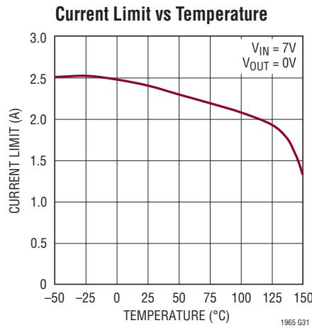

**Current Limit vs Temperature**

Y-axis: CURRENT LIMIT (A) (0 to 3.0)  
 X-axis: TEMPERATURE (°C) (-50 to 150)  
 VIN = 7V, VOUT = 0V  
 1965 G31

Current Limit vs Temperature graph showing current limit in amperes versus temperature in degrees Celsius.

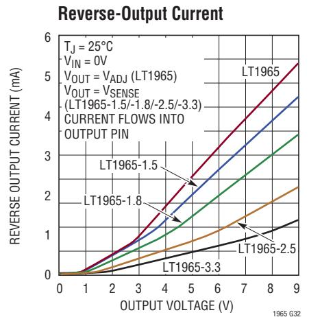

**Reverse-Output Current**

Y-axis: REVERSE OUTPUT CURRENT (mA) (0 to 6)  
 X-axis: OUTPUT VOLTAGE (V) (0 to 9)  
 TJ = 25°C, VIN = 0V, VOUT = VADJ (LT1965), VOUT = VSENSE (LT1965-1.5/-1.8/-2.5/-3.3)  
 CURRENT FLOWS INTO OUTPUT PIN  
 Curves for LT1965, LT1965-1.5, LT1965-1.8, LT1965-3.3, LT1965-2.5  
 1965 G32

Reverse-Output Current graph showing current in milliamperes versus output voltage in volts for various LT1965 models.

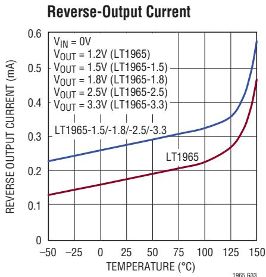

**Reverse-Output Current**

Y-axis: REVERSE OUTPUT CURRENT (mA) (0 to 0.6)  
 X-axis: TEMPERATURE (°C) (-50 to 150)  
 VIN = 0V, VOUT = 1.2V (LT1965), VOUT = 1.5V (LT1965-1.5), VOUT = 1.8V (LT1965-1.8), VOUT = 2.5V (LT1965-2.5), VOUT = 3.3V (LT1965-3.3)  
 LT1965-1.5/-1.8/-2.5/-3.3, LT1965  
 1965 G33

Reverse-Output Current graph showing current in milliamperes versus temperature in degrees Celsius for various LT1965 models.

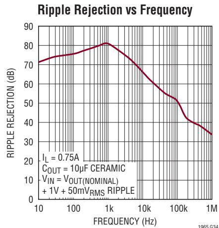

**Ripple Rejection vs Frequency**

Y-axis: RIPPLE REJECTION (dB) (0 to 90)  
 X-axis: FREQUENCY (Hz) (10 to 1M)  
 IL = 0.75A, COUT = 10μF CERAMIC, VIN = VOUT(NOMINAL) + 1V + 50mVRMS RIPPLE  
 1965 G34

Ripple Rejection vs Frequency graph showing ripple rejection in decibels versus frequency in hertz.

{9}------------------------------------------------

## LT1965 Series

## TYPICAL PERFORMANCE CHARACTERISTICS

### Ripple Rejection vs Temperature

1965 G35

Graph of Ripple Rejection (dB) vs Temperature (°C) for LT1965. The y-axis ranges from 0 to 100 dB, and the x-axis ranges from -50 to 150 °C. A single red curve shows a gradual decrease in ripple rejection as temperature increases. Test conditions: I\_L = 0.75A, V\_IN = V\_OUT(NOMINAL) + 1V + 0.5p.p. RIPPLE AT f = 120Hz.

### LT1965 Minimum Input Voltage

1965 G36

Graph of Minimum Input Voltage (V) vs Temperature (°C) for LT1965. The y-axis ranges from 0 to 2.5 V, and the x-axis ranges from -50 to 150 °C. Multiple curves are shown for different load currents: I\_L = 1A, 1.1A, 500mA, 100mA. Minimum input voltage decreases slightly with temperature and increases with load current.

### Load Regulation

1965 G37

Graph of Load Regulation (mV) vs Temperature (°C) for LT1965. The y-axis ranges from 0 to -50 mV, and the x-axis ranges from -50 to 150 °C. Curves are shown for LT1965, LT1965-1.5, LT1965-1.8, LT1965-2.5, and LT1965-3.3. Load regulation becomes more negative (worse) as temperature increases and load current increases.

### Output Noise Spectral Density

1965 G38

Graph of Output Noise Spectral Density (µV/Hz) vs Frequency (Hz) for LT1965. The y-axis is logarithmic from 0.01 to 1.00 µV/Hz, and the x-axis is logarithmic from 10 to 100k Hz. Curves are shown for LT1965-2.5, LT1965-3.3, LT1965-1.8, and LT1965. Test conditions: C\_OUT = 10µF, I\_L = 1.1A.

### RMS Output Noise vs Load Current (10Hz to 100kHz)

1965 G39

Graph of Output Noise Voltage (µV\_RMS) vs Load Current (A) for LT1965. The y-axis ranges from 0 to 80 µV\_RMS, and the x-axis is logarithmic from 0.0001 to 10 A. Curves are shown for LT1965-3.3, LT1965-2.5, LT1965-1.8, LT1965-1.5, and LT1965. Test conditions: C\_OUT = 10µF, I\_L = 1.1A.

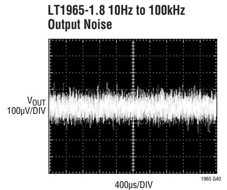

### LT1965-1.8 10Hz to 100kHz Output Noise

1965 G40

Oscilloscope trace of the output noise for the LT1965-1.8. The vertical scale is V\_OUT 100µV/DIV and the horizontal scale is 400µs/DIV. The noise appears as a dense band of high-frequency noise centered around zero.

### LT1965-3.3 Transient Response

1965 G41

Two stacked graphs showing the transient response of the LT1965-3.3. The top graph shows Output Voltage Deviation (mV) vs Time (µs) with a step change in load current. The bottom graph shows Load Current (A) vs Time (µs) with a step change from 0 to 1.1A at 30µs. Test conditions: V\_OUT = 3.3V, V\_IN = 4.3V, C\_IN = 10µF CERAMIC, C\_OUT = 10µF CERAMIC.

### LT1965-2.5 SHDN Transient Response

1965 G42

Graph showing the Soft Start (SHDN) and Output voltage response for the LT1965-2.5. The y-axis is SHDN and Output Voltage (V) from 0 to 4.0 V, and the x-axis is Time (µs) from 0 to 100. The SHDN signal (red) steps up at 20µs, and the output (blue) ramps up to 2.5V by 40µs. Test conditions: V\_IN = 3.3V, C\_OUT = 10µF CERAMIC, R\_L = 2.5k, I\_L = 1mA FOR V\_OUT = 2.5V.

{10}------------------------------------------------

## PIN FUNCTIONS (DFN/MSOP/DD-Pak/TO-220)

**OUT (Pins 1, 2 / 1, 2 / 4 / 4):** Output. This pin supplies power to the load. Use a minimum output capacitor of  $10\mu\text{F}$  to prevent oscillations. Large load transient applications require larger output capacitors to limit peak voltage transients. See the Applications Information section for more information on output capacitance and reverse-output characteristics.

**SENSE (Pin 3 / 3 / 5 / 5):** Sense. For fixed voltage versions of the LT1965 (LT1965-1.5/LT1965-1.8/ LT1965-2.5/ LT1965-3.3), the SENSE pin is the input to the error amplifier. Optimum regulation is obtained when the SENSE pin is connected to the OUT pin of the regulator. In critical applications, small voltage drops are caused by the resistance ( $R_p$ ) of PCB traces between the regulator and the load. These drops may be eliminated by connecting the SENSE pin to the output at the load as shown in Figure 1 (Kelvin Sense Connection). Note that the voltage drop across the external PCB traces will add to the dropout voltage of the regulator. The SENSE pin bias current is  $100\mu\text{A}$  at the nominal rated output voltage.

**ADJ (Pin 3 / 3 / 5 / 5):** Adjust. This pin is the input to the error amplifier. It has a typical bias current of  $1.3\mu\text{A}$  that flows into the pin. The ADJ pin voltage is  $1.20\text{V}$  referenced to ground.

**GND (Pins 4, 5 / 4, 5 / 3 / 3):** Ground. For the adjustable LT1965, connect the bottom of the resistor divider, setting output voltage, directly to GND for optimum regulation.

**SHDN (Pin 6 / 6 / 1 / 1):** Shutdown. Pulling the  $\overline{\text{SHDN}}$  pin low puts the LT1965 into a low power state and turns the output off. Drive the  $\overline{\text{SHDN}}$  pin with either logic or an open collector/drain with a pull-up resistor. The resistor supplies the pull-up current to the open collector/drain logic, normally several microamperes and the  $\overline{\text{SHDN}}$  pin current, typically less than  $5.5\mu\text{A}$ . If unused, connect the  $\overline{\text{SHDN}}$  pin to  $V_{\text{IN}}$ . The  $\overline{\text{SHDN}}$  pin cannot be driven below GND unless it is tied to the IN pin. If the  $\overline{\text{SHDN}}$  pin is driven below GND while IN is powered, the output will turn on.  $\overline{\text{SHDN}}$  pin logic cannot be referenced to a negative supply rail.

**IN (Pins 7, 8 / 7, 8 / 2 / 2):** Input. This pin supplies power to the device. The LT1965 requires a bypass capacitor at IN if located more than six inches from the main input filter capacitor. Include a bypass capacitor in battery-powered circuits as a battery's output impedance generally rises with frequency. A bypass capacitor in the range of  $1\mu\text{F}$  to  $10\mu\text{F}$  suffices. The LT1965's design withstands reverse voltages on the IN pin with respect to ground and the OUT pin. In the case of a reversed input, which occurs if a battery is plugged in backwards, the LT1965 behaves as if a diode is in series with its input. No reverse current flows into the LT1965 and no reverse voltage appears at the load. The device protects itself and the load.

**Exposed Pad (Pin 9 / 9, DFN and MSOP Packages Only):** Ground. Tie this pin directly to Pins 4 and 5 and the PCB ground. This pin provides enhanced thermal performance with its connection to the PCB ground. See the Applications Information section for thermal considerations and calculating junction temperature.

![Figure 1: Kelvin Sense Connection circuit diagram. The diagram shows the LT1965 regulator with pins IN, OUT, SHDN, SENSE, and GND. The IN pin is connected to the input voltage source V_IN and a bypass capacitor. The SHDN pin is connected to the input voltage source. The SENSE pin is connected to the output of the regulator through a resistor R_p. The OUT pin is connected to the load through a resistor R_p. The GND pin is connected to the ground of the input voltage source and the ground of the load. The load is represented by a box labeled 'LOAD'.](img/7c6d9bfe9c31ce872722d60b73d20df1_img.jpg)

Figure 1: Kelvin Sense Connection circuit diagram. The diagram shows the LT1965 regulator with pins IN, OUT, SHDN, SENSE, and GND. The IN pin is connected to the input voltage source V\_IN and a bypass capacitor. The SHDN pin is connected to the input voltage source. The SENSE pin is connected to the output of the regulator through a resistor R\_p. The OUT pin is connected to the load through a resistor R\_p. The GND pin is connected to the ground of the input voltage source and the ground of the load. The load is represented by a box labeled 'LOAD'.

Figure 1. Kelvin Sense Connection

{11}------------------------------------------------

## LT1965 Series

## APPLICATIONS INFORMATION

The LT1965 series are 1.1A low dropout regulators with shutdown. The devices are capable of supplying 1.1A at a typical dropout voltage of 310mV. The low operating quiescent current (500μA for the adjustable version, 600μA for the fixed voltage versions) drops to less than 1μA in shutdown. In addition to the low quiescent current, the LT1965 regulators incorporate several protection features that makes them ideal for use in battery-powered systems. The devices protect themselves against both reverse-input and reverse-output voltages. In battery backup applications, if a backup battery holds up the output when the input is pulled to ground, the LT1965 performs like it has a diode in series with its output, preventing reverse-current flow.

### Adjustable Operation

The LT1965 adjustable version has an output voltage range of 1.20V to 19.5V. Figure 2 illustrates that the ratio of two external resistors sets the output voltage. The device servos the output to maintain the ADJ pin voltage at 1.20V referenced to ground. R1's current equals 1.20V/R1. R2's current equals R1's current plus the ADJ pin bias current. The ADJ pin bias current, 1.3μA at 25°C, flows through R2 into the ADJ pin. Use the formula in Figure 2 to calculate output voltage. Linear Technology recommends that R1's value be less than 12.1k to minimize output voltage errors due to the ADJ pin bias current. In shutdown, the output turns off and the divider current is zero. For curves depicting ADJ Pin Voltage vs Temperature and ADJ Pin Bias Current vs Temperature, see the Typical Performance Characteristics section.

The adjustable device is tested and specified with the ADJ pin tied to the OUT pin for an output voltage of 1.20V. Specifications for output voltages greater than 1.20V are proportional to the ratio of the desired output voltage to

1.20V:  $V_{OUT}/1.20V$ . For example, load regulation for an output current change of 1mA to 1.1A is typically -4.25mV at  $V_{OUT} = 1.20V$ . At  $V_{OUT} = 5V$ , load regulation is:

$$\frac{5V}{1.20V} \cdot -4.25mV = -17.71mV$$

### Output Capacitance

The LT1965's design is stable with a wide range of output capacitors. The ESR of the output capacitor affects stability, most notably with small capacitors. A minimum output capacitor of 10μF with an ESR of 0.3Ω or less is recommended to prevent oscillations. The LT1965 is a low quiescent current device and output load transient response is a function of output capacitance. Larger values of output capacitance decrease the peak deviations and provide improved transient response for larger current changes.

Ceramic capacitors require extra consideration. Manufacturers make ceramic capacitors with a variety of dielectrics, each with different behavior across temperature and applied voltage. The most common dielectrics used are specified with EIA temperature characteristic codes of Z5U, Y5V, X5R and X7R. The Z5U and Y5V dielectrics provide high C-V products in a small package at low cost, but exhibit strong voltage and temperature coefficients as shown in Figures 3 and 4. When used with a 5V regulator, a 16V 10μF Y5V capacitor can exhibit an effective value as low as 1μF to 2μF for the DC bias applied and over the operating temperature range. The X5R and X7R dielectrics yield much more stable characteristics and are more suitable for use as the output capacitor. The X7R type works over a wider temperature range and has better temperature stability whereas X5R is less expensive and is available in higher values. Care still must be exercised when using X5R and X7R capacitors; the X5R and X7R codes only specify operating temperature range and maximum capacitance change over temperature. Capacitance change due to DC bias with X5R and X7R capacitors is better than Y5V and Z5U capacitors, but can still be significant enough to drop capacitor values below appropriate levels. Capacitor DC bias characteristics tend to improve as component case size increases, but expected capacitance at operating voltages should be verified.

![Circuit diagram of the LT1965 adjustable regulator. The IC is shown with pins IN, OUT, ADJ, and GND. An input voltage VIN is connected to the IN pin. The ADJ pin is connected to ground through resistor R1. Resistor R2 is connected between the ADJ pin and the output. The output is connected to the OUT pin and also to a load through a capacitor. The output voltage is labeled VOUT. The diagram includes the following equations: VOUT = 1.20V * (1 + R2/R1) + IADJ * R2, VADJ = 1.20V, IADJ = 1.3μA AT 25°C, and OUTPUT RANGE = 1.20V TO 19.5V.](img/63e0c22852c26699d0bd095a2d796bab_img.jpg)

$$V_{OUT} = 1.20V \left(1 + \frac{R_2}{R_1}\right) + I_{ADJ} \cdot R_2$$
$$V_{ADJ} = 1.20V$$
$$I_{ADJ} = 1.3\mu A \text{ AT } 25^\circ C$$
$$\text{OUTPUT RANGE} = 1.20V \text{ TO } 19.5V$$

Circuit diagram of the LT1965 adjustable regulator. The IC is shown with pins IN, OUT, ADJ, and GND. An input voltage VIN is connected to the IN pin. The ADJ pin is connected to ground through resistor R1. Resistor R2 is connected between the ADJ pin and the output. The output is connected to the OUT pin and also to a load through a capacitor. The output voltage is labeled VOUT. The diagram includes the following equations: VOUT = 1.20V \* (1 + R2/R1) + IADJ \* R2, VADJ = 1.20V, IADJ = 1.3μA AT 25°C, and OUTPUT RANGE = 1.20V TO 19.5V.

Figure 2. Adjustable Operation

{12}------------------------------------------------

## APPLICATIONS INFORMATION

Voltage and temperature coefficients are not the only sources of problems. Some ceramic capacitors have a piezoelectric response. A piezoelectric device generates voltage across its terminals due to mechanical stress, similar to the way a piezoelectric accelerometer or microphone works. For a ceramic capacitor, the stress can be induced by vibrations in the system or thermal transients. The resulting voltages produced can cause appreciable amounts of noise. A ceramic capacitor produced the trace in Figure 5 in response to light tapping from a pencil. Similar vibration induced behavior can masquerade as increased output voltage noise.

### Overload Recovery

Like many IC power regulators, the LT1965 has safe operating area protection. The safe area protection decreases current limit as input-to-output voltage increases and keeps the power transistor inside a safe operating region for all values of input-to-output voltage. The protective design provides some output current at all values of input-to-output voltage up to the device breakdown.

When power is first applied, as input voltage rises, the output follows the input, allowing the regulator to start up into very heavy loads. During start-up, as the input voltage

*[AI figure description: curve-data table removed (values were estimated from the plot, not printed in the PDF). Read values from the image/PDF.]*

Figure 3: Ceramic Capacitor DC Bias Characteristics. A line graph showing the percentage change in value versus DC bias voltage for X5R and Y5V capacitors. Both are 16V, 1210 case size, 10µF. The X5R curve (red) shows a gradual decrease from 0% at 0V to -40% at 16V. The Y5V curve (blue) shows a steeper decrease from 0% at 0V to -80% at 16V.

Figure 3. Ceramic Capacitor DC Bias Characteristics

*[AI figure description: curve-data table removed (values were estimated from the plot, not printed in the PDF). Read values from the image/PDF.]*

Figure 4: Ceramic Capacitor Temperature Characteristics. A line graph showing the percentage change in value versus temperature for X5R and Y5V capacitors. Both are 16V, 1210 case size, 10µF. The X5R curve (red) is relatively flat, staying near 0% between -25°C and 75°C, then slightly decreasing. The Y5V curve (blue) peaks at 20% around 0°C and then drops sharply to -80% at 75°C.

Figure 4. Ceramic Capacitor Temperature Characteristics

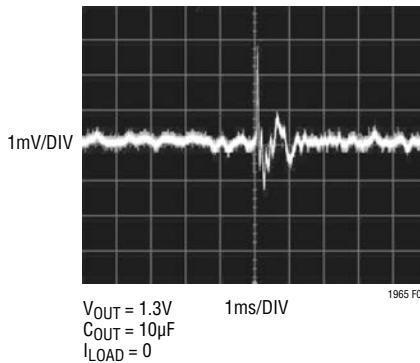

Figure 5: Noise Resulting from Tapping on a Ceramic Capacitor. An oscilloscope trace showing a sharp noise spike. The vertical scale is 1mV/DIV and the horizontal scale is 1ms/DIV. Test conditions: VOUT = 1.3V, COUT = 10µF, ILOAD = 0.

Figure 5. Noise Resulting from Tapping on a Ceramic Capacitor

{13}------------------------------------------------

## APPLICATIONS INFORMATION

is rising, the input-to-output voltage differential is small, allowing the regulator to supply large output currents. With a high input voltage, a problem can occur wherein removal of an output short will not allow the output to recover. Other regulators, such as the LT1083/LT1084/LT1085 family, also exhibit this phenomenon, so it is not unique to the LT1965.

The problem occurs with a heavy output load when the input voltage is high and the output voltage is low. Common situations occur immediately after the removal of a short-circuit or if the shutdown pin is pulled high after the input voltage has already been turned on. The load line for such a load may intersect the output current curve at two points. If this happens, there are two stable output operating points for the regulator. With this double intersection, the input power supply may need to be cycled down to zero and brought up again to make the output recover.

### Output Voltage Noise

The LT1965 regulators are designed to provide low output voltage noise over the 10Hz to 100kHz bandwidth while operating at full load. Output voltage noise is approximately  $80\text{nV}/\sqrt{\text{Hz}}$  over this frequency bandwidth for the LT1965 adjustable version. For higher output voltages (generated by using a resistor divider), the output voltage noise gains up accordingly.

Higher values of output voltage noise may be measured if care is not exercised with regard to circuit layout and testing. Crosstalk from nearby traces can induce unwanted noise onto the LT1965's output. Power supply ripple rejection must also be considered; the LT1965 regulators do not have unlimited power supply rejection and will pass a small portion of the input noise through to the output.

## Thermal Considerations

The LT1965's maximum rated junction temperature of  $125^{\circ}\text{C}$  (LT1965E, LT1965I) or  $150^{\circ}\text{C}$  (LT1965H) limits its power handling capability. Two components comprise the power dissipated by the device:

1. Output current multiplied by the input/output voltage differential:  $I_{\text{OUT}} \cdot (V_{\text{IN}} - V_{\text{OUT}})$ , and
2. GND pin current multiplied by the input voltage:  $I_{\text{GND}} \cdot V_{\text{IN}}$

GND pin current is determined using the GND Pin Current curves in the Typical Performance Characteristics section. Power dissipation equals the sum of the two components listed.

The LT1965 regulators have internal thermal limiting that protect the device during overload conditions. For continuous normal conditions, do not exceed the maximum junction temperature rating of  $125^{\circ}\text{C}$  (E-grade, I-grade) or  $150^{\circ}\text{C}$  (H-grade). Carefully consider all sources of thermal resistance from junction to ambient including other heat sources mounted in proximity to the LT1965.

The underside of the LT1965 DFN package has exposed metal ( $4\text{mm}^2$ ) from the lead frame to the die attachment. The underside of the LT1965 MSOP package also has exposed metal ( $3.7\text{mm}^2$ ). Both packages allow heat to directly transfer from the die junction to the printed circuit board metal to control maximum operating junction temperature. The dual-in-line pin arrangement allows metal to extend beyond the ends of the package on the topside (component side) of a PCB. Connect this metal to GND on the PCB. The multiple IN and OUT pins of the LT1965 also assist in spreading heat to the PCB.

For surface mount devices, heat sinking is accomplished by using the heat spreading capabilities of the PC board and its copper traces. Copper board stiffeners and plated through-holes can also be used to spread the heat generated by power devices.

{14}------------------------------------------------

## APPLICATIONS INFORMATION

The following tables list thermal resistance for several different board sizes and copper areas. All measurements were taken in still air on a 2-layer 1/16" FR-4 board with one ounce copper.

**Table 1. Measured Thermal Resistance for DFN Package**

| Copper Area         |                     | Board Area          | Thermal Resistance (Junction-to-Ambient) |
|---------------------|---------------------|---------------------|------------------------------------------|
| Topside*            | Backside            |                     |                                          |
| 2500mm 2 | 2500mm 2 | 2500mm 2 | 60°C/W                                   |
| 1000mm 2 | 2500mm 2 | 2500mm 2 | 62°C/W                                   |
| 225mm 2  | 2500mm 2 | 2500mm 2 | 65°C/W                                   |
| 100mm 2  | 2500mm 2 | 2500mm 2 | 68°C/W                                   |
| 50mm 2   | 2500mm 2 | 2500mm 2 | 70°C/W                                   |

\*Device is mounted on topside

**Table 2. Measured Thermal Resistance for MSOP Package**

| Copper Area         |                     | Board Area          | Thermal Resistance (Junction-to-Ambient) |
|---------------------|---------------------|---------------------|------------------------------------------|
| Topside*            | Backside            |                     |                                          |
| 2500mm 2 | 2500mm 2 | 2500mm 2 | 55°C/W                                   |
| 1000mm 2 | 2500mm 2 | 2500mm 2 | 57°C/W                                   |
| 225mm 2  | 2500mm 2 | 2500mm 2 | 60°C/W                                   |
| 100mm 2  | 2500mm 2 | 2500mm 2 | 65°C/W                                   |
| 50mm 2   | 2500mm 2 | 2500mm 2 | 68°C/W                                   |

\*Device is mounted on topside

**Table 3. Measured Thermal Resistance for DD-Pak Package**

| Copper Area         |                     | Board Area          | Thermal Resistance (Junction-to-Ambient) |
|---------------------|---------------------|---------------------|------------------------------------------|
| Topside*            | Backside            |                     |                                          |
| 2500mm 2 | 2500mm 2 | 2500mm 2 | 25°C/W                                   |
| 1000mm 2 | 2500mm 2 | 2500mm 2 | 30°C/W                                   |
| 125mm 2  | 2500mm 2 | 2500mm 2 | 35°C/W                                   |

\*Device is mounted on topside

### Measured Thermal Resistance for TO-220 Package

Thermal Resistance (Junction-to-Case) = 3°C/W

### Calculating Junction Temperature

Example: Given an output voltage of 2.5V, an input voltage range of 3.3V ± 5%, an output current range of 0mA to 500mA and a maximum ambient temperature of 85°C, what will the maximum junction temperature be?

The power dissipated by the device equals:

$$I_{OUT(MAX)} \cdot (V_{IN(MAX)} - V_{OUT}) + I_{GND} \cdot V_{IN(MAX)}$$

where:

$$I_{OUT(MAX)} = 500\text{mA}$$

$$V_{IN(MAX)} = 3.465\text{V}$$

$$I_{GND} \text{ at } (I_{OUT} = 500\text{mA}, V_{IN} = 3.465\text{V}) = 8.2\text{mA}$$

So,

$$P = 500\text{mA}(3.465\text{V} - 2.5\text{V}) + 8.2\text{mA}(3.465\text{V}) = 0.511\text{W}$$

Using a DFN package, the thermal resistance will be in the range of 60°C/W to 70°C/W depending on the copper area. So the junction temperature rise above ambient approximately equals:

$$0.511\text{W} \cdot 65^\circ\text{C/W} = 33.22^\circ\text{C}$$

The maximum junction temperature equals the maximum ambient temperature plus the maximum junction temperature rise above ambient or:

$$T_{JMAX} = 85^\circ\text{C} + 33.22^\circ\text{C} = 118.22^\circ\text{C}$$

### Protection Features

The LT1965 regulators incorporate several protection features that makes them ideal for use in battery-powered circuits. In addition to the normal protection features associated with monolithic regulators, such as current limiting and thermal limiting, the devices also protect against reverse-input voltages, reverse-output voltages and reverse output-to-input voltages.

Current-limit protection and thermal overload protection protect the device against current overload conditions at its output. For normal operation, do not exceed the maximum rated junction temperature of 125°C (LT1965E, LT1965I) or 150°C (LT1965H).

{15}------------------------------------------------

## APPLICATIONS INFORMATION

The input of the device withstands reverse voltages of 22V. The LT1965 limits current flow to less than 1mA (typically less than 300μA) and no negative voltage appears at the output. The device protects both itself and the load against batteries that are plugged in backwards.

The LT1965 incurs no damage if its output is pulled below ground. If the input is left open-circuit or grounded, the output can be pulled below ground by 22V. For fixed voltage versions, the output will act like a large resistor, typically 5k or higher, limiting current flow to typically less than 300μA. For the adjustable version, the output acts like an open circuit and no current flows from the output. However, current flows out of (but is limited by) the resistor divider that sets the output voltage. If the input is powered by a voltage source, the LT1965 protects itself by shutting off the output.

The LT1965 adjustable version incurs no damage if the ADJ pin is pulled above or below ground by 9V. If the input is left open-circuit or grounded, the ADJ pin performs like a diode in series with typically 1.5k of resistance when pulled below ground and like a large resistor (typically 5k up to 3V on the ADJ pin and then 1.5k up to 9V) in series with a diode when pulled above ground.

In situations where the ADJ pin connects to a resistor divider that would pull the ADJ pin above its 9V clamp

voltage if the output is pulled high, the ADJ pin input current must be limited to less than 5mA. For example, a resistor divider is used to provide a regulated 1.5V output from the 1.20V reference when the output is forced to 20V. The top resistor of the resistor divider must be chosen to limit the current into the ADJ pin to less than 5mA when the ADJ pin is at 9V. The 11V difference between the OUT and ADJ pins divided by the 5mA maximum current into the ADJ pin yields a minimum top resistor value of 2.2k.

In circuits where a backup battery is required, several different input/output conditions can occur. The output voltage may be held up while the input is either pulled to ground, pulled to some intermediate voltage, or is left open-circuit. Current flow back into the output follows the curve shown in Figure 6.

If the LT1965's IN pin is forced below the OUT pin or the OUT pin is pulled above the IN pin, input current typically drops to less than 2μA. This occurs if the LT1965 input is connected to a discharged (low voltage) battery and either a backup battery or a second regulator holds up the output. The state of the  $\overline{\text{SHDN}}$  pin has no effect on the reverse-output current if the output is pulled above the input.

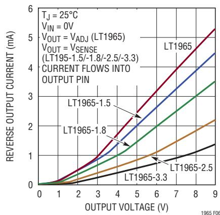

Figure 6 is a line graph showing the reverse-output current (mA) versus output voltage (V) for various LT1965 models. The graph includes the following parameters:  $T_J = 25^\circ\text{C}$ ,  $V_{IN} = 0\text{V}$ ,  $V_{OUT} = V_{ADJ}$  (LT1965),  $V_{OUT} = V_{SENSE}$  (LT195-1.5/-1.8/-2.5/-3.3), and a note that current flows into the output pin. The x-axis represents output voltage from 0 to 9V, and the y-axis represents reverse output current from 0 to 6mA. Five curves are shown, labeled LT1965, LT1965-1.5, LT1965-1.8, LT1965-2.5, and LT1965-3.3. The LT1965 curve shows the highest current, reaching approximately 5.5mA at 9V. The LT1965-1.5, -1.8, -2.5, and -3.3 curves show progressively lower currents, reaching approximately 4.5mA, 3.5mA, 2.5mA, and 1.5mA respectively at 9V.

*[AI figure description: curve-data table removed (values were estimated from the plot, not printed in the PDF). Read values from the image/PDF.]*

Figure 6: Reverse-Output Current graph showing Reverse Output Current (mA) vs Output Voltage (V) for various LT1965 models.

Figure 6. Reverse-Output Current

{16}------------------------------------------------

## TYPICAL APPLICATIONS

### Paralleling of Regulators for Higher Output Current

![Circuit diagram showing the paralleling of an LT1965-3.3 and an LT1965 regulator. The LT1965-3.3 is configured as a 3.3V regulator with a 2.2A output. The LT1965 is configured as an adjustable regulator. Their outputs are connected in parallel through sense resistors R6 (6.65k 1%) and R7 (4.02k 1%). A 1/2 LT1366 operational amplifier is used for current sharing, comparing the voltage drops across R6 and R7. Control signals include SHDN (Shutdown) and SENSE. Input capacitors C1 (100µF) and C2 (22µF) are shown, along with a 0.01µF capacitor C3 at the op-amp output. Resistor values R1 (0.01Ω), R2 (0.01Ω), R3 (2.2k), R4 (2.2k), and R5 (10k) are also specified.](img/8307f6b04df072c9332f9987e034272c_img.jpg)

Circuit diagram showing the paralleling of an LT1965-3.3 and an LT1965 regulator. The LT1965-3.3 is configured as a 3.3V regulator with a 2.2A output. The LT1965 is configured as an adjustable regulator. Their outputs are connected in parallel through sense resistors R6 (6.65k 1%) and R7 (4.02k 1%). A 1/2 LT1366 operational amplifier is used for current sharing, comparing the voltage drops across R6 and R7. Control signals include SHDN (Shutdown) and SENSE. Input capacitors C1 (100µF) and C2 (22µF) are shown, along with a 0.01µF capacitor C3 at the op-amp output. Resistor values R1 (0.01Ω), R2 (0.01Ω), R3 (2.2k), R4 (2.2k), and R5 (10k) are also specified.

## PACKAGE DESCRIPTION

Please refer to <http://www.linear.com/designtools/packaging/> for the most recent package drawings.

### DD Package 8-Lead Plastic DFN (3mm × 3mm) (Reference LTC DWG # 05-08-1698 Rev C)

Mechanical drawings of the 8-lead Plastic DFN package. The top view shows a 3.5 ± 0.05 mm by 2.10 ± 0.05 mm package with a 1.65 ± 0.05 mm (2 sides) pitch and 0.25 ± 0.05 mm lead width. The side view shows a 3.00 ± 0.10 mm (4 sides) height and 0.75 ± 0.05 mm lead length. The bottom view shows the exposed pad with a 2.38 ± 0.10 mm pitch and 0.50 BSC lead spacing. Dimensions are in millimeters.

RECOMMENDED SOLDER PAD PITCH AND DIMENSIONS APPLY SOLDER MASK TO AREAS THAT ARE NOT SOLDERED

###### **NOTE:**

1. DRAWING TO BE MADE A JEDEC PACKAGE OUTLINE MO-229 VARIATION OF (WEED-1)
2. DRAWING NOT TO SCALE
3. ALL DIMENSIONS ARE IN MILLIMETERS
4. DIMENSIONS OF EXPOSED PAD ON BOTTOM OF PACKAGE DO NOT INCLUDE MOLD FLASH. MOLD FLASH, IF PRESENT, SHALL NOT EXCEED 0.15mm ON ANY SIDE

5. EXPOSED PAD SHALL BE SOLDER PLATED
6. SHADED AREA IS ONLY A REFERENCE FOR PIN 1 LOCATION ON TOP AND BOTTOM OF PACKAGE

{17}------------------------------------------------

## LT1965 Series

## PACKAGE DESCRIPTION

Please refer to <http://www.linear.com/designtools/packaging/> for the most recent package drawings.

### MS8E Package 8-Lead Plastic MSOP, Exposed Die Pad (Reference LTC DWG # 05-08-1662 Rev K)

![Technical drawing of the MS8E Package (8-Lead Plastic MSOP, Exposed Die Pad). The drawing includes a top view showing the recommended solder pad layout with dimensions for the package body and leads. It also includes a bottom view of the exposed pad option, showing the exposed pad area and lead frame features. Two detail views, 'A' and 'B', show the lead profile and corner tail. The drawing includes dimensions in millimeters and inches, with tolerances and reference values. A note section at the bottom left provides additional information for the dimensions.](img/ef25c3cf1fdb334fc8679e85ab5265ca_img.jpg)

**RECOMMENDED SOLDER PAD LAYOUT**

Top view dimensions:  
 - Package body width:  $1.88 \pm 0.102$  ( $.074 \pm .004$ )  
 - Package body length:  $5.10$  ( $.201$ ) MIN  
 - Lead pitch:  $0.42 \pm 0.038$  ( $.0165 \pm .0015$ ) TYP  
 - Lead width:  $0.65$  ( $.0256$ ) BSC  
 - Lead length:  $0.889 \pm 0.127$  ( $.035 \pm .005$ )  
 - Lead angle:  $0^\circ - 6^\circ$  TYP  
 - Lead separation:  $0.53 \pm 0.152$  ( $.021 \pm .006$ )

**BOTTOM VIEW OF EXPOSED PAD OPTION**

Bottom view dimensions:  
 - Exposed pad width:  $1.88$  ( $.074$ )  
 - Exposed pad length:  $1.68$  ( $.066$ )  
 - Lead pitch:  $3.00 \pm 0.102$  ( $.118 \pm .004$ ) (NOTE 3)  
 - Lead width:  $0.52$  ( $.0205$ ) REF  
 - Lead separation:  $0.86$  ( $.034$ ) REF  
 - Lead angle:  $0^\circ - 6^\circ$  TYP  
 - Lead separation:  $0.53 \pm 0.152$  ( $.021 \pm .006$ )

**DETAIL "A"**

Lead profile dimensions:  
 - Lead width:  $0.254$  ( $.010$ )  
 - Lead angle:  $0^\circ - 6^\circ$  TYP  
 - Lead separation:  $0.53 \pm 0.152$  ( $.021 \pm .006$ )

**DETAIL "B"**

Corner tail dimensions:  
 - Corner tail length:  $0.29$  REF  
 - Corner tail width:  $0.05$  REF  
 - Corner tail angle:  $0^\circ - 6^\circ$  TYP

**SEATING PLANE**

Lead profile dimensions:  
 - Lead width:  $1.10$  ( $.043$ ) MAX  
 - Lead angle:  $0^\circ - 6^\circ$  TYP  
 - Lead separation:  $0.86$  ( $.034$ ) REF  
 - Lead separation:  $0.53 \pm 0.152$  ( $.021 \pm .006$ )

**MSOP (MS8E) 0213 REV K**

Technical drawing of the MS8E Package (8-Lead Plastic MSOP, Exposed Die Pad). The drawing includes a top view showing the recommended solder pad layout with dimensions for the package body and leads. It also includes a bottom view of the exposed pad option, showing the exposed pad area and lead frame features. Two detail views, 'A' and 'B', show the lead profile and corner tail. The drawing includes dimensions in millimeters and inches, with tolerances and reference values. A note section at the bottom left provides additional information for the dimensions.

##### NOTE:

1. DIMENSIONS IN MILLIMETER/(INCH)
2. DRAWING NOT TO SCALE
3. DIMENSION DOES NOT INCLUDE MOLD FLASH, PROTRUSIONS OR GATE BURRS.  
MOLD FLASH, PROTRUSIONS OR GATE BURRS SHALL NOT EXCEED  $0.152\text{mm}$  ( $.006$ ) PER SIDE
4. DIMENSION DOES NOT INCLUDE INTERLEAD FLASH OR PROTRUSIONS.  
INTERLEAD FLASH OR PROTRUSIONS SHALL NOT EXCEED  $0.152\text{mm}$  ( $.006$ ) PER SIDE
5. LEAD COPLANARITY (BOTTOM OF LEADS AFTER FORMING) SHALL BE  $0.102\text{mm}$  ( $.004$ ) MAX
6. EXPOSED PAD DIMENSION DOES INCLUDE MOLD FLASH. MOLD FLASH ON E-PAD  
SHALL NOT EXCEED  $0.254\text{mm}$  ( $.010$ ) PER SIDE.

{18}------------------------------------------------

## PACKAGE DESCRIPTION

Please refer to <http://www.linear.com/designtools/packaging/> for the most recent package drawings.

### Q Package 5-Lead Plastic DD Pak (Reference LTC DWG # 05-08-1461 Rev F)

Bottom view of the 5-lead plastic DD Pak package showing dimensions in inches and millimeters. The package width is .300 (7.620). The distance between the centers of the leads is .256 (6.502). The lead pitch is .060 (1.524). The lead width is .060 (1.524). The lead length is .183 (4.648). The lead thickness is .075 (1.905). A hatched area indicates the solder-plated copper heat sink.

BOTTOM VIEW OF DD PAK  
HATCHED AREA IS SOLDER PLATED  
COPPER HEAT SINK

Top view of the 5-lead plastic DD Pak package showing dimensions in inches and millimeters. The package width is .390 - .415 (9.906 - 10.541). The package length is .060 (1.524) TYP. The lead pitch is .330 - .370 (8.382 - 9.398). The lead width is .143 +.012 -.020 (3.632 +.0305 -.508). The lead thickness is .028 - .038 (0.711 - 0.965) TYP. The lead angle is 15° TYP. The lead spacing is .067 (1.702) BSC.

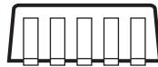

Front view of the 5-lead plastic DD Pak package showing the lead spacing and pitch.

Side view of the 5-lead plastic DD Pak package showing dimensions in inches and millimeters. The package width is .165 - .180 (4.191 - 4.572). The package length is .059 (1.499) TYP. The lead pitch is .045 - .055 (1.143 - 1.397). The lead width is .004 +.008 -.004 (0.102 +.0203 -.102). The lead thickness is .095 - .115 (2.413 - 2.921). The lead angle is 0° - 7° TYP. The lead spacing is .013 - .023 (0.330 - 0.584). The lead thickness is .050 ±.012 (1.270 ±.0305). Detail A shows the lead profile.

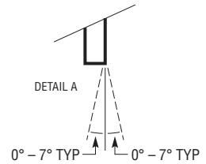

Detail A showing the lead profile with dimensions in inches and millimeters. The lead width is .013 - .023 (0.330 - 0.584). The lead thickness is .050 ±.012 (1.270 ±.0305). The lead angle is 0° - 7° TYP.

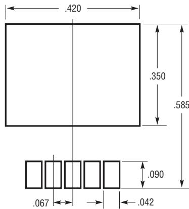

Recommended solder pad layout for the 5-lead plastic DD Pak package. The package width is .420. The package length is .350. The package thickness is .585. The lead pitch is .067. The lead width is .042. The lead thickness is .090.

RECOMMENDED SOLDER PAD LAYOUT  
NOTE:  
1. DIMENSIONS IN INCH/(MILLIMETER)  
2. DRAWING NOT TO SCALE

Recommended solder pad layout for thicker solder paste applications. The package width is .420. The package length is .325. The package thickness is .585. The lead pitch is .067. The lead width is .042. The lead thickness is .090. The lead angle is 0° - 7° TYP. The lead spacing is .013 - .023 (0.330 - 0.584). The lead thickness is .050 ±.012 (1.270 ±.0305).

RECOMMENDED SOLDER PAD LAYOUT  
FOR THICKER SOLDER PASTE APPLICATIONS

Q(DD5) 0811 REV F

{19}------------------------------------------------

## LT1965 Series

## PACKAGE DESCRIPTION

Please refer to <http://www.linear.com/designtools/packaging/> for the most recent package drawings.

### **T-Package 5-Lead Plastic TO-220 (Standard)** (Reference LTC DWG # 05-08-1421)

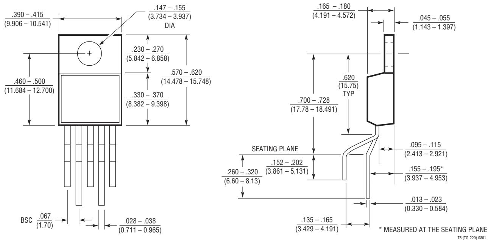

Dimension drawing showing front and side views of the 5-Lead TO-220 package:

**Front View Dimensions:**

- Hole Diameter:  $\frac{.147 - .155}{(3.734 - 3.937)}$  DIA
- Tab Top to Hole Center:  $\frac{.230 - .270}{(5.842 - 6.858)}$
- Body Width:  $\frac{.390 - .415}{(9.906 - 10.541)}$
- Tab Height:  $\frac{.570 - .620}{(14.478 - 15.748)}$
- Plastic Body Height:  $\frac{.460 - .500}{(11.684 - 12.700)}$
- Hole Center to Body Bottom:  $\frac{.330 - .370}{(8.382 - 9.398)}$
- Lead Pitch:  $\frac{.067}{(1.70)}$  BSC
- Lead Width:  $\frac{.028 - .038}{(0.711 - 0.965)}$

**Side View Dimensions:**

- Package Thickness (Top):  $\frac{.165 - .180}{(4.191 - 4.572)}$
- Tab Thickness:  $\frac{.045 - .055}{(1.143 - 1.397)}$
- Total Plastic and Tab Height:  $\frac{.620}{(15.75)}$  TYP
- Total Height to Lead Bend:  $\frac{.700 - .728}{(17.78 - 18.491)}$
- Seating Plane to Lead Bend:  $\frac{.152 - .202}{(3.861 - 5.131)}$
- Seating Plane to Lead Tip:  $\frac{.260 - .320}{(6.60 - 8.13)}$
- Lead Bend Standoff:  $\frac{.095 - .115}{(2.413 - 2.921)}$
- Lead Center to Back:  $\frac{.155 - .195*}{(3.937 - 4.953)}$
- Lead Thickness:  $\frac{.013 - .023}{(0.330 - 0.584)}$
- Seating Plane to Body Bottom:  $\frac{.135 - .165}{(3.429 - 4.191)}$

\* MEASURED AT THE SEATING PLANE

T5 (TO-220) 0801

T-Package 5-Lead Plastic TO-220 (Standard) package dimension drawing

1965fb

{20}------------------------------------------------

## **REVISION HISTORY** (Revision history begins at Rev B)

| REV | DATE  | DESCRIPTION                                              | PAGE NUMBER |
|-----|-------|----------------------------------------------------------|-------------|
| B   | 08/13 | Added H-grade, specs and curves                          | 2-10        |
|     |       | Lowered max ESR to 0.3 $\Omega$                          | 12          |
|     |       | Removed references to “starting up from negative output” | 11, 12, 16  |

{21}------------------------------------------------

## LT1965 Series

## TYPICAL APPLICATION

**Adjustable Current Source**

NOTE: ADJUST R1 FOR  
0A TO 1.1A CONSTANT-CURRENT

Circuit diagram of an adjustable current source using the LT1965. The circuit includes an LT1004-1.2 diode, a 10µF capacitor C1, a 1k resistor R1, an 80.6k resistor R2, a 2k resistor R3, a 0.01Ω sense resistor R5, a 2.2k resistor R4, a 2.2k resistor R6, a 1µF capacitor C3, an LT1965 IC, a 10µF capacitor C4, a 100k resistor R8, a 470Ω resistor R7, and a load. A 1/2 LT1366 op-amp is used for feedback. A note states: 'ADJUST R1 FOR 0A TO 1.1A CONSTANT-CURRENT'.

## RELATED PARTS

| PART NUMBER         | DESCRIPTION                                                          | COMMENTS                                                                                                                                                                                                                                                                                                                                                               |
|---------------------|----------------------------------------------------------------------|------------------------------------------------------------------------------------------------------------------------------------------------------------------------------------------------------------------------------------------------------------------------------------------------------------------------------------------------------------------------|
| LT1129              | 700mA, Micropower, LDO                                               | $V_{IN}$ : 4.2V to 30V, $V_{OUT(MIN)}$ = 3.8V, $V_{DO}$ = 0.40V, $I_Q$ = 50µA, $I_{SD}$ = 16µA; DD, SOT-223, S8, TO220-5 and TSSOP20 Packages                                                                                                                                                                                                                          |
| LT1761              | 100mA, Low Noise Micropower, LDO                                     | $V_{IN}$ : 1.8V to 20V, $V_{OUT(MIN)}$ = 1.22V, $V_{DO}$ = 0.30V, $I_Q$ = 20µA, $I_{SD}$ = < 1µA, Low Noise < 20µV RMS , Stable with 1µF Ceramic Capacitors, ThinSOT™ Package                                                                                                                                                                               |
| LT1762              | 150mA, Low Noise Micropower, LDO                                     | $V_{IN}$ : 1.8V to 20V, $V_{OUT(MIN)}$ = 1.22V, $V_{DO}$ = 0.30V, $I_Q$ = 25µA, $I_{SD}$ = < 1µA, Low Noise < 20µV RMS , MS8 Package                                                                                                                                                                                                                        |
| LT1763              | 500mA, Low Noise Micropower, LDO                                     | $V_{IN}$ : 1.8V to 20V, $V_{OUT(MIN)}$ = 1.22V, $V_{DO}$ = 0.30V, $I_Q$ = 30µA, $I_{SD}$ = < 1µA, Low Noise < 20µV RMS , S8 Package                                                                                                                                                                                                                         |
| LT1764/ LT1764A  | 3A, Low Noise, Fast Transient Response, LDO                          | $V_{IN}$ : 2.7V to 20V, $V_{OUT(MIN)}$ = 1.21V, $V_{DO}$ = 0.34V, $I_Q$ = 1mA, $I_{SD}$ = < 1µA, Low Noise < 40µV RMS , "A" Version Stable with Ceramic Capacitors, DD and TO220-5 Packages                                                                                                                                                                 |
| LTC1844             | 150mA, Very Low Drop-Out LDO                                         | $V_{IN}$ : 1.6V to 6.5V, $V_{OUT(MIN)}$ = 1.25V, $V_{DO}$ = 0.08V, $I_Q$ = 35µA, $I_{SD}$ = < 1µA, Low Noise < 60µV RMS , ThinSOT™ Package                                                                                                                                                                                                                  |
| LT1962              | 300mA, Low Noise Micropower, LDO                                     | $V_{IN}$ : 1.8V to 20V, $V_{OUT(MIN)}$ = 1.22V, $V_{DO}$ = 0.27V, $I_Q$ = 30µA, $I_{SD}$ = < 1µA, Low Noise < 20µV RMS , MS8 Package                                                                                                                                                                                                                        |
| LT1963/ LT1963A  | 1.5A, Low Noise, Fast Transient Response, LDO                        | $V_{IN}$ : 2.1V to 20V, $V_{OUT(MIN)}$ = 1.21V, $V_{DO}$ = 0.34V, $I_Q$ = 1mA, $I_{SD}$ = < 1µA, Low Noise < 40µV RMS , "A" Version Stable with Ceramic Capacitors; DD, TO220-5, SOT-223 and S8 Packages                                                                                                                                                    |
| LT3020              | 100mA, Low Voltage $V_{DO}$ , $V_{IN(MIN)}$ = 0.9V, LDO              | $V_{IN}$ : 0.9V to 10V, $V_{OUT(MIN)}$ = 0.20V, $V_{DO}$ = 0.15V, $I_Q$ = 120µA, $I_{SD}$ = 3µA, DFN and MS8 Packages                                                                                                                                                                                                                                                  |
| LT3021              | 500mA, Low Voltage $V_{DO}$ , $V_{IN(MIN)}$ = 0.9V, LDO              | $V_{IN}$ : 0.9V to 10V, $V_{OUT(MIN)}$ = 0.20V, $V_{DO}$ = 0.16V, $I_Q$ = 120µA, $I_{SD}$ = 3µA, DFN and S8 Packages                                                                                                                                                                                                                                                   |
| LT3023              | Dual, 2x 100mA, Low Noise Micropower, LDO                            | $V_{IN}$ : 1.8V to 20V, $V_{OUT(MIN)}$ = 1.22V, $V_{DO}$ = 0.30V, $I_Q$ = 40µA, $I_{SD}$ = < 1µA, DFN and MS10 Packages                                                                                                                                                                                                                                                |
| LT3024              | Dual, 100mA/500mA, Low Noise Micropower, LDO                         | $V_{IN}$ : 1.8V to 20V, $V_{OUT(MIN)}$ = 1.22V, $V_{DO}$ = 0.30V, $I_Q$ = 60µA, $I_{SD}$ = < 1µA, DFN and TSSOP Packages                                                                                                                                                                                                                                               |
| LT3027              | Dual, 2x 100mA, Low Noise Micropower, LDO with Independent Inputs    | $V_{IN}$ : 1.8V to 20V, $V_{OUT(MIN)}$ = 1.22V, $V_{DO}$ = 0.30V, $I_Q$ = 25µA, $I_{SD}$ = < 1µA, Low Noise < 20µV RMS , DFN and MS10 Packages                                                                                                                                                                                                              |
| LT3028              | Dual, 100mA/500mA, Low Noise Micropower, LDO with Independent Inputs | $V_{IN}$ : 1.8V to 20V, $V_{OUT(MIN)}$ = 1.22V, $V_{DO}$ = 0.30V, $I_Q$ = 30µA, $I_{SD}$ = < 1µA, Low Noise < 20µV RMS , DFN and TSSOP Packages                                                                                                                                                                                                             |
| LT3080/ LT3080-1 | 1.1A Parallelable, Low Noise, Low Dropout Linear Regulator           | 300mV Dropout Voltage (2-Supply Operation), Low Noise: 40µV RMS , $V_{IN}$ : 1.2V to 36V, $V_{OUT}$ : 0V to 35.7V, Current-Based Reference with 1-Resistor $V_{OUT}$ Set; Directly Parallelable (No Op Amp Required), Stable with Ceramic Caps, TO-220, SOT-223, MSOP and 3mm × 3mm DFN Packages; LT3080-1 Version Has Integrated Internal Ballast Resistor |