{0}------------------------------------------------

# LTC2975

# 4-Channel PMBus Power System Manager Featuring Accurate Input Current and Energy Measurement

## FEATURES

- Sequence, Trim, Margin and Supervise Four Power Supplies
- Manage Faults, Monitor Telemetry and Create Fault Logs
- PMBus™ Compliant Command Set
- Supported by LTpowerPlay® GUI
- Margin or Trim Supplies to Within 0.25% of Target
- Monitor Input Current ( $\pm 1\%$ ) and Accumulate Energy
- Fast OV/UV and OC Supervisors Per Channel
- Coordinate Sequencing and Fault Management Across Multiple ADI PSM Devices
- Automatic Fault Logging to Internal EEPROM
- Operate Autonomously Without Additional Software
- External Temperature and Input Voltage Supervisors
- Accurate Monitoring of Four Output Voltages, Four Output Currents, Four External Temperatures, Input Voltage and Current, and Internal Die Temperature
- Can Be Powered from 3.3V, or 4.5V to 15V
- Pin-Compatible to the LTC2974
- Available in 64-Lead 9mm  $\times$  9mm QFN Package and in 63-Lead 6.25mm  $\times$  7.5mm BGA Package
- AEC-Q100 Qualified for Automotive Applications

## APPLICATIONS

- Computers and Network Servers
- Industrial Test and Measurement
- High Reliability Systems
- Video and Medical Imaging

## DESCRIPTION

The **LTC®2975** is a 4-channel Power System Manager used to sequence, trim (servo), margin, supervise, manage faults, provide telemetry and create fault logs. PMBus commands support power supply sequencing, precision point-of-load voltage adjustment and margining. DACs use a proprietary soft-connect algorithm to minimize supply disturbances. Supervisory functions include over and under current, voltage and temperature threshold limits for four power supply output channels as well as over and under voltage threshold limits for a single power supply input channel. Programmable fault responses can disable the power supplies with optional retry after a fault is detected. Faults that disable a power supply can automatically trigger black box EEPROM storage of fault status and associated telemetry. An internal 16-bit ADC monitors four output voltages, four output currents, four external temperatures, input voltage and current, and die temperature. Input power, energy, and output power is also calculated. A programmable watchdog timer monitors microprocessor activity for a stalled condition and resets the microprocessor if necessary. A single wire bus synchronizes power supplies across multiple ADI Power System Management (PSM) devices. Configuration EEPROM with ECC supports autonomous operation without additional software.

All registered trademarks and trademarks are the property of their respective owners. Protected by U.S. patents, including 7382303, 7420359 and 8648623.

## TYPICAL APPLICATION

**4-Channel PMBus Power System Manager with Input Energy Metering**

![Typical application schematic (description written from the PDF drawing; one of four channels shown). DC_IN feeds an IBC (IN, OUT) whose output is the intermediate bus, labeled 4.5V ≤ V_IBUS ≤ 15V. The bus runs through an input sense resistor to V_IN of a DC/DC CONVERTER; the LTC2975 I_IN_SNSP and I_IN_SNSM pins connect across that resistor, and V_IN_SNS and V_PWR* connect to the bus. V_DD33* has a capacitor to ground. The DC/DC converter V_OUT goes through a current sense resistor, measured by I_SENSEP and I_SENSEM, to the LOAD; V_SENSEP and V_SENSEM connect across the LOAD. The converter V_FB node sits between R20 (from the output) and R10 (to ground), and V_DAC drives that node through R30. V_OUT_EN drives the converter RUN pin. T_SENSE connects to an MMBT3906 transistor. SDA, SCL and ALERTB form the PMBus INTERFACE; CONTROL, FAULT and PWRGD are also brought out; GND goes to ground. Notes on the drawing: '*LTC2975 MAY ALSO BE POWERED DIRECTLY FROM AN EXTERNAL 3.3V SUPPLY' and 'NOTE: SOME DETAILS OMITTED FOR CLARITY ONLY ONE OF FOUR CHANNELS SHOWN'.](img/acdccfc1d546eaad16a58be576456caf_img.jpg)

Typical application schematic (description written from the PDF drawing; one of four channels shown). DC\_IN feeds an IBC (IN, OUT) whose output is the intermediate bus, labeled 4.5V ≤ V\_IBUS ≤ 15V. The bus runs through an input sense resistor to V\_IN of a DC/DC CONVERTER; the LTC2975 I\_IN\_SNSP and I\_IN\_SNSM pins connect across that resistor, and V\_IN\_SNS and V\_PWR\* connect to the bus. V\_DD33\* has a capacitor to ground. The DC/DC converter V\_OUT goes through a current sense resistor, measured by I\_SENSEP and I\_SENSEM, to the LOAD; V\_SENSEP and V\_SENSEM connect across the LOAD. The converter V\_FB node sits between R20 (from the output) and R10 (to ground), and V\_DAC drives that node through R30. V\_OUT\_EN drives the converter RUN pin. T\_SENSE connects to an MMBT3906 transistor. SDA, SCL and ALERTB form the PMBus INTERFACE; CONTROL, FAULT and PWRGD are also brought out; GND goes to ground. Notes on the drawing: '\*LTC2975 MAY ALSO BE POWERED DIRECTLY FROM AN EXTERNAL 3.3V SUPPLY' and 'NOTE: SOME DETAILS OMITTED FOR CLARITY ONLY ONE OF FOUR CHANNELS SHOWN'.

2975 TA01

**Power Measurement Error**

Image: Power Measurement Error graph (vector drawing, description written from the PDF; read values from the PDF). ERROR (%) from –2 to 2 versus TEMPERATURE (°C) from –50 to 100, six curves labeled 6 TYPICAL PARTS. Conditions printed in the graph: Mfr\_ein\_config\_iin\_range = Medium, VIIN\_SNS = 50mV, VVIN\_SNS = 12V.

2975 TA01b

{1}------------------------------------------------

# TABLE OF CONTENTS

|                                                                   |           |                                                                                                                                                                                                 |    |
|-------------------------------------------------------------------|-----------|-------------------------------------------------------------------------------------------------------------------------------------------------------------------------------------------------|----|
| <b>Features</b> .....                                             | <b>1</b>  | Input Voltage Commands and Limits .....                                                                                                                                                         | 48 |
| <b>Applications</b> .....                                         | <b>1</b>  | VIN_ON, VIN_OFF, VIN_OV_FAULT_LIMIT, VIN_OV_WARN_LIMIT, VIN_UV_WARN_LIMIT and VIN_UV_FAULT_LIMIT .....                                                                                    | 48 |
| <b>Typical Application</b> .....                                  | <b>1</b>  | Input Current and Energy .....                                                                                                                                                                  | 49 |
| <b>Description</b> .....                                          | <b>1</b>  | Energy Measurement and Reporting .....                                                                                                                                                          | 49 |
| <b>Absolute Maximum Ratings</b> .....                             | <b>4</b>  | MFR_EIN .....                                                                                                                                                                                   | 49 |
| <b>Pin Configuration</b> .....                                    | <b>4</b>  | MFR_EIN_CONFIG .....                                                                                                                                                                            | 50 |
| <b>Order Information</b> .....                                    | <b>5</b>  | MFR_IIN_CAL_GAIN .....                                                                                                                                                                          | 50 |
| <b>Electrical Characteristics</b> .....                           | <b>5</b>  | MFR_IIN_CAL_GAIN_TC .....                                                                                                                                                                       | 51 |
| <b>PMBus Timing Diagram</b> .....                                 | <b>11</b> | MFR_CLEAR_ENERGY .....                                                                                                                                                                          | 51 |
| <b>Typical Performance Characteristics</b> .....                  | <b>12</b> | Output Voltage Commands and Limits .....                                                                                                                                                        | 51 |
| <b>Pin Functions</b> .....                                        | <b>16</b> | VOUT_MODE .....                                                                                                                                                                                 | 52 |
| <b>Block Diagram</b> .....                                        | <b>18</b> | VOUT_COMMAND, VOUT_MAX, VOUT_MARGIN_HIGH, VOUT_MARGIN_LOW, VOUT_OV_FAULT_LIMIT, VOUT_OV_WARN_LIMIT, VOUT_UV_WARN_LIMIT, VOUT_UV_FAULT_LIMIT, POWER_GOOD_ON and POWER_GOOD_OFF ..... | 52 |
| <b>Operation</b> .....                                            | <b>19</b> | MFR_VOUT_DISCHARGE_THRESHOLD .....                                                                                                                                                              | 52 |
| LTC2975 Operation Overview .....                                  | 19        | MFR_DAC .....                                                                                                                                                                                   | 52 |
| EEPROM .....                                                      | 20        | Output Current Commands and Limits .....                                                                                                                                                        | 53 |
| AUXFAULTB .....                                                   | 20        | IOUT_CAL_GAIN .....                                                                                                                                                                             | 53 |
| RESETB .....                                                      | 21        | IOUT_OC_FAULT_LIMIT, IOUT_OC_WARN_LIMIT and IOUT_UC_FAULT_LIMIT .....                                                                                                                        | 53 |
| PMBus Serial Digital Interface .....                              | 21        | MFR_IOUT_CAL_GAIN_TC .....                                                                                                                                                                      | 53 |
| PMBus .....                                                       | 21        | External Temperature Commands and Limits .....                                                                                                                                                  | 54 |
| Device Address .....                                              | 21        | OT_FAULT_LIMIT, OT_WARN_LIMIT, UT_WARN_LIMIT and UT_FAULT_LIMIT .....                                                                                                                        | 55 |
| Processing Commands .....                                         | 22        | MFR_TEMP_1_GAIN and MFR_TEMP_1_OFFSET .....                                                                                                                                                     | 55 |
| <b>PMBUS Command Summary</b> .....                                | <b>25</b> | MFR_T_SELF_HEAT, MFR_IOUT_CAL_GAIN_TAU_INV and MFR_IOUT_CAL_GAIN_THETA .....                                                                                                                 | 55 |
| <b>PMBus Command Description</b> .....                            | <b>31</b> | Sequencing Timing Limits and Clock Sharing .....                                                                                                                                                | 57 |
| Addressing and Write Protect .....                                | 31        | TON_DELAY, TON_RISE, TON_MAX_FAULT_LIMIT and TOFF_DELAY .....                                                                                                                                | 57 |
| PAGE .....                                                        | 31        | Watchdog Timer and Power Good .....                                                                                                                                                             | 58 |
| WRITE_PROTECT .....                                               | 32        | MFR_PWRGD_EN .....                                                                                                                                                                              | 58 |
| Write Protect Pin .....                                           | 32        | MFR_RESTART_DELAY .....                                                                                                                                                                         | 58 |
| MFR_PAGE_FF_MASK .....                                            | 32        | Clock Sharing .....                                                                                                                                                                             | 58 |
| MFR_I2C_BASE_ADDRESS .....                                        | 33        | MFR_POWERGOOD_ASSERTION_DELAY .....                                                                                                                                                             | 59 |
| MFR_COMMAND_PLUS .....                                            | 33        | Watchdog Operation .....                                                                                                                                                                        | 59 |
| MFR_DATA_PLUS0 and MFR_DATA_PLUS1 .....                           | 33        | MFR_WATCHDOG_T_FIRST and MFR_WATCHDOG_T .....                                                                                                                                                   | 59 |
| MFR_STATUS_PLUS0, and MFR_STATUS_PLUS1 .....                      | 33        | Fault Responses .....                                                                                                                                                                           | 60 |
| Reading Fault Log Using Command Plus and Mfr_data_plus0 .....     | 34        | Clearing Latched Faults .....                                                                                                                                                                   | 60 |
| Reading Energy Using MFR_COMMAND_PLUS and MFR_DATA_PLUS0 ..... | 35        | VOUT_OV_FAULT_RESPONSE and VOUT_UV_FAULT_RESPONSE .....                                                                                                                                      | 60 |
| Peek Operation Using Mfr_data_plus0 .....                         | 35        | IOUT_OC_FAULT_RESPONSE and IOUT_UC_FAULT_RESPONSE .....                                                                                                                                      | 61 |
| Enabling and Disabling Poke Operations .....                      | 35        | OT_FAULT_RESPONSE, UT_FAULT_RESPONSE, VIN_OV_FAULT_RESPONSE and VIN_UV_FAULT_RESPONSE .....                                                                                               | 62 |
| Poke Operation Using Mfr_data_plus0 .....                         | 35        | TON_MAX_FAULT_RESPONSE .....                                                                                                                                                                    | 63 |
| Command Plus Operations Using Mfr_data_plus1 .....                | 36        | MFR_RETRY_DELAY .....                                                                                                                                                                           | 63 |
| On/Off Control, Margining and Configuration .....                 | 36        | MFR_RETRY_COUNT .....                                                                                                                                                                           | 63 |
| OPERATION .....                                                   | 36        | Shared External Faults .....                                                                                                                                                                    | 64 |
| ON_OFF_CONFIG .....                                               | 37        | MFR_FAULTB0_PROPAGATE and MFR_FAULTB1_PROPAGATE .....                                                                                                                                        | 64 |
| MFR_CONFIG_LTC2975 .....                                          | 38        |                                                                                                                                                                                                 |    |
| Cascade Sequence ON with Time-Based Sequence OFF .....            | 39        |                                                                                                                                                                                                 |    |
| MFR_CONFIG2_LTC2975 .....                                         | 40        |                                                                                                                                                                                                 |    |
| MFR_CONFIG3_LTC2975 .....                                         | 41        |                                                                                                                                                                                                 |    |
| Tracking Supplies On and Off .....                                | 42        |                                                                                                                                                                                                 |    |
| Tracking Implementation .....                                     | 44        |                                                                                                                                                                                                 |    |
| MFR_CONFIG_ALL_LTC2975 .....                                      | 44        |                                                                                                                                                                                                 |    |
| Programming User EEPROM Space .....                               | 46        |                                                                                                                                                                                                 |    |
| STORE_USER_ALL and RESTORE_USER_ALL .....                         | 46        |                                                                                                                                                                                                 |    |
| Bulk Programming the User EEPROM Space .....                      | 46        |                                                                                                                                                                                                 |    |
| MFR_EE_UNLOCK .....                                               | 47        |                                                                                                                                                                                                 |    |
| MFR_EE_ERASE .....                                                | 47        |                                                                                                                                                                                                 |    |
| MFR_EE_DATA .....                                                 | 47        |                                                                                                                                                                                                 |    |
| Response When Part Is Busy .....                                  | 48        |                                                                                                                                                                                                 |    |
| MFR_EE Erase and Write Programming Time .....                     | 48        |                                                                                                                                                                                                 |    |

{2}------------------------------------------------

# TABLE OF CONTENTS

|                                                                                                                             |    |                                                                                                                |            |
|-----------------------------------------------------------------------------------------------------------------------------|----|----------------------------------------------------------------------------------------------------------------|------------|
| MFR_FAULTB0_RESPONSE and MFR_FAULTB1_RESPONSE.....                                                                       | 64 | <b>Applications Information .....</b>                                                                          | <b>85</b>  |
| Fault Warning and Status .....                                                                                              | 65 | Overview .....                                                                                                 | 85         |
| CLEAR_FAULTS .....                                                                                                          | 65 | Powering the LTC2975.....                                                                                      | 85         |
| STATUS_BYTE.....                                                                                                            | 66 | Setting Command Register Values.....                                                                           | 85         |
| STATUS_WORD.....                                                                                                            | 66 | Measuring Input Current.....                                                                                   | 85         |
| STATUS_VOUT .....                                                                                                           | 67 | Measuring Input Voltage.....                                                                                   | 87         |
| STATUS_IOUT .....                                                                                                           | 67 | Measuring Input Power.....                                                                                     | 87         |
| STATUS_INPUT .....                                                                                                          | 67 | Measuring Input Energy .....                                                                                   | 87         |
| STATUS_TEMPERATURE .....                                                                                                    | 68 | Sequence, Servo, Margin and Restart Operations .....                                                           | 87         |
| STATUS_CML .....                                                                                                            | 68 | Command Units On or Off.....                                                                                   | 87         |
| STATUS_MFR_SPECIFIC .....                                                                                                   | 68 | On Sequencing .....                                                                                            | 88         |
| MFR_PADS.....                                                                                                               | 69 | On State Operation.....                                                                                        | 88         |
| MFR_COMMON.....                                                                                                             | 70 | Servo Modes .....                                                                                              | 88         |
| Telemetry .....                                                                                                             | 71 | DAC Modes.....                                                                                                 | 88         |
| READ_VIN .....                                                                                                              | 71 | Margining .....                                                                                                | 89         |
| READ_IIN .....                                                                                                              | 71 | Off Sequencing.....                                                                                            | 89         |
| READ_PIN .....                                                                                                              | 71 | V OUT Off Threshold Voltage .....                                                                   | 89         |
| READ_VOUT .....                                                                                                             | 71 | Automatic Restart via MFR_RESTART_DELAY Command and CONTROL Pin .....                                       | 89         |
| READ_IOUT .....                                                                                                             | 72 | Fault Management .....                                                                                         | 90         |
| MFR_IIN_PEAK .....                                                                                                          | 72 | Output Overvoltage, Undervoltage, Overcurrent and Undercurrent Faults.....                                  | 90         |
| MFR_IIN_MIN .....                                                                                                           | 72 | Output Overvoltage, Undervoltage, and Overcurrent Warnings.....                                                | 90         |
| MFR_PIN_PEAK .....                                                                                                          | 72 | Configuring the AUXFAULTB Output.....                                                                          | 90         |
| MFR_PIN_MIN .....                                                                                                           | 72 | Multi-Channel Fault Management .....                                                                           | 90         |
| READ_TEMPERATURE_1 .....                                                                                                    | 72 | Interconnect Between Multiple ADI Power Managers.....                                                          | 92         |
| READ_TEMPERATURE_2.....                                                                                                     | 72 | Application Circuits.....                                                                                      | 93         |
| READ_POUT .....                                                                                                             | 73 | Trimming and Margining DC/DC Converters with External Feedback Resistors .....                              | 93         |
| MFR_READ_IOUT .....                                                                                                         | 73 | Four-Step Resistor Selection Procedure for DC/DC Converters with External Feedback Resistors .....          | 94         |
| MFR_IOUT_SENSE_VOLTAGE.....                                                                                                 | 74 | Trimming and Margining DC/DC Converters with a TRIM Pin.....                                                   | 94         |
| MFR_VIN_PEAK .....                                                                                                          | 74 | Two-Step Resistor and DAC Full-Scale Voltage Selection Procedure for DC/DC Converters with a TRIM Pin ..... | 95         |
| MFR_VOUT_PEAK .....                                                                                                         | 74 | Measuring Output with a Sense Resistor.....                                                                    | 95         |
| MFR_IOUT_PEAK .....                                                                                                         | 74 | Measuring Output with Inductor DCR.....                                                                        | 95         |
| MFR_TEMPERATURE_1_PEAK.....                                                                                                 | 74 | Single Phase Design Example .....                                                                              | 96         |
| MFR_VIN_MIN .....                                                                                                           | 74 | Measuring Multiphase Currents.....                                                                             | 96         |
| MFR_VOUT_MIN .....                                                                                                          | 74 | Multiphase Design Example .....                                                                                | 96         |
| MFR_IOUT_MIN .....                                                                                                          | 75 | Anti-aliasing Filter Considerations .....                                                                      | 96         |
| MFR_TEMPERATURE_1_MIN .....                                                                                                 | 75 | Sensing Negative Voltages.....                                                                                 | 97         |
| Fault Logging .....                                                                                                         | 75 | Connecting the DC1613 USB to I 2 C/SMBus/PMBus Controller to the LTC2975 in System .....         | 97         |
| Fault Log Operation .....                                                                                                   | 75 | Accurate DCR Temperature Compensation .....                                                                    | 98         |
| MFR_FAULT_LOG_STORE .....                                                                                                   | 75 | LTpowerPlay: An Interactive GUI for Power Managers.....                                                        | 101        |
| MFR_FAULT_LOG_RESTORE.....                                                                                                  | 76 | PCB Assembly and Layout Suggestions.....                                                                       | 102        |
| MFR_FAULT_LOG_CLEAR .....                                                                                                   | 76 | Bypass Capacitor Placement.....                                                                                | 102        |
| MFR_FAULT_LOG_STATUS .....                                                                                                  | 76 | Exposed Pad Stencil Design.....                                                                                | 102        |
| MFR_FAULT_LOG .....                                                                                                         | 76 | PCB Board Layout .....                                                                                         | 102        |
| MFR_FAULT_LOG Read Example.....                                                                                             | 79 | Unused ADC Sense Inputs .....                                                                                  | 102        |
| Identification/Information.....                                                                                             | 83 | Design Checklist .....                                                                                         | 103        |
| CAPABILITY.....                                                                                                             | 83 | <b>Package Description .....</b>                                                                               | <b>104</b> |
| User Scratchpad .....                                                                                                       | 84 | <b>Revision History .....</b>                                                                                  | <b>107</b> |
| USER_DATA_00, USER_DATA_01, USER_DATA_02, USER_DATA_03, USER_DATA_04, MFR_LTC_RESERVED_1 and MFR_LTC_RESERVED_2 ..... | 84 | <b>Typical Application .....</b>                                                                               | <b>108</b> |
| PMBUS_REVISION.....                                                                                                         | 84 | <b>Related Parts .....</b>                                                                                     | <b>108</b> |
| MFR_SPECIAL_ID.....                                                                                                         | 84 |                                                                                                                |            |
| MFR_SPECIAL_LOT.....                                                                                                        | 84 |                                                                                                                |            |
| MFR_INFO .....                                                                                                              | 84 |                                                                                                                |            |

{3}------------------------------------------------

## ABSOLUTE MAXIMUM RATINGS (Notes 1, 2)

### Supply Voltages:

|                   |                |
|-------------------|----------------|
| V PWR  | -0.3V to 15V   |
| V DD33 | -0.3V to 3.6V  |
| V DD25 | -0.3V to 2.75V |

### Digital Input/Output Voltages:

|                                                          |               |
|----------------------------------------------------------|---------------|
| ALERTB, SDA, SCL, CONTROL0, CONTROL1, CONTROL2, CONTROL3 | -0.3V to 3.6V |
| PWRGD, SHARE_CLK, WDI/RESETB, WP, FAULTB0, FAULTB1       | -0.3V to 3.6V |
| ASEL0, ASEL1                                             | -0.3V to 3.6V |

### Analog Voltages:

|                                                                    |                |
|--------------------------------------------------------------------|----------------|
| REFP                                                               | -0.3V to 1.35V |
| REFM                                                               | -0.3V to 0.3V  |
| V IN_SNS , V IN_SNS_CAP                      | -0.3V to 15V   |
| I IN_SNSP , I IN_SNSM to V IN_SNS | -0.3V to 0.3V  |
| V SENSEP[3:0]                                           | -0.3V to 6V    |

|                                             |               |
|---------------------------------------------|---------------|
| V SENSEM[3:0]                    | -0.3V to 6V   |
| I SENSEP[3:0]                    | -0.3V to 6V   |
| I SENSEM[3:0]                    | -0.3V to 6V   |
| V OUT_EN[3:0] , AUXFAULTB        | -0.3V to 15V  |
| V DAC[3:0]                       | -0.3V to 6V   |
| T SENSE[3:0]                     | -0.3V to 3.6V |
| I IN_SNSP , I IN_SNSM | -0.3V to 15V  |

### Operating Junction Temperature Range:

|          |                |
|----------|----------------|
| LTC2975C | 0°C to 70°C    |
| LTC2975I | -40°C to 105°C |

### Storage Temperature Range

-65°C to 150°C\*

### Maximum Junction Temperature

125°C\*

\*See OPERATION section for detailed EEPROM derating information for junction temperatures in excess of 105°C.

## PIN CONFIGURATION

![Pin Configuration diagrams (pin and ball names written from the PDF drawing). Left: UP PACKAGE, 64-LEAD (9mm × 9mm) PLASTIC QFN, TOP VIEW, exposed pad 65 GND. Pins: 1 V_SENSEP0; 2 V_SENSEM0; 3 V_OUT_EN0; 4 V_OUT_EN1; 5 V_OUT_EN2; 6 V_OUT_EN3; 7 AUXFAULTB; 8 DNC; 9 V_IN_SNS; 10 V_PWR; 11 V_DD33; 12 V_DD33; 13 V_DD25; 14 V_DD25; 15 T_SENSE0; 16 T_SENSE1; 17 PWRGD; 18 SHARE_CLK; 19 GND; 20 GND; 21 GND; 22 CONTROL2; 23 CONTROL3; 24 WDI/RESETB; 25 FAULTB0; 26 FAULTB1; 27 T_SENSE2; 28 WP; 29 SDA; 30 SCL; 31 ALERTB; 32 CONTROL0; 33 CONTROL1; 34 T_SENSE3; 35 ASEL0; 36 ASEL1; 37 GND; 38 REFP; 39 GND; 40 REFM; 41 I_SENSEP0; 42 I_SENSEM0; 43 I_SENSEP1; 44 I_SENSEM1; 45 I_SENSEP2; 46 I_SENSEM2; 47 I_SENSEP3; 48 I_SENSEM3; 49 V_SENSEP3; 50 V_SENSEM3; 51 V_IN_SNS_CAP; 52 GND; 53 V_DAC0; 54 V_DAC1; 55 I_IN_SNSP; 56 I_IN_SNSM; 57 V_DAC2; 58 V_DAC3; 59 GND; 60 GND; 61 V_SENSEP2; 62 V_SENSEM2; 63 V_SENSEP1; 64 V_SENSEM1; 65 GND (exposed pad). Right: BGA PACKAGE, 63-PIN (7.5mm × 6.25mm × 1.52mm), TOP VIEW, columns 1 to 7, rows A to J: row A: A1 V_SENSEM1, A2 V_SENSEP1, A3 V_DAC3, A4 I_IN_SNSM, A5 V_DAC0, A6 V_IN_SNS_CAP, A7 V_SENSEM3; row B: B1 V_SENSEM0, B2 V_SENSEP0, B3 V_SENSEP2, B4 I_IN_SNSP, B5 V_DAC1, B6 I_SENSEM3, B7 V_SENSEP3; row C: C1 V_OUT_EN1, C2 V_OUT_EN0, C3 V_SENSEM2, C4 V_DAC2, C5 GND, C6 I_SENSEP3, C7 I_SENSEM2; row D: D1 V_OUT_EN3, D2 GND, D3 V_OUT_EN2, D4 GND, D5 I_SENSEM0, D6 I_SENSEM1, D7 I_SENSEP2; row E: E1 DNC, E2 V_IN_SNS, E3 AUXFAULTB, E4 GND, E5 ASEL1, E6 I_SENSEP0, E7 I_SENSEP1; row F: F1 V_DD33, F2 T_SENSE0, F3 T_SENSE1, F4 GND, F5 GND, F6 REFP, F7 REFM; row G: G1 V_DD25, G2 V_PWR, G3 GND, G4 GND, G5 T_SENSE2, G6 T_SENSE3, G7 ASEL0; row H: H1 V_DD25, H2 WDI/RESETB, H3 CONTROL2, H4 FAULTB0, H5 WP, H6 CONTROL1, H7 CONTROL0; row J: J1 PWRGD, J2 SHARE_CLK, J3 CONTROL3, J4 FAULTB1, J5 SDA, J6 SCL, J7 ALERTB.](img/43d28d7b1268188b0c70f801c78c9720_img.jpg)

**UP PACKAGE**  
64-LEAD (9mm × 9mm) PLASTIC QFN  
TJMAX = 125°C, θJCtop = 7°C/W, θJCbottom = 1°C/W  
EXPOSED PAD (PIN 65) IS GND, MUST BE SOLDERED TO PCB

**BGA PACKAGE**  
63-PIN (7.5mm × 6.25mm × 1.52mm)  
TJMAX = 125°C, θJA = 45°C/W, θJCtop = 25°C/W, θJCbottom = 21°C/W, θJB = 23°C/W  
WEIGHT = 0.14g, VALUES DETERMINED PER JEDEC 51-9, 51-12

Pin Configuration diagrams (pin and ball names written from the PDF drawing). Left: UP PACKAGE, 64-LEAD (9mm × 9mm) PLASTIC QFN, TOP VIEW, exposed pad 65 GND. Pins: 1 V\_SENSEP0; 2 V\_SENSEM0; 3 V\_OUT\_EN0; 4 V\_OUT\_EN1; 5 V\_OUT\_EN2; 6 V\_OUT\_EN3; 7 AUXFAULTB; 8 DNC; 9 V\_IN\_SNS; 10 V\_PWR; 11 V\_DD33; 12 V\_DD33; 13 V\_DD25; 14 V\_DD25; 15 T\_SENSE0; 16 T\_SENSE1; 17 PWRGD; 18 SHARE\_CLK; 19 GND; 20 GND; 21 GND; 22 CONTROL2; 23 CONTROL3; 24 WDI/RESETB; 25 FAULTB0; 26 FAULTB1; 27 T\_SENSE2; 28 WP; 29 SDA; 30 SCL; 31 ALERTB; 32 CONTROL0; 33 CONTROL1; 34 T\_SENSE3; 35 ASEL0; 36 ASEL1; 37 GND; 38 REFP; 39 GND; 40 REFM; 41 I\_SENSEP0; 42 I\_SENSEM0; 43 I\_SENSEP1; 44 I\_SENSEM1; 45 I\_SENSEP2; 46 I\_SENSEM2; 47 I\_SENSEP3; 48 I\_SENSEM3; 49 V\_SENSEP3; 50 V\_SENSEM3; 51 V\_IN\_SNS\_CAP; 52 GND; 53 V\_DAC0; 54 V\_DAC1; 55 I\_IN\_SNSP; 56 I\_IN\_SNSM; 57 V\_DAC2; 58 V\_DAC3; 59 GND; 60 GND; 61 V\_SENSEP2; 62 V\_SENSEM2; 63 V\_SENSEP1; 64 V\_SENSEM1; 65 GND (exposed pad). Right: BGA PACKAGE, 63-PIN (7.5mm × 6.25mm × 1.52mm), TOP VIEW, columns 1 to 7, rows A to J: row A: A1 V\_SENSEM1, A2 V\_SENSEP1, A3 V\_DAC3, A4 I\_IN\_SNSM, A5 V\_DAC0, A6 V\_IN\_SNS\_CAP, A7 V\_SENSEM3; row B: B1 V\_SENSEM0, B2 V\_SENSEP0, B3 V\_SENSEP2, B4 I\_IN\_SNSP, B5 V\_DAC1, B6 I\_SENSEM3, B7 V\_SENSEP3; row C: C1 V\_OUT\_EN1, C2 V\_OUT\_EN0, C3 V\_SENSEM2, C4 V\_DAC2, C5 GND, C6 I\_SENSEP3, C7 I\_SENSEM2; row D: D1 V\_OUT\_EN3, D2 GND, D3 V\_OUT\_EN2, D4 GND, D5 I\_SENSEM0, D6 I\_SENSEM1, D7 I\_SENSEP2; row E: E1 DNC, E2 V\_IN\_SNS, E3 AUXFAULTB, E4 GND, E5 ASEL1, E6 I\_SENSEP0, E7 I\_SENSEP1; row F: F1 V\_DD33, F2 T\_SENSE0, F3 T\_SENSE1, F4 GND, F5 GND, F6 REFP, F7 REFM; row G: G1 V\_DD25, G2 V\_PWR, G3 GND, G4 GND, G5 T\_SENSE2, G6 T\_SENSE3, G7 ASEL0; row H: H1 V\_DD25, H2 WDI/RESETB, H3 CONTROL2, H4 FAULTB0, H5 WP, H6 CONTROL1, H7 CONTROL0; row J: J1 PWRGD, J2 SHARE\_CLK, J3 CONTROL3, J4 FAULTB1, J5 SDA, J6 SCL, J7 ALERTB.

{4}------------------------------------------------

## ORDER INFORMATION

| LEAD FREE FINISH | TAPE AND REEL    | PART MARKING* | PACKAGE DESCRIPTION             | TEMPERATURE RANGE |
|------------------|------------------|---------------|---------------------------------|-------------------|
| LTC2975CUP#PBF   | LTC2975CUP#TRPBF | LTC2975UP     | 64-Lead (9mm × 9mm) Plastic QFN | 0°C to 70°C       |
| LTC2975IUP#PBF   | LTC2975IUP#TRPBF | LTC2975UP     | 64-Lead (9mm × 9mm) Plastic QFN | –40°C to 105°C    |

## AUTOMOTIVE PRODUCTS\*\*

|                 |                   |           |                                 |                |
|-----------------|-------------------|-----------|---------------------------------|----------------|
| LTC2975IUP#WPBF | LTC2975IUP#WTRPBF | LTC2975UP | 64-Lead (9mm × 9mm) Plastic QFN | –40°C to 105°C |

Contact the factory for parts specified with wider operating temperature ranges. \*The temperature grade is identified by a label on the shipping container.

[Tape and reel specifications](#). Some packages are available in 500 unit reels through designated sales channels with #TRMPBF suffix.

\*\*Versions of this part are available with controlled manufacturing to support the quality and reliability requirements of automotive applications. These models are designated with a #W suffix. Only the automotive grade products shown are available for use in automotive applications. Contact your local Analog Devices account representative for specific product ordering information and to obtain the specific Automotive Reliability reports for these models.

| PART NUMBER   | PAD OR BALL FINISH | PART MARKING* |             | PACKAGE TYPE | MSL RATING | TEMPERATURE RANGE (SEE NOTE 2) |
|---------------|--------------------|---------------|-------------|--------------|------------|--------------------------------|
|               |                    | DEVICE        | FINISH CODE |              |            |                                |
| LTC2975CY#PBF | SAC305 (RoHS)      | LTC2975Y      | e1          | BGA          | 3          | 0°C to 70°C                    |
| LTC2975IY#PBF |                    | LTC2975Y      |             |              |            | –40°C to 105°C                 |

- Contact the factory for parts specified with wider operating temperature ranges. \*Pad or ball finish code is per IPC/JEDEC J-STD-609.
- [Recommended LGA and BGA PCB Assembly and Manufacturing Procedures](#)
- [LGA and BGA Package and Tray Drawings](#)

## ELECTRICAL CHARACTERISTICS

The ● denotes the specifications which apply over the full operating temperature range, otherwise specifications are at  $T_J = 25^\circ\text{C}$ .  $V_{PWR} = V_{IN\_SNS} = 12\text{V}$ ,  $V_{DD33}$ ,  $V_{DD25}$ , REFP and REFM pins floating, unless otherwise indicated.  $C_{VDD33} = 100\text{nF}$ ,  $C_{VDD25} = 100\text{nF}$ ,  $C_{VIN\_SNS\_CAP} = 10\text{nF}$  and  $C_{REF} = 100\text{nF}$ . (Note 2)

| SYMBOL                                   | PARAMETER                                  | CONDITIONS                                                            | MIN | TYP   | MAX   | UNITS  |
|------------------------------------------|--------------------------------------------|-----------------------------------------------------------------------|-----|-------|-------|--------|
| <b>Power Supply Characteristics</b>      |                                            |                                                                       |     |       |       |        |
| $V_{PWR}$ | $V_{PWR}$ Supply Input Operating Range | $V_{DD33}$ Floating | ● 4.5 |  | 15 | V |
| $I_{PWR}$                                | $V_{PWR}$ Supply Current                   | $4.5\text{V} \leq V_{PWR} \leq 15\text{V}$ , $V_{DD33}$ Floating      | ●   | 10    | 13    | mA     |
| $I_{VDD33}$                              | $V_{DD33}$ Supply Current                  | $3.13\text{V} \leq V_{DD33} \leq 3.47\text{V}$ , $V_{PWR} = V_{DD33}$ | ●   | 10    | 13    | mA     |
| $V_{UVLO\_VDD33}$ | $V_{DD33}$ Undervoltage Lockout | $V_{DD33}$ Ramping Up, $V_{PWR} = V_{DD33}$ | ● 2.25 | 2.55 | 2.8 | V |
|                                          | $V_{DD33}$ Undervoltage Lockout Hysteresis |                                                                       |     | 120   |       | mV     |
| $V_{DD33}$ | Supply Input Operating Range | $V_{PWR} = V_{DD33}$ | ● 3.13 |  | 3.47 | V |
|  | Regulator Output Voltage | $4.5\text{V} \leq V_{PWR} \leq 15\text{V}$ | ● 3.13 | 3.26 | 3.47 | V |
|  | Regulator Output Short-Circuit Current | $V_{PWR} = 4.5\text{V}$ , $V_{DD33} = 0\text{V}$ | ● 50 | 90 | 140 | mA |
| $V_{DD25}$ | Regulator Output Voltage | $3.13\text{V} \leq V_{DD33} \leq 3.47\text{V}$ | ● 2.35 | 2.5 | 2.6 | V |
|  | Regulator Output Short-Circuit Current | $V_{PWR} = V_{DD33} = 3.47\text{V}$ , $V_{DD25} = 0\text{V}$ | ● 30 | 55 | 80 | mA |
| $t_{INIT}$                               | Initialization Time                        | Time from $V_{IN}$ applied until the TON_DELAY timer starts           |     | 30    |       | ms     |
| <b>Voltage Reference Characteristics</b> |                                            |                                                                       |     |       |       |        |
| $V_{REF}$ | Output Voltage (Note 3) | $V_{REF} = V_{REFP} - V_{REFM}$ , $0 < I_{REFP} < 100\mu\text{A}$ | ● 1.220 | 1.232 | 1.244 | V |
|                                          | Temperature Coefficient                    |                                                                       |     | 3     |       | ppm/°C |
|                                          | Hysteresis                                 | (Note 4)                                                              |     | 100   |       | ppm    |

{5}------------------------------------------------

## ELECTRICAL CHARACTERISTICS

The ● denotes the specifications which apply over the full operating temperature range, otherwise specifications are at TJ = 25°C. VPWR = VIN\_SNS = 12V, VDD33, VDD25, REFP and REFM pins floating, unless otherwise indicated. CVDD33 = 100nF, CVDD25 = 100nF, CVIN\_SNS\_CAP = 10nF and CREF = 100nF. (Note 2)

| SYMBOL                                               | PARAMETER                                | CONDITIONS                                                                                                                          | MIN | TYP  | MAX   | UNITS        |
|------------------------------------------------------|------------------------------------------|-------------------------------------------------------------------------------------------------------------------------------------|-----|------|-------|--------------|
| <b>ADC Characteristics</b>                           |                                          |                                                                                                                                     |     |      |       |              |
| V IN_ADC | Voltage Sense Input Range | Differential Voltage: V IN_ADC = (V SENSEPn - V SENSEMn ) | ● 0 |  | 6 | V |
|  |  | Single-Ended Voltage: V SENSEMn | ● -0.1 |  | 0.1 | V |
|  | Current Sense Input Range | Single-Ended Voltage: I SENSEPn , I SENSEMn | ● -0.1 |  | 6 | V |
|  |  | Differential Current Sense Voltage: V IN_ADC = (I SENSEPn - I SENSEMn ) | ● -170 |  | 170 | mV |
| N_ADC                                     | Voltage Sense Resolution (Note 5)        | 0V ≤ V IN_ADC ≤ 6V, READ_VOUT                                                                                            |     | 122  |       | µV/LSB       |
| TUE_ADC_VOLT_SNS                                     | Total Unadjusted Error (Note 3)          | Voltage Sense Inputs V IN_ADC ≥ 1V                                                                                       | ●   |      | ±0.25 | % of Reading |
|                                                      |                                          | Voltage Sense Inputs 0 ≤ V IN_ADC ≤ 1V                                                                                   | ●   |      | ±2.5  | mV           |
| TUE_ADC_CURR_SNS                                      | Total Unadjusted Error (Note 3)          | Current Sense Inputs 20mV ≤ \|V IN_ADC\| ≤ 170mV                                                                          | ●   |      | ±0.3  | % of Reading |
|                                                      |                                          | Current Sense Inputs \|V IN_ADC\| ≤ 20mV                                                                                  | ●   |      | ±60   | µV           |
| V OS_ADC                                  | Offset Error                             | I SENSEPn and I SENSEMn Inputs, V OS • IOUT_CAL_GAIN, IOUT_CAL_GAIN = 1000mΩ | ●   |      | ±35   | µV           |
| t CONV_ADC                                | Conversion Time                          | V SENSEPn , V SENSEMn , V IN_SNS Inputs (Note 6)                             |     | 6.15 |       | ms           |
|                                                      |                                          | I SENSEPn and I SENSEMn Inputs (Note 6)                                                 |     | 24.6 |       | ms           |
|                                                      |                                          | Internal Temperature (READ_TEMPERATURE_2) (Note 6)                                                                                  |     | 24.6 |       | ms           |
| t UPDATE_ADC                              | Update Time                              | Mfr_ein_config_hd = 0 (Note 6)                                                                                                      |     | 190  |       | ms           |
|                                                      |                                          | Mfr_ein_config_hd = 1 (Note 6)                                                                                                      |     | 500  |       | ms           |
| f IN_ADC                                  | Input Sampling Frequency                 |                                                                                                                                     |     | 62.5 |       | kHz          |
| <b>Sense Input Current Characteristics (Note 13)</b> |                                          |                                                                                                                                     |     |      |       |              |
| I IN_VSENSE                               | Input Current                            | V SENSEPn and V SENSEMn Inputs                                                          | ●   |      | ±15   | µA           |
|                                                      | Differential Input Current               | V SENSEPn and V SENSEMn Inputs, V IN_DIFF = 6V                               | ●   |      | ±30   | µA           |
| I IN_ISENSE                                | Input Current                            | I SENSEPn and I SENSEMn Inputs                                                          | ●   |      | ±3    | µA           |
|                                                      | Differential Input Current               | I SENSEPn and I SENSEMn Inputs, \|V IN_DIFF\| = 170mV                         | ●   |      | ±5    | µA           |
| <b>DAC Output Characteristics</b>                    |                                          |                                                                                                                                     |     |      |       |              |
| N_VDAC                                    | Resolution                               |                                                                                                                                     |     | 10   |       | Bits         |
| V FS_VDAC | Full-Scale Output Voltage (Programmable) | DAC Code = 0x3FF, DAC Polarity = 1, Buffer Gain Setting_0 | ● 1.3 | 1.38 | 1.44 | V |
|  |  | DAC Code = 0x3FF, DAC Polarity = 1, Buffer Gain Setting_1 | ● 2.5 | 2.65 | 2.77 | V |
| INL_VDAC                                  | Integral Nonlinearity                    | (Note 7)                                                                                                                            | ●   |      | ±2    | LSB          |
| DNL_VDAC                                  | Differential Nonlinearity                | (Note 7)                                                                                                                            | ●   |      | ±2.4  | LSB          |
| V OS_VDAC                                 | Offset Voltage                           | (Note 7)                                                                                                                            | ●   |      | ±15   | mV           |
| V DAC                                     | Load Regulation                          | V DACn = 2.65V, I VDACn Sourcing = 2mA                                                  |     | 100  |       | ppm/mA       |
|                                                      |                                          | V DACn = 0.1V, I VDACn Sinking = 2mA                                                    |     | 100  |       | ppm/mA       |
|                                                      | PSRR                                     | DC: 3.13V ≤ V DD33 ≤ 3.47V, V PWR = V DD33                                                         |     | 60   |       | dB           |
|                                                      | Leakage Current                          | V DACn Hi-Z, 0V ≤ V DACn ≤ 6V                                                           | ●   |      | ±100  | nA           |
|  | Short-Circuit Current Low | V DACn Shorted to GND | ● -12 |  | -4 | mA |
|  | Short-Circuit Current High | V DACn Shorted to V DD33 | ● 4 |  | 12 | mA |
| C OUT                                     | Output Capacitance                       | V DACn Hi-Z                                                                                                   |     | 10   |       | pF           |
| t S_VDAC                                  | DAC Output Update Rate                   | Fast Servo Mode                                                                                                                     |     | 250  |       | µs           |

{6}------------------------------------------------

## ELECTRICAL CHARACTERISTICS

The ● denotes the specifications which apply over the full operating temperature range, otherwise specifications are at  $T_J = 25^\circ\text{C}$ .  $V_{\text{PWR}} = V_{\text{IN\_SNS}} = 12\text{V}$ ,  $V_{\text{DD33}}$ ,  $V_{\text{DD25}}$ , REFP and REFM pins floating, unless otherwise indicated.  $C_{\text{VDD33}} = 100\text{nF}$ ,  $C_{\text{VDD25}} = 100\text{nF}$ ,  $C_{\text{VIN\_SNS\_CAP}} = 10\text{nF}$  and  $C_{\text{REF}} = 100\text{nF}$ . (Note 2)

| SYMBOL                                                       | PARAMETER                                                                   | CONDITIONS                                                                                                                               | MIN | TYP   | MAX   | UNITS        |
|--------------------------------------------------------------|-----------------------------------------------------------------------------|------------------------------------------------------------------------------------------------------------------------------------------|-----|-------|-------|--------------|
| <b>Voltage Supervisor Characteristics</b>                    |                                                                             |                                                                                                                                          |     |       |       |              |
| $V_{\text{IN\_VS}}$ | Input Voltage Range (Programmable) | $V_{\text{IN\_VS}} = (V_{\text{SENSEP}_n} - V_{\text{SENSEM}_n})$ Low Resolution Mode | ● 0 |  | 6 | V |
|  |  | $V_{\text{IN\_VS}} = (V_{\text{SENSEP}_n} - V_{\text{SENSEM}_n})$ High Resolution Mode | ● 0 |  | 3.8 | V |
|  |  | Single-Ended Voltage: $V_{\text{SENSEM}_n}$ | ● -0.1 |  | 0.1 | V |
| N\_VS                                              | Voltage Sensing Resolution                                                  | 0V to 3.8V Range: High Resolution Mode                                                                                                   |     | 4     |       | mV/LSB       |
|                                                              |                                                                             | 0V to 6V Range: Low Resolution Mode                                                                                                      |     | 8     |       | mV/LSB       |
| TUE\_VS                                            | Total Unadjusted Error                                                      | $2\text{V} \leq V_{\text{IN\_VS}} \leq 6\text{V}$ , Low Resolution Mode                                                                  | ●   |       | ±1.25 | % of Reading |
|                                                              |                                                                             | $1.5\text{V} < V_{\text{IN\_VS}} \leq 3.8\text{V}$ , High Resolution Mode                                                                | ●   |       | ±1.0  | % of Reading |
|                                                              |                                                                             | $0.8\text{V} \leq V_{\text{IN\_VS}} \leq 1.5\text{V}$ , High Resolution Mode                                                             | ●   |       | ±1.5  | % of Reading |
| $t_{\text{S\_VS}}$                                           | Update Period                                                               |                                                                                                                                          |     | 12.21 |       | μs           |
| <b>Current Supervisor Characteristics</b>                    |                                                                             |                                                                                                                                          |     |       |       |              |
| $V_{\text{IN\_CS}}$ | Current Sense Input Range | Single-Ended Voltage: $I_{\text{SENSEP}_n}$ , $I_{\text{SENSEM}_n}$ | ● -0.1 |  | 6 | V |
|  |  | Differential Voltage: $V_{\text{IN\_CS}} = (I_{\text{SENSEP}_n} - I_{\text{SENSEM}_n})$ | ● -170 |  | 170 | mV |
| N\_CS                                              | Current Sense Resolution                                                    | IOUT\_OC\_FAULT\_LIMIT • IOUT\_CAL\_GAIN IOUT\_UC\_FAULT\_LIMIT • IOUT\_CAL\_GAIN |     | 400   |       | μV/LSB       |
| TUE\_CS                                            | Total Unadjusted Error                                                      | $50\text{mV} \leq \lvert V_{\text{IN\_CS}} \rvert \leq 170\text{mV}$                                                                                 | ●   |       | ±3    | % of Reading |
|                                                              |                                                                             | $\lvert V_{\text{IN\_CS}} \rvert < 50\text{mV}$                                                                                                      | ●   |       | ±1.5  | mV           |
| $V_{\text{OS\_CS}}$                                          | Offset Error                                                                | $V_{\text{IN\_CS}} = 0$                                                                                                                  | ●   |       | ±600  | μV           |
| $t_{\text{S\_CS}}$                                           | Update Period                                                               |                                                                                                                                          |     | 12.21 |       | μs           |
| <b><math>V_{\text{IN\_SNS}}</math> Input Characteristics</b> |                                                                             |                                                                                                                                          |     |       |       |              |
| $V_{\text{IN\_SNS}}$ | $V_{\text{IN\_SNS}}$ Input Voltage Range | (Note 12) | ● 0 |  | 15 | V |
| $I_{\text{VIN\_SNS}}$ | VIN\_SNS Input Current | $V_{\text{VIN\_SNS}} = 4.5\text{V}$ | ● 80 | 140 | 200 | μA |
|  |  | $V_{\text{VIN\_SNS}} = 12\text{V}$ | ● 150 | 250 | 350 | μA |
|  |  | $V_{\text{VIN\_SNS}} = 15\text{V}$ | ● 180 | 300 | 420 | μA |
| $TUE_{\text{VIN\_SNS}}$                                      | VIN\_ON, VIN\_OFF Threshold Total Unadjusted Error | $4.5\text{V} \leq V_{\text{VIN\_SNS}} \leq 8\text{V}$                                                                                    | ●   |       | ±2.0  | % of Reading |
|                                                              |                                                                             | $V_{\text{VIN\_SNS}} > 8\text{V}$                                                                                                        | ●   |       | ±1.0  | % of Reading |
| TUE\_VIN                                           | READ_VIN Total Unadjusted Error                                             | $4.5\text{V} \leq V_{\text{VIN\_SNS}} \leq 15\text{V}$ (Note 12)                                                                         | ●   |       | ±0.5  | % of Reading |
| <b>DAC Soft-Connect Comparator Characteristics</b>           |                                                                             |                                                                                                                                          |     |       |       |              |
| $V_{\text{OS\_CMP}}$                                         | Offset Voltage                                                              | $V_{\text{DACP}_n} = 0.2\text{V}$                                                                                                        | ●   | ±1    | ±18   | mV           |
|                                                              |                                                                             | $V_{\text{DACP}_n} = 1.3\text{V}$                                                                                                        | ●   | ±2    | ±26   | mV           |
|                                                              |                                                                             | $V_{\text{DACP}_n} = 2.65\text{V}$                                                                                                       | ●   | ±3    | ±52   | mV           |
| <b>Input Current Sense Characteristics</b>                   |                                                                             |                                                                                                                                          |     |       |       |              |
| $V_{\text{IIN}}$ | Common Mode Input Range | $V_{\text{IIN\_SNSP}} = V_{\text{IIN\_SNSM}}$ (Note 12) | ● 4.5 |  | 15 | V |
| $I_{\text{IIN}}$                                             | $I_{\text{IIN\_SNSP}}$ , $I_{\text{IIN\_SNSM}}$ Input Current               | $V_{\text{IIN\_SNSP}} = V_{\text{IIN\_SNSM}} = V_{\text{IIN\_SNS}}$                                                                      | ●   | 0.5   | 2     | μA           |
| FS\_IIN | Full-Scale Input Current Sense Voltage Range | Referred to $(V_{\text{IIN\_SNSP}} - V_{\text{IIN\_SNSM}})$ High Range | ● -100 |  | 100 | mV |
|  |  | Referred to $(V_{\text{IIN\_SNSP}} - V_{\text{IIN\_SNSM}})$ Medium Range | ● -50 |  | 50 | mV |
|  |  | Referred to $(V_{\text{IIN\_SNSP}} - V_{\text{IIN\_SNSM}})$ Low Range | ● -20 |  | 20 | mV |

{7}------------------------------------------------

## ELECTRICAL CHARACTERISTICS

The ● denotes the specifications which apply over the full operating temperature range, otherwise specifications are at TJ = 25°C. VPWR = VIN\_SNS = 12V, VDD33, VDD25, REFP and REFM pins floating, unless otherwise indicated. CVDD33 = 100nF, CVDD25 = 100nF, CVIN\_SNS\_CAP = 10nF and CREF = 100nF. (Note 2)

| SYMBOL                | PARAMETER              | CONDITIONS                                                                                                                            | MIN | TYP | MAX   | UNITS        |
|-----------------------|------------------------|---------------------------------------------------------------------------------------------------------------------------------------|-----|-----|-------|--------------|
| TUE_IIN               | Total Unadjusted Error | \|V IIN_SNSP - V IIN_SNSM\| = 100mV, High Range ●                                                                 |     |     | ±0.6  | % of Reading |
|                       |                        | \|V IIN_SNSP - V IIN_SNSM\| = 50mV, Medium Range ●                                                                |     |     | ±0.65 | % of Reading |
|                       |                        | \|V IIN_SNSP - V IIN_SNSM\| = 20mV, Low Range ●                                                                   |     |     | ±0.75 | % of Reading |
|                       |                        | \|V IIN_SNSP - V IIN_SNSM\| = 20mV, High Range ●                                                                  |     |     | ±1    | % of Reading |
|                       |                        | \|V IIN_SNSP - V IIN_SNSM\| = 15mV, Medium Range ●                                                                |     |     | ±1    | % of Reading |
|                       |                        | \|V IIN_SNSP - V IIN_SNSM\| = 10mV, Low Range ●                                                                   |     |     | ±1    | % of Reading |
|                       |                        | \|V IIN_SNSP - V IIN_SNSM\| = 0mV, High Range ●                                                                   |     |     | ±100  | μV           |
|                       |                        | \|V IIN_SNSP - V IIN_SNSM\| = 0mV, Medium Range ●                                                                 |     |     | ±75   | μV           |
|                       |                        | \|V IIN_SNSP - V IIN_SNSM\| = 0mV, Low Range ●                                                                    |     |     | ±50   | μV           |
|                       |                        | \|V IIN_SNSP - V IIN_SNSM\| = 0mV, Low Range BGA Only ●                                                           |     |     | ±65   | μV           |
| CMRR_IIN              | DC CMRR                | 4.5V ≤ V IIN_SNSP = V IIN_SNS ≤ 15V  \|V IIN_SNSP - V IIN_SNSM\| = 100mV High Range ● | 85  |     |       | dB           |
|                       | AC CMRR                | V IIN_SNSP = V IIN_SNS = 12V ± 100mV f = 62.5kHz                                                             |     | 85  |       | dB           |
| t CONV_IIN | Conversion Time        |                                                                                                                                       |     | 25  |       | ms           |
| t UPDATE   | Update Rate            |                                                                                                                                       |     | 5.4 |       | Hz           |

### External Temperature Sensor Characteristics (READ\_TEMPERATURE\_1)

|                          |                                       |                                                               |      |     |      |    |
|--------------------------|---------------------------------------|---------------------------------------------------------------|------|-----|------|----|
| t CONV_TSENSE | Conversion Time                       | For One Channel, (Total Latency For All Channels Is 4 • 66ms) |      | 66  |      | ms |
| I TSENSE_HI   | T SENSE High Level Current | ●                                                             | -90  | -64 | -40  | μA |
| I TSENSE_LOW  | T SENSE Low Level Current  | ●                                                             | -5.5 | -4  | -2.5 | μA |
| TUE_TS                   | Total Unadjusted Error                | Ideal Diode Assumed ●                                         |      | ±3  |      | °C |
| N_TS                     | Maximum Ideality Factor               | READ_TEMPERATURE_1 = 175°C MFR_TEMP_1_GAIN = 1/N_TS        |      |     | 1.10 |    |

### Internal Temperature Sensor Characteristics (READ\_TEMPERATURE\_2)

|         |                        |  |  |    |  |    |
|---------|------------------------|--|--|----|--|----|
| TUE_TS2 | Total Unadjusted Error |  |  | ±1 |  | °C |

### VOUT Enable Output (VOUT\_EN [3:0]) Characteristics

|                        |                                                           |                                                                   |     |    |      |    |
|------------------------|-----------------------------------------------------------|-------------------------------------------------------------------|-----|----|------|----|
| V VOUT_ENn   | Output High Voltage                                       | I VOUT_ENn = -5μA, V DD33 = 3.13V ●          | 10  | 13 | 14.7 | V  |
| I VOUT_ENn   | Output Sourcing Current                                   | V VOUT_ENn Pull-Up Enabled, V VOUT_ENn = 1V ● | -5  | -7 | -9   | μA |
|                        | Output Sinking Current                                    | Strong Pull-Down Enabled, V VOUT_ENn = 0.4V ●           | 2.5 | 5  | 8    | mA |
|                        |                                                           | Weak Pull-Down Enabled, V VOUT_ENn = 0.4V ●             | 33  | 50 | 65   | μA |
|                        | Output Leakage Current                                    | Internal Pull-Up Disabled, 0V ≤ V VOUT_ENn ≤ 15V ●      |     |    | ±1   | μA |
| V VOUT_VALID | Minimum V DD33 when V OUT_ENn Valid | V VOUT_ENn ≤ 0.4V ●                                     |     |    | 1.1  | V  |

### General Purpose Output (AUXFAULTB) Characteristics

|                        |                         |                                                                |     |    |      |    |
|------------------------|-------------------------|----------------------------------------------------------------|-----|----|------|----|
| V AUXFAULTB | Output High Voltage     | I AUXFAULTB = -5μA, V DD33 = 3.13V ●     | 10  | 13 | 14.7 | V  |
| I AUXFAULTB | Output Sourcing Current | AUXFAULTB Pull-Up Enabled, V AUXFAULTB = 1V ●       | -5  | -7 | -9   | μA |
|                        | Output Sinking Current  | Strong Pull-Down Enabled, V AUXFAULTB = 0.4V ●      | 2.5 | 5  | 8    | mA |
|                        | Output Leakage Current  | Internal Pull-Up Disabled, 0V ≤ V AUXFAULTB ≤ 15V ● |     |    | ±1   | μA |

### Energy Meter Characteristics

|         |                                     |                                                                      |  |  |      |              |
|---------|-------------------------------------|----------------------------------------------------------------------|--|--|------|--------------|
| TUE_ETB | Energy Meter Time-Base Error        | ●                                                                    |  |  | ±1.5 | % of Reading |
| TUE_PIN | READ_PIN Total Unadjusted Error     | V IIN_SNSP - V IIN_SNSM = 50mV, Medium Range ● |  |  | ±1   | % of Reading |
| TUE_EIN | Energy Meter Total Unadjusted Error | V IIN_SNSP - V IIN_SNSM = 50mV, Medium Range ● |  |  | ±2.5 | % of Reading |

{8}------------------------------------------------

## ELECTRICAL CHARACTERISTICS

The ● denotes the specifications which apply over the full operating temperature range, otherwise specifications are at TJ = 25°C. VPWR = VIN\_SNS = 12V, VDD33, VDD25, REFP and REFM pins floating, unless otherwise indicated. CVDD33 = 100nF, CVDD25 = 100nF, CVIN\_SNS\_CAP = 10nF and CREF = 100nF. (Note 2)

| SYMBOL                                                                                                   | PARAMETER                                               | CONDITIONS                                                                 | MIN | TYP                     | MAX     | UNITS  |
|----------------------------------------------------------------------------------------------------------|---------------------------------------------------------|----------------------------------------------------------------------------|-----|-------------------------|---------|--------|
| <b>EEPROM Characteristics</b>                                                                            |                                                         |                                                                            |     |                         |         |        |
| Endurance | (Notes 8, 11) | 0°C < T J < 85°C During EEPROM Write Operations | ● 10,000 |  |  | Cycles |
| Retention | (Notes 8, 11) | T J < 105°C | ● 20 |  |  | Years |
| t MASS_WRITE                                                                                  | Mass Write Operation Time (Note 9)                      | STORE_USER_ALL, 0°C < T J < 85°C During EEPROM Write Operations | ●   | 440                     | 4100    | ms     |
| <b>Digital Inputs SCL, SDA, CONTROL0, CONTROL1, CONTROL2, CONTROL3, WDI/RESETB, FAULTB0, FAULTB1, WP</b> |                                                         |                                                                            |     |                         |         |        |
| V IH | High Level Input Voltage | FAULTB0, FAULTB1, SDA, SCL, WDI/RESETB, WP | ● 2.1 |  |  | V |
|  |  | CONTROL*n* Only | ● 1.85 |  |  | V |
| V IL                                                                                          | Low Level Input Voltage                                 | FAULTB0, FAULTB1, SDA, SCL, WDI/RESETB, WP                                 | ●   |                         | 1.5     | V      |
|                                                                                                          |                                                         | CONTROL*n* Only                                                  | ●   |                         | 1.6     | V      |
| V HYST                                                                                        | Input Hysteresis                                        |                                                                            |     | 20                      |         | mV     |
| I LEAK                                                                                        | Input Leakage Current                                   | 0V ≤ V PIN ≤ 3.6V                                               | ●   |                         | ±2      | μA     |
| t SP                                                                                          | Pulse Width of Spike Suppressed                         | FAULTB0, FAULTB1, CONTROL*n*                                     |     | 10                      |         | μs     |
|                                                                                                          |                                                         | SDA, SCL                                                                   |     | 98                      |         | ns     |
| t FAULT_MIN | Minimum Low Pulse Width for Externally Generated Faults |  | 180 |  |  | ms |
| t RESETB | Pulse Width to Assert Reset | V WDI/RESETB ≤ 1.5V | ● 300 |  |  | μs |
| t WDI | Pulse Width to Reset Watchdog Timer | V WDI/RESETB ≤ 1.5V | ● 0.3 |  | 200 | μs |
| f WDI                                                                                         | Watchdog Timer Interrupt Input Frequency                |                                                                            | ●   |                         | 1       | MHz    |
| C IN                                                                                          | Input Capacitance                                       |                                                                            |     | 10                      |         | pF     |
| <b>Digital Input SHARE_CLK</b>                                                                           |                                                         |                                                                            |     |                         |         |        |
| V IH | High Level Input Voltage |  | ● 1.6 |  |  | V |
| V IL                                                                                          | Low Level Input Voltage                                 |                                                                            | ●   |                         | 0.8     | V      |
| f SHARE_CLK_IN | Input Frequency Operating Range |  | ● 90 |  | 110 | kHz |
| t LOW | Assertion Low Time | V SHARE_CLK < 0.8V | ● 0.825 |  | 1.11 | μs |
| t RISE                                                                                        | Rise Time                                               | V SHARE_CLK < 0.8V to V SHARE_CLK > 1.6V             | ●   |                         | 450     | ns     |
| I LEAK                                                                                        | Input Leakage Current                                   | 0V ≤ V SHARE_CLK ≤ V DD33 + 0.3V                     | ●   |                         | ±1      | μA     |
| C IN                                                                                          | Input Capacitance                                       |                                                                            |     | 10                      |         | pF     |
| <b>Digital Outputs SDA, ALERTB, SHARE_CLK, FAULTB0, FAULTB1, PWRGD</b>                                   |                                                         |                                                                            |     |                         |         |        |
| V OL                                                                                          | Digital Output Low Voltage                              | I SINK = 3mA                                                    | ●   |                         | 0.4     | V      |
| f SHARE_CLK_OUT | Output Frequency Operating Range | 5.49kΩ Pull-Up to V DD33 | ● 90 | 100 | 110 | kHz |
| <b>Digital Inputs ASEL0,ASEL1</b>                                                                       |                                                         |                                                                            |     |                         |         |        |
| V IH | Input High Threshold Voltage |  | ● V DD33 – 0.5 |  |  | V |
| V IL                                                                                          | Input Low Threshold Voltage                             |                                                                            | ●   |                         | 0.5     | V      |
| I IH,IL                                                                                       | High, Low Input Current                                 | ASEL[1:0] = 0, V DD33                                           | ●   |                         | ±95     | μA     |
| I HIZ                                                                                         | Hi-Z Input Current                                      |                                                                            | ●   |                         | ±24     | μA     |
| C IN                                                                                          | Input Capacitance                                       |                                                                            |     | 10                      |         | pF     |
| <b>Serial Bus Timing Characteristics</b>                                                                 |                                                         |                                                                            |     |                         |         |        |
| f SCL | Serial Clock Frequency (Note 10) |  | ● 10 |  | 400 | kHz |
| t LOW | Serial Clock Low Period (Note 10) |  | ● 1.3 |  |  | μs |
| t HIGH | Serial Clock High Period (Note 10) |  | ● 0.6 |  |  | μs |

{9}------------------------------------------------

## ELECTRICAL CHARACTERISTICS

| SYMBOL                   | PARAMETER                                                                                               | CONDITIONS                              | MIN | TYP | MAX | UNITS |
|--------------------------|---------------------------------------------------------------------------------------------------------|-----------------------------------------|-----|-----|-----|-------|
| t BUF         | Bus Free Time Between Stop and Start (Note 10)                                                          | ●                                       | 1.3 |     |     | μs    |
| t HD,STA      | Start Condition Hold Time (Note 10)                                                                     | ●                                       | 600 |     |     | ns    |
| t SU,STA      | Start Condition Setup Time (Note 10)                                                                    | ●                                       | 600 |     |     | ns    |
| t SU,STO      | Stop Condition Setup Time (Note 10)                                                                     | ●                                       | 600 |     |     | ns    |
| t HD,DAT      | Data Hold Time (LTC2975 Receiving Data) (Note 10)                                                       | ●                                       | 0   |     |     | ns    |
|                          | Data Hold Time (LTC2975 Transmitting Data) (Note 10)                                                    | ●                                       | 300 |     | 900 | ns    |
| t SU,DAT      | Data Setup Time (Note 10)                                                                               | ●                                       | 100 |     |     | ns    |
| t SP          | Pulse Width of Spike Suppressed (Note 10)                                                               |                                         |     | 98  |     | ns    |
| t TIMEOUT_BUS | Time Allowed to Complete any PMBus Command After Which Time SDA Will Be Released and Command Terminated | Mfr_config_all_longer_pmbus_timeout = 0 | ●   | 25  | 35  | ms    |
|                          |                                                                                                         | Mfr_config_all_longer_pmbus_timeout = 1 | ●   | 200 | 280 | ms    |

### Additional Digital Timing Characteristics

| SYMBOL | PARAMETER | CONDITIONS | MIN | TYP | MAX | UNITS |
|---|---|---|---|---|---|---|
| t OFF_MIN | Minimum Off-Time for Any Channel | | | 100 | | ms |

**Note 1:** Stresses beyond those listed under Absolute Maximum Ratings may cause permanent damage to the device. Exposure to any Absolute Maximum Rating condition for extended periods may affect device reliability and lifetime.

**Note 2:** All currents into device pins are positive. All currents out of device pins are negative. All voltages are referenced to GND unless otherwise specified. If power is supplied to the chip via the VDD33 pin only, connect VPWR and VDD33 pins together.

**Note 3:** The ADC total unadjusted error includes all error sources. First, a two-point analog trim is performed to achieve a flat reference voltage (VREF) over temperature. This results in minimal temperature coefficient, but the absolute voltage can still vary. To compensate for this, a high-resolution, drift-free, and noiseless digital trim is applied at the output of the ADC, resulting in a very high accuracy measurement.

**Note 4:** Hysteresis in the output voltage is created by package stress that differs depending on whether IC was previously at a higher or lower temperature. Output voltage is always measured at 25°C, but the IC is cycled to 105°C or –40°C before successive measurements. Hysteresis is roughly proportional to the square of the temperature change.

**Note 5:** The current sense resolution is determined by the L11 format, the value of IOUT\_CAL\_GAIN, and the magnitude of the current being measured. See Table 5 for details.

**Note 6:** The nominal time between successive ADC conversions (latency of the ADC) for any given channel is tUPDATE\_ADC.

**Note 7:** Nonlinearity is defined from the first code that is greater than or equal to the maximum offset specification to full-scale code, 1023.

**Note 8:** EEPROM endurance and retention are guaranteed by design, characterization and correlation with statistical process controls. The minimum retention specification applies for devices whose EEPROM has been cycled less than the minimum endurance specification.

**Note 9:** The LTC2975 will not acknowledge any PMBus commands, except for MFR\_COMMON, when a STORE\_USER\_ALL command is being executed. See also OPERATION section.

**Note 10:** Maximum capacitive load, CB, for SCL and SDA is 400pF. Data and clock rise time (tr) and fall time (tf) are: (20 + 0.1 • CB) (ns) < tr < 300ns and (20 + 0.1 • CB) (ns) < tf < 300ns. CB = capacitance of one bus line in pF. SCL and SDA external pull-up voltage, VIO, is 3.13V < VIO < 3.6V.

**Note 11:** EEPROM endurance and retention will be degraded when TJ > 105°C.

**Note 12:** While READ\_VIN operates with 0V ≤ VIN\_SNS ≤ 15V, the valid READ\_IIN, READ\_PIN, and MFR\_EIN operating range is 4.5V ≤ VIN\_SNS ≤ 15V.

**Note 13:** VSENSE and ISENSE input currents are characterized by input current and input differential current. Input current is defined as current into a single device pin (see Note 2). Input differential current is defined as (I+ – I–) where I+ is the current into the positive device pin and I– is the current into the negative device pin.

{10}------------------------------------------------

## PMBUS TIMING DIAGRAM

![PMBus timing diagram (description written from the PDF drawing). Two waveforms, SDA (top) and SCL (bottom); dashed boxes mark, from left to right, START CONDITION, REPEATED START CONDITION, STOP CONDITION and START CONDITION. Labeled intervals: t_f (SDA fall at the first start); t_HD(STA) (from SDA falling to SCL falling at the start); t_LOW (SCL low); t_r (SCL rise); t_HD(DAT) (from SCL falling to the SDA data change); t_SU(DAT) (from the SDA data change to SCL rising); t_HIGH (SCL high); t_f (SCL fall); t_SU(STA) (from SCL rising to SDA falling at the repeated start); t_HD(STA) (from SDA falling to SCL falling after the repeated start); t_SP (a narrow spike on SDA and SCL that is suppressed); t_SU(STO) (from SCL rising to SDA rising at the stop); t_r (SDA rise at the stop); t_BUF (from the stop to the next start).](img/10c82dcc5f2c237961329dd29d65859c_img.jpg)

2975 TD

PMBus timing diagram (description written from the PDF drawing). Two waveforms, SDA (top) and SCL (bottom); dashed boxes mark, from left to right, START CONDITION, REPEATED START CONDITION, STOP CONDITION and START CONDITION. Labeled intervals: t\_f (SDA fall at the first start); t\_HD(STA) (from SDA falling to SCL falling at the start); t\_LOW (SCL low); t\_r (SCL rise); t\_HD(DAT) (from SCL falling to the SDA data change); t\_SU(DAT) (from the SDA data change to SCL rising); t\_HIGH (SCL high); t\_f (SCL fall); t\_SU(STA) (from SCL rising to SDA falling at the repeated start); t\_HD(STA) (from SDA falling to SCL falling after the repeated start); t\_SP (a narrow spike on SDA and SCL that is suppressed); t\_SU(STO) (from SCL rising to SDA rising at the stop); t\_r (SDA rise at the stop); t\_BUF (from the stop to the next start).

{11}------------------------------------------------

## TYPICAL PERFORMANCE CHARACTERISTICS

### Reference Voltage vs Temperature

THREE TYPICAL PARTS

REFERENCE OUTPUT VOLTAGE (V)

TEMPERATURE (°C)

2975 G01

Line graph showing Reference Output Voltage (V) vs Temperature (°C) for three typical parts. The y-axis ranges from 1.2304 to 1.2324 V. The x-axis ranges from -50 to 100 °C. Three curves (red, blue, green): the red and blue curves lie close together near the top of the scale and the green curve lies well below them; each rises gently, falls to a minimum at high temperature and turns up again at the hot end. Curve shapes only; read values from the image/PDF.

### ADC READ\_VOUT ADC Total Unadjusted Error vs Temperature

THREE TYPICAL PARTS

ERROR (% OF READING)

TEMPERATURE (°C)

2975 G02

Line graph showing Error (% of Reading) vs Temperature (°C) for three typical parts. The y-axis ranges from -0.03 to 0.07%. The x-axis ranges from -50 to 100 °C. Three curves (red, blue, green) show error increasing with temperature, peaking around 75-100 °C.

### ADC READ\_IOUT Input Referred Offset Voltage vs Temperature

THREE TYPICAL PARTS

OFFSET (µV)

TEMPERATURE (°C)

2975 G03

Line graph showing Offset (µV) vs Temperature (°C) for three typical parts. The y-axis ranges from -5 to 5 µV. The x-axis ranges from -50 to 100 °C. Three curves (red, blue, green) show offset voltage fluctuating around zero, with significant dips at low temperatures.

### ADC READ\_VOUT-INL

122µV/LSB

ERROR (LSBs)

READ\_VOUT (V)

2975 G04

Plot of ADC READ\_VOUT INL: ERROR (LSBs) vs READ\_VOUT (V), 122µV/LSB. The y-axis ranges from -5 to 5 LSBs. The x-axis ranges from 0 to 6 V. The dense, noisy trace forms an arch: near zero at both ends of the range and highest in the middle. Curve shapes only; read values from the image/PDF.

### ADC READ\_VOUT-DNL

122µV/LSB

ERROR (LSBs)

READ\_VOUT (V)

2975 G05

Plot of ADC READ\_VOUT DNL: ERROR (LSBs) vs READ\_VOUT (V), 122µV/LSB. The y-axis ranges from -5 to 5 LSBs. The x-axis ranges from 0 to 6 V. The dense, noisy trace is a band centered on zero across the whole range. Curve shapes only; read values from the image/PDF.

### ADC READ\_IOUT Error vs READ\_IOUT

IOUT\_CAL\_GAIN = 2.1875mΩ

READ\_IOUT Error (mA)

READ\_IOUT (A)

2975 G06

Plot of READ\_IOUT ERROR (mA) vs READ\_IOUT (A) with a logarithmic x-axis, IOUT\_CAL\_GAIN = 2.1875mΩ. The y-axis ranges from -75 to 75 mA. The x-axis ranges from 0.001 to 100 A. The error trace stays close to zero at low currents; its spread widens as the current increases and is largest at the highest currents. Curve shapes only; read values from the image/PDF.

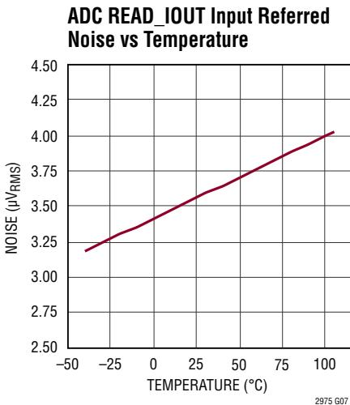

### ADC READ\_IOUT Input Referred Noise vs Temperature

NOISE (µVrms)

TEMPERATURE (°C)

2975 G07

Line graph showing Noise (µVrms) vs Temperature (°C). The y-axis ranges from 2.50 to 4.50 µVrms. The x-axis ranges from -50 to 100 °C. A single red curve shows noise increasing linearly with temperature.

### Voltage Sense Input Currents vs Differential Input Voltage

VOLTAGE SUPERVISOR LOW RES MODE  
 $V_{SENSEM1} = 0V$

INPUT CURRENT (µA)

$V_{SENSEP1} - V_{SENSEM1}$  (V)

2975 G08

Line graph showing INPUT CURRENT (µA) vs V\_SENSEP1 - V\_SENSEM1 (V), VOLTAGE SUPERVISOR LOW RES MODE, V\_SENSEM1 = 0V. The y-axis ranges from -12 to 15 µA. The x-axis ranges from 0 to 6 V. Two curves: I\_VSENSEP1 (red) rises linearly with the differential voltage; I\_VSENSEM1 (blue) starts at zero and falls linearly (becomes more negative).

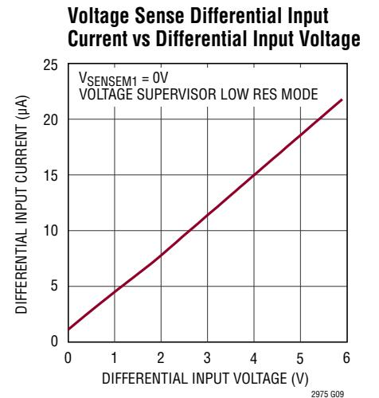

### Voltage Sense Differential Input Current vs Differential Input Voltage

$V_{SENSEM1} = 0V$   
VOLTAGE SUPERVISOR LOW RES MODE

DIFFERENTIAL INPUT CURRENT (µA)

DIFFERENTIAL INPUT VOLTAGE (V)

2975 G09

Line graph showing Differential Input Current (µA) vs Differential Input Voltage (V). The y-axis ranges from 0 to 25 µA. The x-axis ranges from 0 to 6 V. A single red curve shows current increasing linearly with differential voltage.

{12}------------------------------------------------

## TYPICAL PERFORMANCE CHARACTERISTICS

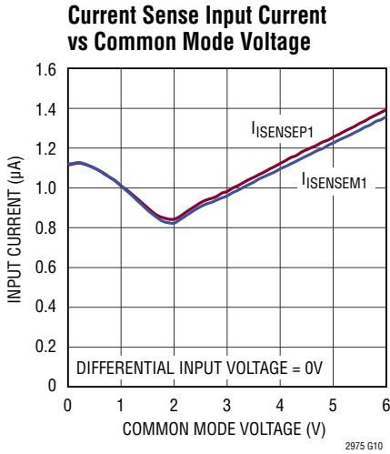

### Current Sense Input Current vs Common Mode Voltage

This graph shows INPUT CURRENT (µA), 0 to 1.6, versus COMMON MODE VOLTAGE (V), 0 to 6, with DIFFERENTIAL INPUT VOLTAGE = 0V. Two nearly overlapping curves are labeled ISENSEP1 (red) and ISENSEM1 (blue): the current first falls to a minimum in the lower part of the voltage range, then rises roughly linearly up to 6V. Curve shapes only; read values from the image/PDF.

DIFFERENTIAL INPUT VOLTAGE = 0V

2975 G10

Current Sense Input Current vs Common Mode Voltage graph

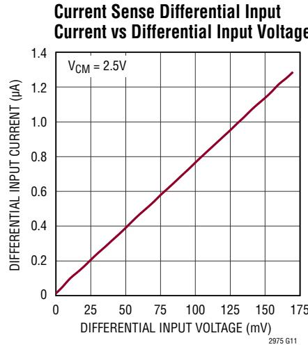

### Current Sense Differential Input Current vs Differential Input Voltage

This graph shows DIFFERENTIAL INPUT CURRENT (µA), 0 to 1.4, versus DIFFERENTIAL INPUT VOLTAGE (mV), 0 to 175, with VCM = 2.5V. A single red curve rises linearly from the origin across the whole range. Curve shapes only; read values from the image/PDF.

VCM = 2.5V

2975 G11

Current Sense Differential Input Current vs Differential Input Voltage graph

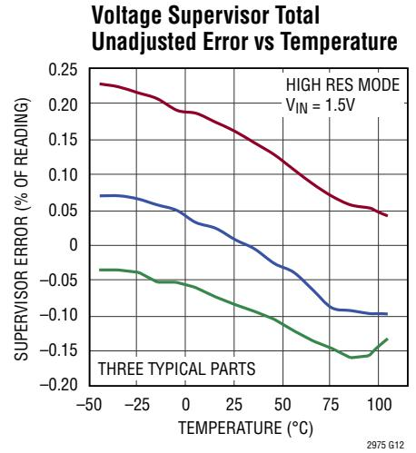

### Voltage Supervisor Total Unadjusted Error vs Temperature

This graph shows SUPERVISOR ERROR (% OF READING), -0.20 to 0.25, versus TEMPERATURE (°C), -50 to 100, in HIGH RES MODE with VIN = 1.5V, for THREE TYPICAL PARTS (red, blue and green curves). All three curves decrease as the temperature increases; the red curve is the highest, the blue curve is in the middle and the green curve is the lowest. Curve shapes only; read values from the image/PDF.

HIGH RES MODE VIN = 1.5V

THREE TYPICAL PARTS

2975 G12

Voltage Supervisor Total Unadjusted Error vs Temperature graph

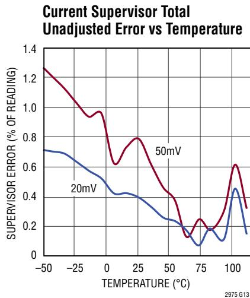

### Current Supervisor Total Unadjusted Error vs Temperature

This graph shows SUPERVISOR ERROR (% OF READING), 0 to 1.4, versus TEMPERATURE (°C), -50 to 100, with two curves labeled 50mV (red) and 20mV (blue). Both curves decrease overall as the temperature increases, with ripples; each turns up briefly near the hot end and drops again at the last point. Curve shapes only; read values from the image/PDF.

50mV

20mV

2975 G13

Current Supervisor Total Unadjusted Error vs Temperature graph

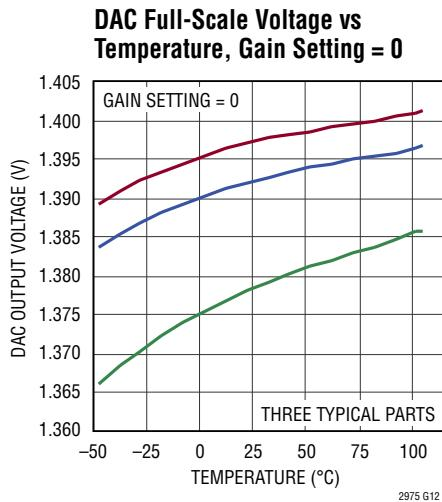

### DAC Full-Scale Voltage vs Temperature, Gain Setting = 0

This graph shows DAC OUTPUT VOLTAGE (V), 1.360 to 1.405, versus TEMPERATURE (°C), -50 to 100, with GAIN SETTING = 0, for THREE TYPICAL PARTS (red, blue and green curves). All three rise with temperature, with a smaller slope at higher temperatures; the red curve is the highest and the green curve the lowest. Curve shapes only; read values from the image/PDF.

GAIN SETTING = 0

THREE TYPICAL PARTS

2975 G12

DAC Full-Scale Voltage vs Temperature, Gain Setting = 0 graph

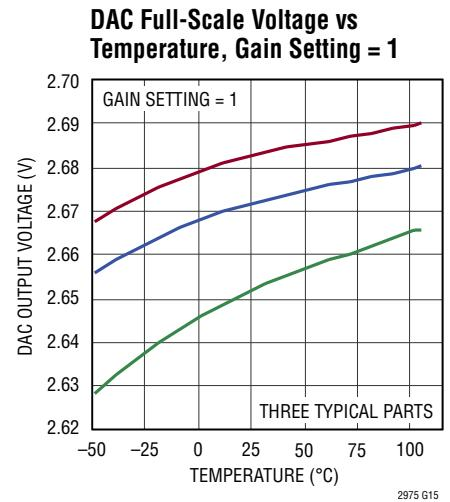

### DAC Full-Scale Voltage vs Temperature, Gain Setting = 1

This graph shows DAC OUTPUT VOLTAGE (V), 2.62 to 2.70, versus TEMPERATURE (°C), -50 to 100, with GAIN SETTING = 1, for THREE TYPICAL PARTS (red, blue and green curves). All three rise with temperature, with a smaller slope at higher temperatures; the red curve is the highest and the green curve the lowest. Curve shapes only; read values from the image/PDF.

GAIN SETTING = 1

THREE TYPICAL PARTS

2975 G15

DAC Full-Scale Voltage vs Temperature, Gain Setting = 1 graph

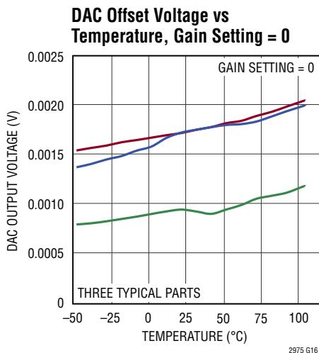

### DAC Offset Voltage vs Temperature, Gain Setting = 0

This graph shows DAC OUTPUT VOLTAGE (V), 0 to 0.0025, versus TEMPERATURE (°C), -50 to 100, with GAIN SETTING = 0, for THREE TYPICAL PARTS (red, blue and green curves). All three rise slowly with temperature; the red and blue curves lie close together and the green curve lies well below them. Curve shapes only; read values from the image/PDF.

GAIN SETTING = 0

THREE TYPICAL PARTS

2975 G16

DAC Offset Voltage vs Temperature, Gain Setting = 0 graph

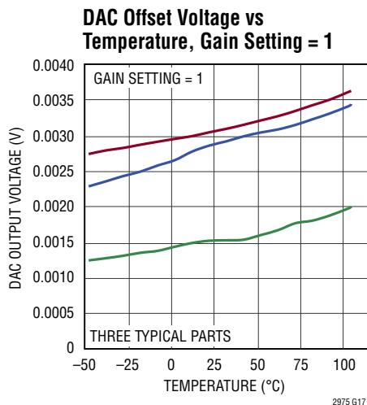

### DAC Offset Voltage vs Temperature, Gain Setting = 1

This graph shows DAC OUTPUT VOLTAGE (V), 0 to 0.0040, versus TEMPERATURE (°C), -50 to 100, with GAIN SETTING = 1, for THREE TYPICAL PARTS (red, blue and green curves). All three rise with temperature; the red curve is the highest, the blue curve slightly below it and the green curve the lowest. Curve shapes only; read values from the image/PDF.

GAIN SETTING = 1

THREE TYPICAL PARTS

2975 G17

DAC Offset Voltage vs Temperature, Gain Setting = 1 graph

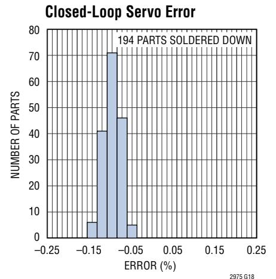

### Closed-Loop Servo Error

This histogram shows NUMBER OF PARTS, 0 to 80, versus ERROR (%), -0.25 to 0.25, for 194 PARTS SOLDERED DOWN. The bars are grouped in a narrow band on the negative side of zero. Curve shapes only; read values from the image/PDF.

194 PARTS SOLDERED DOWN

2975 G18

Closed-Loop Servo Error histogram

{13}------------------------------------------------

## TYPICAL PERFORMANCE CHARACTERISTICS

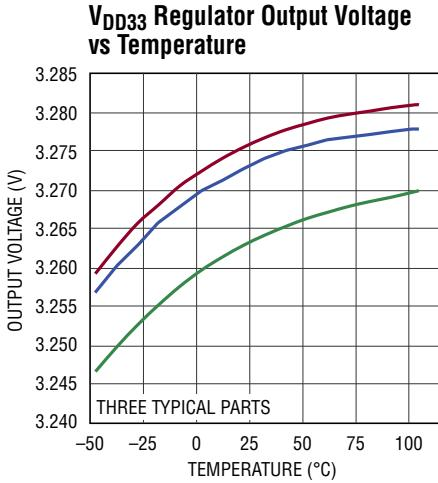

### VDD33 Regulator Output Voltage vs Temperature

THREE TYPICAL PARTS

2975 G19

Graph of VDD33 Regulator Output Voltage vs Temperature. The y-axis is Output Voltage (V) from 3.240 to 3.285. The x-axis is Temperature (°C) from -50 to 100. Three typical parts are shown: red, blue, and green. All show a positive temperature coefficient.

### VDD33 Regulator Load Regulation

2975 G20

Graph of VDD33 Regulator Load Regulation. The y-axis is Output Voltage Delta (ppm) from 0 to -4000. The x-axis is Load Current Sourcing (mA) from 0 to 50. A single red line falls linearly (the output voltage delta becomes more negative) as the load current increases.

![Graph of V_OUT_EN[0:3] and AUXFAULTB Output High Voltage vs Load Current. The y-axis is OUTPUT VOLTAGE (V) from 9 to 14. The x-axis is CURRENT SOURCING (μA) from 0 to 7. Three curves labeled 105°C (red), 25°C (green) and -40°C (blue): each is nearly flat, decreasing slightly with current, and then drops sharply near the right end of the range; the 105°C curve is the highest and the -40°C curve the lowest. Curve shapes only; read values from the image/PDF.](img/411fa16c3211377525ba37c57784fee0_img.jpg)

### VOUT\_EN[0:3] and AUXFAULTB Output High Voltage vs Load Current

2975 G21

Graph of V\_OUT\_EN[0:3] and AUXFAULTB Output High Voltage vs Load Current. The y-axis is OUTPUT VOLTAGE (V) from 9 to 14. The x-axis is CURRENT SOURCING (μA) from 0 to 7. Three curves labeled 105°C (red), 25°C (green) and -40°C (blue): each is nearly flat, decreasing slightly with current, and then drops sharply near the right end of the range; the 105°C curve is the highest and the -40°C curve the lowest. Curve shapes only; read values from the image/PDF.

![Graph of V_OUT_EN[0:3] and AUXFAULTB VOL vs Load Current. The y-axis is VOL (V) from 0 to 1.4. The x-axis is CURRENT SOURCING (μA) from 0 to 12. Three curves labeled 105°C (red), 25°C (green) and -40°C (blue) rise from the origin almost linearly with load current; the 105°C curve is the highest and the -40°C curve the lowest. Curve shapes only; read values from the image/PDF.](img/bafe3c344aef7f6f79dab49c9eca89a9_img.jpg)

### VOUT\_EN[0:3] and AUXFAULTB VOL vs Load Current

2975 G22

Graph of V\_OUT\_EN[0:3] and AUXFAULTB VOL vs Load Current. The y-axis is VOL (V) from 0 to 1.4. The x-axis is CURRENT SOURCING (μA) from 0 to 12. Three curves labeled 105°C (red), 25°C (green) and -40°C (blue) rise from the origin almost linearly with load current; the 105°C curve is the highest and the -40°C curve the lowest. Curve shapes only; read values from the image/PDF.

![Graph of External Temperature READ_TEMPERATURE_1 Error vs Temperature. The y-axis is ERROR (°C) from -1.00 to 1.00. The x-axis is TEMPERATURE (°C) from -50 to 100. Conditions printed on the plot: MMBT3906 DIODE CONNECTED BJTS, MFR_TEMP_1_GAIN_ADJ = 0.984, MFR_EXT_TEMP_1_ADC_OFF = 0.7704°C. THREE TYPICAL PARTS (red, blue, green): each curve falls to a negative minimum in the middle of the temperature range and rises again toward the hot end; the green curve also has a local peak near the cold end. Curve shapes only; read values from the image/PDF.](img/fd188843e5acb8e0d76372860b5f5962_img.jpg)

### External Temperature READ\_TEMPERATURE\_1 Error vs Temperature

MMBT3906 DIODE CONNECTED BJTS  
MFR\_TEMP\_1\_GAIN\_ADJ = 0.984  
MFR\_EXT\_TEMP\_1\_ADC\_OFF = 0.7704°C

THREE TYPICAL PARTS

2975 G23

Graph of External Temperature READ\_TEMPERATURE\_1 Error vs Temperature. The y-axis is ERROR (°C) from -1.00 to 1.00. The x-axis is TEMPERATURE (°C) from -50 to 100. Conditions printed on the plot: MMBT3906 DIODE CONNECTED BJTS, MFR\_TEMP\_1\_GAIN\_ADJ = 0.984, MFR\_EXT\_TEMP\_1\_ADC\_OFF = 0.7704°C. THREE TYPICAL PARTS (red, blue, green): each curve falls to a negative minimum in the middle of the temperature range and rises again toward the hot end; the green curve also has a local peak near the cold end. Curve shapes only; read values from the image/PDF.

### READ\_TEMPERATURE\_2 Error vs Temperature

VDD33 = VPWR = 3.3V

THREE TYPICAL PARTS

2975 G24

Graph of READ\_TEMPERATURE\_2 Error vs Temperature. The y-axis is ERROR (°C) from -1.00 to 1.00. The x-axis is TEMPERATURE (°C) from -50 to 100. V\_DD33 = V\_PWR = 3.3V, THREE TYPICAL PARTS (red, blue, green): the error is negative at low temperature, stays roughly flat over the lower part of the range and then rises steadily, becoming positive at the hot end. Curve shapes only; read values from the image/PDF.

### TUE\_VIN vs VIN\_SNS

2975 G25

Graph of TUE\_VIN vs VIN\_SNS. The y-axis is TUE\_VIN (%) from -0.5 to 0.5. The x-axis is VIN\_SNS (V) from 4.5 to 14.5. Three curves labeled -40°C, 25°C and 105°C lie almost on top of each other, close to zero, across the entire range. Curve shapes only; read values from the image/PDF.

### TUE\_IIN vs VIN\_SNS

Mfr\_ein\_config\_iin\_range = Medium  
VIIN\_SNS = 50mV

2975 G26

Graph of TUE\_IIN vs VIN\_SNS. The y-axis is TUE\_IIN (% OF READING) from -0.6 to 0.6. The x-axis is VIN\_SNS (V) from 4.5 to 14.5. Mfr\_ein\_config\_iin\_range = Medium, V\_IIN\_SNS = 50mV. Three curves labeled 25°C, -40°C and 105°C zigzag in a narrow band around zero across the range. Curve shapes only; read values from the image/PDF.

### TUE\_PIN vs VIN\_SNS

Mfr\_ein\_config\_iin\_range = Medium  
VIIN\_SNS = 50mV

2975 G27

Graph of TUE\_PIN vs VIN\_SNS. The y-axis is TUE\_PIN (% OF READING) from -1.00 to 1.00. The x-axis is VIN\_SNS (V) from 4.5 to 14.5. Mfr\_ein\_config\_iin\_range = Medium, V\_IIN\_SNS = 50mV. Three curves labeled 25°C, -40°C and 105°C vary in a narrow band around zero across the range. Curve shapes only; read values from the image/PDF.

{14}------------------------------------------------

## TYPICAL PERFORMANCE CHARACTERISTICS

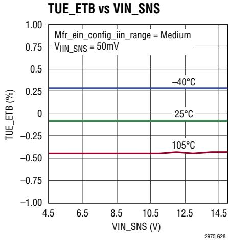

### TUE\_ETB vs VIN\_SNS

Mfr\_ein\_config\_iin\_range = Medium  
VIIN\_SNS = 50mV

*[AI figure description: curve-data table removed (values were estimated from the plot, not printed in the PDF). Read values from the image/PDF.]*

2975 G28

TUE\_ETB vs VIN\_SNS graph showing TUE\_ETB (%) versus VIN\_SNS (V) for -40°C, 25°C, and 105°C.

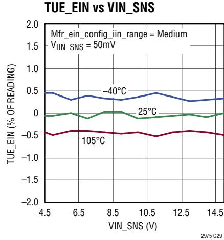

### TUE\_EIN vs VIN\_SNS

Mfr\_ein\_config\_iin\_range = Medium  
VIIN\_SNS = 50mV

*[AI figure description: curve-data table removed (values were estimated from the plot, not printed in the PDF). Read values from the image/PDF.]*

2975 G29

TUE\_EIN vs VIN\_SNS graph showing TUE\_EIN (% OF READING) versus VIN\_SNS (V) for -40°C, 25°C, and 105°C.

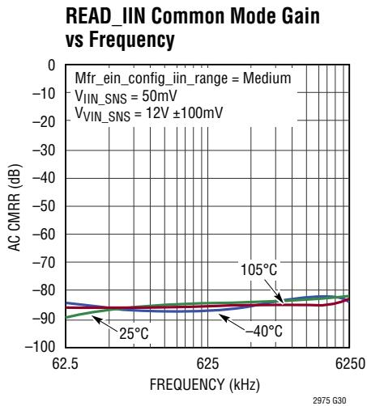

### READ\_IIN Common Mode Gain vs Frequency

Mfr\_ein\_config\_iin\_range = Medium  
VIIN\_SNS = 50mV  
VVIN\_SNS = 12V ± 100mV

*[AI figure description: curve-data table removed (values were estimated from the plot, not printed in the PDF). Read values from the image/PDF.]*

2975 G30

READ\_IIN Common Mode Gain vs Frequency graph showing AC CMRR (dB) versus Frequency (kHz) for -40°C, 25°C, and 105°C.

![VOUT_EN[3:0] Output Voltage vs VDD33 graph showing output voltage versus VDD33 voltage, including a pull-up characteristic.](img/1145fc59efdc7dacc8d3c715d7ff3248_img.jpg)

### VOUT\_EN[3:0] Output Voltage vs VDD33

*[AI figure description: curve-data table removed (values were estimated from the plot, not printed in the PDF). Read values from the image/PDF.]*

2975 G31

VOUT\_EN[3:0] Output Voltage vs VDD33 graph showing output voltage versus VDD33 voltage, including a pull-up characteristic.

{15}------------------------------------------------

## PIN FUNCTIONS

| PIN NAME             | PIN NUMBER QFN | PIN NUMBER BGA | PIN TYPE       | DESCRIPTION                                                                                                                                                                                                                                                                                                                                                   |
|----------------------|----------------|----------------|----------------|---------------------------------------------------------------------------------------------------------------------------------------------------------------------------------------------------------------------------------------------------------------------------------------------------------------------------------------------------------------|
| V SENSEP0 | 1*             | B2             | In             | DC/DC Converter Differential (+) Output Voltage-0 Sensing Pin                                                                                                                                                                                                                                                                                                 |
| V SENSEM0 | 2*             | B1             | In             | DC/DC Converter Differential (–) Output Voltage-0 Sensing Pin                                                                                                                                                                                                                                                                                                 |
| V OUT_EN0 | 3              | C2             | Out            | DC/DC Converter Enable-0 Pin. Output High Voltage Optionally Pulled-Up to 12V by 5µA                                                                                                                                                                                                                                                                          |
| V OUT_EN1 | 4              | C1             | Out            | DC/DC Converter Enable-1 Pin. Output High Voltage Optionally Pulled-Up to 12V by 5µA                                                                                                                                                                                                                                                                          |
| V OUT_EN2 | 5              | D3             | Out            | DC/DC Converter Enable-2 Pin. Output High Voltage Optionally Pulled-Up to 12V by 5µA                                                                                                                                                                                                                                                                          |
| V OUT_EN3 | 6              | D1             | Out            | DC/DC Converter Enable-3 Pin. Output High Voltage Optionally Pulled-Up to 12V by 5µA                                                                                                                                                                                                                                                                          |
| AUXFAULTB            | 7              | E3             | Out            | Auxiliary Fault Output Pin. Output High Voltage Optionally Pulled-Up to 12V by 5µA. Can Be Configured to Pull Low When OV/OC/UC Detected                                                                                                                                                                                                                      |
| DNC                  | 8              | E1             | Do Not Connect | Do Not Connect to this Pin                                                                                                                                                                                                                                                                                                                                    |
| V IN_SNS  | 9              | E2             | In             | V IN SENSE Input. This Voltage is Compared Against the V IN On and Off Voltage Thresholds In Order to Determine When to Enable and Disable, Respectively, the Downstream DC/DC Converters                                                                                                                                               |
| V PWR     | 10             | G2             | In             | V PWR Serves as the Unregulated Power Supply Input to the Chip (4.5 to 15V). If a 4.5V to 15V Supply Voltage Is Unavailable, Short V PWR to V DD33 and Power the Chip Directly from a 3.3V Supply. Bypass to GND with 0.1µF Capacitor.                                                                                       |
| V DD33    | 11, 12         | F1             | In/Out         | If Shorted to V PWR , It Serves as 3.13 to 3.47V Supply Input Pin. Otherwise It Is a 3.3V Internally Regulated Voltage Output (Use 0.1µF Decoupling Capacitor to GND). If using the internal regulator to provide V DD33 , only connect the pull-up resistors and bypass capacitors required to support the LTC2975 in the application. |
| V DD25    | 13             | G1             | In/Out         | 2.5V Internally Regulated Voltage Output. Bypass to GND with a 0.1µF Capacitor. Only connect the pull-up resistors and bypass capacitors required to support the LTC2975 in the application.                                                                                                                                                                  |
| V DD25    | 14             | H1             | In             | 2.5V Supply Voltage Input. Short this Pin to Pin 13. Only connect the pull-up resistors and bypass capacitors required to support the LTC2975 in the application.                                                                                                                                                                                             |
| T SENSE0  | 15*            | F2             | In/Out         | External Temperature Current Output and Voltage Input for Channel 0. Maximum allowed capacitance is 1µF                                                                                                                                                                                                                                                       |
| T SENSE1  | 16*            | F3             | In/Out         | External Temperature Current Output and Voltage Input for Channel 1. Maximum allowed capacitance is 1µF                                                                                                                                                                                                                                                       |
| PWRGD                | 17             | J1             | Out            | Power-Good Open Drain Output. Indicates When Selected Outputs Are Power Good. Can be Used as System Power-on Reset                                                                                                                                                                                                                                            |
| SHARE_CLK            | 18             | J2             | In/Out         | Bidirectional Clock Sharing Pin. Connect a 5.49kΩ Pull-Up Resistor to V DD33 . Connect to all other SHARE_CLK pins in the system.                                                                                                                                                                                                                  |
| GND                  | 19             | D2             | Ground         | Chip Ground. Must Be Soldered to PCB                                                                                                                                                                                                                                                                                                                          |
| GND                  | 20             | D4             | Ground         | Chip Ground. Must Be Soldered to PCB                                                                                                                                                                                                                                                                                                                          |
| GND                  | 21             | E4             | Ground         | Chip Ground. Must Be Soldered to PCB                                                                                                                                                                                                                                                                                                                          |
| CONTROL2             | 22             | H3             | In             | Control Pin 2 Input                                                                                                                                                                                                                                                                                                                                           |
| CONTROL3             | 23             | J3             | In             | Control Pin 3 Input                                                                                                                                                                                                                                                                                                                                           |
| WDI/ RESETB       | 24             | H2             | In             | Watchdog Timer Interrupt and Chip Reset Input. Connect a 10kΩ Pull-Up Resistor to V DD33 . Rising Edge Resets Watchdog Counter. Holding this Pin Low for More than t RESETB Resets the Chip                                                                                                                                             |
| FAULTB0              | 25             | H4             | In/Out         | Open-Drain Output and Digital Input. Active Low Bidirectional Fault Indicator-0. Connect a 10kΩ Pull-Up Resistor to V DD33                                                                                                                                                                                                                         |
| FAULTB1              | 26             | J4             | In/Out         | Open-Drain Output and Digital Input. Active Low Bidirectional Fault Indicator-1. Connect a 10kΩ Pull-Up Resistor to V DD33                                                                                                                                                                                                                         |
| T SENSE2  | 27*            | G5             | In/Out         | External Temperature Current Output and Voltage Input for Channel 2. Maximum allowed capacitance is 1µF                                                                                                                                                                                                                                                       |
| WP                   | 28             | H5             | In             | Digital Input. Write-Protect Input Pin, Active High                                                                                                                                                                                                                                                                                                           |
| SDA                  | 29             | J5             | In/Out         | PMBus Bidirectional Serial Data Pin                                                                                                                                                                                                                                                                                                                           |
| SCL                  | 30             | J6             | In             | PMBus Serial Clock Input Pin (400kHz Maximum)                                                                                                                                                                                                                                                                                                                 |

{16}------------------------------------------------

## PIN FUNCTIONS

| PIN NAME                | PIN NUMBER QFN | PIN NUMBER BGA | PIN TYPE | DESCRIPTION                                                                                                   |
|-------------------------|----------------|----------------|----------|---------------------------------------------------------------------------------------------------------------|
| ALERTB                  | 31             | J7             | Out      | Open-Drain Output. Generates an Interrupt Request in a Fault/Warning Situation                                |
| CONTROL0                | 32             | H7             | In       | Control Pin 0 Input                                                                                           |
| CONTROL1                | 33             | H6             | In       | Control Pin 1 Input                                                                                           |
| T SENSE3     | 34*            | G6             | In/Out   | External Temperature Current Output and Voltage Input for Channel 3. Maximum allowed capacitance is 1µF       |
| ASEL0                   | 35             | G7             | In       | Ternary Address Select Pin 0 Input. Connect to V DD33 , GND or Float to Encode 1 of 3 Logic States |
| ASEL1                   | 36             | E5             | In       | Ternary Address Select Pin 1 Input. Connect to V DD33 , GND or Float to Encode 1 of 3 Logic States |
| GND                     | 37             | F5             | Ground   | Chip Ground. Must Be Soldered to PCB                                                                          |
| REFP                    | 38             | F6             | Out      | Reference Voltage Output. Needs 0.1µF Decoupling Capacitor to REFM                                            |
| GND                     | 39             | F4             | Ground   | Chip Ground. Must Be Soldered to PCB                                                                          |
| REFM                    | 40             | F7             | Out      | Reference Return Pin. Needs 0.1µF Decoupling Capacitor to REFP                                                |
| I SENSEP0    | 41*            | E6             | In       | DC/DC Converter Differential (+) Output Current-0 Sensing Pin                                                 |
| I SENSEM0    | 42*            | D5             | In       | DC/DC Converter Differential (–) Output Current-0 Sensing Pin                                                 |
| I SENSEP1    | 43*            | E7             | In       | DC/DC Converter Differential (+) Output Current-1 Sensing Pin                                                 |
| I SENSEM1    | 44*            | D6             | In       | DC/DC Converter Differential (–) Output Current-1 Sensing Pin                                                 |
| I SENSEP2    | 45*            | D7             | In       | DC/DC Converter Differential (+) Output Current-2 Sensing Pin                                                 |
| I SENSEM2    | 46*            | C7             | In       | DC/DC Converter Differential (–) Output Current-2 Sensing Pin                                                 |
| I SENSEP3    | 47*            | C6             | In       | DC/DC Converter Differential (+) Output Current-3 Sensing Pin                                                 |
| I SENSEM3    | 48*            | B6             | In       | DC/DC Converter Differential (–) Output Current-3 Sensing Pin                                                 |
| V SENSEP3    | 49*            | B7             | In       | DC/DC Converter Differential (+) Output Voltage-3 Sensing Pin                                                 |
| V SENSEM3    | 50*            | A7             | In       | DC/DC Converter Differential (–) Output Voltage-3 Sensing Pin                                                 |
| V IN_SNS_CAP | 51             | A6             | Out      | V IN_SNS Filter Capacitor Pin. Bypass to Ground with a 10nF Ceramic Capacitor                      |
| GND                     | 52             | G3             | Ground   | Chip Ground. Must be Soldered to PCB.                                                                         |
| V DAC0       | 53             | A5             | Out      | DAC0 Output                                                                                                   |
| V DAC1       | 54             | B5             | Out      | DAC1 Output                                                                                                   |
| I IN_SNSP    | 55             | B4             | In       | DC/DC Converter Differential (+) Input Current Sensing Pin. If Unused, Connect to V IN_SNS         |
| I IN_SNSM    | 56             | A4             | In       | DC/DC Converter Differential (–) Input Current Sensing Pin. If Unused, Connect to V IN_SNS         |
| V DAC2       | 57             | C4             | Out      | DAC2 Output                                                                                                   |
| V DAC3       | 58             | A3             | Out      | DAC3 Output                                                                                                   |
| GND                     | 59             | C5             | Ground   | Chip Ground. Must Be Soldered to PCB                                                                          |
| GND                     | 60             | G4             | Ground   | Chip Ground. Must Be Soldered to PCB                                                                          |
| V SENSEP2    | 61*            | B3             | In       | DC/DC Converter Differential (+) Output Voltage-2 Sensing Pin                                                 |
| V SENSEM2    | 62*            | C3             | In       | DC/DC Converter Differential (–) Output Voltage-2 Sensing Pin                                                 |
| V SENSEP1    | 63*            | A2             | In       | DC/DC Converter Differential (+) Output Voltage-1 Sensing Pin                                                 |
| V SENSEM1    | 64*            | A1             | In       | DC/DC Converter Differential (–) Output Voltage-1 Sensing Pin                                                 |
| GND                     | 65             | –              | Ground   | Exposed Pad. Must Be Soldered to PCB, QFN Only                                                                |

\* Tie any unused VSENSEPn/ISENSEPn, VSENSEMn/ISENSEMn or TSENSEn pins to GND. Refer to Unused ADC Sense Inputs in the Applications Information section.

{17}------------------------------------------------

## BLOCK DIAGRAM

![Block diagram of the LTC2975 (description written from the PDF drawing; pin numbers in parentheses). Supplies: V_PWR (10) feeds a 3.3V REGULATOR whose V_OUT is the V_DD33 node, brought out on V_DD33(OUT) (11); V_DD33(IN) (12) feeds a 2.5V REGULATOR whose V_OUT is V_DD25(OUT) (13); V_DD25(IN) (14) is the V_DD25 node. V_IN_SNS (9) connects through 20Ω to DNC (8), to a 3R/R divider to ground whose tap goes to the MUX, and through 350Ω to V_IN_SNS_CAP (51), which also connects to the input-current amplifier; I_IN_SNSP (55, + input) and I_IN_SNSM (56, – input) drive that amplifier, whose output goes to the MUX. The MUX also takes V_SENSEP0/V_SENSEM0, I_SENSEP0/I_SENSEM0 through V_SENSEP3/V_SENSEM3, I_SENSEP3/I_SENSEM3 from the right-hand pins and the INTERNAL TEMP SENSOR, and feeds a 16-BIT ΔΣ ADC (with ADC CLOCKS) referenced to the REFERENCE 1.232V (TYP) block (supplied from V_DD33), which connects to REFP (38) and REFM (40). GND pins: 19, 20, 21, 37, 39, 52, 59, 60 and 65. PMBus INTERFACE (400kHz I2C COMPATIBLE): ALERTB (31), SCL (30), SDA (29), ASEL0 (35), ASEL1 (36). EEPROM is connected to RAM (ADC_RESULTS, MONITOR LIMITS, SERVO TARGETS). CONTROLLER (PMBus ALGORITHM, FAULT PROCESSOR, WATCHDOG, SEQUENCER): WP (28), PWRGD (17), SHARE_CLK (18), WDI/RESETB (24), FAULTB0 (25), FAULTB1 (26), CONTROL0 (32), CONTROL1 (33), CONTROL2 (22), CONTROL3 (23). Per channel (dashed boxes PAGE 0 to PAGE 3, '4 PAGES' buses to the controller): comparator ICMP compares I_SENSEPn/I_SENSEMn with a 10-BIT DAC, comparator VCMP compares V_SENSEPn/V_SENSEMn with a second 10-BIT DAC, and a third 10-BIT DAC drives VBUF and a switch to the V_DAC pin. Right-hand pins: V_SENSEP0 (1), V_SENSEM0 (2), I_SENSEP0 (41), I_SENSEM0 (42), V_SENSEP1 (63), V_SENSEM1 (64), I_SENSEP1 (43), I_SENSEM1 (44), V_SENSEP2 (61), V_SENSEM2 (62), I_SENSEP2 (45), I_SENSEM2 (46), V_SENSEP3 (49), V_SENSEM3 (50), I_SENSEP3 (47), I_SENSEM3 (48), V_DAC0 (53), V_DAC1 (54), V_DAC2 (57), V_DAC3 (58). A MASKING block driven by the controller outputs V_OUT_EN0 (3), V_OUT_EN1 (4), V_OUT_EN2 (5), V_OUT_EN3 (6) and AUXFAULTB (7). OSCILLATOR → CLOCK GENERATION; a UVLO block on V_DD produces PORB. An EXTERNAL TEMPERATURE SENSOR block, connected to the controller, drives T_SENSE0 (15), T_SENSE1 (16), T_SENSE2 (27) and T_SENSE3 (34).](img/dfe556fea00682b09a59427aaf72051c_img.jpg)

Block diagram of the LTC2975 (description written from the PDF drawing; pin numbers in parentheses). Supplies: V_PWR (10) feeds a 3.3V REGULATOR whose V_OUT is the V_DD33 node, brought out on V_DD33(OUT) (11); V_DD33(IN) (12) feeds a 2.5V REGULATOR whose V_OUT is V_DD25(OUT) (13); V_DD25(IN) (14) is the V_DD25 node. V_IN_SNS (9) connects through 20Ω to DNC (8), to a 3R/R divider to ground whose tap goes to the MUX, and through 350Ω to V_IN_SNS_CAP (51), which also connects to the input-current amplifier; I_IN_SNSP (55, + input) and I_IN_SNSM (56, – input) drive that amplifier, whose output goes to the MUX. The MUX also takes V_SENSEP0/V_SENSEM0, I_SENSEP0/I_SENSEM0 through V_SENSEP3/V_SENSEM3, I_SENSEP3/I_SENSEM3 from the right-hand pins and the INTERNAL TEMP SENSOR, and feeds a 16-BIT ΔΣ ADC (with ADC CLOCKS) referenced to the REFERENCE 1.232V (TYP) block (supplied from V_DD33), which connects to REFP (38) and REFM (40). GND pins: 19, 20, 21, 37, 39, 52, 59, 60 and 65. PMBus INTERFACE (400kHz I2C COMPATIBLE): ALERTB (31), SCL (30), SDA (29), ASEL0 (35), ASEL1 (36). EEPROM is connected to RAM (ADC_RESULTS, MONITOR LIMITS, SERVO TARGETS). CONTROLLER (PMBus ALGORITHM, FAULT PROCESSOR, WATCHDOG, SEQUENCER): WP (28), PWRGD (17), SHARE_CLK (18), WDI/RESETB (24), FAULTB0 (25), FAULTB1 (26), CONTROL0 (32), CONTROL1 (33), CONTROL2 (22), CONTROL3 (23). Per channel (dashed boxes PAGE 0 to PAGE 3, '4 PAGES' buses to the controller): comparator ICMP compares I_SENSEPn/I_SENSEMn with a 10-BIT DAC, comparator VCMP compares V_SENSEPn/V_SENSEMn with a second 10-BIT DAC, and a third 10-BIT DAC drives VBUF and a switch to the V_DAC pin. Right-hand pins: V_SENSEP0 (1), V_SENSEM0 (2), I_SENSEP0 (41), I_SENSEM0 (42), V_SENSEP1 (63), V_SENSEM1 (64), I_SENSEP1 (43), I_SENSEM1 (44), V_SENSEP2 (61), V_SENSEM2 (62), I_SENSEP2 (45), I_SENSEM2 (46), V_SENSEP3 (49), V_SENSEM3 (50), I_SENSEP3 (47), I_SENSEM3 (48), V_DAC0 (53), V_DAC1 (54), V_DAC2 (57), V_DAC3 (58). A MASKING block driven by the controller outputs V_OUT_EN0 (3), V_OUT_EN1 (4), V_OUT_EN2 (5), V_OUT_EN3 (6) and AUXFAULTB (7). OSCILLATOR → CLOCK GENERATION; a UVLO block on V_DD produces PORB. An EXTERNAL TEMPERATURE SENSOR block, connected to the controller, drives T_SENSE0 (15), T_SENSE1 (16), T_SENSE2 (27) and T_SENSE3 (34).

2975 BD

See Figure 35 for a Typical Application with a Simplified Block Diagram

{18}------------------------------------------------

## OPERATION

### LTC2975 OPERATION OVERVIEW

The LTC2975 is a PMBus programmable power supply controller, monitor, sequencer and voltage and current supervisor that can perform the following operations:

- Accept PMBus compatible programming commands.
- Provide DC/DC converter input voltage, output voltage, output current, output temperature, and LTC2975 internal temperature readback through the PMBus interface.
- Control the output of DC/DC converters that set the output voltage with a trim pin or DC/DC converters that set the output voltage using an external resistor feedback network.
- Sequence the startup of DC/DC converters via PMBus programming and the CONTROL input pins. The LTC2975 supports time-based sequencing and tracking sequencing. Cascade sequence on with time based sequence off is also supported.
- Trim the DC/DC converter output voltage (typically in 0.02% steps), in closed-loop servo operating mode, autonomously or through PMBus programming.
- Margin the DC/DC converter output voltage to PMBus programmed limits.
- Trim or margin the DC/DC converter output voltage with direct access to the margin DAC.
- Supervise the DC/DC converter input voltage, output voltage, load current and the inductor temperatures for overvalue/undervalue conditions with respect to PMBus programmed limits and generate appropriate faults and warnings.
- Accurately handle inductor self-heating transients using a proprietary algorithm. These self-heating effects are combined with external temperature sensor readings to improve accuracy of current supervisors and ADC current measurement.
- Respond to a fault condition by continuing operation indefinitely, latching-off after a programmable deglitch period, latching-off immediately or sequencing off after TOFF\_DELAY. Use retry mode to automatically recover from a latched-off condition. With retry enabled, MFR\_RETRY\_COUNT programs the number of retries (0 to 6 or infinite) for all pages.
- Optionally stop trimming the DC/DC converter output voltage after it reaches the initial margin or nominal target. Optionally allow trimming restart if target drifts outside of VOUT warning limits.
- Store command register contents to EEPROM with CRC and ECC through PMBus programming.
- Restore EEPROM contents through PMBus programming or when VDD33 is applied on power-up.
- Report the DC/DC converter output voltage status through the power good output.
- Generate interrupt requests by asserting the ALERTB pin in response to supported PMBus faults and warnings.
- Coordinate system wide fault responses for all DC/DC converters connected to the LTC2975 FAULTB0 and FAULTB1 pins.
- Synchronize sequencing delays or shutdown for multiple devices using the SHARE\_CLK pin.
- Software and hardware write protect the command registers.
- Disable the input voltage to the supervised DC/DC converters in response to output OV, UV, OC and UC faults.
- Log telemetry and status data to EEPROM in response to a faulted-off condition.
- Supervise an external microcontroller's activity for a stalled condition with a programmable watchdog timer and reset it if necessary.
- Prevent a DC/DC converter from re-entering the on state after a power cycle until a programmable interval (MFR\_RESTART\_DELAY) has elapsed and its output has decayed below a programmable threshold voltage (MFR\_VOUT\_DISCHARGE\_THRESHOLD).
- Read high side input current, input voltage, input power, and accumulated input energy.
- Record minimum and maximum input voltage, input current, input power, output voltages, output currents and output temperatures.
- Access user EEPROM data directly, without altering RAM space (Mfr\_ee\_unlock, Mfr\_ee\_erase, and Mfr\_ee\_data). Facilitates in-house bulk programming.
- Accommodate multiple hosts with Command Plus.

{19}------------------------------------------------

## OPERATION

### EEPROM

The LTC2975 contains internal EEPROM (Non-Volatile Memory) with error-correcting code (ECC) to store configuration settings and fault log information. EEPROM endurance, retention and mass write operation time are specified over the operating temperature range. See Electrical Characteristics and Absolute Maximum Ratings sections.

Non destructive operation above  $T_J = 105^\circ\text{C}$  is possible although the Electrical Characteristics are not guaranteed and the EEPROM will be degraded.

Operating the EEPROM above  $105^\circ\text{C}$  may result in a degradation of retention characteristics. The fault logging function, which is useful in debugging system problems that may occur at high temperatures, only writes to fault log EEPROM locations. If occasional writes to these registers occur above  $105^\circ\text{C}$ , a slight degradation in the data retention characteristics of the fault log may occur.

It is recommended that the EEPROM not be written using STORE\_USER\_ALL or bulk programming when  $T_J > 85^\circ\text{C}$ .

The degradation in EEPROM retention for temperatures  $>105^\circ\text{C}$  can be approximated by calculating the dimensionless acceleration factor using the following equation.

$$AF = e^{\left[\left(\frac{Ea}{k}\right) \cdot \left(\frac{1}{T_{USE}+273} - \frac{1}{T_{STRESS}+273}\right)\right]}$$

where:

AF = acceleration factor

Ea = activation energy = 1.4eV

$k = 8.617 \cdot 10^{-5}$  eV/°K

$T_{USE}$  =  $105^\circ\text{C}$  specified junction temperature

$T_{STRESS}$  = actual junction temperature °C

Example: Calculate the effect on retention when operating at a junction temperature of  $125^\circ\text{C}$  for 10 hours.

$T_{STRESS} = 125^\circ\text{C}$

$T_{USE} = 105^\circ\text{C}$

AF = 8.65

Equivalent operating time at  $105^\circ\text{C} = 86.5$  hours.

So the overall retention of the EEPROM was degraded by an additional 76.5 hours as a result of operation at a junction temperature of  $125^\circ\text{C}$  for 10 hours. Note that the effect of this overstress is negligible when compared to the overall EEPROM retention rating of 175,200 hours at a junction temperature of  $105^\circ\text{C}$ .

### AUXFAULTB

The AUXFAULTB pin can be configured to indicate when some fault conditions have been detected. See Figure 1 for a conceptual view of this multiplexing.

Figure 1: AUXFAULTB MUX. Description written from the PDF drawing: a current source from 12V, controlled by Mfr\_config\_all\_auxfaultb\_wpu\_dis, feeds a series diode to the AUXFAULTB output node. An NMOS pull-down from AUXFAULTB to ground is driven by the fault\_seen signal, the Q output of a SET/RESET latch whose SET input is OV/OC/UC (MASKABLE) and whose RESET input is OFF\_THEN\_ON OR FAULT\_RETRY FOR ANY CHANNEL.

2975 F01

**Figure 1. AUXFAULTB MUX**

The MFR\_CONFIG2\_LTC2975 and MFR\_CONFIG3\_LTC2975 commands can be used on a per channel basis to select which, if any, fault conditions will cause the AUXFAULTB pin to be driven low. The only fault types which can be propagated to the AUXFAULTB pin are overvoltage faults and overcurrent/undercurrent faults.

Mfr\_config\_all\_auxfaultb\_wpu selects whether the AUXFAULTB pin is in the hi-Z state, or weakly pulled-up to approximately 12V, using a 5μA current. As shown in Figure 1, the pull-down to GND overrides if any enabled faults are detected.

{20}------------------------------------------------

## OPERATION

### RESETB

Holding the WDI/RESETB pin low for more than  $t_{\text{RESETB}}$  will cause the LTC2975 to enter the power-on reset state. While in the power-on reset state, the device will not communicate on the I2C bus. Following the subsequent rising-edge of the WDI/RESETB pin, the LTC2975 will execute its power-on sequence per the user configuration stored in EEPROM. Connect WDI/RESETB to VDD33 with a 10k resistor. WDI/RESETB includes an internal 256μs deglitch filter so additional filter capacitance on this pin is not recommended.

### PMBus SERIAL DIGITAL INTERFACE

The LTC2975 communicates with a host (master) using the standard PMBus serial bus interface. The PMBus Timing Diagram shows the timing relationship of the signals on the bus. The two bus lines, SDA and SCL, must be high when the bus is not in use. External pull-up resistors or current sources are required on these lines.

The LTC2975 is a slave device. The master can communicate with the LTC2975 using the following formats:

- Master transmitter, slave receiver
- Master receiver, slave transmitter

The following SMBus commands are supported:

- Write Byte, Write Word, Send Byte
- Read Byte, Read Word, Block Read
- Alert Response Address

Figures 2 to 14 illustrate the aforementioned SMBus protocols. All transactions support PEC (packet error check) and GCP (group command protocol). The Block Read supports 255 bytes of returned data. For this reason, the SMBus timeout may be extended using the Mfr_config_all_longer_pmbus_timeout setting.

### PMBus

PMBus is an industry standard that defines a means of communication with power conversion devices. It is comprised of an industry standard SMBus serial interface and the PMBus command language.

The PMBus two wire interface is an incremental extension of the SMBus. SMBus is built upon I2C with some minor differences in timing, DC parameters and protocol. The SMBus protocols are more robust than simple I2C byte commands because they provide timeouts to prevent bus hangs and optional Packet Error Checking (PEC) to ensure data integrity. In general, a master device that can be configured for I2C communication can be used for PMBus communication with little or no change to hardware or firmware.

For a description of the minor extensions and exceptions PMBus makes to SMBus, refer to PMBus Specification Part 1 Revision 1.1: Section 5: Transport. This can be found at:

[www.pmbus.org](http://www.pmbus.org)

For a description of the differences between SMBus and I2C, refer to System Management Bus (SMBus) Specification Version 2.0: Appendix B – Differences between SMBus and I2C. This can be found at:

[www.smbus.org](http://www.smbus.org)

When using an I2C controller to communicate with a PMBus part it is important that the controller be able to write a byte of data without generating a stop. This will allow the controller to properly form the repeated start of a PMBus read command by concatenating a start command byte write with an I2C read.

#### Device Address

The I2C/SMBus address of the LTC2975 equals the base address + N where N is a number from 0 to 8. N can be configured by setting the ASEL0 and ASEL1 pins to VDD33, GND or FLOAT. See Table 3. Using one base address and the nine values of N, nine LTC2975s can be connected together to control thirty six outputs. The base address is stored in the MFR_I2C_BASE_ADDRESS register. The base address can be written to any value, but generally should not be changed unless the desired range of addresses overlap existing addresses. Watch that the address range does not overlap with other I2C/SMBus device or global addresses, including I2C/SMBus multiplexers and bus buffers. This will bring you great happiness.

The LTC2975 always responds to its global address and the SMBus Alert Response address regardless of the state of its ASEL pins and the MFR_I2C_BASE_ADDRESS register.

{21}------------------------------------------------

## OPERATION

#### Processing Commands

The LTC2975 uses a dedicated processing block to ensure quick response to all of its commands. There are a few exceptions where the part will NACK a subsequent command because it is still processing the previous command. These are summarized in the following tables. MFR\_COMMON is a special command that may always be read even when the part is busy. This provides an alternate method for a host to determine if the LTC2975 is busy.

If a part is busy processing a previous command and a new command arrives, a BUSY fault is created. The ALERTB is pulled low and the second command is not processed. To avoid the occurrence of a BUSY fault, the user can add a polling loop to SEND BYTE, WRITE BYTE, and WRITE WORD commands. A polling loop checks whether the device is busy and the master issues a subsequent command only if the device is not busy. The master performs this check by reading bit 6 in the MFR\_COMMON command. Bit 6 is low when the LTC2975 is busy. EEPROM commands are in table 1 below, which includes typical execution delays.

**Table 1. EEPROM Related Commands**

| COMMAND               | TYPICAL DELAY*           | COMMENT                                                                                                                                                                                                                                                                                                                                                                                                                  |
|-----------------------|--------------------------|--------------------------------------------------------------------------------------------------------------------------------------------------------------------------------------------------------------------------------------------------------------------------------------------------------------------------------------------------------------------------------------------------------------------------|
| STORE_USER_ALL        | $t_{\text{MASS\_WRITE}}$ | These commands have large delays and require monitoring of MFR_COMMON bit 6. If MFR_COMMON bit 6 is low, the LTC2975 will not accept new commands (except MFR_COMMON) and will be in a busy state. If another command is issued while the device is busy, the address byte will be ACKed, the command byte will be NACKed, and ALERTB will be asserted low. MFR_COMMON may always be read without creating a BUSY fault. |
| RESTORE_USER_ALL      | 30ms                     |                                                                                                                                                                                                                                                                                                                                                                                                                          |
| MFR_FAULT_LOG_CLEAR   | 175ms                    |                                                                                                                                                                                                                                                                                                                                                                                                                          |
| MFR_FAULT_LOG_STORE   | 20ms                     |                                                                                                                                                                                                                                                                                                                                                                                                                          |
| Internal Fault Log    | 20ms                     |                                                                                                                                                                                                                                                                                                                                                                                                                          |
| MFR_FAULT_LOG_RESTORE | 2ms                      |                                                                                                                                                                                                                                                                                                                                                                                                                          |
| MFR_EE_ERASE          | Consult Factory          |                                                                                                                                                                                                                                                                                                                                                                                                                          |
| MFR_EE_DATA           | Consult Factory          |                                                                                                                                                                                                                                                                                                                                                                                                                          |

\*The typical delay indicates the typical amount of time needed to complete the internal operation. It is measured from the stop of the first command to the start of the next command.

Writes to RAM locations may also cause BUSY faults. Table 2 shows typical delays for commands that may require time to complete the internal operation.

**Table 2. Other Commands**

| COMMAND             | TYPICAL DELAY* | COMMENT                                                                                                                                                                                                                                                                                                                                             |
|---------------------|----------------|-----------------------------------------------------------------------------------------------------------------------------------------------------------------------------------------------------------------------------------------------------------------------------------------------------------------------------------------------------|
| IOUT_CAL_GAIN       | <500μs         | The LTC2975 will not accept new commands (except MFR_COMMON) while it is processing this command and will be in a busy state. If another command is issued while the device is busy, the address byte will be ACKed, the command byte will be NACKed, and ALERTB will be asserted low. MFR_COMMON may always be read without creating a BUSY fault. |
| MFR_IIN_CAL_GAIN    | <500μs         |                                                                                                                                                                                                                                                                                                                                                     |
| MFR_DATA_PLUS0      | <50μs          |                                                                                                                                                                                                                                                                                                                                                     |
| MFR_DATA_PLUS1      | <50μs          |                                                                                                                                                                                                                                                                                                                                                     |
| IOUT_OC_FAULT_LIMIT | <50μs          |                                                                                                                                                                                                                                                                                                                                                     |
| MFR_CONFIG          | <50μs          |                                                                                                                                                                                                                                                                                                                                                     |
| IOUT_UC_FAULT_LIMIT | <50μs          |                                                                                                                                                                                                                                                                                                                                                     |
| TON_RISE            | <50μs          |                                                                                                                                                                                                                                                                                                                                                     |
| VOUT_OV_FAULT_LIMIT | <50μs          |                                                                                                                                                                                                                                                                                                                                                     |
| VOUT_UV_FAULT_LIMIT | <50μs          |                                                                                                                                                                                                                                                                                                                                                     |
| MFR_DAC             | <50μs          |                                                                                                                                                                                                                                                                                                                                                     |

\*The typical delay indicates the typical amount of time needed to complete the internal operation. It is measured from the stop of the first command to the start of the next command.

**Other PMBus Timing Notes**

| COMMAND      | COMMENT                                                                                                                                 |
|--------------|-----------------------------------------------------------------------------------------------------------------------------------------|
| CLEAR_FAULTS | The LTC2975 will accept commands while it is completing this command but the affected status flags will not be cleared for up to 500μs. |

{22}------------------------------------------------

## OPERATION

**Table 3. LTC2975 Address Look-Up Table with MFR\_I2C\_BASE\_ADDRESS Set to 7bit 0x5C**

| ADDRESS PINS |       | DESCRIPTION    | HEX DEVICE ADDRESS |       | BINARY DEVICE ADDRESS |   |   |   |   |   |   | R/W |
|--------------|-------|----------------|--------------------|-------|-----------------------|---|---|---|---|---|---|-----|
| ASEL1        | ASEL0 |                | 7-Bit              | 8-Bit | 6                     | 5 | 4 | 3 | 2 | 1 | 0 |     |
| X            | X     | Alert Response | 0C                 | 19    | 0                     | 0 | 0 | 1 | 1 | 0 | 0 | 1   |
| X            | X     | Global         | 5B                 | B6    | 1                     | 0 | 1 | 1 | 0 | 1 | 1 | 0   |
| L            | L     | N = 0          | 5C*                | B8    | 1                     | 0 | 1 | 1 | 1 | 0 | 0 | 0   |
| L            | NC    | N = 1          | 5D                 | BA    | 1                     | 0 | 1 | 1 | 1 | 0 | 1 | 0   |
| L            | H     | N = 2          | 5E                 | BC    | 1                     | 0 | 1 | 1 | 1 | 1 | 0 | 0   |
| NC           | L     | N = 3          | 5F                 | BE    | 1                     | 0 | 1 | 1 | 1 | 1 | 1 | 0   |
| NC           | NC    | N = 4          | 60                 | C0    | 1                     | 1 | 0 | 0 | 0 | 0 | 0 | 0   |
| NC           | H     | N = 5          | 61                 | C2    | 1                     | 1 | 0 | 0 | 0 | 0 | 1 | 0   |
| H            | L     | N = 6          | 62                 | C4    | 1                     | 1 | 0 | 0 | 0 | 1 | 0 | 0   |
| H            | NC    | N = 7          | 63                 | C6    | 1                     | 1 | 0 | 0 | 0 | 1 | 1 | 0   |
| H            | H     | N = 8          | 64                 | C8    | 1                     | 1 | 0 | 0 | 1 | 0 | 0 | 0   |

H = Tie to VDD33, NC = No Connect = Open or Float, L = Tie to GND, X = Don't Care

\*MFR\_I2C\_BASE\_ADDRESS = 7bit 0x5C (Factory Default)

- S START CONDITION
- Sr REPEATED START CONDITION
- Rd READ (BIT VALUE OF 1)
- Wr WRITE (BIT VALUE OF 0)
- $\bar{A}$  NOT ACKNOWLEDGE (HIGH)
- A ACKNOWLEDGE (LOW)
- P STOP CONDITION
- PEC PACKET ERROR CODE
- ☐ MASTER TO SLAVE
- ☒ SLAVE TO MASTER
- ... CONTINUATION OF PROTOCOL

2975 F02

**Figure 2. PMBus Packet Protocol Diagram Element Key**

![Diagram of Write Byte Protocol. It shows a sequence of bits: 1 (S), 7 (SLAVE ADDRESS), 1 (Wr), 1 (A), 8 (COMMAND CODE), 1 (A), 8 (DATA BYTE), 1 (A), 1 (P). The fields are represented in a table: [S | SLAVE ADDRESS | Wr | A | COMMAND CODE | A | DATA BYTE | A | P].](img/19a59d6b53059ebd27b13c98793f88e0_img.jpg)

Diagram of Write Byte Protocol. It shows a sequence of bits: 1 (S), 7 (SLAVE ADDRESS), 1 (Wr), 1 (A), 8 (COMMAND CODE), 1 (A), 8 (DATA BYTE), 1 (A), 1 (P). The fields are represented in a table: [S | SLAVE ADDRESS | Wr | A | COMMAND CODE | A | DATA BYTE | A | P].

2975 F03

**Figure 3. Write Byte Protocol**

![Diagram of Write Word Protocol. It shows a sequence of bits: 1 (S), 7 (SLAVE ADDRESS), 1 (Wr), 1 (A), 8 (COMMAND CODE), 1 (A), 8 (DATA BYTE LOW), 1 (A), 8 (DATA BYTE HIGH), 1 (A), 1 (P). The fields are represented in a table: [S | SLAVE ADDRESS | Wr | A | COMMAND CODE | A | DATA BYTE LOW | A | DATA BYTE HIGH | A | P].](img/2119293733c74fc64de88aefd597f4bb_img.jpg)

Diagram of Write Word Protocol. It shows a sequence of bits: 1 (S), 7 (SLAVE ADDRESS), 1 (Wr), 1 (A), 8 (COMMAND CODE), 1 (A), 8 (DATA BYTE LOW), 1 (A), 8 (DATA BYTE HIGH), 1 (A), 1 (P). The fields are represented in a table: [S | SLAVE ADDRESS | Wr | A | COMMAND CODE | A | DATA BYTE LOW | A | DATA BYTE HIGH | A | P].

2975 F04

**Figure 4. Write Word Protocol**

![Diagram of Write Byte Protocol with PEC. It shows a sequence of bits: 1 (S), 7 (SLAVE ADDRESS), 1 (Wr), 1 (A), 8 (COMMAND CODE), 1 (A), 8 (DATA BYTE), 1 (A), 8 (PEC), 1 (A), 1 (P). The fields are represented in a table: [S | SLAVE ADDRESS | Wr | A | COMMAND CODE | A | DATA BYTE | A | PEC | A | P].](img/b0e32f17c90ce1db73135488888ce558_img.jpg)

Diagram of Write Byte Protocol with PEC. It shows a sequence of bits: 1 (S), 7 (SLAVE ADDRESS), 1 (Wr), 1 (A), 8 (COMMAND CODE), 1 (A), 8 (DATA BYTE), 1 (A), 8 (PEC), 1 (A), 1 (P). The fields are represented in a table: [S | SLAVE ADDRESS | Wr | A | COMMAND CODE | A | DATA BYTE | A | PEC | A | P].

2975 F05

**Figure 5. Write Byte Protocol with PEC**

{23}------------------------------------------------

## OPERATION

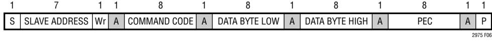

Figure 6. Write Word Protocol with PEC. Bus sequence (field widths in bits): S (1), SLAVE ADDRESS (7), Wr (1), A (1), COMMAND CODE (8), A (1), DATA BYTE LOW (8), A (1), DATA BYTE HIGH (8), A (1), PEC (8), A (1), P (1).

2975 F06

**Figure 6. Write Word Protocol with PEC**

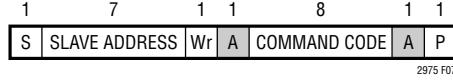

Figure 7. Send Byte Protocol. Bus sequence (field widths in bits): S (1), SLAVE ADDRESS (7), Wr (1), A (1), COMMAND CODE (8), A (1), P (1).

2975 F07

**Figure 7. Send Byte Protocol**

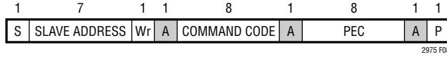

Figure 8. Send Byte Protocol with PEC. Bus sequence (field widths in bits): S (1), SLAVE ADDRESS (7), Wr (1), A (1), COMMAND CODE (8), A (1), PEC (8), A (1), P (1).

2975 F08

**Figure 8. Send Byte Protocol with PEC**

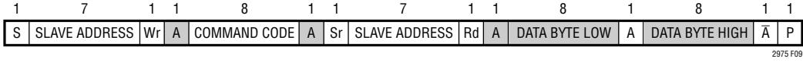

Figure 9. Read Word Protocol. Bus sequence (field widths in bits): S (1), SLAVE ADDRESS (7), Wr (1), A (1), COMMAND CODE (8), A (1), Sr (1), SLAVE ADDRESS (7), Rd (1), A (1), DATA BYTE LOW (8), A (1), DATA BYTE HIGH (8), Ā (1), P (1).

2975 F09

**Figure 9. Read Word Protocol**

Figure 10. Read Word Protocol with PEC. Bus sequence (field widths in bits): S (1), SLAVE ADDRESS (7), Wr (1), A (1), COMMAND CODE (8), A (1), Sr (1), SLAVE ADDRESS (7), Rd (1), A (1), DATA BYTE LOW (8), A (1), DATA BYTE HIGH (8), A (1), PEC (8), Ā (1), P (1).

2975 F10

**Figure 10. Read Word Protocol with PEC**

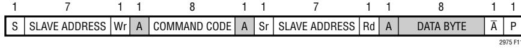

Figure 11. Read Byte Protocol. Bus sequence (field widths in bits): S (1), SLAVE ADDRESS (7), Wr (1), A (1), COMMAND CODE (8), A (1), Sr (1), SLAVE ADDRESS (7), Rd (1), A (1), DATA BYTE (8), Ā (1), P (1).

2975 F11

**Figure 11. Read Byte Protocol**

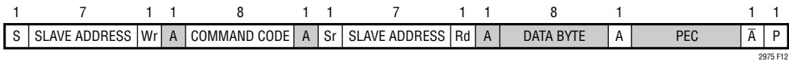

Figure 12. Read Byte Protocol with PEC. Bus sequence (field widths in bits): S (1), SLAVE ADDRESS (7), Wr (1), A (1), COMMAND CODE (8), A (1), Sr (1), SLAVE ADDRESS (7), Rd (1), A (1), DATA BYTE (8), A (1), PEC (8), Ā (1), P (1).

2975 F12

**Figure 12. Read Byte Protocol with PEC**

Figure 13. Block Read. Two parts: 1) Bus sequence (field widths in bits): S (1), SLAVE ADDRESS (7), Wr (1), A (1), COMMAND CODE (8), A (1), Sr (1), SLAVE ADDRESS (7), Rd (1), A (1), BYTE COUNT = N (8), A (1), followed by an ellipsis. 2) Bus sequence (field widths in bits): DATA BYTE 1 (8), A (1), DATA BYTE 2 (8), A (1), ..., DATA BYTE N (8), Ā (1), P (1).

2975 F13

**Figure 13. Block Read**

Figure 14. Block Read with PEC. Two parts: 1) Bus sequence (field widths in bits): S (1), SLAVE ADDRESS (7), Wr (1), A (1), COMMAND CODE (8), A (1), Sr (1), SLAVE ADDRESS (7), Rd (1), A (1), BYTE COUNT = N (8), A (1), followed by an ellipsis. 2) Bus sequence (field widths in bits): DATA BYTE 1 (8), A (1), DATA BYTE 2 (8), A (1), ..., DATA BYTE N (8), A (1), PEC (8), Ā (1), P (1).

2975 F14

**Figure 14. Block Read with PEC**

{24}------------------------------------------------

## PMBUS COMMAND SUMMARY

**Summary Table**

| COMMAND NAME           | CMD CODE | DESCRIPTION                                                                                                                                                     | TYPE      | PAGED | DATA FORMAT | UNITS     | EEPROM | DEFAULT VALUE: FLOAT HEX | REF PAGE           |
|------------------------|----------|-----------------------------------------------------------------------------------------------------------------------------------------------------------------|-----------|-------|-------------|-----------|--------|--------------------------|--------------------|
| PAGE                   | 0x00     | Channel or page currently selected for any command that supports paging.                                                                                        | R/W Byte  | N     | Reg         |           |        | 0x00                     | <a href="#">31</a> |
| OPERATION              | 0x01     | Operating mode control. On/Off, Margin High and Margin Low.                                                                                                     | R/W Byte  | Y     | Reg         |           | Y      | 0x00                     | <a href="#">36</a> |
| ON_OFF_CONFIG          | 0x02     | CONTROL pin and PMBus on/off command setting.                                                                                                                   | R/W Byte  | Y     | Reg         |           | Y      | 0x1E                     | <a href="#">37</a> |
| CLEAR_FAULTS           | 0x03     | Clear any fault bits that have been set.                                                                                                                        | Send Byte | Y     |             |           |        | NA                       | <a href="#">65</a> |
| WRITE_PROTECT          | 0x10     | Level of protection provided by the device against accidental changes.                                                                                          | R/W Byte  | N     | Reg         |           | Y      | 0x00                     | <a href="#">32</a> |
| STORE_USER_ALL         | 0x15     | Store entire operating memory to EEPROM.                                                                                                                        | Send Byte | N     |             |           |        | NA                       | <a href="#">46</a> |
| RESTORE_USER_ALL       | 0x16     | Restore entire operating memory from EEPROM.                                                                                                                    | Send Byte | N     |             |           |        | NA                       | <a href="#">46</a> |
| CAPABILITY             | 0x19     | Summary of PMBus optional communication protocols supported by this device.                                                                                     | R Byte    | N     | Reg         |           |        | 0xB0                     | <a href="#">83</a> |
| VOUT_MODE              | 0x20     | Output voltage data format and mantissa exponent ( $2^{-13}$ ).                                                                                                 | R Byte    | Y     | Reg         |           |        | 0x13                     | <a href="#">52</a> |
| VOUT_COMMAND           | 0x21     | Servo target. Nominal DC/DC converter output voltage setpoint.                                                                                                  | R/W Word  | Y     | L16         | V         | Y      | 1.0 0x2000            | <a href="#">52</a> |
| VOUT_MAX               | 0x24     | Upper limit on the output voltage the unit can command regardless of any other commands.                                                                        | R/W Word  | Y     | L16         | V         | Y      | 4.0 0x8000            | <a href="#">52</a> |
| VOUT_MARGIN_HIGH       | 0x25     | Margin high DC/DC converter output voltage setting.                                                                                                             | R/W Word  | Y     | L16         | V         | Y      | 1.05 0x219A           | <a href="#">52</a> |
| VOUT_MARGIN_LOW        | 0x26     | Margin low DC/DC converter output voltage setting.                                                                                                              | R/W Word  | Y     | L16         | V         | Y      | 0.95 0x1E66           | <a href="#">52</a> |
| VIN_ON                 | 0x35     | Input voltage above which power conversion can be enabled.                                                                                                      | R/W Word  | N     | L11         | V         | Y      | 10.0 0xD280           | <a href="#">48</a> |
| VIN_OFF                | 0x36     | Input voltage below which power conversion is disabled. All $V_{OUT\_ENn}$ pins go off immediately or sequence off after TOFF_DELAY (See Mfr_track_en_chann). | R/W Word  | N     | L11         | V         | Y      | 9.0 0xD240            | <a href="#">48</a> |
| IOUT_CAL_GAIN          | 0x38     | The nominal resistance of the current sense element in $m\Omega$ .                                                                                              | R/W Word  | Y     | L11         | $m\Omega$ | Y      | 1.0 0xBA00            | <a href="#">53</a> |
| VOUT_OV_FAULT_LIMIT    | 0x40     | Output overvoltage fault limit.                                                                                                                                 | R/W Word  | Y     | L16         | V         | Y      | 1.1 0x2333            | <a href="#">60</a> |
| VOUT_OV_FAULT_RESPONSE | 0x41     | Action to be taken by the device when an output overvoltage fault is detected.                                                                                  | R/W Byte  | Y     | Reg         |           | Y      | 0x80                     | <a href="#">60</a> |
| VOUT_OV_WARN_LIMIT     | 0x42     | Output overvoltage warning limit.                                                                                                                               | R/W Word  | Y     | L16         | V         | Y      | 1.075 0x2266          | <a href="#">52</a> |
| VOUT_UV_WARN_LIMIT     | 0x43     | Output undervoltage warning limit.                                                                                                                              | R/W Word  | Y     | L16         | V         | Y      | 0.925 0x1D9A          | <a href="#">52</a> |
| VOUT_UV_FAULT_LIMIT    | 0x44     | Output undervoltage fault limit. Used for Ton_max_fault and power good de-assertion.                                                                            | R/W Word  | Y     | L16         | V         | Y      | 0.9 0x1CCD            | <a href="#">52</a> |

**Note:** The data format abbreviations are detailed at the end of this table

{25}------------------------------------------------

## PMBUS COMMAND SUMMARY

**Summary Table**

| COMMAND NAME           | CMD CODE | DESCRIPTION                                                                                                          | TYPE     | PAGED | DATA FORMAT | UNITS | EEPROM | DEFAULT VALUE: FLOAT HEX | REF PAGE |
|------------------------|----------|----------------------------------------------------------------------------------------------------------------------|----------|-------|-------------|-------|--------|--------------------------|----------|
| VOUT_UV_FAULT_RESPONSE | 0x45     | Action to be taken by the device when an output undervoltage fault is detected.                                      | R/W Byte | Y     | Reg         |       | Y      | 0x7F                     | 60       |
| IOUT_OC_FAULT_LIMIT    | 0x46     | Output overcurrent fault limit.                                                                                      | R/W Word | Y     | L11         | A     | Y      | 10.0 0xD280           | 53       |
| IOUT_OC_FAULT_RESPONSE | 0x47     | Action to be taken by the device when an output overcurrent fault is detected.                                       | R/W Byte | Y     | Reg         |       | Y      | 0x00                     | 61       |
| IOUT_OC_WARN_LIMIT     | 0x4A     | Output overcurrent warning limit.                                                                                    | R/W Word | Y     | L11         | A     | Y      | 5.0 0xCA80            | 53       |
| IOUT_UC_FAULT_LIMIT    | 0x4B     | Output undercurrent fault limit. Used to detect a reverse current and must be a negative value.                      | R/W Word | Y     | L11         | A     | Y      | -1.0 0xB400           | 53       |
| IOUT_UC_FAULT_RESPONSE | 0x4C     | Action to be taken by the device when an output undercurrent fault is detected.                                      | R/W Byte | Y     | Reg         |       | Y      | 0x00                     | 61       |
| OT_FAULT_LIMIT         | 0x4F     | Overtemperature fault limit for the external temperature sensor.                                                     | R/W Word | Y     | L11         | °C    | Y      | 65.0 0xEA08           | 55       |
| OT_FAULT_RESPONSE      | 0x50     | Action to be taken by the device when an overtemperature fault is detected on the external temperature sensor.       | R/W Byte | Y     | Reg         |       | Y      | 0xB8                     | 62       |
| OT_WARN_LIMIT          | 0x51     | Overtemperature warning limit for the external temperature sensor                                                    | R/W Word | Y     | L11         | °C    | Y      | 60.0 0xE3C0           | 55       |
| UT_WARN_LIMIT          | 0x52     | Undertemperature warning limit for the external temperature sensor.                                                  | R/W Word | Y     | L11         | °C    | Y      | 0 0x8000              | 55       |
| UT_FAULT_LIMIT         | 0x53     | Undertemperature fault limit for the external temperature sensor.                                                    | R/W Word | Y     | L11         | °C    | Y      | -5.0 0xCD80           | 55       |
| UT_FAULT_RESPONSE      | 0x54     | Action to be taken by the device when an undertemperature fault is detected on the external temperature sensor.      | R/W Byte | Y     | Reg         |       | Y      | 0xB8                     | 62       |
| VIN_OV_FAULT_LIMIT     | 0x55     | Input overvoltage fault limit measured at VIN_SNS pin.                                                               | R/W Word | N     | L11         | V     | Y      | 15.0 0xD3C0           | 48       |
| VIN_OV_FAULT_RESPONSE  | 0x56     | Action to be taken by the device when an input overvoltage fault is detected.                                        | R/W Byte | N     | Reg         |       | Y      | 0x80                     | 62       |
| VIN_OV_WARN_LIMIT      | 0x57     | Input overvoltage warning limit measured at VIN_SNS pin.                                                             | R/W Word | N     | L11         | V     | Y      | 14.0 0xD380           | 48       |
| VIN_UV_WARN_LIMIT      | 0x58     | Input undervoltage warning limit measured at VIN_SNS pin.                                                            | R/W Word | N     | L11         | V     | Y      | 0 0x8000              | 48       |
| VIN_UV_FAULT_LIMIT     | 0x59     | Input undervoltage fault limit measured at VIN_SNS pin.                                                              | R/W Word | N     | L11         | V     | Y      | 0 0x8000              | 48       |
| VIN_UV_FAULT_RESPONSE  | 0x5A     | Action to be taken by the device when an input undervoltage fault is detected.                                       | R/W Byte | N     | Reg         |       | Y      | 0x00                     | 62       |
| POWER_GOOD_ON          | 0x5E     | Output voltage at or above which a power good should be asserted.                                                    | R/W Word | Y     | L16         | V     | Y      | 0.96 0x1EB8           | 52       |
| POWER_GOOD_OFF         | 0x5F     | Output voltage at or below which a power good should be de-asserted when Mfr_config_all_pwrgd_off_uses_uv is clear. | R/W Word | Y     | L16         | V     | Y      | 0.94 0x1E14           | 52       |
| TON_DELAY              | 0x60     | Time from CONTROL pin and/or OPERATION command = ON to $V_{OUT\_ENn}$ pin = ON.                                             | R/W Word | Y     | L11         | ms    | Y      | 1.0 0xBA00            | 57       |

{26}------------------------------------------------

## PMBUS COMMAND SUMMARY

**Summary Table**

| COMMAND NAME           | CMD CODE | DESCRIPTION                                                                                                                                                     | TYPE     | PAGED | DATA FORMAT | UNITS | EEPROM | DEFAULT VALUE: FLOAT HEX | REF PAGE           |
|------------------------|----------|-----------------------------------------------------------------------------------------------------------------------------------------------------------------|----------|-------|-------------|-------|--------|--------------------------|--------------------|
| TON_RISE               | 0x61     | Time from when the $V_{OUT\_ENn}$ pin goes high until the LTC2975 optionally soft-connects its DAC and begins to servo the output voltage to the desired value. | R/W Word | Y     | L11         | ms    | Y      | 10.0 0xD280           | <a href="#">57</a> |
| TON_MAX_FAULT_LIMIT    | 0x62     | Maximum time from $V_{OUT\_ENn} = ON$ assertion that an UV condition will be tolerated before a TON_MAX_FAULT condition results.                                | R/W Word | Y     | L11         | ms    | Y      | 15.0 0xD3C0           | <a href="#">57</a> |
| TON_MAX_FAULT_RESPONSE | 0x63     | Action to be taken by the device when a TON_MAX_FAULT event is detected.                                                                                        | R/W Byte | Y     | Reg         |       | Y      | 0xB8                     | <a href="#">63</a> |
| TOFF_DELAY             | 0x64     | Time from CONTROL pin and/or OPERATION command = OFF to $V_{OUT\_ENn}$ pin = OFF.                                                                               | R/W Word | Y     | L11         | ms    | Y      | 1.0 0xBA00            | <a href="#">57</a> |
| STATUS_BYTE            | 0x78     | One byte summary of the unit's fault condition.                                                                                                                 | R Byte   | Y     | Reg         |       |        | NA                       | <a href="#">66</a> |
| STATUS_WORD            | 0x79     | Two byte summary of the unit's fault condition.                                                                                                                 | R Word   | Y     | Reg         |       |        | NA                       | <a href="#">66</a> |
| STATUS_VOUT            | 0x7A     | Output voltage fault and warning status.                                                                                                                        | R Byte   | Y     | Reg         |       |        | NA                       | <a href="#">67</a> |
| STATUS_IOUT            | 0x7B     | Output current fault and warning status.                                                                                                                        | R Byte   | Y     | Reg         |       |        | NA                       | <a href="#">67</a> |
| STATUS_INPUT           | 0x7C     | Input supply fault and warning status.                                                                                                                          | R Byte   | N     | Reg         |       |        | NA                       | <a href="#">67</a> |
| STATUS_TEMPERATURE     | 0x7D     | External temperature fault and warning status for READ_TEMPERATURE_1.                                                                                           | R Byte   | Y     | Reg         |       |        | NA                       | <a href="#">68</a> |
| STATUS_CML             | 0x7E     | Communication and memory fault and warning status.                                                                                                              | R Byte   | N     | Reg         |       |        | NA                       | <a href="#">68</a> |
| STATUS_MFR_SPECIFIC    | 0x80     | Manufacturer specific fault and state information.                                                                                                              | R Byte   | Y     | Reg         |       |        | NA                       | <a href="#">68</a> |
| READ_VIN               | 0x88     | Input supply voltage.                                                                                                                                           | R Word   | N     | L11         | V     |        | NA                       | <a href="#">71</a> |
| READ_IIN               | 0x89     | DC/DC converter input current.                                                                                                                                  | R Word   | N     | L11         | A     |        | NA                       | <a href="#">71</a> |
| READ_VOUT              | 0x8B     | DC/DC converter output voltage.                                                                                                                                 | R Word   | Y     | L16         | V     |        | NA                       | <a href="#">71</a> |
| READ_IOUT              | 0x8C     | DC/DC converter output current.                                                                                                                                 | R Word   | Y     | L11         | A     |        | NA                       | <a href="#">72</a> |
| READ_TEMPERATURE_1     | 0x8D     | External diode junction temperature. This is the value used for all temperature related processing, including IOUT_CAL_GAIN.                                    | R Word   | Y     | L11         | °C    |        | NA                       | <a href="#">72</a> |
| READ_TEMPERATURE_2     | 0x8E     | Internal junction temperature.                                                                                                                                  | R Word   | N     | L11         | °C    |        | NA                       | <a href="#">72</a> |
| READ_POUT              | 0x96     | DC/DC converter output power.                                                                                                                                   | R Word   | Y     | L11         | W     |        | NA                       | <a href="#">73</a> |
| READ_PIN               | 0x97     | DC/DC converter input power.                                                                                                                                    | R Word   | N     | L11         | W     |        | NA                       | <a href="#">71</a> |
| PMBUS_REVISION         | 0x98     | PMBus revision supported by this device. Current revision is 1.1.                                                                                               | R Byte   | N     | Reg         |       |        | 0x11                     | <a href="#">84</a> |
| USER_DATA_00           | 0xB0     | Manufacturer reserved for LTpowerPlay.                                                                                                                          | R/W Word | N     | Reg         |       | Y      | NA                       | <a href="#">84</a> |
| USER_DATA_01           | 0xB1     | Manufacturer reserved for LTpowerPlay.                                                                                                                          | R/W Word | Y     | Reg         |       | Y      | NA                       | <a href="#">84</a> |
| USER_DATA_02           | 0xB2     | OEM Reserved.                                                                                                                                                   | R/W Word | N     | Reg         |       | Y      | NA                       | <a href="#">84</a> |
| USER_DATA_03           | 0xB3     | Scratchpad location.                                                                                                                                            | R/W Word | Y     | Reg         |       | Y      | 0x0000                   | <a href="#">84</a> |
| USER_DATA_04           | 0xB4     | Scratchpad location.                                                                                                                                            | R/W Word | N     | Reg         |       | Y      | 0x0000                   | <a href="#">84</a> |
| MFR_LTC_RESERVED_1     | 0xB5     | Manufacturer reserved.                                                                                                                                          | R/W Word | Y     | Reg         |       | Y      | NA                       | <a href="#">84</a> |
| MFR_INFO               | 0xB6     | Manufacturer specific information.                                                                                                                              | R Word   | N     | Reg         |       |        | NA                       | <a href="#">84</a> |

{27}------------------------------------------------

## PMBUS COMMAND SUMMARY

**Summary Table**

| COMMAND NAME              | CMD CODE | DESCRIPTION                                                                                                                           | TYPE      | PAGED | DATA FORMAT | UNITS | EEPROM | DEFAULT VALUE: FLOAT HEX | REF PAGE           |
|---------------------------|----------|---------------------------------------------------------------------------------------------------------------------------------------|-----------|-------|-------------|-------|--------|--------------------------|--------------------|
| MFR_T_SELF_HEAT           | 0xB8     | Calculated temperature rise due to self-heating of output current sense device above value measured by external temperature sensor.   | R Word    | Y     | L11         | °C    |        | NA                       | <a href="#">55</a> |
| MFR_IOUT_CAL_GAIN_TAU_INV | 0xB9     | Inverse of time constant for Mfr_t_self_heat changes scaled by $4 \cdot t_{\text{CONV\_SENSE}}$ .                                     | R/W Word  | Y     | L11         |       | Y      | 0.0 0x8000            | <a href="#">55</a> |
| MFR_IOUT_CAL_GAIN_THETA   | 0xBA     | Thermal resistance from inductor core to point measured by external temperature sensor.                                               | R/W Word  | Y     | L11         | °C/W  | Y      | 0.0 0x8000            | <a href="#">55</a> |
| MFR_READ_IOUT             | 0xBB     | Alternate data format for READ_IOUT. One LSB = 2.5mA.                                                                                 | R Word    | Y     | CF          | 2.5mA |        | NA                       | <a href="#">72</a> |
| MFR_LTC_RESERVED_2        | 0xBC     | Manufacturer reserved.                                                                                                                | R/W Word  | Y     | Reg         |       |        | NA                       | <a href="#">84</a> |
| MFR_EE_UNLOCK             | 0xBD     | Unlock user EEPROM for access by MFR_EE_ERASE and MFR_EE_DATA commands.                                                               | R/W Byte  | N     | Reg         |       |        | NA                       | <a href="#">47</a> |
| MFR_EE_ERASE              | 0xBE     | Initialize user EEPROM for bulk programming by MFR_EE_DATA.                                                                           | R/W Byte  | N     | Reg         |       |        | NA                       | <a href="#">47</a> |
| MFR_EE_DATA               | 0xBF     | Data transferred to and from EEPROM using sequential PMBus word reads or writes. Supports bulk programming.                           | R/W Word  | N     | Reg         |       |        | NA                       | <a href="#">47</a> |
| MFR_EIN                   | 0xC0     | Input Energy data bytes.                                                                                                              | R Block   | N     | Reg         |       |        | NA                       | <a href="#">49</a> |
| MFR_EIN_CONFIG            | 0xC1     | Configuration register for energy and input current.                                                                                  | R/W Byte  | N     | Reg         |       | Y      | 0x00                     | <a href="#">50</a> |
| MFR_SPECIAL_LOT           | 0xC2     | Customer dependent codes that identify the factory programmed user configuration stored in EEPROM. Contact factory for default value. | R Byte    | Y     | Reg         |       | Y      | NA                       | <a href="#">84</a> |
| MFR_IIN_CAL_GAIN_TC       | 0xC3     | Temperature coefficient applied to IIN_CAL_GAIN.                                                                                      | R/W Word  | N     | CF          | ppm   | Y      | 0x0000                   | <a href="#">51</a> |
| MFR_IIN_PEAK              | 0xC4     | Maximum measured value of READ_IIN.                                                                                                   | R Word    | N     | L11         | A     |        | NA                       | <a href="#">72</a> |
| MFR_IIN_MIN               | 0xC5     | Minimum measured value of READ_IIN.                                                                                                   | R Word    | N     | L11         | A     |        | NA                       | <a href="#">72</a> |
| MFR_PIN_PEAK              | 0xC6     | Maximum measured value of READ_PIN.                                                                                                   | R Word    | N     | L11         | W     |        | NA                       | <a href="#">72</a> |
| MFR_PIN_MIN               | 0xC7     | Minimum measured value of READ_PIN.                                                                                                   | R Word    | N     | L11         | W     |        | NA                       | <a href="#">72</a> |
| MFR_COMMAND_PLUS          | 0xC8     | Alternate access to block read and other data. Commands for all additional hosts.                                                     | R/W Word  | N     | Reg         |       |        |                          | <a href="#">33</a> |
| MFR_DATA_PLUS0            | 0xC9     | Alternate access to block read and other data. Data for additional host 0.                                                            | R/W Word  | N     | Reg         |       |        |                          | <a href="#">33</a> |
| MFR_DATA_PLUS1            | 0xCA     | Alternate access to block read and other data. Data for additional host 1.                                                            | R/W Word  | N     | Reg         |       |        |                          | <a href="#">33</a> |
| MFR_CLEAR_ENERGY          | 0xCC     | Clear MFR_EIN time and energy values.                                                                                                 | Send Byte | N     |             |       |        | NA                       | <a href="#">51</a> |
| MFR_CONFIG_LTC2975        | 0xD0     | Configuration bits that are channel specific.                                                                                         | R/W Word  | Y     | Reg         |       | Y      | 0x0080                   | <a href="#">38</a> |
| MFR_CONFIG_ALL_LTC2975    | 0xD1     | Configuration bits that are common to all pages.                                                                                      | R/W Word  | N     | Reg         |       | Y      | 0x0F7B                   | <a href="#">44</a> |
| MFR_FAULTB0_PROPAGATE     | 0xD2     | Configuration that determines if a channel's faulted off state is propagated to the FAULTB0 pin.                                      | R/W Byte  | Y     | Reg         |       | Y      | 0x00                     | <a href="#">64</a> |

{28}------------------------------------------------

## PMBUS COMMAND SUMMARY

**Summary Table**

| COMMAND NAME                  | CMD CODE | DESCRIPTION                                                                                             | TYPE      | PAGED | DATA FORMAT | UNITS      | EEPROM | DEFAULT VALUE: FLOAT HEX | REF PAGE           |
|-------------------------------|----------|---------------------------------------------------------------------------------------------------------|-----------|-------|-------------|------------|--------|--------------------------|--------------------|
| MFR_FAULTB1_PROPAGATE         | 0xD3     | Configuration that determines if a channel's faulted off state is propagated to the FAULTB1 pin.        | R/W Byte  | Y     | Reg         |            | Y      | 0x00                     | <a href="#">64</a> |
| MFR_PWRGD_EN                  | 0xD4     | Configuration that maps WDI/RESETB status and individual channel power good to the PWRGD pin.           | R/W Word  | N     | Reg         |            | Y      | 0x0000                   | <a href="#">58</a> |
| MFR_FAULTB0_RESPONSE          | 0xD5     | Action to be taken by the device when the FAULTB0 pin is asserted low.                                  | R/W Byte  | N     | Reg         |            | Y      | 0x00                     | <a href="#">64</a> |
| MFR_FAULTB1_RESPONSE          | 0xD6     | Action to be taken by the device when the FAULTB1 pin is asserted low.                                  | R/W Byte  | N     | Reg         |            | Y      | 0x00                     | <a href="#">64</a> |
| MFR_IOUT_PEAK                 | 0xD7     | Maximum measured value of READ_IOUT.                                                                    | R Word    | Y     | L11         | A          |        | NA                       | <a href="#">74</a> |
| MFR_IOUT_MIN                  | 0xD8     | Minimum measured value of READ_IOUT.                                                                    | R Word    | Y     | L11         | A          |        | NA                       | <a href="#">75</a> |
| MFR_CONFIG2_LTC2975           | 0xD9     | Configuration bits that are channel specific                                                            | R/W Byte  | N     | Reg         |            | Y      | 0x00                     | <a href="#">40</a> |
| MFR_CONFIG3_LTC2975           | 0xDA     | Configuration bits that are channel specific                                                            | R/W Byte  | N     | Reg         |            | Y      | 0x00                     | <a href="#">41</a> |
| MFR_RETRY_DELAY               | 0xDB     | Retry interval during FAULT retry mode.                                                                 | R/W Word  | N     | L11         | ms         | Y      | 200 0xF320            | <a href="#">63</a> |
| MFR_RESTART_DELAY             | 0xDC     | Delay from actual CONTROL active edge to virtual CONTROL active edge.                                   | R/W Word  | N     | L11         | ms         | Y      | 400 0xFB20            | <a href="#">58</a> |
| MFR_VOUT_PEAK                 | 0xDD     | Maximum measured value of READ_VOUT.                                                                    | R Word    | Y     | L16         | V          |        | NA                       | <a href="#">74</a> |
| MFR_VIN_PEAK                  | 0xDE     | Maximum measured value of READ_VIN.                                                                     | R Word    | N     | L11         | V          |        | NA                       | <a href="#">74</a> |
| MFR_TEMPERATURE_1_PEAK        | 0xDF     | Maximum measured value of READ_TEMPERATURE_1.                                                           | R Word    | Y     | L11         | °C         |        | NA                       | <a href="#">74</a> |
| MFR_DAC                       | 0xE0     | The code of the 10-bit DAC.                                                                             | R/W Word  | Y     | Reg         |            |        | NA                       | <a href="#">52</a> |
| MFR_POWERGOOD_ASSERTION_DELAY | 0xE1     | Power-good output assertion delay.                                                                      | R/W Word  | N     | L11         | ms         | Y      | 100 0xEB20            | <a href="#">59</a> |
| MFR_WATCHDOG_T_FIRST          | 0xE2     | First watchdog timer interval.                                                                          | R/W Word  | N     | L11         | ms         | Y      | 0 0x8000              | <a href="#">59</a> |
| MFR_WATCHDOG_T                | 0xE3     | Watchdog timer interval.                                                                                | R/W Word  | N     | L11         | ms         | Y      | 0 0x8000              | <a href="#">59</a> |
| MFR_PAGE_FF_MASK              | 0xE4     | Configuration defining which channels respond to global page commands (PAGE=0xFF).                      | R/W Byte  | N     | Reg         |            | Y      | 0x0F                     | <a href="#">32</a> |
| MFR_PADS                      | 0xE5     | Current state of selected digital I/O pads.                                                             | R Word    | N     | Reg         |            |        | NA                       | <a href="#">69</a> |
| MFR_I2C_BASE_ADDRESS          | 0xE6     | Base value of the I 2 C/SMBus address byte.                                                  | R/W Byte  | N     | Reg         |            | Y      | 0x5C                     | <a href="#">33</a> |
| MFR_SPECIAL_ID                | 0xE7     | Manufacturer code for identifying the LTC2975.                                                          | R Word    | N     | Reg         |            | Y      | 0x0226                   | <a href="#">84</a> |
| MFR_IIN_CAL_GAIN              | 0xE8     | The nominal resistance of the input current sense element in m $\Omega$ .                               | R/W Word  | N     | L11         | m $\Omega$ | Y      | 1.0 0xBA00            | <a href="#">50</a> |
| MFR_VOUT_DISCHARGE_THRESHOLD  | 0xE9     | Coefficient used to multiply VOUT_COMMAND in order to determine V OUT off threshold voltage. | R/W Word  | Y     | L11         |            | Y      | 2.0 0xC200            | <a href="#">52</a> |
| MFR_FAULT_LOG_STORE           | 0xEA     | Command a transfer of the fault log from RAM to EEPROM.                                                 | Send Byte | N     |             |            |        | NA                       | <a href="#">75</a> |
| MFR_FAULT_LOG_RESTORE         | 0xEB     | Command a transfer of the fault log previously stored in EEPROM back to RAM.                            | Send Byte | N     |             |            |        | NA                       | <a href="#">76</a> |

{29}------------------------------------------------

## PMBUS COMMAND SUMMARY

**Summary Table**

| COMMAND NAME           | CMD CODE | DESCRIPTION                                                                                                                   | TYPE      | PAGED | DATA FORMAT | UNITS  | EEPROM | DEFAULT VALUE: FLOAT HEX | REF PAGE |
|------------------------|----------|-------------------------------------------------------------------------------------------------------------------------------|-----------|-------|-------------|--------|--------|--------------------------|----------|
| MFR_FAULT_LOG_CLEAR    | 0xEC     | Initialize the EEPROM block reserved for fault logging and clear any previous fault logging locks.                            | Send Byte | N     |             |        |        | NA                       | 76       |
| MFR_FAULT_LOG_STATUS   | 0xED     | Fault logging status.                                                                                                         | R Byte    | N     | Reg         |        | Y      | NA                       | 76       |
| MFR_FAULT_LOG          | 0xEE     | Fault log data bytes. This sequentially retrieved data is used to assemble a complete fault log.                              | R Block   | N     | Reg         |        | Y      | NA                       | 76       |
| MFR_COMMON             | 0xEF     | Manufacturer status bits that are common across multiple ADI chips.                                                           | R Byte    | N     | Reg         |        |        | NA                       | 70       |
| MFR_IOUT_CAL_GAIN_TC   | 0xF6     | Temperature coefficient applied to IOUT_CAL_GAIN.                                                                             | R/W Word  | Y     | CF          | ppm    | Y      | 0x0000                   | 51       |
| MFR_RETRY_COUNT        | 0xF7     | Retry count for all faulted off conditions that enable retry.                                                                 | R/W Byte  | N     | Reg         |        | Y      | 0x07                     | 63       |
| MFR_TEMP_1_GAIN        | 0xF8     | Inverse of external diode temperature non ideality factor. One LSB = 2 -14 .                                       | R/W Word  | Y     | CF          |        | Y      | 1 0x4000              | 55       |
| MFR_TEMP_1_OFFSET      | 0xF9     | Offset value for the external temperature.                                                                                    | R/W Word  | Y     | L11         | °C     | Y      | 0 0x8000              | 55       |
| MFR_IOUT_SENSE_VOLTAGE | 0xFA     | Absolute value of the voltage between I SENSEPn and I SENSEMn . One LSB = 3.05μV. | R Word    | Y     | CF          | 3.05μV |        | NA                       | 74       |
| MFR_VOUT_MIN           | 0xFB     | Minimum measured value of READ_VOUT.                                                                                          | R Word    | Y     | L16         | V      |        | NA                       | 74       |
| MFR_VIN_MIN            | 0xFC     | Minimum measured value of READ_VIN.                                                                                           | R Word    | N     | L11         | V      |        | NA                       | 74       |
| MFR_TEMPERATURE_1_MIN  | 0xFD     | Minimum measured value of READ_TEMPERATURE_1.                                                                                 | R Word    | Y     | L11         | °C     |        | NA                       | 75       |

**Data Formats**

|     |               |                                                                                                                                                                                                                                                                                                                                                                                                         |
|-----|---------------|---------------------------------------------------------------------------------------------------------------------------------------------------------------------------------------------------------------------------------------------------------------------------------------------------------------------------------------------------------------------------------------------------------|
| L11 | Linear_5s_11s | 
PMBus data field b[15:0]  Value = <math>Y \cdot 2^N</math>  where N = b[15:11] is a 5-bit two's complement integer and Y = b[10:0] is an 11-bit two's complement integer
 
Example:  READ_VIN = 10V  For b[15:0] = 0xD280 = 1101_0010_1000_0000b  Value = 640 • 2-6 = 10
 
See PMBus Spec Part II: Paragraph 7.3
                                        |
| L16 | Linear_16u    | 
PMBus data field b[15:0]  Value = <math>Y \cdot 2^N</math> where Y = b[15:0] is an unsigned integer and N = Vout_mode_parameter is a 5-bit two's complement exponent that is hardwired to -13 decimal.
 
Example:  VOUT_COMMAND = 4.75V  For b[15:0] = 0x9800 = 1001_1000_0000_0000b  Value = 38912 • 2-13 = 4.75
 
See PMBus Spec Part II: Paragraph 8.4.1
 |
| Reg | Register      | 
PMBus data field b[15:0] or b[7:0].  Bit field meaning is defined in detailed PMBus Command Register Description.
                                                                                                                                                                                                                                                                            |
| CF  | Custom Format | 
PMBus data field b[15:0]  Value is defined in detailed PMBus Command Register Description. This is often an unsigned or two's complement integer scaled by an MFR specific constant.
                                                                                                                                                                                                         |

{30}------------------------------------------------

## PMBUS COMMAND DESCRIPTION

### ADDRESSING AND WRITE PROTECT

| COMMAND NAME         | CMD CODE | DESCRIPTION                                                                        | TYPE     | PAGED | DATA FORMAT | UNITS | EEPROM | DEFAULT VALUE | REF PAGE           |
|----------------------|----------|------------------------------------------------------------------------------------|----------|-------|-------------|-------|--------|---------------|--------------------|
| PAGE                 | 0x00     | Channel or page currently selected for any command that supports paging.           | R/W Byte | N     | Reg         |       |        | 0x00          | <a href="#">31</a> |
| WRITE_PROTECT        | 0x10     | Level of protection provided by the device against accidental changes.             | R/W Byte | N     | Reg         |       | Y      | 0x00          | <a href="#">32</a> |
| MFR_I2C_BASE_ADDRESS | 0xE6     | Base value of the I 2 C/SMBus address byte.                             | R/W Byte | N     | Reg         |       | Y      | 0x5C          | <a href="#">33</a> |
| MFR_PAGE_FF_MASK     | 0xE4     | Configuration defining which channels respond to global page commands (PAGE=0xFF). | R/W Byte | N     | Reg         |       | Y      | 0x0F          | <a href="#">32</a> |
| MFR_COMMAND_PLUS     | 0xC8     | Alternate access to block read and other data. Commands for all additional hosts.  | R/W Word | N     | Reg         |       |        |               | <a href="#">33</a> |
| MFR_DATA_PLUS0       | 0xC9     | Alternate access to block read and other data. Data for additional host 0.         | R/W Word | N     | Reg         |       |        |               | <a href="#">33</a> |
| MFR_DATA_PLUS1       | 0xCA     | Alternate access to block read and other data. Data for additional host 1.         | R/W Word | N     | Reg         |       |        |               | <a href="#">33</a> |

#### PAGE

The LTC2975 has four pages that correspond to the four DC/DC converter channels that can be managed. Each DC/DC converter channel can be uniquely programmed by first setting the appropriate page.

Setting PAGE = 0xFF allows a simultaneous write to all pages for PMBus commands that support global page programming. The only commands that support PAGE = 0xFF are CLEAR\_FAULTS, OPERATION and ON\_OFF\_CONFIG. See MFR\_PAGE\_FF\_MASK for additional options. Reading any paged PMBus register with PAGE = 0xFF returns unpredictable data and will trigger a CML fault. Writes to commands that do not support PAGE = 0xFF with PAGE = 0xFF will be ignored and generate a CML fault.

**PAGE Data Contents**

| BIT(S) | SYMBOL | OPERATION                                                                                                                                                                                                                                                                                                                                                                                                                     |
|--------|--------|-------------------------------------------------------------------------------------------------------------------------------------------------------------------------------------------------------------------------------------------------------------------------------------------------------------------------------------------------------------------------------------------------------------------------------|
| b[7:0] | Page   | Page operation. 0x00: All PMBus commands address channel/page 0. 0x01: All PMBus commands address channel/page 1. 0x02: All PMBus commands address channel/page 2. 0x03: All PMBus commands address channel/page 3. 0xXX: All non specified values reserved. 0xFF: A single PMBus write/send to commands that support this mode will simultaneously address all channel/pages with MFR_PAGE_FF_MASK enabled. |

{31}------------------------------------------------

## PMBUS COMMAND DESCRIPTION

#### WRITE\_PROTECT

The WRITE\_PROTECT command provides protection against accidental programming of the LTC2975 command registers. All supported commands may have their parameters read, regardless of the WRITE\_PROTECT setting, and the EEPROM contents can also be read regardless of the WRITE\_PROTECT settings.

There are two levels of protection:

- Level 1: Nothing can be changed except the level of write protection itself. Values can be read from all pages. This setting can be stored to EEPROM.
- Level 2: Nothing can be changed except for the level of protection, channel on/off state, and clearing of faults. Values can be read from all pages. This setting can be stored to EEPROM.

**WRITE\_PROTECT Data Contents**

| BIT(S) | SYMBOL             | OPERATION                                                                                                                                                                                                                                                                                                                                                                                                                                      |
|--------|--------------------|------------------------------------------------------------------------------------------------------------------------------------------------------------------------------------------------------------------------------------------------------------------------------------------------------------------------------------------------------------------------------------------------------------------------------------------------|
| b[7:0] | Write_protect[7:0] | 1000_0000b: Level 1 Protection - Disable all writes except to the WRITE_PROTECT, PAGE, MFR_EE_UNLOCK, and STORE_USER_ALL commands. 0100_0000b: Level 2 Protection – Disable all writes except to the WRITE_PROTECT, PAGE, MFR_EE_UNLOCK, STORE_USER_ALL, OPERATION, MFR_COMMAND_PLUS, MFR_PAGE_FF_MASK, MFR_CLEAR_ENERGY and CLEAR_FAULTS commands. 0000_0000b: Enable writes to all commands. xxxx_xxxxb: All other values reserved. |

#### Write Protect Pin

The WP pin allows the user to write-protect the LTC2975’s configuration registers. The WP pin is active high, and when asserted it provides Level 2 protection: all writes are disabled except to the WRITE\_PROTECT, PAGE, MFR\_EE\_UNLOCK, STORE\_USER\_ALL, OPERATION, MFR\_COMMAND\_PLUS, MFR\_PAGE\_FF\_MASK, MFR\_CLEAR\_ENERGY and CLEAR\_FAULTS commands. The most restrictive setting between the WP pin and WRITE\_PROTECT command will override.

| WP PIN STATE | WRITE_PROTECT COMMAND VALUE | WRITE PROTECT LEVEL |
|--------------|-----------------------------|---------------------|
| Low          | 0x00                        | No write protection |
|              | 0x40                        | Level 2             |
|              | 0x80                        | Level 1             |
| High         | 0x00                        | Level 2             |
|              | 0x40                        | Level 2             |
|              | 0x80                        | Level 1             |

#### MFR\_PAGE\_FF\_MASK

The MFR\_PAGE\_FF\_MASK command is used to select which channels respond when the global page command (PAGE = 0xFF) is in use.

**MFR\_PAGE\_FF\_MASK Data Contents**

| BIT(S) | SYMBOL                 | OPERATION                                                                                                                                                     |
|--------|------------------------|---------------------------------------------------------------------------------------------------------------------------------------------------------------|
| b[7:4] | Reserved               | Always returns 0000b                                                                                                                                          |
| b[3]   | Mfr_page_ff_mask_chan3 | Channel 3 masking of global page command (PAGE=0xFF) accesses 0 = ignore global page command accesses 1 = fully respond to global page command accesses |

{32}------------------------------------------------

## PMBUS COMMAND DESCRIPTION

**MFR\_PAGE\_FF\_MASK Data Contents**

| BIT(S) | SYMBOL                 | OPERATION                                                                                                                                                       |
|--------|------------------------|-----------------------------------------------------------------------------------------------------------------------------------------------------------------|
| b[2]   | Mfr_page_ff_mask_chan2 | Channel 2 masking of global page command (PAGE=0xFF) accesses 0 = ignore global page command accesses 1 = fully respond to global page command accesses   |
| b[1]   | Mfr_page_ff_mask_chan1 | Channel 1 masking of global page command (PAGE=0xFF) accesses 0 = ignore global page command accesses 1 = fully respond to global page command accesses   |
| b[0]   | Mfr_page_ff_mask_chan0 | Channel 0 masking of global page command (PAGE = 0xFF) accesses 0 = ignore global page command accesses 1 = fully respond to global page command accesses |

#### MFR\_I2C\_BASE\_ADDRESS

The MFR\_I2C\_BASE\_ADDRESS command determines the base value for the I2C/SMBus address byte. Offsets of 0 to 8 are added to this base address to generate the device I2C/SMBus address. The part responds to the device address. For example, with the factory default MFR\_I2C\_BASE\_ADDRESS of 0x5C, with both ASEL1 and ASEL0 High (Offset N=8), the device address would be 0x5C + 8 = 0x64.

**MFR\_I2C\_BASE\_ADDRESS Data Contents**

| BIT(S) | SYMBOL           | OPERATION                                                                                                                            |
|--------|------------------|--------------------------------------------------------------------------------------------------------------------------------------|
| b[7]   | Reserved         | Read only, always returns 0.                                                                                                         |
| b[6:0] | I2C_base_address | This 7-bit value determines the base value of the 7-bit I 2 C/SMBus address. See Device Address in the Operation section. |

#### MFR\_COMMAND\_PLUS

#### MFR\_DATA\_PLUS0 and MFR\_DATA\_PLUS1

#### MFR\_STATUS\_PLUS0, and MFR\_STATUS\_PLUS1

Similar to the PAGE register, these registers allow the user to indirectly address memory. These registers are useful to advanced users for reading or writing memory as described below.

Command Plus operations use a sequence of word commands to support the following:

- An alternate method for reading block data using sequential standard word reads.
- A peek operation that allows up to two additional hosts to read an internal register using PMBus word protocol where each host has a unique page.
- A poke operation that allows up to two additional hosts to write an internal register using PMBus word protocol where each host has a unique page.
- Peek, Poke and Command Plus block reads do not interfere with normal PMBus accesses or page values set by PAGE. This enables multi master support for up to 3 hosts.

{33}------------------------------------------------

## PMBUS COMMAND DESCRIPTION

**MFR\_COMMAND\_PLUS Data Contents**

| BIT(S)  | SYMBOL                    | OPERATION                                                                                                                                                                                                                                                                                                                                                                                                                                                 |
|---------|---------------------------|-----------------------------------------------------------------------------------------------------------------------------------------------------------------------------------------------------------------------------------------------------------------------------------------------------------------------------------------------------------------------------------------------------------------------------------------------------------|
| b[15]   | Mfr_command_plus_reserved | Reserved. Always returns 0.                                                                                                                                                                                                                                                                                                                                                                                                                               |
| b[14]   | Mfr_command_plus_id       | Command plus host ID 0: Mfr_command_plus pointer and page are cached and used for all Mfr_data_plus0 accesses. 1: Mfr_command_plus pointer and page are cached and used for all Mfr_data_plus1 accesses.                                                                                                                                                                                                                                            |
| b[13:9] | Mfr_command_plus_page     | Page to be used when peeking or poking via Mfr_data_plus0 or Mfr_data_plus1. Allowed values are 0 through 3. This page value is cached separately for Mfr_data_plus0 and Mfr_data_plus1 based on the value of Mfr_command_plus_id when this register is written.                                                                                                                                                                                          |
| b[8:0]  | Mfr_command_plus_pointer  | Internal memory location accessed by Mfr_data_plus0 or Mfr_data_plus1. Mfr_data_plus0 and Mfr_data_plus1 pointers are cached separately. Legal values are listed in the CMD Code column of the PMBus COMMAND SUMMARY table. All other values are reserved, except for the special poke enable/disable values listed in the Enabling And Disabling Poke Operations section, and the command values listed below for Mfr_status_plus0 and Mfr_status_plus1. |

**MFR\_DATA\_PLUS0 and MFR\_DATA\_PLUS1 Data Contents**

| BIT(S)  | SYMBOL                           | OPERATION                                                                                                                                                                                                                                                                                                                                                                                                                                                                                                                                                                                                                                                 |
|---------|----------------------------------|-----------------------------------------------------------------------------------------------------------------------------------------------------------------------------------------------------------------------------------------------------------------------------------------------------------------------------------------------------------------------------------------------------------------------------------------------------------------------------------------------------------------------------------------------------------------------------------------------------------------------------------------------------------|
| b[15:0] | Mfr_data_plus0 Mfr_data_plus1 | A read from this register returns data referenced by the last matching Mfr_command_plus write. More specifically, writes to Mfr_command_plus by host 0 update Mfr_data_plus0, and writes to Mfr_command_plus by host1 update Mfr_data_plus1. Multiple sequential reads while pointer = Mfr_fault_Log return the complete contents of the block read buffer. Block reads beyond the end of buffer return zeros.  A write to this register will transfer the data to the location referenced by the last matching Mfr_command_plus_pointer when the Poke operation protocol described in the Poke Operation Using Mfr_data_plus0 section is followed. |

**MFR\_STATUS\_PLUS0 and MFR\_STATUS\_PLUS1 Data Contents**

| BIT(S) | SYMBOL                                                       | OPERATION                                                                                                                                                                                                                                                                |
|--------|--------------------------------------------------------------|--------------------------------------------------------------------------------------------------------------------------------------------------------------------------------------------------------------------------------------------------------------------------|
| b[7:2] | Reserved                                                     |                                                                                                                                                                                                                                                                          |
| b[1]   | Mfr_status_plus_poke_failed0 Mfr_status_plus_poke_failed1 | Status of most recent poke for matching host. 0: Last poke operation did not fail. 1: Last poke operation failed because pokes were not enabled, as described in Enabling and Disabling Poke Operations below, or an illegal Mfr_command_plus_page value was used. |
| b[0]   | Mfr_status_plus_poke_failed0 Mfr_status_plus_poke_failed1 | Status of most recent poke for matching host. 0: Last poke operation did not fail. 1: Last poke operation failed because pokes were not enabled as described in Enabling and Disabling Poke Operations section.                                                    |

MFR\_STATUS\_PLUS0 is at command location 0x2C, and MFR\_STATUS\_PLUS1 is at command location 0x2D. These correspond to reserved PMBus command locations. These two status registers can only be read via Command Plus peeks.

#### Reading Fault Log Using Command Plus and Mfr\_data\_plus0

Write Mfr\_command\_plus\_pointer = 0xEE with Mfr\_command\_plus\_page = 0 and Mfr\_command\_plus\_id = 0.

Read data from Mfr\_data\_plus0; each read returns the next data word of the MFR\_FAULT\_LOG command:

- The first word read is Byte\_count[15:0] = 0x00FF.
- The next set of words read is the Preamble with 2 bytes packed into a word. Refer to the Fault Log section for details.
- The next set of words read is the Cyclical Loop Data with 2 bytes per word. Refer to the Fault Log section for details.
- Extra reads return zero.

{34}------------------------------------------------

## PMBUS COMMAND DESCRIPTION

- Interleaved PMBus word and byte commands do not interfere with an ongoing Command Plus block read.
- Interleaved PMBus block reads of MFR\_FAULT\_LOG will interrupt this command.

Check status to be sure the data just read was all valid:

- Write Mfr\_command\_plus\_pointer = 0x2C with Mfr\_command\_plus\_page = 0 and Mfr\_command\_plus\_id = 0.
- Read data from Mfr\_data\_plus0 and confirm that Mfr\_status\_plus\_block\_peek\_failed0 = 0.

#### Reading Energy Using MFR\_COMMAND\_PLUS and MFR\_DATA\_PLUS0

Write Mfr\_command\_plus\_pointer = 0xC0 with Mfr\_command\_plus\_page = 0 and Mfr\_command\_plus\_id = 0.

Read data from Mfr\_data\_plus\_0; each read returns the next data word of the MFR\_EIN command:

- Byte\_count[15:0] = 0x000C
- Energy\_value[15:0]
- Energy\_value[31:16]
- Energy\_value[47:32]
- Energy\_time[15:0]
- Energy\_time[31:16]
- Energy\_time[47:32]

#### Peek Operation Using Mfr\_data\_plus0

Internal words and bytes may be read using Command Plus:

Write Mfr\_command\_plus\_pointer = CMD\_CODE with Mfr\_command\_plus\_page = page and Mfr\_command\_plus\_id = 0.

The CMD\_CODE's are listed in the PMBus COMMAND SUMMARY table.

Read data from Mfr\_data\_plus0. Data is always read using a word read. Byte data is returned with upper byte set to 0.

#### Enabling and Disabling Poke Operations

Poke operations to Mfr\_data\_plus0 are enabled by writing Mfr\_command\_plus = 0x0BF6.

Poke operations to Mfr\_data\_plus0 are disabled by writing Mfr\_command\_plus = 0x01F6.

Poke operations to Mfr\_data\_plus1 are enabled by writing Mfr\_command\_plus = 0x4BF6.

Poke operations to Mfr\_data\_plus1 are disabled by writing Mfr\_command\_plus = 0x41F6.

#### Poke Operation Using Mfr\_data\_plus0

Internal words and bytes may be written using Command Plus:

Enable poke access for Mfr\_data\_plus0. This need only be done once after a power-up or WDI reset.

Write Mfr\_command\_plus\_pointer = CMD\_CODE with Mfr\_command\_plus\_page = page and Mfr\_command\_plus\_id = 0.

The CMD\_CODEs are listed in the PMBus COMMAND SUMMARY table.

Write the new data value to MFR\_DATA\_PLUS0

{35}------------------------------------------------

## PMBUS COMMAND DESCRIPTION

Optionally check status to be sure data was written as desired:

- Write Mfr\_command\_plus\_pointer = 0x2C with Mfr\_command\_plus\_page = 0 and Mfr\_command\_plus\_id = 0.
- Read data from Mfr\_data\_plus0 and confirm that Mfr\_status\_plus\_poke\_failed0 = 0.

#### Command Plus Operations Using Mfr\_data\_plus1

All the previous operations may be accessed via Mfr\_data\_plus1 by substituting Mfr\_command\_plus\_id value with a 1. Poke operations must be enabled for Mfr\_data\_plus1.

### ON/OFF CONTROL, MARGINING AND CONFIGURATION

| COMMAND NAME           | CMD CODE | DESCRIPTION                                                 | TYPE     | PAGED | DATA FORMAT | UNITS | EEPROM | DEFAULT VALUE | REF PAGE |
|------------------------|----------|-------------------------------------------------------------|----------|-------|-------------|-------|--------|---------------|----------|
| OPERATION              | 0x01     | Operating mode control. On/Off, Margin High and Margin Low. | R/W Byte | Y     | Reg         |       | Y      | 0x00          | 36       |
| ON_OFF_CONFIG          | 0x02     | CONTROL pin and PMBus on/off command setting.               | R/W Byte | Y     | Reg         |       | Y      | 0x1E          | 37       |
| MFR_CONFIG_LTC2975     | 0xD0     | Configuration bits that are channel specific.               | R/W Word | Y     | Reg         |       | Y      | 0x0080        | 38       |
| MFR_CONFIG2_LTC2975    | 0xD9     | Configuration bits that are channel specific                | R/W Byte | N     | Reg         |       | Y      | 0x00          | 40       |
| MFR_CONFIG3_LTC2975    | 0xDA     | Configuration bits that are channel specific                | R/W Byte | N     | Reg         |       | Y      | 0x00          | 41       |
| MFR_CONFIG_ALL_LTC2975 | 0xD1     | Configuration bits that are common to all pages.            | R/W Word | N     | Reg         |       | Y      | 0x0F7B        | 44       |

#### OPERATION

The OPERATION command is used to turn the unit on and off in conjunction with the CONTROL pin and ON\_OFF\_CONFIG. This command register responds to the global page command (PAGE = 0xFF). The contents and functions of the data byte are shown in the following tables. A minimum tOFF\_MIN wait time must be observed between any OPERATION commands used to turn the unit off and then back on.

**OPERATION Data Contents (On\_off\_config\_use\_pmbus = 1)**

| SYMBOL   | Action                                                     | Operation_control[1:0]     | Operation_margin[1:0] | Operation_fault[1:0] | Reserved (read only) |
|----------|------------------------------------------------------------|----------------------------|-----------------------|----------------------|----------------------|
| BITS     |                                                            | b[7:6]                     | b[5:4]                | b[3:2]               | b[1:0]               |
| FUNCTION | Turn off immediately                                       | 00                         | XX                    | XX                   | 00                   |
|          | Sequence on                                                | 10                         | 00                    | XX                   | 00                   |
|          | Margin low (ignore faults and warnings)                    | 10                         | 01                    | 01                   | 00                   |
|          | Margin low                                                 | 10                         | 01                    | 10                   | 00                   |
|          | Margin high (ignore faults and warnings                    | 10                         | 10                    | 01                   | 00                   |
|          | Margin high                                                | 10                         | 10                    | 10                   | 00                   |
|          | Sequence off with margin to nominal                        | 01                         | 00                    | XX                   | 00                   |
|          | Sequence off with margin low (ignore faults and warnings)  | 01                         | 01                    | 01                   | 00                   |
|          | Sequence off with margin low                               | 01                         | 01                    | 10                   | 00                   |
|          | Sequence off with margin high (ignore faults and warnings) | 01                         | 10                    | 01                   | 00                   |
|          | Sequence off with margin high                              | 01                         | 10                    | 10                   | 00                   |
|          | Reserved                                                   | All remaining combinations |                       |                      |                      |

{36}------------------------------------------------

## PMBUS COMMAND DESCRIPTION

**OPERATION Data Contents (On\_off\_config\_use\_pmbus = 0) On or Off**

| SYMBOL   | Action                                   | Operation_control[1:0]     | Operation_margin[1:0] | Operation_fault[1:0] | Reserved (read only) |
|----------|------------------------------------------|----------------------------|-----------------------|----------------------|----------------------|
| BITS     |                                          | b[7:6]                     | b[5:4]                | b[3:2]               | b[1:0]               |
| FUNCTION | Output at nominal                        | 00, 01 or 10               | 00                    | XX                   | 00                   |
|          | Margin low (ignore faults and warnings)  | 00, 01 or 10               | 01                    | 01                   | 00                   |
|          | Margin low                               | 00, 01 or 10               | 01                    | 10                   | 00                   |
|          | Margin high (ignore faults and warnings  | 00, 01 or 10               | 10                    | 01                   | 00                   |
|          | Margin high                              | 00, 01 or 10               | 10                    | 10                   | 00                   |
|          | Reserved                                 | All remaining combinations |                       |                      |                      |

#### ON\_OFF\_CONFIG

The ON\_OFF\_CONFIG command configures the combination of CONTROL pin input and PMBus commands needed to turn the LTC2975 on/off, including the power-on behavior, as shown in the following table. This command register responds to the global page command (PAGE = 0xFF). After the part has initialized, an additional comparator monitors VIN\_SNS. The VIN\_ON threshold must be exceeded before the output power sequencing can begin. After  $V_{IN}$  is initially applied, the part will typically require  $t_{INIT}$  to initialize and begin the TON\_DELAY timer. The readback of voltages and currents may require an additional wait for  $t_{UPDATE\_ADC}$ . A minimum  $t_{OFF\_MIN}$  wait time must be observed for any CONTROL pin used toggle to turn the unit off and then back on..

**ON\_OFF\_CONFIG Data Contents**

| BIT(S) | SYMBOL                         | OPERATION                                                                                                                                                                                                                                                                                                                                                                                  |
|--------|--------------------------------|--------------------------------------------------------------------------------------------------------------------------------------------------------------------------------------------------------------------------------------------------------------------------------------------------------------------------------------------------------------------------------------------|
| b[7:5] | Reserved                       | Don't care. Always returns 0.                                                                                                                                                                                                                                                                                                                                                              |
| b[4]   | On_off_config_controlled_on    | Control default autonomous power up operation. 0: Unit powers up regardless of the CONTROL pin or OPERATION value. Unit always powers up with sequencing. To turn unit on without sequencing, set TON_DELAY = 0. 1: Unit does not power up unless commanded by the CONTROL pin and/or the OPERATION command on the serial bus. If On_off_config[3:2] = 00, the unit never powers up. |
| b[3]   | On_off_config_use_pmbus        | Controls how the unit responds to commands received via the serial bus. 0: Unit ignores the Operation_control[1:0]. 1: Unit responds to Operation_control[1:0]. Depending on On_off_config_use_control, the unit may also require the CONTROL pin to be asserted for the unit to start.                                                                                              |
| b[2]   | On_off_config_use_control      | Controls how unit responds to the CONTROL pin. 0: Unit ignores the CONTROL pin. 1: Unit requires the CONTROL pin to be asserted to start the unit. Depending on On_off_config_use_pmbus the OPERATION command may also be required to instruct the device to start.                                                                                                                  |
| b[1]   | Reserved                       | Not supported. Always returns 1.                                                                                                                                                                                                                                                                                                                                                           |
| b[0]   | On_off_config_control_fast_off | CONTROL pin turn off action when commanding the unit to turn off 0: Use the programmed TOFF_DELAY. 1: Turn off the output and stop transferring energy as quickly as possible. The device does not sink current in order to decrease the output voltage fall time.                                                                                                                   |

{37}------------------------------------------------

## PMBUS COMMAND DESCRIPTION

#### MFR\_CONFIG\_LTC2975

This command is used to configure various manufacturer specific operating parameters for each channel.

**MFR\_CONFIG\_LTC2975 Data Contents**

| BIT(S)   | SYMBOL                           | OPERATION                                                                                                                                                                                                                                                                                                                                                                                                                                                   |
|----------|----------------------------------|-------------------------------------------------------------------------------------------------------------------------------------------------------------------------------------------------------------------------------------------------------------------------------------------------------------------------------------------------------------------------------------------------------------------------------------------------------------|
| b[15]    | Reserved                         | Don't care. Always returns 0.                                                                                                                                                                                                                                                                                                                                                                                                                               |
| b[14]    | Mfr_config_cascade_on            | Configures channel's control pin for cascade sequence ON. There is no provision for cascade sequence OFF. See description for time based sequence OFF options.                                                                                                                                                                                                                                                                                              |
| b[13:12] | Mfr_config_controln_sel          | Selects the active control pin input (CONTROL0 , CONTROL1, CONTROL2 or CONTROL3) for this channel. 00: Select CONTROL0 pin. 01: Select CONTROL1 pin. 10: Select CONTROL2 pin. 11: Select CONTROL3 pin.                                                                                                                                                                                                                                           |
| b[11]    | Mfr_config_fast_servo_off        | Disables fast servo when margining or trimming output voltages: 0: fast-servo enabled. 1: fast-servo disabled.                                                                                                                                                                                                                                                                                                                                        |
| b[10]    | Mfr_config_supervisor_resolution | Selects voltage supervisor resolution: 0: high resolution = 4mV / LSB, range for $V_{VSENSEPn} - V_{VSENSEMn}$ is 0 to 3.8V 1: low resolution = 8mV / LSB, range for $V_{VSENSEPn} - V_{VSENSEMn}$ is 0 to 6.0V                                                                                                                                                                                                                                           |
| b[9:8]   | Reserved                         | Always returns 0.                                                                                                                                                                                                                                                                                                                                                                                                                                           |
| b[7]     | Mfr_config_servo_continuous      | Select whether the UNIT should continuously servo VOUT after it has reached a new margin or nominal target. Only applies when Mfr_ config _dac_mode = 00b. 0: Do not continuously servo VOUT after reaching initial target. 1: Continuously servo VOUT to target.                                                                                                                                                                                       |
| b[6]     | Mfr_config_servo_on_warn         | Control re-servo on warning feature. Only applies when Mfr_ config _dac_mode = 00b and Mfr_config_servo_continuous = 0. 0: Do not allow the unit to re-servo when a VOUT warning threshold is met or exceeded. 1: Allow the unit to re-servo VOUT to nominal target if VOUT ≥ V(Vout_ov_warn_limit) or VOUT ≤ V(Vout_uv_warn_limit).                                                                                 |
| b[5:4]   | Mfr_config_dac_mode              | Determines how DAC is used when channel is in the ON state and TON_RISE has elapsed. 00: Soft-connect (if needed) and servo to target. 01: DAC not connected. 10: DAC connected immediately using value from MFR_DAC command. If this is the configuration after a reset or RESTORE_USER_ALL, MFR_DAC will be undefined and must be written to desired value. 11: DAC is soft-connected. After soft-connect is complete MFR_DAC may be written. |
| b[3]     | Mfr_config_vo_en_wpu_en          | $V_{OUT\_EN}$ pin charge pumped, current-limited pull-up enable. 0: Disable weak pull-up. $V_{OUT\_EN}$ pin driver is three-stated when channel is on. 1: Use weak current-limited pull-up on $V_{OUT\_EN}$ pin when the channel is on.                                                                                                                                                                                                               |
| b[2]     | Mfr_config_vo_en_wpd_en          | $V_{OUT\_EN}$ pin charge-pumped, current-limited pull-down enable. 0: Use a fast N-channel device to pull down $V_{OUT\_EN}$ pin when the channel is off for any reason. 1: Use weak current-limited pull-down to discharge $V_{OUT\_EN}$ pin when channel is off due to soft stop by the CONTROL pin and/or OPERATION command. If the channel is off due to a fault, use the fast pull-down on the $V_{OUT\_EN}$ pin.                                |

{38}------------------------------------------------

## PMBUS COMMAND DESCRIPTION

**MFR\_CONFIG\_LTC2975 Data Contents**

| BIT(S) | SYMBOL              | OPERATION                                                                                                                                              |
|--------|---------------------|--------------------------------------------------------------------------------------------------------------------------------------------------------|
| b[1]   | Mfr_config_dac_gain | DAC buffer gain. 0: Select DAC buffer gain dac_gain_0 (1.38V full-scale) 1: Select DAC buffer gain dac_gain_1 (2.65V full-scale)                 |
| b[0]   | Mfr_config_ dac_pol | DAC output polarity. 0: Encodes negative (inverting) DC/DC converter trim input. 1: Encodes positive (non-inverting) DC/DC converter trim input. |

#### Cascade Sequence ON with Time-Based Sequence OFF

Cascade sequence ON allows a master power supply to sequence on a series of slave supplies by connecting each power supply's power good output to the control pin of the next power supply in the chain. Please note that the power good signal is that of the power supply and not derived from the LTC2975's internal power good processing. Power good based cascade sequence OFF is not supported, OFF sequencing must be managed using immediate or time based sequence OFF. See also Tracking Based Sequencing section.

Cascade sequence ON is illustrated in Figure 15. For each slave channel Mfr\_config\_cascade\_on is asserted high and the associated control input is connected to the power good output of the previous power supply. In this configuration each slave channel's startup is delayed until the previous supply has powered up.

Cascade sequence OFF is not directly supported. Options for reversing the sequence when turning the supplies off include:

- Using the OPERATION command to turn off all the channels with an appropriate off delay.
- Using the FAULT pin to bring all the channels down immediately or in sequence with an appropriate off delay.

![Figure 15: LTC2975 Configured to Cascade Sequence ON and Time-Base Sequence OFF (description written from the PDF drawing). One LTC2975 manages four DC/DC converters. The external CONTROL0 and FAULTB0 lines connect to the LTC2975 CONTROL0 and FAULTB0 pins; a dashed link between the CONTROL0 and FAULTB0 lines is labeled 'RECOMMENDED CONNECTION WHEN HARDWARE ON/OFF CONTROL IS REQUIRED'. V_OUT_EN0 to V_OUT_EN3 drive the RUN pins of the four DC/DC converters. POWERGOOD0 of the first converter (MASTER) goes to the LTC2975 CONTROL1 input, POWERGOOD1 to CONTROL2, POWERGOOD2 to CONTROL3, and POWERGOOD3 to 'TO NEXT CONTROL PIN'; the second to fourth converters are bracketed as SLAVES. Each converter's V_OUTP and V_OUTM outputs feed a LOAD, sensed at V_SENSEP0/V_SENSEM0 to V_SENSEP3/V_SENSEM3. Drawing number 2975 F15.](img/24b1ac9eb58a2f22801620b9e2ea8bd3_img.jpg)

RECOMMENDED CONNECTION WHEN HARDWARE ON/OFF CONTROL IS REQUIRED

CONTROL0  
FAULTB0

LTC2975  
FAULTB0  
CONTROL0  
VOUT\_EN0  
CONTROL1  
VOUT\_EN1  
CONTROL2  
VOUT\_EN2  
CONTROL3  
VOUT\_EN3  
TO NEXT CONTROL PIN

RUN DC/DC VOUTP VSENSEP0 LOAD MASTER  
POWERGOOD0 VOUTM VSENSEM0

RUN DC/DC VOUTP VSENSEP1 LOAD  
POWERGOOD1 VOUTM VSENSEM1

RUN DC/DC VOUTP VSENSEP2 LOAD  
POWERGOOD2 VOUTM VSENSEM2

RUN DC/DC VOUTP VSENSEP3 LOAD  
POWERGOOD3 VOUTM VSENSEM3

SLAVES

2975 F15

Figure 15: LTC2975 Configured to Cascade Sequence ON and Time-Base Sequence OFF (description written from the PDF drawing). One LTC2975 manages four DC/DC converters. The external CONTROL0 and FAULTB0 lines connect to the LTC2975 CONTROL0 and FAULTB0 pins; a dashed link between the CONTROL0 and FAULTB0 lines is labeled 'RECOMMENDED CONNECTION WHEN HARDWARE ON/OFF CONTROL IS REQUIRED'. V\_OUT\_EN0 to V\_OUT\_EN3 drive the RUN pins of the four DC/DC converters. POWERGOOD0 of the first converter (MASTER) goes to the LTC2975 CONTROL1 input, POWERGOOD1 to CONTROL2, POWERGOOD2 to CONTROL3, and POWERGOOD3 to 'TO NEXT CONTROL PIN'; the second to fourth converters are bracketed as SLAVES. Each converter's V\_OUTP and V\_OUTM outputs feed a LOAD, sensed at V\_SENSEP0/V\_SENSEM0 to V\_SENSEP3/V\_SENSEM3. Drawing number 2975 F15.

**Figure 15. LTC2975 Configured to Cascade Sequence ON and Time-Base Sequence OFF**

{39}------------------------------------------------

## PMBUS COMMAND DESCRIPTION

![Figure 16: Cascade Sequence ON with Time Based Sequence Down on FAULT0 (description written from the PDF drawing). Waveforms, top to bottom: V_OUT0, V_OUT1, V_OUT2, V_OUT3 (drawn as nested ramps), then the logic traces CONTROL-FAULTB0, POWERGOOD0, POWERGOOD1, POWERGOOD2 and POWERGOOD3. Turn-on: CONTROL-FAULTB0 goes high and V_OUT0 ramps up; when POWERGOOD0 goes high V_OUT1 ramps up, POWERGOOD1 starts V_OUT2 and POWERGOOD2 starts V_OUT3 (cascade); POWERGOOD3 goes high last. Turn-off: CONTROL-FAULTB0 goes low; the arrows TOFF_DELAY3, TOFF_DELAY2, TOFF_DELAY1 and TOFF_DELAY0 run from that falling edge to the start of the V_OUT3, V_OUT2, V_OUT1 and V_OUT0 ramp-downs, TOFF_DELAY3 the shortest and TOFF_DELAY0 the longest, so the outputs turn off in the order V_OUT3, V_OUT2, V_OUT1, V_OUT0, each POWERGOOD going low as its output falls. Drawing number 2975 F16.](img/a52d0eb8feb4ddf21fec03f9f175e9d1_img.jpg)

Figure 16: Cascade Sequence ON with Time Based Sequence Down on FAULT0 (description written from the PDF drawing). Waveforms, top to bottom: V\_OUT0, V\_OUT1, V\_OUT2, V\_OUT3 (drawn as nested ramps), then the logic traces CONTROL-FAULTB0, POWERGOOD0, POWERGOOD1, POWERGOOD2 and POWERGOOD3. Turn-on: CONTROL-FAULTB0 goes high and V\_OUT0 ramps up; when POWERGOOD0 goes high V\_OUT1 ramps up, POWERGOOD1 starts V\_OUT2 and POWERGOOD2 starts V\_OUT3 (cascade); POWERGOOD3 goes high last. Turn-off: CONTROL-FAULTB0 goes low; the arrows TOFF\_DELAY3, TOFF\_DELAY2, TOFF\_DELAY1 and TOFF\_DELAY0 run from that falling edge to the start of the V\_OUT3, V\_OUT2, V\_OUT1 and V\_OUT0 ramp-downs, TOFF\_DELAY3 the shortest and TOFF\_DELAY0 the longest, so the outputs turn off in the order V\_OUT3, V\_OUT2, V\_OUT1, V\_OUT0, each POWERGOOD going low as its output falls. Drawing number 2975 F16.

**Figure 16. Cascade Sequence ON with Time Based Sequence Down on FAULT0**

When asserted, Mfr\_config\_cascade\_on enables a slave channel to honor fault retries even when its control pin is low. Additionally, if the system has faulted off after zero or a finite number of retries, an OPERATION command may be used to turn all cascade channels off then on to clear the faulted off state when the slave’s control pin is low. For this reason we refer to the control pin as being redefined as a sequence pin.

The waveform of Figure 16 illustrates cascade sequence ON and time based sequence OFF using the configuration illustrated in Figure 15. In this example the FAULTB0 pin is used as a broadcast off signal. Turning the system off with the FAULTB0 requires all slave channels to be configured with Mfr\_faultb0\_response\_chann asserted high. After the system is turned off, the LTC2975 will assert ALERTB with all slave channels indicating a Status\_mfr\_fault0\_in event.

#### MFR\_CONFIG2\_LTC2975

This command register determines whether  $V_{OUT}$  overvoltage or overcurrent faults from a given channel cause the AUXFAULTB pin to be pulled low.

**MFR\_CONFIG2\_LTC2975 Data Contents**

| BIT(S) | SYMBOL                                | OPERATION                                                                                                            |
|--------|---------------------------------------|----------------------------------------------------------------------------------------------------------------------|
| b[7]   | Mfr_auxfaultb_oc_fault_response_chan3 | Response to channel 3 IOUT_OC_FAULT. 1 = Pull AUXFAULTB low via fast pull-down. 0 = Do not pull AUXFAULTB low. |
| b[6]   | Mfr_auxfaultb_oc_fault_response_chan2 | Response to channel 2 IOUT_OC_FAULT. 1 = Pull AUXFAULTB low via fast pull-down. 0 = Do not pull AUXFAULTB low. |
| b[5]   | Mfr_auxfaultb_oc_fault_response_chan1 | Response to channel 1 IOUT_OC_FAULT. 1 = Pull AUXFAULTB low via fast pull-down. 0 = Do not pull AUXFAULTB low. |
| b[4]   | Mfr_auxfaultb_oc_fault_response_chan0 | Response to channel 0 IOUT_OC_FAULT. 1 = Pull AUXFAULTB low via fast pull-down. 0 = Do not pull AUXFAULTB low. |
| b[3]   | Mfr_auxfaultb_ov_fault_response_chan3 | Response to channel 3 VOUT_OV_FAULT. 1 = Pull AUXFAULTB low via fast pull-down. 0 = Do not pull AUXFAULTB low. |

{40}------------------------------------------------

## PMBUS COMMAND DESCRIPTION

**MFR\_CONFIG2\_LTC2975 Data Contents**

| BIT(S) | SYMBOL                                | OPERATION                                                                                                            |
|--------|---------------------------------------|----------------------------------------------------------------------------------------------------------------------|
| b[2]   | Mfr_auxfaultb_ov_fault_response_chan2 | Response to channel 2 VOUT_OV_FAULT. 1 = Pull AUXFAULTB low via fast pull-down. 0 = Do not pull AUXFAULTB low. |
| b[1]   | Mfr_auxfaultb_ov_fault_response_chan1 | Response to channel 1 VOUT_OV_FAULT. 1 = Pull AUXFAULTB low via fast pull-down. 0 = Do not pull AUXFAULTB low. |
| b[0]   | Mfr_auxfaultb_ov_fault_response_chan0 | Response to channel 0 VOUT_OV_FAULT. 1 = Pull AUXFAULTB low via fast pull-down. 0 = Do not pull AUXFAULTB low. |

#### MFR\_CONFIG3\_LTC2975

This command register determines whether VOUT undercurrent faults from a given channel cause the AUXFAULTB pin to be pulled low. This command also allows tracking to be enabled on any channel.

**MFR\_CONFIG3\_LTC2975 Data Contents**

| BIT(S) | SYMBOL                                | OPERATION                                                                                                                                                                                                                                                   |
|--------|---------------------------------------|-------------------------------------------------------------------------------------------------------------------------------------------------------------------------------------------------------------------------------------------------------------|
| b[7]   | Mfr_auxfaultb_uc_fault_response_chan3 | Response to channel 3 IOUT_UC_FAULT. 1 = Pull AUXFAULTB low via fast pull-down. 0 = Do not pull AUXFAULTB low.                                                                                                                                        |
| b[6]   | Mfr_auxfaultb_uc_fault_response_chan2 | Response to channel 2 IOUT_UC_FAULT. 1 = Pull AUXFAULTB low via fast pull-down. 0 = Do not pull AUXFAULTB low.                                                                                                                                        |
| b[5]   | Mfr_auxfaultb_uc_fault_response_chan1 | Response to channel 1 IOUT_UC_FAULT. 1 = Pull AUXFAULTB low via fast pull-down. 0 =Do not pull AUXFAULTB low.                                                                                                                                        |
| b[4]   | Mfr_auxfaultb_uc_fault_response_chan0 | Response to channel 0 IOUT_UC_FAULT. 1 = Pull AUXFAULTB low via fast pull-down. 0 = Do not pull AUXFAULTB low.                                                                                                                                        |
| b[3]   | Mfr_track_en_chan3                    | Select if channel 3 is a slave in a tracked power supply system. 0: Channel is not a slave in a tracked power supply system. 1: Channel is a slave in a tracked power supply system. Setting this bit disables UV and UC detection during TOFF_DELAY. |
| b[2]   | Mfr_track_en_chan2                    | Select if channel 2 is a slave in a tracked power supply system. 0: Channel is not a slave in a tracked power supply system. 1: Channel is a slave in a tracked power supply system. Setting this bit disables UV and UC detection during TOFF_DELAY. |
| b[1]   | Mfr_track_en_chan1                    | Select if channel 1 is a slave in a tracked power supply system. 0: Channel is not a slave in a tracked power supply system. 1: Channel is a slave in a tracked power supply system. Setting this bit disables UV and UC detection during TOFF_DELAY. |
| b[0]   | Mfr_track_en_chan0                    | Select if channel 0 is a slave in a tracked power supply system. 0: Channel is not a slave in a tracked power supply system. 1: Channel is a slave in a tracked power supply system. Setting this bit disables UV and UC detection during TOFF_DELAY. |

{41}------------------------------------------------

## PMBUS COMMAND DESCRIPTION

![Figure 17: LTC2975 Configured to Control, Supervise and Monitor Power Supplies Equipped with Tracking Pin (description written from the PDF drawing). The LTC2975 has CONTROL0 and FAULTB0 inputs from external lines of the same names and a PWRGD pin; for each channel n = 0 to 3 it has V_SENSEPn, V_SENSEMn, V_OUT_ENn and V_DACn. Four DC/DC converters each have RUN, V_FB and TRACK inputs and V_OUTP/V_OUTM outputs driving a LOAD, sensed at V_SENSEPn/V_SENSEMn. V_OUT_ENn drives RUN, and V_DACn connects through a resistor to V_FB. Channel 0 is the master: its TRACK pin has a capacitor to ground, and its V_OUTP/V_SENSEP0 node is routed back along a common line to the TRACK pins of channels 1 to 3, each through a divider R1_1/R2_1, R1_2/R2_2 and R1_3/R2_3 (R2 to ground). Drawing number 2975 F17.](img/1ab49904e6a60be337d5b75cb7cc8ab7_img.jpg)

Figure 17: LTC2975 Configured to Control, Supervise and Monitor Power Supplies Equipped with Tracking Pin (description written from the PDF drawing). The LTC2975 has CONTROL0 and FAULTB0 inputs from external lines of the same names and a PWRGD pin; for each channel n = 0 to 3 it has V\_SENSEPn, V\_SENSEMn, V\_OUT\_ENn and V\_DACn. Four DC/DC converters each have RUN, V\_FB and TRACK inputs and V\_OUTP/V\_OUTM outputs driving a LOAD, sensed at V\_SENSEPn/V\_SENSEMn. V\_OUT\_ENn drives RUN, and V\_DACn connects through a resistor to V\_FB. Channel 0 is the master: its TRACK pin has a capacitor to ground, and its V\_OUTP/V\_SENSEP0 node is routed back along a common line to the TRACK pins of channels 1 to 3, each through a divider R1\_1/R2\_1, R1\_2/R2\_2 and R1\_3/R2\_3 (R2 to ground). Drawing number 2975 F17.

**Figure 17. LTC2975 Configured to Control, Supervise and Monitor Power Supplies Equipped with Tracking Pin**

#### Tracking Supplies On and Off

The LTC2975 supports tracking power supplies that are equipped with a tracking pin and configured for tracking. A tracking power supply uses a secondary feedback terminal (TRACK) to allow its output voltage to be scaled to an external master voltage. Typically the external voltage is generated by the supply with the highest voltage in the system, which is fed to the slave track pins (see Figure 17). Supplies that track a master supply must be enabled before the master supply comes up and disabled after the master supply comes down. Enabling the slave supplies when the master is down requires supervisors monitoring the slaves to disable UV detection. Slave UC detection must also be disabled when the slaves are tracking the master down to prevent false UC events. All channels configured for tracking must track off together in response to a fault on any channel or any other condition that can bring one or more of the channels down. Prematurely disabling a slave channel via its RUN pin may cause that channel to shut down out of sequence (see Figure 20)

An important feature of the LTC2975 is the ability to control, monitor and supervise DC/DC converters that are configured to track a master supply on and off.

The LTC2975 supports the following tracking features:

- Track channels on and off without issuing false UV/UC events when the slave channels are tracking up or down.
- Track channels down in response to a fault from a slave or master.
- Track channels down when VIN\_SNS drops below VIN\_OFF, share clock is held low or RESTORE\_USER\_ALL is issued.
- Ability to reconfigure selected channels that are part of a tracking group to sequence up after the group has tracked up or sequence down before the group has tracked down.

{42}------------------------------------------------

## PMBUS COMMAND DESCRIPTION

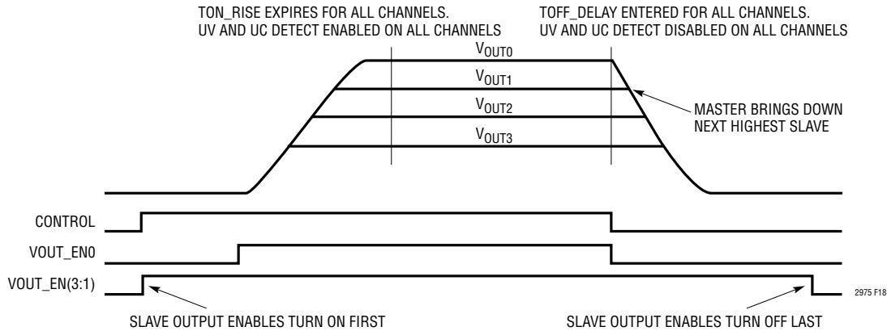

TON\_RISE EXPIRES FOR ALL CHANNELS. UV AND UC DETECT ENABLED ON ALL CHANNELS

TOFF\_DELAY ENTERED FOR ALL CHANNELS. UV AND UC DETECT DISABLED ON ALL CHANNELS

$V_{OUT0}$   
 $V_{OUT1}$   
 $V_{OUT2}$   
 $V_{OUT3}$

MASTER BRINGS DOWN NEXT HIGHEST SLAVE

CONTROL

VOUT\_EN0

VOUT\_EN(3:1)

SLAVE OUTPUT ENABLES TURN ON FIRST

SLAVE OUTPUT ENABLES TURN OFF LAST

2975 F18

Timing diagram for Figure 18 showing supply tracking during power-up and power-down. It includes signals for VOUT0, VOUT1, VOUT2, VOUT3, CONTROL, VOUT\_EN0, and VOUT\_EN(3:1).

**Figure 18. Control Pin Tracking All Supplies Up And Down**

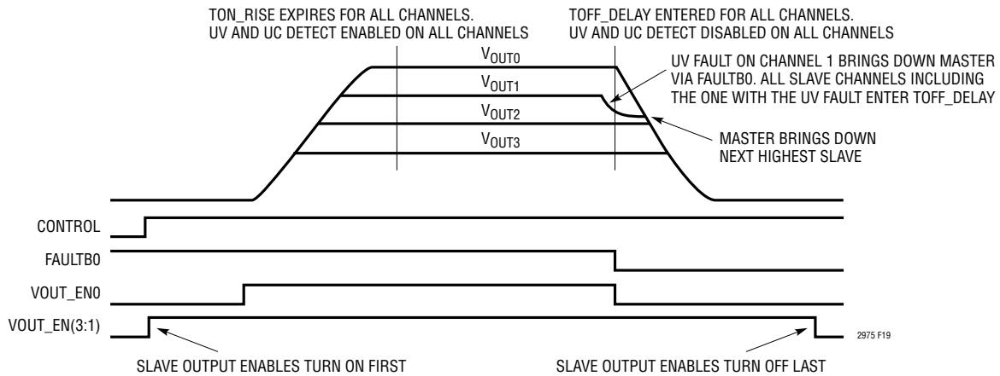

TON\_RISE EXPIRES FOR ALL CHANNELS. UV AND UC DETECT ENABLED ON ALL CHANNELS

TOFF\_DELAY ENTERED FOR ALL CHANNELS. UV AND UC DETECT DISABLED ON ALL CHANNELS

$V_{OUT0}$   
 $V_{OUT1}$   
 $V_{OUT2}$   
 $V_{OUT3}$

UV FAULT ON CHANNEL 1 BRINGS DOWN MASTER VIA FAULTB0. ALL SLAVE CHANNELS INCLUDING THE ONE WITH THE UV FAULT ENTER TOFF\_DELAY

MASTER BRINGS DOWN NEXT HIGHEST SLAVE

CONTROL

FAULTB0

VOUT\_EN0

VOUT\_EN(3:1)

SLAVE OUTPUT ENABLES TURN ON FIRST

SLAVE OUTPUT ENABLES TURN OFF LAST

2975 F19

Timing diagram for Figure 19 showing a UV fault on Channel 1 during power-down. It includes signals for VOUT0, VOUT1, VOUT2, VOUT3, CONTROL, FAULTB0, VOUT\_EN0, and VOUT\_EN(3:1).

**Figure 19. Fault on Channel 1 Tracking All Supplies Down**

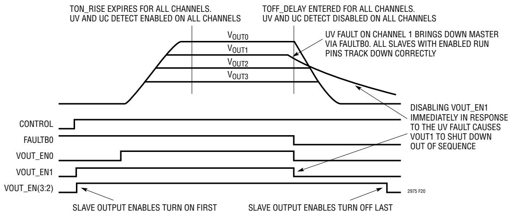

TON\_RISE EXPIRES FOR ALL CHANNELS. UV AND UC DETECT ENABLED ON ALL CHANNELS

TOFF\_DELAY ENTERED FOR ALL CHANNELS. UV AND UC DETECT DISABLED ON ALL CHANNELS

$V_{OUT0}$   
 $V_{OUT1}$   
 $V_{OUT2}$   
 $V_{OUT3}$

UV FAULT ON CHANNEL 1 BRINGS DOWN MASTER VIA FAULTB0. ALL SLAVES WITH ENABLED RUN PINS TRACK DOWN CORRECTLY

DISABLING VOUT\_EN1 IMMEDIATELY IN RESPONSE TO THE UV FAULT CAUSES VOUT1 TO SHUT DOWN OUT OF SEQUENCE

CONTROL

FAULTB0

VOUT\_EN0

VOUT\_EN1

VOUT\_EN(3:2)

SLAVE OUTPUT ENABLES TURN ON FIRST

SLAVE OUTPUT ENABLES TURN OFF LAST

2975 F20

Timing diagram for Figure 20 showing an improperly configured fault response. It includes signals for VOUT0, VOUT1, VOUT2, VOUT3, CONTROL, FAULTB0, VOUT\_EN0, VOUT\_EN1, and VOUT\_EN(3:2).

**Figure 20. Improperly Configured Fault Response on Faulting Channel Disrupts Tracking**

{43}------------------------------------------------

## PMBUS COMMAND DESCRIPTION

#### Tracking Implementation

The LTC2975 supports tracking through the coordinated programing of Ton\_delay, Ton\_rise,Toff\_delay and Mfr\_track\_en\_chan*n*. The master channel must be configured to turn on after all the slave channels have turned on and to turn off before all the slave channels turn off. Slaves that are enabled before the master will remain off until the tracking pin allows them to turn on. Slaves will be turned off via the tracking pin even though their run pin is still asserted. Ton\_rise must be extended on the slaves so that it ends relative to the rise of the TRACK pin and not the rise of the VOUT\_EN pin.

When Mfr\_track\_en\_chan*n* is enabled the channel is reconfigured to:

- Sequence down on fault, VIN\_OFF, SHARE\_CLK low or RESTORE\_USER\_ALL.
- Ignore UV and UC during TOFF\_DELAY. Note that ignoring UV and UC during TON\_RISE and TON\_MAX\_FAULT always happens regardless of how this bit is set.

The following example illustrates configuring an LTC2975 with one master channel and three slaves.

Master channel 0

TON\_DELAY = Ton\_delay\_master

TON\_RISE = Ton\_rise\_master

TOFF\_DELAY = Toff\_delay\_master

Mfr\_track\_en\_chan0 = 0

Slave channel *n*

TON\_DELAY = Ton\_delay\_slave

TON\_RISE = Ton\_delay\_master + Ton\_rise\_slave

TOFF\_DELAY = Toff\_delay\_master + T\_off\_delay\_slave

Mfr\_track\_en\_chan0 = 1

Where:

Ton\_delay\_master – Ton\_delay\_slave > RUN to TRACK setup time

Toff\_delay\_slave > time for master supply to fall.

The system response to a control pin toggle is illustrated in Figure 18.

The system response to a UV fault on a slave channel is illustrated in Figure 19.

#### MFR\_CONFIG\_ALL\_LTC2975

This command is used to configure parameters that are common to all channels on the IC. They may be set or reviewed from any PAGE setting.

{44}------------------------------------------------

## PMBUS COMMAND DESCRIPTION

**MFR\_CONFIG\_ALL\_LTC2975 Data Contents**

| BIT(S)   | SYMBOL                              | OPERATION                                                                                                                                                                                                                                                                                                                                                                                      |
|----------|-------------------------------------|------------------------------------------------------------------------------------------------------------------------------------------------------------------------------------------------------------------------------------------------------------------------------------------------------------------------------------------------------------------------------------------------|
| b[15:12] | Reserved                            | Don't care. Always returns 0.                                                                                                                                                                                                                                                                                                                                                                  |
| b[11]    | Mfr_config_all_pwrgd_off_uses_uv    | Selects PWRGD de-assertion source for all channels. 0: PWRGD is de-asserted based on $V_{OUT}$ being below or equal to POWER_GOOD_OFF. This option uses the ADC. Response time is approximately 100ms to 200ms. 1: PWRGD is de-asserted based on $V_{OUT}$ being below or equal to VOUT_UV_LIMIT. This option uses the high speed supervisor. Response time is approximately 12 $\mu$ s. |
| b[10]    | Reserved                            | Don't care.                                                                                                                                                                                                                                                                                                                                                                                    |
| b[9]     | Mfr_config_all_control3_pol         | Selects active polarity of CONTROL3 pin 0: Active low (pull pin low to start unit). 1: Active high (pull pin high to start unit).                                                                                                                                                                                                                                                        |
| b[8]     | Mfr_config_all_control2_pol         | Selects active polarity of CONTROL2 pin 0: Active low (pull pin low to start unit). 1: Active high (pull pin high to start unit).                                                                                                                                                                                                                                                        |
| b[7]     | Mfr_config_all_fault_log_enable     | Enable fault logging to EEPROM in response to Fault. 0: Fault logging to EEPROM is disabled. 1: Fault logging to EEPROM is enabled.                                                                                                                                                                                                                                                      |
| b[6]     | Mfr_config_all_vin_on_clr_faults_en | Allow VIN_ON rising edge to clear all latched faults. 0: VIN_ON clear faults feature is disabled. 1: VIN_ON clear faults feature is enabled.                                                                                                                                                                                                                                             |
| b[5]     | Mfr_config_all_control1_pol         | Selects active polarity of CONTROL1 pin 0: Active low (pull pin low to start unit). 1: Active high (pull pin high to start unit).                                                                                                                                                                                                                                                        |
| b[4]     | Mfr_config_all_control0_pol         | Selects active polarity of CONTROL0 pin 0: Active low (pull pin low to start unit). 1: Active high (pull pin high to start unit).                                                                                                                                                                                                                                                        |
| b[3]     | Mfr_config_all_vin_share_enable     | Allow this unit to hold Share-clock pin low when $V_{IN}$ has not risen above VIN_ON or has fallen below VIN_OFF. When enabled this unit will also turn all channels off in response to Share-clock being held low. 0: Share-clock inhibit is disabled. 1: Share-clock inhibit is enabled.                                                                                               |
| b[2]     | Mfr_config_all_pec_en               | PMBus packet error checking enable. 0: PEC is accepted but not required. 1: PEC is enabled.                                                                                                                                                                                                                                                                                              |
| b[1]     | Mfr_config_all_longer_pmbus_timeout | Increase PMBus timeout interval by a factor of 8. Recommended for fault logging. 0: PMBus timeout is not multiplied by a factor of 8. 1: PMBus timeout is multiplied by a factor of 8.                                                                                                                                                                                                   |
| b[0]     | Mfr_config_all_auxfaultb_wpu_dis    | AUXFAULTB charge-pumped, current-limited pull-up disable. 0: Use weak current-limited pull-up on AUXFAULTB after power-up, as long as no faults have forced AUXFAULTB off. 1: Disable weak pull-up. AUXFAULTB driver is three-stated after power-up as long as no faults have forced AUXFAULTB off.                                                                                      |

{45}------------------------------------------------

## PMBUS COMMAND DESCRIPTION

### PROGRAMMING USER EEPROM SPACE

| COMMAND NAME     | CMD CODE | DESCRIPTION                                                                                                 | TYPE      | PAGED | DATA FORMAT | UNITS | EEPROM | DEFAULT VALUE | REF PAGE           |
|------------------|----------|-------------------------------------------------------------------------------------------------------------|-----------|-------|-------------|-------|--------|---------------|--------------------|
| STORE_USER_ALL   | 0x15     | Store entire operating memory to EEPROM.                                                                    | Send Byte | N     |             |       |        | NA            | <a href="#">46</a> |
| RESTORE_USER_ALL | 0x16     | Restore entire operating memory from EEPROM.                                                                | Send Byte | N     |             |       |        | NA            | <a href="#">46</a> |
| MFR_EE_UNLOCK    | 0xBD     | Unlock user EEPROM for access by MFR_EE_ERASE and MFR_EE_DATA commands.                                     | R/W Byte  | N     | Reg         |       |        | NA            | <a href="#">47</a> |
| MFR_EE_ERASE     | 0xBE     | Initialize user EEPROM for bulk programming by MFR_EE_DATA.                                                 | R/W Byte  | N     | Reg         |       |        | NA            | <a href="#">47</a> |
| MFR_EE_DATA      | 0xBF     | Data transferred to and from EEPROM using sequential PMBus word reads or writes. Supports bulk programming. | R/W Word  | N     | Reg         |       |        | NA            | <a href="#">47</a> |

#### STORE\_USER\_ALL and RESTORE\_USER\_ALL

STORE\_USER\_ALL, RESTORE\_USER\_ALL commands provide access to User EEPROM space. Once a command is stored in User EEPROM, it will be restored with explicit restore command, when the part emerges from power-on reset after power is applied, or after toggling the Reset pin. While either of these commands is being processed, the part will indicate it is busy, see Response When Part Is Busy on page [48](#).

STORE\_USER\_ALL. Issuing this command will store all operating memory commands with a corresponding EEPROM memory location.

RESTORE\_USER\_ALL. Issuing this command will restore all commands from EEPROM Memory. It is recommended that this command not be executed while a unit is enabled since all monitoring is suspended while the EEPROM is transferred to operating memory, and intermediate values from EEPROM may not be compatible with the values initially stored in operating memory.

#### Bulk Programming the User EEPROM Space

The MFR\_EE\_UNLOCK, MFR\_EE\_ERASE and MFR\_EE\_DATA commands provide a method for 3rd party EEPROM programming houses and end users to easily program the LTC2975 independent of any order dependencies or delays between PMBus commands. All data transfers are directly to and from the EEPROM and do not affect the volatile RAM space currently configuring the device.

The first step is to program a master reference part with the desired configuration. MFR\_EE\_UNLOCK and MFR\_EE\_DATA are then used to read back all the data in User EEPROM space as sequential words. This information is stored to the master programming HEX file. Subsequent parts may be cloned to match the master part using MFR\_EE\_UNLOCK, MFR\_EE\_ERASE and MFR\_EE\_DATA to transfer data from the master HEX file. These commands operate directly on the EEPROM independent of the part configurations stored in RAM space. During EEPROM access the part will indicate that it is busy as described below.

In order to support simple programming fixtures the bulk programming features only uses PMBus word and byte commands. The MFR\_UNLOCK configures the appropriate access mode and resets an internal address pointer allowing a series of word commands to behave as a block read or write with the address pointer being incremented after each operation. PEC use is optional and is configured by the MFR\_EE\_UNLOCK operation.

{46}------------------------------------------------

## PMBUS COMMAND DESCRIPTION

#### MFR\_EE\_UNLOCK

The MFR\_EE\_UNLOCK command prevents accidental EEPROM access in normal operation and configures the required EEPROM bulk programming mode for bulk initialization, sequential writes, or reads. MFR\_EE\_UNLOCK augments the protection provided by write protect. Upon unlocking the part for the required operation, an internal address pointer is reset allowing a series of MFR\_EE\_DATA reads or writes to sequentially transfer data, similar to a block read or block write. The MFR\_EE\_UNLOCK command can clear or set PEC mode based on the desired level of error protection. An MFR\_EE\_UNLOCK sequence consists of writing two or three unlock codes as described below. The following table documents the allowed sequences. Writing a non-supported sequence locks the part. Reading MFR\_EE\_UNLOCK returns the last byte written or zero if the part is locked.

**MFR\_EE\_UNLOCK Data Contents**

| BIT(S) | SYMBOL             | OPERATION                                                                                                                                                                                                                                                                                                                                                                                                                                                                                                                                                                                                                     |
|--------|--------------------|-------------------------------------------------------------------------------------------------------------------------------------------------------------------------------------------------------------------------------------------------------------------------------------------------------------------------------------------------------------------------------------------------------------------------------------------------------------------------------------------------------------------------------------------------------------------------------------------------------------------------------|
| b[7:0] | Mfr_ee_unlock[7:0] | 
To unlock user EEPROM space for Mfr_ee_erase and Mfr_ee_data read or write operations with PEC allowed: Write 0x2b followed by 0xd4.
 
To unlock user EEPROM space for Mfr_ee_erase and Mfr_ee_data read or write operations with PEC required: Write 0x2b followed by 0xd5.
 
To unlock user and manufacturer EEPROM space for Mfr_ee_data read only operations with PEC allowed: Write 0x2b, followed by 0x91 followed by 0xe4.
 
To unlock user and manufacturer EEPROM space for Mfr_ee_data read only operations with PEC required: Write 0x2b, followed by 0x91 followed by 0xe5.
 |

#### MFR\_EE\_ERASE

The MFR\_EE\_ERASE command is used to erase the entire contents of the user EEPROM space and configures this space to accept new program data. Writing values other than 0x2B will lock the part. Reads return the last value written.

**MFR\_EE\_ERASE Data contents**

| BIT(S) | SYMBOL            | OPERATION                                                                                                                                                                                                                                                                                                                                                                |
|--------|-------------------|--------------------------------------------------------------------------------------------------------------------------------------------------------------------------------------------------------------------------------------------------------------------------------------------------------------------------------------------------------------------------|
| b[7:0] | Mfr_ee_erase[7:0] | 
To erase the user EEPROM space and configure to accept new data:
 <ol style="list-style-type: none"> <li>1) Use the appropriate Mfr_ee_unlock sequence to configure for Mfr_ee_erase commands with or without PEC.</li> <li>2) Write 0x2B to Mfr_ee_erase.</li> </ol> 
The part will indicate it is busy erasing the EEPROM by the mechanism detailed below.
 |

#### MFR\_EE\_DATA

The MFR\_EE\_DATA command allows the user to transfer data directly to or from the EEPROM without affecting RAM space.

To read the user EEPROM space issue the appropriate Mfr\_ee\_unlock command and perform Mfr\_ee\_data reads until the EEPROM has been completely read. Extra reads will lock the part and return zero. The first read returns the 16-bit EEPROM packing revision ID that is stored in ROM. The second read returns the number of 16-bit words available; this is the number of reads or writes to access all memory locations. Subsequent reads return EEPROM data starting with lowest address.

To write to the user EEPROM space issue the appropriate Mfr\_ee\_unlock and Mfr\_ee\_erase commands followed by successive Mfr\_ee\_data word writes until the EEPROM is full. Extra writes will lock the part. The first write is to the lowest address.

Mfr\_ee\_data reads and writes must not be mixed.

{47}------------------------------------------------

## PMBUS COMMAND DESCRIPTION

**MFR\_EE\_DATA Data Contents**

| BIT(S)  | SYMBOL            | OPERATION                                                                                                                                                                                                                                                                                                                                                                                                                                                                                                                                                                                                                                                                                                                                                                                                                                                                                                                                           |
|---------|-------------------|-----------------------------------------------------------------------------------------------------------------------------------------------------------------------------------------------------------------------------------------------------------------------------------------------------------------------------------------------------------------------------------------------------------------------------------------------------------------------------------------------------------------------------------------------------------------------------------------------------------------------------------------------------------------------------------------------------------------------------------------------------------------------------------------------------------------------------------------------------------------------------------------------------------------------------------------------------|
| b[15:0] | Mfr_ee_data[15:0] | 
To read user space
 <ol style="list-style-type: none"> <li>1) Use the appropriate Mfr_ee_unlock sequence to configure for Mfr_ee_data commands with or without PEC.</li> <li>2) Read Mfr_ee_data[0] = PackingId (MFR Specific ID).</li> <li>3) Read Mfr_ee_data[1] = NumberOfUserWords (total number of 16-bit word available).</li> <li>4) Read Mfr_ee_data[2] through Mfr_ee_data[NumberOfWord+1] (User EEPROM data contents)</li> </ol> 
To write user space
 <ol style="list-style-type: none"> <li>1) Initialize the user memory using the sequence described for the MFR_EE_ERASE command.</li> <li>2) Use the appropriate Mfr_ee_unlock sequence to configure for Mfr_ee_data commands with or without PEC.</li> <li>3) Write Mfr_ee_data[0] through Mfr_ee_data[NumberOfWord-1] (User EEPROM data content to be written)</li> </ol> 
The part will indicate it is busy erasing the EEPROM by the mechanism detailed below.
 |

#### Response When Part Is Busy

The part will indicate it is busy accessing the EEPROM by:

- 1) Asserting low the Mfr\_common\_busyb of the MFR\_COMMON register. MFR\_COMMON can always be read and will never NACK a byte read request even if the part is busy.
- 2) NACKing commands other than MFR\_COMMON.
- 3) Asserting ALERTB low if any commands other than MFR\_COMMON are issued.

#### MFR\_EE Erase and Write Programming Time

The program time per word is typically 0.17ms and will require spacing the I2C/SMBus writes at greater than 0.17ms to guarantee the write has completed. The Mfr\_ee\_erase command takes approximately 400ms. We recommend using MFR\_COMMON for handshaking.

### INPUT VOLTAGE COMMANDS AND LIMITS

| COMMAND NAME       | CMD CODE | DESCRIPTION                                                                                                                                                         | TYPE     | PAGED | DATA FORMAT | UNITS | EEPROM | DEFAULT VALUE  | REF PAGE |
|--------------------|----------|---------------------------------------------------------------------------------------------------------------------------------------------------------------------|----------|-------|-------------|-------|--------|----------------|----------|
| VIN_ON             | 0x35     | Input voltage above which power conversion can be enabled.                                                                                                          | R/W Word | N     | L11         | V     | Y      | 10.0 0xD280 | 48       |
| VIN_OFF            | 0x36     | Input voltage below which power conversion is disabled. All V OUT_ENn pins go off immediately or sequence off after TOFF_DELAY (See Mfr_track_en_chann). | R/W Word | N     | L11         | V     | Y      | 9.0 0xD240  | 48       |
| VIN_OV_FAULT_LIMIT | 0x55     | Input overvoltage fault limit measured at VIN_SNS pin.                                                                                                              | R/W Word | N     | L11         | V     | Y      | 15.0 0xD3C0 | 48       |
| VIN_OV_WARN_LIMIT  | 0x57     | Input overvoltage warning limit measured at VIN_SNS pin.                                                                                                            | R/W Word | N     | L11         | V     | Y      | 14.0 0xD380 | 48       |
| VIN_UV_WARN_LIMIT  | 0x58     | Input undervoltage warning limit measured at VIN_SNS pin.                                                                                                           | R/W Word | N     | L11         | V     | Y      | 0 0x8000    | 48       |
| VIN_UV_FAULT_LIMIT | 0x59     | Input undervoltage fault limit measured at VIN_SNS pin.                                                                                                             | R/W Word | N     | L11         | V     | Y      | 0 0x8000    | 48       |

#### VIN\_ON, VIN\_OFF, VIN\_OV\_FAULT\_LIMIT, VIN\_OV\_WARN\_LIMIT, VIN\_UV\_WARN\_LIMIT and VIN\_UV\_FAULT\_LIMIT

These commands provide voltage supervising limits for the input voltage VIN\_SNS.

{48}------------------------------------------------

## PMBUS COMMAND DESCRIPTION

### INPUT CURRENT AND ENERGY

| COMMAND NAME        |      | DESCRIPTION                                                               | TYPE      | PAGED | DATA FORMAT | UNITS      | EEPROM | DEFAULT VALUE | REF PAGE        |
|---------------------|------|---------------------------------------------------------------------------|-----------|-------|----------------|------------|--------|------------------|--------------------|
| MFR_EIN             | 0xC0 | Input Energy data bytes.                                                  | R Block   | N     | Reg            |            |        | NA               | <a href="#">49</a> |
| MFR_EIN_CONFIG      | 0xC1 | Configuration register for energy and input current.                      | R/W Byte  | N     | Reg            |            | Y      | 0x00             | <a href="#">50</a> |
| MFR_IIN_CAL_GAIN_TC | 0xC3 | Temperature coefficient applied to IIN_CAL_ GAIN.                         | R/W Word  | N     | CF             | ppm        | Y      | 0x0000           | <a href="#">51</a> |
| MFR_IIN_CAL_GAIN    | 0xE8 | The nominal resistance of the input current sense element in m $\Omega$ . | R/W Word  | N     | L11            | m $\Omega$ | Y      | 1.0 0xBA00    | <a href="#">50</a> |
| MFR_CLEAR_ENERGY    | 0xCC | Clear MFR_EIN time and energy values.                                     | Send Byte | N     |                |            |        | NA               | <a href="#">51</a> |

#### Energy Measurement and Reporting

Input energy measurement and monitoring supports the following:

- Input energy derived from the accumulated product of READ\_VIN and READ\_IIN.
- Reporting input energy value as a 48-bit integer in mJ. Returning value in Joules eliminates the need for the host to manage time.
- Reporting input energy time as a 48-bit integer in ms, where input energy time is the elapsed time since energy monitoring was last reset.
- Resetting time and energy accumulators whenever MFR\_EIN\_CONFIG or MFR\_CLEAR\_ENERGY is written.
- Wrapping of time and energy accumulators when full.
- An optional HD mode allowing the user to give priority to energy measurement by forcing the ADC to measure READ\_VIN and READ\_IIN between every other ADC measurement.
- Reporting energy and time values coherently.
- Ability to decrement energy to prevent rectification and accumulation of noise when the channel is off. Energy is not allowed to decrement below zero.

#### MFR\_EIN

Read only. This 12 byte data block returns the input energy value and time. Once the block read starts, MFR\_EIN updates are suspended until the block read completes. However, energy and time continue to accumulate internally during block reads.

**Table 4. MFR\_EIN Data Block Contents**

| DATA                 | BYTE* | DESCRIPTION                                                                                                                    |
|----------------------|-------|--------------------------------------------------------------------------------------------------------------------------------|
| Energy_value [7:0]   | 0     | Energy Value in mJ. This is the accumulated energy since Mfr_ein_config was last written or MFR_CLEAR_ENERGY was last written. |
| Energy_value [15:8]  | 1     |                                                                                                                                |
| Energy_value [23:16] | 2     |                                                                                                                                |
| Energy_value [31:24] | 3     |                                                                                                                                |
| Energy_value [39:32] | 4     |                                                                                                                                |
| Energy_value [47:40] | 5     |                                                                                                                                |

{49}------------------------------------------------

## PMBUS COMMAND DESCRIPTION

**Table 4. MFR\_EIN Data Block Contents**

| DATA                | BYTE* | DESCRIPTION                                                                                            |
|---------------------|-------|--------------------------------------------------------------------------------------------------------|
| Energy_time [7:0]   | 6     | Energy Time in ms. This is the elapsed time since Mfr_ein_config or MFR_CLEAR_ENERGY was last written. |
| Energy_time [15:8]  | 7     |                                                                                                        |
| Energy_time [23:16] | 8     |                                                                                                        |
| Energy_time [31:24] | 9     |                                                                                                        |
| Energy_time [39:32] | 10    |                                                                                                        |
| Energy_time [47:40] | 11    |                                                                                                        |

#### MFR\_EIN\_CONFIG

This command configures energy and input current related parameters.

**MFR\_EIN\_CONFIG Data Contents**

| BIT(S) | SYMBOL                   | OPERATION                                                                                                                                                                                                                    |
|--------|--------------------------|------------------------------------------------------------------------------------------------------------------------------------------------------------------------------------------------------------------------------|
| b[7:3] | Mfr_ein_config_reserved  | Don't care. Always returns 0.                                                                                                                                                                                                |
| b[2]   | Mfr_ein_config_hd        | Optimize ADC polling sequence for higher definition input energy measurement. 0: Standard ADC polling sequence 1: Read_vin and Read_iin measurements are interleaved between every other ADC measurement.              |
| b[1:0] | Mfr_ein_config_iin_range | Input sense amplifier range setting. 0: High Range 1: Medium Range 2: Low Range 3: Reserved The range sets the Full-Scale Input Voltage Range (FS_IIN). Lower range settings have lower input referred noise. |

#### MFR\_IIN\_CAL\_GAIN

The MFR\_IIN\_CAL\_GAIN command is used to set the ratio of the voltage at the input current sense pins to the sensed current. For devices using a fixed current sense resistor, it is the same value as the resistance of the sense resistor (units are expressed in mΩ). MFR\_IIN\_CAL\_GAIN is internally limited to values between 0.01mΩ to 1,000mΩ. The register readback value always returns what was last written and does not reflect internal limiting.

Calculations using IIN\_CAL\_GAIN are:

$$READ\_IIN = \frac{V_{IIN\_SNSPn} - V_{IIN\_SNSMn}}{(MFR\_IIN\_CAL\_GAIN) \cdot T_{CORRECTION}}$$

where:

$$T_{CORRECTION} = [1 + MFR\_IIN\_CAL\_GAIN\_TC \cdot 1E-6 \cdot (READ\_TEMPERATURE\_2 - 25.0)]$$

Note:

TCORRECTION is limited by hardware to a value between 0.25 and 4.0.

READ\_TEMPERATURE\_2 is the internal die temperature.

Mfr\_ein\_config\_iin\_range[1:0] may be used to minimize noise in systems with low sense resistor values.

{50}------------------------------------------------

## PMBUS COMMAND DESCRIPTION

#### MFR\_IIN\_CAL\_GAIN\_TC

The MFR\_IIN\_CAL\_GAIN\_TC sets the temperature coefficient of the MFR\_IIN\_CAL\_GAIN register value in ppm/°C. This command uses the internal die temperature.

Refer to MFR\_IIN\_CAL\_GAIN for details on proper usage.

**MFR\_IOUT\_CAL\_GAIN\_TC Data Contents**

| BIT(S)  | SYMBOL              | OPERATION                                                                                                                                                                                                                 |
|---------|---------------------|---------------------------------------------------------------------------------------------------------------------------------------------------------------------------------------------------------------------------|
| b[15:0] | Mfr_iin_cal_gain_tc | 16-bit twos complement integer representing the temperature coefficient. Value = Y where Y = b[15:0] is a twos complement number. Example: Mfr_iin_cal_gain_tc = 3900ppm For b[15:0] = 0x0F3C Value = 3900 |

#### MFR\_CLEAR\_ENERGY

This send byte command clears the accumulated energy and time value in MFR\_EIN and can be written even when the LTC2975 is write-protected with level 2 protection. The LTC2975 may internally delay the application of this command by up to tUPDATE\_ADC in order to avoid corrupting an ongoing energy calculation.

### OUTPUT VOLTAGE COMMANDS AND LIMITS

| COMMAND NAME                 | CMD CODE | DESCRIPTION                                                                                                         | TYPE     | PAGED | DATA FORMAT | UNITS | EEPROM | DEFAULT VALUE   | REF PAGE |
|------------------------------|----------|---------------------------------------------------------------------------------------------------------------------|----------|-------|-------------|-------|--------|-----------------|----------|
| VOUT_MODE                    | 0x20     | Output voltage data format and mantissa exponent (2 -13 ).                                               | R Byte   | Y     | Reg         |       |        | 0x13            | 52       |
| VOUT_COMMAND                 | 0x21     | Servo target. Nominal DC/DC converter output voltage setpoint.                                                      | R/W Word | Y     | L16         | V     | Y      | 1.0 0x2000   | 52       |
| VOUT_MAX                     | 0x24     | Upper limit on the output voltage the unit can command regardless of any other commands.                            | R/W Word | Y     | L16         | V     | Y      | 4.0 0x8000   | 52       |
| VOUT_MARGIN_HIGH             | 0x25     | Margin high DC/DC converter output voltage setting.                                                                 | R/W Word | Y     | L16         | V     | Y      | 1.05 0x219A  | 52       |
| VOUT_MARGIN_LOW              | 0x26     | Margin low DC/DC converter output voltage setting.                                                                  | R/W Word | Y     | L16         | V     | Y      | 0.95 0x1E66  | 52       |
| VOUT_OV_FAULT_LIMIT          | 0x40     | Output overvoltage fault limit.                                                                                     | R/W Word | Y     | L16         | V     | Y      | 1.1 0x2333   | 52       |
| VOUT_OV_WARN_LIMIT           | 0x42     | Output overvoltage warning limit.                                                                                   | R/W Word | Y     | L16         | V     | Y      | 1.075 0x2266 | 52       |
| VOUT_UV_WARN_LIMIT           | 0x43     | Output undervoltage warning limit.                                                                                  | R/W Word | Y     | L16         | V     | Y      | 0.925 0x1D9A | 52       |
| VOUT_UV_FAULT_LIMIT          | 0x44     | Output undervoltage fault limit. Used for Ton_max_fault and power good de-assertion.                                | R/W Word | Y     | L16         | V     | Y      | 0.9 0x1CCD   | 52       |
| POWER_GOOD_ON                | 0x5E     | Output voltage at or above which a power good should be asserted.                                                   | R/W Word | Y     | L16         | V     | Y      | 0.96 0x1EB8  | 52       |
| POWER_GOOD_OFF               | 0x5F     | Output voltage at or below which a power good should be de-asserted when Mfr_config_all_pwrgd_off_uses_uv is clear. | R/W Word | Y     | L16         | V     | Y      | 0.94 0x1E14  | 52       |
| MFR_VOUT_DISCHARGE_THRESHOLD | 0xE9     | Coefficient used to multiply VOUT_COMMAND in order to determine V OUT off threshold voltage.             | R/W Word | Y     | L11         |       | Y      | 2.0 0xC200   | 52       |
| MFR_DAC                      | 0xE0     | The code of the 10-bit DAC.                                                                                         | R/W Word | Y     | Reg         |       |        | 0x0000          | 52       |

{51}------------------------------------------------

## PMBUS COMMAND DESCRIPTION

#### VOUT\_MODE

This command is read only and specifies the mode and exponent for all commands with a L16 data format. See Data Formats on page 27.

**VOUT\_MODE Data Contents**

| BIT(S) | SYMBOL              | OPERATION                                                                              |
|--------|---------------------|----------------------------------------------------------------------------------------|
| b[7:5] | Vout_mode_type      | Reports linear mode. Hard-wired to 000b.                                               |
| b[4:0] | Vout_mode_parameter | Linear mode exponent. 5-bit two's complement integer. Hardwired to 0x13 (–13 decimal). |

#### VOUT\_COMMAND, VOUT\_MAX, VOUT\_MARGIN\_HIGH, VOUT\_MARGIN\_LOW, VOUT\_OV\_FAULT\_LIMIT, VOUT\_OV\_WARN\_LIMIT, VOUT\_UV\_WARN\_LIMIT, VOUT\_UV\_FAULT\_LIMIT, POWER\_GOOD\_ON and POWER\_GOOD\_OFF

These commands provide various servo, margining and supervising limits for a channel's output voltage.

#### MFR\_VOUT\_DISCHARGE\_THRESHOLD

This register contains the coefficient that multiplies VOUT\_COMMAND in order to determine the OFF threshold voltage for the associated output. If the output voltage has not decayed below MFR\_VOUT\_DISCHARGE\_THRESHOLD • VOUT\_COMMAND prior to the channel being commanded to enter/re-enter the ON state, the Status\_mfr\_discharge bit in the STATUS\_MFR\_SPECIFIC register will be set and the ALERTB pin will be asserted low. In addition, the channel will not enter the ON state until the output has decayed below its off-threshold voltage. Setting this to a value greater than 1.0 effectively disables DISCHARGE\_THRESHOLD checking, allowing the channel to turn back on even if it has not decayed at all.

Other channels can be held-off if a particular output has failed to discharge by using the bidirectional FAULTBn pins (refer to the MFR\_FAULTBn\_RESPONSE and MFR\_FAULTBn\_PROPOGATE registers).

#### MFR\_DAC

This command register allows the user to directly program the 10-bit DAC. Manual DAC writes require the channel to be in the ON state,TON\_RISE to have expired and MFR\_CONFIG\_LTC2975 b[5:4] = 10b or 11b. Writing MFR\_CONFIG\_LTC2975 b[5:4] = 10b commands the DAC to hard connect with the value in Mfr\_dac\_direct\_val. Writing b[5:4] = 11b commands the DAC to soft connect. Once the DAC has soft connected, Mfr\_dac\_direct\_val returns the value that allowed the DAC to be connected without perturbing the power supply. MFR\_DAC writes are ignored when MFR\_CONFIG\_LTC2975 b[5:4] = 00b or 01b.

**MFR\_DAC Data Contents**

| BIT(S)   | SYMBOL             | OPERATION                    |
|----------|--------------------|------------------------------|
| b[15:10] | Reserved           | Read only, always returns 0. |
| b[9:0]   | Mfr_dac_direct_val | DAC code value.              |

{52}------------------------------------------------

## PMBUS COMMAND DESCRIPTION

### OUTPUT CURRENT COMMANDS AND LIMITS

| COMMAND NAME         | CMD CODE | DESCRIPTION                                                                                     | TYPE     | PAGED | DATA FORMAT | UNITS | EEPROM | DEFAULT VALUE  | REF PAGE |
|----------------------|----------|-------------------------------------------------------------------------------------------------|----------|-------|-------------|-------|--------|----------------|----------|
| IOUT_CAL_GAIN        | 0x38     | The nominal resistance of the current sense element in mΩ.                                      | R/W Word | Y     | L11         | mΩ    | Y      | 1.0 0xBA00  | 53       |
| IOUT_OC_FAULT_LIMIT  | 0x46     | Output overcurrent fault limit.                                                                 | R/W Word | Y     | L11         | A     | Y      | 10.0 0xD280 | 53       |
| IOUT_OC_WARN_LIMIT   | 0x4A     | Output overcurrent warning limit.                                                               | R/W Word | Y     | L11         | A     | Y      | 5.0 0xCA80  | 53       |
| IOUT_UC_FAULT_LIMIT  | 0x4B     | Output undercurrent fault limit. Used to detect a reverse current and must be a negative value. | R/W Word | Y     | L11         | A     | Y      | -1.0 0xB400 | 53       |
| MFR_IOUT_CAL_GAIN_TC | 0xF6     | Temperature coefficient applied to IOUT_CAL_GAIN.                                               | R/W Word | Y     | CF          | ppm   | Y      | 0x0000         | 53       |

#### IOUT\_CAL\_GAIN

The IOUT\_CAL\_GAIN command is used to set the ratio of the voltage at the current sense pins to the sensed current. For devices using a fixed current sense resistor, it is the same value as the resistance of the resistor (units are expressed in mΩ). IOUT\_CAL\_GAIN is internally limited to values between 0.01mΩ to 1,000mΩ. The register readback value always returns what was last written and does not reflect internal limiting.

Calculations using IOUT\_CAL\_GAIN are:

$$V_{\text{IOUT\_OC\_FAULT\_LIMIT}} = \text{IOUT\_OC\_FAULT\_LIMIT} \cdot \text{IOUT\_CAL\_GAIN} \cdot T_{\text{CORRECTION}}$$

$$V_{\text{IOUT\_UC\_FAULT\_LIMIT}} = \text{IOUT\_UC\_FAULT\_LIMIT} \cdot \text{IOUT\_CAL\_GAIN} \cdot T_{\text{CORRECTION}}$$

where:

$$T_{\text{CORRECTION}} = (1 + \text{MFR\_IOUT\_CAL\_GAIN\_TC} \cdot 1\text{E-}6 \cdot (\text{READ\_TEMPERATURE\_1} + \text{MFR\_T\_SELF\_HEAT} - 25.0))$$

$$\text{READ\_IOUT} = \frac{V_{\text{IOUT\_SNSPn}} - V_{\text{IOUT\_SNSMn}}}{(\text{IOUT\_CAL\_GAIN}) \cdot T_{\text{CORRECTION}}}$$

Note:

$T_{\text{CORRECTION}}$  is limited by hardware to a value between 0.25 and 4.0.

READ\_TEMPERATURE\_2 is substituted for READ\_TEMPERATURE\_1 if the associated  $T_{\text{SENSE}}$  network fails to detect a valid temperature. See READ\_TEMPERATURE\_1 for more information.

#### IOUT\_OC\_FAULT\_LIMIT, IOUT\_OC\_WARN\_LIMIT and IOUT\_UC\_FAULT\_LIMIT

IOUT supervisor fault and warning limits.

IOUT\_OC\_FAULT\_LIMIT is internally limited to values greater or equal to zero. The register readback value always returns what was last written and does not reflect internal limiting.

IOUT\_UC\_FAULT\_LIMIT is internally limited to values less than zero. The register readback value always returns what was last written and does not reflect internal limiting.

#### MFR\_IOUT\_CAL\_GAIN\_TC

{53}------------------------------------------------

## PMBUS COMMAND DESCRIPTION

The MFR\_IOUT\_CAL\_GAIN\_TC is a paged command that sets the temperature coefficient of the IOUT\_CAL\_GAIN register value in ppm/°C. This command uses the temperature measured by the external temperature diode for the associated page.

Refer to IOUT\_CAL\_GAIN for details on proper usage.

**MFR\_IOUT\_CAL\_GAIN\_TC Data Contents**

| BIT(S)  | SYMBOL               | OPERATION                                                                                                                                                                                                           |
|---------|----------------------|---------------------------------------------------------------------------------------------------------------------------------------------------------------------------------------------------------------------|
| b[15:0] | Mfr_iout_cal_gain_tc | 16-bit twos complement integer representing the temperature coefficient. Value = Y where Y = b[15:0] is a twos complement. Example: Mfr_iout_cal_gain_tc = 3900ppm For b[15:0] = 0x0F3C Value = 3900 |

### EXTERNAL TEMPERATURE COMMANDS AND LIMITS

| COMMAND NAME              | CMD CODE | DESCRIPTION                                                                                                                         | TYPE     | PAGED | DATA FORMAT | UNITS | EEPROM | DEFAULT VALUE  | REF PAGE |
|---------------------------|----------|-------------------------------------------------------------------------------------------------------------------------------------|----------|-------|-------------|-------|--------|----------------|----------|
| OT_FAULT_LIMIT            | 0x4F     | Overtemperature fault limit for the external temperature sensor.                                                                    | R/W Word | Y     | L11         | °C    | Y      | 65.0 0xEA08 | 55       |
| OT_WARN_LIMIT             | 0x51     | Overtemperature warning limit for the external temperature sensor                                                                   | R/W Word | Y     | L11         | °C    | Y      | 60.0 0xE3C0 | 55       |
| UT_WARN_LIMIT             | 0x52     | Undertemperature warning limit for the external temperature sensor.                                                                 | R/W Word | Y     | L11         | °C    | Y      | 0 0x8000    | 55       |
| UT_FAULT_LIMIT            | 0x53     | Undertemperature fault limit for the external temperature sensor.                                                                   | R/W Word | Y     | L11         | °C    | Y      | -5.0 0xCD80 | 55       |
| MFR_TEMP_1_GAIN           | 0xF8     | Inverse of external diode temperature non ideality factor. One LSB = 2 -14 .                                             | R/W Word | Y     | CF          |       | Y      | 1 0x4000    | 55       |
| MFR_TEMP_1_OFFSET         | 0xF9     | Offset value for the external temperature.                                                                                          | R/W Word | Y     | L11         | °C    | Y      | 0 0x8000    | 55       |
| MFR_T_SELF_HEAT           | 0xB8     | Calculated temperature rise due to self-heating of output current sense device above value measured by external temperature sensor. | R Word   | Y     | L11         | °C    |        | NA             | 55       |
| MFR_IOUT_CAL_GAIN_TAU_INV | 0xB9     | Inverse of time constant for Mfr_t_self_heat changes scaled by 4 • tCONV_SENSE.                                                     | R/W Word | Y     | L11         |       | Y      | 0.0 0x8000  | 55       |
| MFR_IOUT_CAL_GAIN_THETA   | 0xBA     | Thermal resistance from inductor core to point measured by external temperature sensor.                                             | R/W Word | Y     | L11         | °C/W  | Y      | 0.0 0x8000  | 55       |

{54}------------------------------------------------

## PMBUS COMMAND DESCRIPTION

#### OT\_FAULT\_LIMIT, OT\_WARN\_LIMIT, UT\_WARN\_LIMIT and UT\_FAULT\_LIMIT

These commands provide supervising limits for temperature as measured by the external diode.

#### MFR\_TEMP\_1\_GAIN and MFR\_TEMP\_1\_OFFSET

The MFR\_TEMP\_1\_GAIN command specifies the inverse of the temperature sensor ideality factor. The MFR\_TEMP\_1\_OFFSET allows an offset to be applied to the measured temperature.

Calculations using these paged commands are:

$$\text{READ\_TEMPERATURE\_1} = T_{\text{EXT}} \cdot \text{MFR\_TEMP\_1\_GAIN} - 273.15 + \text{MFR\_TEMP\_1\_OFFSET}$$

where:

$T_{\text{EXT}}$  = Measured external temperature in degrees Kelvin.

READ\_TEMPERATURE\_2 is substituted for READ\_TEMPERATURE\_1 if the associated  $T_{\text{SENSE}}$  network fails to detect a valid temperature. Under these conditions MFR\_TEMP\_1\_GAIN and MFR\_TEMP\_1\_OFFSET will have no effect. See READ\_TEMPERATURE\_1 for more information.

**MFR\_TEMP\_1\_GAIN Data Contents**

| BIT(S)  | SYMBOL                | OPERATION                                                                                                                                                                                                                                                 |
|---------|-----------------------|-----------------------------------------------------------------------------------------------------------------------------------------------------------------------------------------------------------------------------------------------------------|
| b[15:0] | Mfr_temp_1_gain[15:0] | 16-bit integer representing inverse of temperature non-ideality factor. Value = $Y \cdot 2^{14}$ where $Y = b[15:0]$ is an unsigned integer. Example: $\text{MFR\_TEMP\_1\_GAIN} = 1.0$ For b[15:0] = 0x4000 Value = $16384 \cdot 2^{-14} = 1.0$ |

#### MFR\_T\_SELF\_HEAT, MFR\_IOUT\_CAL\_GAIN\_TAU\_INV and MFR\_IOUT\_CAL\_GAIN\_THETA

The LTC2975 uses an innovative (patent pending) algorithm to dynamically model the temperature rise from the external temperature sensor to the inductor core. This temperature rise is called MFR\_T\_SELF\_HEAT and is used to calculate the final temperature correction required by IOUT\_CAL\_GAIN. The temperature rise is a function of the power dissipated in the inductor DCR, the thermal resistance from the inductor core to the remote temperature sensor and the thermal time constant of the inductor to board system. The algorithm simplifies the placement requirements for the external temperature sensor and compensates for the significant steady state and transient temperature error from the inductor core to the primary inductor heat sink.

Circuit diagram of the inductor temperature model (description written from the PDF drawing). A current source labeled I = P_I hangs from a supply rail at the top, its arrow pointing down, and drives the top node labeled V_I = T_I (subscript letter I, not 1). A capacitor C = C_τ and a resistor R = θ_IS are connected in parallel between that node and the bottom node labeled V_S = T_S, which is tied to ground.

- $P_I$  = CURRENT REPRESENTING THE POWER DISSIPATED BY THE INDUCTOR ( $V_{\text{DCR}} \cdot \text{READ\_IOUT}$  WHERE  $V_{\text{DCR}} = (V_{\text{ISENSEP}} - V_{\text{ISENSM}})$ )
- $C_\tau$  = CAPACITANCE REPRESENTING THERMAL HEAT CAPACITY OF THE INDUCTOR (INCLUDED IN MFR\_IOUT\_CAL\_GAIN\_TAU\_INV)
- $T_I$  = VOLTAGE REPRESENTING THE TEMPERATURE OF THE INDUCTOR
- $\theta_{\text{IS}}$  = RESISTANCE REPRESENTING THE THERMAL RESISTANCE FROM THE DCR TO THE REMOTE TEMPERATURE SENSOR (MFR\_IOUT\_CAL\_GAIN\_THETA)
- $T_S$  = VOLTAGE REPRESENTING THE TEMPERATURE AT THE REMOTE TEMPERATURE SENSOR

2975 F21

**Figure 21. Electronic Analogy for Inductor Temperature Model**

{55}------------------------------------------------

## PMBUS COMMAND DESCRIPTION

The best way to understand the self-heating effect inside the inductor is to model the system using the circuit analogy of Figure 21. The 1st order differential equation for the above model may be approximated by the following difference equation:

$$P_I - T_I/\theta_{IS} = C_\tau \Delta T_I/\Delta t \text{ (Eq1) (when } T_S = 0\text{)}$$

from which:

$$\Delta T_I = \Delta t (P_I \theta_{IS} - T_I)/(\theta_{IS} C_\tau) \text{ (Eq2) or}$$

$$\Delta T_I = (P_I \theta_{IS} - T_I) \cdot \tau_{INV} \text{ (Eq3)}$$

where

$$\tau_{INV} = \Delta t/(\theta_{IS} C_\tau) \text{ (Eq4)}$$

and  $\Delta t$  is the sample period of the external temperature ADC.

The LTC2975 implements the self-heating algorithm using Eq3 and Eq4 where:

$$\Delta T_I = \Delta MFR\_T\_SELF\_HEAT$$

$$P_I = READ\_IOUT \cdot (V_{ISENSEP} - V_{ISENSEM})$$

$$T_S = READ\_TEMPERATURE\_1$$

$$T_I = MFR\_T\_SELF\_HEAT + T_S$$

$$\Delta t = 4 \cdot t_{CONV\_SENSE}\text{. (One complete external temperature loop period)}$$

$$\tau_{INV} = MFR\_IOUT\_CAL\_GAIN\_TAU\_INV$$

$$\theta_{IS} = MFR\_IOUT\_CAL\_GAIN\_THETA$$

Initially self heat is set to zero. After each temperature measurement self heat is updated to be the previous value of self heat incremented or decremented by  $\Delta MFR\_T\_SELF\_HEAT$ .

The actual value of  $C_\tau$  is not required. The important quantity is the thermal time constant  $\tau_{INV} = (\theta_{IS} C_\tau)$ . For example, if an inductor has a thermal time constant  $\tau_{INV} = 5$  seconds then:

$$MFR\_IOUT\_CAL\_GAIN\_TAU\_INV = (4 \cdot t_{CONV\_SENSE})/5 = 4 \cdot 66\text{ms}/5\text{s} = 0.0528$$

Refer to the application section for more information on calibrating  $\theta_{IS}$  and  $\tau_{INV}$ .

READ\_TEMPERATURE\_2 is substituted for READ\_TEMPERATURE\_1 if the associated  $T_{SENSE}$  network fails to detect a valid temperature. Under these conditions  $T_S = READ\_TEMPERATURE\_2$  and the self-heating correction is applied using the internal die temperature. See READ\_TEMPERATURE\_1 for more information.

**MFR\_T\_SELF\_HEAT Data Content**

| Bit(s)  | Symbol          | Operation                                    |
|---------|-----------------|----------------------------------------------|
| b[15:0] | Mfr_t_self_heat | Values are limited to the range 0°C to 50°C. |

**MFR\_IOUT\_CAL\_GAIN\_THETA Data Content**

| Bit(s)  | Symbol                  | Operation                                    |
|---------|-------------------------|----------------------------------------------|
| b[15:0] | Mfr_iout_cal_gain_theta | Values $\leq 0$ set MFR_T_SELF_HEAT to zero. |

{56}------------------------------------------------

## PMBUS COMMAND DESCRIPTION

**MFR\_IOUT\_CAL\_GAIN\_TAU\_INV Data Content**

| Bit(s)  | Symbol                    | Operation                                                                                                                                                                                             |
|---------|---------------------------|-------------------------------------------------------------------------------------------------------------------------------------------------------------------------------------------------------|
| b[15:0] | Mfr_iout_cal_gain_tau_inv | Values $\leq 0$ set MFR_T_SELF_HEAT to zero. Values $\geq 1$ set MFR_T_SELF_HEAT to $\text{MFR\_IOUT\_CAL\_GAIN\_THETA} \cdot \text{READ\_IOUT} \cdot (V_{\text{ISENSEP}} - V_{\text{ISENSEM}})$ . |

### SEQUENCING TIMING LIMITS AND CLOCK SHARING

| COMMAND NAME        | CMD CODE | DESCRIPTION                                                                                                                                                            | TYPE     | PAGED | DATA FORMAT | UNITS | EEPROM | DEFAULT VALUE  | REF PAGE |
|---------------------|----------|------------------------------------------------------------------------------------------------------------------------------------------------------------------------|----------|-------|-------------|-------|--------|----------------|----------|
| TON_DELAY           | 0x60     | Time from CONTROL pin and/or OPERATION command = ON to $V_{\text{OUT\_ENn}}$ pin = ON.                                                                                 | R/W Word | Y     | L11         | ms    | Y      | 1.0 0xBA00  | 57       |
| TON_RISE            | 0x61     | Time from when the $V_{\text{OUT\_ENn}}$ pin goes high until the LTC2975 optionally soft-connects its DAC and begins to servo the output voltage to the desired value. | R/W Word | Y     | L11         | ms    | Y      | 10.0 0xD280 | 57       |
| TON_MAX_FAULT_LIMIT | 0x62     | Maximum time from $V_{\text{OUT\_ENn}}$ = ON assertion that an UV condition will be tolerated before a TON_MAX_FAULT condition results.                                | R/W Word | Y     | L11         | ms    | Y      | 15.0 0xD3C0 | 57       |
| TOFF_DELAY          | 0x64     | Time from CONTROL pin and/or OPERATION command = OFF to $V_{\text{OUT\_ENn}}$ pin = OFF.                                                                               | R/W Word | Y     | L11         | ms    | Y      | 1.0 0xBA00  | 57       |
| MFR_RESTART_DELAY   | 0xDC     | Delay from actual CONTROL active edge to virtual CONTROL active edge.                                                                                                  | R/W Word | N     | L11         | ms    | Y      | 400 0xFB20  | 58       |

#### TON\_DELAY, TON\_RISE, TON\_MAX\_FAULT\_LIMIT and TOFF\_DELAY

These commands share the same format and provide sequencing and timer fault and warning delays in ms.

TON\_DELAY sets the amount of time in milliseconds that a channel waits following the start of an ON sequence before its  $V_{\text{OUT\_EN}}$  pin enables a DC/DC converter. This delay is counted using SHARE\_CLK only.

TON\_RISE sets the amount of time in ms that elapses after the power supply has been enabled until the LTC2975's DAC soft connects and servos the output voltage to the desired level if Mfr\_dac\_mode = 00b. This delay is counted using SHARE\_CLK only.

TON\_MAX\_FAULT\_LIMIT is the maximum amount of time that the power supply being controlled by the LTC2975 can attempt to power up the output without reaching the VOUT\_UV\_FAULT\_LIMIT. If it does not, then a TON\_MAX\_FAULT is declared. If the output reaches VOUT\_UV\_FAULT\_LIMIT prior to TON\_MAX\_FAULT\_LIMIT, the LTC2975 unmasks the VOUT\_UV\_FAULT\_LIMIT threshold. (Note that a value of zero means there is no limit to how long the power supply can attempt to bring up its output voltage.) This delay is counted using SHARE\_CLK only.

TOFF\_DELAY is the amount of time that elapses after the CONTROL pin and/or OPERATION command is de-asserted until the channel is disabled (soft-off). This delay is counted using SHARE\_CLK if available, otherwise the internal oscillator is used.

All of the above TON and TOFF delays are internally limited to 655ms, and rounded to the nearest 10 $\mu$ s. The read value of these commands always returns what was last written and does not reflect internal limiting.

{57}------------------------------------------------

## PMBUS COMMAND DESCRIPTION

#### MFR\_RESTART\_DELAY

This command essentially sets the off time of a CONTROL pin initiated restart. If the CONTROL pin is toggled off for at least 10μs then on, all dependent channels are disabled, held off for a time = Mfr\_restart\_delay, then sequenced back on. CONTROL pin transitions whose OFF time exceeds Mfr\_restart\_delay are not affected by this command. A value of all zeros disables this feature. This delay is counted using SHARE\_CLK only.

This delay is internally limited to 13.1 seconds, and rounded to the nearest 200μs. The read value of this command always returns what was last written and does not reflect internal limiting.

#### Clock Sharing

Multiple ADI PMBus devices can synchronize their clocks in an application by connecting together the open-drain SHARE\_CLK input/outputs to a pull-up resistor as a wired OR. In this case the fastest clock will take over and synchronize all other chips to its falling edge.

SHARE\_CLK can optionally be used to synchronize ON/OFF dependency on VIN across multiple chips by setting the Mfr\_config\_all\_vin\_share\_enable bit of the MFR\_CONFIG\_ALL register. When configured this way the chip will hold SHARE\_CLK low when the unit is off for insufficient input voltage, and upon detecting that SHARE\_CLK is held low the chip will disable all channels after a brief deglitch period. When the SHARE\_CLK pin is allowed to rise, the chip will respond by beginning a start sequence. In this case the slowest VIN\_ON detection will take over and synchronize other chips to its start sequence.

### WATCHDOG TIMER AND POWER GOOD

| COMMAND NAME                  | CMD CODE | DESCRIPTION                                                                                    | TYPE     | PAGED | DATA FORMAT | UNITS | EEPROM | DEFAULT VALUE | REF PAGE |
|-------------------------------|----------|------------------------------------------------------------------------------------------------|----------|-------|-------------|-------|--------|---------------|----------|
| MFR_PWRGD_EN                  | 0xD4     | Configuration that maps WDI/RESETB status and individual channel power good to the PWRGD pin. | R/W Word | N     | Reg         |       | Y      | 0x0000        | 58       |
| MFR_POWERGOOD_ASSERTION_DELAY | 0xE1     | Power-good output assertion delay.                                                             | R/W Word | N     | L11         | ms    | Y      | 100 0xEB20 | 59       |
| MFR_WATCHDOG_T_FIRST          | 0xE2     | First watchdog timer interval.                                                                 | R/W Word | N     | L11         | ms    | Y      | 0 0x8000   | 59       |
| MFR_WATCHDOG_T                | 0xE3     | Watchdog timer interval.                                                                       | R/W Word | N     | L11         | ms    | Y      | 0 0x8000   | 59       |

#### MFR\_PWRGD\_EN

This command register controls the mapping of the watchdog and channel power good status to the PWRGD pin.

**MFR\_PWRGD\_EN Data Contents**

| BIT(S)  | SYMBOL             | OPERATION                                                                                                                                                                                                                        |
|---------|--------------------|----------------------------------------------------------------------------------------------------------------------------------------------------------------------------------------------------------------------------------|
| b[15:9] | Reserved           | Read only, always returns 0s.                                                                                                                                                                                                    |
| b[8]    | Mfr_pwrgd_en_wdog  | Watchdog. 1 = Watchdog timer not-expired status is ANDed with PWRGD status for any similarly enabled channels to determine when the PWRGD pin gets asserted. 0 = Watchdog timer does not affect the PWRGD pin.             |
| b[7:4]  | Reserved           | Always returns 0000b.                                                                                                                                                                                                            |
| b[3]    | Mfr_pwrgd_en_chan3 | Channel 3. 1 = PWRGD status for this channel is ANDed with PWRGD status for any similarly enabled channels to determine when the PWRGD pin gets asserted. 0 = PWRGD status for this channel does not affect the PWRGD pin. |

{58}------------------------------------------------

## PMBUS COMMAND DESCRIPTION

**MFR\_PWRGD\_EN Data Contents**

| BIT(S) | SYMBOL             | OPERATION                                                                                                                                                                                                                        |
|--------|--------------------|----------------------------------------------------------------------------------------------------------------------------------------------------------------------------------------------------------------------------------|
| b[2]   | Mfr_pwrgd_en_chan2 | Channel 2. 1 = PWRGD status for this channel is ANDed with PWRGD status for any similarly enabled channels to determine when the PWRGD pin gets asserted. 0 = PWRGD status for this channel does not affect the PWRGD pin. |
| b[1]   | Mfr_pwrgd_en_chan1 | Channel 1. 1 = PWRGD status for this channel is ANDed with PWRGD status for any similarly enabled channels to determine when the PWRGD pin gets asserted. 0 = PWRGD status for this channel does not affect the PWRGD pin. |
| b[0]   | Mfr_pwrgd_en_chan0 | Channel 0. 1 = PWRGD status for this channel is ANDed with PWRGD status for any similarly enabled channels to determine when the PWRGD pin gets asserted. 0 = PWRGD status for this channel does not affect the PWRGD pin. |

#### MFR\_POWERGOOD\_ASSERTION\_DELAY

This command register allows the user to program the delay from when the internal power-good signal becomes valid until the power-good output is asserted. This delay is counted using SHARE\_CLK if available, otherwise the internal oscillator is used. This delay is internally limited to 13.1 seconds, and rounded to the nearest 200 $\mu$ s. The read value of this command always returns what was last written and does not reflect internal limiting.

The power good de-assertion delay and threshold source is controlled by Mfr\_config\_all\_pwrgd\_off\_uses\_uv. Systems that require a fast power good de-assertion should set Mfr\_config\_all\_pwrgd\_off\_uses\_uv = 1. This uses the VOUT\_UV\_FAULT\_LIMIT and the high speed comparator to de-assert the PWRGD pin. Systems that require a separate power good off threshold should set Mfr\_config\_all\_pwrgd\_off\_uses\_uv = 0. This uses the slower ADC polling loop and POWER\_GOOD\_OFF to de-assert the PWRGD pin.

#### Watchdog Operation

A non-zero write to the MFR\_WATCHDOG\_T register will reset the watchdog timer. Low-to-high transitions on the WDI/RESETB pin also reset the watchdog timer. If the timer expires, ALERTB is asserted and the PWRGD output is optionally de-asserted and then reasserted after MFR\_PWRGD\_ASSERTION\_DELAY ms. Writing 0 to either the MFR\_WATCH\_DOG\_T or MFR\_WATCHDOG\_T\_FIRST registers will disable the timer.

#### MFR\_WATCHDOG\_T\_FIRST and MFR\_WATCHDOG\_T

The MFR\_WATCHDOG\_T\_FIRST register allows the user to program the duration of the first watchdog timer interval following assertion of the PWRGD pin, assuming the PWRGD pin reflects the status of the watchdog timer. If assertion of PWRGD is not conditioned by the watchdog timer's status, then MFR\_WATCHDOG\_T\_FIRST applies to the first timing interval after the timer is enabled. Writing a value of 0ms to the MFR\_WATCHDOG\_T\_FIRST register disables the watchdog timer. This delay is internally limited to 65 seconds and rounded to the nearest 1ms.

The MFR\_WATCHDOG\_T register allows the user to program watchdog timer intervals subsequent to the MFR\_WATCHDOG\_T\_FIRST timing interval. Writing a value of 0ms to the MFR\_WATCHDOG\_T register disables the watchdog timer. This delay is internally limited to 655ms and rounded to the nearest 10 $\mu$ s.

Both timers operate on an internal clock independent of SHARE\_CLK. The read value of both commands always returns what was last written and does not reflect internal limiting.

{59}------------------------------------------------

## PMBUS COMMAND DESCRIPTION

### FAULT RESPONSES

| COMMAND NAME           | CMD CODE | DESCRIPTION                                                                                                     | TYPE     | PAGED | DATA FORMAT | UNITS | EEPROM | DEFAULT VALUE | REF PAGE |
|------------------------|----------|-----------------------------------------------------------------------------------------------------------------|----------|-------|-------------|-------|--------|---------------|----------|
| VOUT_OV_FAULT_RESPONSE | 0x41     | Action to be taken by the device when an output overvoltage fault is detected.                                  | R/W Byte | Y     | Reg         |       | Y      | 0x80          | 60       |
| VOUT_UV_FAULT_RESPONSE | 0x45     | Action to be taken by the device when an output undervoltage fault is detected.                                 | R/W Byte | Y     | Reg         |       | Y      | 0x7F          | 60       |
| IOUT_OC_FAULT_RESPONSE | 0x47     | Action to be taken by the device when an output overcurrent fault is detected.                                  | R/W Byte | Y     | Reg         |       | Y      | 0x00          | 61       |
| IOUT_UC_FAULT_RESPONSE | 0x4C     | Action to be taken by the device when an output undercurrent fault is detected.                                 | R/W Byte | Y     | Reg         |       | Y      | 0x00          | 61       |
| OT_FAULT_RESPONSE      | 0x50     | Action to be taken by the device when an overtemperature fault is detected on the external temperature sensor.  | R/W Byte | Y     | Reg         |       | Y      | 0xB8          | 62       |
| UT_FAULT_RESPONSE      | 0x54     | Action to be taken by the device when an undertemperature fault is detected on the external temperature sensor. | R/W Byte | Y     | Reg         |       | Y      | 0xB8          | 62       |
| VIN_OV_FAULT_RESPONSE  | 0x56     | Action to be taken by the device when an input overvoltage fault is detected.                                   | R/W Byte | N     | Reg         |       | Y      | 0x80          | 62       |
| VIN_UV_FAULT_RESPONSE  | 0x5A     | Action to be taken by the device when an input undervoltage fault is detected.                                  | R/W Byte | N     | Reg         |       | Y      | 0x00          | 62       |
| TON_MAX_FAULT_RESPONSE | 0x63     | Action to be taken by the device when a TON_MAX_FAULT event is detected.                                        | R/W Byte | Y     | Reg         |       | Y      | 0xB8          | 63       |
| MFR_RETRY_DELAY        | 0xDB     | Retry interval during FAULT retry mode.                                                                         | R/W Word | N     | L11         | ms    | Y      | 200 0xF320 | 63       |
| MFR_RETRY_COUNT        | 0xF7     | Retry count for all faulted off conditions that enable retry.                                                   | R/W Byte | N     | Reg         |       | Y      | 0x07          | 63       |

#### Clearing Latched Faults

Latched faults are reset by toggling the CONTROL pin, using the OPERATION command, or removing and reapplying the bias voltage to the  $V_{IN\_SNS}$  pin. All fault and warning conditions result in the ALERTB pin being asserted low and the corresponding bits being set in the status registers. The CLEAR\_FAULTS command resets the contents of the status registers and de-asserts the ALERTB output. The CLEAR\_FAULTS does not clear a faulted off state nor allow a channel to turn back on.

#### VOUT\_OV\_FAULT\_RESPONSE and VOUT\_UV\_FAULT\_RESPONSE

The fault response documented here is for voltages that are measured by the high speed supervisor. These voltages are measured over a short period of time and may require a deglitch period. Note that in addition to the response described by these commands, the LTC2975 will also:

- Set the appropriate bit(s) in the STATUS\_BYTE.
- Set the appropriate bit(s) in the STATUS\_WORD.
- Set the appropriate bit in the corresponding STATUS\_VOUT register, and
- Notify the host by pulling the ALERTB pin low.

{60}------------------------------------------------

## PMBUS COMMAND DESCRIPTION

**VOUT\_OV\_FAULT\_RESPONSE and VOUT\_UV\_FAULT\_RESPONSE Data Contents**

| BIT(S) | SYMBOL                                                          | OPERATION                                                                                                                                                                                                                                                                                                                                                                                                                                                                                                                                                                                                                                                                       |
|--------|-----------------------------------------------------------------|---------------------------------------------------------------------------------------------------------------------------------------------------------------------------------------------------------------------------------------------------------------------------------------------------------------------------------------------------------------------------------------------------------------------------------------------------------------------------------------------------------------------------------------------------------------------------------------------------------------------------------------------------------------------------------|
| b[7:6] | Vout_ov_fault_response_action, Vout_uv_fault_response_action | Response action: 00b: The unit continues operation without interruption. 01b: The unit continues operating for the delay time specified by bits[2:0] in increments of $t_{S\_VS}$ . See Electrical Characteristics Table. If the fault is still present at the end of the delay time, the unit shuts down immediately or sequences off after TOFF_DELAY (See Mfr_track_en_chann). After shutting down, the device responds according to the retry settings in bits [5:3]. 10b-11b: The unit shuts down immediately or sequences off after TOFF_DELAY (See Mfr_track_en_chann). After shutting down, the device responds according to the retry settings in bits [5:3]. |
| b[5:3] | Vout_ov_fault_response_retry, Vout_uv_fault_response_retry   | Response retry behavior: 000b: A zero value for the retry setting means that the unit does not attempt to restart. The output remains disabled until the fault is cleared. 001b-111b: The PMBus device attempts to restart the number of times specified by the global Mfr_retry_count[2:0] until it is commanded OFF (by the CONTROL pin or OPERATION command or both), bias power is removed, or another fault condition causes the unit to shut down. Changing the value might not take effect until the next off-then-on sequence on that channel.                                                                                                                 |
| b[2:0] | Vout_ov_fault_response_delay, Vout_uv_fault_response_delay   | This sample count determines the amount of time a unit is to ignore a fault after it is first detected. Use this delay to deglitch fast faults. 000b: There is no additional deglitch delay applied to fault detection. 001b-111b: The fault is deglitched for deglitch period of b[2:0] samples at a sampling period of tS_VS (12.2 $\mu$ s typical).                                                                                                                                                                                                                                                                                                              |

#### IOUT\_OC\_FAULT\_RESPONSE and IOUT\_UC\_FAULT\_RESPONSE

The fault response documented here is for currents that are measured by the high speed supervisor. These currents are measured over a short period of time and may require a deglitch period. Note that in addition to the response described by these commands, the LTC2975 will also:

- Set the appropriate bit in the STATUS\_BYTE.
- Set the appropriate bit in the STATUS\_WORD.
- Set the appropriate bit in the corresponding STATUS\_IOUT register, and
- Notify the host by pulling the ALERTB pin low.

**IOUT\_OC\_FAULT\_RESONSE and IOUT\_UC\_FAULT\_RESPONSE Data Contents**

| BIT(S) | SYMBOL                                                          | OPERATION                                                                                                                                                                                                                                                                                                                                                                                                                                                                                                                                                                                                                                                                                                                                                                                                                    |
|--------|-----------------------------------------------------------------|------------------------------------------------------------------------------------------------------------------------------------------------------------------------------------------------------------------------------------------------------------------------------------------------------------------------------------------------------------------------------------------------------------------------------------------------------------------------------------------------------------------------------------------------------------------------------------------------------------------------------------------------------------------------------------------------------------------------------------------------------------------------------------------------------------------------------|
| b[7:6] | Iout_oc_fault_response_action, Iout_uc_fault_response_action | Response action: 00b and 01b: The unit continues operation without interruption. Note that the current will not be limited to the value of Iout_oc_fault_limit or Iout_uc_fault_limit. 10b: The unit continues operating for the delay time specified by bits [2:0]. If the fault is still present at the end of the delay time, the unit shuts down immediately or sequences off after TOFF_DELAY (See Mfr_track_en_chann). After shutting down, the device responds according to the retry settings in bits [5:3]. Note that the current will not be limited to the value of Iout_oc_fault_limit or Iout_uc_fault_limit. 11b: The unit shuts down immediately or sequences off after TOFF_DELAY (See Mfr_track_en_chann). After shutting down, the device responds according to the retry settings in bits [5:3]. |

{61}------------------------------------------------

## PMBUS COMMAND DESCRIPTION

**IOUT\_OC\_FAULT\_RESONSE and IOUT\_UC\_FAULT\_RESPONSE Data Contents**

| BIT(S) | SYMBOL                                                        | OPERATION                                                                                                                                                                                                                                                                                                                                                                                                                                                                                                                                                                                                                                                                                    |
|--------|---------------------------------------------------------------|----------------------------------------------------------------------------------------------------------------------------------------------------------------------------------------------------------------------------------------------------------------------------------------------------------------------------------------------------------------------------------------------------------------------------------------------------------------------------------------------------------------------------------------------------------------------------------------------------------------------------------------------------------------------------------------------|
| b[5:3] | Iout_oc_fault_response_retry, Iout_uc_fault_response_retry | Response retry behavior:  000b: A zero value for the retry setting means that the unit does not attempt to restart. The output remains disabled until the fault is cleared.  001-111b: The PMBus device attempts to restart the number of times specified by the global Mfr_retry_count[2:0] until it is commanded off (by the control pin or operation command or both), bias power is removed, or another fault condition causes the unit to shut down.  Changing the value might not take effect until the next off-then-on sequence on that channel.                                                                                                                   |
| b[2:0] | Iout_oc_fault_response_delay, Iout_uc_fault_response_delay | This sample count determines the amount of time a unit is to ignore a fault after it is first detected. Use this delay to deglitch fast faults.  000b: There is no additional deglitch delay applied to fault detection.  001b-111b: The fault is deglitched for the interval selected by b[2:0] as follows. <table data-bbox="511 718 821 982"> <tr> <th>b[2:0]</th><th>Deglitch interval</th></tr> <tr> <td>001b</td><td>100μs</td></tr> <tr> <td>010b</td><td>1ms</td></tr> <tr> <td>011b</td><td>5ms</td></tr> <tr> <td>100b</td><td>10ms</td></tr> <tr> <td>101b</td><td>20ms</td></tr> <tr> <td>110b</td><td>50ms</td></tr> <tr> <td>111b</td><td>100ms</td></tr> </table> |

#### OT\_FAULT\_RESPONSE, UT\_FAULT\_RESPONSE, VIN\_OV\_FAULT\_RESPONSE and VIN\_UV\_FAULT\_RESPONSE

The fault response documented here is for values that are measured by the ADC. Note that in addition to the response described by these commands, the LTC2975 will also:

- Set the appropriate bit(s) in the STATUS\_BYTE.
- Set the appropriate bit(s) in the STATUS\_WORD.
- Set the appropriate bit in the corresponding STATUS\_VIN or STATUS\_TEMPERATURE register, and
- Notify the host by pulling the ALERTB pin low.

**OT\_FAULT\_RESPONSE, UT\_FAULT\_RESPONSE, VIN\_OV\_FAULT\_RESPONSE, VIN\_UV\_FAULT\_RESPONSE Data Contents**

| BIT(S) | SYMBOL                                                                                                                  | OPERATION                                                                                                                                                                                                                                                                                                                                                                                                                                                                                                                                                                   |
|--------|-------------------------------------------------------------------------------------------------------------------------|-----------------------------------------------------------------------------------------------------------------------------------------------------------------------------------------------------------------------------------------------------------------------------------------------------------------------------------------------------------------------------------------------------------------------------------------------------------------------------------------------------------------------------------------------------------------------------|
| b[7:6] | Ot_fault_response_action, Ut_fault_response_action, Vin_ov_fault_response_action, Vin_uv_fault_response_action | Response action:  00b: The unit continues operation without interruption.  01b-11b: The unit shuts down immediately or sequences off after TOFF_DELAY (See Mfr_track_en_chann). After shutting down, the device responds according to the retry settings in bits [5:3].                                                                                                                                                                                                                                                                                         |
| b[5:3] | Ot_fault_response_retry, Ut_fault_response_retry, Vin_ov_fault_response_retry, Vin_uv_fault_response_retry     | Response retry behavior:  000b: A zero value for the retry setting means that the unit does not attempt to restart. The output remains disabled until the fault is cleared.  001b-111b: The PMBus device attempts to restart the number of times specified by the global Mfr_retry_count[2:0] until it is commanded OFF (by the CONTROL pin or OPERATION command or both), bias power is removed, or another fault condition causes the unit to shut down.  Changing the value might not take effect until the next off-then-on sequence on that channel. |
| b[2:0] | Ot_fault_response_delay, Ut_fault_response_delay, Vin_ov_fault_response_delay, Vin_uv_fault_response_delay     | Hard coded to 000b: There is no additional deglitch delay applied to fault detection.                                                                                                                                                                                                                                                                                                                                                                                                                                                                                       |

{62}------------------------------------------------

## PMBUS COMMAND DESCRIPTION

#### TON\_MAX\_FAULT\_RESPONSE

This command defines the LTC2975 response to a TON\_MAX\_FAULT. It may be used to protect against a short-circuited output at startup. After startup use VOUT\_UV\_FAULT\_RESPONSE to protect against a short-circuited output.

The device also:

- Sets the HIGH\_BYTE bit in the STATUS\_BYTE,
- Sets the VOUT bit in the STATUS\_WORD,
- Sets the TON\_MAX\_FAULT bit in the STATUS\_VOUT register, and
- Notifies the host by asserting ALERTB.

**TON\_MAX\_FAULT\_RESPONSE Data Contents**

| BIT(S) | SYMBOL                        | OPERATION                                                                                                                                                                                                                                                                                                                                                                                                                                                                                                                                                       |
|--------|-------------------------------|-----------------------------------------------------------------------------------------------------------------------------------------------------------------------------------------------------------------------------------------------------------------------------------------------------------------------------------------------------------------------------------------------------------------------------------------------------------------------------------------------------------------------------------------------------------------|
| b[7:6] | Ton_max_fault_response_action | Response action: 00b: The unit continues operation without interruption. 01b-11b: The unit shuts down immediately or sequences off after TOFF_DELAY (See Mfr_track_en_chann). After shutting down, the device responds according to the retry settings in bits [5:3].                                                                                                                                                                                                                                                                                     |
| b[5:3] | Ton_max_fault_response_retry  | Response retry behavior: 000b: A zero value for the retry setting means that the unit does not attempt to restart. The output remains disabled until the fault is cleared. 001b-111b: The PMBus device attempts to restart the number of times specified by the global Mfr_retry_count[2:0] until it is commanded OFF (by the CONTROL pin or OPERATION command or both), bias power is removed, or another fault condition causes the unit to shut down. Changing the value might not take effect until the next off-then-on sequence on that channel. |
| b[2:0] | Ton_max_fault_response_delay  | Hard coded to 000b: There is no additional deglitch delay applied to fault detection.                                                                                                                                                                                                                                                                                                                                                                                                                                                                           |

#### MFR\_RETRY\_DELAY

This command determines the retry interval when the LTC2975 is in retry mode in response to a fault condition. This delay is counted using SHARE\_CLK only. This delay is internally limited to 13.1 seconds, and rounded to the nearest 200μs. The read value of this command always returns what was last written and does not reflect internal limiting.

#### MFR\_RETRY\_COUNT

The MFR\_RETRY\_COUNT is a global command that sets the number of retries attempted when any channel faults off with its fault response retry field set to a non zero value.

In the event of multiple or recurring retry faults on the same channel the total number of retries equals MFR\_RETRY\_COUNT. If a channel has not been faulted off for at least 16 seconds, its retry counter is cleared. Toggling a channel's CONTROL pin off then on or issuing OPERATION off then on commands will synchronously clear the retry count.

**MFR\_RETRY\_COUNT Data Contents**

| BIT(S) | SYMBOL                | OPERATION                                                                                                                                                          |
|--------|-----------------------|--------------------------------------------------------------------------------------------------------------------------------------------------------------------|
| b[7:3] | Reserved              | Always returns zero.                                                                                                                                               |
| b[2:0] | Mfr_retry_count [2:0] | 0: No retries: 1-6: Number of retries. 7: Infinite retries. Changing the value might not take effect until the next off-then-on sequence on that channel. |

{63}------------------------------------------------

## PMBUS COMMAND DESCRIPTION

### SHARED EXTERNAL FAULTS

| COMMAND NAME          | CMD CODE | DESCRIPTION                                                                                      | TYPE     | PAGED | DATA FORMAT | UNITS | EEPROM | DEFAULT VALUE | REF PAGE |
|-----------------------|----------|--------------------------------------------------------------------------------------------------|----------|-------|-------------|-------|--------|---------------|----------|
| MFR_FAULTB0_PROPAGATE | 0xD2     | Configuration that determines if a channel's faulted off state is propagated to the FAULTB0 pin. | R/W Byte | Y     | Reg         |       | Y      | 0x00          | 64       |
| MFR_FAULTB1_PROPAGATE | 0xD3     | Configuration that determines if a channel's faulted off state is propagated to the FAULTB1 pin. | R/W Byte | Y     | Reg         |       | Y      | 0x00          | 64       |
| MFR_FAULTB0_RESPONSE  | 0xD5     | Action to be taken by the device when the FAULTB0 pin is asserted low.                           | R/W Byte | N     | Reg         |       | Y      | 0x00          | 64       |
| MFR_FAULTB1_RESPONSE  | 0xD6     | Action to be taken by the device when the FAULTB1 pin is asserted low.                           | R/W Byte | N     | Reg         |       | Y      | 0x00          | 64       |

#### MFR\_FAULTB0\_PROPAGATE and MFR\_FAULTB1\_PROPAGATE

These manufacturer specific commands enable channels that have faulted off to propagate that state to the appropriate fault pin. MFR\_FAULTB0\_PROPAGATE allows any channel's faulted off state to propagate to the FAULTB0 pin. MFR\_FAULTB1\_PROPAGATE allows any channel's faulted off state to propagate to the FAULTB1 pin.

Note that pulling a fault pin low will have no effect for channels that have MFR\_FAULTBn\_RESPONSE set to 0. The channel continues operation without interruption. This fault response is called Ignore (0x0) in LTpowerPlay.

**MFR\_FAULT0\_PROPAGATE Data Contents**

| BIT(S) | SYMBOL                | OPERATION                                                                                                                                       |
|--------|-----------------------|-------------------------------------------------------------------------------------------------------------------------------------------------|
| b[7:1] | Reserved              | Don't care. Always returns 0.                                                                                                                   |
| b[0]   | Mfr_faultb0_propagate | Enable fault propagation. 0: Channel's faulted off state does not assert FAULTB0 low. 1 :Channel's faulted off state asserts FAULTB0 low. |

**MFR\_FAULT1\_PROPAGATE Data Contents**

| BIT(S) | SYMBOL                | OPERATION                                                                                                                                       |
|--------|-----------------------|-------------------------------------------------------------------------------------------------------------------------------------------------|
| b[7:1] | Reserved              | Don't care. Always returns 0.                                                                                                                   |
| b[0]   | Mfr_faultb1_propagate | Enable fault propagation. 0: Channel's faulted off state does not assert FAULTB1 low. 1: Channel's faulted off state asserts FAULTB1 low. |

#### MFR\_FAULTB0\_RESPONSE and MFR\_FAULTB1\_RESPONSE

These manufacturer specific commands share the same format and specify the response to assertions of the FAULTB pins. MFR\_FAULTB0\_RESPONSE determines which channels shut off when the FAULTB0 pin is asserted low and MFR\_FAULTB1\_RESPONSE determines which channels shut off when the FAULTB1 pin is asserted low. When a channel shuts off in response to a FAULTBn pin, the ALERTB pin is asserted low and the appropriate bit is set in the STATUS\_MFR\_SPECIFIC register. For a graphical explanation, see the switches on the left hand side of Figure 32: Channel Fault Management Block Diagram.

Faults will not propagate for channels that have MFR\_FAULTBn\_RESPONSE set to 0: The channel continues operation without interruption. Note that this fault response is called No Action in LTpowerPlay.

{64}------------------------------------------------

## PMBUS COMMAND DESCRIPTION

**MFR\_FAULTB0\_RESPONSE and MFR\_FAULTB1\_RESPONSE Data Contents**

| BIT(S) | SYMBOL                                                    | OPERATION                                                                                                                                                                                                                                                                                         |
|--------|-----------------------------------------------------------|---------------------------------------------------------------------------------------------------------------------------------------------------------------------------------------------------------------------------------------------------------------------------------------------------|
| b[7:4] | Reserved                                                  | Read only, always returns 0000b.                                                                                                                                                                                                                                                                  |
| b[3]   | Mfr_faultb0_response_chan3, Mfr_faultb1_response_chan3 | Channel 3 response. 0: The channel continues operation without interruption 1: The channel shuts down if the corresponding FAULTB pin is still asserted after 10 $\mu$ s. When the FAULTB pin subsequently de-asserts, the channel turns back on, honoring TON_DELAY and TON_RISE settings. |
| b[2]   | Mfr_faultb0_response_chan2, Mfr_faultb1_response_chan2 | Channel 2 response. 0: The channel continues operation without interruption 1: The channel shuts down if the corresponding FAULTB pin is still asserted after 10 $\mu$ s. When the FAULTB pin subsequently de-asserts, the channel turns back on, honoring TON_DELAY and TON_RISE settings. |
| b[1]   | Mfr_faultb0_response_chan1, Mfr_faultb1_response_chan1 | Channel 1 response. 0: The channel continues operation without interruption 1: The channel shuts down if the corresponding FAULTB pin is still asserted after 10 $\mu$ s. When the FAULTB pin subsequently de-asserts, the channel turns back on, honoring TON_DELAY and TON_RISE settings. |
| b[0]   | Mfr_faultb0_response_chan0, Mfr_faultb1_response_chan0 | Channel 0 response. 0: The channel continues operation without interruption 1: The channel shuts down if the corresponding FAULTB pin is still asserted after 10 $\mu$ s. When the FAULTB pin subsequently de-asserts, the channel turns back on, honoring TON_DELAY and TON_RISE settings. |

### FAULT WARNING AND STATUS

| COMMAND NAME        | CMD CODE | DESCRIPTION                                                           | TYPE      | PAGED | DATA FORMAT | UNITS | EEPROM | DEFAULT VALUE | REF PAGE           |
|---------------------|----------|-----------------------------------------------------------------------|-----------|-------|-------------|-------|--------|---------------|--------------------|
| CLEAR_FAULTS        | 0x03     | Clear any fault bits that have been set.                              | Send Byte | Y     |             |       |        | NA            | <a href="#">65</a> |
| STATUS_BYTE         | 0x78     | One byte summary of the unit's fault condition.                       | R Byte    | Y     | Reg         |       |        | NA            | <a href="#">66</a> |
| STATUS_WORD         | 0x79     | Two byte summary of the unit's fault condition.                       | R Word    | Y     | Reg         |       |        | NA            | <a href="#">66</a> |
| STATUS_VOUT         | 0x7A     | Output voltage fault and warning status.                              | R Byte    | Y     | Reg         |       |        | NA            | <a href="#">67</a> |
| STATUS_IOUT         | 0x7B     | Output current fault and warning status.                              | R Byte    | Y     | Reg         |       |        | NA            | <a href="#">67</a> |
| STATUS_INPUT        | 0x7C     | Input supply fault and warning status.                                | R Byte    | N     | Reg         |       |        | NA            | <a href="#">67</a> |
| STATUS_TEMPERATURE  | 0x7D     | External temperature fault and warning status for READ_TEMPERATURE_1. | R Byte    | Y     | Reg         |       |        | NA            | <a href="#">68</a> |
| STATUS_CML          | 0x7E     | Communication and memory fault and warning status.                    | R Byte    | N     | Reg         |       |        | NA            | <a href="#">68</a> |
| STATUS_MFR_SPECIFIC | 0x80     | Manufacturer specific fault and state information.                    | R Byte    | Y     | Reg         |       |        | NA            | <a href="#">68</a> |
| MFR_PADS            | 0xE5     | Current state of selected digital I/O pads.                           | R Word    | N     | Reg         |       |        | NA            | <a href="#">69</a> |
| MFR_COMMON          | 0xEF     | Manufacturer status bits that are common across multiple ADI chips.   | R Byte    | N     | Reg         |       |        | NA            | <a href="#">70</a> |

#### CLEAR\_FAULTS

The CLEAR\_FAULTS command is used to clear status bits that have been set. This command clears all fault and warning bits in all unpaged status registers, and paged status registers selected by the current PAGE setting. At the same time, the device negates (clears, releases) its contribution to ALERTB.

The CLEAR\_FAULTS command does not cause a unit that has latched off for a fault condition to restart. See Clearing Latched Faults for more information.

If the fault is present after the fault is cleared, the fault status bit will be set again and the host notified by the usual means.

Note: this command responds to the global page command. (PAGE=0xFF)

{65}------------------------------------------------

## PMBUS COMMAND DESCRIPTION

#### STATUS\_BYTE

The STATUS\_BYTE command returns the summary of the most critical faults or warnings which have occurred, as shown in the following table. STATUS\_BYTE is a subset of STATUS\_WORD and duplicates the same information.

**STATUS\_BYTE Data Contents**

| BIT(S) | SYMBOL                | OPERATION                      |
|--------|-----------------------|--------------------------------|
| b[7]   | Status_byte_busy      | Same as Status_word_busy.      |
| b[6]   | Status_byte_off       | Same as Status_word_off.       |
| b[5]   | Status_byte_vout_ov   | Same as Status_word_vout_ov.   |
| b[4]   | Status_byte_iout_oc   | Same as Status_word_iout_oc.   |
| b[3]   | Status_byte_vin_uv    | Same as Status_word_vin_uv.    |
| b[2]   | Status_byte_temp      | Same as Status_word_temp.      |
| b[1]   | Status_byte_cml       | Same as Status_word_cml.       |
| b[0]   | Status_byte_high_byte | Same as Status_word_high_byte. |

#### STATUS\_WORD

The STATUS\_WORD command returns two bytes of information with a summary of the unit's fault condition. Based on the information in these bytes, the host can get more information by reading the appropriate detailed status register.

The low byte of the STATUS\_WORD is the same register as the STATUS\_BYTE command.

**STATUS\_WORD Data Contents**

| BIT(S) | SYMBOL                     | OPERATION                                                                                                                                                                                                    |
|--------|----------------------------|--------------------------------------------------------------------------------------------------------------------------------------------------------------------------------------------------------------|
| b[15]  | Status_word_vout           | An output voltage fault or warning has occurred. See STATUS_VOUT.                                                                                                                                            |
| b[14]  | Status_word_iout           | An output current fault or warning has occurred. See STATUS_IOUT.                                                                                                                                            |
| b[13]  | Status_word_input          | An input voltage fault or warning has occurred. See STATUS_INPUT.                                                                                                                                            |
| b[12]  | Status_word_mfr            | A manufacturer specific fault has occurred. See STATUS_MFR._SPECIFIC.                                                                                                                                        |
| b[11]  | Status_word_power_not_good | The PWRGD pin, if enabled, is negated. Power is not good.                                                                                                                                                    |
| b[10]  | Status_word_fans           | Not supported. Always returns 0.                                                                                                                                                                             |
| b[9]   | Status_word_other          | Not supported. Always returns 0.                                                                                                                                                                             |
| b[8]   | Status_word_unknown        | Not supported. Always returns 0.                                                                                                                                                                             |
| b[7]   | Status_word_busy           | Device busy when PMBus command received. See OPERATION: Processing Commands.                                                                                                                                 |
| b[6]   | Status_word_off            | This bit is asserted if the unit is not providing power to the output, regardless of the reason, including simply not being enabled. The off-bit is clear if unit is allowed to provide power to the output. |
| b[5]   | Status_word_vout_ov        | An output overvoltage fault has occurred.                                                                                                                                                                    |
| b[4]   | Status_word_iout_oc        | An output overcurrent fault has occurred.                                                                                                                                                                    |
| b[3]   | Status_word_vin_uv         | A V IN undervoltage fault has occurred.                                                                                                                                                           |
| b[2]   | Status_word_temp           | A temperature fault or warning has occurred. See STATUS_TEMPERATURE.                                                                                                                                         |
| b[1]   | Status_word_cml            | A communication, memory or logic fault has occurred. See STATUS_CML.                                                                                                                                         |
| b[0]   | Status_word_high_byte      | A fault/warning not listed in b[7:1] has occurred or Status_word_power_not_good = 1.                                                                                                                         |

{66}------------------------------------------------

## PMBUS COMMAND DESCRIPTION

#### STATUS\_VOUT

The STATUS\_VOUT command returns the summary of the output voltage faults or warnings which have occurred, as shown in the following table:

**STATUS\_VOUT Data Contents**

| BIT(S) | SYMBOL                     | OPERATION                                                                                                                    |
|--------|----------------------------|------------------------------------------------------------------------------------------------------------------------------|
| b[7]   | Status_vout_ov_fault       | Overvoltage fault.                                                                                                           |
| b[6]   | Status_vout_ov_warn        | Overvoltage warning.                                                                                                         |
| b[5]   | Status_vout_uv_warn        | Undervoltage warning                                                                                                         |
| b[4]   | Status_vout_uv_fault       | Undervoltage fault.                                                                                                          |
| b[3]   | Status_vout_max_warn       | VOUT_MAX warning. An attempt has been made to set the output voltage to a value higher than allowed by the VOUT_MAX command. |
| b[2]   | Status_vout_ton_max_fault  | TON_MAX_FAULT sequencing fault.                                                                                              |
| b[1]   | Status_vout_toff_max_warn  | Not supported. Always returns 0.                                                                                             |
| b[0]   | Status_vout_tracking_error | Not supported. Always returns 0.                                                                                             |

#### STATUS\_IOUT

The STATUS\_IOUT command returns the summary of the output current faults or warnings which have occurred, as shown in the following table:

**STATUS\_IOUT Data Contents**

| BIT(S) | SYMBOL                       | OPERATION                        |
|--------|------------------------------|----------------------------------|
| b[7]   | Status_iout_oc_fault         | Overcurrent fault.               |
| b[6]   | Status_iout_oc_uv_fault      | Not Supported. Always returns 0. |
| b[5]   | Status_iout_oc_warn          | Overcurrent warning              |
| b[4]   | Status_iout_uc_fault         | Undercurrent fault.              |
| b[3]   | Status_iout_curr_share_fault | Not Supported. Always returns 0. |
| b[2]   | Status_pout_power_limiting   | Not Supported. Always returns 0. |
| b[1]   | Status_pout_overpower_fault  | Not Supported. Always returns 0. |
| b[0]   | Status_pout_overpower_warn   | Not Supported. Always returns 0. |

#### STATUS\_INPUT

The STATUS\_INPUT command returns the summary of the VIN faults or warnings which have occurred, as shown in the following table:

**STATUS\_INPUT Data Contents**

| BIT(S) | SYMBOL                | OPERATION                                   |
|--------|-----------------------|---------------------------------------------|
| b[7]   | Status_input_ov_fault | V IN overvoltage fault           |
| b[6]   | Status_input_ov_warn  | V IN overvoltage warning         |
| b[5]   | Status_input_uv_warn  | V IN undervoltage warning        |
| b[4]   | Status_input_uv_fault | V IN undervoltage fault          |
| b[3]   | Status_input_off      | Unit is off for insufficient input voltage. |
| b[2]   | IIN overcurrent fault | Not supported. Always returns 0.            |
| b[1]   | IIN overcurrent warn  | Not supported. Always returns 0.            |
| b[0]   | PIN overpower warn    | Not supported. Always returns 0.            |

{67}------------------------------------------------

## PMBUS COMMAND DESCRIPTION

#### STATUS\_TEMPERATURE

The STATUS\_TEMPERATURE command returns the summary of the temperature faults or warnings which have occurred, as shown in the following table. Note that this information is paged and refers to the temperature of the associated external diode.

**STATUS\_TEMPERATURE Data Contents**

| BIT(S) | SYMBOL                      | OPERATION                   |
|--------|-----------------------------|-----------------------------|
| b[7]   | Status_temperature_ot_fault | Overtemperature fault.      |
| b[6]   | Status_temperature_ot_warn  | Overtemperature warning.    |
| b[5]   | Status_temperature_ut_warn  | Undertemperature warning.   |
| b[4]   | Status_temperature_ut_fault | Undertemperature fault.     |
| b[3]   | Reserved                    | Reserved. Always returns 0. |
| b[2]   | Reserved                    | Reserved. Always returns 0. |
| b[1]   | Reserved                    | Reserved. Always returns 0. |
| b[0]   | Reserved                    | Reserved. Always returns 0. |

#### STATUS\_CML

The STATUS\_CML command returns the summary of the communication, memory and logic faults or warnings which have occurred, as shown in the following table:

**STATUS\_CML Data Contents**

| BIT(S) | SYMBOL                     | OPERATION                                                                                                                                                                                                                                                                |
|--------|----------------------------|--------------------------------------------------------------------------------------------------------------------------------------------------------------------------------------------------------------------------------------------------------------------------|
| b[7]   | Status_cml_cmd_fault       | 1 = An illegal or unsupported command fault has occurred. 0 = No fault has occurred.                                                                                                                                                                                  |
| b[6]   | Status_cml_data_fault      | 1 = Illegal or unsupported data received. 0 = No fault has occurred.                                                                                                                                                                                                  |
| b[5]   | Status_cml_pec_fault       | 1 = A packet error check fault has occurred. Note: PEC checking is always active in the LTC2975. Any extra byte received before a STOP will set Status_cml_pec_fault unless the extra byte is a matching PEC byte. 0 = No fault has occurred.                         |
| b[4]   | Status_cml_memory_fault    | 1 = A fault has occurred in the EEPROM. 0 = No fault has occurred.                                                                                                                                                                                                    |
| b[3]   | Status_cml_processor_fault | Not supported, always returns 0.                                                                                                                                                                                                                                         |
| b[2]   | Reserved                   | Reserved, always returns 0.                                                                                                                                                                                                                                              |
| b[1]   | Status_cml_pmbus_fault     | 1 = A communication fault other than ones listed in this table has occurred. This is a catch all category for illegally formed I 2 C/SMBus commands (Example: An address byte with read =1 received immediately after a START). 0 = No fault has occurred. |
| b[0]   | Status_cml_unknown_fault   | Not supported, always returns 0.                                                                                                                                                                                                                                         |

#### STATUS\_MFR\_SPECIFIC

The STATUS\_MFR\_SPECIFIC command returns manufacturer specific status flags. Bits marked CHANNEL = All are not paged. Bits marked STICKY = Yes stay set until a CLEAR\_FAULTS is issued or the channel is commanded on by the user. Bits marked ALERT = Yes pull ALERTB low when the bit is set. Bits marked OFF = Yes indicate that the event can be configured elsewhere to turn the channel off.

{68}------------------------------------------------

## PMBUS COMMAND DESCRIPTION

**STATUS\_MFR\_SPECIFIC Data Contents**

| BIT(S) | SYMBOL                           | OPERATION                                                                                                                                                                                                                                                   | CHANNEL      | STICKY | ALERT | OFF |
|--------|----------------------------------|-------------------------------------------------------------------------------------------------------------------------------------------------------------------------------------------------------------------------------------------------------------|--------------|--------|-------|-----|
| b[7]   | Status_mfr_discharge             | 1 = A $V_{OUT}$ discharge fault occurred while attempting to enter the ON state. 0 = No $V_{OUT}$ discharge fault has occurred.                                                                                                                          | Current Page | Yes    | Yes   | Yes |
| b[6]   | Status_mfr_fault1_in             | This channel attempted to turn on while the FAULTB1 pin was asserted low, or this channel has shut down at least once in response to a FAULTB1 pin asserting low since the last CONTROL pin toggle, OPERATION command ON/OFF cycle or CLEAR_FAULTS command. | Current Page | Yes    | Yes   | Yes |
| b[5]   | Status_mfr_fault0_in             | This channel attempted to turn on while the FAULTB0 pin was asserted low, or this channel has shut down at least once in response to a FAULTB0 pin asserting low since the last CONTROL pin toggle, OPERATION command ON/OFF cycle or CLEAR_FAULTS command. | Current Page | Yes    | Yes   | Yes |
| b[4]   | Status_mfr_servo_target_reached  | Servo target has been reached.                                                                                                                                                                                                                              | Current Page | No     | No    | No  |
| b[3]   | Status_mfr_dac_connected         | DAC is connected and driving $V_{DAC}$ pin.                                                                                                                                                                                                                 | Current Page | No     | No    | No  |
| b[2]   | Status_mfr_dac_saturated         | A previous servo operation terminated with maximum or minimum DAC value.                                                                                                                                                                                    | Current Page | Yes    | No    | No  |
| b[1]   | Status_mfr_auxfaultb_faulted_off | AUXFAULTB has been de-asserted due to a $V_{OUT}$ or $I_{OUT}$ fault.                                                                                                                                                                                       | All          | No     | No    | No  |
| b[0]   | Status_mfr_watchdog_fault        | 1 = A watchdog fault has occurred. 0 = No watchdog fault has occurred.                                                                                                                                                                                   | All          | Yes    | Yes   | No  |

#### MFR\_PADS

The MFR\_PADS command provides read-only access of digital pads (pins). The input values are before any deglitching logic.

**MFR\_PADS Data Contents**

| BIT(S)   | SYMBOL                     | OPERATION                                                                                                                                                                        |
|----------|----------------------------|----------------------------------------------------------------------------------------------------------------------------------------------------------------------------------|
| b[15]    | Mfr_pads_pwrgd_drive       | 0 = PWRGD pad is being driven low by this chip. 1 = PWRGD pad is not being driven low by this chip.                                                                           |
| b[14]    | Mfr_pads_alertb_drive      | 0 = ALERTB pad is being driven low by this chip. 1 = ALERTB pad is not being driven low by this chip.                                                                         |
| b[13:12] | Mfr_pads_faultb_drive[1:0] | bit[1] used for FAULTB0 pad, bit[0] used for FAULTB1 pad as follows: 0 = FAULTB pad is being driven low by this chip. 1 = FAULTB pad is not being driven low by this chip. |
| b[11:10] | Reserved[1:0]              | Always returns 00b.                                                                                                                                                              |
| b[9:8]   | Mfr_pads_asel1[1:0]        | 11: Logic high detected on ASEL1 input pad. 10: ASEL1 input pad is floating. 01: Reserved. 00: Logic low detected on ASEL1 input pad.                                   |
| b[7:6]   | Mfr_pads_asel0[1:0]        | 11: Logic high detected on ASEL0 input pad. 10: ASEL0 input pad is floating. 01: Reserved. 00: Logic low detected on ASEL0 input pad.                                   |

{69}------------------------------------------------

## PMBUS COMMAND DESCRIPTION

**MFR\_PADS Data Contents**

| BIT(S) | SYMBOL               | OPERATION                                                                                                                                             |
|--------|----------------------|-------------------------------------------------------------------------------------------------------------------------------------------------------|
| b[5]   | Mfr_pads_control1    | 1: Logic high detected on CONTROL1 pad. 0: Logic low detected on CONTROL1 pad.                                                                     |
| b[4]   | Mfr_pads_control0    | 1: Logic high detected on CONTROL0 pad. 0: Logic low detected on CONTROL0 pad.                                                                     |
| b[3:2] | Mfr_pads_faultb[1:0] | bit[1] used for FAULTB0 pad, bit[0] used for FAULTB1 pad as follows: 1: Logic high detected on FAULTB pad. 0: Logic low detected on FAULTB pad. |
| b[1]   | Mfr_pads_control2    | 1: Logic high detected on CONTROL2 pad. 0: Logic low detected on CONTROL2 pad.                                                                     |
| b[0]   | Mfr_pads_control3    | 1: Logic high detected on CONTROL3 pad. 0: Logic low detected on CONTROL3 pad.                                                                     |

#### MFR\_COMMON

This command returns status information for the alert, device busy, share-clock pin (SHARE\_CLK) and the write-protect pin (WP).

This is the only command that may still be read when the LTC2975 is busy processing an EEPROM or other command. It may be polled by the host to determine when the LTC2975 is available to process a PMBus command. A busy device will always acknowledge its address but will NACK the command byte and set Status\_byte\_busy and Status\_word\_busy when it receives a command that it cannot immediately process. ALERTB will be asserted low in this case.

**MFR\_COMMON Data Contents**

| BIT(S) | SYMBOL                   | OPERATION                                                                                                                                   |
|--------|--------------------------|---------------------------------------------------------------------------------------------------------------------------------------------|
| b[7]   | Mfr_common_alertb        | Returns alert status. 1: ALERTB is de-asserted high. 0: ALERTB is asserted low.                                                       |
| b[6]   | Mfr_common_busyb          | Returns device busy status. 1: The device is available to process PMBus commands. 0: The device is busy and will NACK PMBus commands. |
| b[5:2] | Reserved                 | Read only, always returns 1s.                                                                                                               |
| b[1]   | Mfr_common_share_clk     | Returns the status of the share-clock pin. 1: Share-clock pin is being held low. 0: Share-clock pin is active.                        |
| b[0]   | Mfr_common_write_protect | Returns the status of the write-protect pin. 1: Write-protect pin is high. 0: Write-protect pin is low.                               |

{70}------------------------------------------------

## PMBUS COMMAND DESCRIPTION

### TELEMETRY

| COMMAND NAME           | CMD CODE | DESCRIPTION                                                                                                                  | TYPE   | PAGED | DATA FORMAT | UNITS  | EEPROM | DEFAULT VALUE | REF PAGE           |
|------------------------|----------|------------------------------------------------------------------------------------------------------------------------------|--------|-------|-------------|--------|--------|---------------|--------------------|
| READ_VIN               | 0x88     | Input supply voltage.                                                                                                        | R Word | N     | L11         | V      |        | NA            | <a href="#">71</a> |
| READ_IIN               | 0x89     | DC/DC converter input current.                                                                                               | R Word | N     | L11         | A      |        | NA            | <a href="#">71</a> |
| READ_PIN               | 0x97     | DC/DC converter input power.                                                                                                 | R Word | N     | L11         | W      |        | NA            | <a href="#">71</a> |
| READ_VOUT              | 0x8B     | DC/DC converter output voltage.                                                                                              | R Word | Y     | L16         | V      |        | NA            | <a href="#">71</a> |
| READ_IOUT              | 0x8C     | DC/DC converter output current.                                                                                              | R Word | Y     | L11         | A      |        | NA            | <a href="#">72</a> |
| READ_TEMPERATURE_1     | 0x8D     | External diode junction temperature. This is the value used for all temperature related processing, including IOUT_CAL_GAIN. | R Word | Y     | L11         | °C     |        | NA            | <a href="#">72</a> |
| READ_TEMPERATURE_2     | 0x8E     | Internal junction temperature.                                                                                               | R Word | N     | L11         | °C     |        | NA            | <a href="#">72</a> |
| READ_POUT              | 0x96     | DC/DC converter output power.                                                                                                | R Word | Y     | L11         | W      |        | NA            | <a href="#">73</a> |
| MFR_READ_IOUT          | 0xBB     | Alternate data format for READ_IOUT. One LSB = 2.5mA.                                                                        | R Word | Y     | CF          | 2.5mA  |        | NA            | <a href="#">73</a> |
| MFR_IIN_PEAK           | 0xC4     | Maximum measured value of READ_IIN                                                                                           | R Word | N     | L11         | A      |        | NA            | <a href="#">72</a> |
| MFR_IIN_MIN            | 0xC5     | Minimum measured value of READ_IIN.                                                                                          | R Word | N     | L11         | A      |        | NA            | <a href="#">72</a> |
| MFR_PIN_PEAK           | 0xC6     | Maximum measured value of READ_PIN.                                                                                          | R Word | N     | L11         | W      |        | NA            | <a href="#">72</a> |
| MFR_PIN_MIN            | 0xC7     | Minimum measured value of READ_PIN.                                                                                          | R Word | N     | L11         | W      |        | NA            | <a href="#">72</a> |
| MFR_IOUT_SENSE_VOLTAGE | 0xFA     | Absolute value of the voltage between I SENSEP<i>n</i> and I SENSEM<i>n</i> . One LSB = 3.05μV.        | R Word | Y     | CF          | 3.05μV |        | NA            | <a href="#">74</a> |
| MFR_VIN_PEAK           | 0xDE     | Maximum measured value of READ_VIN.                                                                                          | R Word | N     | L11         | V      |        | NA            | <a href="#">74</a> |
| MFR_VOUT_PEAK          | 0xDD     | Maximum measured value of READ_VOUT.                                                                                         | R Word | Y     | L16         | V      |        | NA            | <a href="#">74</a> |
| MFR_IOUT_PEAK          | 0xD7     | Maximum measured value of READ_IOUT.                                                                                         | R Word | Y     | L11         | A      |        | NA            | <a href="#">74</a> |
| MFR_TEMPERATURE_1_PEAK | 0xDF     | Maximum measured value of READ_TEMPERATURE_1.                                                                                | R Word | Y     | L11         | °C     |        | NA            | <a href="#">74</a> |
| MFR_VIN_MIN            | 0xFC     | Minimum measured value of READ_VIN.                                                                                          | R Word | N     | L11         | V      |        | NA            | <a href="#">74</a> |
| MFR_VOUT_MIN           | 0xFB     | Minimum measured value of READ_VOUT.                                                                                         | R Word | Y     | L16         | V      |        | NA            | <a href="#">74</a> |
| MFR_IOUT_MIN           | 0xD8     | Minimum measured value of READ_IOUT.                                                                                         | R Word | Y     | L11         | A      |        | NA            | <a href="#">75</a> |
| MFR_TEMPERATURE_1_MIN  | 0xFD     | Minimum measured value of READ_TEMPERATURE_1.                                                                                | R Word | Y     | L11         | °C     |        | NA            | <a href="#">75</a> |

#### READ\_VIN

This command returns the most recent ADC measured value of the input voltage at the VIN\_SNS pin.

#### READ\_IIN

This command returns the most recent ADC measured value of the input current derived from the voltage difference between the IIN\_SNSP and IIN\_SNSM pins. The READ\_IIN value reported is automatically corrected to account for the range selected by Mfr\_ein\_config\_iin\_range[1:0].

#### READ\_PIN

This command returns the most recent ADC measured value of the input power in watts. This is the product of READ\_IIN and READ\_VIN.

#### READ\_VOUT

This command returns the most recent ADC measured value of the channel's output voltage.

{71}------------------------------------------------

## PMBUS COMMAND DESCRIPTION

#### READ\_IOUT

This command returns the most recent ADC measured value of the channel's output current.

#### MFR\_IIN\_PEAK

This command returns the maximum ADC measured value of the input current. This register is reset to 0x7C00 ( $-2^{25}$ ) when the LTC2975 emerges from power-on reset, when a CLEAR\_FAULTS command to any page is executed, or a channel goes through an off-to-on transition.

#### MFR\_IIN\_MIN

This command returns the minimum ADC measured value of the input current. This register is reset to 0x7BFF (approximately  $2^{25}$ ) when the LTC2975 emerges from power-on reset, when a CLEAR\_FAULTS command to any page is executed, or a channel goes through an off-to-on transition.

#### MFR\_PIN\_PEAK

This command returns the maximum ADC measured value of the input power. This register is reset to 0x7C00 ( $-2^{25}$ ) when the LTC2975 emerges from power-on reset, when a CLEAR\_FAULTS command to any page is executed, or a channel goes through an off-to-on transition.

#### MFR\_PIN\_MIN

This command returns the minimum ADC measured value of the input power. This register is reset to 0x7BFF (approximately  $2^{25}$ ) when the LTC2975 emerges from power-on reset, when a CLEAR\_FAULTS command to any page is executed, or a channel goes through an off-to-on transition.

#### READ\_TEMPERATURE\_1

This command returns the most recent measured value of the external diode temperature in °C. This value is used for all temperature related operations and calculations. This command is paged. READ\_TEMPERATURE\_2 is substituted for READ\_TEMPERATURE\_1 if the associated TSENSE network fails to detect a valid temperature.

The TSENSE network will fail to detect a valid temperature under the following conditions:

- The TSENSE pin is shorted to a constant voltage.

- The sense diode has an ideality factor greater than N\_TS max.

#### READ\_TEMPERATURE\_2

This command returns the most recent ADC measured value of junction temperature in °C as determined by the LTC2975's internal temperature sensor. This register is for information purposes and does not generate any faults, warnings, or affect any other registers or internal calculations unless it is used as READ\_TEMPERATURE\_1. This command is not paged.

READ\_TEMPERATURE\_2 is substituted for READ\_TEMPERATURE\_1 if a channel's TSENSE network fails to detect a valid temperature.

{72}------------------------------------------------

## PMBUS COMMAND DESCRIPTION

#### READ\_POUT

This command returns the most recent ADC measured value of the channel's output power in watts.

#### MFR\_READ\_IOUT

This command returns the most recent ADC measured value of the channel's output current, using a custom format that provides better numeric representation granularity than the READ\_IOUT command for currents whose absolute value is between 2A and 82A.

**MFR\_READ\_IOUT Data Contents**

| BIT(S)  | SYMBOL              | OPERATION                                                                                                                                                                                                                                                                      |
|---------|---------------------|--------------------------------------------------------------------------------------------------------------------------------------------------------------------------------------------------------------------------------------------------------------------------------|
| b[15:0] | Mfr_read_iout[15:0] | Channel output current expressed in custom format for improved resolution at high currents. Value = $Y \cdot 2.5$ where $Y = b[15:0]$ is a signed two's-complement number. Example: MFR_READ_IOUT = 5mA For b[15:0] = 0x0002 Value = $2 \cdot 2.5 = 5\text{mA}$ |

The granularity of the returned value is always 2.5mA, and the return value is limited to  $\pm 81.92\text{A}$ . The READ\_IOUT command provides the best resolution for currents less than 2A and must be used for currents larger than 82A. Note that the accuracy of the returned value is always limited by the ADC Characteristics listed in the Electrical Characteristics section.

**Table 5. Comparison of Granularity Due to Numeric Format**

| CURRENT RANGE                                        | READ_IOUT GRANULARITY | MFR_READ_IOUT GRANULARITY |
|------------------------------------------------------|-----------------------|---------------------------|
| $31.25\text{mA} \leq I_{\text{OUT}} < 62.5\text{mA}$ | 61 $\mu\text{A}$      | 2.5mA                     |
| $62.5\text{mA} \leq I_{\text{OUT}} < 125\text{mA}$   | 122 $\mu\text{A}$     | 2.5mA                     |
| $125\text{mA} \leq I_{\text{OUT}} < 250\text{mA}$    | 244 $\mu\text{A}$     | 2.5mA                     |
| $250\text{mA} \leq I_{\text{OUT}} < 500\text{mA}$    | 488 $\mu\text{A}$     | 2.5mA                     |
| $0.5\text{A} \leq I_{\text{OUT}} < 1\text{A}$        | 977 $\mu\text{A}$     | 2.5mA                     |
| $1\text{A} \leq I_{\text{OUT}} < 2\text{A}$          | 1.95mA                | 2.5mA                     |
| $2\text{A} \leq I_{\text{OUT}} < 4\text{A}$          | 3.9mA                 | 2.5mA                     |
| $4\text{A} \leq I_{\text{OUT}} < 8\text{A}$          | 7.8mA                 | 2.5mA                     |
| $8\text{A} \leq I_{\text{OUT}} < 16\text{A}$         | 15.6mA                | 2.5mA                     |
| $16\text{A} \leq I_{\text{OUT}} < 32\text{A}$        | 31.3mA                | 2.5mA                     |
| $32\text{A} \leq I_{\text{OUT}} < 64\text{A}$        | 62.5mA                | 2.5mA                     |
| $64\text{A} \leq I_{\text{OUT}} < 82\text{A}$        | 125mA                 | 2.5mA                     |
| $82\text{A} \leq I_{\text{OUT}} < 128\text{A}$       | 125mA                 | Saturated                 |
| $128\text{A} \leq I_{\text{OUT}} < 256\text{A}$      | 250mA                 | Saturated                 |

{73}------------------------------------------------

## PMBUS COMMAND DESCRIPTION

#### MFR\_IOUT\_SENSE\_VOLTAGE

This command returns the absolute value of the voltage measured between ISENSEP*n* and ISENSEM*n* during the last READ\_IOUT ADC conversion without any temperature correction.

**MFR\_IOUT\_SENSE\_VOLTAGE Data Contents**

| BIT(S)  | SYMBOL                 | OPERATION                                                                                                                                                                                                                                                                                                                                |
|---------|------------------------|------------------------------------------------------------------------------------------------------------------------------------------------------------------------------------------------------------------------------------------------------------------------------------------------------------------------------------------|
| b[15:0] | Mfr_iout_sense_voltage | Absolute value of raw voltage conversion measured between I SENSEP<i>n</i> and I SENSEM<i>n</i> . Value = Y • 0.025 • 2 –13 where Y = b[15:0] is an unsigned integer. Example: MFR_IOUT_SENSE_VOLTAGE = 1.544mV For b[15:0] = 0x1FA=506 Value = 506 • 0.025 • 2 –13 = 1.544mV |

#### MFR\_VIN\_PEAK

This command returns the maximum ADC measured value of the input voltage. This register is reset to 0x7C00 (–225) when the LTC2975 emerges from power-on reset, when a CLEAR\_FAULTS command to any page is executed, or a channel goes through an off-to-on transition.

#### MFR\_VOUT\_PEAK

This command returns the maximum ADC measured value of the channel’s output voltage. This register is reset to 0xF800 (0.0) when the LTC2975 emerges from power-on reset, when a CLEAR\_FAULTS command to the page is executed, or the channel goes through an off-to-on transition.

#### MFR\_IOUT\_PEAK

This commands returns the maximum ADC measured value of the channel’s output current. This register is reset to 0x7C00 (–225) when the LTC2975 emerges from power-on reset, when a CLEAR\_FAULTS command to the page is executed, or the channel goes through an off-to-on transition.

#### MFR\_TEMPERATURE\_1\_PEAK

This command returns the maximum measured value of the external diode temperature in °C. This register is reset to 0x7C00 (–225) when the LTC2975 emerges from power-on reset, when a CLEAR\_FAULTS command to the page is executed, or the channel goes through an off-to-on transition.

#### MFR\_VIN\_MIN

This command returns the minimum ADC measured value of the input voltage. This register is reset to 0x7BFF (approximately 225) when the LTC2975 emerges from power-on reset, when a CLEAR\_FAULTS command to any page is executed, or a channel goes through an off-to-on transition.

#### MFR\_VOUT\_MIN

This command returns the minimum ADC measured value of the channel’s output voltage. This register is reset to 0xFFFF (7.9999) when the LTC2975 emerges from power-on reset, when a CLEAR\_FAULTS command to the page is executed, or the channel goes through an off-to-on transition.

{74}------------------------------------------------

## PMBUS COMMAND DESCRIPTION

#### MFR\_IOUT\_MIN

This command returns the minimum ADC measured value of the channel's output current. This register is reset to 0x7BFF (approximately  $2^{25}$ ) when the LTC2975 emerges from power-on reset, when a CLEAR\_FAULTS command to the page is executed, or the channel goes through an off-to-on transition.

#### MFR\_TEMPERATURE\_1\_MIN

This command returns the minimum measured value of the external diode temperature in °C. This register is reset to 0x7BFF (approximately  $2^{25}$ ) when the LTC2975 emerges from power-on reset, when a CLEAR\_FAULTS command to the page is executed, or the channel goes through an off-to-on transition.

### FAULT LOGGING

| COMMAND NAME          | CMD CODE | DESCRIPTION                                                                                        | TYPE      | PAGED | DATA FORMAT | UNITS | EEPROM | DEFAULT VALUE | REF PAGE |
|-----------------------|----------|----------------------------------------------------------------------------------------------------|-----------|-------|-------------|-------|--------|---------------|----------|
| MFR_FAULT_LOG_STORE   | 0xEA     | Command a transfer of the fault log from RAM to EEPROM.                                            | Send Byte | N     |             |       |        | NA            | 75       |
| MFR_FAULT_LOG_RESTORE | 0xEB     | Command a transfer of the fault log previously stored in EEPROM back to RAM.                       | Send Byte | N     |             |       |        | NA            | 76       |
| MFR_FAULT_LOG_CLEAR   | 0xEC     | Initialize the EEPROM block reserved for fault logging and clear any previous fault logging locks. | Send Byte | N     |             |       |        | NA            | 76       |
| MFR_FAULT_LOG_STATUS  | 0xED     | Fault logging status.                                                                              | R Byte    | N     | Reg         |       | Y      | NA            | 76       |
| MFR_FAULT_LOG         | 0xEE     | Fault log data bytes. This sequentially retrieved data is used to assemble a complete fault log.   | R Block   | N     | Reg         |       | Y      | NA            | 76       |

#### Fault Log Operation

A conceptual diagram of the fault log is shown in Figure 22. The fault log provides black box capability for the LTC2975. During normal operation the contents of the status registers, the output voltage/current/temperature readings, the input voltage readings, as well as peak and min values of these quantities, are stored in a continuously updated buffer in RAM. You can think of the operation as being similar to a strip chart recorder. When a fault occurs, the contents are written into EEPROM for non volatile storage. The EEPROM fault log is then locked. The part can be powered down with the fault log available for reading at a later time.

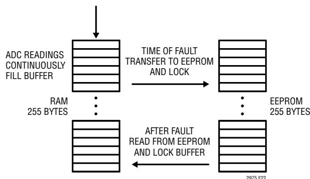

The diagram (description written from the PDF drawing) shows two stacks of byte cells with dots between their upper and lower parts: the left one labeled 'RAM 255 BYTES', the right one 'EEPROM 255 BYTES'. A vertical arrow enters the top of the RAM stack, next to the label 'ADC READINGS CONTINUOUSLY FILL BUFFER'. An arrow from the RAM stack to the EEPROM stack is labeled 'TIME OF FAULT TRANSFER TO EEPROM AND LOCK'. An arrow from the EEPROM stack back to the RAM stack, at the bottom, is labeled 'AFTER FAULT READ FROM EEPROM AND LOCK BUFFER'. Drawing number '2975 F22'.

Figure 22: Fault Logging diagram showing the flow of data from RAM to EEPROM and back.

**Figure 22. Fault Logging**

#### MFR\_FAULT\_LOG\_STORE

This command allows the user to transfer data from the RAM buffer to EEPROM.

{75}------------------------------------------------

## PMBUS COMMAND DESCRIPTION

#### MFR\_FAULT\_LOG\_RESTORE

This command allows the user to transfer a copy of the fault-log data from the EEPROM to the RAM buffer. After a restore the RAM buffer is locked until a successful Mfr\_fault\_log read.

#### MFR\_FAULT\_LOG\_CLEAR

This command initializes the EEPROM block reserved for fault logging. Any previous fault log stored in EEPROM will be erased by this operation and logging of the fault log RAM to EEPROM will be enabled. Make sure that Mfr\_fault\_log\_status\_ram = 0 before issuing the MFR\_FAULT\_LOG\_CLEAR command.

#### MFR\_FAULT\_LOG\_STATUS

This register is used to manage fault log events. The Mfr\_fault\_log\_status\_eeprom bit is set after a MFR\_FAULT\_LOG\_STORE command or a faulted-off event triggers a transfer of the fault log from RAM to EEPROM. This bit is cleared by a MFR\_FAULT\_LOG\_CLEAR command.

Mfr\_fault\_log\_status\_ram is set after a MFR\_FAULT\_ LOG\_RESTORE to indicate that the data in the RAM has been restored from EEPROM and not yet read using a MFR\_FAULT\_LOG command. This bit is cleared only by a successful execution of an MFR\_FAULT\_LOG command.

**MFR\_FAULT\_LOG\_STATUS Data Contents**

| BIT(S) | SYMBOL                      | OPERATION                                                                                                                                                      |
|--------|-----------------------------|----------------------------------------------------------------------------------------------------------------------------------------------------------------|
| b[7:2] | Reserved                    | Read only, always returns 0s.                                                                                                                                  |
| b[1]   | Mfr_fault_log_status_ram    | Fault log RAM status: 0: The fault log RAM allows updates. 1: The fault log RAM is locked until the next Mfr_fault_log read.                             |
| b[0]   | Mfr_fault_log_status_eeprom | Fault log EEPROM status: 0: The transfer of the fault log RAM to the EEPROM is enabled. 1: The transfer of the fault log RAM to the EEPROM is inhibited. |

#### MFR\_FAULT\_LOG

Read only. This 2040-bit (255 byte) data block contains a copy of the RAM buffer fault log. The RAM buffer is continuously updated after each ADC conversion as long as Mfr\_fault\_log\_status\_eeprom is clear.

With Mfr\_config\_fault\_log\_enable = 1 and Mfr\_fault\_log\_status\_eeprom = 0, the RAM buffer is transferred to EEPROM whenever an LTC2975 fault causes a channel to latch off or a MFR\_FAULT\_LOG\_STORE command is received. This transfer is delayed until the ADC has updated its READ values for all channels when Mfr\_config\_all\_fast\_fault\_log is clear, otherwise it happens within 24ms. This optional delay can be used to ensure that the slower ADC monitored values are all updated for the case where a fast supervisor detected fault initiates the transfer to EEPROM.

Mfr\_fault\_log\_status\_eeprom is set high after the RAM buffer is transferred to EEPROM and not cleared until a Mfr\_fault\_log\_clear is received, even if the LTC2975 is reset or powered down. Fault log EEPROM transfers are not initiated as a result of Status\_mfr\_discharge events.

During a Mfr\_fault\_log read, data is returned one byte at a time as defined in Table 6. The fault log data is partitioned into two sections. The first section is referred to as the preamble and contains the Position\_last pointer, time information and peak and min values. The second section contains a chronological record of telemetry and requires Position\_last for proper interpretation. The fault log stores approximately 300ms seconds of telemetry. To prevent timeouts during block reads, it is recommended that Mfr\_config\_all\_longer\_pmbus\_timeout be set to 1.

{76}------------------------------------------------

## PMBUS COMMAND DESCRIPTION

**Table 6. Data Block Contents**

| DATA                        | BYTE* | DESCRIPTION                                                                               |
|-----------------------------|-------|-------------------------------------------------------------------------------------------|
| Position_last[7:0]          | 0     | Position of fault log pointer when fault occurred.                                        |
| SharedTime[7:0]             | 1     | 41-bit share-clock counter value when fault occurred. Counter LSB is in 200µs increments. |
| SharedTime[15:8]            | 2     |                                                                                           |
| SharedTime[23:16]           | 3     |                                                                                           |
| SharedTime[31:24]           | 4     |                                                                                           |
| SharedTime[39:32]           | 5     |                                                                                           |
| SharedTime[40]              | 6     |                                                                                           |
| Mfr_vout_peak0[7:0]         | 7     |                                                                                           |
| Mfr_vout_peak0[15:8]        | 8     |                                                                                           |
| Mfr_vout_min0[7:0]          | 9     |                                                                                           |
| Mfr_vout_min0[15:8]         | 10    |                                                                                           |
| Mfr_temperature_peak0[7:0]  | 11    |                                                                                           |
| Mfr_temperature_peak0[15:8] | 12    |                                                                                           |
| Mfr_temperature_min0[7:0]   | 13    |                                                                                           |
| Mfr_temperature_min0[15:8]  | 14    |                                                                                           |
| Mfr_iout_peak0[7:0]         | 15    |                                                                                           |
| Mfr_iout_peak0[15:8]        | 16    |                                                                                           |
| Mfr_iout_min0[7:0]          | 17    |                                                                                           |
| Mfr_iout_min0[15:8]         | 18    |                                                                                           |
| Mfr_vin_peak[7:0]           | 19    |                                                                                           |
| Mfr_vin_peak[15:8]          | 20    |                                                                                           |
| Mfr_vin_min[7:0]            | 21    |                                                                                           |
| Mfr_vin_min[15:8]           | 22    |                                                                                           |
| Mfr_iin_peak[7:0]           | 23    |                                                                                           |
| Mfr_iin_peak[15:8]          | 24    |                                                                                           |
| Mfr_iin_min[7:0]            | 25    |                                                                                           |
| Mfr_iin_min[15:8]           | 26    |                                                                                           |
| Mfr_pin_peak[7:0]           | 27    |                                                                                           |
| Mfr_pin_peak[15:8]          | 28    |                                                                                           |
| Mfr_pin_min[7:0]            | 29    |                                                                                           |
| Mfr_pin_min[15:8]           | 30    |                                                                                           |
| Mfr_vout_peak1[7:0]         | 31    |                                                                                           |
| Mfr_vout_peak1[15:8]        | 32    |                                                                                           |
| Mfr_vout_min1[7:0]          | 33    |                                                                                           |
| Mfr_vout_min1[15:8]         | 34    |                                                                                           |
| Mfr_temperature_peak1[7:0]  | 35    |                                                                                           |
| Mfr_temperature_peak1[15:8] | 36    |                                                                                           |
| Mfr_temperature_min1[7:0]   | 37    |                                                                                           |
| Mfr_temperature_min1[15:8]  | 38    |                                                                                           |

**Table 6. Data Block Contents**

| DATA                        | BYTE* | DESCRIPTION           |
|-----------------------------|-------|-----------------------|
| Mfr_iout_peak1[7:0]         | 39    |                       |
| Mfr_iout_peak1[15:8]        | 40    |                       |
| Mfr_iout_min1[7:0]          | 41    |                       |
| Mfr_iout_min1[15:8]         | 42    |                       |
| Mfr_vout_peak2[7:0]         | 43    |                       |
| Mfr_vout_peak2[15:8]        | 44    |                       |
| Mfr_vout_min2[7:0]          | 45    |                       |
| Mfr_vout_min2[15:8]         | 46    |                       |
| Mfr_temperature_peak2[7:0]  | 47    |                       |
| Mfr_temperature_peak2[15:8] | 48    |                       |
| Mfr_temperature_min2[7:0]   | 49    |                       |
| Mfr_temperature_min2[15:8]  | 50    |                       |
| Mfr_iout_peak2[7:0]         | 51    |                       |
| Mfr_iout_peak2[15:8]        | 52    |                       |
| Mfr_iout_min2[7:0]          | 53    |                       |
| Mfr_iout_min2[15:8]         | 54    |                       |
| Mfr_vout_peak3[7:0]         | 55    |                       |
| Mfr_vout_peak3[15:8]        | 56    |                       |
| Mfr_vout_min3[7:0]          | 57    |                       |
| Mfr_vout_min3[15:8]         | 58    |                       |
| Mfr_temperature_peak3[7:0]  | 59    |                       |
| Mfr_temperature_peak3[15:8] | 60    |                       |
| Mfr_temperature_min3[7:0]   | 61    |                       |
| Mfr_temperature_min3[15:8]  | 62    |                       |
| Mfr_iout_peak3[7:0]         | 63    |                       |
| Mfr_iout_peak3[15:8]        | 64    |                       |
| Mfr_iout_min3[7:0]          | 65    |                       |
| Mfr_iout_min3[15:8]         | 66    |                       |
| Status_vout0[7:0]           | 67    |                       |
| Status_iout0[7:0]           | 68    |                       |
| Status_mfr_specific0[7:0]   | 69    |                       |
| Status_vout1[7:0]           | 70    |                       |
| Status_iout1[7:0]           | 71    |                       |
| Status_mfr_specific1[7:0]   | 72    |                       |
| Status_vout2[7:0]           | 73    |                       |
| Status_iout2[7:0]           | 74    |                       |
| Status_mfr_specific2[7:0]   | 75    |                       |
| Status_vout3[7:0]           | 76    |                       |
| Status_iout3[7:0]           | 77    |                       |
| Status_mfr_specific3[7:0]   | 78    |                       |
|                             |       | 79 bytes for preamble |

{77}------------------------------------------------

## PMBUS COMMAND DESCRIPTION

**Table 6. Data Block Contents**

| DATA                          | BYTE*   | DESCRIPTION                          |
|-------------------------------|---------|--------------------------------------|
| Fault_log [Position_last]     | 79      |                                      |
| Fault_log [Position_last-1]   | 80      |                                      |
| ...                           |         |                                      |
| Fault_log [Position_last-170] | 237     |                                      |
| Reserved                      | 238-254 |                                      |
|                               |         | Number of loops: (238 – 79)/58 = 2.7 |

\*Note that PMBus data byte numbers start at 1 rather than 0. See Figure 13 Block Read.

The data returned between bytes 79 and 237 of the previous table is interpreted using Position\_last and the following table. The key to identifying the data located in byte 79 is to locate the DATA corresponding to POSITION = Position\_last in the next table. Subsequent bytes are identified by decrementing the value of POSITION. For example: If Position\_last = 8 then the first data returned in a block read is Status\_temperature of page 0 followed by Read\_temperature\_1[15:8] of page 0 followed by Read\_temperature\_1[7:0] of page 0 and so on. See Table 7.

**Table 7. Interpreting Cyclical Loop Data**

| POSITION | DATA                       |
|----------|----------------------------|
| 0        | Read_temperature_2[7:0]    |
| 1        | Read_temperature_2[15:8]   |
| 2        | Read_vout0[7:0]            |
| 3        | Read_vout0[15:8]           |
| 4        | Status_vout0[7:0]          |
| 5        | Status_mfr_specific0[7:0]  |
| 6        | Read_temperature_1_0[7:0]  |
| 7        | Read_temperature_1_0[15:8] |
| 8        | Status_temperature0[7:0]   |
| 9        | Status_iout0[7:0]          |
| 10       | Read_iout0[7:0]            |
| 11       | Read_iout0[15:8]           |
| 12       | Read_pout0[7:0]            |
| 13       | Read_pout0[15:8]           |
| 14       | Read_vin[7:0]              |
| 15       | Read_vin[15:8]             |
| 16       | Status_input[7:0]          |
| 17       | 0x0                        |

**Table 7. Interpreting Cyclical Loop Data**

| POSITION | DATA                       |
|----------|----------------------------|
| 18       | Read_iin[7:0]              |
| 19       | Read_iin[15:8]             |
| 20       | Read_pin[7:0]              |
| 21       | Read_pin[15:8]             |
| 22       | Read_vout1[7:0]            |
| 23       | Read_vout1[15:8]           |
| 24       | Status_vout1[7:0]          |
| 25       | Status_mfr_specific1[7:0]  |
| 26       | Read_temperature_1_1[7:0]  |
| 27       | Read_temperature_1_1[15:8] |
| 28       | Status_temperature1[7:0]   |
| 29       | Status_iout1[7:0]          |
| 30       | Read_iout1[7:0]            |
| 31       | Read_iout1[15:8]           |
| 32       | Read_pout1[7:0]            |
| 33       | Read_pout1[15:8]           |
| 34       | Read_vout2[7:0]            |
| 35       | Read_vout2[15:8]           |
| 36       | Status_vout2[7:0]          |
| 37       | Status_mfr_specific2[7:0]  |
| 38       | Read_temperature_1_2[7:0]  |
| 39       | Read_temperature_1_2[15:8] |
| 40       | Status_temperature2[7:0]   |
| 41       | Status_iout2[7:0]          |
| 42       | Read_iout2[7:0]            |
| 43       | Read_iout2[15:8]           |
| 44       | Read_pout2[7:0]            |
| 45       | Read_pout2[15:8]           |
| 46       | Read_vout3[7:0]            |
| 47       | Read_vout3[15:8]           |
| 48       | Status_vout3[7:0]          |
| 49       | Status_mfr_specific3[7:0]  |
| 50       | Read_temperature_1_3[7:0]  |
| 51       | Read_temperature_1_3[15:8] |
| 52       | Status_temperature3[7:0]   |
| 53       | Status_iout3[7:0]          |
| 54       | Read_iout3[7:0]            |
| 55       | Read_iout3[15:8]           |
| 56       | Read_pout3[7:0]            |
| 57       | Read_pout3[15:8]           |
|          | Total Bytes = 58           |

{78}------------------------------------------------

## PMBUS COMMAND DESCRIPTION

#### MFR\_FAULT\_LOG Read Example

The following table fully decodes a sample fault log read with Position\_last = 13 to help clarify the cyclical nature of the operation.

**Data Block Contents**

**PREAMBLE INFORMATION**

| BYTE NUMBER DECIMAL | BYTE NUMBER HEX |  | DATA                        | DESCRIPTION                                                                               |
|---------------------------|-----------------------|--|-----------------------------|-------------------------------------------------------------------------------------------|
| 0                         | 00                    |  | Position_last[7:0] = 13     | Position of fault-log pointer when fault occurred.                                        |
| 1                         | 01                    |  | SharedTime[7:0]             | 41-bit share-clock counter value when fault occurred. Counter LSB is in 200µs increments. |
| 2                         | 02                    |  | SharedTime[15:8]            |                                                                                           |
| 3                         | 03                    |  | SharedTime[23:16]           |                                                                                           |
| 4                         | 04                    |  | SharedTime[31:24]           |                                                                                           |
| 5                         | 05                    |  | SharedTime[39:32]           |                                                                                           |
| 6                         | 06                    |  | SharedTime[40]              |                                                                                           |
| 7                         | 07                    |  | Mfr_vout_peak0[7:0]         |                                                                                           |
| 8                         | 08                    |  | Mfr_vout_peak0[15:8]        |                                                                                           |
| 9                         | 09                    |  | Mfr_vout_min0[7:0]          |                                                                                           |
| 10                        | 0A                    |  | Mfr_vout_min0[15:8]         |                                                                                           |
| 11                        | 0B                    |  | Mfr_temperature_peak0[7:0]  |                                                                                           |
| 12                        | 0C                    |  | Mfr_temperature_peak0[15:8] |                                                                                           |
| 13                        | 0D                    |  | Mfr_temperature_min0[7:0]   |                                                                                           |
| 14                        | 0E                    |  | Mfr_temperature_min0[15:8]  |                                                                                           |
| 15                        | 0F                    |  | Mfr_iout_peak0[7:0]         |                                                                                           |
| 16                        | 10                    |  | Mfr_iout_peak0[15:8]        |                                                                                           |
| 17                        | 11                    |  | Mfr_iout_min0[7:0]          |                                                                                           |
| 18                        | 12                    |  | Mfr_iout_min0[15:8]         |                                                                                           |
| 19                        | 13                    |  | Mfr_vin_peak_[7:0]          |                                                                                           |
| 20                        | 14                    |  | Mfr_vin_peak_[15:8]          |                                                                                           |
| 21                        | 15                    |  | Mfr_vin_min_[7:0]           |                                                                                           |
| 22                        | 16                    |  | Mfr_vin_min_[15:8]          |                                                                                           |
| 23                        | 17                    |  | Mfr_iin_peak[7:0]           |                                                                                           |
| 24                        | 18                    |  | Mfr_iin_peak[15:8]          |                                                                                           |
| 25                        | 19                    |  | Mfr_iin_min[7:0]            |                                                                                           |
| 26                        | 1A                    |  | Mfr_iin_min[15:8]           |                                                                                           |
| 27                        | 1B                    |  | Mfr_pin_peak[7:0]           |                                                                                           |

**PREAMBLE INFORMATION (CONT.)**

| BYTE NUMBER DECIMAL | BYTE NUMBER HEX |  | DATA                        | DESCRIPTION |
|---------------------------|-----------------------|--|-----------------------------|-------------|
| 28                        | 1C                    |  | Mfr_pin_peak[15:8]          |             |
| 29                        | 1D                    |  | Mfr_pin_min[7:0]            |             |
| 30                        | 1E                    |  | Mfr_pin_min[15:8]           |             |
| 31                        | 1F                    |  | Mfr_vout_peak1[7:0]         |             |
| 32                        | 20                    |  | Mfr_vout_peak1[15:8]        |             |
| 33                        | 21                    |  | Mfr_vout_min1[7:0]          |             |
| 34                        | 22                    |  | Mfr_vout_min1[15:8]         |             |
| 35                        | 23                    |  | Mfr_temperature_peak1[7:0]  |             |
| 36                        | 24                    |  | Mfr_temperature_peak1[15:8] |             |
| 37                        | 25                    |  | Mfr_temperature_min1[7:0]   |             |
| 38                        | 26                    |  | Mfr_temperature_min1[15:8]  |             |
| 39                        | 27                    |  | Mfr_iout_peak1[7:0]         |             |
| 40                        | 28                    |  | Mfr_iout_peak1[15:8]        |             |
| 41                        | 29                    |  | Mfr_iout_min1[7:0]          |             |
| 42                        | 2A                    |  | Mfr_iout_min1[15:8]         |             |
| 43                        | 2B                    |  | Mfr_vout_peak2[7:0]         |             |
| 44                        | 2C                    |  | Mfr_vout_peak2[15:8]        |             |
| 45                        | 2D                    |  | Mfr_vout_min2[7:0]          |             |
| 46                        | 2E                    |  | Mfr_vout_min2[15:8]         |             |
| 47                        | 2F                    |  | Mfr_temperature_peak2[7:0]  |             |
| 48                        | 30                    |  | Mfr_temperature_peak2[15:8] |             |
| 49                        | 31                    |  | Mfr_temperature_min2[7:0]   |             |
| 50                        | 32                    |  | Mfr_temperature_min2[15:8]  |             |
| 51                        | 33                    |  | Mfr_iout_peak2[7:0]         |             |
| 52                        | 34                    |  | Mfr_iout_peak2[15:8]        |             |
| 53                        | 35                    |  | Mfr_iout_min2[7:0]          |             |
| 54                        | 36                    |  | Mfr_iout_min2[15:8]         |             |
| 55                        | 37                    |  | Mfr_vout_peak3[7:0]         |             |
| 56                        | 38                    |  | Mfr_vout_peak3[15:8]        |             |
| 57                        | 39                    |  | Mfr_vout_min3[7:0]          |             |
| 58                        | 3A                    |  | Mfr_vout_min3[15:8]         |             |
| 59                        | 3B                    |  | Mfr_temperature_peak3[7:0]  |             |

{79}------------------------------------------------

## PMBUS COMMAND DESCRIPTION

**PREAMBLE INFORMATION (CONT.)**

| BYTE NUMBER DECIMAL | BYTE NUMBER HEX |  | DATA                        | DESCRIPTION     |
|---------------------|-----------------|--|-----------------------------|-----------------|
| 60                  | 3C              |  | Mfr_temperature_peak3[15:8] |                 |
| 61                  | 3D              |  | Mfr_temperature_min3[7:0]   |                 |
| 62                  | 3E              |  | Mfr_temperature_min3[15:8]  |                 |
| 63                  | 3F              |  | Mfr_iout_peak3[7:0]         |                 |
| 64                  | 40              |  | Mfr_iout_peak3[15:8]        |                 |
| 65                  | 41              |  | Mfr_iout_min3[7:0]          |                 |
| 66                  | 42              |  | Mfr_iout_min3[15:8]         |                 |
| 67                  | 43              |  | Status_vout0[7:0]           |                 |
| 68                  | 44              |  | Status_iout0[7:0]           |                 |
| 69                  | 45              |  | Status_temperature0[7:0]    |                 |
| 70                  | 46              |  | Status_vout1[7:0]           |                 |
| 71                  | 47              |  | Status_iout1[7:0]           |                 |
| 72                  | 48              |  | Status_temperature1[7:0]    |                 |
| 73                  | 49              |  | Status_vout2[7:0]           |                 |
| 74                  | 4A              |  | Status_iout2[7:0]           |                 |
| 75                  | 4B              |  | Status_temperature2[7:0]    |                 |
| 76                  | 4C              |  | Status_vout3[7:0]           |                 |
| 77                  | 4D              |  | Status_iout3[7:0]           |                 |
| 78                  | 4E              |  | Status_temperature3[7:0]    | End of Preamble |

**CYCLICAL MUX LOOP DATA PARTIAL LOOP**

| BYTE NUMBER DECIMAL | BYTE NUMBER HEX | LOOP BYTE NUMBER DECIMAL | MUX LOOP 0        | 58 BYTES PER LOOP |
|---------------------|-----------------|--------------------------|-------------------|-------------------|
| 79                  | 4F              | 13                       | Read_pout0[15:8]  | Position_last     |
| 80                  | 50              | 12                       | Read_pout0[7:0]   |                   |
| 81                  | 51              | 11                       | Read_iout0[15:8]  |                   |
| 82                  | 52              | 10                       | Read_iout0[7:0]   |                   |
| 83                  | 53              | 9                        | Status_iout0[7:0] |                   |

**CYCLICAL MUX LOOP DATA PARTIAL LOOP (CONT.)**

| BYTE NUMBER DECIMAL | BYTE NUMBER HEX | LOOP BYTE NUMBER DECIMAL | MUX LOOP 0                 | 58 BYTES PER LOOP |
|---------------------|-----------------|--------------------------|----------------------------|-------------------|
| 84                  | 54              | 8                        | Status_temperature0[7:0]   |                   |
| 85                  | 55              | 7                        | Read_temperature_1_0[15:8] |                   |
| 86                  | 56              | 6                        | Read_temperature_1_0[7:0]  |                   |
| 87                  | 57              | 5                        | Status_mfr_specific0[7:0]  |                   |
| 88                  | 58              | 4                        | Status_vout0[7:0]          |                   |
| 89                  | 59              | 3                        | Read_vout0[15:8]           |                   |
| 90                  | 5A              | 2                        | Read_vout0[7:0]            |                   |
| 91                  | 5B              | 1                        | Read_temperature_2[15:8]   |                   |
| 92                  | 5C              | 0                        | Read_temperature_2[7:0]    |                   |

**CYCLICAL MUX LOOP DATA FULL LOOP**

| BYTE NUMBER DECIMAL | BYTE NUMBER HEX | LOOP BYTE NUMBER DECIMAL | MUX LOOP 1                 | 58 BYTES PER LOOP |
|---------------------|-----------------|--------------------------|----------------------------|-------------------|
| 93                  | 5D              | 57                       | Read_pout3[15:8]           |                   |
| 94                  | 5E              | 56                       | Read_pout3[7:0]            |                   |
| 95                  | 5F              | 55                       | Read_iout3[15:8]           |                   |
| 96                  | 60              | 54                       | Read_iout3[7:0]            |                   |
| 97                  | 61              | 53                       | Status_iout3[7:0]          |                   |
| 98                  | 62              | 52                       | Status_temperature3[7:0]   |                   |
| 99                  | 63              | 51                       | Read_temperature_1_3[15:8] |                   |
| 100                 | 64              | 50                       | Read_temperature_1_3[7:0]  |                   |
| 101                 | 65              | 49                       | Status_mfr_specific3[7:0]  |                   |
| 102                 | 66              | 48                       | Status_vout3[7:0]          |                   |
| 103                 | 67              | 47                       | Read_vout3[15:8]           |                   |
| 104                 | 78              | 46                       | Read_vout3[7:0]            |                   |
| 105                 | 69              | 45                       | Read_pout2[15:8]           |                   |
| 106                 | 6A              | 44                       | Read_pout2[7:0]            |                   |
| 107                 | 6B              | 43                       | Read_iout2[15:8]           |                   |
| 108                 | 6C              | 42                       | Read_iout2[7:0]            |                   |

{80}------------------------------------------------

## PMBUS COMMAND DESCRIPTION

**CYCLICAL MUX LOOP DATA FULL LOOP (CONT.)**

| BYTE NUMBER DECIMAL | BYTE NUMBER HEX | LOOP BYTE NUMBER DECIMAL | MUX LOOP 1                 | 58 BYTES PER LOOP |
|---------------------|-----------------|--------------------------|----------------------------|-------------------|
| 109                 | 6D              | 41                       | Status_iout2[7:0]          |                   |
| 110                 | 6E              | 40                       | Status_temperature2[7:0]   |                   |
| 111                 | 6F              | 39                       | Read_temperature_1_2[15:8] |                   |
| 112                 | 70              | 38                       | Read_temperature_1_2[7:0]  |                   |
| 113                 | 71              | 37                       | Status_mfr_specific2[7:0]  |                   |
| 114                 | 72              | 36                       | Status_vout2[7:0]          |                   |
| 115                 | 73              | 35                       | Read_vout2[15:8]           |                   |
| 116                 | 74              | 34                       | Read_vout2[7:0]            |                   |
| 117                 | 75              | 33                       | Read_pout1[15:8]           |                   |
| 118                 | 76              | 32                       | Read_pout1[7:0]            |                   |
| 119                 | 77              | 31                       | Read_iout1[15:8]           |                   |
| 120                 | 78              | 30                       | Read_iout1[7:0]            |                   |
| 121                 | 79              | 29                       | Status_iout1[7:0]          |                   |
| 122                 | 7A              | 28                       | Status_temperature2[7:0]   |                   |
| 123                 | 7B              | 27                       | Read_temperature_1_1[15:8] |                   |
| 124                 | 7C              | 26                       | Read_temperature_1_1[7:0]  |                   |
| 125                 | 7D              | 25                       | Status_mfr_specific1[7:0]  |                   |
| 126                 | 7E              | 24                       | Status_vout1[7:0]          |                   |
| 127                 | 7F              | 23                       | Read_vout1[15:8]           |                   |
| 128                 | 80              | 22                       | Read_vout1[7:0]            |                   |
| 129                 | 81              | 21                       | Read_pin[15:8]             |                   |
| 130                 | 82              | 20                       | Read_pin[7:0]              |                   |
| 131                 | 83              | 19                       | Read_in[15:8]              |                   |
| 132                 | 84              | 18                       | Read_in[7:0]               |                   |
| 133                 | 85              | 17                       | 0x0                        |                   |
| 134                 | 86              | 16                       | Status_input[7:0]          |                   |
| 135                 | 87              | 15                       | Read_vin[15:8]             |                   |
| 136                 | 88              | 14                       | Read_vin[7:0]              |                   |
| 137                 | 89              | 13                       | Read_pout0[15:8]           |                   |
| 138                 | 8A              | 12                       | Read_pout0[7:0]            |                   |
| 139                 | 8B              | 11                       | Read_iout0[15:8]           |                   |
| 140                 | 8C              | 10                       | Read_iout0[7:0]            |                   |

**CYCLICAL MUX LOOP DATA FULL LOOP (CONT.)**

| BYTE NUMBER DECIMAL | BYTE NUMBER HEX | LOOP BYTE NUMBER DECIMAL | MUX LOOP 1                 | 58 BYTES PER LOOP |
|---------------------|-----------------|--------------------------|----------------------------|-------------------|
| 141                 | 8D              | 9                        | Status_iout0[7:0]          |                   |
| 142                 | 8E              | 8                        | Status_temperature0[7:0]   |                   |
| 143                 | 8F              | 7                        | Read_temperature_1_0[15:8] |                   |
| 144                 | 90              | 6                        | Read_temperature_1_0[7:0]  |                   |
| 145                 | 91              | 5                        | Status_mfr_specific0[7:0]  |                   |
| 146                 | 92              | 4                        | Status_vout0[7:0]          |                   |
| 147                 | 93              | 3                        | Read_vout0[15:8]           |                   |
| 148                 | 94              | 2                        | Read_vout0[7:0]            |                   |
| 149                 | 95              | 1                        | Read_temperature_2[15:8]   |                   |
| 150                 | 96              | 0                        | Read_temperature_2[7:0]    |                   |

**CYCLICAL MUX LOOP DATA FULL LOOP**

| BYTE NUMBER DECIMAL | BYTE NUMBER HEX | LOOP BYTE NUMBER DECIMAL | MUX LOOP 2                 | 58 BYTES PER LOOP |
|---------------------|-----------------|--------------------------|----------------------------|-------------------|
| 151                 | 97              | 57                       | Read_pout3[15:8]           |                   |
| 152                 | 98              | 56                       | Read_pout3[7:0]            |                   |
| 153                 | 99              | 55                       | Read_iout3[15:8]           |                   |
| 154                 | 9A              | 54                       | Read_iout3[7:0]            |                   |
| 155                 | 9B              | 53                       | Status_iout3[7:0]          |                   |
| 156                 | 9C              | 52                       | Status_temperature3[7:0]   |                   |
| 157                 | 9D              | 51                       | Read_temperature_1_3[15:8] |                   |
| 158                 | 9E              | 50                       | Read_temperature_1_3[7:0]  |                   |
| 159                 | 9F              | 49                       | Status_mfr_specific3[7:0]  |                   |
| 160                 | A0              | 48                       | Status_vout3[7:0]          |                   |
| 161                 | A1              | 47                       | Read_vout3[15:8]           |                   |
| 162                 | A2              | 46                       | Read_vout3[7:0]            |                   |
| 163                 | A3              | 45                       | Read_pout2[15:8]           |                   |
| 164                 | A4              | 44                       | Read_pout2[7:0]            |                   |
| 165                 | A5              | 43                       | Read_iout2[15:8]           |                   |
| 166                 | A6              | 42                       | Read_iout2[7:0]            |                   |

{81}------------------------------------------------

## PMBUS COMMAND DESCRIPTION

**CYCLICAL MUX LOOP DATA FULL LOOP (CONT.)**

| BYTE NUMBER DECIMAL | BYTE NUMBER HEX | LOOP BYTE NUMBER DECIMAL | MUX LOOP 2                 | 58 BYTES PER LOOP |
|---------------------|-----------------|--------------------------|----------------------------|-------------------|
| 167                 | A7              | 41                       | Status_iout2[7:0]          |                   |
| 168                 | A8              | 40                       | Status_temperature2[7:0]   |                   |
| 169                 | A9              | 39                       | Read_temperature_1_2[15:8] |                   |
| 170                 | AA              | 38                       | Read_temperature_1_2[7:0]  |                   |
| 171                 | AB              | 37                       | Status_mfr_specific2[7:0]  |                   |
| 172                 | AC              | 36                       | Status_vout2[7:0]          |                   |
| 173                 | AD              | 35                       | Read_vout2[15:8]           |                   |
| 174                 | AE              | 34                       | Read_vout2[7:0]            |                   |
| 175                 | AF              | 33                       | Read_pout1[15:8]           |                   |
| 176                 | B0              | 32                       | Read_pout1[7:0]            |                   |
| 177                 | B1              | 31                       | Read_iout1[15:8]           |                   |
| 178                 | B2              | 30                       | Read_iout1[7:0]            |                   |
| 179                 | B3              | 29                       | Status_iout1[7:0]          |                   |
| 180                 | B4              | 28                       | Status_temperature2[7:0]   |                   |
| 181                 | B5              | 27                       | Read_temperature_1_1[15:8] |                   |
| 182                 | B6              | 26                       | Read_temperature_1_1[7:0]  |                   |
| 183                 | B7              | 25                       | Status_mfr_specific1[7:0]  |                   |
| 184                 | B8              | 24                       | Status_vout1[7:0]          |                   |
| 185                 | B9              | 23                       | Read_vout1[15:8]           |                   |
| 186                 | BA              | 22                       | Read_vout1[7:0]            |                   |
| 187                 | BB              | 21                       | Read_pin[15:8]             |                   |
| 188                 | BC              | 20                       | Read_pin[7:0]              |                   |
| 189                 | BD              | 19                       | Read_in[15:8]              |                   |
| 190                 | BE              | 18                       | Read_in[7:0]               |                   |
| 191                 | BF              | 17                       | 0x0                        |                   |
| 192                 | C0              | 16                       | Status_input[7:0]          |                   |
| 193                 | C1              | 15                       | Read_vin[15:8]             |                   |
| 194                 | C2              | 14                       | Read_vin[7:0]              |                   |
| 195                 | C3              | 13                       | Read_pout0[15:8]           |                   |
| 196                 | C4              | 12                       | Read_pout0[7:0]            |                   |
| 197                 | C5              | 11                       | Read_iout0[15:8]           |                   |
| 198                 | C6              | 10                       | Read_iout0[7:0]            |                   |
| 199                 | C7              | 9                        | Status_iout0[7:0]          |                   |

**CYCLICAL MUX LOOP DATA FULL LOOP (CONT.)**

| BYTE NUMBER DECIMAL | BYTE NUMBER HEX | LOOP BYTE NUMBER DECIMAL | MUX LOOP 2                 | 58 BYTES PER LOOP |
|---------------------|-----------------|--------------------------|----------------------------|-------------------|
| 200                 | C8              | 8                        | Status_temperature0[7:0]   |                   |
| 201                 | C9              | 7                        | Read_temperature_1_0[15:8] |                   |
| 202                 | CA              | 6                        | Read_temperature_1_0[7:0]  |                   |
| 203                 | CB              | 5                        | Status_mfr_specific0[7:0]  |                   |
| 204                 | CC              | 4                        | Status_vout0[7:0]          |                   |
| 205                 | CD              | 3                        | Read_vout0[15:8]           |                   |
| 206                 | CE              | 2                        | Read_vout0[7:0]            |                   |
| 207                 | CF              | 1                        | Read_temperature_2[15:8]   |                   |
| 208                 | D0              | 0                        | Read_temperature_2[7:0]    |                   |

**CYCLICAL MUX LOOP DATA PARTIAL LOOP**

| BYTE NUMBER DECIMAL | BYTE NUMBER HEX | LOOP BYTE NUMBER DECIMAL | MUX LOOP 3                 | 58 BYTES PER LOOP |
|---------------------|-----------------|--------------------------|----------------------------|-------------------|
| 209                 | D1              | 57                       | Read_pout3[15:8]           |                   |
| 210                 | D2              | 56                       | Read_pout3[7:0]            |                   |
| 211                 | D3              | 55                       | Read_iout3[15:8]           |                   |
| 212                 | D4              | 54                       | Read_iout3[7:0]            |                   |
| 213                 | D5              | 53                       | Status_iout3[7:0]          |                   |
| 214                 | D6              | 52                       | Status_temperature_3[7:0]  |                   |
| 215                 | D7              | 51                       | Read_temperature_1_3[15:8] |                   |
| 216                 | D8              | 50                       | Read_temperature_1_3[7:0]  |                   |
| 217                 | D9              | 49                       | Status_mfr_specific3[7:0]  |                   |
| 218                 | DA              | 48                       | Status_vout3[7:0]          |                   |
| 219                 | DB              | 47                       | Read_vout3[15:8]           |                   |
| 220                 | DC              | 46                       | Read_vout3[7:0]            |                   |
| 221                 | DD              | 45                       | Read_pout2[15:8]           |                   |
| 222                 | DE              | 44                       | Read_pout2[7:0]            |                   |
| 223                 | DF              | 43                       | Read_iout2[15:8]           |                   |
| 224                 | E0              | 42                       | Read_iout2[7:0]            |                   |
| 225                 | E1              | 41                       | Status_iout2[7:0]          |                   |

{82}------------------------------------------------

## PMBUS COMMAND DESCRIPTION

**CYCLICAL MUX LOOP DATA PARTIAL LOOP (CONT.)**

| BYTE NUMBER DECIMAL | BYTE NUMBER HEX | LOOP BYTE NUMBER DECIMAL | MUX LOOP 3 | 58 BYTES PER LOOP |
|---------------------|-----------------|--------------------------|------------|-------------------|
| 226                                         | E2              | 40                       | Status_temperature2[7:0]   |                           |
| 227                                         | E3              | 39                       | Read_temperature_1_2[15:8] |                           |
| 228                                         | E4              | 38                       | Read_temperature_1_2[7:0]  |                           |
| 229                                         | E5              | 37                       | Status_mfr_specific2[7:0]  |                           |
| 230                                         | E6              | 36                       | Status_vout2[7:0]          |                           |
| 231                                         | E7              | 35                       | Read_vout2[15:8]           |                           |
| 232                                         | E8              | 34                       | Read_vout2[7:0]            |                           |
| 233                                         | E9              | 33                       | Read_pout1[15:8]           |                           |
| 234                                         | EA              | 32                       | Read_pout1[7:0]            |                           |
| 235                                         | EB              | 31                       | Read_iout1[15:8]           |                           |
| 236                                         | EC              | 30                       | Read_iout1[7:0]            |                           |
| 237                                         | ED              | 29                       | Status_iout1[7:0]          | Last valid fault log byte |
| 238                                         | EE              |                          | 0x00                       | Bytes EE - FE return 0x00 |
| 239                                         | EF              |                          | 0x00                       |                           |

**CYCLICAL MUX LOOP DATA PARTIAL LOOP (CONT.)**

| BYTE NUMBER DECIMAL | BYTE NUMBER HEX | LOOP BYTE NUMBER DECIMAL | MUX LOOP 3 | 58 BYTES PER LOOP |
|---------------------|-----------------|--------------------------|------------|-------------------|
| 240                                         | F0              |                          | 0x00       |                                                                            |
| 241                                         | F1              |                          | 0x00       |                                                                            |
| 242                                         | F2              |                          | 0x00       |                                                                            |
| 243                                         | F3              |                          | 0x00       |                                                                            |
| 244                                         | F4              |                          | 0x00       |                                                                            |
| 245                                         | F5              |                          | 0x00       |                                                                            |
| 246                                         | F6              |                          | 0x00       |                                                                            |
| 247                                         | F7              |                          | 0x00       |                                                                            |
| 248                                         | F8              |                          | 0x00       |                                                                            |
| 249                                         | F9              |                          | 0x00       |                                                                            |
| 250                                         | FA              |                          | 0x00       |                                                                            |
| 251                                         | FB              |                          | 0x00       |                                                                            |
| 252                                         | FC              |                          | 0x00       |                                                                            |
| 253                                         | FD              |                          | 0x00       |                                                                            |
| 254                                         | FE              |                          | 0x00       | This is PMBUS byte 255. It must be read to clear Mfr_fault_log_status_ram. |

### IDENTIFICATION/INFORMATION

| COMMAND NAME    | CMD CODE | DESCRIPTION                                                                                                                           | TYPE   | PAGED | DATA FORMAT | UNITS | EEPROM | DEFAULT VALUE | REF PAGE |
|-----------------|----------|---------------------------------------------------------------------------------------------------------------------------------------|--------|-------|-------------|-------|--------|---------------|----------|
| CAPABILITY      | 0x19     | Summary of PMBus optional communication protocols supported by this device.                                                           | R Byte | N     | Reg         |       |        | 0xB0          | 83       |
| PMBUS_REVISION  | 0x98     | PMBus revision supported by this device. Current revision is 1.1.                                                                     | R Byte | N     | Reg         |       |        | 0x11          | 84       |
| MFR_SPECIAL_ID  | 0xE7     | Manufacturer code for identifying the LTC2975.                                                                                        | R Word | N     | Reg         |       | Y      | 0x0226        | 84       |
| MFR_SPECIAL_LOT | 0xC2     | Customer dependent codes that identify the factory programmed user configuration stored in EEPROM. Contact factory for default value. | R Byte | Y     | Reg         |       | Y      | NA            | 84       |
| MFR_INFO        | 0xB6     | Manufacturer specific information.                                                                                                    | R Word | N     | Reg         |       |        | NA            | 84       |

#### CAPABILITY

The CAPABILITY command provides a way for a host system to determine some key capabilities of the LTC2975.

**CAPABILITY Data Contents**

| BIT(S) | SYMBOL               | OPERATION                                                                                                                                             |
|--------|----------------------|-------------------------------------------------------------------------------------------------------------------------------------------------------|
| b[7]   | Capability_pec       | Hard coded to 1 indicating Packet Error Checking is supported. Reading the Mfr_config_all_pec_en bit will indicate whether PEC is currently required. |
| b[6:5] | Capability_scl_max   | Hard coded to 01b indicating the maximum supported bus speed is 400kHz.                                                                               |
| b[4]   | Capability_smb_alert | Hard coded to 1 indicating this device does have an ALERTB pin and does support the SMBus Alert Response Protocol.                                    |
| b[3:0] | Reserved             | Always returns 0.                                                                                                                                     |

{83}------------------------------------------------

## PMBUS COMMAND DESCRIPTION

#### PMBUS\_REVISION

**PMBUS\_REVISION Data Contents**

| BIT(S) | SYMBOL    | OPERATION                                                                                    |
|--------|-----------|----------------------------------------------------------------------------------------------|
| b[7:0] | PMBus_rev | Reports the PMBus standard revision compliance. This is hard-coded to 0x11 for revision 1.1. |

#### MFR\_SPECIAL\_ID

This register contains the manufacturer ID for the LTC2975. Always returns 0x0226.

#### MFR\_SPECIAL\_LOT

These paged registers contain information that identifies the user configuration that was programmed at the factory. Contact the factory to request a custom factory programmed user configuration and special lot number.

#### MFR\_INFO

The MFR\_INFO register contains manufacturer specific information and is updated after a power-on reset, a RESTORE\_USER\_ALL command, or an EEPROM bulk read operation.

**MFR\_INFO Data Contents**

| BIT(S)  | SYMBOL            | OPERATION                                                                                                               |
|---------|-------------------|-------------------------------------------------------------------------------------------------------------------------|
| b[15:6] | Reserved          | Reserved.                                                                                                               |
| b[5]    | Mfr_info_ecc_user | EEPROM ECC status. 0: Corrections made in the EEPROM user space. 1: No corrections made in the EEPROM user space. |
| b[4:0]  | Reserved          | Reserved.                                                                                                               |

### USER SCRATCHPAD

| COMMAND NAME       | CMD CODE | DESCRIPTION                            | TYPE     | PAGED | DATA FORMAT | UNITS | EEPROM | DEFAULT VALUE | REF PAGE |
|--------------------|----------|----------------------------------------|----------|-------|-------------|-------|--------|---------------|----------|
| USER_DATA_00       | 0xB0     | Manufacturer reserved for LTpowerPlay. | R/W Word | N     | Reg         |       | Y      | NA            | 84       |
| USER_DATA_01       | 0xB1     | Manufacturer reserved for LTpowerPlay. | R/W Word | Y     | Reg         |       | Y      | NA            | 84       |
| USER_DATA_02       | 0xB2     | OEM Reserved.                          | R/W Word | N     | Reg         |       | Y      | NA            | 84       |
| USER_DATA_03       | 0xB3     | Scratchpad location.                   | R/W Word | Y     | Reg         |       | Y      | 0x0000        | 84       |
| USER_DATA_04       | 0xB4     | Scratchpad location.                   | R/W Word | N     | Reg         |       | Y      | 0x0000        | 84       |
| MFR_LTC_RESERVED_1 | 0xB5     | Manufacturer reserved.                 | R/W Word | Y     | Reg         |       | Y      | NA            | 84       |
| MFR_LTC_RESERVED_2 | 0xBC     | Manufacturer reserved.                 | R/W Word | Y     | Reg         |       |        | NA            | 84       |

#### USER\_DATA\_00, USER\_DATA\_01, USER\_DATA\_02, USER\_DATA\_03, USER\_DATA\_04, MFR\_LTC\_RESERVED\_1 and MFR\_LTC\_RESERVED\_2

These registers are provided as user scratchpad and additional manufacturer reserved locations.

USER\_DATA\_03 and USER\_DATA\_04 are available for user scratchpad use. These 10 bytes (1 unpaged word plus 4paged words) might be used for traceability or revision information such as serial number, board model number, assembly location, or assembly date.

{84}------------------------------------------------

## APPLICATIONS INFORMATION

### OVERVIEW

The LTC2975 is a 4-channel Power System Management IC that is capable of sequencing, margining, trimming, supervising output voltage for OV/UV conditions, supervising output current for OC/UC conditions, fault management, voltage/current/ temperature readback for four DC/DC converter channels, and readback of high side input current, input voltage, input power, input energy, and junction temperature. Multiple Analog Devices Power System Managers can coordinate operation using the SHARE\_CLK, FAULTB, and CONTROL pins. The LTC2975 utilizes a PMBus compliant interface and command set.

### POWERING THE LTC2975

The LTC2975 can be powered two ways. The first method requires that a voltage between 4.5V and 15V be applied to the  $V_{PWR}$  pin. See Figure 23. An internal linear regulator converts  $V_{PWR}$  down to 3.3V which drives all of the internal circuitry of the LTC2975.

Alternatively, power from an external 3.3V supply may be applied directly to the  $V_{DD33}$  pins 11 and 12 using a voltage between 3.13V and 3.47V. See Figure 24. Tie  $V_{PWR}$  to the  $V_{DD33}$  pins. All functionality is available when using this alternate power method. The higher voltages needed for the  $V_{OUT\_EN}$  pins and bias for the  $V_{SENSE}$  pins are charge pumped from  $V_{DD33}$ .

![Figure 23: Powering LTC2975 Directly from an Intermediate Bus (description written from the PDF drawing). The bus labeled '4.5V < V_PWR < 15V' connects to the V_PWR pin and to the V_IN_SNS pin of the LTC2975* box; a 0.1µF capacitor connects V_PWR to ground. The two V_DD33 pins are tied together and decoupled to ground by a 0.1µF capacitor; the two V_DD25 pins are tied together and decoupled to ground by a 0.1µF capacitor. GND connects to ground. A note states '*SOME DETAILS OMITTED FOR CLARITY'. Drawing number 2975 F23.](img/b71ad9fc874230de9ba4480e12a216f7_img.jpg)

Figure 23: Powering LTC2975 Directly from an Intermediate Bus (description written from the PDF drawing). The bus labeled '4.5V < V\_PWR < 15V' connects to the V\_PWR pin and to the V\_IN\_SNS pin of the LTC2975\* box; a 0.1µF capacitor connects V\_PWR to ground. The two V\_DD33 pins are tied together and decoupled to ground by a 0.1µF capacitor; the two V\_DD25 pins are tied together and decoupled to ground by a 0.1µF capacitor. GND connects to ground. A note states '\*SOME DETAILS OMITTED FOR CLARITY'. Drawing number 2975 F23.

**Figure 23. Powering LTC2975 Directly from an Intermediate Bus**

Figure 24: Powering LTC2975 from External 3.3V Supply (description written from the PDF drawing). The 'EXTERNAL 3.3V' supply connects to the V\_PWR pin and to the two V\_DD33 pins (tied together) of the LTC2975\* box, with a 0.1µF capacitor to ground at the V\_DD33 node. The two V\_DD25 pins are tied together and decoupled to ground by a 0.1µF capacitor. GND connects to ground. A note states '\*SOME DETAILS OMITTED FOR CLARITY'. Drawing number 2975 F24.

**Figure 24. Powering LTC2975 from External 3.3V Supply**

### SETTING COMMAND REGISTER VALUES

The command register settings described herein are intended as a reference and for the purpose of understanding the registers in a software development environment. In actual practice, the LTC2975 can be completely configured for stand-alone operation with the DC1613 USB to I2C/ SMBus/ PMBus controller and software GUI using intuitive menu driven objects.

### MEASURING INPUT CURRENT

The LTC2975 is capable of measuring the current of the input power source. The device also measures the input supply voltage, enabling it to calculate input power. The LTC2975 has an accurate internal time base allowing the chip to calculate input energy since energy is the product of power and time. The units for each of the measured parameters are amps, volts, watts, and millijoules.

Input current is measured by placing a sense resistor,  $R_{SENSE}$ , in series with the desired current load path as shown in Figure 25. If  $R_{SENSE}$  has low thermal drift characteristics, the MFR\_IIN\_CAL\_GAIN\_TC register value may be set to zero. Otherwise, choose a setting for the MFR\_IIN\_CAL\_GAIN\_TC value in units of ppm/°C to correct for  $R_{SENSE}$  thermal drift.

For best results, it is recommended to locate  $R_{SENSE}$  close to and isothermal with the LTC2975.

![Figure 25: Measuring Input Current (description written from the PDF drawing). A supply line labeled '4.5V < V_IN_SNS < 15V' connects to the V_IN_SNS pin of the LTC2975* box and to the I_IN_SNSP pin. The sense resistor R_SENSE is connected between I_IN_SNSP and I_IN_SNSM; the I_IN_SNSM node feeds a box labeled 'LOAD' that returns to ground. Inside the LTC2975 a 350Ω resistor is drawn between V_IN_SNS and V_IN_SNS_CAP; an external capacitor C_IN 0.1µF connects V_IN_SNS_CAP to ground. GND connects to ground. A note states '*SOME DETAILS OMITTED FOR CLARITY'. Drawing number 2975 F25.](img/0bc2dbdde1fd164bcb295b4f6ddbacc8_img.jpg)

Figure 25: Measuring Input Current (description written from the PDF drawing). A supply line labeled '4.5V < V\_IN\_SNS < 15V' connects to the V\_IN\_SNS pin of the LTC2975\* box and to the I\_IN\_SNSP pin. The sense resistor R\_SENSE is connected between I\_IN\_SNSP and I\_IN\_SNSM; the I\_IN\_SNSM node feeds a box labeled 'LOAD' that returns to ground. Inside the LTC2975 a 350Ω resistor is drawn between V\_IN\_SNS and V\_IN\_SNS\_CAP; an external capacitor C\_IN 0.1µF connects V\_IN\_SNS\_CAP to ground. GND connects to ground. A note states '\*SOME DETAILS OMITTED FOR CLARITY'. Drawing number 2975 F25.

**Figure 25. Measuring Input Current**

{85}------------------------------------------------

## APPLICATIONS INFORMATION

The input current sense path includes an internal, anti-aliasing low pass filter with typical 32dB rejection at 62.5kHz. To improve high frequency current sense common mode rejection, add a 0.01µF capacitor,  $C_{IN}$ , to the  $V_{IN\_SNS\_CAP}$  pin.

The `Mfr_ein_config_iin_range` bits select one of three input current sense amplifier ranges: high, medium and low. The  $R_{SENSE}$  value should be chosen to satisfy the input range. The maximum allowable input ranges are as follows:  $\pm 100\text{mV}$  range for high range,  $\pm 50\text{mV}$  for medium range and  $\pm 20\text{mV}$  for low range. For best accuracy, use the lowest range setting encompassing the maximum input signal.

To help choose the  $R_{SENSE}$  value and `Mfr_ein_config_iin_range` setting for your application, use the Electrical Characteristics table for `TUE_IIN`, along with Figures 26 and 27. Figures 26 and 27 serve as extrapolated guides while the Electrical Characteristics table shows tested `TUE_IIN` conditions. After selecting  $R_{SENSE}$ , write its value in  $\text{m}\Omega$  to the `MFR_IIN_CAL_GAIN` register, and `READ_IIN` will return the sensed current in amps. Figures 26 and 27 show absolute value of the expected worst case `READ_IIN` Total Unadjusted Error, `TUE_IIN`, in  $\mu\text{V}$  and in relative % of current sense input voltage reading,  $V_{IIN\_SNS}$ , as a function of  $V_{IIN\_SNS}$  ( $V_{IIN\_SNSP} - V_{IIN\_SNSM}$ ) for high range, medium range and low range settings.

Figure 26: TUE\_IIN vs READ\_IIN Input Voltage in µV. A line graph showing Total Unadjusted Error (TUE\_IIN) in µV on the y-axis (0 to 700) versus input voltage V\_IN\_SNS in mV on the x-axis (0 to 100). Three curves are shown: HIGH RANGE (red), MEDIUM RANGE (blue), and LOW RANGE (green). All curves show a linear increase in error with voltage, with the high range having the steepest slope.

Figure 26. TUE\_IIN vs READ\_IIN Input Voltage in  $\mu\text{V}$

Figure 27: TUE\_IIN vs READ\_IIN Input Voltage in Percentage. A line graph showing TUE\_IIN (RELATIVE %) on a logarithmic y-axis (0.5 to 10) versus input voltage V\_IN\_SNS in mV on a logarithmic x-axis (1 to 100). Three curves are shown: HIGH RANGE (red), MEDIUM RANGE (blue), and LOW RANGE (green). All curves show a decreasing relative error as input voltage increases, with the high range consistently having the highest relative error.

Figure 27. TUE\_IIN vs READ\_IIN Input Voltage in Percentage

![Figure 28: Optional V_IN_SNS Filtering circuit diagram. The diagram shows a circuit with a 4.5V < V_IN_SNS < 15V supply. It includes resistors R1 (100Ω), R2 (100Ω), R3 (10Ω), and a sense resistor RSENSE. Capacitors C1 (1µF), C2 (1µF), C3 (10µF), and CIN (0.01µF) are used for filtering. The LTC2975* IC is shown with pins V_IN_SNS, V_IN_SNS_CAP, I_IN_SNSP, I_IN_SNSM, and GND. Diodes D1, D2, D3, and D4 are part of the internal structure of the IC. A 350Ω resistor is connected between V_IN_SNS_CAP and CIN.](img/a760132c773ae85ff8cedb26b500f223_img.jpg)

Figure 28: Optional V\_IN\_SNS Filtering circuit diagram. The diagram shows a circuit with a 4.5V < V\_IN\_SNS < 15V supply. It includes resistors R1 (100Ω), R2 (100Ω), R3 (10Ω), and a sense resistor RSENSE. Capacitors C1 (1µF), C2 (1µF), C3 (10µF), and CIN (0.01µF) are used for filtering. The LTC2975\* IC is shown with pins V\_IN\_SNS, V\_IN\_SNS\_CAP, I\_IN\_SNSP, I\_IN\_SNSM, and GND. Diodes D1, D2, D3, and D4 are part of the internal structure of the IC. A 350Ω resistor is connected between V\_IN\_SNS\_CAP and CIN.

\*SOME DETAILS OMITTED FOR CLARITY

Figure 28. Optional  $V_{IN\_SNS}$  Filtering

{86}------------------------------------------------

## APPLICATIONS INFORMATION

### MEASURING INPUT VOLTAGE

READ\_VIN returns input voltage on the VIN\_SNS pin. TUE\_VIN reflects READ\_VIN measurement error. Large ripple on the VIN\_SNS pin may affect READ\_VIN, READ\_PIN, and MFR\_EIN accuracy. To reduce ripple induced measurement errors, consider adding the optional anti-aliasing filter components shown in Figure 28. R3 and C3 filter VIN\_SNS with 30dB attenuation at 62.5kHz. R1, R2, C1, C2 add additional filtering for IIN\_SNS inputs and prevent the internal diodes, D1 to D4, from turning on.

### MEASURING INPUT POWER

READ\_PIN returns input power in watts calculated from the product of the most recent VVIN\_SNS and IIN\_SNS measurements. Although the Electrical Characteristics table only specifies READ\_PIN Total Unadjusted Error (TUE\_PIN) under typical conditions, TUE\_PIN is actually bounded by the sum of TUE\_IIN and TUE\_VIN.

$$\mathrm{TUE\_PIN} \le \mathrm{TUE\_IIN} + \mathrm{TUE\_VIN}$$

For example, if  $15\text{mV} < |\mathrm{V}_{\mathrm{IIN\_SNS}}| < 50\text{mV}$  with the current sense amplifier set for medium range,  $\mathrm{TUE\_IIN} \le 1\%$  and TUE\_PIN is less than 1% (TUE\_IIN) + 0.5% (TUE\_VIN) = 1.5%.

Since current sense ranges include positive and negative inputs, READ\_PIN returns signed values indicating power transfer magnitude and direction.

### MEASURING INPUT ENERGY

The 12 byte data block, MFR\_EIN, contains a 48-bit accumulated energy measurement in mJ, Energy\_value[47:0], and a 48-bit elapsed time in milliseconds since energy began accumulating, Energy\_time[47:0]. Refer to INPUT CURRENT AND ENERGY and MFR\_COMMAND\_PLUS sections of the PMBUS COMMAND DESCRIPTION for accumulated energy and elapsed time data access details. Energy\_value can accumulate up to (248-1) mJ of energy before wrapping. Energy can accumulate for (248-1) ms, or about 8925 years, before Energy\_time wraps. Accumulation of negative power measurements decreases Energy\_value, and the energy meter saturates when it reaches 0 millijoules.

The energy meter time base error (TUE\_ETB) specifies error in the internal energy time base accuracy: Energy\_time is accurate with maximum error of TUE\_ETB. Accumulated energy includes errors from current sense measurements, voltage sense measurements, and the internal time base. Energy\_value error (TUE\_EIN) is bounded by the summation of TUE\_IIN, TUE\_VIN, and TUE\_ETB:

$$\mathrm{TUE\_EIN} \le \mathrm{TUE\_IIN} + \mathrm{TUE\_VIN} + \mathrm{TUE\_ETB}$$

For example, if  $\mathrm{V}_{\mathrm{IIN\_SNS}} = 20\text{mV}$  with high current sense amplifier range, TUE\_IIN is less than 1% error, TUE\_VIN is less than 0.5% error, and TUE\_ETB is less than 1.5% error. Therefore the energy measurement error (TUE\_EIN) is less than 3%.

## SEQUENCE, SERVO, MARGIN AND RESTART OPERATIONS

#### Command Units On or Off

Three control parameters determine how a particular channel is turned on and off: The CONTROL pins, the OPERATION command and the value of the input voltage measured at the VIN\_SNS pin (VIN). In all cases, VIN must exceed VIN\_ON in order to enable the device to respond to the CONTROL pins or OPERATION commands. When VIN drops below VIN\_OFF an immediate OFF or sequence off after TOFF\_DELAY of all channels will result (See Mfr\_track\_en\_chann). Refer to the OPERATION section in the data sheet for a detailed description of the ON\_OFF\_CONFIG command.

Some examples of typical ON/OFF configurations are:

1. A DC/DC converter may be configured to turn on any time VIN exceeds VIN\_ON.
2. A DC/DC converter may be configured to turn on only when it receives an OPERATION command.
3. A DC/DC converter may be configured to turn on only via the CONTROL pin.
4. A DC/DC converter may be configured to turn on only when it receives an OPERATION command and the CONTROL pin is asserted.

{87}------------------------------------------------

## APPLICATIONS INFORMATION

### On Sequencing

The TON\_DELAY command sets the amount of time that a channel will wait following the start of an ON sequence before its  $V_{OUT\_EN}$  pin will enable a DC/DC converter. Once the DC/DC converter has been enabled, the TON\_RISE value determines the time at which the device soft-connects the DAC and servos the DC/DC converter output to the VOUT\_COMMAND value. The TON\_MAX\_FAULT\_LIMIT value determines the time at which the device checks for an undervoltage condition. If a TON\_MAX\_FAULT occurs, the channel can be configured to disable the DC/DC converter and propagate the fault to other channels using the bidirectional FAULTB pins. Figure 29 shows a typical on-sequence using the CONTROL pin. Note that overvoltage faults are checked against the VOUT\_OV\_FAULT\_LIMIT value at all times the device is powered up and not in a reset state nor margining while ignoring OVs.

![Figure 29: Typical ON Sequence Using Control Pin. This timing diagram shows the relationship between VCONTROL, VOUT_EN, VOUT_OV_FAULT_LIMIT, VOUT_UV_FAULT_LIMIT, and VOUT. VCONTROL transitions from low to high, followed by a delay TON_DELAY before VOUT_EN transitions high. VOUT then rises from a low level, passing through VDC(NOM), towards VOUT_COMMAND. The rise time is TON_RISE. TON_MAX_FAULT_LIMIT is the total time from the start of the TON_DELAY until the device checks for an undervoltage fault. VOUT_OV_FAULT_LIMIT and VOUT_UV_FAULT_LIMIT are horizontal dashed lines indicating overvoltage and undervoltage fault thresholds respectively. A small label '2975 F29' is present near the VOUT rise curve.](img/36ea45381c7b7fcbc99ce438860f8f37_img.jpg)

Figure 29: Typical ON Sequence Using Control Pin. This timing diagram shows the relationship between VCONTROL, VOUT\_EN, VOUT\_OV\_FAULT\_LIMIT, VOUT\_UV\_FAULT\_LIMIT, and VOUT. VCONTROL transitions from low to high, followed by a delay TON\_DELAY before VOUT\_EN transitions high. VOUT then rises from a low level, passing through VDC(NOM), towards VOUT\_COMMAND. The rise time is TON\_RISE. TON\_MAX\_FAULT\_LIMIT is the total time from the start of the TON\_DELAY until the device checks for an undervoltage fault. VOUT\_OV\_FAULT\_LIMIT and VOUT\_UV\_FAULT\_LIMIT are horizontal dashed lines indicating overvoltage and undervoltage fault thresholds respectively. A small label '2975 F29' is present near the VOUT rise curve.

Figure 29. Typical ON Sequence Using Control Pin

#### On State Operation

Once a channel has reached the ON state, the OPERATION command can be used to command the DC/DC converter's output to margin high, margin low, or return to a nominal output voltage indicated by VOUT\_COMMAND. The user also has the option of configuring a channel to continuously trim the output of the DC/DC converter to the VOUT\_COMMAND voltage, or the channel's  $V_{DACn}$  output can be placed in a high impedance state thus allowing the DC/DC converter output voltage to go to its nominal value,

$V_{DCn(NOM)}$ . Refer to the MFR\_CONFIG\_LTC2975 command for details on how to configure the output voltage servo.

#### Servo Modes

The ADC, DAC and internal processor comprise a digital servo loop that can be configured to operate in several useful modes. The servo target refers to the desired output voltage.

Continuous/non-continuous trim mode: MFR\_CONFIG\_LTC2975 b[7]. In continuous trim mode, the servo will update the DAC in a closed loop fashion each time it takes a  $V_{OUT}$  reading. The update rate is determined by the time it takes to step through the ADC MUX which is no more than  $t_{UPDATE\_ADC}$ . See Electrical Characteristics table Note 6. In non-continuous trim mode, the servo will drive the DAC until the ADC measures the output voltage desired and then stop updating the DAC.

As part of continuous/noncontinuous trim mode, fast servo mode can be used to speed up large output transitions, such as margin commands, or ON events. To use, set Mfr\_config\_fast\_servo\_off = 0. When enabled, fast servo is started by a change to the target voltage or a new softconnect. The DAC is ramped one lsb every  $t_{S\_VDAC}$  period until it is near the new target voltage, at which point slow servo mode is entered to avoid overshoot.

Non-continuous servo on warn mode: MFR\_CONFIG\_LTC2975 b[7] = 0, b[6] = 1. When in non-continuous mode, the LTC2975 will re-trim (re-servo) the output if the output drifts beyond the OV or UV warn limits.

#### DAC Modes

The DACs that drive the  $V_{DACn}$  pins can operate in several useful modes. See MFR\_CONFIG\_LTC2975.

- Soft-connect. Using the ADI patented soft-connect feature, the DAC output is driven to within 1 LSB of the voltage at the DC/DC's feedback node before connecting, to avoid introducing transients on the output. This mode is used when servoing the output voltage. During startup, the LTC2975 waits until TON\_RISE has expired before connecting the DAC. This is the most common operating mode.
- Disconnected. DAC output is high Z.

{88}------------------------------------------------

## APPLICATIONS INFORMATION

- DAC manual with soft-connect. Non servo mode. The DAC soft connects to the feedback node. Soft-connect drives the DAC code to match the voltage at the feedback node. After connection, the DAC is moved by writing DAC codes to the MFR\_DAC.
- DAC manual with hard connect. Non servo mode. The DAC hard connects to the feedback node using the current value in MFR\_DAC. After connection, the DAC is moved by writing DAC codes to the MFR\_DAC.

### Margining

The LTC2975 margins and trims the output of a DC/DC converter by forcing a voltage across an external resistor connected between the DAC output and the feedback node or the trim pin. Preset limits for margining are stored in the VOUT\_MARGIN\_HIGH/LOW registers. Margining is actuated by writing the appropriate bits to the OPERATION register.

Margining requires the DAC to be connected. Margin requests that occur when the DAC is disconnected will be ignored.

#### Off Sequencing

An off sequence is initiated using the CONTROL pin or the OPERATION command. The TOFF\_DELAY value determines the amount of time that elapses from the beginning of the off sequence until each channel's VOUT\_EN pin is pulled low, thus disabling its DC/DC converter.

#### VOUT Off Threshold Voltage

The MFR\_VOUT\_DISCHARGE\_THRESHOLD command register allows the user to specify the OFF threshold that the output voltage must decay below before the channel can enter/re-enter the ON state. The OFF threshold voltage is specified by multiplying MFR\_VOUT\_DISCHARGE\_THRESHOLD and VOUT\_COMMAND. In the event that an output voltage has not decayed below its OFF threshold before attempting to enter the ON state, the channel will continue to be held off, the appropriate bit is set in the STATUS\_MFR\_SPECIFIC register, and the ALERTB pin will be asserted low. When the output voltage has decayed below its OFF threshold, the channel can enter the ON state.

### Automatic Restart via MFR\_RESTART\_DELAY Command and CONTROL Pin

An automatic restart sequence can be initiated by driving the CONTROL pin to the off state for >10 $\mu$ s and then releasing it. The automatic restart disables all VOUT\_EN pins that are mapped to a particular CONTROL pin for a time period = MFR\_RESTART\_DELAY and then starts all DC/DC Converters according to their respective TON\_DELAYs. (see Figure 30). VOUT\_EN pins are mapped to one of the CONTROL pins by the MFR\_CONFIG\_LTC2975 command. This feature allows a host that is about to reset to restart the power in a controlled manner after it has recovered.

![Timing diagram for Figure 30: Off Sequence with Automatic Restart. The diagram shows two signals: VCONTROL and VOUT_ENO. VCONTROL starts high, then transitions to low. A 'CONTROL PIN BOUNCE' period is indicated where the signal oscillates between high and low before settling low. VOUT_ENO starts high. When VCONTROL transitions to low, VOUT_ENO transitions to low after a delay labeled TOFF_DELAY0. While VCONTROL is low, VOUT_ENO remains low for a duration labeled MFR_RESTART_DELAY. After this delay, VOUT_ENO transitions back to high. The time from the start of the MFR_RESTART_DELAY until VOUT_ENO transitions high is labeled TON_DELAY0. The diagram is labeled '2975 F30'.](img/650819f4bed020004db5fb56fb199dc0_img.jpg)

Timing diagram for Figure 30: Off Sequence with Automatic Restart. The diagram shows two signals: VCONTROL and VOUT\_ENO. VCONTROL starts high, then transitions to low. A 'CONTROL PIN BOUNCE' period is indicated where the signal oscillates between high and low before settling low. VOUT\_ENO starts high. When VCONTROL transitions to low, VOUT\_ENO transitions to low after a delay labeled TOFF\_DELAY0. While VCONTROL is low, VOUT\_ENO remains low for a duration labeled MFR\_RESTART\_DELAY. After this delay, VOUT\_ENO transitions back to high. The time from the start of the MFR\_RESTART\_DELAY until VOUT\_ENO transitions high is labeled TON\_DELAY0. The diagram is labeled '2975 F30'.

Figure 30. Off Sequence with Automatic Restart

{89}------------------------------------------------

## APPLICATIONS INFORMATION

## FAULT MANAGEMENT

### Output Overvoltage, Undervoltage, Overcurrent and Undercurrent Faults

The high-speed voltage supervisor OV and UV fault thresholds are configured using the `VOUT_OV_FAULT_LIMIT` and `VOUT_UV_FAULT_LIMIT` commands, respectively. The `VOUT_OV_FAULT_RESPONSE` and `VOUT_UV_FAULT_RESPONSE` commands determine the responses to OV/UV faults. In addition, the high-speed current supervisor OC and UC fault thresholds are configured using the `IOUT_OC_FAULT_LIMIT` and `IOUT_UC_FAULT_LIMIT` commands, respectively. The `IOUT_OC_FAULT_RESPONSE` and `IOUT_UC_FAULT_RESPONSE` commands determine the responses to OC/UC faults. Fault responses can range from disabling the DC/DC converter immediately, waiting to see if the fault condition persists for some interval before disabling the DC/DC converter, or allowing the DC/DC converter to continue operating in spite of the fault. If a DC/DC converter is disabled, the LTC2975 can be configured to retry one to six times, retry continuously without limitation, or latch-off. The retry interval is specified using the `MFR_RETRY_DELAY` command. Latched faults are reset by toggling the `CONTROL` pin, using the `OPERATION` command, or removing and reapplying the bias voltage to the `VIN_SNS` pin. All fault and warning conditions result in the `ALERTB` pin being asserted low and the corresponding bits being set in the status registers. The `CLEAR_FAULTS` command resets the contents of the status registers and de-asserts the `ALERTB` output.

### Output Overvoltage, Undervoltage, and Overcurrent Warnings

OV, UV, and OC warning thresholds are processed by the LTC2975's ADC. These thresholds are set by the `VOUT_OV_WARN_LIMIT`, `VOUT_UV_WARN_LIMIT`, and `IOUT_OC_WARN_LIMIT` commands, respectively. Note that there is no `IOUT_UC` warning threshold. If a warning occurs, the corresponding bits are set in the status registers and the `ALERTB` output is asserted low. Note that a warning will never cause a `VOUT_EN` output pin to disable a DC/DC converter.

### Configuring the AUXFAULTB Output

The AUXFAULTB output may be used to indicate an output OV, OC, or UC fault. Use the `MFR_CONFIG2_LTC2975` and `MFR_CONFIG3_LTC2975` registers to configure the AUXFAULTB pin to assert low in response to `VOUT_OV`, `IOUT_OC` or `IOUT_UC` fault conditions. The AUXFAULTB output will stop pulling low when the LTC2975 is commanded to re-enter the ON state following a faulted-off condition.

A charge-pumped 5µA pull-up to 12V is also available on the AUXFAULTB output. Refer to the `MFR_CONFIG_ALL_LTC2975` register description in the PMBUS COMMAND DESCRIPTION section for more information.

Figure 31 shows an application circuit where the AUXFAULTB output is used to trigger an SCR crowbar on the intermediate bus in order to protect the DC/DC converter's load from a catastrophic fault such as a stuck top gate. The stuck top gate causes an OV fault, which in turn causes the LTC2975 to pull AUXFAULTB low, thus deasserting the ON input to the LTC4210 hot-swap controller, which opens the switch Q1 that supplies the DC/DC converter input. In addition, when AUXFAULTB goes low it forces the S4010DS3 SCR device into the on-state via the 2N2907 PNP, thus quickly dropping the voltage on the `VIN` input to the DC/DC converter, preventing the stuck top gate from damaging components supplied by this converter. Note that the `VPWR` input to the LTC2975 bypasses switch Q1, keeping the LTC2975 fully powered throughout the above sequence.

### Multi-Channel Fault Management

Multi-channel fault management is handled using the bidirectional `FAULTB` pins. Figure 32 illustrates the connections between channels and the `FAULTB` pins.

- The `MFR_FAULTBn_PROPAGATE` command acts like a programmable switch that allows faulted\_off conditions from a particular channel (`PAGE`) to propagate to either `FAULTB` output. The `MFR_FAULTBn_RESPONSE` command controls similar switches on the inputs to each channel that allow any channel to shut down in response to any combination of the `FAULTB` pins.

{90}------------------------------------------------

## APPLICATIONS INFORMATION

![Figure 31: Application Circuit with Crowbar Protection on Intermediate Bus. This schematic shows a power supply system. An input bus (4.5V < VIBUS < 15V) feeds into a DC/DC converter. A sense resistor (RSENSE = 0.007Ω) is placed between the input and the converter. The LTC2975* IC is used for monitoring and control. It has pins for VIN_SNS, V_PWR, V_DAC0, V_SENSEP0, V_SENSEM0, V_OUT_EN0, REFP, REFM, GND, AUXFAULTB, VDD33, VDD25, and VDD25. A MOSFET (Q1, Si4894BDY) is used for crowbar protection, controlled by the LTC2975. A timer IC (LTC4210-1) is also present, with pins for VCC, SENSE, GATE, ON, TIMER, and GND. Other components include a BAT54 diode, a 10k resistor, a 0.22µF capacitor, a 24.3k resistor, a 100Ω resistor, a 68Ω resistor, a 0.01µF capacitor, a 10k resistor, a 4.99k resistor, a 1k resistor, a 1/4W resistor, a 10k resistor, a 0.1µF capacitor, and a 0.01µF capacitor. A note states: '*SOME DETAILS OMITTED FOR CLARITY ONLY ONE OF FOUR CHANNELS SHOWN'.](img/90183a52275501da5a0fd5c63d837009_img.jpg)

Figure 31: Application Circuit with Crowbar Protection on Intermediate Bus. This schematic shows a power supply system. An input bus (4.5V < VIBUS < 15V) feeds into a DC/DC converter. A sense resistor (RSENSE = 0.007Ω) is placed between the input and the converter. The LTC2975\* IC is used for monitoring and control. It has pins for VIN\_SNS, V\_PWR, V\_DAC0, V\_SENSEP0, V\_SENSEM0, V\_OUT\_EN0, REFP, REFM, GND, AUXFAULTB, VDD33, VDD25, and VDD25. A MOSFET (Q1, Si4894BDY) is used for crowbar protection, controlled by the LTC2975. A timer IC (LTC4210-1) is also present, with pins for VCC, SENSE, GATE, ON, TIMER, and GND. Other components include a BAT54 diode, a 10k resistor, a 0.22µF capacitor, a 24.3k resistor, a 100Ω resistor, a 68Ω resistor, a 0.01µF capacitor, a 10k resistor, a 4.99k resistor, a 1k resistor, a 1/4W resistor, a 10k resistor, a 0.1µF capacitor, and a 0.01µF capacitor. A note states: '\*SOME DETAILS OMITTED FOR CLARITY ONLY ONE OF FOUR CHANNELS SHOWN'.

Figure 31. Application Circuit with Crowbar Protection on Intermediate Bus

![Figure 32: Channel Fault Management Block Diagram. This block diagram illustrates the internal logic for managing faults across four channels (0, 1, 2, 3). Each channel has an 'EVENT PROCESSOR' block (PAGE = 0, 1, 2, 3). Each processor receives 'Mfr_faultb0_response' and 'Mfr_faultb1_response' signals. The processors output 'FAULTED_OFF' signals. These signals are then propagated through 'Mfr_faultb0_propagate_chan' and 'Mfr_faultb1_propagate_chan' blocks. The propagated signals are combined using OR gates to generate 'FAULTB0' and 'FAULTB1' signals. A note indicates: '2975 F32'.](img/f7b2cf9e1b71dc4f900f3810646d3903_img.jpg)

Figure 32: Channel Fault Management Block Diagram. This block diagram illustrates the internal logic for managing faults across four channels (0, 1, 2, 3). Each channel has an 'EVENT PROCESSOR' block (PAGE = 0, 1, 2, 3). Each processor receives 'Mfr\_faultb0\_response' and 'Mfr\_faultb1\_response' signals. The processors output 'FAULTED\_OFF' signals. These signals are then propagated through 'Mfr\_faultb0\_propagate\_chan' and 'Mfr\_faultb1\_propagate\_chan' blocks. The propagated signals are combined using OR gates to generate 'FAULTB0' and 'FAULTB1' signals. A note indicates: '2975 F32'.

Figure 32. Channel Fault Management Block Diagram

{91}------------------------------------------------

## APPLICATIONS INFORMATION

- Channels responding to a FAULTB pin pulling low will attempt a new start sequence when the FAULTB pin in question is released by the faulted channel.
- A FAULTB pin can also be asserted low by an external driver in order to initiate an immediate off-sequence after a 10μs deglitch delay.

## INTERCONNECT BETWEEN MULTIPLE ADI POWER MANAGERS

Figure 33 shows how to interconnect the pins in a typical multi-LTC2975 array.

- All VIN\_SNS lines should be tied together in a star type connection at the point where VIN is to be sensed. This will minimize timing errors for the case where the ON\_OFF\_CONFIG is configured to start the LTC2975 based on VIN and ignore the CONTROL line and the OPERATION command. In multi-part applications that are sensitive to timing differences, it is recommended that the Vin\_share\_enable bit of the MFR\_CONFIG\_ALL\_LTC2975 register be set high in order to allow SHARE\_CLK to synchronize on/off sequencing in response to the VIN\_ON and VIN\_OFF thresholds.

- Connecting all AUXFAULTB lines together will allow selected faults on any DC/DC converter's output in the array to shut off a common input switch.
- ALERTB is typically one line in an array of PMBus converters. The LTC2975 allows a rich combination of faults and warnings to be propagated to the ALERTB pin.
- WDI/RESETB can be used to put the LTC2975 in the power-on reset state. Pull WDI/RESETB low for at least tRESETB to enter this state.
- The FAULTB lines can be connected together to create fault dependencies. Figure 33 shows a configuration where a fault on any FAULTB will pull all others low. This is useful for arrays where it is desired to abort a startup sequence in the event any channel does not come up (see Figure 34).
- PWRGD reflects the status of the outputs that are mapped to it by the MFR\_PWRGD\_EN command. Figure 33 shows all the PWRGD pins connected together, but any combination may be used.

![Figure 33: Typical Connections Between Multiple ADI Power System Managers. The diagram shows two LTC2975 chips, labeled #1 and #n, connected via a grid of lines. Pin labels on the left: VIN_SNS, AUXFAULTB, SDA, SCL, ALERTB, CONTROL0, WDI/RESETB, FAULTB0, SHARE_CLK, PWRGD, GND. Pin labels on the right: VIN_SNS, AUXFAULTB, SDA, SCL, ALERTB, CONTROL0, WDI/RESETB, FAULTB0, SHARE_CLK, PWRGD, GND. Arrows at the top indicate connections: 'TO VIN OF DC/DCs' (to VIN_SNS), 'TO HOST CONTROLLER' (to SDA, SCL, ALERTB, CONTROL0, WDI/RESETB, FAULTB0), and 'TO INPUT SWITCH' (to AUXFAULTB). Arrows at the bottom indicate connections to other LTC power system managers with pull-up notes. Dots at intersections indicate connected pins. A small label '2975 F33' is at the bottom right.](img/869c547c11ac7e123c51aba22289f2cd_img.jpg)

Figure 33: Typical Connections Between Multiple ADI Power System Managers. The diagram shows two LTC2975 chips, labeled #1 and #n, connected via a grid of lines. Pin labels on the left: VIN\_SNS, AUXFAULTB, SDA, SCL, ALERTB, CONTROL0, WDI/RESETB, FAULTB0, SHARE\_CLK, PWRGD, GND. Pin labels on the right: VIN\_SNS, AUXFAULTB, SDA, SCL, ALERTB, CONTROL0, WDI/RESETB, FAULTB0, SHARE\_CLK, PWRGD, GND. Arrows at the top indicate connections: 'TO VIN OF DC/DCs' (to VIN\_SNS), 'TO HOST CONTROLLER' (to SDA, SCL, ALERTB, CONTROL0, WDI/RESETB, FAULTB0), and 'TO INPUT SWITCH' (to AUXFAULTB). Arrows at the bottom indicate connections to other LTC power system managers with pull-up notes. Dots at intersections indicate connected pins. A small label '2975 F33' is at the bottom right.

Figure 33. Typical Connections Between Multiple ADI Power System Managers

{92}------------------------------------------------

## APPLICATIONS INFORMATION

## APPLICATION CIRCUITS

### Trimming and Margining DC/DC Converters with External Feedback Resistors

Figure 35 shows a typical application circuit for trimming/margining a power supply with an external feedback

network. The  $V_{SENSEP0}$  and  $V_{SENSEM0}$  differential inputs sense the load voltage directly, and a correction voltage is developed on the  $V_{DAC0}$  pin by the closed-loop servo algorithm. The  $V_{DAC0}$  output is connected to the DC/DC converter's feedback node through resistor R30. For this configuration, set Mfr\_config\_dac\_pol to 0.

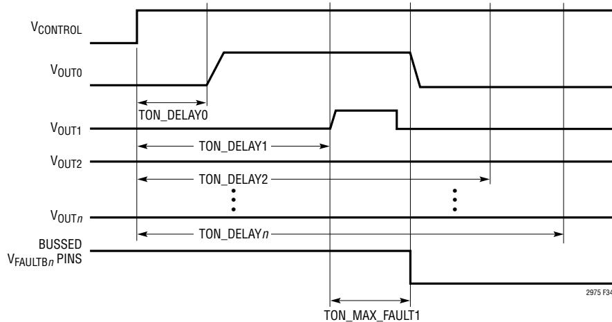

The timing diagram shows the control signal  $V_{CONTROL}$  going high, which triggers a sequence of output enable signals  $V_{OUT0}$ ,  $V_{OUT1}$ ,  $V_{OUT2}$ , up to  $V_{OUTn}$ . Each output has a corresponding delay time labeled  $T_{ON\_DELAY0}$ ,  $T_{ON\_DELAY1}$ ,  $T_{ON\_DELAY2}$ , and  $T_{ON\_DELAYn}$ . A fault condition  $V_{FAULTBn}$  is shown going low, which terminates the sequence with a delay  $T_{ON\_MAX\_FAULT1}$ .

Timing diagram showing the relationship between VCONTROL, VOUT0, VOUT1, VOUT2, VOUTn, and BUSSED VFAULTBn PINS. It illustrates TON\_DELAY0, TON\_DELAY1, TON\_DELAY2, TON\_DELAYn, and TON\_MAX\_FAULT1.

Figure 34. Aborted On-Sequence Due to Channel 1 Short

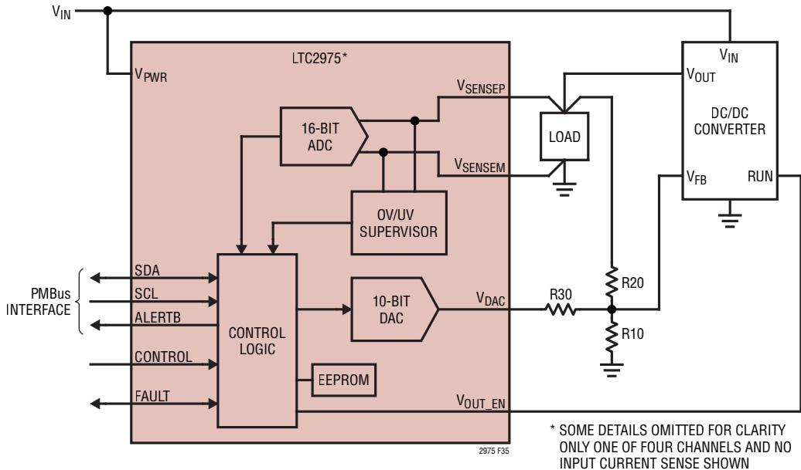

The diagram illustrates the internal architecture of the LTC2975\* and its connection to a DC/DC converter. Inside the LTC2975\*, a 16-BIT ADC and a 10-BIT DAC are connected to a central CONTROL LOGIC block. The CONTROL LOGIC also interfaces with a PMBus INTERFACE (SDA, SCL, ALERTB, CONTROL, FAULT) and an EEPROM. An OV/UV SUPERVISOR is also present. The 10-BIT DAC output  $V_{DAC}$  is connected to the feedback node of the DC/DC converter through resistor R30. The DC/DC converter's feedback node is also connected to a resistor divider consisting of R20 and R10. The converter's output  $V_{OUT}$  is sensed by the LTC2975\* through  $V_{SENSEP}$  and  $V_{SENSEM}$  pins. A note states: "\* SOME DETAILS OMITTED FOR CLARITY ONLY ONE OF FOUR CHANNELS AND NO INPUT CURRENT SENSE SHOWN".

Block diagram of the LTC2975\* application circuit. It shows the internal components like 16-BIT ADC, 10-BIT DAC, and CONTROL LOGIC, connected to a DC/DC CONVERTER and various feedback resistors (R10, R20, R30).

Figure 35. Application Circuit for DC/DC Converters with External Feedback Resistors

{93}------------------------------------------------

## APPLICATIONS INFORMATION

### Four-Step Resistor Selection Procedure for DC/DC Converters with External Feedback Resistors

The following four-step procedure should be used to calculate the resistor values required for the application circuit shown in Figure 35.

1. Assume values for feedback resistor R20 and the nominal DC/DC converter output voltage  $V_{DC(NOM)}$ , and solve for R10.

$V_{DC(NOM)}$  is the output voltage of the DC/DC converter when the LTC2975's  $V_{DAC0}$  pin is in a high impedance state. R10 is a function of R20,  $V_{DC(NOM)}$ , the voltage at the feedback node ( $V_{FB}$ ) when the loop is in regulation, and the feedback node's input current ( $I_{FB}$ ).

$$R10 = \frac{R20 \cdot V_{FB}}{V_{DC(NOM)} - I_{FB} \cdot R20 - V_{FB}} \quad (1)$$

2. Solve for the value of R30 that yields the maximum required DC/DC converter output voltage  $V_{DC(MAX)}$ .

When  $V_{DAC0}$  is at 0V, the output of the DC/DC converter is at its maximum voltage.

$$R30 \leq \frac{R20 \cdot V_{FB}}{V_{DC(MAX)} - V_{DC(NOM)}} \quad (2)$$

3. Solve for the minimum value of  $V_{DAC0}$  that's needed to yield the minimum required DC/DC converter output voltage  $V_{DC(MIN)}$ .

The DAC has two full-scale settings, 1.38V and 2.65V. In order to select the appropriate full-scale setting, calculate the minimum required  $V_{FS\_VDAC}$  output voltage:

$$V_{FS\_VDAC} > (V_{DC(NOM)} - V_{DC(MIN)}) \cdot \frac{R30}{R20} + V_{FB} \quad (3)$$

4. Re-calculate the minimum, nominal, and maximum DC/DC converter output voltages and the resulting margining resolution.

$$V_{DC(NOM)} = V_{FB} \cdot \left( 1 + \frac{R20}{R10} \right) + I_{FB} \cdot R20 \quad (4)$$

$$V_{DC(MIN)} = V_{DC(NOM)} - \frac{R20}{R30} \cdot (V_{FS\_VDAC} - V_{FB}) \quad (5)$$

$$V_{DC(MAX)} = V_{DC(NOM)} + \frac{R20}{R30} \cdot V_{FB} \quad (6)$$

$$V_{RES} = \frac{\frac{R20}{R30} \cdot V_{FS\_VDAC}}{1023} \text{ V/DAC LSB} \quad (7)$$

### Trimming and Margining DC/DC Converters with a TRIM Pin

Figure 36 illustrates a typical application circuit for trimming/margining the output voltage of a DC/DC converter with a TRIM Pin. The LTC2975's  $V_{DAC0}$  pin connects to the TRIM pin through resistor R30. For this configuration, set the DAC polarity bit Mfr\_config\_dac\_pol in MFR\_CONFIG\_LTC2975 to 1.

DC/DC converters with a TRIM pin may be margined high or low by connecting an external resistor between the TRIM pin and either the  $V_{SENSEP}$  or  $V_{SENSEM}$  pin. The relationships between these resistors and the  $\Delta\%$  change in the output voltage of the DC/DC converter are typically expressed as:

$$R_{TRIM\_DOWN} = \frac{R_{TRIM} \cdot 50}{\Delta_{DOWN}\%} - R_{TRIM} \quad (8)$$

$$R_{TRIM\_UP} =$$

$$R_{TRIM} \cdot \left[ \frac{V_{DC} \cdot (100 + \Delta_{UP}\%)}{2 \cdot V_{REF} \cdot \Delta_{UP}\%} - \left( \frac{50}{\Delta_{UP}\%} \right) - 1 \right] \quad (9)$$

where  $R_{TRIM}$  is the resistance looking into the TRIM pin,  $V_{REF}$  is the TRIM pin's open-circuit output voltage and  $V_{DC}$  is the DC/DC converter's nominal output voltage.  $\Delta_{UP}\%$  and  $\Delta_{DOWN}\%$  denote the percentage change in the converter's output voltage when margining up or down, respectively.

{94}------------------------------------------------

## APPLICATIONS INFORMATION

![Figure 36: Application Circuit for DC/DC Converters with Trim Pin. The diagram shows an LTC2975* IC connected to a DC/DC converter. The LTC2975* has pins for V_PWR, V_DDS33, V_DDS3, V_DDS25, GND, V_IN_SNS, V_DAC0, V_SENSEP0, V_SENSEM0, and V_OUT_EN0. The DC/DC converter has pins for V_IN, V_O+, TRIM, V_SENSE+, V_SENSE-, ON/OFFB, and V_O-. A resistor R30 is connected between the TRIM pin and the V_SENSE+ pin. A load is connected between the V_O+ and ground pins of the DC/DC converter. Input voltage is specified as 4.5V < V_IBUS < 15V. Two 0.1µF capacitors are connected to the V_DDS33 and V_DDS25 pins. A note states: * SOME DETAILS OMITTED FOR CLARITY ONLY ONE OF FOUR CHANNELS AND NO INPUT CURRENT SENSE SHOWN.](img/b3d488012fdceacab867cf24c5efef05_img.jpg)

Figure 36: Application Circuit for DC/DC Converters with Trim Pin. The diagram shows an LTC2975\* IC connected to a DC/DC converter. The LTC2975\* has pins for V\_PWR, V\_DDS33, V\_DDS3, V\_DDS25, GND, V\_IN\_SNS, V\_DAC0, V\_SENSEP0, V\_SENSEM0, and V\_OUT\_EN0. The DC/DC converter has pins for V\_IN, V\_O+, TRIM, V\_SENSE+, V\_SENSE-, ON/OFFB, and V\_O-. A resistor R30 is connected between the TRIM pin and the V\_SENSE+ pin. A load is connected between the V\_O+ and ground pins of the DC/DC converter. Input voltage is specified as 4.5V < V\_IBUS < 15V. Two 0.1µF capacitors are connected to the V\_DDS33 and V\_DDS25 pins. A note states: \* SOME DETAILS OMITTED FOR CLARITY ONLY ONE OF FOUR CHANNELS AND NO INPUT CURRENT SENSE SHOWN.

Figure 36. Application Circuit for DC/DC Converters with Trim Pin

### Two-Step Resistor and DAC Full-Scale Voltage Selection Procedure for DC/DC Converters with a TRIM Pin

The following two-step procedure should be used to calculate the resistor value for R30 and the required full-scale DAC voltage (refer to Figure 36).

1. Solve for R30:

$$R30 \leq R_{TRIM} \cdot \left( \frac{50 - \Delta_{DOWN}\%}{\Delta_{DOWN}\%} \right) \quad (10)$$

2. Calculate the maximum required output voltage for VDAC0:

$$V_{DAC0} \geq \left( 1 + \frac{\Delta_{UP}\%}{\Delta_{DOWN}\%} \right) \cdot V_{REF} \quad (11)$$

Note: Not all DC/DC converters follow these trim equations, especially newer bricks. Consult ADI Field Application Engineering.

### Measuring Output with a Sense Resistor

A circuit for measuring current with a sense resistor is shown in Figure 37. The balanced filter rejects both common mode and differential mode noise from the output of the DC/DC converter. The filter is placed directly across the sense resistor in series with the DC/DC converter's inductor. Note that the current sense inputs must be limited to less than 6V with respect to ground. Select RCM and CCM such that the filter's corner frequency is < 1/10 the DC/DC converter's switching frequency. This will result in a current sense waveform that offers a good compromise

between the voltage ripple and the delay through the filter. A value 1kΩ for RCM is suggested in order to minimize gain errors due to the current sense inputs' internal resistance.

### Measuring Output with Inductor DCR

Figure 38 shows the circuit for applications that require DCR current sense. A second order R-C filter is required in these applications in order to minimize the ripple voltage seen at the current sense inputs. A value of 1kΩ is suggested for RCM1 and RCM2 in order to minimize gain errors due to the current sense inputs' internal resistance. CCM1 should be selected to provide cancellation of the zero created by the DCR and inductance, i.e. CCM1 = L/(DCR • RCM1). CCM2 should be selected to provide a second stage corner frequency at < 1/10 of the

Figure 37: Sense Resistor Current Sensing Circuits. The diagram shows a DC/DC converter output connected to a load inductor L. A sense resistor R\_SNS is placed in series with the inductor. A balanced filter consisting of two resistors R\_CM and two capacitors C\_CM is connected across the sense resistor. The output of the filter is connected to the I\_SENSEP and I\_SENSEM pins of an LTC2975 IC. The diagram is labeled 2975 F37.

Figure 37. Sense Resistor Current Sensing Circuits

Figure 38: DCR Current Sensing Circuits. The diagram shows a DC/DC converter output connected to a load inductor L and a DCR. A second-order R-C filter is used for current sensing. The filter consists of two resistors R\_CM1 and R\_CM2, and two capacitors C\_CM1 and C\_CM2. The output of the filter is connected to the I\_SENSEP and I\_SENSEM pins of an LTC2975 IC. The diagram is labeled 2975 F38.

Figure 38. DCR Current Sensing Circuits

{95}------------------------------------------------

## APPLICATIONS INFORMATION

DC/DC converter's switching frequency. In addition,  $C_{CM2}$  needs to be much smaller than  $C_{CM1}$  in order to prevent significant loading of the filter's first stage.

### Single Phase Design Example

As a design example for a DCR current sense application, assume  $L = 2.2\mu H$ ,  $DCR = 10m\Omega$ , and  $F_{SW} = 500kHz$ .

Let  $R_{CM1} = 1k\Omega$  and solve for  $C_{CM1}$ :

$$C_{CM1} \geq \frac{2.2\mu H}{10m\Omega \cdot 1k\Omega} = 220nF$$

Let  $R_{CM2} = 1k\Omega$ . In order to get a second pole at  $F_{SW}/10 = 50kHz$ :

$$C_{CM2} \cong \frac{1}{2\pi \cdot 50kHz \cdot 1k\Omega} = 3.18nF$$

Let  $C_{CM2} = 3.3nF$ . Note that since  $C_{CM2}$  is much less than  $C_{CM1}$  the loading effects of the second stage filter on the matched first stage are not significant. Consequently, the delay time constant through the filter for the current sense waveform will be approximately  $3\mu s$ .

### Measuring Multiphase Currents

For current sense applications with more than one phase, R-C averaging may be employed. Figure 39 shows an example of this approach for a 3-phase system with DCR current sensing. The current sense waveforms are averaged

together prior to being applied to the second stage of the filter consisting of  $R_{CM2}$  and  $C_{CM2}$ . Because the  $R_{CM1}$  resistors for the three phases are in parallel, the value of  $R_{CM1}$  must be multiplied by the number of phases. Also note that since the DCRs are effectively in parallel, the value for  $IOUT\_CAL\_GAIN$  will be equal to the inductor's DCR divided by the number of phases. Care should be taken in the layout of the multiphase inductors to keep the PCB trace resistance from the DC side of each inductor to the summing node balanced in order to provide the most accurate results.

#### Multiphase Design Example

Using the same values for inductance and DCR from the previous design example, the value for  $R_{CM1}$  will be  $3k\Omega$  for a three phase DC/DC converter if  $C_{CM1}$  is left at  $220nF$ . Similarly, the value for  $IOUT\_CAL\_GAIN$  will be  $DCR/3 = 3.33m\Omega$ .

### Anti-aliasing Filter Considerations

Noisy environments require an anti-aliasing filter on the input to the LTC2975's ADC. The R-C circuit shown in Figure 40 is adequate for most situations. Keep  $R_{40} = R_{50} \leq 200\Omega$  to minimize ADC gain errors, and select a value for capacitors  $C_{10}$  and  $C_{20}$  that doesn't add too much additional response time to the OV/UV supervisor, e.g.  $\tau = 10\mu s$  ( $R = 100\Omega$ ,  $C = 0.10\mu F$ ).

Figure 39: Multiphase DCR Current Sensing Circuits. The diagram shows a three-phase system with inductors L and DCRs connected to a load. The phases are labeled SWX1, SWX2, and SWX3. The current sense waveforms are averaged using a network of resistors RCM1, RCM1/3, and RCM2, and capacitors CCM1, CCM2. The output is connected to the LTC2975 ADC, with inputs labeled ISENSEP and ISENSEM. A small label '2975 F39' is at the bottom right of the diagram.

Figure 39. Multiphase DCR Current Sensing Circuits

{96}------------------------------------------------

## APPLICATIONS INFORMATION

![Figure 40: Anti-Aliasing Filter on VSENSE Lines. This circuit diagram shows the LTC2975* connected to a DC/DC converter. The LTC2975* has pins V_PWR, V_IN_SNS, V_DAC0, V_SENSEP0, V_SENSEM0, V_OUT_EN0, and GND. The DC/DC converter has pins V_IN, V_OUT, V_FB, SGND, RUN/SS, and GND. The anti-aliasing filter consists of resistors R40, R50, R20, R30, and R10, and capacitors C10, C20, and 0.1µF capacitors on the V_PWR and V_DAC0 pins. A note states: '*SOME DETAILS OMITTED FOR CLARITY ONLY ONE OF FOUR CHANNELS SHOWN'.](img/d9ea7e6c55ac790700d27c96ba7f66a3_img.jpg)

Figure 40: Anti-Aliasing Filter on VSENSE Lines. This circuit diagram shows the LTC2975\* connected to a DC/DC converter. The LTC2975\* has pins V\_PWR, V\_IN\_SNS, V\_DAC0, V\_SENSEP0, V\_SENSEM0, V\_OUT\_EN0, and GND. The DC/DC converter has pins V\_IN, V\_OUT, V\_FB, SGND, RUN/SS, and GND. The anti-aliasing filter consists of resistors R40, R50, R20, R30, and R10, and capacitors C10, C20, and 0.1µF capacitors on the V\_PWR and V\_DAC0 pins. A note states: '\*SOME DETAILS OMITTED FOR CLARITY ONLY ONE OF FOUR CHANNELS SHOWN'.

Figure 40. Anti-Aliasing Filter on VSENSE Lines

![Figure 41: Sensing Negative Voltages. This circuit diagram shows the LTC2975 connected to a PMBus interface and a negative power supply (V_EE = -12V). The LTC2975 has pins V_PWR, V_IN_SNS, REFP, REFM, V_SENSEP1, V_SENSEM1, PWRGD, WDI/RESETB, FAULTB, SHARE_CLK, ASEL0, ASEL1, WP, and GND. The PMBus interface includes SDA, SCL, ALERTB, and CONTROL pins. The negative supply sensing circuit uses a resistor divider R1 (4.99k) and R2 (120k) to translate the negative supply voltage to the V_SENSEM1 input. A note states: 'POWER_GOOD_ON = 0.5V FOR V_EE POWER_GOOD = -11.414V WHERE V_EE POWER_GOOD = V_REFP - POWER_GOOD_ON (R2/R1 + 1) - 1µA • R2 ONLY ONE OF FOUR CHANNELS SHOWN, SOME DETAILS OMITTED FOR CLARITY'.](img/7dfe05137c554aca6bed20d67e52d739_img.jpg)

Figure 41: Sensing Negative Voltages. This circuit diagram shows the LTC2975 connected to a PMBus interface and a negative power supply (V\_EE = -12V). The LTC2975 has pins V\_PWR, V\_IN\_SNS, REFP, REFM, V\_SENSEP1, V\_SENSEM1, PWRGD, WDI/RESETB, FAULTB, SHARE\_CLK, ASEL0, ASEL1, WP, and GND. The PMBus interface includes SDA, SCL, ALERTB, and CONTROL pins. The negative supply sensing circuit uses a resistor divider R1 (4.99k) and R2 (120k) to translate the negative supply voltage to the V\_SENSEM1 input. A note states: 'POWER\_GOOD\_ON = 0.5V FOR V\_EE POWER\_GOOD = -11.414V WHERE V\_EE POWER\_GOOD = V\_REFP - POWER\_GOOD\_ON (R2/R1 + 1) - 1µA • R2 ONLY ONE OF FOUR CHANNELS SHOWN, SOME DETAILS OMITTED FOR CLARITY'.

Figure 41. Sensing Negative Voltages

### Sensing Negative Voltages

Figure 41 shows the LTC2975 sensing a negative power supply ( $V_{EE}$ ). The R1/R2 resistor divider translates the negative supply voltage to the LTC2975's  $V_{SENSEM1}$  input while the  $V_{SENSEP1}$  input is tied to the REFP pin which has a typical output voltage of 1.23V. The voltage divider should be configured in order to present about 0.5V to the voltage sense inputs when the negative supply reaches its POWER\_GOOD\_ON threshold so that the current flowing out of the  $V_{SENSEMn}$  pin is minimized to  $\sim 1\mu A$ . The relationship between the POWER\_GOOD\_ON register value and the corresponding negative supply value can be expressed as:

$$V_{EE} = V_{REFP} - (READ\_VOUT) \cdot \left( \frac{R2}{R1} + 1 \right) - 1\mu A \cdot R2$$

where READ\_VOUT returns  $V_{SENSEP} - V_{SENSEM}$

### Connecting the DC1613 USB to I2C/SMBus/PMBus Controller to the LTC2975 in System

The DC1613 USB to I2C/SMBus/PMBus Controller can be interfaced to the LTC2975s on the user's board for programming, telemetry and system debug. The controller, when used in conjunction with LTpowerPlay software, provides a powerful way to debug an entire power system. Failures are quickly diagnosed using telemetry, fault status registers and the fault log. The final configuration can be quickly developed and stored to the LTC2975's EEPROM.

Rev. D

{97}------------------------------------------------

## APPLICATIONS INFORMATION

Figure 42 and Figure 43 illustrate application schematics for powering, programming and communicating with one or more LTC2975's via the ADI I2C/SMBus/PMBus controller regardless of whether or not system power is present.

Figure 42 shows the recommended schematic to use when the LTC2975 is powered by the system intermediate bus through its VPWR pin.

Figure 43 shows the recommended schematic to use when the LTC2975 is powered by the system 3.3V through its VDD33 and VPWR pins. The LTC4412 ideal ORing circuit allows either the controller or system to power the LTC2975.

Because of the controller's limited current sourcing capability, only the LTC2975s, their associated pull-up resistors and the I2C/SMBus pull-up resistors should be powered from the ORed 3.3V supply. In addition, any device sharing I2C/SMBus bus connections with the LTC2975 should not have body diodes between the SDA/SCL pins and its VDD node because this will interfere with bus communication in the absence of system power.

The ADI controller's I2C/SMBus connections are opto-isolated from the PC's USB. The 3.3V from the controller and the LTC2975's VDD33 pin can be paralleled because the ADI LDOs that generate these voltages can be back driven and draw <10μA. The controller's 3.3V current limit is 100mA.

## ACCURATE DCR TEMPERATURE COMPENSATION

Using the DC resistance of the inductor as a current shunt element has several advantages – no additional power loss, lower circuit complexity and cost. However, the strong temperature dependence of the inductor resistance and the difficulty in measuring the exact inductor core temperature introduce errors in the current measurement. For copper, a change of inductor temperature of only 1°C corresponds to approximately 0.39% current gain change. Figure 44 shows a sample layout using the integrated DC/DC converter LTC3601 (right) and its corresponding thermal image (left). The converter is providing 1.8V, 1.5A to the output load.

![Circuit diagram showing ADI Controller Connections for LTC2975 when V_PWR is used. The diagram includes an isolated 3.3V source connected to an I2C/SMBus/PMBus controller. This controller is connected to an LTC2975* chip. Power is supplied to the LTC2975 via V_PWR (4.5V to 15V) and VDD33 (3.3V) pins. The LTC2975 is also connected to other LTC power system managers via SCL, SDA, and SHARE_CLK pins. Pull-up resistors (150k, 49.9k, 10k, 10k, 5.49k) and capacitors (0.1μF) are shown. A note indicates to repeat the outlined circuit for every LTC2975.](img/896f6ec457b6252d4af32a634299218c_img.jpg)

REPEAT OUTLINED CIRCUIT FOR EVERY LTC2975

ISOLATED 3.3V

SCL

GND

SDA

TO LTC USB TO I2C/SMBUS/PMBUS CONTROLLER

150k

49.9k

NTS4173P

4.5V TO 15V

0.1μF

VPWR

LTC2975\*

VDD33

VDD33

VDD25

0.1μF

0.1μF

10k

10k

5.49k

SCL

SDA

SHARE\_CLK

WP

GND

2975 F42

\*PIN CONNECTIONS OMITTED FOR CLARITY

TO/FROM OTHER LTC POWER SYSTEM MANAGERS

Circuit diagram showing ADI Controller Connections for LTC2975 when V\_PWR is used. The diagram includes an isolated 3.3V source connected to an I2C/SMBus/PMBus controller. This controller is connected to an LTC2975\* chip. Power is supplied to the LTC2975 via V\_PWR (4.5V to 15V) and VDD33 (3.3V) pins. The LTC2975 is also connected to other LTC power system managers via SCL, SDA, and SHARE\_CLK pins. Pull-up resistors (150k, 49.9k, 10k, 10k, 5.49k) and capacitors (0.1μF) are shown. A note indicates to repeat the outlined circuit for every LTC2975.

Figure 42. ADI Controller Connections When VPWR Is Used

{98}------------------------------------------------

## APPLICATIONS INFORMATION

![Schematic diagram of ADI Controller Connections. The LTC4412 ideal diode controller is connected to a SYSTEM 3.3V rail. Its SENSE pin connects to the isolated 3.3V rail, and its GATE pin drives an NTS4173P MOSFET. The LTC2975* controller is connected to the isolated 3.3V rail and an OR'D 3.3V rail. It has pins for V_PWR, V_DD33, V_DD25, SCL, SDA, SHARE_CLK, WP, and GND. The isolated 3.3V rail is connected to an I²C/SMBUS/PMBUS controller. The OR'D 3.3V rail is connected to other LTC power system managers. 0.1µF capacitors are connected from the isolated 3.3V rail to ground. A note states: *PIN CONNECTIONS OMITTED FOR CLARITY. NOTE: LTC CONTROLLER I²C CONNECTIONS ARE OPTO-ISOLATED. ISOLATED 3.3V FROM LTC CONTROLLER CAN BE BACK DRIVEN AND WILL ONLY DRAW <10µA. ISOLATED 3.3V CURRENT LIMIT IS 100mA.](img/592f13acca3e6d5152dd4489f030d004_img.jpg)

Schematic diagram of ADI Controller Connections. The LTC4412 ideal diode controller is connected to a SYSTEM 3.3V rail. Its SENSE pin connects to the isolated 3.3V rail, and its GATE pin drives an NTS4173P MOSFET. The LTC2975\* controller is connected to the isolated 3.3V rail and an OR'D 3.3V rail. It has pins for V\_PWR, V\_DD33, V\_DD25, SCL, SDA, SHARE\_CLK, WP, and GND. The isolated 3.3V rail is connected to an I²C/SMBUS/PMBUS controller. The OR'D 3.3V rail is connected to other LTC power system managers. 0.1µF capacitors are connected from the isolated 3.3V rail to ground. A note states: \*PIN CONNECTIONS OMITTED FOR CLARITY. NOTE: LTC CONTROLLER I²C CONNECTIONS ARE OPTO-ISOLATED. ISOLATED 3.3V FROM LTC CONTROLLER CAN BE BACK DRIVEN AND WILL ONLY DRAW <10µA. ISOLATED 3.3V CURRENT LIMIT IS 100mA.

Figure 43. ADI Controller Connections When LTC2975 Is Powered Directly from 3.3V

Thermal image of a DC/DC converter. The left side shows a thermal map with temperature labels: Switcher (35.9), Inductor (31.5), and Ts (29.8). A color scale on the right ranges from 23.0 to 37.0 °C. The right side shows a photograph of the PCB with labels for LTC3601, INDuctor, and TEMPERATURE SENSOR.

Figure 44. Thermal Image of a DC/DC Converter Showing the Difference Between the Actual Inductor Temperature and the Temperature Sensing Point

{99}------------------------------------------------

## APPLICATIONS INFORMATION

Heat dissipation in the inductor under high load conditions creates transient and steady state thermal gradients between the inductor and the temperature sensor, and the sensed temperature does not accurately represent the inductor core temperature. This temperature gradient is clearly visible in the thermal image of Figure 44. In addition, transient heating/cooling effects have to be accounted for in order to reduce the transient errors introduced when load current changes are faster than heat transfer time constants of the inductor. Both of these problems are addressed by introducing two additional parameters: the thermal resistance  $\theta_{IS}$  from the inductor core to the on-board temperature sensor, and the inductor thermal time constant  $\tau$ . The thermal resistance  $\theta_{IS}$  [°C/W], is used to calculate the steady state difference between the sensed temperature  $T_S$  and the internal inductor temperature  $T_I$  for a given power dissipated in the inductor  $P_I$ :

$$T_I - T_S = \theta_{IS} P_I = \theta_{IS} V_{DCR} I_{OUT} \quad (1.1)$$

The additional temperature rise is used for a more accurate estimate of the inductor DC resistance  $R_I$ :

$$R_I = R_0 (1 + \alpha [T_S - T_{REF} + \theta_{IS} V_{DCR} I_{OUT}]) \quad (1.2)$$

In these equations,  $V_{DCR}$  is the inductor DC voltage drop,  $I_{OUT}$  is the RMS value of the output current,  $R_0$  is the inductor DC resistance at the reference temperature  $T_{REF}$  and  $\alpha$  is the temperature coefficient of the resistance. Since most inductors are made of copper, we can expect a temperature coefficient close to  $\alpha_{CU} = 3900 \text{ ppm/}^\circ\text{C}$ . For a given  $\alpha$ , the remaining parameters  $\theta_{IS}$  and  $R_0$  can be calibrated at a single temperature using only two load currents:

$$R_0 = \frac{(R_2 - R_1)(P_2 + P_1) - (R_2 + R_1)(P_2 - P_1)}{\alpha(T_2 - T_1)(P_2 + P_1) - (P_2 - P_1)(2 + \alpha[T_1 + T_2 - 2T_{REF}])} \quad (1.3)$$

$$\theta_{IS} = \frac{1}{\alpha R_0} \frac{\alpha(R_1 + R_2)(T_2 - T_1) - (R_2 - R_1)(2 + \alpha[T_1 + T_2 - 2T_{REF}])}{\alpha(T_2 - T_1)(P_2 + P_1) - (P_2 - P_1)(2 + \alpha[T_1 + T_2 - 2T_{REF}])} \quad (1.4)$$

The inductor resistance,  $R_K = V_{DCR(K)}/I_{OUT(K)}$ , power dissipation  $P_K = V_{DCR(K)} I_{OUT(K)}$  and the sensed temperature  $T_K$ , ( $K = 1, 2$ ) are recorded for each load current. To increase the accuracy in calculating  $\theta_{IS}$ , the two load currents should be chosen around  $I_1 = 10\%$  and  $I_2 = 90\%$  of the current range of the system.

The inductor thermal time constant  $\tau$  models the first order thermal response of the inductor and allows accurate DCR compensation during load transients. During a transition from low to high load current, the inductor resistance increases due to the self-heating. If we apply a single load step from the low current  $I_1$  to the higher current  $I_2$ , the voltage across the inductor will change instantaneously from  $I_1 R_1$  to  $I_2 R_1$  and then slowly approach  $I_2 R_2$ . Here  $R_1$  is the steady state resistance at the given temperature and load current  $I_1$ , and  $R_2$  is the slightly higher DC resistance at  $I_2$ , due to the inductor self-heating. Note that the electrical time constant  $\tau_{EL} = L/R$  is several orders of magnitude shorter than the thermal one, and “instantaneous” is relative to the thermal time constant. The two settled regions give us the data sets ( $I_1, T_1, R_1, P_1$ ) and ( $I_2, T_2, R_2, P_2$ ) and the two-point calibration technique (1.3-1.4) is used to extract the steady-state parameters  $\theta_{IS}$  and  $R_0$  (given a previously characterized average  $\alpha$ ). The relative current error calculated using the steady-state expression (1.2) will peak immediately after the load step, and then decay to zero with the inductor thermal time constant  $\tau$ .

$$\frac{\Delta I}{I}(t) = \alpha \theta_{IS} (V_2 \cdot I_2 - V_1 \cdot I_1) e^{-t/\tau} \quad (1.5)$$

The time constant  $\tau$  is calculated from the slope of the best-fit line  $y = \ln(\Delta I/I) = a_1 + a_2 t$ :

$$\tau = -\frac{1}{a_2} \quad (1.6)$$

In summary, a single load current step is all that is needed to calibrate the DCR current measurement. The stable portions of the response give us the thermal resistance  $\theta_{IS}$  and nominal DC resistance  $R_0$ , and the settling characteristic is used to measure the inductor thermal time constant  $\tau$ .

To get the best performance, the temperature sensor has to be as close as possible to the inductor and away from other significant heat sources. For example in Figure 44, the bipolar sense transistor is close to the inductor and away from the switcher. Connect the collector of the PNP to the base. Route the base and emitter separately to the LTC2975. Connect base and collector to the signal ground close to LTC2975.

{100}------------------------------------------------

## APPLICATIONS INFORMATION

## LTpowerPlay: AN INTERACTIVE GUI FOR POWER MANAGERS

LTpowerPlay is a powerful Windows based development environment that supports Analog Devices power manager ICs with EEPROM, including the LTC2975. The software supports a variety of different tasks. You can use LTpowerPlay to evaluate Analog Devices ICs by connecting to a demo board system. LTpowerPlay can also be used in an offline mode (with no hardware present) in order to build a multi-chip configuration file that can be saved and re-loaded at a later time. LTpowerPlay provides unprecedented diagnostic and debug features. It

becomes a valuable diagnostic tool during board bring-up to program the power management scheme in a system. LTpowerPlay utilizes Analog Devices' DC1613 USB-to-I2C/SMBus/PMBus Controller to communicate with one of many potential targets including the DC2022 demo board set, the DC1508 socketed programming board, or a customer target system. The software also provides an automatic update feature to keep the software current with the latest set of device drivers and documentation. A great deal of context sensitive help is available within LTpowerPlay along with several tutorial demos. [Complete information is available.](#)

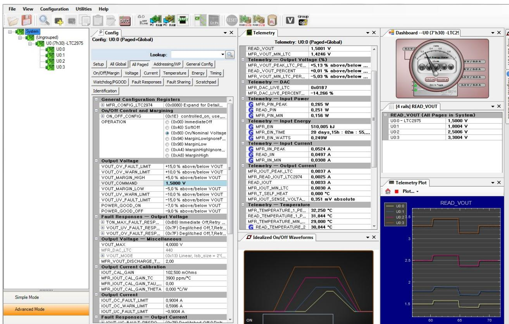

The screenshot displays the LTpowerPlay software interface with the following components:

- Left Panel:** A tree view showing the system configuration for U0 (7h30) - LTC2975, with sub-entries for U0.0, U0.1, U0.2, and U0.3.
- Center-Left Panel:** The 'Config' window for U0.0 (Paged+Global) showing various configuration registers:
  - General Configuration Registers:** MFR\_CONFIG\_LTC2974 (0x0080) Expand for Detail...
  - On/Off Control and Margining:** ON\_OFF\_CONFIG (0x1E) controlled\_on\_use... OPERATION
  - Output Voltage:** VOUT\_OV\_FAULT\_LIMIT +15.0 % above/below VOUT, VOUT\_OV\_WARN\_LIMIT +10.0 % above/below VOUT, VOUT\_MARGIN\_HIGH +5.0 % above/below VOUT, VOUT\_COMMAND 1,5000 V, VOUT\_MARGIN\_LOW -5.0 % above/below VOUT, VOUT\_UV\_WARN\_LIMIT -10.0 % above/below VOUT, VOUT\_UV\_FAULT\_LIMIT -15.0 % above/below VOUT, POWER\_GOOD\_ON -7.0 % above/below VOUT, POWER\_GOOD\_OFF -9.0 % above/below VOUT
  - Fault Responses - Output Voltage:** TON\_MAX\_FAULT\_RESP... (0x88) Immediate Off,Retry..., VOUT\_UV\_FAULT\_RESP... (0x7F) Deglitched Off,7,Retr..., VOUT\_OV\_FAULT\_RESP... (0x7F) Deglitched Off,7,Retr...
  - Output Voltage - Miscellaneous:** VOUT\_MAX 4,0000 V, MFR\_DAC\_LTC 440, VOUT\_MODE (0x13) Linear, Isb\_size = 2%, MFR\_VOUT\_DISCHARGE\_T... 2.00
  - Output Current Calibration:** IOUT\_CAL\_GAIN 102,500 mOhms, MFR\_IOUT\_CAL\_GAIN\_TC 3900 ppm/°C, MFR\_IOUT\_CAL\_GAIN\_TAU... 0.00, MFR\_IOUT\_CAL\_GAIN\_THETA 0.000 °C/W
  - Output Current:** IOUT\_OC\_FAULT\_LIMIT 0,9004 A, IOUT\_OC\_WARN\_LIMIT 0,5996 A, IOUT\_OC\_WARN\_LIMIT -0,9004 A
  - Fault Responses - Output Current:** IOUT\_OC\_FAULT\_RESP... (0x7F) Deglitched Off,7,Retr...
- Center-Right Panel:** The 'Telemetry' window for U0.0 (Paged+Global) showing real-time data:
  - Output Voltage (%):** READ\_VOUT 1,5001 V, MFR\_VOUT\_MIN\_LTC 1,4246 V, MFR\_VOUT\_PEAK\_LTC\_P... +5.13 % above/below..., READ\_VOUT\_PERCENT +0.01 % above/below..., MFR\_VOUT\_MIN\_LTC\_P... -5.03 % above/below...
  - DAC:** MFR\_DAC\_LIVE\_LTC 0x01B7, MFR\_DAC\_LIVE\_PERCENT... -14,266 %
  - Input Power:** MFR\_PIN\_PEAK 0,265 W, READ\_PIN 0,251 W, MFR\_PIN\_MIN 0,156 W
  - Input Energy:** MFR\_EIN 510,005 kJ, MFR\_EIN\_TIME 20 days,15h : 02m : 55..., MFR\_EIN\_WATTS 0,249W
  - Input Current:** MFR\_JIN\_PEAK 0,0524 A, READ\_JIN 0,0497 A, MFR\_JIN\_MIN 0,0308 A
  - Output Current:** MFR\_IOUT\_PEAK\_LTC 0,0037 A, MFR\_READ\_IOUT\_LTC2974 0,0025 A, READ\_IOUT 0,0033 A, MFR\_IOUT\_MIN\_LTC 0,0030 A, MFR\_T\_SELF\_HEAT 0,000 °C, MFR\_IOUT\_SENSE\_VOLTA... 0,351 mV absolute
  - Temperature:** MFR\_TEMPERATURE\_1\_P... 32,250 °C, READ\_TEMPERATURE\_1\_P... 31,844 °C, MFR\_TEMPERATURE\_MIN... 29,000 °C, READ\_TEMPERATURE\_2... 30,844 °C
- Right Panel:** The 'Dashboard' window showing a gauge for 'READ\_VOUT' and a table of 'READ\_VOUT (All Pages in System)'.
  - Dashboard Gauge:** Shows a needle pointing to approximately 1.5 V.
  - READ\_VOUT (All Pages in System) Table:**

| Page           | READ_VOUT |
|----------------|-----------|
| U0.0 - LTC2975 | 1,5000 V  |
| U0.1           | 1,8004 V  |
| U0.2           | 2,5006 V  |
| U0.3           | 3,3004 V  |
- Bottom Center:** The 'Idealized On/Off Waveforms' window showing a graph of voltage and current over time during power transitions.
- Bottom Right:** The 'Telemetry Plot' window showing a graph of 'READ\_VOUT' over time for multiple pages (U0.0, U0.1, U0.2, U0.3).

A screenshot of the LTpowerPlay software interface showing various configuration registers, telemetry data, and a plot of output voltage over time.

Figure 45. LTpowerPlay Snapshot

{101}------------------------------------------------

## APPLICATIONS INFORMATION

## PCB ASSEMBLY AND LAYOUT SUGGESTIONS

### Bypass Capacitor Placement

The LTC2975 requires 0.1 $\mu$ F bypass capacitors between the  $V_{DD33}$  pins and GND, the  $V_{DD25}$  pin and GND, the REFP pin and REFM pin, and a 10nF capacitor between the VIN\_SNS\_CAP pin and GND. If the chip is being powered from the  $V_{PWR}$  input, then that pin should also be bypassed to GND by a 0.1 $\mu$ F capacitor. In order to be effective, these capacitors should be made of a high quality ceramic dielectric such as X5R or X7R and be placed as close to the chip as possible.

### Exposed Pad Stencil Design

The LTC2975's package is thermally and electrically efficient. This is enabled by the exposed die attach pad on the under side of the package which must be soldered down to the PCB or mother board substrate. It is a good practice to minimize the presence of voids within the exposed pad inter-connection. Total elimination of voids is difficult, but the design of the exposed pad stencil is key. Figure 46 shows a suggested screen print pattern. The proposed stencil design enables out-gassing of the solder paste during reflow as well as regulating the finished solder thickness. See IPC7525A.

Figure 46: Suggested Screen Pattern for Die Attach Pad. The diagram shows a rectangular 'QFN PACKAGE' with a central 'GROUND PLANE' area. Within this area, there is a 3x4 grid of 12 small squares. An arrow points to the grid with the text 'APERATURE DESIGN 50% TO 80% REDUCTION'.

Figure 46. Suggested Screen Pattern for Die Attach Pad

### PCB Board Layout

Mechanical stress on a PC board and soldering-induced stress can cause the LTC2975's reference voltage and the voltage drift to shift. A simple way to reduce the stress-related shifts is to mount the IC near the short edge of the PC board, or in a corner. The board acts as a stress boundary, or a region where the flexure of the board is minimal.

The LTC2975's READ\_IIN input current sense amplifier has very low offsets enabling accurate current, power, and energy readings. PC Board routing to current sense inputs may create a thermal voltage offset if differential routing paths cross dissimilar metal boundaries in the presence of a thermal gradient. To minimize thermal voltages, route differential current sense inputs as close together as possible, and minimize vias. If vias are necessary, make sure to place both positive and negative current sense path vias are close together to minimize the temperature difference.

### Unused ADC Sense Inputs

Connect all unused ADC sense inputs ( $V_{SENSEP_n}$ ,  $V_{SENSEM_n}$ ,  $T_{SENSE_n}$ ,  $I_{SENSEP_n}$  or  $I_{SENSEM_n}$ ) to GND. In a system where the inputs are connected to removable cards and may be left floating in certain situations, connect the inputs to GND using 100k resistors. Place the 100k resistors before any filter components, as shown in Figure 47, to prevent loading of the filter.

Figure 47: Connecting Unused Inputs to GND. The diagram shows a circuit with two parallel branches. Each branch contains a 100k resistor connected to ground. The top branch is connected to the VSENSEP pin of the LTC2975, and the bottom branch is connected to the VSENSEM pin. The LTC2975 is shown as a rectangular block with these pins labeled.

Figure 47. Connecting Unused Inputs to GND

{102}------------------------------------------------

## APPLICATIONS INFORMATION

## DESIGN CHECKLIST

### I2C

- The LTC2975 must be configured for a unique address.
- The address select pins (ASELn) are tri-level; Check Table 3.
- Check addresses for collision with other devices on the bus and any global addresses.

### Output Enables

- Use appropriate pull-up resistors on all VOUT\_ENn pins.
- Verify that the absolute maximum ratings of the VOUT\_ENn pins are not exceeded.

### VIN Sense

- No external resistive divider is required to sense VIN; VIN\_SNS already has an internal calibrated divider.

### Input Current Sense

- Verify that IIN\_SNSP and IIN\_SNSM pins do not exceed absolute maximum ratings.
- Add a 10nF capacitor to VIN\_SNS\_CAP

### External Temperature Sense

- Verify the PNP sense transistor is close to the inductor and away from other significant heat sources.
- Verify the PNP sense transistor emitter routes to the LTC2975, and the base and collector connect to signal ground near the LTC2975.

### Logic Signals

- Verify the absolute maximum ratings of the digital pins (SCL, SDA, ALERTB, FAULTBn, CONTROLn, SHARE\_CLK, WDI, ASELn, PWRGD) are not exceeded.
- Connect all SHARE\_CLK pins in the system together and pull up to 3.3V with a 5.49k resistor.
- Do not leave CONTROLn pins floating. Pull up to 3.3V with a 10k resistor.
- Tie WDI/RESETB to VDD33 with a 10k resistor. Do not connect a capacitor to the WDI/RESETB pin.
- Tie WP to either VDD33 or GND. Do not leave floating.

### Unused Inputs

- Connect all unused VSENSEPn, VSENSEMn, ISENSEPn, ISENSEMn, and TSENSEn pins to GND. Do not float unused inputs. Refer to Unused ADC Sense Inputs in the Applications Information section.
- If not used, connect IIN\_SNSP and IIN\_SNSM pins to the VIN\_SNS pin.

### DAC Outputs

- Select appropriate resistor for desired margin range. Refer to the resistor selection tool in LTpowerPlay for assistance.

For a more complete list of design considerations and a schematic checklist, see the Design Checklist on the [LTC2975](#) product page.

{103}------------------------------------------------

## LTC2975

## PACKAGE DESCRIPTION

**UP Package**  
**64-Lead Plastic QFN (9mm × 9mm)**  
(Reference LTC DWG # 05-08-1705 Rev C)

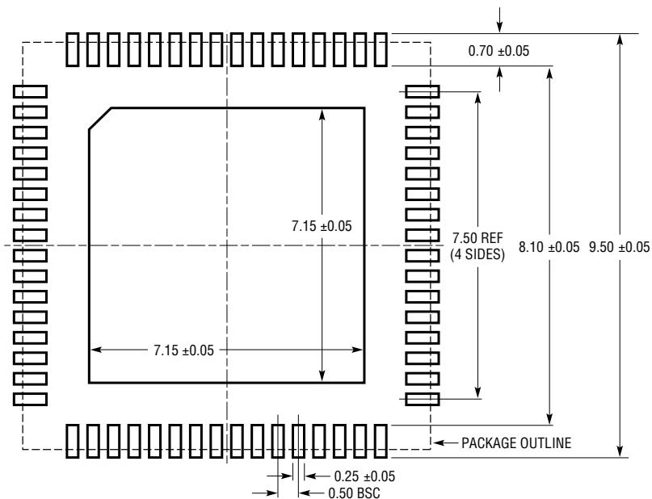

Detailed diagram of the recommended PCB solder pad layout for 64-lead QFN (9mm × 9mm), showing central ground pad of dimensions 7.15 ±0.05 × 7.15 ±0.05, surrounded by 64 perimeter pads. Dimensions include: 0.70 ±0.05 pad length, 0.25 ±0.05 pad width, 0.50 BSC pitch, 7.50 REF (4 SIDES), 8.10 ±0.05 inner pad span, 9.50 ±0.05 outer boundary span, with dashed package outline.

Recommended solder pad pitch and dimensions drawing for 64-lead QFN package.

RECOMMENDED SOLDER PAD PITCH AND DIMENSIONS  
APPLY SOLDER MASK TO AREAS THAT ARE NOT SOLDERED

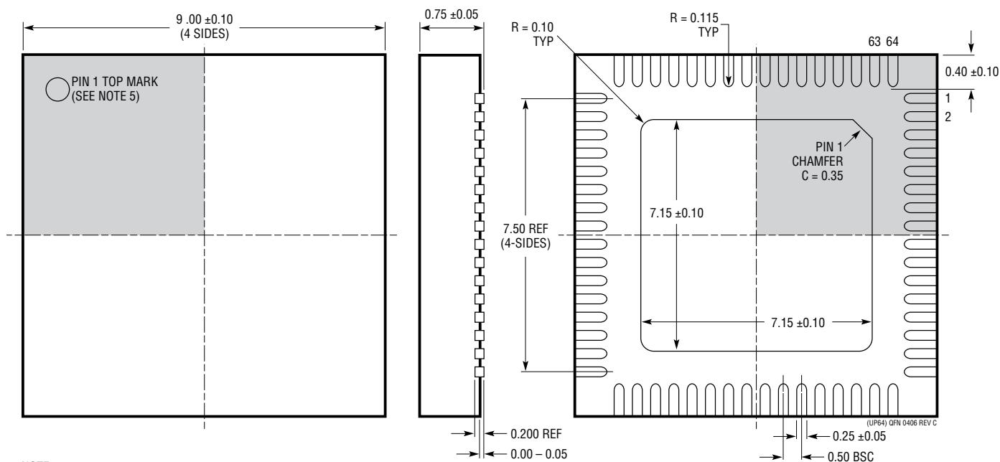

The drawing contains three views of the 64-lead QFN package:

- Top View:** Square package measuring 9.00 ±0.10 (4 SIDES) with circular PIN 1 TOP MARK (SEE NOTE 5).
- Side View:** Package thickness 0.75 ±0.05, terminal thickness 0.200 REF, standoff 0.00 – 0.05, edge radius R = 0.10 TYP, side pad reference 7.50 REF (4-SIDES).
- Bottom View (Exposed Pad):** Central exposed pad 7.15 ±0.10 × 7.15 ±0.10 with PIN 1 CHAMFER C = 0.35, corner radius R = 0.115 TYP, pin pitch 0.50 BSC, lead width 0.25 ±0.05, lead length 0.40 ±0.10. Labeled with pins 1, 2, 63, 64 and drawing code (UP64) QFN 0406 REV C.

Technical drawing showing top, side, and bottom views of 64-Lead Plastic QFN package with exposed pad.

NOTE:

1. DRAWING CONFORMS TO JEDEC PACKAGE OUTLINE MO-220 VARIATION WNJR-5
2. ALL DIMENSIONS ARE IN MILLIMETERS
3. DIMENSIONS OF EXPOSED PAD ON BOTTOM OF PACKAGE DO NOT INCLUDE MOLD FLASH. MOLD FLASH, IF PRESENT, SHALL NOT EXCEED 0.20mm ON ANY SIDE, IF PRESENT
4. EXPOSED PAD SHALL BE SOLDER PLATED
5. SHADED AREA IS ONLY A REFERENCE FOR PIN 1 LOCATION ON THE TOP AND BOTTOM OF PACKAGE
6. DRAWING NOT TO SCALE

BOTTOM VIEW—EXPOSED PAD

{104}------------------------------------------------

## PACKAGE DESCRIPTION

Warning icon: exclamation mark inside a triangle.

PACKAGE ROW AND COLUMN LABELING MAY VARY AMONG  $\mu$ Module PRODUCTS. REVIEW EACH PACKAGE LAYOUT CAREFULLY.

## LTC2975 Component BGA Pinout

| PIN | NAME               | PIN | NAME           | PIN | NAME           | PIN | NAME           | PIN | NAME          |
|-----|--------------------|-----|----------------|-----|----------------|-----|----------------|-----|---------------|
| A1  | $V_{SENSEM1}$       | B1  | $V_{SENSEM0}$   | C1  | $V_{OUT\_EN1}$ | D1  | $V_{OUT\_EN3}$ | E1  | DNC           |
| A2  | $V_{SENSEP1}$      | B2  | $V_{SENSEP0}$  | C2  | $V_{OUT\_EN0}$ | D2  | GND            | E2  | $V_{IN\_SNS}$ |
| A3  | $V_{DAC3}$         | B3  | $V_{SENSEP2}$  | C3  | $V_{SENSEM2}$   | D3  | $V_{OUT\_EN2}$ | E3  | AUXFAULTB     |
| A4  | $I_{IN\_SNSM}$     | B4  | $I_{IN\_SNSP}$ | C4  | $V_{DAC2}$     | D4  | GND            | E4  | GND           |
| A5  | $V_{DAC0}$         | B5  | $V_{DAC1}$     | C5  | GND            | D5  | $I_{SENSEM0}$   | E5  | ASEL1         |
| A6  | $V_{IN\_SNS\_CAP}$ | B6  | $I_{SENSEM3}$   | C6  | $I_{SENSEP3}$  | D6  | $I_{SENSEM1}$   | E6  | $I_{SENSEP0}$ |
| A7  | $V_{SENSEM3}$       | B7  | $V_{SENSEP3}$  | C7  | $I_{SENSEM2}$   | D7  | $I_{SENSEP2}$  | E7  | $I_{SENSEP1}$ |

| PIN | NAME         | PIN | NAME         | PIN | NAME       | PIN | NAME      |
|-----|--------------|-----|--------------|-----|------------|-----|-----------|
| F1  | $V_{DD33}$   | G1  | $V_{DD25}$   | H1  | $V_{DD25}$ | J1  | PWRGD     |
| F2  | $T_{SENSE0}$ | G2  | $V_{PWR}$    | H2  | WDI/RESETB | J2  | SHARE_CLK |
| F3  | $T_{SENSE1}$ | G3  | GND          | H3  | CONTROL2   | J3  | CONTROL3  |
| F4  | GND          | G4  | GND          | H4  | FAULTB0    | J4  | FAULTB1   |
| F5  | GND          | G5  | $T_{SENSE2}$ | H5  | WP         | J5  | SDA       |
| F6  | REFP         | G6  | $T_{SENSE3}$ | H6  | CONTROL1   | J6  | SCL       |
| F7  | REFM         | G7  | ASEL0        | H7  | CONTROL0   | J7  | ALERTB    |

{105}------------------------------------------------

## PACKAGE DESCRIPTION

**BGA Package**  
**63-Lead ( $7.5\text{mm} \times 6.25\text{mm} \times 1.52\text{mm}$ )**  
(Reference LTC DWG # 05-08-1547 Rev Ø)

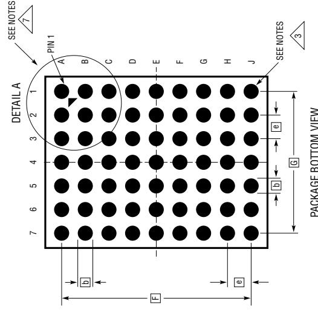

PACKAGE BOTTOM VIEW showing a 7x9 array of solder balls labeled columns 7 to 1 and rows A to J, with dimensions e, b, G, F, and callout to DETAIL A and DETAIL B.

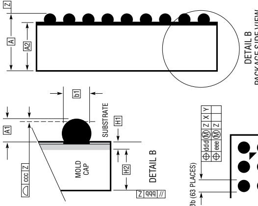

PACKAGE SIDE VIEW with DETAIL B showing mold cap, substrate, solder balls, and parameters A, A1, A2, b1, H1, H2, and geometric tolerancing frames.

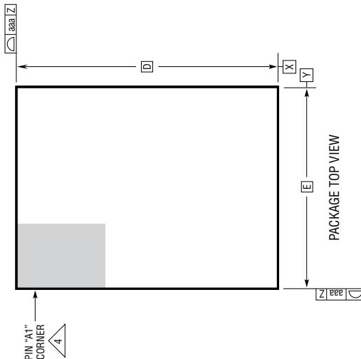

PACKAGE TOP VIEW showing dimensions D and E, PIN "A1" CORNER, and datum references X, Y, Z.

| DIMENSIONS                |      |      |      |       |
|---------------------------|------|------|------|-------|
| SYMBOL                    | MIN  | NOM  | MAX  | NOTES |
| A                         | 1.32 | 1.52 | 1.72 |       |
| A1                        | 0.30 | 0.40 | 0.50 |       |
| A2                        | 1.02 | 1.12 | 1.22 |       |
| b                         | 0.45 | 0.50 | 0.55 |       |
| b1                        | 0.37 | 0.40 | 0.43 |       |
| D                         |      | 7.50 |      |       |
| E                         |      | 6.25 |      |       |
| e                         |      | 0.80 |      |       |
| F                         |      | 6.40 |      |       |
| G                         |      | 4.80 |      |       |
| H1                        | 0.27 | 0.32 | 0.37 |       |
| H2                        | 0.75 | 0.80 | 0.85 |       |
| aaa                       |      |      | 0.15 |       |
| bbb                       |      |      | 0.10 |       |
| ccc                       |      |      | 0.20 |       |
| ddd                       |      |      | 0.15 |       |
| eee                       |      |      | 0.08 |       |
| TOTAL NUMBER OF BALLS: 63 |      |      |      |       |

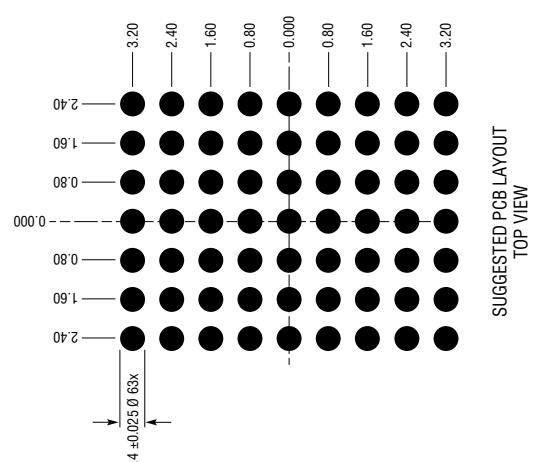

SUGGESTED PCB LAYOUT TOP VIEW showing pitch spacing of 0.80mm and pad sizes 0.4 ±0.025 Ø 63x.

- NOTES:
1. DIMENSIONING AND TOLERANCING PER ASME Y14.5M-1994
2. ALL DIMENSIONS ARE IN MILLIMETERS
3. BALL DESIGNATION PER JESD MS-028 AND JEP95
4. DETAILS OF PIN #1 IDENTIFIER ARE OPTIONAL, BUT MUST BE LOCATED WITHIN THE ZONE INDICATED. THE PIN #1 IDENTIFIER MAY BE EITHER A MOLD OR MARKED FEATURE
5. PRIMARY DATUM -Z- IS SEATING PLANE
6. SOLDER BALL COMPOSITION IS 96.5% Sn/3.0% Ag/0.5% Cu
7. PACKAGE ROW AND COLUMN LABELING MAY VARY AMONG µModule PRODUCTS. REVIEW EACH PACKAGE LAYOUT CAREFULLY

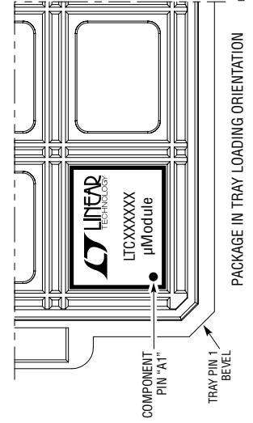

PACKAGE IN TRAY LOADING ORIENTATION showing the device placed in pocket with Pin 1 bevel indicator.

{106}------------------------------------------------

## REVISION HISTORY

| REV | DATE  | DESCRIPTION                                                                                                                                                                                                                                                                                                                                                                                                                                                                                                                                                                                                                                                                                                                                                                                                                                                                                                                                                                                                                                                                                                                                                                                         | PAGE NUMBER                                                                                                                             |
|-----|-------|-----------------------------------------------------------------------------------------------------------------------------------------------------------------------------------------------------------------------------------------------------------------------------------------------------------------------------------------------------------------------------------------------------------------------------------------------------------------------------------------------------------------------------------------------------------------------------------------------------------------------------------------------------------------------------------------------------------------------------------------------------------------------------------------------------------------------------------------------------------------------------------------------------------------------------------------------------------------------------------------------------------------------------------------------------------------------------------------------------------------------------------------------------------------------------------------------------|-----------------------------------------------------------------------------------------------------------------------------------------|
| A   | 09/19 | Updated Typical Application; added EEPROM ECC information. Updated DAC Output Update Rate ( $t_{S\_VDAC}$ ). Added $V_{VOUT\_VALID}$ specification. Added Note 3; Updated Note 5; Updated Note numbers. Added graph: $V_{OUT\_EN[3:0]}$ Output Voltage vs $V_{DD33}$ . Updated $V_{DD33}$ and $V_{DD25}$ pin functions. Updated Figure 2. Updated READ_IIN, READ_PIN PAGED entries; added MFR_INFO. Updated PAGED entries for MFR_IIN_PEAK, MFR_IIN_MIN, MFR_PIN_PEAK, MFR_PIN_MIN. Updated MFR_SPECIAL_ID value. Added MFR_COMMAND_PLUS to Level 2 exception list; added write protection level table. Updated: b[1] symbol and operation for MFR_STATUS_PLUS n registers. Updated: b[10] to reserved status, MFR_EE_DATA bits and symbol. Updated: STATUS_WORD b[0], STATUS_VOUT b[3]. Updated description: MFR_IIN_PEAK, MFR_IIN_MIN, MFR_PIN_PEAK, MFR_PIN_MIN, MFR_READ_IOUT, MFR_VIN_PEAK, MFR_VOUT_PEAK, MFR_IOUT_PEAK, MFR_TEMPERATURE_1_PEAK, MFR_VIN_MIN, MFR_VOUT_MIN, MFR_IOUT_MIN, MFR_TEMPERATURE_1_MIN. Updated section on Configuring the AUXFAULTB Output. Added BAT54 diode to Figure 31. Updated Design Checklist. | 1, 18, 19 6 8 9, 10 14 15 22 26, 84 27 28, 84 31 33 45, 48 66, 67 72 to 75 90 91 103 |
| B   | 02/20 | Added BGA package option to Features bullets and Ordering Information table. Added TUE_IIN 0mV low range specification for BGA. Added BGA pin numbers to Pin Functions table. Added BGA Package Description.                                                                                                                                                                                                                                                                                                                                                                                                                                                                                                                                                                                                                                                                                                                                                                                                                                                                                                                                                                               | 1, 4, 5 7 15, 16 105, 106                                                                                                      |
| C   | 04/21 | Updated Typical Application . Updated $V_{DD33}$ and $V_{DD25}$ pin descriptions. Updated section on Processing Commands and associated command tables. Corrected MFR_PADS type from 'R/W Word' to 'R Word'. Updated offset value in the example scenario in MFR_I2C_BASE_ADDRESS section. Updated text in Response When Part Is Busy section. Updated b[5] and b[6] Operation text in STATUS_MFR_SPECIFIC Data Contents table. Updated ALERTB behavior described in MFR_COMMON section. Updated MFR_VOUT_MIN description.                                                                                                                                                                                                                                                                                                                                                                                                                                                                                                                                                                                                                                                  | 1 15 21 28, 65 32 48 69 70 74                                                                                   |
| D   | 06/22 | Added AEC-Q100 Qualification and 'W' part numbers. Corrected Pin Functions table.                                                                                                                                                                                                                                                                                                                                                                                                                                                                                                                                                                                                                                                                                                                                                                                                                                                                                                                                                                                                                                                                                                                | 1, 5 17                                                                                                                              |

{107}------------------------------------------------

## TYPICAL APPLICATION

![Typical application circuit diagram for the LTC2975. The diagram shows a central LTC2975 IC with 65 pins, surrounded by four DC/DC converter modules. Each module includes a transformer-coupled inverter, a diode rectifier, and a DC/DC converter (labeled 'DC/DC CONVERSION'). The LTC2975 is connected to an 'INTERMEDIATE BUS' via a sense resistor (RSENSE) and a 10nF capacitor. It also connects to a 3.3V supply and ground. The diagram includes various components like capacitors (330nF, 0.1uF, 10nF), resistors (10k, 5.49k), and transistors (MMBT3906). The LTC2975 pins are labeled with functions such as TSENSE0, TSENSE1, TSENSE2, TSENSE3, VDAC0, VDAC1, VDAC2, VDAC3, VSENSE0, VSENSE1, VSENSE2, VSENSE3, ISENSE0, ISENSE1, ISENSE2, ISENSE3, VOUT_EN0, VOUT_EN1, VOUT_EN2, VOUT_EN3, REFP, REFM, AUXFAULTB, FAULTB1, FAULTB0, SHARE_CLK, SDA, SCL, ALERTB, PWRGD, CONTROL3, CONTROL2, CONTROL1, CONTROL0, WDI/RESETB, and VOUT_EN3. The diagram also shows connections to other LTC power system managers and microcontrollers.](img/3d1817e8551f9c226a5f561108d3b3f9_img.jpg)

Typical application circuit diagram for the LTC2975. The diagram shows a central LTC2975 IC with 65 pins, surrounded by four DC/DC converter modules. Each module includes a transformer-coupled inverter, a diode rectifier, and a DC/DC converter (labeled 'DC/DC CONVERSION'). The LTC2975 is connected to an 'INTERMEDIATE BUS' via a sense resistor (RSENSE) and a 10nF capacitor. It also connects to a 3.3V supply and ground. The diagram includes various components like capacitors (330nF, 0.1uF, 10nF), resistors (10k, 5.49k), and transistors (MMBT3906). The LTC2975 pins are labeled with functions such as TSENSE0, TSENSE1, TSENSE2, TSENSE3, VDAC0, VDAC1, VDAC2, VDAC3, VSENSE0, VSENSE1, VSENSE2, VSENSE3, ISENSE0, ISENSE1, ISENSE2, ISENSE3, VOUT\_EN0, VOUT\_EN1, VOUT\_EN2, VOUT\_EN3, REFP, REFM, AUXFAULTB, FAULTB1, FAULTB0, SHARE\_CLK, SDA, SCL, ALERTB, PWRGD, CONTROL3, CONTROL2, CONTROL1, CONTROL0, WDI/RESETB, and VOUT\_EN3. The diagram also shows connections to other LTC power system managers and microcontrollers.

## RELATED PARTS

| PART NUMBER             | DESCRIPTION                                                                   | COMMENTS                                                                     |
|-------------------------|-------------------------------------------------------------------------------|------------------------------------------------------------------------------|
| <a href="#">LTC2970</a> | Dual I 2 C Power Supply Monitor and Margining Controller           | 5V to 15V, ±0.5% TUE 14-Bit ADC, 8-Bit DAC, Temperature Sensor               |
| <a href="#">LTC2974</a> | 4-Channel Power System Manager                                                | 0.25% TUE 16-Bit ADC, Voltage/Current/Temperature Monitoring and Supervision |
| <a href="#">LTC2977</a> | 8-Channel Power System Manager                                                | 0.25% TUE 16-Bit ADC, Voltage/Temperature Monitoring and Supervision         |
| <a href="#">LTC2980</a> | 16-Channel PMBus Power System Manager                                         | Dual LTC2977                                                                 |
| <a href="#">LTM2987</a> | 16-Channel µModule PMBus Power System Manager                                 | Dual LTC2977 with Integrated Passive Components                              |
| <a href="#">LTC3880</a> | Dual Output PolyPhase Step-Down DC/DC Controller                              | 0.5% TUE 16-Bit ADC, Voltage/Current/Temperature Monitoring and Supervision  |
| <a href="#">LTC3883</a> | Single Output PolyPhase Step-Down DC/DC Controller                            | 0.5% TUE 16-Bit ADC, Voltage/Current/Temperature Monitoring and Supervision  |
| <a href="#">LTM4676</a> | Dual 13A or Single 26A µModule Regulator with Digital Power System Management | 1% TUE 16-Bit ADC, Voltage/Current/Temperature Monitoring and Supervision    |