{0}------------------------------------------------

# 5V, 15A Synchronous Step-Down Silent Switcher in 3mm × 3mm LQFN

## FEATURES

- Layout Compatible with LTC3310/LTC3311 Family
- Silent Switcher® Architecture
  - Ultralow EMI Emissions
- High Efficiency: 3mΩ NMOS and 8mΩ PMOS
- Wide Bandwidth, Fast Transient Response
- Safely Tolerates Inductor Saturation in Overload
- VIN Range: 2.25V to 5.5V
- VOUT Range: 0.5V to VIN
- VOUT Accuracy: ±1% with Remote Sense
- Peak Current Mode Control
- Minimum On-Time: 35ns
- Programmable Frequency to 5MHz
- Shutdown Current: 1μA
- Precision 400mV Enable Threshold
- Output Soft-Start with Voltage Tracking
- Power Good Output
- Die Temperature Monitor
- Configurable for Paralleling Power Stages
- Thermally-Enhanced 3mm × 3mm LQFN Package
- AEC-Q100 Qualified for Automotive Applications

## DESCRIPTION

The **LTC®3313** is a very small, low noise, monolithic step-down DC/DC converter capable of providing up to 15A of output current from a 2.25V to 5.5V input supply. The device employs the Silent Switcher architecture to achieve both low EMI and high efficiency at switching frequencies as high as 5MHz. For systems with higher power requirements, multiphasing parallel converters is readily implemented.

The LTC3313 uses a constant frequency, peak current mode control architecture for fast transient response. A 500mV reference allows for low voltage outputs. 100% duty cycle operation delivers low drop out.

Other features include a power good signal when the output is in regulation, a precision enable threshold, output overvoltage protection, thermal shutdown, a temperature monitor, clock synchronization, mode selection, and output short circuit protection. The device is available in a compact 18-pin 3mm × 3mm LQFN package.

All registered trademarks and trademarks are the property of their respective owners.

## APPLICATIONS

- Automotive/Industrial/Communications
- Servers, Telecom Power Supplies
- Distributed DC Power Systems (POL)
- FPGA, ASIC, μP Core Supplies

## TYPICAL APPLICATION

**1.2V, 15A Step-Down Converter**

Typical Application circuit diagram for the LTC3313. The diagram shows an 18-pin LQFN package with various pins connected to external components. The input voltage is 3V to 5.5V, connected to VIN and EN pins. The output is 1.2V, 15A, connected to SW and FB pins. The circuit includes an 80nH inductor, a 6.8pF capacitor, a 140k resistor, a 47μF capacitor, a 100k resistor, a 274k resistor, a 15k resistor, and a 470pF capacitor. The diagram is labeled 3313 TA01a.

![Efficiency vs Load Current graph. The graph shows Efficiency (%) on the left y-axis (0 to 100) and Power Loss (W) on the right y-axis (0 to 4.0) versus Load Current (A) on the x-axis (0 to 15). The Efficiency curve (red) starts at 100% at 0A, drops to about 85% at 2.5A, and then gradually decreases to about 80% at 15A. The Power Loss curve (blue) starts at 0W at 0A and increases to about 3.6W at 15A. The graph is labeled with VIN = 3.3V, VOUT = 1.2V, fSW = 2MHz, and COILCRAFT XEL4020-800MEC. The diagram is labeled 3313 TA01a.](img/4a4646a696af04e604f014c503b5730a_img.jpg)

**Efficiency vs Load Current**

Efficiency vs Load Current graph. The graph shows Efficiency (%) on the left y-axis (0 to 100) and Power Loss (W) on the right y-axis (0 to 4.0) versus Load Current (A) on the x-axis (0 to 15). The Efficiency curve (red) starts at 100% at 0A, drops to about 85% at 2.5A, and then gradually decreases to about 80% at 15A. The Power Loss curve (blue) starts at 0W at 0A and increases to about 3.6W at 15A. The graph is labeled with VIN = 3.3V, VOUT = 1.2V, fSW = 2MHz, and COILCRAFT XEL4020-800MEC. The diagram is labeled 3313 TA01a.

{1}------------------------------------------------

## LTC3313

## ABSOLUTE MAXIMUM RATINGS

(Note 1)

|                                                   |                                              |
|---------------------------------------------------|----------------------------------------------|
| $V_{IN}$ .....                                    | –0.3V to 6V                                  |
| EN, SSTT .....                                    | –0.3V to Lesser of ( $V_{IN} + 0.3V$ ) or 6V |
| MODE/SYNC .....                                   | –0.3V to Lesser of ( $V_{IN} + 0.3V$ ) or 6V |
| RT .....                                          | –0.3V to Lesser of ( $V_{IN} + 0.3V$ ) or 6V |
| FB .....                                          | –0.3V to Lesser of ( $V_{IN} + 0.3V$ ) or 6V |
| PGOOD .....                                       | –0.3V to 6V                                  |
| $I_{PGOOD}$ .....                                 | 5mA                                          |
| Operating Junction Temperature Range (Notes 2, 3) |                                              |
| LTC3313E .....                                    | –40°C to 125°C                               |
| LTC3313J .....                                    | –40°C to 150°C                               |
| Storage Temperature .....                         | –65°C to 150°C                               |
| Maximum Reflow (Package Body) Temperature ...     | 260°C                                        |

## PIN CONFIGURATION

TOP VIEW

- Pin 1: EN
- Pin 2: AGND
- Pin 3: VIN
- Pin 4: VIN
- Pin 5: PGND
- Pins 6-9: SW
- Pin 10: PGND
- Pin 11: VIN
- Pin 12: VIN
- Pin 13: MODE/SYNC
- Pin 14: PGOOD
- Pin 15: RT
- Pin 16: SSTT
- Pin 17: ITH
- Pin 18: FB
- Pin 19 (exposed pad): PGND

LQFN PACKAGE  
18-PIN (3mm × 3mm × 0.95mm)  
 $\theta_{JA} = 39.6^{\circ}\text{C/W}$ ,  $\theta_{JC\text{bottom}} = 5.8^{\circ}\text{C/W}$ ,  $\theta_{JC\text{top}} = 57.2^{\circ}\text{C/W}$ ,  
 $\theta_{JB} = 14^{\circ}\text{C/W}$ ,  $\Psi_{JT} = 1.25^{\circ}\text{C/W}$ ,  $\theta$  VALUES DETERMINED  
PER JESD51-12 EXPOSED PAD (PIN 19) IS PGND, MUST  
BE SOLDERED TO PCB

## ORDER INFORMATION

| LEAD FREE FINISH | TAPE AND REEL (MINI) | TAPE AND REEL   | PART MARKING* | PACKAGE DESCRIPTION                                                    | TEMPERATURE RANGE |
|------------------|----------------------|-----------------|---------------|------------------------------------------------------------------------|-------------------|
| LTC3313EV#PBF    | LTC3313EV#TRMPBF     | LTC3313EV#TRPBF | LHQF          | 18-Pin (3mm × 3mm × 0.95mm) LQFN (Laminate Package with QFN Footprint) | –40°C to 125°C    |
| LTC3313JV#PBF    | LTC3313JV#TRMPBF     | LTC3313JV#TRPBF | LHQF          | 18-Pin (3mm × 3mm × 0.95mm) LQFN (Laminate Package with QFN Footprint) | –40°C to 150°C    |

## AUTOMOTIVE PRODUCTS\*\*

|                |                   |                  |      |                                                                        |                |
|----------------|-------------------|------------------|------|------------------------------------------------------------------------|----------------|
| LTC3313EV#WPBF | LTC3313EV#WTRMPBF | LTC3313EV#WTRPBF | LHQF | 18-Pin (3mm × 3mm × 0.95mm) LQFN (Laminate Package with QFN Footprint) | –40°C to 125°C |
| LTC3313JV#WPBF | LTC3313JV#WTRMPBF | LTC3313JV#WTRPBF | LHQF | 18-Pin (3mm × 3mm × 0.95mm) LQFN (Laminate Package with QFN Footprint) | –40°C to 150°C |

Contact the factory for parts specified with wider operating temperature ranges. \*Temperature grades are identified by a label on the shipping container. Contact the factory for information on lead based finish parts.

[Tape and reel specifications](#). Some packages are available in 500 unit reels through designated sales channels with #TRMPBF suffix.

\*\*Versions of this part are available with controlled manufacturing to support the quality and reliability requirements of automotive applications. These models are designated with a #W suffix. Only the automotive grade products shown are available for use in automotive applications. Contact your local Analog Devices account representative for specific product ordering information and to obtain the specific Automotive Reliability reports for these models.

{2}------------------------------------------------

**ELECTRICAL CHARACTERISTICS** The ● denotes the specifications which apply over the specified operating temperature range, otherwise specifications are at  $T_A = 25^\circ\text{C}$  (Notes 2, 3).  $V_{IN} = 3.3\text{V}$ ,  $V_{EN} = V_{IN}$ ,  $\text{MODE}/\text{SYNC} = 0\text{V}$ , unless otherwise noted.

| PARAMETER                                         | CONDITIONS                                    |   | MIN   | TYP | MAX   | UNITS |
|---------------------------------------------------|-----------------------------------------------|---|-------|-----|-------|-------|
| <b>Input Supply</b>                               |                                               |   |       |     |       |       |
| Operating Supply Voltage ( $V_{IN}$ )             |                                               | ● | 2.25  |     | 5.5   | V     |
| $V_{IN}$ Undervoltage Lockout                     | $V_{IN}$ Rising                               | ● | 2.0   | 2.1 | 2.2   | V     |
| $V_{IN}$ Undervoltage Lockout Hysteresis          |                                               |   |       | 150 |       | mV    |
| $V_{IN}$ Quiescent Current                        | (Note 4)                                      |   |       | 1.3 | 2.0   | mA    |
| $V_{IN}$ Quiescent Current in Shutdown            | $V_{EN} = 0.1\text{V}$                        |   |       | 1   | 2     | μA    |
| EN Threshold                                      | $V_{EN}$ Rising                               | ● | 0.375 | 0.4 | 0.425 | V     |
| EN Hysteresis                                     |                                               |   |       | 60  |       | mV    |
| EN Pin Leakage Current                            | $V_{EN} = 0.4\text{V}$                        |   |       |     | ±20   | nA    |
| <b>Voltage Regulation</b>                         |                                               |   |       |     |       |       |
| Regulated Feedback Voltage ( $V_{FB}$ )           |                                               | ● | 495   | 500 | 505   | mV    |
| Feedback Pin Input Current                        | $V_{FB} = 0.5\text{V}$                        |   |       |     | ±20   | nA    |
| Error Amp Transconductance                        |                                               |   |       | 1   |       | ms    |
| Error Amp Source/Sink Current                     |                                               |   |       | ±45 |       | μA    |
| Top Switch Current Limit                          | $V_{OUT}/V_{IN} \leq 0.2$ , Current Out of SW | ● | 18    | 21  | 24    | A     |
| Bottom Switch Current Limit ( $I_{VALLEY(MAX)}$ ) | Current Out of SW                             | ● | 15    | 17  | 19    | A     |
| Top Switch ON-Resistance                          |                                               |   |       | 8   |       | mΩ    |
| Bottom Switch ON-Resistance                       |                                               |   |       | 3   |       | mΩ    |
| SW Leakage Current                                | $V_{EN} = 0.1\text{V}$                        |   |       |     | ±100  | nA    |
| $V_{ITH}$ to $I_{PEAK}$ Current Gain              |                                               |   |       | 31  |       | A/V   |
| Minimum On-Time                                   |                                               | ● |       | 35  | 60    | ns    |
| Maximum Duty Cycle                                |                                               | ● | 100   |     |       | %     |
| <b>Power Good/Soft-Start/Temp Monitor</b>         |                                               |   |       |     |       |       |
| PGOOD Rising Threshold                            | As a Percentage of the Regulated $V_{OUT}$    | ● | 97    | 98  | 99    | %     |
| PGOOD Hysteresis                                  |                                               | ● | 0.5   | 1   | 1.5   | %     |
| Overvoltage Rising Threshold                      | As a Percentage of the Regulated $V_{OUT}$    | ● | 106   | 110 | 114.5 | %     |
| Overvoltage Hysteresis                            |                                               | ● | 1     | 2.5 | 3.5   | %     |
| PGOOD Leakage Current                             | $V_{PGOOD} = 5.5\text{V}$                     |   |       |     | 20    | nA    |
| PGOOD Pull-Down Resistance                        | $V_{PGOOD} = 0.1\text{V}$                     |   |       | 12  | 20    | Ω     |
| PGOOD Delay                                       |                                               |   |       | 125 |       | μs    |
| PGOOD Input Threshold                             | Multiphase Mode, Rising                       | ● | 390   | 440 | 490   | mV    |
| PGOOD Input Hysteresis                            |                                               |   |       | 130 |       | mV    |
| Soft-Start Charge Current                         | $V_{SSTT} = 0.5\text{V}$                      | ● | 7     | 10  | 13    | μA    |
| Temp Monitor Slope                                |                                               |   |       | 4   |       | mV/°C |
| <b>Oscillator and MODE/SYNC</b>                   |                                               |   |       |     |       |       |
| Switching Frequency Range                         | $R_T$ -Programmed                             | ● | 0.5   |     | 5     | MHz   |
| Switching Frequency                               | $R_T = 274\text{k}$                           | ● | 1.8   | 2   | 2.2   | MHz   |
| Synchronization Frequency Range                   | $R_T = V_{IN}$                                | ● | 0.5   |     | 2.25  | MHz   |
| Default Frequency                                 | $R_T = V_{IN}$                                | ● | 1.8   | 2   | 2.2   | MHz   |
| SYNC Level High on MODE/SYNC                      |                                               | ● | 1.2   |     |       | V     |
| SYNC Level Low on MODE/SYNC                       |                                               | ● |       |     | 0.4   | V     |
| Minimum MODE/SYNC Pulse Width                     |                                               |   | 40    |     |       | ns    |
| MODE/SYNC Input Resistance                        |                                               |   |       | 200 |       | kΩ    |

{3}------------------------------------------------

## ELECTRICAL CHARACTERISTICS The ● denotes the specifications which apply over the specified operating temperature range, otherwise specifications are at $T_A = 25^\circ\text{C}$ (Notes 2, 3). $V_{IN} = 3.3\text{V}$ , $V_{EN} = V_{IN}$ , $\text{MODE}/\text{SYNC} = 0\text{V}$ , unless otherwise noted.

| PARAMETER                           | CONDITIONS                                      | MIN | TYP            | MAX | UNITS         |
|-------------------------------------|-------------------------------------------------|-----|----------------|-----|---------------|
| MODE/SYNC No Clock Detect Time      |                                                 |     | 20             |     | $\mu\text{s}$ |
| MODE/SYNC Clock Out Rise/Fall Time  | $C_{\text{MODE}/\text{SYNC}} = 50\text{pF}$     |     | 10             |     | ns            |
| MODE/SYNC Clock Low Output Voltage  | $I_{\text{MODE}/\text{SYNC}} = -100\mu\text{A}$ |     | 0.2            |     | V             |
| MODE/SYNC Clock High Output Voltage | $I_{\text{MODE}/\text{SYNC}} = 100\mu\text{A}$  |     | $V_{IN} - 0.2$ |     | V             |
| MODE/SYNC Clock Out Duty Cycle      |                                                 |     | 50             |     | %             |

**Note 1:** Stresses beyond those listed under Absolute Maximum Ratings may cause permanent damage to the device. Exposure to any Absolute Maximum Rating condition for extended periods may affect device reliability and lifetime.

**Note 2:** The LTC3313E is guaranteed to meet performance specifications from  $0^\circ\text{C}$  to  $125^\circ\text{C}$  junction temperature. Specifications over the  $-40^\circ\text{C}$  to  $125^\circ\text{C}$  operating junction temperature range are assured by design, characterization, and correlation with statistical process controls. The LTC3313J is guaranteed over the  $-40^\circ\text{C}$  to  $150^\circ\text{C}$  operating junction temperature range.

**Note 3:** The LTC3313 includes overtemperature protection which protects the device during momentary overload conditions. Junction temperatures will exceed  $150^\circ\text{C}$  when overtemperature protection is active. Continuous operation above the specified maximum operating junction temperature may impair device reliability.

**Note 4:** Supply current specification does not include switching currents. Actual supply currents will be higher.

**Note 5:** Inductor ripple current equal to 30% of full load (4.5AP-P).

{4}------------------------------------------------

## TYPICAL PERFORMANCE CHARACTERISTICS

$V_{IN} = 3.3V$ ,  $T_A = 25^{\circ}C$ , unless otherwise noted.

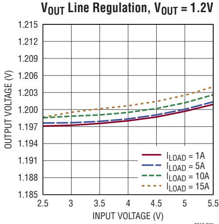

**$V_{OUT}$  Line Regulation,  $V_{OUT} = 1.2V$**

This graph plots output voltage (V) on the y-axis (1.185 to 1.215) against input voltage (V) on the x-axis (2.5 to 5.5). Four curves are shown for different load currents: 1A (solid red), 5A (dashed blue), 10A (dashed green), and 15A (dashed orange). All curves show a slight upward trend as input voltage increases.

3313 G01

Line regulation graph showing output voltage vs input voltage for various load currents.

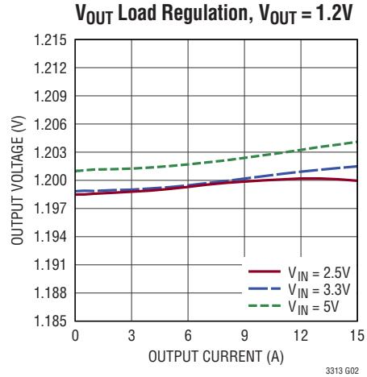

**$V_{OUT}$  Load Regulation,  $V_{OUT} = 1.2V$**

This graph plots output voltage (V) on the y-axis (1.185 to 1.215) against output current (A) on the x-axis (0 to 15). Three curves are shown for different input voltages: 2.5V (solid red), 3.3V (dashed blue), and 5V (dashed green). All curves show a slight upward trend as output current increases.

3313 G02

Load regulation graph showing output voltage vs output current for various input voltages.

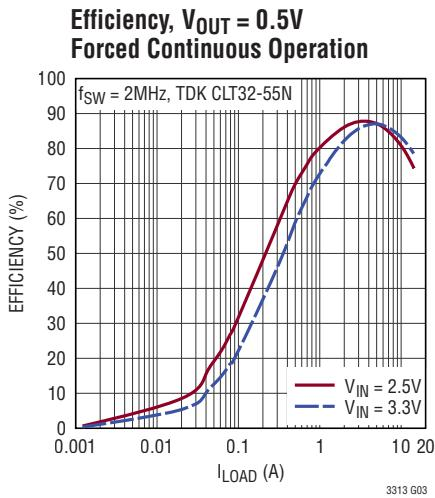

**Efficiency,  $V_{OUT} = 0.5V$   
Forced Continuous Operation**

This graph plots efficiency (%) on the y-axis (0 to 100) against load current (A) on a logarithmic x-axis (0.001 to 20). It shows two curves for  $V_{IN} = 2.5V$  (solid red) and  $V_{IN} = 3.3V$  (dashed blue). The graph includes a vertical line indicating  $f_{SW} = 2MHz$  and a note for TDK CLT32-55N.

3313 G03

Efficiency vs load current graph for VOUT = 0.5V, Forced Continuous Operation.

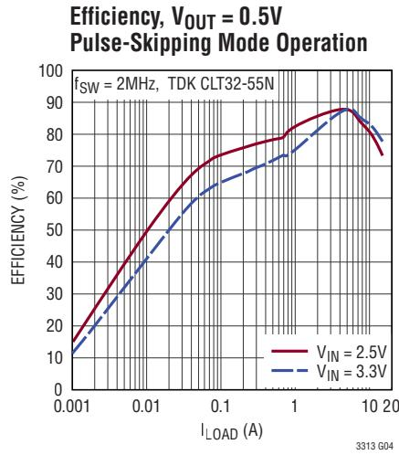

**Efficiency,  $V_{OUT} = 0.5V$   
Pulse-Skipping Mode Operation**

This graph plots efficiency (%) on the y-axis (0 to 100) against load current (A) on a logarithmic x-axis (0.001 to 20). It shows two curves for  $V_{IN} = 2.5V$  (solid red) and  $V_{IN} = 3.3V$  (dashed blue). The graph includes a vertical line indicating  $f_{SW} = 2MHz$  and a note for TDK CLT32-55N.

3313 G04

Efficiency vs load current graph for VOUT = 0.5V, Pulse-Skipping Mode Operation.

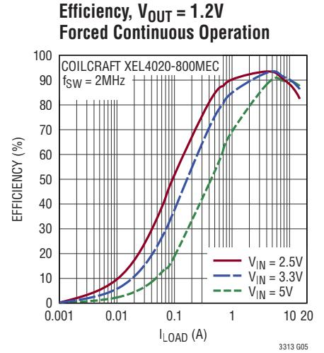

**Efficiency,  $V_{OUT} = 1.2V$   
Forced Continuous Operation**

This graph plots efficiency (%) on the y-axis (0 to 100) against load current (A) on a logarithmic x-axis (0.001 to 20). It shows three curves for  $V_{IN} = 2.5V$  (solid red),  $V_{IN} = 3.3V$  (dashed blue), and  $V_{IN} = 5V$  (dashed green). The graph includes a vertical line indicating  $f_{SW} = 2MHz$  and a note for COILCRAFT XEL4020-800MEC.

3313 G05

Efficiency vs load current graph for VOUT = 1.2V, Forced Continuous Operation.

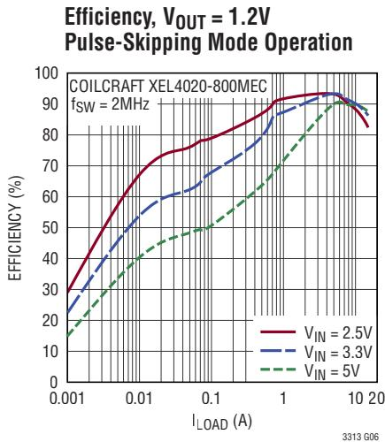

**Efficiency,  $V_{OUT} = 1.2V$   
Pulse-Skipping Mode Operation**

This graph plots efficiency (%) on the y-axis (0 to 100) against load current (A) on a logarithmic x-axis (0.001 to 20). It shows three curves for  $V_{IN} = 2.5V$  (solid red),  $V_{IN} = 3.3V$  (dashed blue), and  $V_{IN} = 5V$  (dashed green). The graph includes a vertical line indicating  $f_{SW} = 2MHz$  and a note for COILCRAFT XEL4020-800MEC.

3313 G06

Efficiency vs load current graph for VOUT = 1.2V, Pulse-Skipping Mode Operation.

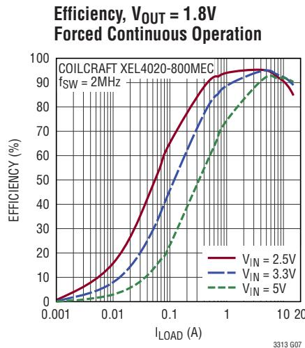

**Efficiency,  $V_{OUT} = 1.8V$   
Forced Continuous Operation**

This graph plots efficiency (%) on the y-axis (0 to 100) against load current (A) on a logarithmic x-axis (0.001 to 20). It shows three curves for  $V_{IN} = 2.5V$  (solid red),  $V_{IN} = 3.3V$  (dashed blue), and  $V_{IN} = 5V$  (dashed green). The graph includes a vertical line indicating  $f_{SW} = 2MHz$  and a note for COILCRAFT XEL4020-800MEC.

3313 G07

Efficiency vs load current graph for VOUT = 1.8V, Forced Continuous Operation.

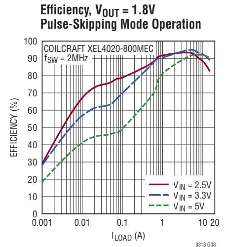

**Efficiency,  $V_{OUT} = 1.8V$   
Pulse-Skipping Mode Operation**

This graph plots efficiency (%) on the y-axis (0 to 100) against load current (A) on a logarithmic x-axis (0.001 to 20). It shows three curves for  $V_{IN} = 2.5V$  (solid red),  $V_{IN} = 3.3V$  (dashed blue), and  $V_{IN} = 5V$  (dashed green). The graph includes a vertical line indicating  $f_{SW} = 2MHz$  and a note for COILCRAFT XEL4020-800MEC.

3313 G08

Efficiency vs load current graph for VOUT = 1.8V, Pulse-Skipping Mode Operation.

{5}------------------------------------------------

## TYPICAL PERFORMANCE CHARACTERISTICS VIN = 3.3V, TA = 25°C, unless otherwise noted.

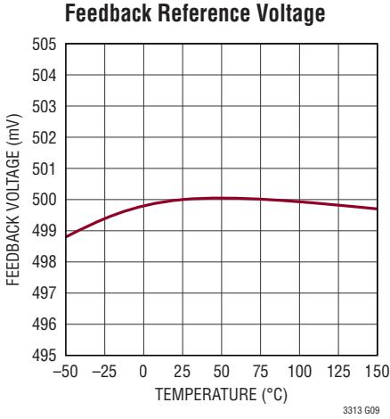

### Feedback Reference Voltage

| TEMPERATURE (°C) | FEEDBACK VOLTAGE (mV) |
|------------------|-----------------------|
| -50              | 498.8                 |
| -25              | 499.2                 |
| 0                | 499.5                 |
| 25               | 499.8                 |
| 50               | 499.8                 |
| 75               | 499.8                 |
| 100              | 499.7                 |
| 125              | 499.6                 |
| 150              | 499.5                 |

3313 G09

Graph of Feedback Reference Voltage vs Temperature. The voltage is stable around 499.5 mV from -50°C to 150°C.

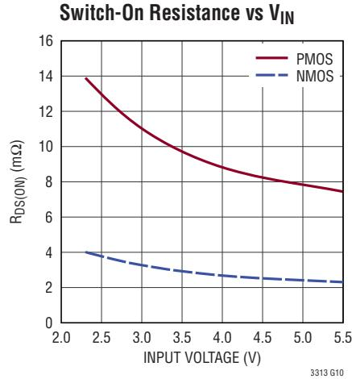

### Switch-On Resistance vs VIN

| INPUT VOLTAGE (V) | PMOS R DS(ON) (mΩ) | NMOS R DS(ON) (mΩ) |
|-------------------|-------------------------------|-------------------------------|
| 2.0               | 14.0                          | 4.0                           |
| 2.5               | 12.5                          | 3.8                           |
| 3.0               | 11.5                          | 3.5                           |
| 3.5               | 10.5                          | 3.2                           |
| 4.0               | 9.8                           | 3.0                           |
| 4.5               | 9.2                           | 2.8                           |
| 5.0               | 8.8                           | 2.6                           |
| 5.5               | 8.5                           | 2.5                           |

3313 G10

Graph of Switch-On Resistance vs Input Voltage. PMOS Rds(on) decreases from ~14 mΩ to ~7.5 mΩ. NMOS Rds(on) decreases from ~4 mΩ to ~2.2 mΩ.

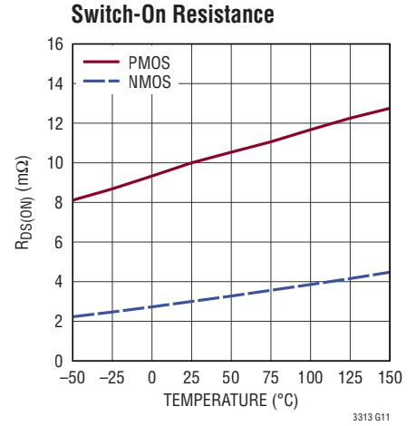

### Switch-On Resistance

| TEMPERATURE (°C) | PMOS R DS(ON) (mΩ) | NMOS R DS(ON) (mΩ) |
|------------------|-------------------------------|-------------------------------|
| -50              | 8.0                           | 2.0                           |
| -25              | 8.5                           | 2.2                           |
| 0                | 9.0                           | 2.5                           |
| 25               | 9.5                           | 2.8                           |
| 50               | 10.0                          | 3.0                           |
| 75               | 10.5                          | 3.2                           |
| 100              | 11.0                          | 3.5                           |
| 125              | 11.5                          | 3.8                           |
| 150              | 12.5                          | 4.5                           |

3313 G11

Graph of Switch-On Resistance vs Temperature. PMOS Rds(on) increases from ~8 mΩ to ~12.5 mΩ. NMOS Rds(on) increases from ~2 mΩ to ~4.5 mΩ.

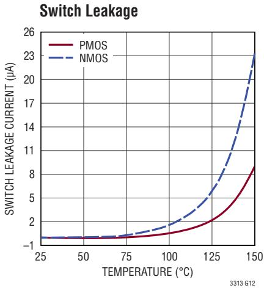

### Switch Leakage

| TEMPERATURE (°C) | PMOS I SWITCH LEAKAGE (μA) | NMOS I SWITCH LEAKAGE (μA) |
|------------------|---------------------------------------|---------------------------------------|
| 25               | 1.0                                   | 1.0                                   |
| 50               | 1.2                                   | 1.2                                   |
| 75               | 1.5                                   | 1.5                                   |
| 100              | 2.0                                   | 2.5                                   |
| 125              | 4.0                                   | 6.0                                   |
| 150              | 8.0                                   | 23.0                                  |

3313 G12

Graph of Switch Leakage Current vs Temperature. PMOS leakage increases from ~1 μA to ~8 μA. NMOS leakage increases from ~1 μA to ~23 μA.

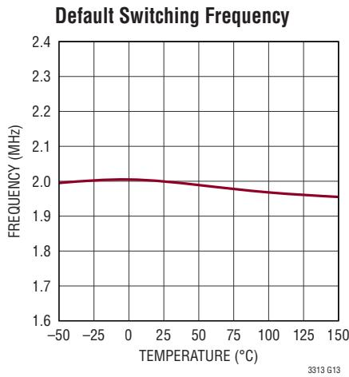

### Default Switching Frequency

| TEMPERATURE (°C) | FREQUENCY (MHz) |
|------------------|-----------------|
| -50              | 2.00            |
| -25              | 2.00            |
| 0                | 2.00            |
| 25               | 1.99            |
| 50               | 1.98            |
| 75               | 1.97            |
| 100              | 1.96            |
| 125              | 1.95            |
| 150              | 1.94            |

3313 G13

Graph of Default Switching Frequency vs Temperature. Frequency is stable around 2.0 MHz from -50°C to 150°C.

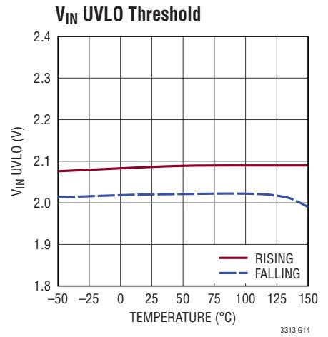

### VIN UVLO Threshold

| TEMPERATURE (°C) | RISING V IN UVLO (V) | FALLING V IN UVLO (V) |
|------------------|---------------------------------|----------------------------------|
| -50              | 2.08                            | 2.02                             |
| -25              | 2.08                            | 2.02                             |
| 0                | 2.08                            | 2.02                             |
| 25               | 2.08                            | 2.02                             |
| 50               | 2.08                            | 2.02                             |
| 75               | 2.08                            | 2.02                             |
| 100              | 2.08                            | 2.02                             |
| 125              | 2.08                            | 2.01                             |
| 150              | 2.08                            | 2.00                             |

3313 G14

Graph of VIN UVLO Threshold vs Temperature. Rising threshold is ~2.08V, falling threshold is ~2.02V.

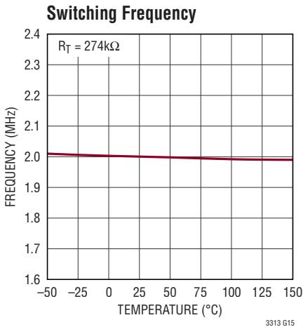

### Switching Frequency

| TEMPERATURE (°C) | FREQUENCY (MHz) |
|------------------|-----------------|
| -50              | 2.00            |
| -25              | 2.00            |
| 0                | 2.00            |
| 25               | 1.99            |
| 50               | 1.99            |
| 75               | 1.99            |
| 100              | 1.99            |
| 125              | 1.99            |
| 150              | 1.99            |

3313 G15

Graph of Switching Frequency vs Temperature with RT = 274kΩ. Frequency is stable around 2.0 MHz.

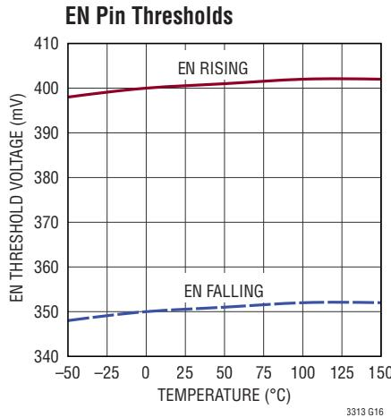

### EN Pin Thresholds

| TEMPERATURE (°C) | EN RISING (mV) | EN FALLING (mV) |
|------------------|----------------|-----------------|
| -50              | 398            | 348             |
| -25              | 399            | 349             |
| 0                | 400            | 350             |
| 25               | 400            | 350             |
| 50               | 400            | 350             |
| 75               | 400            | 350             |
| 100              | 400            | 350             |
| 125              | 400            | 350             |
| 150              | 400            | 350             |

3313 G16

Graph of EN Pin Thresholds vs Temperature. EN RISING is ~400 mV, EN FALLING is ~350 mV.

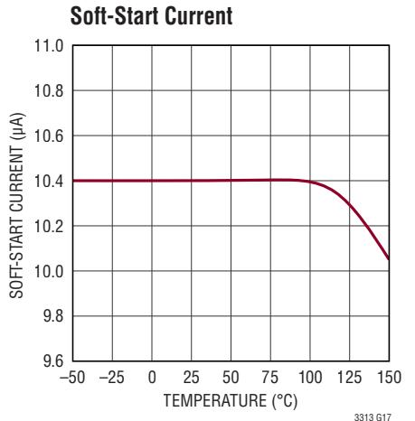

### Soft-Start Current

| TEMPERATURE (°C) | SOFT-START CURRENT (μA) |
|------------------|-------------------------|
| -50              | 10.4                    |
| -25              | 10.4                    |
| 0                | 10.4                    |
| 25               | 10.4                    |
| 50               | 10.4                    |
| 75               | 10.4                    |
| 100              | 10.4                    |
| 125              | 10.2                    |
| 150              | 10.0                    |

3313 G17

Graph of Soft-Start Current vs Temperature. Current is constant at ~10.4 μA until 100°C, then drops to ~10.0 μA.

{6}------------------------------------------------

## **TYPICAL PERFORMANCE CHARACTERISTICS** $V_{IN} = 3.3V, T_A = 25^{\circ}C$ , unless otherwise noted.

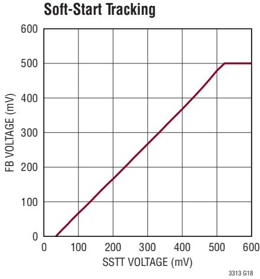

**Soft-Start Tracking**

This graph shows the feedback voltage (FB VOLTAGE) in millivolts versus the soft-start tracking voltage (SSTT VOLTAGE) in millivolts. The feedback voltage increases linearly from 0 mV at 0 mV SSTT to approximately 500 mV at 500 mV SSTT, then levels off. The graph is labeled 3313 G18.

Soft-Start Tracking graph showing FB VOLTAGE (mV) vs SSTT VOLTAGE (mV).

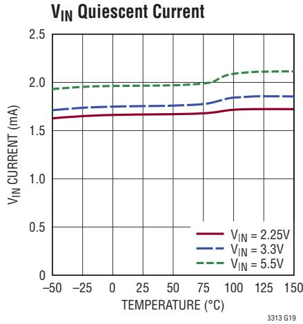

**VIN Quiescent Current**

This graph shows the quiescent current (VIN CURRENT) in milliamperes versus temperature in degrees Celsius for three input voltages: 2.25V (solid red line), 3.3V (dashed blue line), and 5.5V (dashed green line). The current is relatively stable across the temperature range, with the 5.5V curve showing a slight increase above 100°C. The graph is labeled 3313 G19.

VIN Quiescent Current graph showing VIN CURRENT (mA) vs TEMPERATURE (°C) for VIN = 2.25V, 3.3V, and 5.5V.

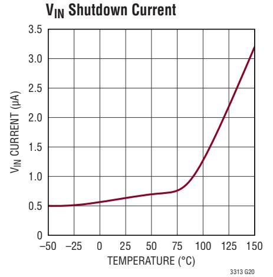

**VIN Shutdown Current**

This graph shows the shutdown current (VIN CURRENT) in microamperes versus temperature in degrees Celsius. The current is low (around 0.5 μA) until approximately 75°C, after which it increases sharply to about 3.2 μA at 150°C. The graph is labeled 3313 G20.

VIN Shutdown Current graph showing VIN CURRENT (μA) vs TEMPERATURE (°C).

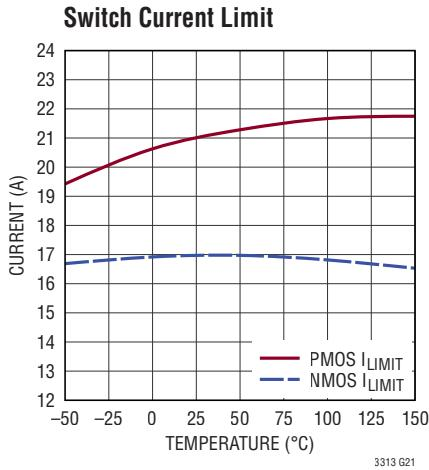

**Switch Current Limit**

This graph shows the current limit in amperes versus temperature in degrees Celsius for PMOS (solid red line) and NMOS (dashed blue line) switches. The PMOS limit starts at approximately 19.5 A at -50°C and rises to about 21.8 A at 150°C. The NMOS limit starts at approximately 16.8 A at -50°C and slightly decreases to about 16.5 A at 150°C. The graph is labeled 3313 G21.

Switch Current Limit graph showing CURRENT (A) vs TEMPERATURE (°C) for PMOS and NMOS limits.

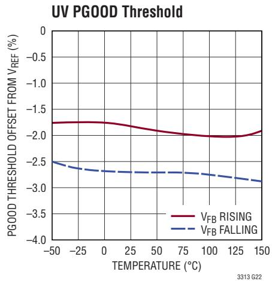

**UV PGOOD Threshold**

This graph shows the UV PGOOD threshold offset from VREF in percent versus temperature in degrees Celsius for rising (solid red line) and falling (dashed blue line) feedback voltages. Both offsets are negative, with the falling offset being more negative. The offsets are relatively stable across the temperature range. The graph is labeled 3313 G22.

UV PGOOD Threshold graph showing PGOOD THRESHOLD OFFSET FROM VREF (%) vs TEMPERATURE (°C) for VFB RISING and FALLING.

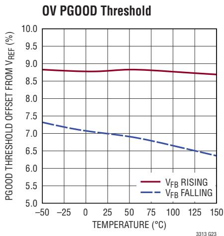

**OV PGOOD Threshold**

This graph shows the OV PGOOD threshold offset from VREF in percent versus temperature in degrees Celsius for rising (solid red line) and falling (dashed blue line) feedback voltages. The offsets are positive, with the rising offset being higher. Both offsets show a slight downward trend as temperature increases. The graph is labeled 3313 G23.

OV PGOOD Threshold graph showing PGOOD THRESHOLD OFFSET FROM VREF (%) vs TEMPERATURE (°C) for VFB RISING and FALLING.

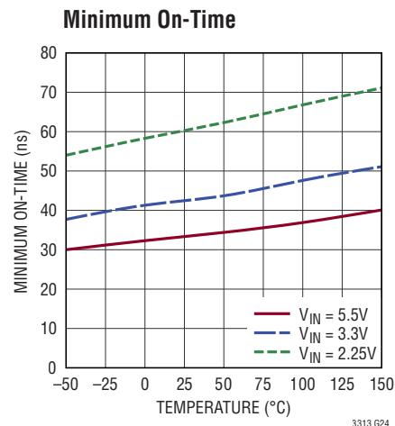

**Minimum On-Time**

This graph shows the minimum on-time in nanoseconds versus temperature in degrees Celsius for three input voltages: 5.5V (solid red line), 3.3V (dashed blue line), and 2.25V (dashed green line). The minimum on-time increases with temperature for all input voltages, with the 2.25V curve showing the steepest increase, reaching about 72 ns at 150°C. The graph is labeled 3313 G24.

Minimum On-Time graph showing MINIMUM ON-TIME (ns) vs TEMPERATURE (°C) for VIN = 5.5V, 3.3V, and 2.25V.

{7}------------------------------------------------

## **TYPICAL PERFORMANCE CHARACTERISTICS** $V_{IN} = 3.3V$ , $T_A = 25^{\circ}C$ , unless otherwise noted.

**Start-Up Waveforms  
Pulse-Skipping Mode**

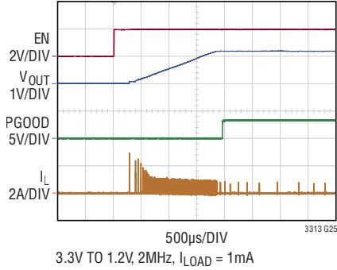

3313 G25

EN 2V/DIV  
VOUT 1V/DIV  
PGOOD 5V/DIV  
IL 2A/DIV

500µs/DIV

3.3V TO 1.2V, 2MHz, ILOAD = 1mA

This graph shows the start-up waveforms for the LTC3313 in Pulse-Skipping Mode. The top trace is the enable (EN) signal, which transitions from low to high. The second trace is the output voltage (VOUT), which ramps up from 0V to approximately 1.2V. The third trace is the power good (PGOOD) signal, which transitions from low to high once the output voltage is stable. The bottom trace is the load current (IL), which shows a series of pulses that decrease in amplitude as the output voltage rises, eventually settling to a steady-state current of 1mA. The horizontal scale is 500µs/DIV.

Start-Up Waveforms Pulse-Skipping Mode

**Start-Up Waveforms  
Forced Continuous Mode**

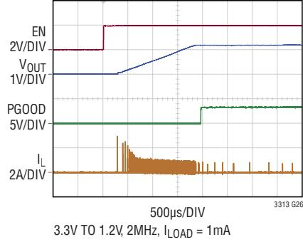

3313 G26

EN 2V/DIV  
VOUT 1V/DIV  
PGOOD 5V/DIV  
IL 2A/DIV

500µs/DIV

3.3V TO 1.2V, 2MHz, ILOAD = 1mA

This graph shows the start-up waveforms for the LTC3313 in Forced Continuous Mode. The top trace is the enable (EN) signal, which transitions from low to high. The second trace is the output voltage (VOUT), which ramps up from 0V to approximately 1.2V. The third trace is the power good (PGOOD) signal, which transitions from low to high once the output voltage is stable. The bottom trace is the load current (IL), which shows a series of pulses that decrease in amplitude as the output voltage rises, eventually settling to a steady-state current of 1mA. The horizontal scale is 500µs/DIV.

Start-Up Waveforms Forced Continuous Mode

**Switching Waveforms  
Pulse-Skipping Mode**

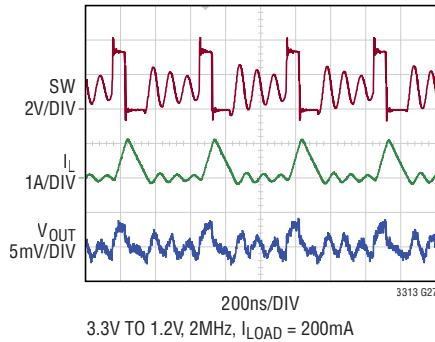

3313 G27

SW 2V/DIV  
IL 1A/DIV  
VOUT 5mV/DIV

200ns/DIV

3.3V TO 1.2V, 2MHz, ILOAD = 200mA

This graph shows the switching waveforms for the LTC3313 in Pulse-Skipping Mode. The top trace is the switch (SW) signal, which is a square wave with a frequency of 2MHz. The second trace is the load current (IL), which shows a triangular waveform with a peak current of 200mA. The third trace is the output voltage (VOUT), which shows a small ripple around 1.2V. The horizontal scale is 200ns/DIV.

Switching Waveforms Pulse-Skipping Mode

**Switching Waveforms  
Forced Continuous Mode**

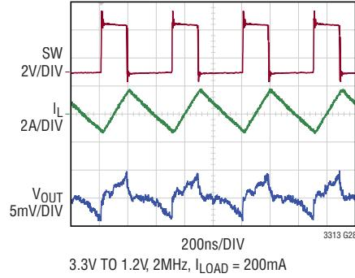

3313 G28

SW 2V/DIV  
IL 2A/DIV  
VOUT 5mV/DIV

200ns/DIV

3.3V TO 1.2V, 2MHz, ILOAD = 200mA

This graph shows the switching waveforms for the LTC3313 in Forced Continuous Mode. The top trace is the switch (SW) signal, which is a square wave with a frequency of 2MHz. The second trace is the load current (IL), which shows a triangular waveform with a peak current of 200mA. The third trace is the output voltage (VOUT), which shows a small ripple around 1.2V. The horizontal scale is 200ns/DIV.

Switching Waveforms Forced Continuous Mode

**Load Transient Response  
Pulse-Skipping Mode**

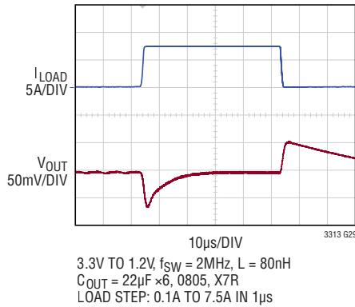

3313 G29

ILOAD 5A/DIV  
VOUT 50mV/DIV

10µs/DIV

3.3V TO 1.2V, fSW = 2MHz, L = 80nH  
COUT = 22µF × 6, 0805, X7R  
LOAD STEP: 0.1A TO 7.5A IN 1µs

This graph shows the load transient response for the LTC3313 in Pulse-Skipping Mode. The top trace is the load current (ILOAD), which steps from 0.1A to 7.5A in 1µs. The bottom trace is the output voltage (VOUT), which shows a transient dip and recovery during the load step. The horizontal scale is 10µs/DIV.

Load Transient Response Pulse-Skipping Mode

**Load Transient Response  
Forced Continuous Mode**

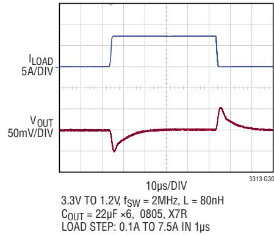

3313 G30

ILOAD 5A/DIV  
VOUT 50mV/DIV

10µs/DIV

3.3V TO 1.2V, fSW = 2MHz, L = 80nH  
COUT = 22µF × 6, 0805, X7R  
LOAD STEP: 0.1A TO 7.5A IN 1µs

This graph shows the load transient response for the LTC3313 in Forced Continuous Mode. The top trace is the load current (ILOAD), which steps from 0.1A to 7.5A in 1µs. The bottom trace is the output voltage (VOUT), which shows a transient dip and recovery during the load step. The horizontal scale is 10µs/DIV.

Load Transient Response Forced Continuous Mode

{8}------------------------------------------------

## PIN FUNCTIONS

**EN (Pin 1):** The EN pin has a precision enable threshold with hysteresis. An optional external resistor divider, from  $V_{IN}$  or from another supply, programs the threshold below which the LTC3313 will shut down. If the precision threshold is not used, directly connect the pin to  $V_{IN}$ . When the EN pin is low, the LTC3313 enters a low current shutdown mode where all internal circuitry is disabled.

**AGND (Pin 2):** The AGND pin is the output voltage remote ground sense. Connect the AGND pin directly to the negative terminal of the output capacitor at the load and to the feedback divider resistor.

**$V_{IN}$  (Pins 3, 4, 11, 12):** The  $V_{IN}$  pins supply current to the internal circuitry and topside power switch. All of the  $V_{IN}$  pins must be connected together with short, wide traces and bypassed to PGND with low ESR capacitors located as close as possible to the pins.

**PGND (Pins 5, 10, 19):** The PGND pins are the return path of the internal bottom side power switch. Connect the PGND pins together and to the exposed pad. Connect the negative terminal of the input capacitors as close to the PGND pins as possible. The PGND node is the main thermal highway and should be connected to a large PCB ground plane with many large vias.

**SW (Pins 6–9):** The SW pins are the switching outputs of the internal power switches. Connect these pins together to the inductor with short, wide traces.

**MODE/SYNC (Pin 13):** The MODE/SYNC pin facilitates multiphase operation and synchronization to an external clock. Depending on the mode of operation, the MODE/SYNC pin either accepts an input clock pulse or outputs a clock pulse at its operating frequency. (see Multiphase Operation in Applications Information). The MODE/SYNC pin also programs the mode of operation: pulse-skipping or forced continuous.

**PGOOD (Pin 14):** The PGOOD pin is a power good pin and is the open drain output of an internal comparator. The PGOOD output is pulled low when  $V_{IN}$  is above 2.25V and the part is in shutdown. When connecting multiple phases in parallel, connect the PGOOD pins together.

**RT (Pin 15):** The RT pin sets the oscillator frequency with an external resistor to AGND or sets the phasing for multiphase operation (see Multiphase Operation in Applications Information).

**SSTT (Pin 16):** Soft-Start, Track, Temperature Monitor. An internal 10 $\mu$ A current into an external capacitor at the soft-start pin programs the output voltage ramp rate during start-up. During the soft-start cycle, the FB pin voltage will track the SSTT pin voltage. When the soft-start cycle is complete, the tracking function is disabled, the internal reference resumes control of the error amplifier and the SSTT pin servos to a voltage representative of junction temperature. For a clean recovery from an output short circuit condition, the SSTT pin is pulled down to approximately 140mV above the  $V_{FB}$  voltage and a new soft-start cycle is initiated. During shutdown and fault conditions, the SSTT pin is pulled to ground.

**ITH (Pin 17):** The ITH pin is the compensation node for the output voltage regulation control loop. Compensation components connected to this pin are referenced to AGND.

**FB (Pin 18):** The feedback pin is externally connected to the output voltage via a resistive divider and is internally connected to the inverting input of the error amplifier. The LTC3313 regulates the FB pin to 500mV. A phase-lead capacitor connected between FB and  $V_{OUT}$  is used to optimize the transient response.

{9}------------------------------------------------

## BLOCK DIAGRAM

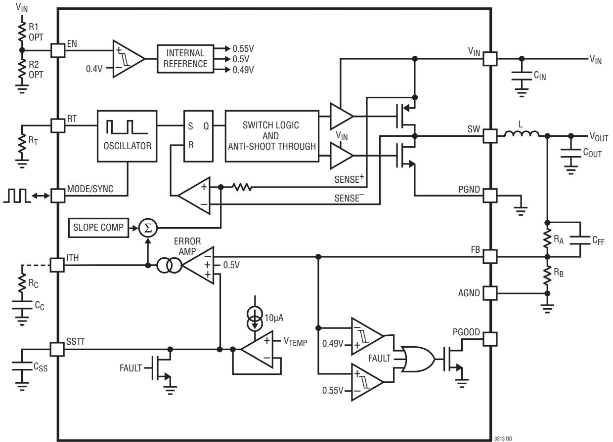

The diagram illustrates the internal architecture of the LTC3313 buck converter. Key components and their connections are as follows:

- Power and Input:**  $V_{IN}$  is connected to the input pin and the internal reference.  $C_{IN}$  is connected to the input pin.
- Reference and Control:** The **INTERNAL REFERENCE** block provides 0.55V, 0.5V, and 0.49V references. The **EN** pin is connected to a voltage divider ( $R1_{OPT}$ ,  $R2_{OPT}$ ) and the reference. The **RT** pin is connected to a resistor  $R_T$  and the **OSCILLATOR**. The **MODE/SYNC** pin is connected to a resistor and the **OSCILLATOR**.
- Switching and Sense:** The **OSCILLATOR** drives an **S Q R** flip-flop, which feeds into **SWITCH LOGIC AND ANTI-SHOOT THROUGH**. This block controls the **SW** (Switch) and **PGND** (Power Ground) pins. **SENSE+** and **SENSE-** pins are connected to the output and input pins, respectively.
- Control and Error:** The **ERROR AMP** compares the **FB** (Feedback) pin voltage (0.5V) with a reference. The **SLOPE COMP** (Slope Compensator) is connected to the **FB** pin. The **FB** pin is also connected to a resistor divider ( $R_A$ ,  $R_B$ ) and a capacitor  $C_{FF}$ . The **AGND** (Analog Ground) pin is connected to ground.
- Temperature and Fault:** The **SSTT** (Supply Temperature) pin is connected to a capacitor  $C_{SS}$  and a temperature sensor. The **FAULT** pin is connected to a fault detector and a transistor. The **PGOOD** (Power Good) pin is connected to a transistor and a fault detector.
- Output:** The **SW** pin drives the inductor  $L$  and the output capacitor  $C_{OUT}$ . The **VOUT** is taken from the output node.

3313 BD

Block diagram of the LTC3313 buck converter showing internal components and pin connections.

{10}------------------------------------------------

## OPERATION

### Voltage Regulation

The LTC3313 is a monolithic, constant frequency, current mode step-down DC/DC converter. An oscillator turns on the internal top power switch at the beginning of each clock cycle. Current in the inductor increases until the top switch current comparator trips and turns off the top power switch. The peak inductor current at which the top switch turns off is controlled by the voltage on the ITH node. The error amplifier servos the ITH node by comparing the voltage on the FB node with an internal 500mV reference. When the load current increases, it causes a reduction in the feedback voltage relative to the reference leading the error amplifier to raise the ITH voltage until the average inductor current matches the new load current. When the top power switch turns off, the synchronous power switch turns on until the next clock cycle begins or, if in pulse-skipping mode, until the inductor current falls to zero. If overload conditions result in excessive current flowing through the bottom switch, the next clock cycle will be delayed until the switch current returns to a safe level.

On the LTC3313, the output voltage is resistively divided externally to create a feedback voltage for the regulator. In high current operation, a ground offset may be present between the LTC3313 local ground and ground at the load. To overcome this offset, AGND should have a Kelvin connection to the load ground, and the lowest potential node of the resistor divider should be connected to AGND. The internal error amplifier senses the difference between this feedback voltage and a 0.5V AGND-referenced voltage. This scheme overcomes any ground offsets between local ground and remote output ground, resulting in a more accurate output voltage. The LTC3313 allows for remote output ground deviations as much as  $\pm 100\text{mV}$  with respect to local ground.

If the EN pin is low, the LTC3313 is shut down and in a low quiescent current state. When the EN pin is above its threshold, the switching regulator will be enabled.

### Silent Switcher

The LTC3313 uses Silent Switcher 1 technology, allowing fast switching edges for high efficiency at high switching frequencies, while simultaneously achieving good EMI

performance. Ceramic capacitors on  $V_{IN}$  keep all the fast AC current loops small, improving EMI performance.

### Synchronizing the Oscillator to an External Clock

The LTC3313's internal oscillator is synchronized through an internal PLL circuit to an external frequency by applying a square wave clock signal to the MODE/SYNC pin.

During synchronization, the top power switch turn-on is locked to the rising edge of the external frequency source. While synchronizing, the switcher operates in forced continuous mode. The slope compensation is automatically adapted to the external clock frequency.

After detecting an external clock on the first rising edge of the MODE/SYNC pin, the internal PLL gradually adjusts its operating frequency to match the frequency and phase of the signal on the MODE/SYNC pin. When the external clock is removed, the LTC3313 detects the absence of the external clock within approximately  $20\mu\text{s}$ . During this time, the PLL will continue to provide clock cycles. Once the external clock removal has been detected, the oscillator gradually adjusts its operating frequency back to the 2MHz default frequency.

### Mode Selection

The MODE/SYNC pin either synchronizes the switching frequency to an external clock, is a clock output, or sets the PWM mode. The PWM mode of operation is either pulse-skipping or forced continuous. See Table 6 in the Applications Information section. In pulse-skipping mode, switching cycles are skipped at light loads to regulate the output voltage. During forced continuous mode, the top switch turns on every cycle and light load regulation is achieved by allowing negative inductor current.

### Output Power Good

Comparators monitoring the FB node voltage pull the PGOOD pin low if the output voltage varies from the nominal set point or if a fault condition is present. The comparator includes voltage hysteresis. A time delay to report PGOOD is used to filter short duration output voltage transients.

{11}------------------------------------------------

## OPERATION

### Soft-Start/Tracking/Temperature Monitor

The soft-start tracking function facilitates supply sequencing, limits  $V_{IN}$  inrush current, and reduces start-up output overshoot. When soft-start is completed, the SSTT pin parks itself at a voltage representative of the LTC3313 die junction temperature. The SSTT capacitor is reset during shutdown,  $V_{IN}$  UVLO, and thermal shutdown. See Applications Information section.

### Dropout Operation

As the input supply voltage approaches the output voltage, the duty cycle increases. Further reduction of the supply voltage forces the main switch to remain on for more than one cycle, eventually reaching 100% duty cycle. The output voltage will then be determined by the input voltage minus the DC voltage drop across the internal main P-channel MOSFET and the inductor.

In many designs when the input voltage approaches the output voltage, the amplitude of the output ripple voltage increases from its normally low value. To avoid any increase in output ripple voltage under these conditions, it is recommended to utilize a resistor divider on the EN input and limit the  $V_{IN}$  turn-on and turn-off thresholds to where the output ripple voltage is acceptable for the given application (typically 500mV above  $V_{OUT}$ ).

### Low Supply Operation

The LTC3313 is designed to operate down to an input supply voltage of 2.25V. An important thermal design

consideration is that the  $R_{DS(ON)}$ s of the power switches increase at low  $V_{IN}$ . Calculate the worst case LTC3313 power dissipation and die junction temperature at the lowest input voltages.

### Output Short-Circuit Protection and Recovery

The peak inductor current level, at which the current comparator shuts off the top power switch, is controlled by the voltage on the ITH pin. If the output current increases, the error amplifier raises the ITH pin voltage until the average inductor current matches the load current. The LTC3313 clamps the maximum ITH pin voltage, thereby limiting the peak inductor current.

When the output is shorted to ground, the inductor current decays very slowly during a single switching cycle because the voltage across the inductor is low. To keep the inductor current in control, a secondary limit is imposed on the valley of the inductor current. If the inductor current measured through the bottom power switch is greater than the  $I_{VALLEY(MAX)}$ , the top power switch will be held off. Subsequent switching cycles will be skipped until the inductor current is reduced below  $I_{VALLEY(MAX)}$ .

Recovery from an output short circuit goes through a soft-start cycle. When  $V_{OUT}$  goes below regulation, as defined by the PGOOD threshold, the SSTT voltage is pulled to a voltage just above the FB voltage. Because the SSTT pin is pulled low, a soft-start cycle is initiated once the output short is removed.

{12}------------------------------------------------

## APPLICATIONS INFORMATION

Refer to the Block Diagram for reference.

### FB Resistor Network

The output voltage on the LTC3313 is programmed with a resistor divider between the output and the FB pin. Choose the resistor values according to:

$$R_A = R_B \left( \frac{V_{OUT}}{500\text{mV}} - 1 \right) \quad (1)$$

as shown in Figure 1:

![Figure 1: Feedback Resistor Network. A block diagram of the LTC3313 showing the SW pin connected to an inductor L, which is connected to the output node VOUT. The FB pin is connected to a resistor divider consisting of RA and RB. RA is connected between VOUT and the FB pin, and RB is connected between the FB pin and ground. A capacitor CFF is connected between VOUT and ground, labeled as (OPTIONAL). Another capacitor COUT is connected between VOUT and ground. The part number 3313 F01 is at the bottom of the block diagram.](img/3ad00ce93ad9dea9ee0f47535e5355e6_img.jpg)

Figure 1: Feedback Resistor Network. A block diagram of the LTC3313 showing the SW pin connected to an inductor L, which is connected to the output node VOUT. The FB pin is connected to a resistor divider consisting of RA and RB. RA is connected between VOUT and the FB pin, and RB is connected between the FB pin and ground. A capacitor CFF is connected between VOUT and ground, labeled as (OPTIONAL). Another capacitor COUT is connected between VOUT and ground. The part number 3313 F01 is at the bottom of the block diagram.

Figure 1. Feedback Resistor Network

Reference designators refer to the Block Diagram. 1% resistors are recommended to maintain output voltage accuracy. When optimizing the control loop for high bandwidth and optimal transient response, add a phase-lead capacitor connected from  $V_{OUT}$  to FB.

### Operating Frequency Selection and Trade-Offs

Selection of the operating frequency is a trade-off between efficiency, component size, transient response, and input voltage range.

The advantage of high frequency operation is that smaller inductor and capacitor values may be used. Higher switching frequencies allow for higher control loop bandwidth and, therefore, faster transient response. The disadvantages of higher switching frequencies are lower efficiency, because of increased switching losses, and a smaller input voltage range, because of minimum switch on-time limitations.

Although the maximum programmable switching frequency is 5MHz, the minimum on-time of the LTC3313 imposes a minimum operating duty cycle. The highest

switching frequency ( $f_{SW(MAX)}$ ) for a given application can be calculated as follows:

$$f_{SW(MAX)} = \frac{V_{OUT}}{t_{ON(MIN)} \cdot V_{IN(MAX)}} \quad (2)$$

where  $V_{IN(MAX)}$  is the maximum input voltage,  $V_{OUT}$  is the output voltage, and  $t_{ON(MIN)}$  is the minimum top switch on-time. This equation shows that a slower switching frequency is necessary to accommodate a high  $V_{IN}/V_{OUT}$  ratio.

The LTC3313 is capable of a maximum duty cycle of 100%, therefore, the  $V_{IN}$ -to- $V_{OUT}$  dropout is limited by the  $R_{DS(ON)}$  of the top switch, the inductor DCR, and the load current.

### Setting the Switching Frequency

The LTC3313 uses a constant frequency PWM architecture. There are three methods to set the switching frequency. The first method is with a resistor ( $R_T$ ) tied from the RT pin to ground. The frequency can be programmed to switch from 500kHz to 5MHz. Table 1 shows the necessary  $R_T$  value for a desired switching frequency.

The  $R_T$  resistor required for a desired switching frequency is calculated using the following formula:

$$R_T = \frac{580}{f_{SW}} - 16 \quad (3)$$

where  $R_T$  is in  $k\Omega$  and  $f_{SW}$  is the desired switching frequency in MHz.

Table 1. Switching Frequency vs  $R_T$  Value

| $f_{SW}$ (MHz) | $R_T$ (k $\Omega$ ) |
|----------------|---------------------|
| 0.5            | 1210                |
| 1              | 549                 |
| 2              | 274                 |
| 2.2            | 243                 |
| 3              | 178                 |
| 4              | 130                 |
| 5              | 100                 |

{13}------------------------------------------------

## APPLICATIONS INFORMATION

The second method to set the LTC3313 switching frequency is by synchronizing the internal PLL circuit to an external frequency applied to the MODE/SYNC pin. The synchronization frequency range is 0.5MHz to 2.25MHz.

The internal PLL starts up at the 2MHz default frequency. After detecting an external clock on the first rising edge of the MODE/SYNC pin, the internal PLL gradually adjusts its operating frequency to match the frequency and phase of the MODE/SYNC signal.

The LTC3313 detects when the external clock is removed and will gradually adjust its operating frequency to the 2MHz default frequency. The LTC3313 operates in forced continuous mode when synchronized to an external clock.

The third method of setting the LTC3313 switching frequency is to use the internal nominal 2MHz default clock. See Table 4 for pin configuration.

### Inductor Selection and Maximum Output Current

Considerations in choosing an inductor are inductance, RMS current rating, saturation current rating, DCR, and core loss.

A good first choice for the inductor value is:

$$L \geq \frac{V_{OUT}}{4.5A \cdot f_{SW}} \cdot \left( 1 - \frac{V_{OUT}}{V_{IN(MAX)}} \right) \text{ for } \frac{V_{OUT}}{V_{IN(MAX)}} \leq 0.5 \quad (4)$$

$$L \geq \frac{0.25 \cdot V_{IN(MAX)}}{4.5A \cdot f_{SW}} \text{ for } \frac{V_{OUT}}{V_{IN(MAX)}} > 0.5 \quad (5)$$

where  $f_{SW}$  is the switching frequency in MHz,  $V_{IN}$  is the input voltage, and  $L$  is the inductor value in  $\mu H$ .

To avoid overheating of the inductor, choose an inductor with an RMS current rating that is greater than the maximum expected output load of the application. Overload and short circuit conditions may need to be taken into consideration.

In addition, the saturation current ( $I_{SAT}$ ) rating of the inductor must be higher than the load current plus 1/2 of the inductor ripple current:

$$I_{SAT} \geq I_{LOAD(MAX)} + \frac{1}{2} \Delta I_L \quad (6)$$

where  $I_{LOAD(MAX)}$  is the maximum output load current for a given application and  $\Delta I_L$  is the inductor ripple current calculated as:

$$\Delta I_L = \frac{V_{OUT}}{L \cdot f_{SW}} \cdot \left( 1 - \frac{V_{OUT}}{V_{IN(MAX)}} \right) \quad (7)$$

where  $V_{IN(MAX)}$  is the maximum application input voltage.

To keep the efficiency high, choose an inductor with the lowest series resistance (DCR). The core material should be intended for high frequency applications.

The LTC3313 limits the peak switch current in order to protect the switches and the system from overload faults. The inductor value must then be sufficiently large to supply the desired maximum output current,  $I_{OUT(MAX)}$ , which is a function of the switch current limit,  $I_{LIM}$ , and the ripple current.

$$I_{OUT(MAX)} = I_{LIM} - \Delta I_L \quad (8)$$

Therefore, the maximum output current that the LTC3313 will deliver depends on the switch current limit, the inductor value, and the input and output voltages. The inductor value may have to be increased if the inductor ripple current does not allow sufficient maximum output current ( $I_{OUT(MAX)}$ ) given the switching frequency, and maximum input voltage used in the desired application. Table 2 provides a list of recommended inductor manufacturers.

**Table 2. Inductor Manufacturers**

| VENDOR           | URL               |
|------------------|-------------------|
| Coilcraft        | www.coilcraft.com |
| Sumida           | www.sumida.com    |
| TDK              | www.tdk.com       |
| Toko             | www.toko.com      |
| Vishay           | www.vishay.com    |
| Würth Elektronik | www.we-online.com |
| XFMRS            | www.xfmrs.com     |

### Input Capacitors

Bypass the input of the LTC3313 with at least two bulk storage ceramic capacitors close to the part, one on each side from  $V_{IN}$  to PGND. These capacitors should be 0603 or 0805 in size. See layout section for more detail. X7R or X5R

{14}------------------------------------------------

## APPLICATIONS INFORMATION

capacitors are recommended for best performance across temperature and input voltage variations. Note that larger input capacitance is required when a lower switching frequency is used. For high frequency applications, adding two small capacitors close to the part is also recommended. If the input power source has high impedance, or if there is significant inductance due to long wires or cables, additional bulk capacitance may be necessary. This can be provided with a low performance electrolytic capacitor.

A ceramic input capacitor combined with trace or cable inductance forms a high quality (underdamped) tank circuit. If the LTC3313 circuit is plugged into a live supply, the input voltage can ring to twice its nominal value, possibly exceeding the LTC3313's voltage rating. This situation is easily avoided (see Analog Devices [Application Note 88](#)). Table 3 provides a list of recommended capacitor manufacturers.

**Table 3. Ceramic Capacitor Manufacturers**

| VENDOR      | URL                 |
|-------------|---------------------|
| Kyocera AVX | www.kyocera-avx.com |
| Murata      | www.murata.com      |
| TDK         | www.tdk.com         |
| Taiyo Yuden | www.t-yuden.com     |
| Samsung     | www.samsungsem.com  |

### Output Capacitor and Output Ripple

The output capacitor has two essential functions. Along with the inductor, it filters the square wave, generated by the LTC3313, to produce the DC output. In this role it determines the output ripple, thus, low impedance at the switching frequency is important. The second function is to store energy in order to satisfy transient loads and stabilize the LTC3313's control loop. Ceramic capacitors have very low equivalent series resistance (ESR) and provide the best ripple performance.

X5R or X7R type capacitors will provide low output ripple and good transient response. Transient performance is improved with a higher value output capacitor and the addition of a feedforward capacitor placed between  $V_{OUT}$  and FB. Increasing the output capacitance will also decrease the output voltage ripple. A lower value of output capacitor saves space and cost but transient performance will suffer and may cause loop instability. See the Typical Applications in this data sheet for suggested capacitor values.

### Multiphase Operation

The LTC3313 is easily configurable for multiphase operation. See Table 4.

Connecting the RT pin of the master phase to a resistor to AGND programs the frequency and configures the MODE/SYNC pin to become clock output used to drive the MODE/SYNC pin of the slave phase(s).

Connecting the RT pin of the master phase to  $V_{IN}$  configures the MODE/SYNC pin to become an input capable of accepting an external clock. The switching frequency defaults to the nominal 2MHz internal frequency when the external clock is unavailable, such as during start-up.

Connecting the FB pin to  $V_{IN}$  configures a phase as a slave. The MODE/SYNC becomes an input and the voltage control loop is disabled. The slave phase current control loop is still active and the peak current is controlled via the shared ITH node. Careful consideration should be taken when routing the ITH node between phases. Routing the ITH and AGND nodes together is recommended to create a low inductance path. See the multiphase demo board PCB layout documentation as an example.

Connecting the PGOOD pins together and adding an external pull-up resistor allows the master phase to communicate with the slave phases on when start-up has been completed.

**Table 4. LTC3313 Multiphase Configuration**

| MASTER/SLAVE | RT PIN           | FB PIN            | MODE/SYNC PIN | SWITCHING FREQUENCY ( $f_{SW}$ ) |
|--------------|------------------|-------------------|---------------|----------------------------------|
| Master       | $V_{IN}$         | $V_{OUT}$ Divider | Clock Input   | External Clock/2MHz Default      |
| Master       | Resistor to AGND | $V_{OUT}$ Divider | Clock Output  | RT-Programmed                    |
| Slave        | $V_{IN}$ Divider | $V_{IN}$          | Clock Input   | External Clock                   |

{15}------------------------------------------------

## APPLICATIONS INFORMATION

The phasing of a slave phase relative to the master phase is programmed with a resistor divider on the RT pin. Use of 1% resistors is recommended. See Table 5 and Figure 2 for more information.

**Table 5. LTC3313 Programming Slave Phase Angle**

| SYNC PHASE ANGLE | R3 VALUE | R4 VALUE | R3 EXAMPLE | R4 EXAMPLE |
|------------------|----------|----------|------------|------------|
| 0°               | 0Ω       | None     | 0Ω         | None       |
| 90°              | 3 • R    | R        | 301k       | 100k       |
| 120°             | 7 • R    | 5 • R    | 243k       | 174k       |
| 180°             | None     | 0Ω       | None       | 0Ω         |
| 240°             | 5 • R    | 7 • R    | 174k       | 243k       |
| 270°             | R        | 3 • R    | 100k       | 301k       |

When configured for master/slave operation, the slave phases operate in forced continuous mode.

Figure 2: Phase Programming circuit diagram. The LTC3313 IC is shown with pins FB and RT. A resistor R3 is connected between V\_IN and the node between R3 and R4. Resistor R4 is connected between that node and AGND. The FB pin is also connected to V\_IN. The pinout is labeled 3313 F02.

**Figure 2. Phase Programming**

### Mode of Operation

For most configurations, the LTC3313 operates in forced continuous mode. While in forced continuous mode, regulation at low currents is achieved by allowing negative inductor current. Switching cycles are not skipped.

The LTC3313 operates in pulse-skipping mode when both the RT and MODE/SYNC pins are connected to VIN. In this mode, the switching frequency is set with the nominal 2MHz internal clock. While in pulse-skipping mode negative current is disallowed and regulation at low currents is achieved by skipping switching cycles.

**Table 6. LTC3313 Single-Phase Configuration**

| RT PIN CONNECTION | MODE/SYNC PIN CONNECTION | MODE OF OPERATION | SWITCHING FREQUENCY |
|-------------------|--------------------------|-------------------|---------------------|
| V IN   | Clock Input              | Forced Continuous | External Clock      |
| V IN   | AGND                     | Forced Continuous | 2MHz Default        |
| V IN   | V IN          | Pulse-Skipping    | 2MHz Default        |
| Resistor to AGND  | Clock Output             | Forced Continuous | RT-Programmed       |

### Synchronization

To synchronize the LTC3313 oscillator to an external frequency, configure the MODE/SYNC pin as an input by connecting the RT pin to VIN. Drive the MODE/SYNC pin with a square wave in the frequency range of 500kHz to 2.25MHz with an amplitude swinging above 1.2V and below 0.4V, and a pulse width greater than 40ns.

The LTC3313 phase-locked loop (PLL) will synchronize the internal oscillator to the clock applied to the MODE/SYNC pin. At start up, before the LTC3313 recognizes the external clock applied to MODE/SYNC, the LTC3313 will switch at its default frequency of 2MHz. Once the externally applied clock is recognized, the switching frequency will gradually transition from the default frequency to the applied frequency. If the external clock is removed, the LTC3313 will slowly transition back to the default frequency.

The LTC3313 operates in forced continuous mode during synchronization. An internal 200k resistor from the MODE/SYNC pin to AGND allows the MODE/SYNC pin to be left floating.

### Transient Response and Loop Compensation

When determining the compensation components, CFF, RC, and CC, control loop stability and transient response are the two main considerations.

The LTC3313 has been designed to operate at a high bandwidth for fast transient response capability. Operating at a high loop bandwidth reduces the output capacitance required to meet transient response requirements.

{16}------------------------------------------------

## APPLICATIONS INFORMATION

Applying a load transient and monitoring the response of the system or using a network analyzer to measure the actual loop response are two ways to verify and optimize the control loop stability. [LTpowerCAD®](#) is a useful tool to help optimize the compensation components.

When using the load transient response method to stabilize the control loop, apply an output current pulse of 20% to 100% of the full load current having a rise time of 1 $\mu$ s. This will produce a transient on the output voltage and ITH pin waveforms.

Switching regulators take multiple cycles to respond to a step in load current. When a load step occurs,  $V_{OUT}$  is immediately perturbed, generating a feedback error signal used by the regulator to return  $V_{OUT}$  to its steady-state value.

During this recovery time, monitor  $V_{OUT}$  for overshoot or ringing that would indicate a stability problem. The initial output voltage step may not be within the bandwidth of the feedback loop, so the standard second-order overshoot/DC ratio cannot be used to determine phase margin. The gain of the loop increases with  $R_C$  and the bandwidth of the loop increases with decreasing  $C_C$ . If  $R_C$  is increased by the same factor that  $C_C$  is decreased, the zero frequency will be kept the same, thereby keeping the phase the same in the most critical frequency range of the feedback loop. In addition, adding a feedforward capacitor,  $C_{FF}$ , improves the high frequency response. Capacitor  $C_{FF}$  provides phase lead by creating a high frequency zero with  $R_A$  to improve the phase margin. The compensation components of the typical application circuits are a good starting point for component values.

The output voltage settling behavior is related to the stability of the closed-loop system. For a detailed explanation of optimizing the compensation components, including a review of control loop theory, refer to Analog Devices [Application Note 76](#).

### Output Overvoltage Protection

During an output overvoltage event, when the FB node voltage is greater than 110% of nominal, the LTC3313 top power switch will be turned off. If the output remains out of regulation for more than 125 $\mu$ s, the PGOOD pin will be pulled low.

An output overvoltage event should not happen under normal operating conditions.

### Output Voltage Sensing

The LTC3313 AGND pin is the ground reference for the internal analog circuitry, including the bandgap voltage reference. To achieve good load regulation, connect the AGND pin to the negative terminal of the output capacitor ( $C_{OUT}$ ) at the load. A drop in the high current power ground return path will be compensated. All of the signal components, such as the FB resistor dividers and soft-start capacitor, should be referenced to the AGND node. The AGND node carries very little current and, therefore, can be a minimal size trace. See the example PCB Layout for more information.

### Enable Threshold Programming

The LTC3313 has a precision enable pin threshold to enable or disable switching. When forced low, the LTC3313 enters a low current shutdown mode.

The rising threshold of the EN comparator is 400mV, with 60mV of hysteresis. Connect the EN pin to  $V_{IN}$  if the shutdown feature is not used. Adding a resistor divider from  $V_{IN}$  to EN programs the LTC3313 to regulate the output only when  $V_{IN}$  is above a desired voltage (see the Block Diagram). Typically, this threshold,  $V_{IN(EN)}$ , is used in situations where the input supply is current limited or has a relatively high source resistance. A switching regulator draws constant power from the source, so source current increases as source voltage drops. This looks like a negative resistance load to the source and can cause the source to current limit or latch low under low source voltage

{17}------------------------------------------------

## APPLICATIONS INFORMATION

conditions. The  $V_{IN(EN)}$  threshold prevents the regulator from operating at source voltages where problems may occur. This threshold can be adjusted by setting the values R1 and R2 such that they satisfy the following equation:

$$V_{IN(EN)} = \left( \frac{R1}{R2} + 1 \right) \cdot 400\text{mV} \quad (9)$$

where the LTC3313 will remain off until  $V_{IN}$  is above  $V_{IN(EN)}$ . Due to the comparator's hysteresis, switching will not stop until the input falls slightly below  $V_{IN(EN)}$ .

Alternatively, a resistor divider from an output of another regulator to the enable pin of the LTC3313 provides event-based power-up sequencing, enabling the LTC3313 when the output of the other regulator reaches a predetermined level.

### Output Voltage Tracking and Soft-Start

The LTC3313 allows the user to program its output voltage ramp rate by means of the SSTT pin.

An internal 10 $\mu$ A pulls up the SSTT pin. Putting an external capacitor on SSTT enables soft-starting the output to prevent current surge on the input supply and output voltage overshoot. During the soft-start ramp, the output voltage will proportionally track the SSTT pin voltage. When the soft-start is complete, the pin will servo to a voltage proportional to the LTC3313 junction temperature. See Figure 3 showing the SSTT pin operating range.

The soft-start time is calculated as follows:

$$t_{ss} = C_{ss} \cdot \frac{500\text{mV}}{10\mu\text{A}} \quad (10)$$

For output tracking applications, SSTT can be externally driven by another voltage source. From 0V to 0.5V, the SSTT voltage will override the internal 0.5V reference input to the error amplifier, thus regulating the FB pin

voltage to that of the SSTT pin. When SSTT is above 0.5V, tracking is disabled and the feedback voltage will regulate to the internal reference voltage.

An active pull-down circuit is connected to the SSTT pin to discharge the external soft-start capacitor in the case of fault conditions. The ramp will restart when the fault is cleared. Fault conditions that clear the soft-start capacitor are the EN pin transitioning low,  $V_{IN}$  voltage falling too low, or thermal shutdown.

### Temperature Monitor

Once the soft-start cycle has completed and the output power good flag thrown, the SSTT pin reports the die junction temperature. The LTC3313 regulates the SSTT pin to a voltage proportional to the junction temperature. While reporting the temperature, the SSTT voltage is not valid below 1V. The junction temperature is calculated with Equation 11.

$$T_J (\text{°C}) = \frac{V_{SSTT}}{4\text{mV}} - 273 \quad (11)$$

The following procedure is used for a more accurate measurement of the junction temperature:

1. Measure the ambient temperature  $T_A$ .
2. Measure the SSTT voltage while in pulse-skipping mode with the  $V_{OUT}$  pulled up slightly higher than the regulated  $V_{OUT}$ .
3. Calculate the slope of the temperature sensing circuit with Equation 12.

$$\text{Slope (mV/°C)} = \frac{V_{SSTT}}{T_A + 273} \quad (12)$$

4. Calculate the junction temperature with the new calibrated slope.

{18}------------------------------------------------

## APPLICATIONS INFORMATION

![Figure 3: Soft-Start and Temperature Monitor Operation. A graph showing the relationship between FB voltage (V) and SSTT voltage (V). The y-axis (FB) ranges from 0 to 1.5 V with a break between 0.6 and 0.7 V. The x-axis (SSTT) ranges from 0 to 1.7 V. A red line represents the 'SOFT-START AND TRACKING' region, starting at (0,0) and ending at (0.5, 0.5). A dashed line represents the 'TEMP MONITOR ~4mV/°C' region, starting at (0.5, 0.5) and ending at (1.7, 1.5). The area between these lines is labeled 'SSTT PIN VOLTAGE OPERATING RANGE'. A point on the temp monitor line at 0.6 V FB is labeled 'DIE TEMP (°C)'.](img/7bed2d7c96d86bf922295a1252da52a5_img.jpg)

Figure 3: Soft-Start and Temperature Monitor Operation. A graph showing the relationship between FB voltage (V) and SSTT voltage (V). The y-axis (FB) ranges from 0 to 1.5 V with a break between 0.6 and 0.7 V. The x-axis (SSTT) ranges from 0 to 1.7 V. A red line represents the 'SOFT-START AND TRACKING' region, starting at (0,0) and ending at (0.5, 0.5). A dashed line represents the 'TEMP MONITOR ~4mV/°C' region, starting at (0.5, 0.5) and ending at (1.7, 1.5). The area between these lines is labeled 'SSTT PIN VOLTAGE OPERATING RANGE'. A point on the temp monitor line at 0.6 V FB is labeled 'DIE TEMP (°C)'.

Figure 3. Soft-Start and Temperature Monitor Operation

When the output voltage goes out of regulation and the power good pin is pulled low, the soft-start pin no longer reports the temperature.

### Output Power Good

When the LTC3313's output voltage is within the  $-2/+10\%$  window of the nominal regulation voltage the output is considered good. The open-drain PGOOD pin goes high impedance and is typically pulled high with an external resistor. Otherwise, the internal pull-down device will pull the PGOOD pin low. To prevent glitching, both the upper and lower thresholds include 1% of hysteresis as well as a built-in time delay, typically  $125\mu\text{s}$ . The PGOOD pin is also actively pulled low during fault conditions: EN pin is low,  $V_{\text{IN}}$  is too low, or in thermal shutdown.

For multiphase applications the PGOOD pin is used for communication between the master and slave phases. Connect the PGOOD pins together and pull-up to  $V_{\text{IN}}$  or  $V_{\text{OUT}}$  with an external resistor.

### Output Short Circuit Protection and Recovery

The peak inductor current at which the current comparator shuts off the top power switch is controlled by the voltage on the ITH pin. If the output current increases, the error amplifier raises the ITH pin voltage until the average inductor current matches the new load current.

In normal operation, the LTC3313 clamps the maximum ITH pin voltage.

When the output is shorted to ground, the inductor current decays very slowly during the switch off time because of the low voltage across the inductor. To keep the current in control, a secondary limit is also imposed on the valley inductor current. If the inductor current measured through the bottom power switch stays above  $I_{\text{VALLEY}}(\text{MAX})$ , the top power switch will be held off and switching cycles will be skipped until the inductor current is reduced.

Recovery from a short circuit can be abrupt and because the output is shorted and below regulation the regulator is requesting the maximum current to charge the output. When the short circuit condition is removed, the inductor current could cause an extreme voltage overshoot in the output. The LTC3313 addresses this potential issue by regulating the SSTT voltage just above the FB voltage anytime the output is out of regulation. Therefore, a recovery from an output short circuit goes through a soft-start cycle. The output ramp is controlled and the overshoot is minimized.

### Low EMI PCB Layout

The LTC3313 is specifically designed to minimize EMI/EMC emissions and also to maximize efficiency when switching at high frequencies. For optimal performance, the LTC3313 requires the use of multiple  $V_{\text{IN}}$  bypass capacitors.

Many designs will benefit from additional  $0.1\mu\text{F}$ , 0201 ceramic capacitors placed between the larger bulk input ceramic capacitors and the IC. If the additional  $0.1\mu\text{F}$  capacitors are not added to the layout then the bulk input ceramic capacitors should be moved as close as to the  $V_{\text{IN}}$  pin as possible.

To avoid noise coupling into the LTC3313 FB node, the resistor divider should be placed near the FB and AGND pins and physically close to the IC. The remote output and ground traces should be routed together as a differential pair to the remote output. These traces should be terminated as close as physically possible to the remote output point that is to be accurately regulated through remote differential sensing.

{19}------------------------------------------------

## APPLICATIONS INFORMATION

See Figure 4 for a recommended PCB layout.

![Figure 4: Recommended PCB Layout for the LTC3313. This is a detailed PCB layout diagram for the LTC3313 integrated circuit. The central component is the LTC3313 itself, shown with its 19 pins numbered 1 through 19. The layout includes various passive components: input capacitors CIN1, CIN2, CIN3, and CIN4 connected to the VIN pin; a feedback capacitor CFF connected to the FB pin; a compensation capacitor CCS connected to the CS pin; and a temperature sensor resistor RT connected to the RT pin. Output capacitors COUT1 and COUT2 are connected to the VOUT pin. A power inductor L is placed between the VOUT pin and the output capacitors. The diagram also shows ground planes (GND) and a note indicating 'GROUND PLANE ON LAYER 2' for the VIN area. A dashed line indicates a connection 'TO VOUT AND GND REMOTE SENSE'. The diagram is labeled '3313 F04' at the bottom right.](img/81a4cbf0b3c4cbc065efdf8f800dadde_img.jpg)

Figure 4: Recommended PCB Layout for the LTC3313. This is a detailed PCB layout diagram for the LTC3313 integrated circuit. The central component is the LTC3313 itself, shown with its 19 pins numbered 1 through 19. The layout includes various passive components: input capacitors CIN1, CIN2, CIN3, and CIN4 connected to the VIN pin; a feedback capacitor CFF connected to the FB pin; a compensation capacitor CCS connected to the CS pin; and a temperature sensor resistor RT connected to the RT pin. Output capacitors COUT1 and COUT2 are connected to the VOUT pin. A power inductor L is placed between the VOUT pin and the output capacitors. The diagram also shows ground planes (GND) and a note indicating 'GROUND PLANE ON LAYER 2' for the VIN area. A dashed line indicates a connection 'TO VOUT AND GND REMOTE SENSE'. The diagram is labeled '3313 F04' at the bottom right.

Figure 4. Recommended PCB Layout for the LTC3313

Large, switched currents flow in the LTC3313  $V_{IN}$ , SW, and PGND pins and input capacitors. The loops formed by the input capacitors should be as small as possible by placing the capacitors adjacent to the  $V_{IN}$  and PGND pins. Place the input capacitors, inductor, and output capacitors on the same layer of the circuit board. Place a local, unbroken ground plane under the application circuit on the layer closest to the surface layer.

The SW node should be as short as possible. Finally, keep the FB and RT nodes small and away from the noisy SW node.

### High Temperature Considerations

For higher ambient temperatures, care should be taken in the layout of the PCB to ensure good heat sinking of the LTC3313. The PGND pins and the exposed pad on the bottom of the package should be soldered to a ground plane. This ground should be tied to large copper layers below with many thermal vias; these layers will spread heat dissipated by the LTC3313. Placing additional vias can reduce thermal resistance further. The maximum load current should be derated as the ambient temperature approaches the maximum junction rating. Power dissipation within the LTC3313 can be estimated by calculating the total power loss from an efficiency measurement and subtracting the inductor loss. The die temperature is monitored with the SSTT pin.

{20}------------------------------------------------

## TYPICAL APPLICATIONS

Dual-Phase, 2MHz, 5V to 3.3V, 30A, Forced Continuous Mode

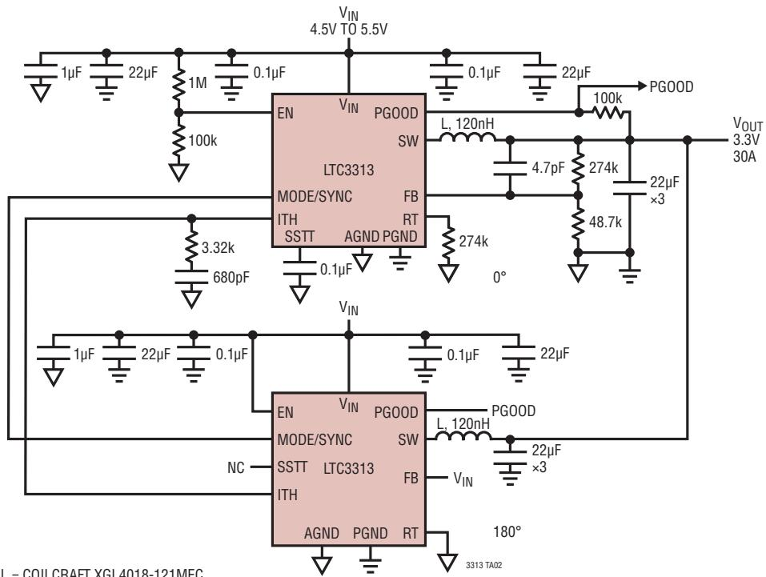

{21}------------------------------------------------

## TYPICAL APPLICATIONS

Three-Phase, 2MHz, 0.6V, 45A, Forced Continuous Mode

![Schematic diagram of a three-phase power supply using three LTC3313 controllers. The diagram shows three LTC3313 ICs arranged vertically. Each IC has pins for EN, VIN, PGOOD, MODE/SYNC, SW, ITH, FB, SSTT, AGND, and PGND. The top IC is configured for 0° phase, the middle for 120°, and the bottom for 240°. Each phase includes an input filter (10µF, 1µF, 22µF, 0.1µF capacitors), a 5.49kΩ resistor to the ITH pin, a 1500pF capacitor to the SSTT pin, and a 100kΩ resistor to the PGOOD pin. The output of each phase consists of a 55nH inductor (L), a 10pF capacitor, an 86.6kΩ resistor, a 432kΩ resistor, and a 47µF x3 capacitor. The output voltage is VOUT = 0.6V, 45A. The diagram also includes a reference to L = WURTH 744340300055 and a small label 3313 TA03.](img/e180f2b5fcbe8001554a7c0677cd3f82_img.jpg)

The diagram illustrates a three-phase power supply circuit using three LTC3313 controllers. Each controller is configured for a specific phase: 0°, 120°, and 240°. The input voltage is  $V_{IN}$  (3.0V TO 4.5V). Each controller has an input filter consisting of a 10µF capacitor, a 1µF capacitor, a 22µF capacitor, and a 0.1µF capacitor. The ITH pin is connected to a 5.49kΩ resistor to ground. The SSTT pin is connected to a 1500pF capacitor to ground. The PGOOD pin is connected to a 100kΩ resistor to ground. The output of each controller consists of a 55nH inductor (L), a 10pF capacitor, an 86.6kΩ resistor, a 432kΩ resistor, and a 47µF x3 capacitor. The output voltage is  $V_{OUT}$  = 0.6V, 45A. The diagram also includes a reference to L = WURTH 744340300055 and a small label 3313 TA03.

Schematic diagram of a three-phase power supply using three LTC3313 controllers. The diagram shows three LTC3313 ICs arranged vertically. Each IC has pins for EN, VIN, PGOOD, MODE/SYNC, SW, ITH, FB, SSTT, AGND, and PGND. The top IC is configured for 0° phase, the middle for 120°, and the bottom for 240°. Each phase includes an input filter (10µF, 1µF, 22µF, 0.1µF capacitors), a 5.49kΩ resistor to the ITH pin, a 1500pF capacitor to the SSTT pin, and a 100kΩ resistor to the PGOOD pin. The output of each phase consists of a 55nH inductor (L), a 10pF capacitor, an 86.6kΩ resistor, a 432kΩ resistor, and a 47µF x3 capacitor. The output voltage is VOUT = 0.6V, 45A. The diagram also includes a reference to L = WURTH 744340300055 and a small label 3313 TA03.

L = WURTH 744340300055

3313 TA03

{22}------------------------------------------------

## TYPICAL APPLICATIONS

Four-Phase, 2MHz, 1.2V, 60A, Forced Continuous Mode

The schematic diagram illustrates a four-phase power supply design using four LTC3313 controllers. The input stage features a common DC link with a filter consisting of a 10µF capacitor, a 1µF capacitor, a 22µF capacitor, and a 0.1µF capacitor. The input voltage is  $V_{IN}$  (3.0V TO 5.5V). The output stage provides a 1.2V, 60A output with a filter consisting of a 22µF capacitor, a 0.1µF capacitor, and a 22µF capacitor. The output voltage is  $V_{OUT}$  (1.2V, 60A). The four LTC3313 controllers are arranged vertically, each with its own input filtering and output filtering. The first controller (top) is a full-bridge rectifier, with its output connected to the output filter. The second controller is a single-phase rectifier with a 90° phase shift, with its output connected to the output filter. The third controller is a single-phase rectifier with a 180° phase shift, with its output connected to the output filter. The fourth controller is a single-phase rectifier with a 270° phase shift, with its output connected to the output filter. The output filter consists of a 22µF capacitor, a 0.1µF capacitor, and a 22µF capacitor. The output voltage is 1.2V, 60A. The diagram also shows the connection of the controllers to a common input line and a common output line. The first controller's output is connected to the output filter. The second controller's output is connected to the output filter. The third controller's output is connected to the output filter. The fourth controller's output is connected to the output filter. The output filter consists of a 22µF capacitor, a 0.1µF capacitor, and a 22µF capacitor. The output voltage is 1.2V, 60A.

Schematic diagram of a four-phase power supply using four LTC3313 controllers. The diagram shows the input filtering, the four controller blocks, the output filtering for each phase, and the output rectification. The first phase is a full-bridge rectifier, while the others are single-phase rectifiers with different phase shifts (0°, 90°, 180°, 270°).

L = COILCRAFT XEL4020-800MEC

3313 TA04

{23}------------------------------------------------

## TYPICAL APPLICATIONS

Four-Phase, 2MHz, 1.2V, 60A, Driven with External Clock, Forced Continuous Mode

![Schematic diagram of a four-phase LTC3313 power supply system. It consists of four LTC3313 controllers in a 2x2 grid. Each controller has an input section with a 10µF, 1µF, 22µF, and 0.1µF capacitor bank. The top-left controller is the master, with its MODE/SYNC pin connected to an EXTERNAL CLOCK. Its ITH pin is connected to a 3.32k resistor and a 680pF capacitor to ground. Its FB pin is connected to a voltage divider (140k and 100k) from VOUT to ground. Its SS TT pin is connected to ground. Its PGOOD pin is connected to a 100k resistor and a 22µF capacitor to ground. Its SW pin is connected to an 80nH inductor (L) and a 6.8pF capacitor to ground. Its AGND and PGND pins are connected to ground. The output of the master is VOUT, 1.2V, 60A. The other three controllers (top-right, bottom-left, bottom-right) are slaves. Their MODE/SYNC pins are connected to the master's SW pin. Their ITH pins are connected to ground. Their FB pins are connected to ground. Their SS TT pins are connected to ground. Their PGOOD pins are connected to 80nH inductors (L) and 22µF capacitors to ground. Their SW pins are connected to 80nH inductors (L) and 22µF capacitors to ground. Their AGND and PGND pins are connected to ground. The output of the slaves is VOUT, 1.2V, 60A. The diagram also shows a 301k resistor and a 100k resistor connected to the FB pin of the top-right controller, and a 301k resistor and a 100k resistor connected to the FB pin of the bottom-right controller. The diagram includes a note: L = COILCRAFT XEL4020-800MEC.](img/ae53f90bb87d6d09e2d6b5278d7c338f_img.jpg)

L = COILCRAFT XEL4020-800MEC

Schematic diagram of a four-phase LTC3313 power supply system. It consists of four LTC3313 controllers in a 2x2 grid. Each controller has an input section with a 10µF, 1µF, 22µF, and 0.1µF capacitor bank. The top-left controller is the master, with its MODE/SYNC pin connected to an EXTERNAL CLOCK. Its ITH pin is connected to a 3.32k resistor and a 680pF capacitor to ground. Its FB pin is connected to a voltage divider (140k and 100k) from VOUT to ground. Its SS TT pin is connected to ground. Its PGOOD pin is connected to a 100k resistor and a 22µF capacitor to ground. Its SW pin is connected to an 80nH inductor (L) and a 6.8pF capacitor to ground. Its AGND and PGND pins are connected to ground. The output of the master is VOUT, 1.2V, 60A. The other three controllers (top-right, bottom-left, bottom-right) are slaves. Their MODE/SYNC pins are connected to the master's SW pin. Their ITH pins are connected to ground. Their FB pins are connected to ground. Their SS TT pins are connected to ground. Their PGOOD pins are connected to 80nH inductors (L) and 22µF capacitors to ground. Their SW pins are connected to 80nH inductors (L) and 22µF capacitors to ground. Their AGND and PGND pins are connected to ground. The output of the slaves is VOUT, 1.2V, 60A. The diagram also shows a 301k resistor and a 100k resistor connected to the FB pin of the top-right controller, and a 301k resistor and a 100k resistor connected to the FB pin of the bottom-right controller. The diagram includes a note: L = COILCRAFT XEL4020-800MEC.

{24}------------------------------------------------

## TYPICAL APPLICATIONS

**5MHz, 1V, 15A, Forced Continuous Mode**

3.0V TO 3.6V  $V_{IN}$

22µF 649k 100k

EN MODE/SYNC SSTT ITH PGND PGOOD SW FB AGND RT

LTC3313

0.1µF 0.1µF 22µF

L 55nH L = WURTH 744340300055

10pF 100k 100k

$V_{IN}$  1µF

4.12k 680pF

3313 TA06

$V_{OUT}$  1V 15A

22µF x3

Circuit diagram for LTC3313 in Forced Continuous Mode. The input voltage is VIN (3.0V TO 3.6V). The output voltage is VOUT (1V, 15A). The inductor L is 55nH (WURTH 744340300055). The frequency is 5MHz. The diagram shows connections for EN, MODE/SYNC, SSTT, ITH, PGND, PGOOD, SW, FB, AGND, and RT. Component values include 22µF, 649k, 100k, 0.1µF, 4.12k, 680pF, 10pF, 100k, and 22µF x3.

**2MHz, 3.3V, 15A, Pulse-Skipping Mode**

4.5V TO 5.5V  $V_{IN}$

22µF 1M 100k

EN MODE/SYNC SSTT ITH PGND PGOOD SW FB AGND RT

LTC3313

0.1µF 0.1µF 22µF

100k  $V_{OUT}$  PGOOD

L 120nH L = COILCRAFT XGL4018-121MEC

10pF 562k 100k

$V_{IN}$  1µF

1500pF 1k

3313 TA07

$V_{OUT}$  3.3V 15A

22µF x2

Circuit diagram for LTC3313 in Pulse-Skipping Mode. The input voltage is VIN (4.5V TO 5.5V). The output voltage is VOUT (3.3V, 15A). The inductor L is 120nH (COILCRAFT XGL4018-121MEC). The frequency is 2MHz. The diagram shows connections for EN, MODE/SYNC, SSTT, ITH, PGND, PGOOD, SW, FB, AGND, and RT. Component values include 22µF, 1M, 100k, 0.1µF, 0.1µF, 22µF, 100k, 120nH, 10pF, 562k, 100k, 1500pF, and 1k.

{25}------------------------------------------------

# LTC3313

---

## TYPICAL APPLICATIONS

**2MHz, 0.5V, 15A, Forced Continuous Mode, Low Part Count**

Image: LTC3313 schematic for 2MHz, 0.5V, 15A, Forced Continuous Mode, Low Part Count application

L = WURTH 744340300055

---

26  
For more information [www.analog.com](https://www.analog.com)  
Rev. A

{26}------------------------------------------------

**PACKAGE DESCRIPTION**

**LTC3313**

**LQFN Package  
18-Lead (3mm × 3mm × 0.95mm)  
(Reference LTC DWG # 05-08-7061 Rev Ø)**

| SYMBOL | DIMENSIONS |      |      | NOTES         |
|--------|------------|------|------|---------------|
|        | MIN        | NOM  | MAX  |               |
| A      | 0.85       | 0.95 | 1.05 |               |
| A1     | 0.01       | 0.02 | 0.03 |               |
| L      | 0.30       | 0.40 | 0.50 |               |
| b      | 0.22       | 0.25 | 0.28 |               |
| D      | 3.00       |      |      |               |
| E      | 3.00       |      |      |               |
| D1     | 1.70       |      |      |               |
| E1     | 1.70       |      |      |               |
| e      | 0.50       |      |      |               |
| H1     | 0.25 REF   |      |      | SUBSTRATE THK |
| H2     | 0.70 REF   |      |      | MOLD CAP HT   |
| aaa    | 0.10       |      |      |               |
| bbb    | 0.10       |      |      |               |
| ccc    | 0.08       |      |      |               |
| ddd    | 0.10       |      |      |               |
| eee    | 0.15       |      |      |               |
| fff    | 0.08       |      |      |               |

NOTES:  
1. DIMENSIONING AND TOLERANCING PER ASME Y14.5M-1994  
2. ALL DIMENSIONS ARE IN MILLIMETERS  
3. METAL FEATURES UNDER THE SOLDER MASK OPENING NOT SHOWN SO AS NOT TO OBSCURE THESE TERMINALS AND HEAT FEATURES  
4. DETAILS OF PIN 1 IDENTIFIER ARE OPTIONAL, BUT MUST BE LOCATED WITHIN THE ZONE INDICATED. THE PIN 1 IDENTIFIER MAY BE EITHER A MOLD OR MARKED FEATURE  
5. PRIMARY DATUM -Z- IS SEATING PLANE  
6. THE EXPOSED HEAT FEATURE MAY HAVE OPTIONAL CORNER RADII

LQFN 18 0920 REV Ø

For more information [www.analog.com](http://www.analog.com)

Rev. A

27

{27}------------------------------------------------

## REVISION HISTORY

| REV | DATE  | DESCRIPTION               | PAGE NUMBER |
|-----|-------|---------------------------|-------------|
| 0   | 01/23 | Initial release           | —           |
| A   | 07/25 | Updated Pin Configuration | 2           |

{28}------------------------------------------------

## TYPICAL APPLICATION

3MHz, 1.0V, 15A, Forced Continuous Mode

Circuit diagram of the LTC3313 in a typical application. The input voltage is VIN (3.0V TO 3.6V). The LTC3313 is configured for 3MHz, 1.0V, 15A, Forced Continuous Mode. The diagram shows the input capacitors (22µF, 0.1µF, 0.1µF, 22µF), the LTC3313 IC, the output inductor (L = COILCRAFT XEL3515-720MEB), the output capacitors (22µF x3), and the feedback network (10pF, 100k, 100k, 178k). The output voltage is VOUT (1.0V, 15A).

## RELATED PARTS

| PART NUMBER                                                                                                     | DESCRIPTION                                                                                        | COMMENTS                                                                                                                                                                                                                                                                                                                                                                                     |
|-----------------------------------------------------------------------------------------------------------------|----------------------------------------------------------------------------------------------------|----------------------------------------------------------------------------------------------------------------------------------------------------------------------------------------------------------------------------------------------------------------------------------------------------------------------------------------------------------------------------------------------|
| <a href="#">LTC3307A/LTC3307B</a> , <a href="#">LTC3308A/LTC3308B</a> , <a href="#">LTC3309A/LTC3309B</a> | 3A, 4A and 6A 5V Synchronous Step-Down Silent Switcher DC/DC                                       | Monolithic Synchronous Step-Down DC/DC Capable of Supplying Up to 6A at Switching Frequencies Up to 3MHz(A)10MHz(B); Silent Switcher Architecture for Ultralow EMI Emissions; 2.25V to 5.5V Input Operating Range; 0.5V to V IN Output Voltage Range with ±1% Accuracy; PGOOD Indication, R T Programming, SYNC Input; 2mm × 2mm LQFN                                  |
| <a href="#">LTC3310/LTC3310S</a> <a href="#">LTC3311/LTC3311S</a>                                            | 5V, 10A/12.5A Synchronous Step-Down Silent Switcher/Silent Switcher 2                              | Monolithic Synchronous Step-Down DC/DC Capable of Supplying 10A/12.5A at Switching Frequencies Up to 5MHz; Silent Switcher Architecture for Ultralow EMI Emissions; 2.25V to 5.5V Input Operating Range; 0.5V to V IN Output Voltage Range with ±1% Accuracy; PGOOD Indication, R T Programming, SYNC Input; Configurable for Paralleling Power Stages; 3mm × 3mm LQFN |
| <a href="#">LTC3315A/LTC3315B</a>                                                                               | Dual 5V, 2A Synchronous Step-Down DC/DCs                                                           | Dual Monolithic Synchronous Step-Down Voltage Regulators each Capable of Supplying 2A at Switching Frequencies Up to 3MHz(A) and 10MHz(B); 2.25V to 5.5V Input Operating Range; 0.5V to V IN Output Voltage Range with ±1% Accuracy; PGOOD Indication, SYNC Input; 2mm × 2mm LQFN                                                                                                 |
| <a href="#">LTC3612</a>                                                                                         | 5.5V, 3A (I OUT ), 4MHz, Synchronous Step-Down DC/DC Converter                          | 95% Efficiency, V IN : 2.25V to 5.5V, V OUT(MIN) = 0.8V, I Q = 60µA, I SD < 1µA, TSSOP-16E and 4mm × 4mm QFN-16 Packages                                                                                                                                                                                                                         |
| <a href="#">LTC3614/LTC3616</a>                                                                                 | 5.5V, 4A/6A (I OUT ), 4MHz, Synchronous Step-Down DC/DC Converter with Tracking and DDR | 95% Efficiency, V IN : 2.25V to 5.5V, V OUT(MIN) = 0.6V, I Q = 75µA, I SD < 1µA, 3mm × 5mm QFN-24 Package                                                                                                                                                                                                                                        |
| <a href="#">LTC3615/LTC3615-1</a>                                                                               | Dual Channel 5.5V, 3A (I OUT ), 4MHz, Synchronous Step-Down DC/DC Converter             | 94% Efficiency, V IN : 2.25V to 5.5V, V OUT(MIN) = 0.6V, I Q = 130µA, I SD < 1µA, 4mm × 4mm QFN-24 Package                                                                                                                                                                                                                                       |
| <a href="#">LTC3636/LTC3636-1</a>                                                                               | Dual Channel 6A, 20V Monolithic Synchronous Step-Down Regulator                                    | 95% Efficiency, V IN : 3.1V to 20V, V OUT(MIN) = 0.6V (LTC3636), 1.8V (LTC3636-1), I Q = 1.3mA, I SD < 13µA, 4mm × 5mm QFN-28                                                                                                                                                                                                                    |
| <a href="#">LTC7150S</a>                                                                                        | 20V, 20A Synchronous Step-Down Silent Switcher 2 Regulator                                         | 92% Efficiency, V IN : 3.1V to 20V, V OUT(MIN) = 0.6V, I Q = 2mA, I SD ≤ 40µA, Differential Remote Sense, 6mm × 5mm BGA                                                                                                                                                                                                                          |
| <a href="#">LTC7151S</a>                                                                                        | 20V, 15A Synchronous Step-Down Silent Switcher 2 Regulator                                         | 92.5% Efficiency, V IN : 3.1V to 20V, V OUT(MIN) = 0.5V, I Q = 2mA, I SD < 20µA, 4mm × 5mm LQFN-28                                                                                                                                                                                                                                               |
| <a href="#">LT8640S</a>                                                                                         | 42V, 6A Synchronous Step-Down Silent Switcher 2 with 2.5µA Quiescent Current                       | 96% Efficiency, V IN : 3.4V to 42V, V OUT(MIN) = 1.0V, I Q = 230µA, I SD < 1µA, 4mm × 4mm LQFN-24                                                                                                                                                                                                                                                |
| <a href="#">LT8642S</a>                                                                                         | 18V, 10A Synchronous Step-Down Silent Switcher 2 Regulator                                         | 96% Efficiency, V IN : 2.8V to 18V, V OUT(MIN) = 0.6V, I Q = 240µA, I SD < 1µA, 4mm × 4mm LQFN-24                                                                                                                                                                                                                                                |
| <a href="#">LT8650S</a>                                                                                         | Dual Channel 4A, 42V, Synchronous Step-Down Silent Switcher 2 with 6.2µA Quiescent Current         | 94.5% Efficiency, V IN : 3V to 42V, V OUT(MIN) = 0.8V, I Q = 5mA, I SD < 2µA, 4mm × 6mm LQFN-32                                                                                                                                                                                                                                                  |