{0}------------------------------------------------

# Dual 5V, 2A Synchronous Step-Down DC/DCs in Tiny LQFN and WLCSP

## FEATURES

- **Dual Outputs Each with 2A Output Current**
- **High Efficiency: 19mΩ NMOS and 75mΩ PMOS**
- **Wide Bandwidth, Fast Transient Response**
- **Switching Frequency Synchronizable Up to 3MHz**
- $V_{IN}$  Range: 2.25V to 5.5V
- $V_{OUT}$  Range: 0.5V to  $V_{IN}$
- $V_{OUT}$  Accuracy:  $\pm 1\%$
- Low Ripple Burst Mode® Operation
- Peak Current Mode Control
- Minimum On-Time: 25ns
- Safely Tolerates Inductor Saturation in Overload
- Shutdown Current: 1.2μA
- Precision 400mV Enable Thresholds
- Internal Soft-Start and Compensation
- Power Good Output
- Low Profile, Thermally Enhanced 12-Lead 2mm × 2mm × 0.74mm LQFN and 16-Ball 1.64mm × 1.64mm × 0.5mm WLCSP Packages
- AEC-Q100 Qualified for Automotive Applications

## DESCRIPTION

The LTC®3315A features dual 2A monolithic synchronous step-down converters operating from a 2.25V to 5.5V input supply in one package for space-constrained applications with demanding performance requirements. Using constant frequency, peak current mode control at switching frequencies up to 3MHz with a minimum on-time as low as 25ns, both bucks achieve high efficiency and fast transient response in a very small application footprint.

The LTC3315A operates in forced continuous or pulse-skipping mode for low noise or in Burst Mode® operation for high efficiency at light loads. The common buck switching frequency is 2MHz and can be synchronized to an external oscillator via the MODE/SYNC pin.

The LTC3315A can regulate outputs as low as 500mV. Other features include precision enable thresholds, a PGOOD signal, output overvoltage protection, thermal shutdown, output short-circuit protection, and up to 100% duty cycle operation for low dropout. The LTC3315A is available in a compact 2mm × 2mm LQFN package and a 1.64mm × 1.64mm WLCSP package.

All registered trademarks and trademarks are the property of their respective owners.

## APPLICATIONS

- Servers, Telecom Supplies, Optical Networking
- Distributed DC Power Systems (POL)
- FPGA, ASIC, μP Core Supplies
- Industrial/Automotive/Communications

## TYPICAL APPLICATION

Dual 2MHz 2A Buck Regulators

![Schematic diagram of the LTC3315A dual 2A buck regulators. The diagram shows a 12-lead LQFN package with two identical buck converter sections. Input: VIN (2.25V to 5.5V) connected to both VIN pins, with 10µF capacitors to ground. Enable pins: EN1 and EN2 connected to VIN. Switching frequency: fSW = 2MHz connected to the MODE/SYNC pin. Output 1: SW1 pin connected to an 880nH inductor, which is connected to a 140k resistor and a 6.8pF capacitor to the VOUT1 pin (1.2V, 2A). FB1 pin is connected to a voltage divider (100k and 140k resistors) between VOUT1 and ground. Output 2: SW2 pin connected to a 1µH inductor, which is connected to a 261k resistor and a 4.7pF capacitor to the VOUT2 pin (1.8V, 2A). FB2 pin is connected to a voltage divider (100k and 261k resistors) between VOUT2 and ground. Power Good: PGOOD pin is shown. Reference: 3315A TA01a.](24029b85683e6c5b14e96022cd9b6ff6_img.jpg)

Schematic diagram of the LTC3315A dual 2A buck regulators. The diagram shows a 12-lead LQFN package with two identical buck converter sections. Input: VIN (2.25V to 5.5V) connected to both VIN pins, with 10µF capacitors to ground. Enable pins: EN1 and EN2 connected to VIN. Switching frequency: fSW = 2MHz connected to the MODE/SYNC pin. Output 1: SW1 pin connected to an 880nH inductor, which is connected to a 140k resistor and a 6.8pF capacitor to the VOUT1 pin (1.2V, 2A). FB1 pin is connected to a voltage divider (100k and 140k resistors) between VOUT1 and ground. Output 2: SW2 pin connected to a 1µH inductor, which is connected to a 261k resistor and a 4.7pF capacitor to the VOUT2 pin (1.8V, 2A). FB2 pin is connected to a voltage divider (100k and 261k resistors) between VOUT2 and ground. Power Good: PGOOD pin is shown. Reference: 3315A TA01a.

Efficiency vs Load Current

![Graph showing Efficiency (%) and Power Loss (W) versus Load Current (A) for Burst Mode Operation. The graph has two y-axes: Efficiency (%) from 0 to 100 on the left, and Power Loss (W) from 0 to 1.0 on the right. The x-axis is Load Current (A) on a logarithmic scale from 1m to 2. Efficiency (red solid line) starts at ~80% at 1mA, rises to ~90% at 10mA, and stays high. Power Loss (blue dashed line) starts near 0 at 1mA, remains low until ~100mA, then rises sharply to ~0.3W at 2A. Text in the graph: 'Burst Mode OPERATION', 'VIN = 3.3V, VOUT = 1.2V', 'L = 880nH, L DCR = 19mΩ', 'fSW = 2MHz'. Reference: 3315A TA01b.](207c4bf0dce180461dfd17ac04bb84bc_img.jpg)

Graph showing Efficiency (%) and Power Loss (W) versus Load Current (A) for Burst Mode Operation. The graph has two y-axes: Efficiency (%) from 0 to 100 on the left, and Power Loss (W) from 0 to 1.0 on the right. The x-axis is Load Current (A) on a logarithmic scale from 1m to 2. Efficiency (red solid line) starts at ~80% at 1mA, rises to ~90% at 10mA, and stays high. Power Loss (blue dashed line) starts near 0 at 1mA, remains low until ~100mA, then rises sharply to ~0.3W at 2A. Text in the graph: 'Burst Mode OPERATION', 'VIN = 3.3V, VOUT = 1.2V', 'L = 880nH, L DCR = 19mΩ', 'fSW = 2MHz'. Reference: 3315A TA01b.

Rev. B

{1}------------------------------------------------

## LTC3315A

## ABSOLUTE MAXIMUM RATINGS (Note 1)

|                   |                                            |
|-------------------|--------------------------------------------|
| $V_{IN}$ .....    | −0.3V to 6V                                |
| EN1, EN2 .....    | −0.3V to Lesser of $(V_{IN} + 0.3V)$ or 6V |
| FB1, FB2 .....    | −0.3V to Lesser of $(V_{IN} + 0.3V)$ or 6V |
| MODE/SYNC .....   | −0.3V to Lesser of $(V_{IN} + 0.3V)$ or 6V |
| PGOOD .....       | −0.3V to 6V                                |
| $I_{PGOOD}$ ..... | 5mA                                        |

Operating Junction Temperature (Notes 2, 3):

|                  |                |
|------------------|----------------|
| LTC3315AA .....  | −40°C to 125°C |
| LTC3315AE .....  | −40°C to 125°C |
| LTC3315AI .....  | −40°C to 125°C |
| LTC3315AJ .....  | −40°C to 150°C |
| LTC3315AH .....  | −40°C to 150°C |
| LTC3315AMP ..... | −55°C to 150°C |

Storage Temperature Range ..... −65°C to 150°C

Maximum Reflow (Package Body) Temperature ... 260°C

## PIN CONFIGURATION

TOP VIEW

Image: LQFN 12-lead package pinout diagram. Pin 13 is the exposed pad (GND). Pin 1 is EN1, Pin 2 is FB1, Pin 3 is FB2, Pin 4 is EN2, Pin 5 is PGOOD, Pin 6 is SW2, Pin 7 is VIN, Pin 8 is GND, Pin 9 is GND, Pin 10 is VIN, Pin 11 is SW1, Pin 12 is MODE/SYNC.

LQFN PACKAGE  
12-LEAD (2mm × 2mm × 0.74mm)

$T_{JMAX} = 150^{\circ}C$ ,  $\theta_{JA} = 51^{\circ}C/W$ ,  $\theta_{JCBOTTOM} = 8.6^{\circ}C/W$ ,  
 $\theta_{JCTOP} = 80^{\circ}C/W$ ,  $\theta_{JB} = 12^{\circ}C/W$ ,  $\Psi_{JT} = 0.8^{\circ}C/W$ ,  
 $\theta$  AND  $\Psi$  VALUES DETERMINED PER JESD51-7 ON A JEDEC 2S2P PC  
EXPOSED PAD (PIN 13) IS GND, MUST BE SOLDERED TO PCB

TOP VIEW

Image: WLCSP 16-ball package pinout diagram. Pin 1 is PGOOD, Pin 2 is FB2, Pin 3 is FB1, Pin 4 is MODE/SYNC, Pin 5 is VIN, Pin 6 is EN2, Pin 7 is EN1, Pin 8 is GND, Pin 9 is SW2, Pin 10 is SW2, Pin 11 is SW1, Pin 12 is SW1, Pin 13 is VIN, Pin 14 is GND, Pin 15 is GND, Pin 16 is VIN.

WLCSP PACKAGE  
CB-16-11  
16-BALL (1.64mm × 1.64mm × 0.5mm)

$T_{JMAX} = 125^{\circ}C$ ,  $\theta_{JA} = 58^{\circ}C/W$ ,  $\theta_{JCTOP} = 2.7^{\circ}C/W$ ,  
 $\theta_{JB} = 14.8^{\circ}C/W$ ,  $\Psi_{JT} = 2.1^{\circ}C/W$ ,  $\Psi_{JB} = 15^{\circ}C/W$ ,  
 $\theta$  AND  $\Psi$  VALUES DETERMINED PER JESD51-7 ON A JEDEC 2S2P PC

{2}------------------------------------------------

## ORDER INFORMATION

| TAPE AND REEL (MINI) | TAPE AND REEL     | PART MARKING* |             | PACKAGE TYPE                                   | MSL RATING | TEMPERATURE RANGE (SEE NOTE 2) |
|----------------------|-------------------|---------------|-------------|------------------------------------------------|------------|--------------------------------|
|                      |                   | DEVICE        | FINISH CODE |                                                |            |                                |
| LTC3315AEV#TRMPBF    | LTC3315AEV#TRPBF  | LHFY          | e4          | LQFN (Laminate Package with QFN Footprint)     | MSL 3      | –40°C to 125°C                 |
| LTC3315AIV#TRMPBF    | LTC3315AIV#TRPBF  |               |             |                                                |            | –40°C to 125°C                 |
| LTC3315AJV#TRMPBF    | LTC3315AJV#TRPBF  |               |             |                                                |            | –40°C to 150°C                 |
| LTC3315AHV#TRMPBF    | LTC3315AHV#TRPBF  |               |             |                                                |            | –40°C to 150°C                 |
| LTC3315AMPV#TRMPBF   | LTC3315AMPV#TRPBF |               |             |                                                |            | –55°C to 150°C                 |
|                      | LTC3315AACBZ-R7   | 3315A         | e1          | WLCSP (16-Ball Wafer Level Chip Scale Package) | MSL1       | –40°C to 125°C                 |

### AUTOMOTIVE PRODUCTS\*\*

|                    |                   |      |    |                                            |       |                |
|--------------------|-------------------|------|----|--------------------------------------------|-------|----------------|
| LTC3315AEV#WTRMPBF | LTC3315AEV#WTRPBF | LHFY | e4 | LQFN (Laminate Package with QFN Footprint) | MSL 3 | –40°C to 125°C |
| LTC3315AIV#WTRMPBF | LTC3315AIV#WTRPBF |      |    |                                            |       | –40°C to 125°C |
| LTC3315AJV#WTRMPBF | LTC3315AJV#WTRPBF |      |    |                                            |       | –40°C to 150°C |
| LTC3315AHV#WTRMPBF | LTC3315AHV#WTRPBF |      |    |                                            |       | –40°C to 150°C |

- Contact the factory for parts specified with wider operating temperature ranges. \*Pad or ball finish code is per IPC/JEDEC J-STD-609.
  - Device temperature grade is indicated by a label on the shipping container.
  - TRM = 500 pieces.

\*\*Versions of this part are available with controlled manufacturing to support the quality and reliability requirements of automotive applications. These models are designated with a #W suffix. Only the automotive grade products shown are available for use in automotive applications. Contact your local Analog Devices account representative for specific product ordering information and to obtain the specific Automotive Reliability reports for these models.

- [Recommended LGA and BGA PCB Assembly and Manufacturing Procedures](#)
  - [LGA and BGA Package and Tray Drawings](#)
  - [Tape and reel specifications](#). Some packages are available in 500 unit reels through designated sales channels with #TRMPBF suffix.

## ELECTRICAL CHARACTERISTICS The ● denotes the specifications which apply over the full operating junction temperature range, otherwise specifications are at TA = 25°C (Notes 2, 3). VIN = 3.3V unless otherwise specified.

| PARAMETER                                                 | CONDITIONS                                                                    | MIN    | TYP       | MAX        | UNITS    |
|-----------------------------------------------------------|-------------------------------------------------------------------------------|--------|-----------|------------|----------|
| Input Supply                                              |                                                                               |        |           |            |          |
| Operating Supply Voltage (V IN )               |                                                                               | ● 2.25 |           | 5.5        | V        |
| V IN Undervoltage Lockout                      | V IN Rising                                                        | ● 2.05 | 2.15      | 2.25       | V        |
| V IN Undervoltage Lockout Hysteresis           |                                                                               |        | 150       |            | mV       |
| V IN Quiescent Current in Shutdown             |                                                                               |        | 1.2       | 2          | μA       |
| V IN Quiescent Current with One Buck Enabled   | Burst Mode, Buck in Regulation, Sleeping All Modes, Not Sleeping (Note 4)  |        | 45 1.5 | 70 2.3  | μA mA |
| V IN Quiescent Current with Both Bucks Enabled | Burst Mode, Bucks in Regulation, Sleeping All Modes, Not Sleeping (Note 4) |        | 70 2.8 | 110 4.2 | μA mA |
| Enable Threshold                                          | V EN Rising                                                        | ● 375  | 400       | 425        | mV       |
| Enable Threshold Hysteresis                               |                                                                               |        | 50        |            | mV       |
| EN Pin Leakage                                            | V EN = 5.5V                                                        |        |           | ±20        | nA       |
| Voltage Regulation, Buck 1 and Buck 2                     |                                                                               |        |           |            |          |
| Regulated Feedback Voltage (V FB )             |                                                                               | ● 495  | 500       | 505        | mV       |
| Feedback Voltage Line Regulation                          | 2.25V ≤ V IN ≤ 5.5V                                                |        | 0.015     | 0.05       | %/V      |
| Feedback Pin Input Current                                | V FB = 500mV                                                       |        |           | ±20        | nA       |
| PMOS Current Limit (I LIM )                    | Current out of SW, V OUT /V IN ≤ 0.2                    |        | 2.9       | 3.2        | 3.5 A    |

{3}------------------------------------------------

## ELECTRICAL CHARACTERISTICS The ● denotes the specifications which apply over the full operating junction temperature range, otherwise specifications are at $T_A = 25^\circ\text{C}$ (Notes 2, 3). $V_{IN} = 3.3\text{V}$ unless otherwise specified.

| PARAMETER                           | CONDITIONS                                | MIN | TYP | MAX       | UNITS      |
|-------------------------------------|-------------------------------------------|-----|-----|-----------|------------|
| NMOS Current Limit ( $I_{VALLEY}$ ) | Current out of SW                         | 2.4 | 2.7 | 3.0       | A          |
| NMOS Reverse Current Limit          | Current into SW, Forced Continuous, LQFN  | 0.5 | 1   | 1.5       | A          |
|                                     | Current into SW, Forced Continuous, WLCSP | 0.5 | 1   | 1.7       | A          |
| PMOS ON-Resistance                  |                                           |     | 75  |           | m $\Omega$ |
| NMOS ON-Resistance                  |                                           |     | 19  |           | m $\Omega$ |
| SW Leakage Current                  | Shutdown, $V_{IN} = 5.5\text{V}$          |     |     | $\pm 200$ | nA         |
| Minimum On Time                     | $V_{IN} = 5.5\text{V}$                    | ●   | 25  | 45        | ns         |
| Maximum Duty Cycle                  |                                           | ●   | 100 |           | %          |
| Overtemperature Shutdown (OT)       | Temperature Rising (Note 5)               |     | 165 |           | °C         |
| Overtemperature Shutdown Hysteresis |                                           |     | 5   |           | °C         |

### Power Good/Soft-Start

|                              |                                            |   |      |     |     |    |
|------------------------------|--------------------------------------------|---|------|-----|-----|----|
| PGOOD Rising Threshold       | As a Percentage of the Regulated $V_{OUT}$ | ● | 97   | 98  | 99  | %  |
| PGOOD Hysteresis             |                                            | ● | 0.6  | 1.1 | 1.6 | %  |
| Overvoltage Rising Threshold | As a Percentage of the Regulated $V_{OUT}$ | ● | 107  | 110 | 114 | %  |
| Overvoltage Hysteresis       |                                            | ● | 1    | 2.2 | 3.5 | %  |
| PGOOD Delay                  |                                            |   | 120  |     |     | μs |
| PGOOD Leakage Current        | $V_{PGOOD} = 5.5\text{V}$                  |   |      |     | 20  | nA |
| PGOOD Pull-Down Resistance   | $V_{PGOOD} = 0.1\text{V}$                  |   | 10   | 20  |     | Ω  |
| Soft-Start Time              | (Note 6)                                   | ● | 0.25 | 1   | 3   | ms |

### Oscillator and MODE/SYNC

|                                            |                                     |   |                |   |      |     |
|--------------------------------------------|-------------------------------------|---|----------------|---|------|-----|
| Internal Oscillator Frequency ( $f_{SW}$ ) |                                     | ● | 1.85           | 2 | 2.15 | MHz |
| Synchronization Frequency Range            |                                     | ● | 1              |   | 3    | MHz |
| Minimum SYNC High or Low Pulse Width       |                                     | ● | 40             |   |      | ns  |
| SYNC Level High on MODE/SYNC               |                                     | ● | 1.2            |   |      | V   |
| SYNC Level Low on MODE/SYNC                |                                     | ● |                |   | 0.4  | V   |
| MODE/SYNC No Clock Detect Time             |                                     |   | 10             |   |      | μs  |
| MODE/SYNC Pin Threshold                    | For Programming Pulse Skipping Mode | ● |                |   | 0.1  | V   |
|                                            | For Programming Burst Mode          | ● | $V_{IN} - 0.1$ |   |      | V   |

**Note 1:** Stresses beyond those listed under Absolute Maximum Ratings may cause permanent damage to the device. Exposure to any Absolute Maximum Rating condition for extended periods may affect device reliability and lifetime.

**Note 2:** The LTC3315A is tested under pulsed load conditions such that  $T_J \approx T_A$ . The LTC3315AE is guaranteed to meet specifications from  $0^\circ\text{C}$  to  $85^\circ\text{C}$  junction temperature. Specifications over the  $-40^\circ\text{C}$  to  $125^\circ\text{C}$  operating junction temperature range are assured by design, characterization, and correlation with statistical process controls. The LTC3315AI is guaranteed over the  $-40^\circ\text{C}$  to  $125^\circ\text{C}$  operating junction temperature range, the LTC3315AJV and the LTC3315AH are guaranteed over the  $-40^\circ\text{C}$  to  $150^\circ\text{C}$  operating junction temperature range, and the LTC3315AMP is guaranteed over the  $-55^\circ\text{C}$  to  $150^\circ\text{C}$  operating junction temperature range. The LTC3315AA specifications over the  $-40^\circ\text{C}$  to  $125^\circ\text{C}$  operating junction temperature range are assured by design, characterization, and correlation with statistical process controls. High junction temperatures degrade operating lifetimes; operating lifetime is derated for junction temperatures greater than  $125^\circ\text{C}$ . Note that the maximum ambient temperature consistent with these specifications is

determined by specific operating conditions in conjunction with board layout, the rated package thermal impedance, and other environmental factors. The junction temperature ( $T_J$  in  $^\circ\text{C}$ ) is calculated from ambient temperature ( $T_A$  in  $^\circ\text{C}$ ) and power dissipation ( $P_D$  in Watts) according to the formula:

$$T_J = T_A + (P_D \cdot \theta_{JA})$$

where  $\theta_{JA}$  (in  $^\circ\text{C}/\text{W}$ ) is the package thermal impedance. See High Temperature Considerations section for more details.

**Note 3:** The LTC3315A includes overtemperature protection which protects the device during momentary overload conditions. Junction temperatures will exceed  $150^\circ\text{C}$  when overtemperature protection is active. Continuous operation above the specified maximum operating junction temperature may impair device reliability.

**Note 4:** Static current, switches not switching. Actual current will be higher due to gate charge losses at the switching frequency.

**Note 5:** Overtemperature shutdown is not tested in production.

**Note 6:** The soft-start time is the time from the start of switching until the FB pin reaches 475mV.

{4}------------------------------------------------

## **TYPICAL PERFORMANCE CHARACTERISTICS** $T_A = 25^{\circ}\text{C}$ , $V_{IN} = 3.3\text{V}$ , unless otherwise noted.

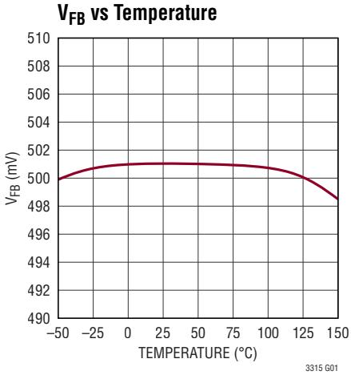

### VFB vs Temperature

| TEMPERATURE (°C) | V FB (mV) |
|------------------|----------------------|
| -50              | 500.0                |
| 0                | 501.0                |
| 25               | 501.2                |
| 50               | 501.1                |
| 75               | 501.0                |
| 100              | 500.5                |
| 125              | 499.5                |
| 150              | 498.0                |

3315 G01

Graph of VFB vs Temperature. The y-axis is VFB (mV) from 490 to 510. The x-axis is TEMPERATURE (°C) from -50 to 150. A solid red line shows VFB is relatively stable around 501 mV until 100°C, then decreases to about 498 mV at 150°C.

### PMOS RDS(ON) vs Temperature

| TEMPERATURE (°C) | V IN = 2.25V | V IN = 3.3V | V IN = 5.5V |
|------------------|-------------------------|------------------------|------------------------|
| -50              | 85                      | 65                     | 55                     |
| 0                | 95                      | 70                     | 58                     |
| 25               | 105                     | 75                     | 60                     |
| 50               | 115                     | 80                     | 62                     |
| 75               | 125                     | 85                     | 65                     |
| 100              | 135                     | 90                     | 68                     |
| 125              | 145                     | 95                     | 70                     |
| 150              | 155                     | 100                    | 72                     |

3315ab G02

Graph of PMOS RDS(ON) vs Temperature. The y-axis is RDS(ON) (mΩ) from 0 to 150. The x-axis is TEMPERATURE (°C) from -50 to 150. Three lines are shown: VIN = 2.25V (solid red), VIN = 3.3V (dashed blue), and VIN = 5.5V (dashed green). All show an upward trend with temperature.

### NMOS RDS(ON) vs Temperature

| TEMPERATURE (°C) | V IN = 2.25V | V IN = 3.3V | V IN = 5.5V |
|------------------|-------------------------|------------------------|------------------------|
| -50              | 20                      | 15                     | 10                     |
| 0                | 25                      | 18                     | 12                     |
| 25               | 30                      | 20                     | 14                     |
| 50               | 35                      | 22                     | 16                     |
| 75               | 40                      | 25                     | 18                     |
| 100              | 45                      | 28                     | 20                     |
| 125              | 50                      | 30                     | 22                     |
| 150              | 55                      | 32                     | 24                     |

3315ab G03

Graph of NMOS RDS(ON) vs Temperature. The y-axis is RDS(ON) (mΩ) from 0 to 50. The x-axis is TEMPERATURE (°C) from -50 to 150. Three lines are shown: VIN = 2.25V (solid red), VIN = 3.3V (dashed blue), and VIN = 5.5V (dashed green). All show an upward trend with temperature.

### NMOS, PMOS Leakage vs Temperature

| TEMPERATURE (°C) | NMOS VIN = 5.5V, SW = 5.5V | NMOS VIN = 3.3V, SW = 3.3V | PMOS VIN = 5.5V, SW = 0V | PMOS VIN = 3.3V, SW = 0V |
|------------------|----------------------------|----------------------------|--------------------------|--------------------------|
| -50              | 0.0                        | 0.0                        | 0.0                      | 0.0                      |
| 0                | 0.0                        | 0.0                        | 0.0                      | 0.0                      |
| 25               | 0.0                        | 0.0                        | 0.0                      | 0.0                      |
| 50               | 0.0                        | 0.0                        | 0.0                      | 0.0                      |
| 75               | 0.1                        | 0.1                        | 0.1                      | 0.1                      |
| 100              | 0.5                        | 0.4                        | 0.3                      | 0.2                      |
| 125              | 2.0                        | 1.5                        | 0.8                      | 0.5                      |
| 150              | 3.0                        | 2.5                        | 1.5                      | 0.8                      |

3315ab G04

Graph of Leakage vs Temperature. The y-axis is LEAKAGE (μA) from 0 to 3.2. The x-axis is TEMPERATURE (°C) from -50 to 150. Four lines are shown: NMOS VIN = 5.5V, SW = 5.5V (solid red); NMOS VIN = 3.3V, SW = 3.3V (dashed blue); PMOS VIN = 5.5V, SW = 0V (dashed green); PMOS VIN = 3.3V, SW = 0V (dotted orange). All show exponential increase in leakage above 75°C.

### Oscillator Frequency vs Temperature

| TEMPERATURE (°C) | V IN = 5.5V | V IN = 3.3V | V IN = 2.25V |
|------------------|------------------------|------------------------|-------------------------|
| -50              | 2.08                   | 2.00                   | 1.96                    |
| 0                | 2.08                   | 2.00                   | 1.96                    |
| 25               | 2.08                   | 2.00                   | 1.96                    |
| 50               | 2.07                   | 1.99                   | 1.95                    |
| 75               | 2.06                   | 1.98                   | 1.94                    |
| 100              | 2.05                   | 1.97                   | 1.93                    |
| 125              | 2.04                   | 1.96                   | 1.92                    |
| 150              | 2.03                   | 1.95                   | 1.91                    |

3315aba G05

Graph of Oscillator Frequency vs Temperature. The y-axis is FREQUENCY (MHz) from 1.80 to 2.20. The x-axis is TEMPERATURE (°C) from -50 to 150. Three lines are shown: VIN = 5.5V (solid red), VIN = 3.3V (dashed blue), and VIN = 2.25V (dashed green). All show a slight downward trend with temperature.

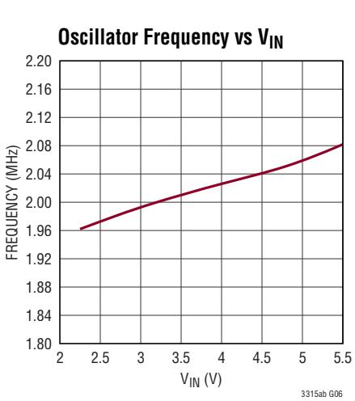

### Oscillator Frequency vs VIN

| V IN (V) | FREQUENCY (MHz) |
|---------------------|-----------------|
| 2.25                | 1.96            |
| 3.3                 | 2.00            |
| 4.5                 | 2.04            |
| 5.5                 | 2.08            |

3315ab G06

Graph of Oscillator Frequency vs VIN. The y-axis is FREQUENCY (MHz) from 1.80 to 2.20. The x-axis is VIN (V) from 2 to 5.5. A solid red line shows frequency increasing from approximately 1.96 MHz at 2.25V to 2.08 MHz at 5.5V.

{5}------------------------------------------------

## TYPICAL PERFORMANCE CHARACTERISTICS $T_A = 25^\circ\text{C}$ , $V_{IN} = 3.3\text{V}$ , unless otherwise noted.

### $V_{IN}$ Shutdown Quiescent Current vs Temperature

3315ab G7

Graph of VIN Shutdown Quiescent Current vs Temperature. The y-axis is Ivin (µA) from 0 to 10.0. The x-axis is Temperature (°C) from -50 to 150. Two curves are shown: VIN = 5.5V (solid red) and VIN = 3.3V (dashed blue). Both curves are low until about 100°C, then rise sharply.

### $V_{IN}$ Quiescent Current vs Temperature, All Modes, Not Sleeping

3315ab G08

Graph of VIN Quiescent Current vs Temperature, All Modes, Not Sleeping. The y-axis is Ivin (mA) from 0.8 to 3.0. The x-axis is Temperature (°C) from -50 to 150. Two regions are labeled: 'BOTH BUCKS ENABLED' (top) and 'ONE BUCK ENABLED' (bottom). Each region has three curves for VIN = 5.5V (solid red), VIN = 3.3V (dashed blue), and VIN = 2.25V (dotted green). Current is relatively constant with temperature.

### $V_{IN}$ Quiescent Current vs Temperature, Burst Mode, Sleeping

3315ab G09

Graph of VIN Quiescent Current vs Temperature, Burst Mode, Sleeping. The y-axis is Ivin (µA) from 30.0 to 100.0. The x-axis is Temperature (°C) from -50 to 150. Two regions are labeled: 'BOTH BUCKS ENABLED' (top) and 'ONE BUCK ENABLED' (bottom). Each region has three curves for VIN = 5.5V (solid red), VIN = 3.3V (dashed blue), and VIN = 2.25V (dotted green). Current increases with temperature, especially in the 'BOTH BUCKS ENABLED' region.

### Minimum On Time vs $V_{IN}$

3315ab G10

Graph of Minimum On Time vs VIN. The y-axis is Minimum On Time (ns) from 0 to 70. The x-axis is VIN (V) from 2 to 5.5. Three curves are shown for temperatures: 150°C (dashed red), 25°C (solid green), and -50°C (dashed blue). All curves show a decreasing trend as VIN increases.

### Minimum On Time vs Temperature

3315ab G11

Graph of Minimum On Time vs Temperature. The y-axis is Minimum On Time (ns) from 0 to 70. The x-axis is Temperature (°C) from -50 to 150. Three curves are shown for VIN = 2.25V (solid red), VIN = 3.3V (dashed blue), and VIN = 5.5V (dotted green). All curves show an increasing trend as temperature increases.

### UVLO Threshold vs Temperature

3315 G12

Graph of UVLO Threshold vs Temperature. The y-axis is VIN (V) from 1.8 to 2.4. The x-axis is Temperature (°C) from -50 to 150. Two curves are shown: UVLO RISING (solid red) and UVLO FALLING (dashed blue). Both curves are nearly horizontal, indicating a stable threshold over temperature.

### EN Threshold vs Temperature

3315ab G13

Graph of EN Threshold vs Temperature. The y-axis is VEN (mV) from 320 to 420. The x-axis is Temperature (°C) from -50 to 150. Two curves are shown: EN RISING (solid red) and EN FALLING (dashed blue). Both curves are nearly horizontal, indicating a stable threshold over temperature.

### Current Limit vs Temperature

3315ab G14

Graph of Current Limit vs Temperature. The y-axis is Current Out of SW PIN (A) from 2.5 to 3.4. The x-axis is Temperature (°C) from -50 to 150. Two curves are shown: PMOS (solid red) and NMOS (dashed blue). The PMOS curve shows a slight increase with temperature, while the NMOS curve is relatively flat.

### Efficiency vs $I_{LOAD}$ Syncing, Forced Continuous

3315ab G15

Graph of Efficiency vs ILOAD Syncing, Forced Continuous. The y-axis is Efficiency (%) from 0 to 100. The x-axis is Load Current (A) on a log scale from 1m to 2. Two conditions are specified: VIN = 3.3V, VOUT = 1.2V. Three curves are shown for different frequencies and inductors: 1MHz, L = 1.5µH, DCR = 33mΩ (solid red); 2MHz, L = 880nH, DCR = 19mΩ (dashed blue); 3MHz, L = 560nH, DCR = 16mΩ (dotted green). All curves show a peak efficiency around 100-200mA.

{6}------------------------------------------------

## **TYPICAL PERFORMANCE CHARACTERISTICS** $T_A = 25^{\circ}\text{C}$ , $V_{IN} = 3.3\text{V}$ , unless otherwise noted.

**PGOOD, OV vs Temperature**

3315ab G16

Graph of PGOOD and OV vs Temperature. The y-axis is 'PERCENTAGE OF THE REGULATED VOUT (%)' from 96 to 112. The x-axis is 'TEMPERATURE (°C)' from -50 to 150. Four curves are shown: OV RISING (solid red), OV FALLING (dashed blue), PGOOD RISING (dashed green), and PGOOD FALLING (dotted orange).

**VOUT Load Regulation**

3315ab G17

Graph of VOUT Load Regulation. The y-axis is 'VOUT (V)' from 1.188 to 1.212. The x-axis is 'LOAD CURRENT (A)' on a log scale from 1m to 2. The legend shows curves for VOUT = 1.2V and different VIN values: VIN = 5.5V (solid red), VIN = 5.0V (dashed blue), VIN = 3.3V (dotted green), and VIN = 2.25V (dash-dot orange).

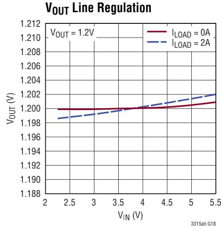

**VOUT Line Regulation**

3315ab G18

Graph of VOUT Line Regulation. The y-axis is 'VOUT (V)' from 1.188 to 1.212. The x-axis is 'VIN (V)' from 2 to 5.5. Two curves are shown for VOUT = 1.2V: ILOAD = 0A (solid red) and ILOAD = 2A (dashed blue).

**Efficiency vs ILOAD,  
VOUT = 0.8V, VIN = 2.25V**

3315ab G19

Graph of Efficiency vs ILOAD for VOUT = 0.8V, VIN = 2.25V. The y-axis is 'EFFICIENCY (%)' from 0 to 100. The x-axis is 'LOAD CURRENT (A)' on a log scale from 1m to 2. Three curves are shown: BURST MODE (solid red), PULSE SKIP (dashed blue), and FORCED CONTINUOUS (dashed green). Parameters: fSW = 2MHz, L = 680nH, L DCR = 17mΩ.

**Efficiency vs ILOAD,  
VOUT = 0.8V, VIN = 3.3V**

3315ab G20

Graph of Efficiency vs ILOAD for VOUT = 0.8V, VIN = 3.3V. The y-axis is 'EFFICIENCY (%)' from 0 to 100. The x-axis is 'LOAD CURRENT (A)' on a log scale from 1m to 2. Three curves are shown: BURST MODE (solid red), PULSE SKIP (dashed blue), and FORCED CONTINUOUS (dashed green). Parameters: fSW = 2MHz, L = 680nH, L DCR = 17mΩ.

**Efficiency vs ILOAD,  
VOUT = 0.8V, VIN = 5.5V**

3315ab G21

Graph of Efficiency vs ILOAD for VOUT = 0.8V, VIN = 5.5V. The y-axis is 'EFFICIENCY (%)' from 0 to 100. The x-axis is 'LOAD CURRENT (A)' on a log scale from 1m to 2. Three curves are shown: BURST MODE (solid red), PULSE SKIP (dashed blue), and FORCED CONTINUOUS (dashed green). Parameters: fSW = 2MHz, L = 680nH, L DCR = 17mΩ.

**Efficiency vs ILOAD,  
VOUT = 1.2V, VIN = 2.25V**

3315ab G22

Graph of Efficiency vs ILOAD for VOUT = 1.2V, VIN = 2.25V. The y-axis is 'EFFICIENCY (%)' from 0 to 100. The x-axis is 'LOAD CURRENT (A)' on a log scale from 1m to 2. Three curves are shown: BURST MODE (solid red), PULSE SKIP (dashed blue), and FORCED CONTINUOUS (dashed green). Parameters: fSW = 2MHz, L = 880nH, L DCR = 19mΩ.

**Efficiency vs ILOAD,  
VOUT = 1.2V, VIN = 3.3V**

3315ab G23

Graph of Efficiency vs ILOAD for VOUT = 1.2V, VIN = 3.3V. The y-axis is 'EFFICIENCY (%)' from 0 to 100. The x-axis is 'LOAD CURRENT (A)' on a log scale from 1m to 2. Three curves are shown: BURST MODE (solid red), PULSE SKIP (dashed blue), and FORCED CONTINUOUS (dashed green). Parameters: fSW = 2MHz, L = 880nH, L DCR = 19mΩ.

**Efficiency vs ILOAD,  
VOUT = 1.2V, VIN = 5.5V**

3315ab G24

Graph of Efficiency vs ILOAD for VOUT = 1.2V, VIN = 5.5V. The y-axis is 'EFFICIENCY (%)' from 0 to 100. The x-axis is 'LOAD CURRENT (A)' on a log scale from 1m to 2. Three curves are shown: BURST MODE (solid red), PULSE SKIP (dashed blue), and FORCED CONTINUOUS (dashed green). Parameters: fSW = 2MHz, L = 880nH, L DCR = 19mΩ.

{7}------------------------------------------------

## **TYPICAL PERFORMANCE CHARACTERISTICS** $T_A = 25^{\circ}\text{C}$ , $V_{IN} = 3.3\text{V}$ , unless otherwise noted.

Efficiency vs  $I_{LOAD}$ ,  
 $V_{OUT} = 1.8\text{V}$ ,  $V_{IN} = 2.25\text{V}$

Graph of Efficiency vs Load Current for VOUT=1.8V, VIN=2.25V. The x-axis is Load Current (A) on a log scale from 1m to 2. The y-axis is Efficiency (%) from 0 to 100. Three curves are shown: BURST MODE (solid red), PULSE SKIP (dashed blue), and FORCED CONTINUOUS (dashed green).参数: fsw = 2MHz, L = 1uH, L DCR = 20mΩ. 3315ab G25

Efficiency vs  $I_{LOAD}$ ,  
 $V_{OUT} = 1.8\text{V}$ ,  $V_{IN} = 3.3\text{V}$

Graph of Efficiency vs Load Current for VOUT=1.8V, VIN=3.3V. The x-axis is Load Current (A) on a log scale from 1m to 2. The y-axis is Efficiency (%) from 0 to 100. Three curves are shown: BURST MODE (solid red), PULSE SKIP (dashed blue), and FORCED CONTINUOUS (dashed green).参数: fsw = 2MHz, L = 1uH, L DCR = 20mΩ. 3315ab G26

Efficiency vs  $I_{LOAD}$ ,  
 $V_{OUT} = 1.8\text{V}$ ,  $V_{IN} = 5.5\text{V}$

Graph of Efficiency vs Load Current for VOUT=1.8V, VIN=5.5V. The x-axis is Load Current (A) on a log scale from 1m to 2. The y-axis is Efficiency (%) from 0 to 100. Three curves are shown: BURST MODE (solid red), PULSE SKIP (dashed blue), and FORCED CONTINUOUS (dashed green).参数: fsw = 2MHz, L = 1uH, L DCR = 20mΩ. 3315ab G27

Efficiency vs  $I_{LOAD}$ ,  
 $V_{OUT} = 2.5\text{V}$ ,  $V_{IN} = 3.3\text{V}$

Graph of Efficiency vs Load Current for VOUT=2.5V, VIN=3.3V. The x-axis is Load Current (A) on a log scale from 1m to 2. The y-axis is Efficiency (%) from 0 to 100. Three curves are shown: BURST MODE (solid red), PULSE SKIP (dashed blue), and FORCED CONTINUOUS (dashed green).参数: fsw = 2MHz, L = 1.2uH, L DCR = 23mΩ. 3315ab G28

Efficiency vs  $I_{LOAD}$ ,  
 $V_{OUT} = 2.5\text{V}$ ,  $V_{IN} = 5.5\text{V}$

Graph of Efficiency vs Load Current for VOUT=2.5V, VIN=5.5V. The x-axis is Load Current (A) on a log scale from 1m to 2. The y-axis is Efficiency (%) from 0 to 100. Three curves are shown: BURST MODE (solid red), PULSE SKIP (dashed blue), and FORCED CONTINUOUS (dashed green).参数: fsw = 2MHz, L = 1.2uH, L DCR = 23mΩ. 3315ab G29

Efficiency vs  $I_{LOAD}$ ,  
 $V_{OUT} = 3.3\text{V}$ ,  $V_{IN} = 4.2\text{V}$

Graph of Efficiency vs Load Current for VOUT=3.3V, VIN=4.2V. The x-axis is Load Current (A) on a log scale from 1m to 2. The y-axis is Efficiency (%) from 0 to 100. Three curves are shown: BURST MODE (solid red), PULSE SKIP (dashed blue), and FORCED CONTINUOUS (dashed green).参数: fsw = 2MHz, L = 1.2uH, L DCR = 23mΩ. 3315ab G30

Efficiency vs  $I_{LOAD}$ ,  
 $V_{OUT} = 3.3\text{V}$ ,  $V_{IN} = 5.5\text{V}$

Graph of Efficiency vs Load Current for VOUT=3.3V, VIN=5.5V. The x-axis is Load Current (A) on a log scale from 1m to 2. The y-axis is Efficiency (%) from 0 to 100. Three curves are shown: BURST MODE (solid red), PULSE SKIP (dashed blue), and FORCED CONTINUOUS (dashed green).参数: fsw = 2MHz, L = 1.2uH, L DCR = 23mΩ. 3315ab G31

{8}------------------------------------------------

## **TYPICAL PERFORMANCE CHARACTERISTICS** $T_A = 25^{\circ}\text{C}$ , $V_{IN} = 3.3\text{V}$ , unless otherwise noted.

**Transient Response, Pulse Skip Mode**

Oscilloscope plot for Transient Response, Pulse Skip Mode. It shows three traces: I\_LOAD (red), I\_L (green), and V\_OUT (blue). The I\_LOAD trace shows a step from 0.1A to 1.5A. The I\_L trace shows a corresponding step. The V\_OUT trace shows a temporary dip followed by a recovery. Scale: 1A/DIV for I\_LOAD and I\_L, 50mV/DIV for V\_OUT, 10μs/DIV for time base. Reference: 3315ab G32.

REFER TO BUCK 1 IN TYPICAL APPLICATION:  
DUAL 1.2V AND 0.8V 2MHz, 2A BUCK  
REGULATORS,  $V_{IN} = 3.3\text{V}$

**Transient Response, FC Mode**

Oscilloscope plot for Transient Response, FC Mode. It shows three traces: I\_LOAD (red), I\_L (green), and V\_OUT (blue). The I\_LOAD trace shows a step from 0.1A to 1.5A. The I\_L trace shows a corresponding step. The V\_OUT trace shows a temporary dip followed by a recovery. Scale: 1A/DIV for I\_LOAD and I\_L, 50mV/DIV for V\_OUT, 10μs/DIV for time base. Reference: 3315ab G33.

REFER TO BUCK 1 IN TYPICAL APPLICATION:  
DUAL 1.2V AND 0.8V 2MHz, 2A BUCK  
REGULATORS,  $V_{IN} = 3.3\text{V}$

**Transient Response, Burst Mode Operation**

Oscilloscope plot for Transient Response, Burst Mode Operation. It shows three traces: I\_LOAD (red), I\_L (green), and V\_OUT (blue). The I\_LOAD trace shows a step from 0.1A to 1.5A. The I\_L trace shows a burst of pulses during the load step. The V\_OUT trace shows a temporary dip followed by a recovery. Scale: 1A/DIV for I\_LOAD and I\_L, 50mV/DIV for V\_OUT, 10μs/DIV for time base. Reference: 3315ab G34.

REFER TO BUCK 1 IN TYPICAL APPLICATION:  
DUAL 1.2V AND 0.8V 2MHz, 2A BUCK  
REGULATORS,  $V_{IN} = 3.3\text{V}$

**Startup Transient, Pulse Skip Mode**

Oscilloscope plot for Startup Transient, Pulse Skip Mode. It shows four traces: EN (red), V\_OUT (blue), I\_L (green), and PGOOD (orange). The EN signal transitions from low to high. The V\_OUT signal ramps up. The I\_L signal shows a small initial spike. The PGOOD signal transitions from low to high. Scale: 2V/DIV for EN, 500mV/DIV for V\_OUT, 500mA/DIV for I\_L, 5V/DIV for PGOOD, 200μs/DIV for time base. R\_LOAD = 120Ω. Reference: 3315ab G35.

REFER TO BUCK 1 IN TYPICAL APPLICATION:  
DUAL 1.2V AND 0.8V 2MHz, 2A BUCK  
REGULATORS,  $V_{IN} = 3.3\text{V}$

**Startup Transient, FC Mode**

Oscilloscope plot for Startup Transient, FC Mode. It shows four traces: EN (red), V\_OUT (blue), I\_L (green), and PGOOD (orange). The EN signal transitions from low to high. The V\_OUT signal ramps up. The I\_L signal shows a small initial spike. The PGOOD signal transitions from low to high. Scale: 2V/DIV for EN, 500mV/DIV for V\_OUT, 500mA/DIV for I\_L, 5V/DIV for PGOOD, 200μs/DIV for time base. R\_LOAD = 120Ω. Reference: 3315ab G36.

REFER TO BUCK 1 IN TYPICAL APPLICATION:  
DUAL 1.2V AND 0.8V 2MHz, 2A BUCK  
REGULATORS,  $V_{IN} = 3.3\text{V}$

**Startup Transient, Burst Mode**

Oscilloscope plot for Startup Transient, Burst Mode. It shows four traces: EN (red), V\_OUT (blue), I\_L (green), and PGOOD (orange). The EN signal transitions from low to high. The V\_OUT signal ramps up. The I\_L signal shows a burst of pulses during the startup ramp. The PGOOD signal transitions from low to high. Scale: 2V/DIV for EN, 500mV/DIV for V\_OUT, 500mA/DIV for I\_L, 5V/DIV for PGOOD, 200μs/DIV for time base. R\_LOAD = 120Ω. Reference: 3315ab G37.

REFER TO BUCK 1 IN TYPICAL APPLICATION:  
DUAL 1.2V AND 0.8V 2MHz, 2A BUCK  
REGULATORS,  $V_{IN} = 3.3\text{V}$

{9}------------------------------------------------

## PIN FUNCTIONS (LQFN/WLCSP)

**EN1 (Pin 1/Ball B3):** Enable Input for Buck Regulator 1. Active high. The EN1 pin has a precision threshold and an optional external resistor divider from  $V_{IN}$  or another supply programs when Buck Regulator 1 is enabled. If the precision threshold is not required, drive EN1 to  $V_{IN}$  to enable. Do not float.

**FB1 (Pin 2/Ball A3):** Feedback Input for Buck Regulator 1. Program the output voltage and close the control loop by connecting this pin to the middle node of a resistor divider between the output and ground. The LTC3315A regulates FB1 to 500mV (typical). A phase lead capacitor connected between  $V_{OUT1}$  and FB1 may be used to optimize transient response.

**FB2 (Pin 3/Ball A2):** Feedback Input for Buck Regulator 2. Program the output voltage and close the control loop by connecting this pin to the middle node of a resistor divider between the output and ground. The LTC3315A regulates FB2 to 500mV (typical). A phase lead capacitor connected between  $V_{OUT2}$  and FB2 may be used to optimize transient response.

**EN2 (Pin 4/Ball B2):** Enable Input for Buck Regulator 2. Active high. The EN2 pin has a precision threshold and an optional external resistor divider from  $V_{IN}$  or another supply programs when Buck Regulator 2 is enabled. If the precision threshold is not required, drive EN2 to  $V_{IN}$  to enable. Do not float.

**PGOOD (Pin 5/Ball A1):** Power Good Output. Open drain output. When the regulated output voltage of either enabled switching regulator falls below its PGOOD threshold or rises above its overvoltage threshold, this pin is driven low. When both buck regulators are disabled PGOOD is driven low.

**SW2 (Pin 6/Balls C1, C2):** Switch Node for Buck Regulator 2. Connect an inductor to this pin with a short, wide trace.

**$V_{IN}$  (Pin 7, Pin 10/Balls B1, D1, D4):** Input Supply Pins. The  $V_{IN}$  pins supply current to internal circuitry and to each buck's PMOS power switch. Connect both  $V_{IN}$  pins together with a short, wide trace and bypass to GND with low ESR capacitors located as close as possible to the pins. On the WLCSP package, an optional 0.1 $\mu$ F bypass capacitor can be added to Ball B1 to reduce noise at high  $V_{IN}$ .

**GND (Pin 8, Pin 9, Exposed Pad Pin 13/Balls B4, D2, D3):** Ground. Connect the exposed pad to a continuous ground plane on the printed circuit board directly under the LTC3315A for electrical contact and rated thermal performance. Additionally, Pin 8 and Pin 9 should be shorted to the exposed pad with a wide trace. On the WLCSP package, Balls D2 and D3 can connect on the top of the PCB board to bypass capacitors on  $V_{IN}$  and then via to a ground plane on the next layer. Ball B4 can via directly to the ground plane on the next layer.

**SW1 (Pin 11/Balls C3, C4):** Switch Node for Buck Regulator 1. Connect an inductor to this pin with a short, wide trace.

**MODE/SYNC (Pin 12/Ball A4):** Mode Selection and External Clock Synchronization Input. Ground this pin to enable pulse-skipping mode. For higher efficiency at light loads, tie this pin to  $V_{IN}$  to enable Burst Mode. For fast transient response and constant frequency operation over a wide load range, float this pin to enable forced continuous mode. Drive MODE/SYNC with an external clock to synchronize both buck converters to the applied frequency. When syncing, the operating mode is forced continuous. The slope compensation is automatically adapted to the external clock frequency. In the absence of an external clock both buck converters will switch at the default switching frequency.

{10}------------------------------------------------

## BLOCK DIAGRAM

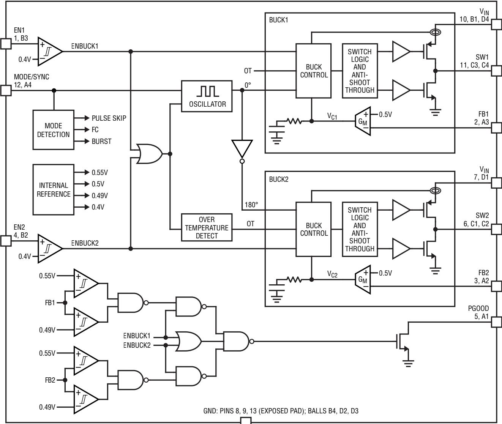

The diagram illustrates the internal architecture of the LTC3315A dual-buck converter. It features two parallel buck converter paths, BUCK1 and BUCK2. Each path includes a BUCK CONTROL block, a SWITCH LOGIC AND ANTI-SHOOT THROUGH block, and a switch driver stage consisting of two MOSFETs. The output of each buck converter is connected to an input pin (VIN 10, B1, D4 for BUCK1 and VIN 7, D1 for BUCK2) and a switch pin (SW1 11, C3, C4 and SW2 6, C1, C2). Feedback pins (FB1 2, A3 and FB2 3, A2) are connected to the output of each buck converter through a resistor and a transconductance amplifier (GM). The feedback loop for each buck converter includes a 0.5V reference and a 0.5V reference. The feedback signals are compared with 0.5V references and the outputs are combined with the enable signals (ENBUCK1 and ENBUCK2) using logic gates to control the switch drivers. The enable signals are derived from input pins EN1 (1, B3) and EN2 (4, B2) through 0.4V comparators. The mode detection block receives inputs from the mode/sync pin (12, A4) and the internal reference (0.55V, 0.5V, 0.49V, 0.4V) and outputs pulse skip, FC, and burst signals. The oscillator provides a 0° and 180° clock signal to the BUCK CONTROL blocks. An over temperature detect block monitors the temperature and provides an OT signal to the BUCK CONTROL blocks. The PGGOOD pin (5, A1) is connected to the output of a logic gate that combines the feedback signals and the enable signals. The ground pins (8, 9, 13) are connected to the exposed pad and the balls (B4, D2, D3).

EN1 1, B3  
MODE/SYNC 12, A4  
EN2 4, B2  
FB1 2, A3  
FB2 3, A2  
PGGOOD 5, A1  
VIN 10, B1, D4  
SW1 11, C3, C4  
VIN 7, D1  
SW2 6, C1, C2  
GND: PINS 8, 9, 13 (EXPOSED PAD); BALLS B4, D2, D3

Block diagram of the LTC3315A dual-buck converter showing internal components like ENBUCK1, ENBUCK2, OSCILLATOR, BUCK CONTROL, and SW1/SW2 drivers. It includes pin labels for VIN, SW1, FB1, EN1, MODE/SYNC, EN2, FB2, PGGOOD, and GND.

3315ab BD

{11}------------------------------------------------

## OPERATION

### Buck Switching Regulators

The LTC3315A is a 5V dual 2A monolithic, constant frequency, peak current mode step-down DC/DC converter. The synchronous buck switching regulators are internally compensated and require only external feedback resistors to set the output voltage.

An internal oscillator, which can be externally synchronized, turns on the internal PMOS power switch at the beginning of each clock cycle. Current in the inductor ramps up until the PMOS current comparator trips and turns off the PMOS. The peak inductor current,  $I_{PEAK}$ , at which the PMOS turns off is controlled by an internal  $V_C$  voltage which the error amplifier regulates by comparing the voltage on the feedback (FB) pin with an internal 500mV reference. An increase in the load current causes a reduction in the feedback voltage relative to the reference, causing the error amplifier to raise the  $V_C$  voltage (and  $I_{PEAK}$ ) until the average inductor current matches the new load current. When the PMOS turns off, the NMOS turns on and ramps down the inductor current for the remainder of the clock cycle or, if in pulse skipping mode or Burst Mode, until the inductor current falls to zero. If an overload condition results in excessive current flowing through the NMOS, the next clock cycle will be skipped until the current returns to a safe level.

Each buck switching regulator has its own SW, FB, and EN pins. The buck input supplies are internally connected, but each  $V_{IN}$  pin should have its own input bypass capacitor (see Applications Information). The enable pins have precision 400mV thresholds which may be used to provide event-based power-up sequencing by connecting the enable pin to the output of another buck through a resistor divider. If the EN pin of a buck is low, that buck is in shutdown and in a low quiescent current state. If both EN pins are low, both bucks are in shutdown, the SW pins are high impedance, and the quiescent current of the LTC3315A is  $1\mu A$  (typical). If either EN pin is above the enable threshold of 400mV its respective buck is enabled.

Both buck regulators have forward and reverse inductor current limiting, soft-start to limit inrush current during start-up, and short-circuit protection. When both bucks are disabled and either buck is subsequently enabled,

there is a  $400\mu s$  (typical) delay while internal circuitry powers up followed by a  $100\mu s$  (typical) no start time before switching commences and the soft-start ramp begins. If a second buck is then enabled, it will also have a  $100\mu s$  (typical) no start time. If the second buck is enabled within  $400\mu s$  of the first buck, it will wait until the expiry of the  $400\mu s$  to begin its no start time.

The buck switching regulators are switched  $180^\circ$  out of phase with respect to each other. The phase determines the fixed edge of the switching sequence, which is when the PMOS turns on. The PMOS off (NMOS on) phase is subject to the regulated duty cycle of each buck.

### Mode Selection

The buck switching regulators operate in three different modes set by the MODE/SYNC pin: pulse skipping mode (when the MODE/SYNC pin is set low), forced continuous PWM mode (when the MODE/SYNC pin is floating), and Burst Mode (when the MODE/SYNC pin is set high). The MODE/SYNC pin sets the operating mode for both buck switching regulators.

In pulse skipping mode, the oscillator operates continuously and positive SW transitions are aligned to the clock. Negative inductor current is disallowed and during light loads switch pulses are skipped to regulate the output.

In forced continuous mode, the oscillator runs continuously, no pulses are skipped, and switching occurs in every cycle. To maintain regulation, the inductor current is allowed to reverse under light load conditions. This mode allows the buck to run at a fixed frequency with minimal output ripple. In forced continuous mode if the inductor current reaches  $-1A$  (typical,  $1A$  into the SW pin) the NMOS will turn off for the remainder of the cycle to limit the current.

In Burst Mode operation, at light loads, the output capacitor is charged to a voltage slightly higher than its regulation point. The regulator then goes into a sleep state, during which time the output capacitor provides the load current. In sleep most of the regulator's circuitry is powered down, helping to conserve input power. When the output voltage drops below its programmed value, the circuitry is powered back on and another burst cycle begins.

{12}------------------------------------------------

## OPERATION

The sleep time decreases as load current increases. In Burst Mode operation, the regulator will burst at light loads whereas at higher loads it will operate in constant frequency PWM mode.

### Synchronizing the Oscillator to an External Clock

Selection of the operating frequency is a trade-off between efficiency and component size. High frequency operation allows the use of smaller inductor and capacitor values and improves transient response. Operation at lower frequencies improves efficiency by reducing switching losses but requires larger inductance and/or capacitance values to maintain low output voltage ripple. The LTC3315A operates at a default frequency of 2MHz.

The LTC3315A's internal oscillator is synchronized through an internal PLL circuit to an external frequency by applying a square wave clock signal to the MODE/SYNC pin. During synchronization, the Buck 1 PMOS turn-on is locked to the rising edge of the external frequency source. Buck 2 will be 180° out of phase with respect to Buck 1. While syncing, the buck switching regulators operate in forced continuous mode. The synchronization frequency range is 1MHz to 3MHz.

After detecting an external clock on the SYNC pin, the internal PLL starts up at the default frequency. The internal PLL then gradually adjusts its operating frequency to match the frequency and phase of the SYNC signal.

When the external clock is removed the LTC3315A will detect the absence of the external clock within approximately 10μs. During this time it will continue to provide clock cycles. Once the external clock removal has been detected, the oscillator will gradually adjust its operating frequency back to the default.

### Power Failure Reporting Via PGOOD Pin

Power failure faults are reported via the PGOOD pin. Both buck switching regulators have an internal power good (PGOOD) signal and if a buck is enabled its internal PGOOD signal must be high for the PGOOD pin to be high.

When the regulated output voltage of an enabled buck rises above 98% of its programmed value, the PGOOD signal transitions high. If the regulated output voltage subsequently falls below 97% of its programmed value, the PGOOD signal is pulled low. If either enabled buck's internal PGOOD signal stays low for greater than 120μs, then the PGOOD pin is pulled low, indicating to a microprocessor that a power fault has occurred. The 120μs filter time prevents the pin from being pulled low during a transient event. In addition, whenever PGOOD transitions high there will be a 120μs assertion delay.

The LTC3315A also reports overvoltage conditions at the PGOOD pin. If either enabled buck regulator's output voltage rises above 110% of its programmed value, the PGOOD pin is pulled low after 120μs. Similarly, if all enabled outputs that are overvoltage subsequently fall below 107.8% of their programmed value, the PGOOD pin transitions high again after 120μs.

An error condition that pulls the PGOOD pin low is not latched. When the error condition goes away, the PGOOD pin is released and is pulled high if no other error condition exists. PGOOD is also pulled low in the following scenarios: if neither buck switching regulator is enabled, if  $V_{IN}$  is below the UVLO threshold, or if the LTC3315A is over temperature (see below).

### Output Overvoltage Protection

During an output overvoltage event, when the FB pin voltage is greater than 110% of its regulated value, the LTC3315A PMOS will be turned off immediately.

An output overvoltage event should not happen under normal operating conditions.

### Overt temperature Protection

To prevent thermal damage, the LTC3315A incorporates an overtemperature (OT) function. When the LTC3315A die temperature reaches 165°C (typical, not tested) all enabled buck switching regulators are shut down and remain in shutdown until the die temperature falls to 160°C (typical, not tested).

{13}------------------------------------------------

## OPERATION

### Output Voltage Soft-Start

Soft starting the output prevents current surge on the input supply and/or output voltage overshoot. During soft-start, the output voltage will proportionally track an internal voltage ramp. An active pull-down circuit discharges that internal voltage in the case of fault conditions. The ramp will restart when the fault is cleared. Fault conditions that initiate the soft-start ramp are the  $V_{IN}$  voltage falling too low or thermal shutdown.

Recovery from an output short-circuit (see below) may involve another soft-start cycle if the FB voltage falls more than 120mV (typical) below regulation. During such a recovery, the FB voltage will quickly charge up to 120mV (typical) and then follow the soft-start ramp until regulation is reached.

### Dropout Operation

As the input supply voltage approaches the output voltage, the duty cycle increases toward 100%. Further reduction of the supply voltage forces the PMOS to remain on for more than one cycle, eventually reaching 100% duty cycle. The output voltage will then be determined by the input voltage minus the DC voltage drop across the internal PMOS and the inductor.

### Low Supply Operation

The LTC3315A is designed to operate down to an input supply voltage of 2.25V. An important thermal design consideration is that the  $R_{DS(ON)}$  of the power switches increases at low input. Consider the worst case LTC3315A power dissipation and die junction temperature at the lowest input voltage.

### Output Short-Circuit Protection and Recovery

The peak inductor current level at which the current comparator shuts off the PMOS is controlled by the error amplifier. When the output current increases, the error amplifier raises the internal  $V_C$  voltage until the average inductor current matches the load current. The LTC3315A clamps the maximum internal  $V_C$  voltage, thereby limiting the peak inductor current.

When the output is shorted to ground, the inductor current decays very slowly during the downslope because the voltage across the inductor is low. To keep the inductor current in control a secondary limit is imposed on the valley of the inductor current. If the inductor current measured through the NMOS remains greater than  $I_{VALLEY}$  at the end of the cycle, the PMOS will be held off. Subsequent switching cycles will be skipped until the inductor current falls below  $I_{VALLEY}$ .

## APPLICATIONS INFORMATION

### Buck Switching Regulator Output Voltage and Feedback Network

The output voltage of the buck switching regulators is programmed by a resistor divider connected from the switching regulator's output to ground and is given by:

$$V_{OUT} = V_{FB} \left( 1 + \frac{R2}{R1} \right) \quad (1)$$

as shown in Figure 1 where  $V_{FB} = 500\text{mV}$ . Typical values for  $R1$  range from  $40\text{k}\Omega$  to  $1\text{M}\Omega$ . 1% resistors are recommended to maintain output voltage accuracy. The buck regulator transient response may improve with an optional phase lead capacitor  $C_{FF}$  that helps cancel

![Figure 1: Feedback Components. A block diagram of the LTC3315A buck switching regulator. The output pin (VOUT) is connected to a resistor divider consisting of R2 and R1. R2 is connected between VOUT and the feedback pin (FB). R1 is connected between the FB pin and ground. An optional phase lead capacitor CFF is connected in parallel with R1. The output pin is also connected to the output capacitor COUT, which is connected to ground. The feedback pin is also connected to ground. The diagram is labeled 3315ab F01.](9db324c513563a95ae55c77f4462a969_img.jpg)

Figure 1: Feedback Components. A block diagram of the LTC3315A buck switching regulator. The output pin (VOUT) is connected to a resistor divider consisting of R2 and R1. R2 is connected between VOUT and the feedback pin (FB). R1 is connected between the FB pin and ground. An optional phase lead capacitor CFF is connected in parallel with R1. The output pin is also connected to the output capacitor COUT, which is connected to ground. The feedback pin is also connected to ground. The diagram is labeled 3315ab F01.

Figure 1. Feedback Components

the pole created by the feedback resistors and the input capacitance of the FB pin. Experimentation with capacitor values between 2pF and 22pF may improve transient response. The values used in the typical application circuits are a good starting point.

{14}------------------------------------------------

## APPLICATIONS INFORMATION

### Operating Frequency Selection and Trade-Offs

Selection of the operating frequency is a trade-off between efficiency, component size, transient response, and input voltage range. The LTC3315A can operate at frequencies between 1MHz and 3MHz.

The advantage of high frequency operation is that smaller inductor and capacitor values may be used. Higher switching frequencies allow for higher control loop bandwidth and, therefore, faster transient response. The disadvantages of higher switching frequencies are lower efficiency, because of increased switching losses, and a smaller input voltage range, because of minimum switch on-time limitations.

The minimum on-time of the buck regulator imposes a minimum operating duty cycle. The highest switching frequency ( $f_{SW(MAX)}$ ) for a given application can be calculated as follows:

$$f_{SW(MAX)} = \frac{V_{OUT}}{t_{ON(MIN)} \cdot V_{IN(MAX)}} \quad (2)$$

where  $V_{IN(MAX)}$  is the maximum input voltage,  $V_{OUT}$  is the output voltage and  $t_{ON(MIN)}$  is the minimum top switch on-time. This equation shows that a slower switching frequency might be necessary to accommodate a high  $V_{IN}/V_{OUT}$  ratio.

The LTC3315A is capable of a maximum duty cycle of 100%, therefore, the  $V_{IN}$ -to- $V_{OUT}$  dropout is limited by the  $R_{DS(ON)}$  of the PMOS, the inductor DCR, and the load current.

### Inductor Selection and Maximum Output Current

Considerations in choosing an inductor are inductance, RMS current rating, saturation current rating, DCR, and core loss.

Select the inductor value based on the following equations:

$$L \approx \frac{V_{OUT}}{0.6A \cdot f_{SW}} \cdot \left( 1 - \frac{V_{OUT}}{V_{IN(MAX)}} \right) \text{ for } \frac{V_{OUT}}{V_{IN(MAX)}} \leq 0.5 \quad (3)$$

$$L \approx \frac{V_{IN(MAX)}}{2.4A \cdot f_{SW}} \text{ for } \frac{V_{OUT}}{V_{IN(MAX)}} > 0.5 \quad (4)$$

where  $f_{SW}$  is the switching frequency and  $V_{IN(MAX)}$  is the maximum applied input voltage.

To avoid overheating of the inductor, choose an inductor with an RMS current rating that is greater than the maximum expected output load of the application. Overload and short-circuit conditions need to be taken into consideration.

In addition ensure that the saturation current rating (typically labeled  $I_{SAT}$ ) is either higher than 3.5A, the maximum current limit of the LTC3315A, or higher than the maximum expected load plus half the inductor ripple:

$$I_{SAT} > I_{LOAD(MAX)} + \frac{1}{2} \Delta I_L \quad (5)$$

where  $I_{LOAD(MAX)}$  is the maximum output load current for the application and  $\Delta I_L$  is the inductor ripple current calculated as:

$$\Delta I_L = \frac{V_{OUT}}{L \cdot f_{SW}} \cdot \left( 1 - \frac{V_{OUT}}{V_{IN}} \right) \quad (6)$$

To keep the efficiency high, choose an inductor with the lowest series resistance (DCR) and a core material intended for high frequency applications. Table 1 shows recommended inductors from several manufacturers.

### Input Capacitors

Bypass the input of the LTC3315A with at least two ceramic capacitors, one near each  $V_{IN}$  pin for best performance. Connect the ground of each capacitor to a wide PCB trace on the top layer of the PCB that connects pins 8 and 9 with the exposed pad. These capacitors should be 0603 or 0805 in size. Smaller 0201 capacitors can also be placed as close as possible to the LTC3315A directly on the traces leading from  $V_{IN}$  (Pin 7) and GND (Pin 8) and on the traces leading from  $V_{IN}$  (Pin 10) and GND (Pin 9) to reduce input noise with minimal (if at all) increase in application footprint. See the layout section for more detail. On the WLCSP package, an optional 0.1 $\mu$ F bypass capacitor can be added to Ball B1 to reduce noise at high  $V_{IN}$ . X7R or X5R capacitors are recommended for best performance across temperature and input voltage variations (see Table 2). Note that larger input capacitance is

{15}------------------------------------------------

## APPLICATIONS INFORMATION

**Table 1. Recommended Inductors**

| MANUFACTURER     | FAMILY         | L (nH)     | MAX IDC (A) | MAX DCR (mΩ) | SIZE IN mm (L × W × H) |
|------------------|----------------|------------|-------------|--------------|------------------------|
| Murata           | DFE18SAN_G0    | 240 - 470  | 3.6 - 4.9   | 30 - 54      | 1.6 × 0.8 × 1.0        |
| Murata           | DFE252010F     | 330 - 680  | 3.5 - 4.8   | 21 - 37      | 2.5 × 2.0 × 1.0        |
| Vishay           | IHLP-1212BZ-11 | 220 - 1500 | 4.0 - 7.5   | 11.4 - 32    | 3.0 × 3.0 × 2.0        |
| Vishay           | IHHP-0806AB-01 | 220 - 470  | 3.6 - 5.0   | 16 - 35      | 2.0 × 1.6 × 1.2        |
| Würth Elektronik | WE-MAPI        | 330 - 1500 | 3.7 - 5.5   | 17 - 39      | 3.0 × 3.0 × 2.0        |
| Würth Elektronik | WE-PMCI        | 250 - 470  | 3.6 - 4     | 12.5 - 31    | 3.2 × 2.5 × 1.2        |
| Coilcraft        | XEL3515        | 72 - 560   | 3.2 - 23.7  | 6.5 - 16     | 3.5 × 3.2 × 1.5        |

required when a lower switching frequency is used. If the input power source has high impedance, or if there is significant inductance due to long wires or cables, additional bulk capacitance may be necessary. This can be provided with an electrolytic capacitor. A ceramic input capacitor combined with trace or cable inductance forms a high quality (underdamped) tank circuit. If the LTC3315A circuit is plugged in to a live supply, the input voltage can ring to twice its nominal value, possibly exceeding the voltage rating. This situation is easily avoided (see Analog Devices [Application Note 88](#)).

**Table 2. Ceramic Capacitor Manufacturers**

| MANUFACTURER     | URL                |
|------------------|--------------------|
| AVX              | www.avxcorp.com    |
| Murata           | www.murata.com     |
| TDK              | www.tdk.com        |
| Taiyo Yuden      | www.t-yuden.com    |
| Samsung          | www.samsungsem.com |
| Würth Elektronik | www.we-online.com  |

### Output Capacitor, Output Ripple, and Loop Response

The output capacitor has two essential functions. Along with the inductor, it filters the square wave generated by the LTC3315A at the SW pin to produce the DC output. In this role it determines the output ripple; thus, low impedance at the switching frequency is important. The second function is to store energy in order to satisfy transient loads and to stabilize the LTC3315A's control loop.

The LTC3315A is internally compensated and designed to operate at a high bandwidth for fast transient response capability. The selection of  $C_{OUT}$  affects the bandwidth of

the system, but the transient response is also affected by  $V_{OUT}$ ,  $V_{IN}$ ,  $f_{SW}$  and other factors. A good place to start is with an output capacitance value of approximately:

$$C_{OUT} = \frac{80\mu F \cdot MHz}{f_{SW}} \sqrt{\frac{500mV}{V_{OUT}}} \quad (7)$$

where  $C_{OUT}$  is the recommended output capacitor value and  $f_{SW}$  is the switching frequency. A lower value of output capacitor saves space and cost, but transient performance will suffer and loop stability must be verified. Ceramic capacitors have very low equivalent series resistance (ESR) and provide the best output ripple and transient performance. Use X5R or X7R ceramic capacitors. (see Table 2). Even better output ripple and transient performance can be achieved by using low-ESL reverse geometry or three terminal ceramic capacitors.

During a load step, the output capacitor must instantaneously supply the current to support the load until the feedback loop increases the switch current enough to support the load. The time required for the feedback loop to respond is dependent on the compensation components and the output capacitor size. Typically, 3 to 4 cycles are required to respond to a load step, but only in the first cycle does the output drop linearly. Although affected by  $V_{OUT}$ ,  $V_{IN}$ ,  $f_{SW}$ ,  $t_{ON(MIN)}$ , the equivalent series inductance (ESL) of the output capacitor, and other factors, the output droop,  $V_{DROOP}$ , is usually about 3 times the linear drop of the first cycle:

$$V_{DROOP} = \frac{3 \cdot \Delta I_{OUT}}{C_{OUT} \cdot f_{SW}} \quad (8)$$

where  $\Delta I_{OUT}$  is the load step.

{16}------------------------------------------------

## APPLICATIONS INFORMATION

Transient performance and control loop stability can be improved with a higher  $C_{OUT}$  and/or the addition of a feedforward capacitor,  $C_{FF}$ , placed between  $V_{OUT}$  and FB. Capacitor  $C_{FF}$  provides phase lead compensation by creating a high frequency zero which improves the phase margin and the high-frequency response. The values used in the typical application circuits are a good starting point. LTpowerCAD® is a useful tool to help optimize  $C_{FF}$  and  $C_{OUT}$  for the desired transient performance.

Applying a load transient and monitoring the response of the system or using a network analyzer to measure the actual loop response are two ways to experimentally verify transient performance and control loop stability, and to optimize  $C_{FF}$  and  $C_{OUT}$ .

When using the load transient response method to stabilize the control loop, apply an output current pulse going from 20% to 100% of full load current having a very fast rise time. This will produce a transient on the output voltage. Monitor  $V_{OUT}$  for overshoot or ringing that might indicate a stability problem (see [Application Note 149](#)).

### Using the Precision Enable Threshold

The LTC3315A has precision threshold enable pins for each buck regulator to enable or disable each buck. When both are forced low, the device enters into a low current shutdown mode.

The rising threshold of both EN comparators is 400mV, with 50mV of hysteresis. The EN pins can be tied to  $V_{IN}$  if the shutdown feature is not used. Adding a resistor divider from  $V_{IN}$  to an EN pin to ground programs the LTC3315A to regulate that output only when  $V_{IN}$  is above a desired voltage.

Typically, this threshold,  $V_{IN(EN)}$ , is used in situations where the input supply is current limited, or has a relatively high source resistance. A switching regulator draws near constant power from its input source, so source current increases as source voltage drops. This looks like a negative resistance load to the source and can cause the source to current limit or latch low under low source voltage conditions. The  $V_{IN(EN)}$  threshold prevents the regulator from operating at source voltages where problems may occur. Referring to Figure 2, this threshold can

Figure 2: EN Divider circuit diagram. A block diagram of a 'BUCK SWITCHING REGULATOR' is shown. The input voltage V\_IN is connected to the top of a resistor divider consisting of R4 and R3. R4 is connected between V\_IN and the EN pin. R3 is connected between the EN pin and ground. The EN pin is also connected to the regulator block.

Figure 2. EN Divider

be adjusted by setting the values of R3 and R4 such that they satisfy the following equation:

$$V_{IN(EN)} = 400\text{mV} \cdot \left(1 + \frac{R4}{R3}\right) \quad (9)$$

The buck regulator will remain off until  $V_{IN}$  is above  $V_{IN(EN)}$ . The buck regulator will remain enabled until  $V_{IN}$  falls to  $0.875 \cdot V_{IN(EN)}$  and EN is 350mV.

Alternatively a resistor divider from the output of one buck to the EN pin of the second buck to ground provides event based power-up sequencing as the first buck reaching regulation enables the second buck. Replace  $V_{IN(EN)}$  in Equation 9 with the desired output voltage of the first buck (e.g. 90% of the regulated value) at which the second buck is enabled.

## PCB Considerations

The LTC3315A is a high performance IC designed for high efficiency and fast transient response. For optimal results carefully consider the layout of the PCB board and follow the below list to ensure proper operation. Reference the layout design files for the demo board for both the LQFN and WLCSP packages on the LTC3315A product page on the ADI website to see the optimal PCB layout. See Figure 3 for a recommended PCB layout.

1. Connect the exposed pad of the LQFN package (Pin 13) directly to a large, unbroken ground plane under the application circuit on the layer closest to the surface layer to minimize thermal and electrical impedance. Additionally, short the exposed pad to ground pins 8 and 9 on the top layer. See the Application Note, [Application Notes for Thermally Enhanced Leaded Plastic Packages](#) document for the proper size and layout of the thermal vias and solder stencils. On the WLCSP package, Balls D2 and D3 can connect on the

{17}------------------------------------------------

## APPLICATIONS INFORMATION

![Figure 3: Recommended LTC3315A LQFN PCB Layout. This schematic diagram shows the recommended PCB layout for the LTC3315A LQFN package. The LQFN package is centered, with pins 1, 4, 7, 10, 13, and 18 labeled. Input capacitors C1N1 and C1N2 are placed near pins 10 and 7 respectively, connected to VIN. Input inductors L1 and L2 are placed near pins 10 and 7 respectively, connected to VOUT1 and VOUT2. Output capacitors COUT1 and COUT2 are placed near pins 1 and 4 respectively, connected to VOUT1 and VOUT2. Feedback capacitors CFF1 and CFF2 are placed near pins 1 and 4 respectively, connected to the feedback nodes. Resistor R1 is placed near pin 13, connected to the feedback node. Resistor R2 is placed near pin 1, connected to the feedback node. Resistor R3 is placed near pin 4, connected to the feedback node. Resistor R4 is placed near pin 13, connected to the feedback node. A ground plane is shown on layer 2, connected to the feedback nodes. A note indicates that R1, R3, and R4 should be connected to GND on layer 4 to vias on the exposed pad, pin 13. The ground plane is also shown on layer 2.](dfe556fea00682b09a59427aaf72051c_img.jpg)

Figure 3: Recommended LTC3315A LQFN PCB Layout. This schematic diagram shows the recommended PCB layout for the LTC3315A LQFN package. The LQFN package is centered, with pins 1, 4, 7, 10, 13, and 18 labeled. Input capacitors C1N1 and C1N2 are placed near pins 10 and 7 respectively, connected to VIN. Input inductors L1 and L2 are placed near pins 10 and 7 respectively, connected to VOUT1 and VOUT2. Output capacitors COUT1 and COUT2 are placed near pins 1 and 4 respectively, connected to VOUT1 and VOUT2. Feedback capacitors CFF1 and CFF2 are placed near pins 1 and 4 respectively, connected to the feedback nodes. Resistor R1 is placed near pin 13, connected to the feedback node. Resistor R2 is placed near pin 1, connected to the feedback node. Resistor R3 is placed near pin 4, connected to the feedback node. Resistor R4 is placed near pin 13, connected to the feedback node. A ground plane is shown on layer 2, connected to the feedback nodes. A note indicates that R1, R3, and R4 should be connected to GND on layer 4 to vias on the exposed pad, pin 13. The ground plane is also shown on layer 2.

Figure 3. Recommended LTC3315A LQFN PCB Layout

- top of the PCB board to bypass capacitors on  $V_{IN}$  and then via to a ground plane on the next layer. Ball B4 can via directly to the ground plane on the next layer.
- Both of the input supply pins should have local decoupling capacitors with their grounded pins connecting on the top layer to the ground plane around pin 8, pin 9, and the exposed pad. These capacitors provide the AC current to the internal power MOSFETs and their drivers. Large, switched currents flow in these capacitors and it is important to minimize inductance from these capacitors by choosing a small case size such as 0603 and placing them close to the  $V_{IN}$  pins of the LTC3315A. To further minimize inductance and input noise, smaller 0201 capacitors can be placed as close as possible to the LTC3315A directly on the traces leading from  $V_{IN}$  (Pin 7) and GND (Pin 8) and on the traces leading from  $V_{IN}$  (Pin 10) and GND (Pin 9) minimal (if at all) increase in application footprint. On the WLCSP package, an optional 0.1 $\mu$ F bypass capacitor can be added to Ball B1 to reduce noise at high  $V_{IN}$ .
- The switching power traces connecting SW1 and SW2 to their respective inductors should be minimized to reduce radiated EMI and parasitic coupling. Due to the large voltage swing on the switching nodes, high

input impedance sensitive nodes, such as the feedback nodes, should be kept far away or shielded from the switching nodes or poor performance could result.

- The GND side of the switching regulator output capacitors connects directly to the thermal ground plane of the IC. Minimize the trace length from the output capacitor to the inductor(s)/pin(s).

### High Temperature Considerations

A thermal representation of the LTC3315A thermally enhanced LQFN package is shown in Figure 4 with the silicon die and thermal metrics identified. The current source represents power loss  $P_D$  on the die; node voltages represent temperatures; electrical impedances represent conductive thermal impedances  $\theta_{JCBOTTOM}$ ,  $\theta_{JCTOP}$ ,  $\theta_{VIA}$ ,  $\theta_{CB}$ , and convective thermal impedances  $\theta_{CA}$  and  $\theta_{BA}$ . The junction temperature,  $T_J$ , is calculated from the ambient temperature,  $T_A$ , as:

$$T_J = T_A + P_D \cdot \theta_{JA} \quad (10)$$

where, neglecting the  $\theta_{JCTOP} + \theta_{CA}$  path:

$$\theta_{JA} \approx \theta_{JCB} + \left( \frac{\theta_{CB} + \theta_{BA}}{2} \right) \parallel \left( \frac{\theta_{CB} + \theta_{BA}}{2} + \theta_{VIA} \right) \quad (11)$$

{18}------------------------------------------------

## APPLICATIONS INFORMATION

where  $\theta_{JCB} = \theta_{JCBOTTOM} = 10^\circ\text{C/W}$ . The value of  $\theta_{JA} = 51^\circ\text{C/W}$  reported in the Pin Configuration section corresponds to JEDEC standard 2S2P test PCB, which does not have good thermal vias, i.e.,  $\theta_{VIA}$  is relatively high. Assuming, somewhat arbitrarily but not unreasonably, that  $\theta_{VIA} \sim (\theta_{CB} + \theta_{BA})/2$ , and back calculating it is seen that  $(\theta_{CB} + \theta_{BA})/2 = \theta_{VIA} \approx 60^\circ\text{C/W}$  for such a board. The importance of thermal vias becomes clear observing that if the test PCB had low-thermal-resistance vias, the

$\theta_{JA}$  would have been reduced by up to  $10^\circ\text{C/W}$ , which is an improvement of up to 20%. Similarly, having more ground planes that are larger, uninterrupted and higher-copper-weight improves  $\theta_{CB} + \theta_{BA}$ , which has a dominant effect on  $\theta_{JA}$ , given the low value of  $\theta_{JCBOTTOM}$  of the package. The maximum load current should be derated as the ambient temperature approaches the maximum junction rating. Power dissipation within the LTC3315A is estimated by calculating the total power loss from an efficiency measurement and subtracting the inductor loss.

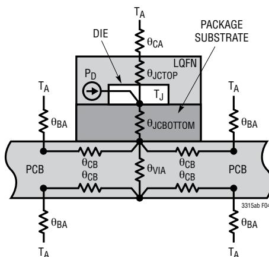

The diagram illustrates the thermal path from the die to the ambient environment. The die is shown within the LQFN package substrate. Power dissipation ( $P_D$ ) leads to a junction temperature ( $T_J$ ). The thermal resistance from the junction to the top of the package is  $\theta_{JCTOP}$ , and from the junction to the bottom is  $\theta_{JCBOTTOM}$ . The ambient temperature at the top is  $T_A$ , with a resistance  $\theta_{CA}$ . The package is mounted on a multi-layer PCB. The thermal resistance from the package bottom to the PCB is  $\theta_{CB}$ , and from the PCB to the ambient is  $\theta_{BA}$ . The PCB itself has a thermal resistance  $\theta_{CB}$  and a thermal via resistance  $\theta_{VIA}$  between its layers. The ambient temperature at the bottom is also  $T_A$ , with a resistance  $\theta_{BA}$ . The diagram shows multiple thermal vias connecting the top and bottom layers of the PCB, which act as a heat sink. The label '3315ab F04' is present in the bottom right corner of the PCB.

Thermal circuit diagram of an LQFN package on a multi-layer PCB with thermal vias acting as a heat sink.

Figure 4. Multi-Layer PCB with Thermal Vias Acts as a Heat Sink

{19}------------------------------------------------

## TYPICAL APPLICATIONS

Dual 1.5V and 1.8V 2MHz, 2A Buck Regulators,  $V_{IN} = 2.5V$

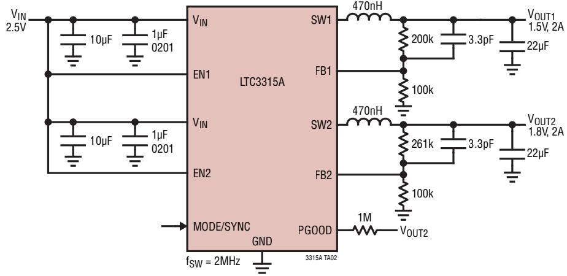

The diagram illustrates a dual buck regulator configuration using the LTC3315A IC. The input voltage is  $V_{IN} = 2.5V$ . The IC is configured to output two different voltages:  $V_{OUT1} = 1.5V, 2A$  and  $V_{OUT2} = 1.8V, 2A$ . The switching frequency is  $f_{SW} = 2MHz$ .

**Input and Control Section:**

- $V_{IN}$  is connected to the top rail, with a 10 $\mu F$  capacitor and a 1 $\mu F$  0201 capacitor in parallel to ground.
- $EN1$  and  $EN2$  pins are connected to the input rail.
- $V_{IN}$  is also connected to the second input rail, with a 10 $\mu F$  capacitor and a 1 $\mu F$  0201 capacitor in parallel to ground.
- $MODE/SYNC$  pin is connected to ground.
- $GND$  pin is connected to ground.
- $PGOOD$  pin is connected to  $V_{OUT2}$  through a 1M resistor.

**Output Section:**

- Output 1 (1.5V, 2A):** SW1 pin is connected to the input of a 470nH inductor. The output of the inductor is connected to a 200k resistor and a 3.3pF capacitor in parallel to ground. The feedback pin (FB1) is connected to the junction between the 200k resistor and a 100k resistor. The output voltage  $V_{OUT1}$  is taken across a 22 $\mu F$  capacitor to ground.
- Output 2 (1.8V, 2A):** SW2 pin is connected to the input of a 470nH inductor. The output of the inductor is connected to a 261k resistor and a 3.3pF capacitor in parallel to ground. The feedback pin (FB2) is connected to the junction between the 261k resistor and a 100k resistor. The output voltage  $V_{OUT2}$  is taken across a 22 $\mu F$  capacitor to ground.

The diagram is labeled "3315A TA02" at the bottom right.

Schematic diagram of the LTC3315A dual buck regulator application.

{20}------------------------------------------------

## TYPICAL APPLICATIONS

Dual 1.2V and 0.8V 2MHz, 2A Buck Regulators,  $V_{IN} = 3.3V$

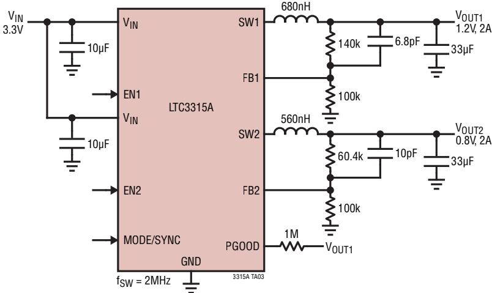

This schematic diagram shows the LTC3315A dual buck regulator configured for a 3.3V input. The input section features a 10µF capacitor on the top rail and a 10µF capacitor on the bottom rail, both connected to ground. The LTC3315A IC is shown with pins labeled  $V_{IN}$ ,  $EN1$ ,  $EN2$ ,  $MODE/SYNC$ ,  $GND$ ,  $PGOOD$ ,  $SW1$ ,  $FB1$ ,  $SW2$ ,  $FB2$ , and  $V_{OUT1}$ . The output section consists of two parallel buck converter stages. The first stage (top) has a 680nH inductor, a 140k resistor, a 6.8pF capacitor, and a 33µF capacitor, with a feedback network of 100k resistors. The second stage (bottom) has a 560nH inductor, a 60.4k resistor, a 10pF capacitor, and a 33µF capacitor, with a feedback network of 100k resistors. The  $PGOOD$  pin is connected to  $V_{OUT1}$  through a 1M resistor. The switching frequency is indicated as  $f_{SW} = 2MHz$ . The diagram is labeled 3315A TA03.

Schematic diagram of the LTC3315A dual buck regulator application for 1.2V and 0.8V outputs.

Dual 3.3V and 2.5V 2MHz, 2A Buck Regulators,  $V_{IN} = 5V$

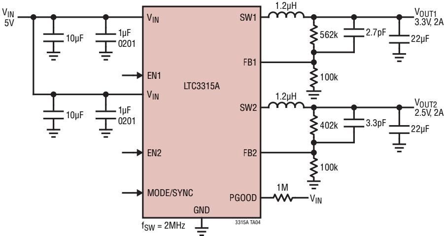

This schematic diagram shows the LTC3315A dual buck regulator configured for a 5V input. The input section features a 10µF capacitor on the top rail and a 10µF capacitor on the bottom rail, both connected to ground. The LTC3315A IC is shown with pins labeled  $V_{IN}$ ,  $EN1$ ,  $EN2$ ,  $MODE/SYNC$ ,  $GND$ ,  $PGOOD$ ,  $SW1$ ,  $FB1$ ,  $SW2$ ,  $FB2$ , and  $V_{OUT1}$ . The output section consists of two parallel buck converter stages. The first stage (top) has a 1.2µH inductor, a 562k resistor, a 2.7pF capacitor, and a 22µF capacitor, with a feedback network of 100k resistors. The second stage (bottom) has a 1.2µH inductor, a 402k resistor, a 3.3pF capacitor, and a 22µF capacitor, with a feedback network of 100k resistors. The  $PGOOD$  pin is connected to  $V_{IN}$  through a 1M resistor. The switching frequency is indicated as  $f_{SW} = 2MHz$ . The diagram is labeled 3315A TA04.

Schematic diagram of the LTC3315A dual buck regulator application for 3.3V and 2.5V outputs.

{21}------------------------------------------------

## TYPICAL APPLICATIONS

### Dual 1.2V and 0.8V 1MHz, 2A Buck Regulators, $V_{IN} = 3.3V$

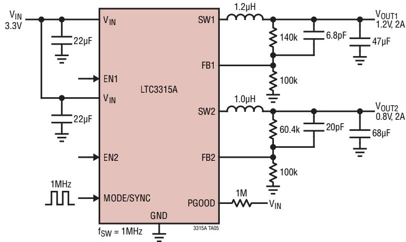

This diagram shows the LTC3315A IC configured as a dual buck regulator. The input voltage  $V_{IN}$  is 3.3V. The input capacitors are 22µF. The mode/sync input is a 1MHz square wave. The output voltages are  $V_{OUT1} = 1.2V$  and  $V_{OUT2} = 0.8V$ , both with a 2A load. The output capacitors are 47µF and 68µF respectively. The inductors are 1.2µH and 1.0µH. The feedback resistors are 140k, 100k, 60.4k, and 100k. The PGOOD pin is connected to  $V_{IN}$  through a 1M resistor. The diagram is labeled 3315A TA05 and  $f_{SW} = 1MHz$ .

Circuit diagram for Dual 1.2V and 0.8V 1MHz, 2A Buck Regulators.

### Dual 1.2V and 0.8V 3MHz, 2A Buck Regulators, $V_{IN} = 3.3V$

This diagram shows the LTC3315A IC configured as a dual buck regulator. The input voltage  $V_{IN}$  is 3.3V. The input capacitors are 4.7µF. The mode/sync input is a 3MHz square wave. The output voltages are  $V_{OUT1} = 1.2V$  and  $V_{OUT2} = 0.8V$ , both with a 2A load. The output capacitors are 22µF and 22µF respectively. The inductors are 470nH and 330nH. The feedback resistors are 140k, 100k, 60.4k, and 100k. The PGOOD pin is connected to  $V_{IN}$  through a 1M resistor. The diagram is labeled 3315A TA06 and  $f_{SW} = 3MHz$ .

Circuit diagram for Dual 1.2V and 0.8V 3MHz, 2A Buck Regulators.

{22}------------------------------------------------

## PACKAGE DESCRIPTION

**LQFN Package**  
**12-Lead ( $2\text{mm} \times 2\text{mm} \times 0.74\text{mm}$ )**  
(Reference LTC DWG # 05-08-1530 Rev B)

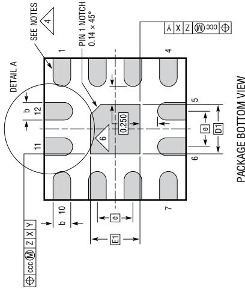

PACKAGE BOTTOM VIEW and details diagram showing dimensional specifications of 12-lead LQFN package.

- NOTES:
1. DIMENSIONING AND TOLERANCING PER ASME Y14.5M-1994
2. ALL DIMENSIONS ARE IN MILLIMETERS
3. PRIMARY DATUM -Z- IS SEATING PLANE
4. METAL FEATURES UNDER THE SOLDER MASK OPENING NOT SHOWN SO AS NOT TO OBSCURE THESE TERMINALS AND HEAT FEATURES
5. DETAILS OF PIN 1 IDENTIFIER ARE OPTIONAL, BUT MUST BE LOCATED WITHIN THE ZONE INDICATED. THE PIN 1 IDENTIFIER MAY BE EITHER A MOLD OR MARKED FEATURE
6. THE EXPOSED HEAT FEATURE MAY HAVE OPTIONAL CORNER RADII

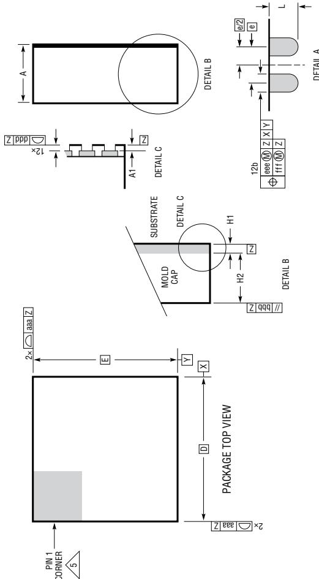

| DIMENSIONS |          |      |      |               |
|------------|----------|------|------|---------------|
| SYMBOL     | MIN      | NOM  | MAX  | NOTES         |
| A          | 0.65     | 0.74 | 0.83 |               |
| A1         | 0.01     | 0.02 | 0.03 |               |
| L          | 0.30     | 0.40 | 0.50 |               |
| b          | 0.22     | 0.25 | 0.28 |               |
| D          | 2.00     |      |      |               |
| E          | 2.00     |      |      |               |
| D1         | 0.70     |      |      |               |
| E1         | 0.70     |      |      |               |
| e          | 0.50     |      |      |               |
| H1         | 0.24 REF |      |      | SUBSTRATE THK |
| H2         | 0.50 REF |      |      | MOLD CAP HT   |
| aaa        |          |      | 0.10 |               |
| bbb        |          |      | 0.10 |               |
| ccc        |          |      | 0.10 |               |
| ddd        |          |      | 0.10 |               |
| eee        |          |      | 0.15 |               |
| fff        |          |      | 0.08 |               |

Technical mechanical drawing showing PACKAGE TOP VIEW, DETAIL B, DETAIL C, DETAIL A, and SUGGESTED PCB LAYOUT TOP VIEW.

{23}------------------------------------------------

## PACKAGE DESCRIPTION

**WLCSP PACKAGE**  
**CB-16-11**  
**16-BALL (1.64mm × 1.64mm × 0.5mm)**  
Dimensions shown in millimeters

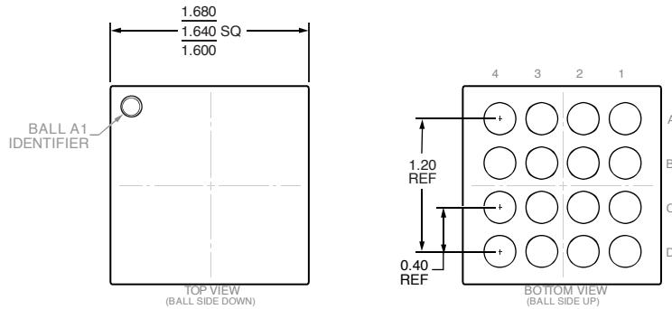

The diagram shows the top and bottom views of the WLCSP package. The top view (ball side down) shows a square package with dimensions 1.680, 1.640 SQ, and 1.600. A small circle in the top-left corner is labeled 'BALL A1 IDENTIFIER'. The bottom view (ball side up) shows a 4x4 grid of balls. The columns are numbered 4, 3, 2, 1 from left to right. The rows are labeled A, B, C, D from top to bottom. Vertical dimensions on the left indicate the distance from the center of the top row to the center of the bottom row is 1.20 REF, and the distance from the center of the bottom row to the center of the bottom ball is 0.40 REF.

Top and bottom views of the WLCSP package showing ball locations and dimensions.

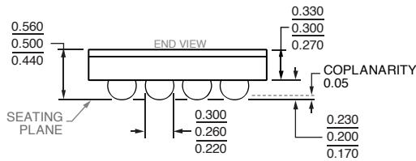

The end view shows the package profile. The package thickness is 0.560, 0.500, and 0.440. The ball diameter is 0.300, 0.300, and 0.270. The ball pitch is 0.300, 0.260, and 0.220. The ball height from the seating plane is 0.230, 0.200, and 0.170. A coplanarity specification of 0.05 is shown for the top of the package relative to the seating plane.

End view of the WLCSP package showing ball dimensions and coplanarity.

PKG-00000000

09-12-2019-B

{24}------------------------------------------------

## REVISION HISTORY

| REV | DATE  | DESCRIPTION                              | PAGE NUMBER |
|-----|-------|------------------------------------------|-------------|
| A   | 11/19 | Added AEC-Q100 Qualified.                | 1           |
|     |       | Added #W Flow Part Numbers.              | 2           |
| B   | 09/21 | Added WLCSP package and references.      | 1-24        |
|     |       | Revised NMOS Reverse Current Limit spec. | 3           |

{25}------------------------------------------------

## TYPICAL APPLICATION

### Dual Buck Regulators with Supply Sequencing

![Circuit diagram of the LTC3315A in a dual buck regulator configuration with supply sequencing. The input voltage V_IN ranges from 2.25V to 5.5V. The LTC3315A is configured with two buck regulators. The first regulator (top) has a switching frequency f_SW = 2MHz and outputs V_OUT1 = 1.2V, 2A. The second regulator (bottom) has a switching frequency f_SW = 2MHz and outputs V_OUT2 = 1.8V, 2A. The LTC3315A is controlled by a 169k resistor and a 100k resistor, with a 0.1µF capacitor. The output of the first regulator is connected to the input of the second regulator. The output of the second regulator is connected to the input of the first regulator. The LTC3315A is also connected to a 1M resistor and a 100k resistor. The diagram includes labels for V_IN, EN1, EN2, SW1, SW2, FB1, FB2, MODE/SYNC, GND, PGOOD, and V_OUT1, V_OUT2.](90ddb84c323b956e2d50a54d3f870566_img.jpg)

Circuit diagram of the LTC3315A in a dual buck regulator configuration with supply sequencing. The input voltage V\_IN ranges from 2.25V to 5.5V. The LTC3315A is configured with two buck regulators. The first regulator (top) has a switching frequency f\_SW = 2MHz and outputs V\_OUT1 = 1.2V, 2A. The second regulator (bottom) has a switching frequency f\_SW = 2MHz and outputs V\_OUT2 = 1.8V, 2A. The LTC3315A is controlled by a 169k resistor and a 100k resistor, with a 0.1µF capacitor. The output of the first regulator is connected to the input of the second regulator. The output of the second regulator is connected to the input of the first regulator. The LTC3315A is also connected to a 1M resistor and a 100k resistor. The diagram includes labels for V\_IN, EN1, EN2, SW1, SW2, FB1, FB2, MODE/SYNC, GND, PGOOD, and V\_OUT1, V\_OUT2.

## RELATED PARTS

| PART NUMBER                                                                                | DESCRIPTION                                                                       | COMMENTS                                                                                                                                                                                                                                                                                                                                                                                                           |
|--------------------------------------------------------------------------------------------|-----------------------------------------------------------------------------------|--------------------------------------------------------------------------------------------------------------------------------------------------------------------------------------------------------------------------------------------------------------------------------------------------------------------------------------------------------------------------------------------------------------------|
| <a href="#">LTC3307A/B</a> , <a href="#">LTC3308A/B</a> , <a href="#">LTC3309A/B</a> | 3A, 4A and 6A 5V Synchronous Step-Down Silent Switcher DC/DC in 2mm × 2mm LQFN-12 | Monolithic Synchronous Step-Down DC/DC Capable of Supplying up to 6A at Switching Frequencies Up to 3MHz(A) and 10MHz(B). Silent Switcher Architecture for Ultralow EMI Emissions. 2.25V to 5.5V Input Operating Range. 0.5V to V IN Output Voltage Range with ±1% Accuracy. PGOOD Indication, RT Programming, SYNC Input. 2mm × 2mm LQFN-12                                                            |
| <a href="#">LTC3310</a> / <a href="#">LTC3310S</a>                                      | 5V, 10A Synchronous Step-Down Silent Switcher/Silent Switcher 2 in 3mm × 3mm LQFN | Switching Frequencies Up to 5MHz. Silent Switcher/Silent Switcher 2 Architecture for Ultralow EMI Emissions. 2.25V to 5.5V Input Operating Range. 0.5V to V IN Output Voltage Range with ±1% Accuracy. PGOOD Indication, R T Programming, SYNC Input. Configurable for Paralleling Power Stages. 150°C Operation (LTC3310). Pin Compatible with LTC3311/LTC3311S. 3mm × 3mm LQFN-18 Package. |
| <a href="#">LTC3370</a> / <a href="#">LTC3371</a>                                       | 4-Channel 8A Configurable 1A Buck DC/DCs                                          | Four Synchronous Buck Regulators with 8 × 1A Power Stages. Can Connect Up to Four Power Stages in Parallel to Make a High Current Output (4A Maximum) with a Single Inductor. 8 Output Configurations Possible. Precision PGOOD Indication. LTC3371 Has a Watchdog Timer. LTC3370: 32-Lead 5mm × 5mm QFN. LTC3371: 38-Lead 5mm × 7mm QFN and TSSOP                                                                 |
| <a href="#">LTC3374</a> / <a href="#">LTC3374A</a>                                      | 8-Channel Parallelable 1A Buck DC/DCs                                             | Eight 1A Synchronous Buck Regulators. Can Connect Up to Four Power Stages in Parallel to Make a High Current Output (4A Maximum) with a Single Inductor. 15 Output Configurations Possible. Precision Enable Inputs and PGOOD_ALL Reporting. 38-Lead 5mm × 7mm QFN and TSSOP                                                                                                                                       |
| <a href="#">LTC3375</a>                                                                    | 8-Channel Parallelable 1A Buck DC/DCs                                             | Eight 1A Synchronous Buck Regulators. Can Connect Up to Four Power Stages in Parallel to Make a High Current Output (4A Maximum) with a Single Inductor. 15 Output Configurations Possible. Precision Enable Inputs and PGOOD_ALL Reporting. I 2 C Programming with a Watchdog Timer and Pushbutton. 48-Lead 7mm × 7mm QFN                                                                              |
| <a href="#">LT8614</a>                                                                     | 42V, 4A Synchronous Step-Down Silent Switcher® with 2.5µA Quiescent Current       | Synchronous Micropower Step-Down DC/DC Converter with Silent Switcher Architecture. Up to 96% Efficiency at 1MHz, 12V IN to 5V OUT . Up to 94% Efficiency at 2MHz, 12V IN to 5V OUT . V IN : 3.4V to 42V, V OUT(MIN) = 0.97V, I Q = 2.5µA, I SD <1µA, 18-Lead 3mm × 4mm QFN                                                |