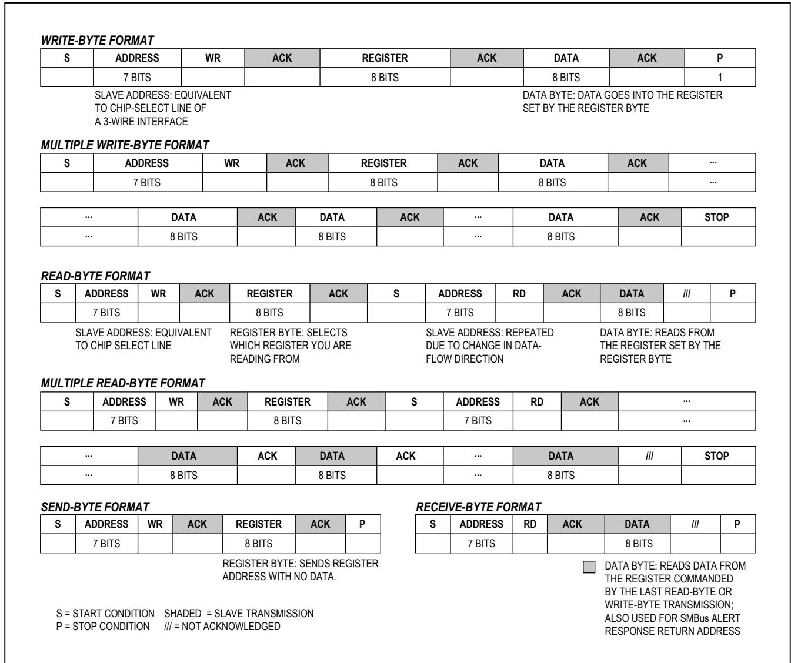

{0}------------------------------------------------

# MAX31730

## 3-Channel Remote Temperature Sensor

## General Description

The MAX31730 temperature sensor monitors its own temperature and the temperatures of three external diode-connected transistors. The operating supply voltage is from 3.0V to 3.6V. Resistance cancellation compensates for high series resistance in circuit-board traces and the external thermal diode, while beta compensation corrects for temperature-measurement errors due to low-beta sensing transistors.

All temperature channels have programmable temperature thresholds. When the measured temperature of a channel crosses the respective threshold, a status bit is set in the thermal status registers and the open-drain THERM output asserts. A highest temperature register allows the master to obtain the temperature of the hottest channel.

The 2-wire serial interface accepts SMBus protocols (write byte, read byte, send byte, and receive byte) for reading the temperature data and programming the temperature thresholds. Any one of eight available slave addresses can be selected using the address selection input (ADD), which can be connected to ground or connected to a grounded resistor.

The MAX31730 supports 3.0V to 3.6V operation and is specified for a -40°C to +125°C operating temperature range. It is available in a 10-pin  $\mu$ MAX® and a 12-pin, 3mm x 3mm TDFN package.

## Benefits and Features

- Highest Temperature Register Simplifies and Speeds Overtemperature Notification
- Accurate Temperature Measurement Helps Designers Meet Error Budgets
  - 12-Bit, 0.0625°C Resolution
  - $\pm 1^\circ\text{C}$  Remote Temperature-Measurement Accuracy (0°C to +100°C)
  - -64°C to +150°C Remote Temperature-Measurement Range
  - Resistance Cancellation for Remote Channels
  - Compensation for Low Beta Transistors
  - Programmable Temperature Thresholds
- Integration Reduces Cost, Board Area, Power-Supply Current, and Slave Address Usage
  - One Local and Three Remote Temperature-Sensing Channels
  - Eight Selectable Slave Addresses
- Flexible SMBus/I2C Bus Interfaces to a Variety of Microcontrollers

**Ordering Information** appears at end of data sheet.

For related parts and recommended products to use with this part, refer to [www.maximintegrated.com/MAX31730.related](http://www.maximintegrated.com/MAX31730.related).

## Typical Application Circuits

![Two typical application circuits for the MAX31730 (description written from the PDF drawing). Left: MAX31730 (10 µMAX) with V_DD at +3.3V. Three PNP transistors share the single DXN pin: the IC1 transistor (inside IC1) has its emitter on DXP1 and its base on DXN; the IC2 transistor (inside IC2) has its emitter on DXP2 and its base on DXN; a discrete transistor has its emitter on DXP3 and its base and collector tied to DXN. The IC1 and IC2 collectors go to ground. A capacitor is drawn between DXP1 and DXN, between DXN and DXP2, and between DXN and DXP3. Right: MAX31730 (12 TDFN) with V_DD at +3.3V and a separate pair per channel: the IC1 transistor on DXP1/DXN1, the IC2 transistor on DXP2/DXN2 (emitter on DXP_, base on DXN_, collector to ground), and a discrete transistor on DXP3/DXN3 with its base and collector tied to DXN3; a capacitor is drawn across each DXP_/DXN_ pair. In both circuits SCL and SDA go TO MASTER, ADD connects through a resistor to ground, THERM (active low) has a pullup resistor to +3.3V, and GND is grounded.](img/acdccfc1d546eaad16a58be576456caf_img.jpg)

Two typical application circuits for the MAX31730 (description written from the PDF drawing). Left: MAX31730 (10 µMAX) with V_DD at +3.3V. Three PNP transistors share the single DXN pin: the IC1 transistor (inside IC1) has its emitter on DXP1 and its base on DXN; the IC2 transistor (inside IC2) has its emitter on DXP2 and its base on DXN; a discrete transistor has its emitter on DXP3 and its base and collector tied to DXN. The IC1 and IC2 collectors go to ground. A capacitor is drawn between DXP1 and DXN, between DXN and DXP2, and between DXN and DXP3. Right: MAX31730 (12 TDFN) with V_DD at +3.3V and a separate pair per channel: the IC1 transistor on DXP1/DXN1, the IC2 transistor on DXP2/DXN2 (emitter on DXP_, base on DXN_, collector to ground), and a discrete transistor on DXP3/DXN3 with its base and collector tied to DXN3; a capacitor is drawn across each DXP_/DXN_ pair. In both circuits SCL and SDA go TO MASTER, ADD connects through a resistor to ground, THERM (active low) has a pullup resistor to +3.3V, and GND is grounded.

$\mu$ MAX is a registered trademark of Maxim Integrated Products, Inc.

{1}------------------------------------------------

## Absolute Maximum Ratings

|                                                       |                                   |                                         |                 |
|-------------------------------------------------------|-----------------------------------|-----------------------------------------|-----------------|
| V DD , SCL, SDA, THERM , ADD.....   | -0.3V to +3.7V                    | Operating Temperature Range.....        | -40°C to +125°C |
| All Other Pins .....                                  | -0.3V to (V DD + 0.3V) | Junction Temperature.....               | +150°C          |
| ESD Protection (All Pins, Human Body Model) .....     | 2kV                               | Storage Temperature Range .....         | -65°C to +150°C |
| Continuous Power Dissipation (T A = +70°C) |                                   | Lead Temperature (soldering, 10s) ..... | +300°C          |
| μMAX (derate at 8.8mW/°C above +70°C) .....           | 707.30mW                          | Soldering Temperature (reflow).....     | +260°C          |
| TDFN (derate 24.4mW/°C above +70°C).....              | 1951.2mW                          |                                         |                 |

Stresses beyond those listed under “Absolute Maximum Ratings” may cause permanent damage to the device. These are stress ratings only, and functional operation of the device at these or any other conditions beyond those indicated in the operational sections of the specifications is not implied. Exposure to absolute maximum rating conditions for extended periods may affect device reliability.

## Package Thermal Characteristics (Note 1)

|                                                                 |           |                                                                 |         |
|-----------------------------------------------------------------|-----------|-----------------------------------------------------------------|---------|
| μMAX                                                            |           | TDFN                                                            |         |
| Junction-to-Ambient Thermal Resistance (θ JA ) ..... | 113.1°C/W | Junction-to-Ambient Thermal Resistance (θ JA ) ..... | 41°C/W  |
| Junction-to-Case Thermal Resistance (θ JC ) .....    | 36°C/W    | Junction-to-Case Thermal Resistance (θ JC ) .....    | 8.5°C/W |

**Note 1:** Package thermal resistances were obtained using the method described in JEDEC specification JESD51-7, using a four-layer board. For detailed information on package thermal considerations, refer to [www.maximintegrated.com/thermal-tutorial](http://www.maximintegrated.com/thermal-tutorial).

## Recommended Operating Conditions

(TA = -40°C to +125°C, unless otherwise noted.) (Note 2)

| PARAMETER                              | SYMBOL          | CONDITIONS              | MIN  | TYP | MAX                   | UNITS |
|----------------------------------------|-----------------|-------------------------|------|-----|-----------------------|-------|
| Voltage Supply                         | V DD | (Note 3)                | 3.0  | 3.3 | 3.6                   | V     |
| Input Logic 0                          | V IL | SDA, SCL (Note 3)       | -0.3 |     | +0.8                  | V     |
| Input Logic 1                          | V IH | SDA, SCL (Note 3)       | 2.2  |     | V DD + 0.3 | V     |
| C EXT (between DXP and DXN) |                 | β compensation disabled |      |     | 2200                  | pF    |
|                                        |                 | β compensation enabled  |      |     | 200                   | pF    |

## Electrical Characteristics

(3.0V ≤ VDD ≤ 3.6V, TA = -40°C to +125°C, unless otherwise noted)

| PARAMETER                   | SYMBOL          | CONDITIONS                                                             | MIN     | TYP | MAX     | UNITS |
|-----------------------------|-----------------|------------------------------------------------------------------------|---------|-----|---------|-------|
| Supply Current              | I DD | Standby (Note 4)                                                       |         | 2.5 | 7       | μA    |
|                             |                 | Operating, β compensation disabled                                     |         | 700 | 1200    |       |
| Temperature Resolution      |                 |                                                                        | -0.0625 |     | +0.0625 | °C    |
| Remote Temperature Accuracy |                 | T A = 0°C to +70°C, T RJ = 0°C to +100°C      | -1      |     | +1      | °C    |
|                             |                 | T A = 0°C to +70°C, T RJ = +100°C to +150°C   | -2      |     | +2      |       |
|                             |                 | T A = -40°C to +125°C, T RJ = -40°C to +125°C | -2.5    |     | +2.5    |       |

{2}------------------------------------------------

## Electrical Characteristics (continued)

(3.0V ≤ VDD ≤ 3.6V, TA = -40°C to +125°C, unless otherwise noted)

| PARAMETER                        | SYMBOL            | CONDITIONS                       | MIN  | TYP  | MAX  | UNITS |
|----------------------------------|-------------------|----------------------------------|------|------|------|-------|
| Local Temperature Accuracy       |                   | T A = 0°C to +70°C    | -1   |      | +1   | °C    |
|                                  |                   | T A = -20°C to +85°C  | -1.5 |      | +1.5 |       |
|                                  |                   | T A = -40°C to +125°C | -2   |      | +2   |       |
| Temperature Hysteresis           |                   | Comparator mode only             |      | 2    |      | °C    |
| Conversion Time Per Channel      |                   | β compensation disabled          |      |      | 100  | ms    |
|                                  |                   | β compensation enabled           |      |      | 150  | ms    |
| Conversion Time for All channels |                   | β compensation disabled          |      |      | 350  | ms    |
| Remote-Diode Source Current      | I RJ   | High level                       |      | 180  |      | μA    |
|                                  |                   | Low level                        |      | 12   |      |       |
| DXN_ Bias Voltage                |                   | Beta compensation disabled       |      |      | 0.3  | V     |
|                                  |                   | Beta compensation enabled        |      | 0.65 |      |       |
| POR Threshold                    | V POR  | V DD rising edge      |      | 2.65 | 2.8  | V     |
| POR Threshold Hysteresis         |                   |                                  |      | 110  |      | mV    |
| THERM Output Low Voltage         | V OL   | I SINK = 1mA          |      |      | 100  | mV    |
|                                  |                   | I SINK = 6mA          |      |      | 300  |       |
| Input Leakage Current            | I LEAK | (Note 5)                         |      | 0.01 | 1    | μA    |
| Output High Leakage Current      | THERM, SDA        |                                  |      |      | 1    | μA    |

## I2C AC Electrical Characteristics

(3.0V ≤ VDD ≤ 3.6V, TA = -40°C to +125°C, timing referenced to VIL(MAX) and VIH(MAX), unless otherwise noted) (Note 6) (Figures 2 and 3)

| PARAMETER                                      | SYMBOL              | CONDITIONS                                          | MIN | TYP | MAX | UNITS |
|------------------------------------------------|---------------------|-----------------------------------------------------|-----|-----|-----|-------|
| Serial-Clock Frequency                         | f CLK    |                                                     |     |     | 400 | kHz   |
| Bus Free Time Between STOP and START Condition | t BUF    | f CLK = 400kHz                           | 1.3 |     |     | μs    |
| Repeated START Condition Setup Time            | t SU:STA |                                                     | 0.6 |     |     | μs    |
| START Condition Setup Time                     |                     | 90% of SCL to 90% of SDA, f CLK = 400kHz | 0.6 |     |     | μs    |
| START Condition Hold Time                      | t HD:STA | 90% of SDA to 90% of SCL, f CLK = 400kHz | 0.6 |     |     | μs    |
| STOP Condition Setup Time                      | t SU:STO | 90% of SCL to 90% of SDA, f CLK = 400kHz | 0.6 |     |     | μs    |

{3}------------------------------------------------

## I2C AC Electrical Characteristics (continued)

( $3.0\text{V} \leq V_{DD} \leq 3.6\text{V}$ ,  $T_A = -40^\circ\text{C}$  to  $+125^\circ\text{C}$ , timing referenced to  $V_{IL(MAX)}$  and  $V_{IH(MAX)}$ , unless otherwise noted) (Note 6) (Figures 2 and 3)

| PARAMETER                       | SYMBOL        | CONDITIONS | MIN | TYP | MAX | UNITS         |
|---------------------------------|---------------|------------|-----|-----|-----|---------------|
| Clock Low Period                | $t_{LOW}$     | 10% to 10% | 1   |     |     | $\mu\text{s}$ |
| Clock High Period               | $t_{HIGH}$    | 90% to 90% | 1   |     |     | $\mu\text{s}$ |
| Data-In Hold Time               | $t_{HD:DAT}$  | (Note 7)   | 0.3 |     |     | $\mu\text{s}$ |
| Data-In Setup Time              | $t_{SU:DAT}$  |            | 100 |     |     | ns            |
| Receive Clock/Data Rise Time    | $t_R$         |            |     |     | 300 | ns            |
| Receive Clock/Data Fall Time    | $t_F$         |            |     |     | 300 | ns            |
| Pulse Width of Spike Suppressed | $t_{SP}$      |            | 0   |     | 50  | ns            |
| Bus Timeout                     | $t_{TIMEOUT}$ | (Note 8)   | 25  |     | 45  | ms            |

**Note 2:** Limits are 100% production tested at  $T_A = +25^\circ\text{C}$ . Limits over the operating temperature range and relevant supply voltage range are guaranteed by design and characterization. Typical values are not guaranteed.

**Note 3:** All voltages referenced to ground.

**Note 4:**  $SDA = SCL = V_{DD}$ .

**Note 5:** Applies to pins  $SDA$ ,  $SCL$ , and  $ADD$ .

**Note 6:** All timing specifications guaranteed by design.

**Note 7:** A master device must provide a hold time of at least 300ns for the  $SDA$  signal to bridge the undefined region of  $SCL$’s falling edge.

**Note 8:** Holding the  $SDA$  line low for a time greater than  $t_{TIMEOUT}$  causes the device to reset  $SDA$  to the idle state of the serial-bus communication ( $SDA$  set high).

{4}------------------------------------------------

## Typical Operating Characteristics

( $3.0\text{V} \leq V_{DD} \leq 3.6\text{V}$ ,  $T_A = +25^\circ\text{C}$ , unless otherwise noted.)

**ACTIVE CURRENT vs TEMPERATURE** toc01

BETA COMPENSATION DISABLED

ACTIVE CURRENT ( $\mu\text{A}$ )

TEMPERATURE ( $^\circ\text{C}$ )

$V_{DD} = 3.6\text{V}$

$V_{DD} = 3.3\text{V}$

$V_{DD} = 3.0\text{V}$

Graph of Active Current vs Temperature with Beta Compensation Disabled. The y-axis is Active Current (μA) from 400 to 1000. The x-axis is Temperature (°C) from -40 to 110. Three curves are shown for VDD = 3.6V, 3.3V, and 3.0V, all showing a linear increase in current with temperature.

**ACTIVE CURRENT vs TEMPERATURE** toc02

BETA COMPENSATION ENABLED; BETA = 0.1

ACTIVE CURRENT ( $\mu\text{A}$ )

TEMPERATURE ( $^\circ\text{C}$ )

$V_{DD} = 3.6\text{V}$

$V_{DD} = 3.3\text{V}$

$V_{DD} = 3.0\text{V}$

Graph of Active Current vs Temperature with Beta Compensation Enabled (BETA = 0.1). The y-axis is Active Current (μA) from 400 to 1800. The x-axis is Temperature (°C) from -40 to 110. Three curves are shown for VDD = 3.6V, 3.3V, and 3.0V, showing a non-linear increase in current with temperature.

**STANDBY CURRENT vs TEMPERATURE** toc03

STANDBY CURRENT ( $\mu\text{A}$ )

TEMPERATURE ( $^\circ\text{C}$ )

$V_{DD} = 3.6\text{V}$

$V_{DD} = 3.3\text{V}$

$V_{DD} = 3.0\text{V}$

Graph of Standby Current vs Temperature. The y-axis is Standby Current (μA) from 0 to 6. The x-axis is Temperature (°C) from -40 to 110. Three curves are shown for VDD = 3.6V, 3.3V, and 3.0V; the current rises gradually with temperature and then more steeply at the high-temperature end of the plot.

**INTERNAL TEMPERATURE ERROR vs. TEMPERATURE** toc04

DATA TAKEN IN BATH LIMITED TO  $+90^\circ\text{C}$

TEMPERATURE ERROR ( $^\circ\text{C}$ )

TEMPERATURE ( $^\circ\text{C}$ )

$V_{DD} = 3.6\text{V}$

$V_{DD} = 3.3\text{V}$

$V_{DD} = 3.0\text{V}$

Graph of Internal Temperature Error vs. Temperature. The y-axis is Temperature Error (°C) from -0.25 to 0.15. The x-axis is Temperature (°C) from -40 to 110. Three curves are shown for VDD = 3.6V, 3.3V, and 3.0V. The curves start above zero at -40°C, fall below zero as the temperature rises and stay negative, with ripples, up to the end of the data; the plot notes DATA TAKEN IN BATH LIMITED TO +90°C. Read values from the image/PDF.

{5}------------------------------------------------

## Pin Configurations

Pin configurations for MAX31730 in μMAX and TDFN 3mm x 3mm packages (TOP VIEW). The μMAX diagram shows a 10-pin package (body labeled MAX31730) with pins 1-10 labeled: 1: VDD, 2: DXP1, 3: DXN, 4: DXP2, 5: DXP3, 6: GND, 7: THERM, 8: ADD, 9: SDA, 10: SCL. The TDFN diagram (body labeled 'MA31730' as printed, exposed pad drawn dashed) shows a 12-pin package with pins 1-12 labeled: 1: VDD, 2: DXP1, 3: DXN1, 4: DXP2, 5: DXN2, 6: DXP3, 7: DXN3, 8: GND, 9: THERM, 10: ADD, 11: SDA, 12: SCL.

## Pin Description

| PIN  |      | NAME            | FUNCTION                                                                                                                                                                                                                                                                                                                                                                                                                                                                          |
|------|------|-----------------|-----------------------------------------------------------------------------------------------------------------------------------------------------------------------------------------------------------------------------------------------------------------------------------------------------------------------------------------------------------------------------------------------------------------------------------------------------------------------------------|
| μMAX | TDFN |                 |                                                                                                                                                                                                                                                                                                                                                                                                                                                                                   |
| 1    | 1    | V DD | Supply Voltage Input. Bypass to GND with a 0.1μF capacitor.                                                                                                                                                                                                                                                                                                                                                                                                                       |
| 2    | 2    | DXP1            | Combined Current Source and ADC Positive Input for Channel 1 Remote Diode. Connect DXP1 to the anode of a remote-diode-connected, temperature-sensing transistor. Leave DXP1 unconnected or connect to DXN or DXN1 if the channel 1 remote diode is not used. Connect a capacitor (see the C EXT specification in the <i>Electrical Characteristic</i> table) between DXP1 and DXN or DXN1 for noise filtering.                                                        |
| —    | 3    | DXN1            | Cathode Input for Channel 1 Remote Diode. Connect the cathode of the channel 1 remote-diode-connected transistor to DXN1. If the channel 1 remote transistor is a substrate PNP (e.g., on a CPU or ASIC die), connect the base of the PNP to DXN1. Leave DXN1 unconnected or connect to DXP1 if a remote diode is not used. Connect a capacitor (see the C EXT specification in the <i>Electrical Characteristic</i> table) between DXP1 and DXN1 for noise filtering. |
| 3    | —    | DXN             | Shared Cathode Input for Remote-Diode Channels. Connect the cathodes of the channel remote-diode-connected transistors to DXN. If a remote transistor is a substrate PNP (e.g., on a CPU or ASIC die), connect the base of the PNP to DXN. Connect a capacitor (see the C EXT specification in the <i>Electrical Characteristic</i> table) between DXP_ and DXN for noise filtering.                                                                                   |

{6}------------------------------------------------

## Pin Description (continued)

| PIN  |      | NAME         | FUNCTION                                                                                                                                                                                                                                                                                                                                                                                                                                                           |
|------|------|--------------|--------------------------------------------------------------------------------------------------------------------------------------------------------------------------------------------------------------------------------------------------------------------------------------------------------------------------------------------------------------------------------------------------------------------------------------------------------------------|
| μMAX | TDFN |              |                                                                                                                                                                                                                                                                                                                                                                                                                                                                    |
| 4    | 4    | DXP2         | Combined Current Source and ADC Positive Input for Channel 2 Remote Diode. Connect DXP2 to the anode of a remote-diode-connected, temperature-sensing transistor. Leave DXP2 unconnected or connect to DXN or DXN2 if a remote diode is not used. Connect a capacitor (see the $C_{EXT}$ specification in the <i>Electrical Characteristic</i> table) between DXP2 and DXN or DXN2 for noise filtering.                                                            |
| —    | 5    | DXN2         | Cathode Input for Channel 2 Remote Diode. Connect the cathode of the channel 2 remote-diode-connected transistor to DXN2. If the channel 2 remote transistor is a substrate PNP (e.g., on a CPU die), connect the base of the PNP to DXN2. Leave DXN2 unconnected or connect to DXP2 if a remote diode is not used. Connect a capacitor (see the $C_{EXT}$ specification in the <i>Electrical Characteristic</i> table) between DXP2 and DXN2 for noise filtering. |
| 5    | 6    | DXP3         | Combined Current Source and ADC Positive Input for Channel 3 Remote Diode. Connect DXP3 to the anode of a remote-diode-connected, temperature-sensing transistor. Leave DXP3 unconnected or connect to DXN or DXN3 if a remote diode is not used. Connect a capacitor (see the $C_{EXT}$ specification in the <i>Electrical Characteristic</i> table) between DXP3 and DXN or DXN3 for noise filtering.                                                            |
| —    | 7    | DXN3         | Cathode Input for Channel 3 Remote Diode. Connect the cathode of the channel 3 remote-diode-connected transistor to DXN3. If the channel 3 remote transistor is a substrate PNP (e.g., on a CPU die), connect the base of the PNP to DXN3. Leave DXN3 unconnected or connect to DXP3 if a remote diode is not used. Connect a capacitor (see the $C_{EXT}$ specification in the <i>Electrical Characteristic</i> table) between DXP3 and DXN3 for noise filtering. |
| 6    | 8    | GND          | Ground                                                                                                                                                                                                                                                                                                                                                                                                                                                             |
| 7    | 9    | THERM | Active-Low, Open-Drain Over/Undertemperature Output. Can also be used as a SMBus alert output by setting the device to interrupt mode using the Configuration register. When enabled, THERM asserts low when the temperature of any channel goes beyond a programmed threshold.                                                                                                                                                                             |
| 8    | 10   | ADD          | Address-Select Input. Sampled at power-up. One of eight possible addresses can be selected by connecting ADD to GND, or connecting ADD to a grounded resistor.                                                                                                                                                                                                                                                                                                     |
| 9    | 11   | SDA          | I 2 C/SMBus Serial-Data Input/Output. Connect SDA to a pullup resistor.                                                                                                                                                                                                                                                                                                                                                                                 |
| 10   | 12   | SCL          | I 2 C/SMBus Serial-Clock Input. Connect SCL to a pullup resistor.                                                                                                                                                                                                                                                                                                                                                                                       |

{7}------------------------------------------------

## Block Diagram

![Block diagram of the MAX31730 3-Channel Remote Temperature Sensor (description written from the PDF drawing). On the left, outside the device, three diode-connected PNP transistors (base and collector tied together) connect to the pin pairs DXP1/DXN1, DXP2/DXN2 and DXP3/DXN3 (emitter on DXP_, base/collector on DXN_), with a capacitor across each DXP_/DXN_ pair. Inside the MAX31730, the six DXP_/DXN_ lines enter an unlabeled input selector block whose + and - outputs feed the MUX; the LOCAL TEMPERATURE block also connects to this selector. A CURRENT SOURCE supplied from VDD feeds the MUX. The MUX drives the ADC, which also takes the REF block. The ADC output goes to the REGISTER BANK, which contains CONFIGURATION BYTES, REMOTE TEMPERATURES, LOCAL TEMPERATURES, SMBus ALERT THRESHOLD, THERMAL THRESHOLDS and ALERT RESPONSE ADDRESS. The REGISTER BANK drives the ALARM block, whose output is the THERM pin. The SMBus/I2C INTERFACE connects to the REGISTER BANK and to the SCL, SDA and ADD pins. GND is grounded.](img/d0abac95583b52a3b35f74a215567334_img.jpg)

Block diagram of the MAX31730 3-Channel Remote Temperature Sensor (description written from the PDF drawing). On the left, outside the device, three diode-connected PNP transistors (base and collector tied together) connect to the pin pairs DXP1/DXN1, DXP2/DXN2 and DXP3/DXN3 (emitter on DXP_, base/collector on DXN_), with a capacitor across each DXP_/DXN_ pair. Inside the MAX31730, the six DXP_/DXN_ lines enter an unlabeled input selector block whose + and - outputs feed the MUX; the LOCAL TEMPERATURE block also connects to this selector. A CURRENT SOURCE supplied from VDD feeds the MUX. The MUX drives the ADC, which also takes the REF block. The ADC output goes to the REGISTER BANK, which contains CONFIGURATION BYTES, REMOTE TEMPERATURES, LOCAL TEMPERATURES, SMBus ALERT THRESHOLD, THERMAL THRESHOLDS and ALERT RESPONSE ADDRESS. The REGISTER BANK drives the ALARM block, whose output is the THERM pin. The SMBus/I2C INTERFACE connects to the REGISTER BANK and to the SCL, SDA and ADD pins. GND is grounded.

## Detailed Description

The MAX31730 is a precision temperature monitor that features one local and three remote temperature-sensing channels, with programmable temperature thresholds for each channel. Communication with the device is achieved through the SMBus/I2C-compatible serial interface and over/undertemperature-detection output (THERM). The THERM output asserts if the software-programmed temperature thresholds are exceeded. THERM normally operates in comparator mode and can be connected to a fan, system shutdown, or other thermal-management circuitry. It can also operate in interrupt mode to serve as a SMBus alert interrupt.

### ADC Conversion Sequence

The device starts the conversion sequence by measuring the temperature on remote channel 1, followed by remote channel 2, remote channel 3, and the local channel. The conversion result for each enabled channel is stored in the corresponding temperature data register. No conversion is performed on any remote channel that does not have a diode connected, whose DXP\_ - DXN\_ inputs are shorted together, or that has a short between DXP\_ and VDD, DXP\_ and GND, or DXN\_ and VDD, or if the channel is not enabled in the Highest Temperature Enable register. See the [Register 36h: Diode Fault Status](#) section for additional details.

{8}------------------------------------------------

### Series-Resistance Cancellation

Some thermal diodes on high-power ICs have excessive series resistance that can cause temperature-measurement errors when used with conventional remote temperature sensors. External channels 1–3 of the device have a series-resistance cancellation feature that eliminates the effect of diode series resistance and interconnection resistance. The cancellation range is from 0 to 300 $\Omega$ . Series-resistance cancellation is always enabled.

### Low-Power Standby Mode

Enter software-standby mode by setting the STOP bit to 1 in the Configuration register. Software-standby mode disables the ADC and reduces the supply current to approximately 2.5 $\mu$ A. During software standby, data is retained in memory and the bus interface is active and listening for commands. If a START condition is recognized, activity on the bus causes the supply current to increase. If a standby command is received while a conversion is in progress, the conversion cycle is finished, then the device enters shutdown, and the temperature registers are updated.

### SMBus Digital Interface

The device is SMBus 2.0 compatible and supports four standard SMBus protocols: write byte, read byte, send byte, and receive byte, as well as multibyte reads and writes ([Figure 1](#)). The shorter receive-byte protocol allows quicker transfers, provided that the correct register was previously selected by a read-byte instruction. Use caution with the shorter protocols in multimaster systems, since a second master could overwrite the register byte without informing the first master. [Figure 2](#) is the SMBus write timing diagram and [Figure 3](#) is the SMBus read timing diagram.

The **write-byte** format consists of the master transmitting the slave address, followed by the address for the target register, followed by the 8 bits of data to be written to the target register. To write multiple bytes to two or more contiguous registers, write a new byte after each ACK. The register address then increments after each byte is written. End the transaction with a STOP condition.

The **read-byte** format consists of the master transmitting the slave address followed by the address for the register to be read. The master then begins a new transaction by sending the slave address again, after which the slave returns the data from the selected register. To read multiple bytes from two or more contiguous registers, continue reading after each ACK. The register address then increments after each byte is read. Conclude the overall transaction with a NACK and a STOP condition.

When the first byte of a 2-byte temperature value is read, the device prevents updates of the second byte's contents until the second byte has been read. If the second byte has not been read within a SMBus timeout period (nominally 35ms), it is again allowed to update.

The **send-byte** format can be used to transmit a register address without a transfer of data. It consists of the master transmitting the slave address followed by the address of the target register.

The **receive-byte** format can be used to read data from a register that was previously selected. It consists of the master transmitting the slave address, after which the slave returns the data from the register that was previously selected. After this command completes, the address pointer does not increment.

{9}------------------------------------------------

**WRITE-BYTE FORMAT**

|   |         |    |     |          |     |        |     |   |
|---|---------|----|-----|----------|-----|--------|-----|---|
| S | ADDRESS | WR | ACK | REGISTER | ACK | DATA   | ACK | P |
|   | 7 BITS  |    |     | 8 BITS   |     | 8 BITS |     | 1 |

SLAVE ADDRESS: EQUIVALENT TO CHIP-SELECT LINE OF A 3-WIRE INTERFACE

DATA BYTE: DATA GOES INTO THE REGISTER SET BY THE REGISTER BYTE

**MULTIPLE WRITE-BYTE FORMAT**

|   |         |    |     |          |     |        |     |     |
|---|---------|----|-----|----------|-----|--------|-----|-----|
| S | ADDRESS | WR | ACK | REGISTER | ACK | DATA   | ACK | ... |
|   | 7 BITS  |    |     | 8 BITS   |     | 8 BITS |     | ... |

|     |        |     |        |     |     |        |     |      |
|-----|--------|-----|--------|-----|-----|--------|-----|------|
| ... | DATA   | ACK | DATA   | ACK | ... | DATA   | ACK | STOP |
| ... | 8 BITS |     | 8 BITS |     | ... | 8 BITS |     |      |

**READ-BYTE FORMAT**

|   |         |    |     |          |     |   |         |    |     |        |     |   |
|---|---------|----|-----|----------|-----|---|---------|----|-----|--------|-----|---|
| S | ADDRESS | WR | ACK | REGISTER | ACK | S | ADDRESS | RD | ACK | DATA   | /// | P |
|   | 7 BITS  |    |     | 8 BITS   |     |   | 7 BITS  |    |     | 8 BITS |     |   |

SLAVE ADDRESS: EQUIVALENT TO CHIP SELECT LINE

REGISTER BYTE: SELECTS WHICH REGISTER YOU ARE READING FROM

SLAVE ADDRESS: REPEATED DUE TO CHANGE IN DATA-FLOW DIRECTION

DATA BYTE: READS FROM THE REGISTER SET BY THE REGISTER BYTE

**MULTIPLE READ-BYTE FORMAT**

|   |         |    |     |          |     |   |         |    |     |     |
|---|---------|----|-----|----------|-----|---|---------|----|-----|-----|
| S | ADDRESS | WR | ACK | REGISTER | ACK | S | ADDRESS | RD | ACK | ... |
|   | 7 BITS  |    |     | 8 BITS   |     |   | 7 BITS  |    |     | ... |

|     |        |     |        |     |     |        |     |      |
|-----|--------|-----|--------|-----|-----|--------|-----|------|
| ... | DATA   | ACK | DATA   | ACK | ... | DATA   | /// | STOP |
| ... | 8 BITS |     | 8 BITS |     | ... | 8 BITS |     |      |

**SEND-BYTE FORMAT**

|   |         |    |     |          |     |   |
|---|---------|----|-----|----------|-----|---|
| S | ADDRESS | WR | ACK | REGISTER | ACK | P |
|   | 7 BITS  |    |     | 8 BITS   |     |   |

REGISTER BYTE: SENDS REGISTER ADDRESS WITH NO DATA.

**RECEIVE-BYTE FORMAT**

|   |         |    |     |        |     |   |
|---|---------|----|-----|--------|-----|---|
| S | ADDRESS | RD | ACK | DATA   | /// | P |
|   | 7 BITS  |    |     | 8 BITS |     |   |

DATA BYTE: READS DATA FROM THE REGISTER COMMANDED BY THE LAST READ-BYTE OR WRITE-BYTE TRANSMISSION; ALSO USED FOR SMBus ALERT RESPONSE RETURN ADDRESS

S = START CONDITION    SHADED = SLAVE TRANSMISSION  
P = STOP CONDITION    /// = NOT ACKNOWLEDGED

Figure 1. I2C/SMBus Format

{10}------------------------------------------------

![Figure 2. SMBus/I²C Write Timing Diagram. This timing diagram illustrates the sequence of events for a write operation on the SMBus. It shows the SCL and SDA lines with various points labeled A through M. Point A is the start condition. Points B, C, and D mark the clocking of the address bits (MSB, LSB, and R/W bit) into the slave. Point E shows the slave pulling the SDA line low. Points F and G mark the clocking of the data bits (ACKnowledge and MSB of data) into the master. Point H shows the master pulling the SDA line low. Points I, J, and K mark the clocking of the data bits (MSB of data and ACKnowledge) into the slave. Point L is the stop condition, and point M is a new start condition. Timing parameters such as tLOW, tHIGH, tSU:STA, tHD:STA, tSU:DAT, tSU:STO, and tBUF are indicated.](img/10c82dcc5f2c237961329dd29d65859c_img.jpg)

A = START CONDITION  
 B = MSB OF ADDRESS CLOCKED INTO SLAVE  
 C = LSB OF ADDRESS CLOCKED INTO SLAVE  
 D = R/W BIT CLOCKED INTO SLAVE  
 E = SLAVE PULLS SDA LINE LOW  
 F = ACKNOWLEDGE BIT CLOCKED INTO MASTER  
 G = MSB OF DATA CLOCKED INTO SLAVE  
 H = LSB OF DATA CLOCKED INTO SLAVE  
 I = SLAVE PULLS SDA LOW  
 J = ACKNOWLEDGE CLOCKED INTO MASTER  
 K = ACKNOWLEDGE CLOCK PULSE  
 L = STOP CONDITION  
 M = NEW START CONDITION

Figure 2. SMBus/I²C Write Timing Diagram. This timing diagram illustrates the sequence of events for a write operation on the SMBus. It shows the SCL and SDA lines with various points labeled A through M. Point A is the start condition. Points B, C, and D mark the clocking of the address bits (MSB, LSB, and R/W bit) into the slave. Point E shows the slave pulling the SDA line low. Points F and G mark the clocking of the data bits (ACKnowledge and MSB of data) into the master. Point H shows the master pulling the SDA line low. Points I, J, and K mark the clocking of the data bits (MSB of data and ACKnowledge) into the slave. Point L is the stop condition, and point M is a new start condition. Timing parameters such as tLOW, tHIGH, tSU:STA, tHD:STA, tSU:DAT, tSU:STO, and tBUF are indicated.

Figure 2. SMBus/I2C Write Timing Diagram

![Figure 3. SMBus/I²C Read Timing Diagram. This timing diagram illustrates the sequence of events for a read operation on the SMBus. It shows the SCL and SDA lines with various points labeled A through K. Point A is the start condition. Points B, C, and D mark the clocking of the address bits (MSB, LSB, and R/W bit) into the slave. Point E shows the slave pulling the SDA line low. Points F and G mark the clocking of the data bits (ACKnowledge and MSB of data) into the master. Point H shows the master pulling the SDA line low. Points I, J, and K mark the clocking of the data bits (MSB of data and ACKnowledge) into the slave. Timing parameters such as tLOW, tHIGH, tSU:STA, tHD:STA, tSU:DAT, tHD:DAT, tSU:STO, and tBUF are indicated.](img/86089bb74e9c313a8c62cd0cb41c3e66_img.jpg)

A = START CONDITION  
 B = MSB OF ADDRESS CLOCKED INTO SLAVE  
 C = LSB OF ADDRESS CLOCKED INTO SLAVE  
 D = R/W BIT CLOCKED INTO SLAVE  
 E = SLAVE PULLS SDA LINE LOW  
 F = ACKNOWLEDGE BIT CLOCKED INTO MASTER  
 G = MSB OF DATA CLOCKED INTO MASTER  
 H = LSB OF DATA CLOCKED INTO MASTER  
 I = ACKNOWLEDGE CLOCK PULSE  
 J = STOP CONDITION  
 K = NEW START CONDITION

Figure 3. SMBus/I²C Read Timing Diagram. This timing diagram illustrates the sequence of events for a read operation on the SMBus. It shows the SCL and SDA lines with various points labeled A through K. Point A is the start condition. Points B, C, and D mark the clocking of the address bits (MSB, LSB, and R/W bit) into the slave. Point E shows the slave pulling the SDA line low. Points F and G mark the clocking of the data bits (ACKnowledge and MSB of data) into the master. Point H shows the master pulling the SDA line low. Points I, J, and K mark the clocking of the data bits (MSB of data and ACKnowledge) into the slave. Timing parameters such as tLOW, tHIGH, tSU:STA, tHD:STA, tSU:DAT, tHD:DAT, tSU:STO, and tBUF are indicated.

Figure 3. SMBus/I2C Read Timing Diagram

### Alert Response Address (ARA)

The SMBus alert response interrupt pointer provides quick fault identification for simple slave devices that lack the complex logic necessary to be a bus master. Upon receiving an interrupt signal, the host master can broadcast a receive-byte transmission to the alert response slave address (19h). Then, any slave device that generated an interrupt attempts to identify itself by putting its own address on the bus. The alert response can activate several different slave devices simultaneously, similar to the I2C general call.

If more than one slave attempts to respond, bus arbitration rules apply, and the device with the lower address code wins. The losing device does not generate an acknowledgment and continues to hold the THERM pin low until cleared (the conditions for clearing an alert vary depending on the type of slave device). Successful completion of the alert response protocol clears the output latch. If the condition that caused the alert still

exists, the device reasserts the interrupt at the end of the next conversion. The device responds to the ARA only when in interrupt mode.

### Interrupt Mode

Thermal interrupts occur when the local or remote temperature reading crosses a user-programmable high thermal limit or a low thermal limit. The THERM interrupt output signal can be cleared by reading the status register associated with the fault or by successfully responding to an ARA transmission by the master. In both cases, the thermal fault is cleared but is reasserted at the end of the next conversion if the fault condition still exists. The interrupt does not halt automatic conversions. The THERM output is open drain so that multiple devices can share a common interrupt line. All thermal interrupts can be masked using the THERM Mask register. Interrupt mode can be selected by writing bit 4 in the Configuration register to a 0.

{11}------------------------------------------------

### Comparator Mode

Selecting comparator mode in the Configuration register causes the THERM output to assert based on a temperature measurement exceeding a trip threshold value, just as in interrupt mode. However, in comparator mode, the output deasserts automatically when the temperature crosses the threshold back into the acceptable range. A 2°C hysteresis is applied in comparator mode, so clearing the THERM output in this mode requires the temperature to be 2°C less than the high thermal limit and 2°C greater than the low thermal limit.

### Temperature Register Format

Temperature data is stored in the temperature, limit, and reference temperature registers. The temperature data

format is 12 bits, two’s complement, and the register is read out in 2 bytes: an upper byte and a lower byte. Bits D[15:0] contain the temperature data, with the LSB representing 0.0625°C and the MSB representing the sign bit (see [Table 1](#)). The MSB is transmitted first.

In addition to the normal two’s-complement temperature data format, the device offers an optional extended data format that allows temperatures equal to or greater than +127.9375°C to be read. In the extended format (selected by bit 1 of the Configuration register, 13h), the measured temperature is the value in the temperature register plus 64°C, as shown in [Table 2](#). **Note:** when the extended format is selected, all limit and reference temperature registers must be written in this format. They are not automatically translated by toggling the extended format bit.

Table 1. Temperature, Reference Temperature, Thermal-Limit Register Definition

| UPPER BYTE |                               |                        |                        |                       |                       |                       |                       | LOWER BYTE               |                           |                            |                           |    |    |    |    |
|------------|-------------------------------|------------------------|------------------------|-----------------------|-----------------------|-----------------------|-----------------------|--------------------------|---------------------------|----------------------------|---------------------------|----|----|----|----|
| D15        | D14                           | D13                    | D12                    | D11                   | D10                   | D9                    | D8                    | D7                       | D6                        | D5                         | D4                        | D3 | D2 | D1 | D0 |
| Sign bit   | MSB 64°C 2 6 | 32°C 2 5 | 16°C 2 4 | 8°C 2 3 | 4°C 2 2 | 2°C 2 1 | 1°C 2 0 | 0.5°C 2 -1 | 0.25°C 2 -2 | 0.125°C 2 -3 | 0.0625 2 -4 | 0  | 0  | 0  | 0  |

Table 2. Temperature Register Data Format

| ACTUAL TEMPERATURE (°C) | NORMAL FORMAT       |        | EXTENDED FORMAT     |        |
|-------------------------|---------------------|--------|---------------------|--------|
|                         | BINARY              | HEX    | BINARY              | HEX    |
| +150                    | 0111 1111 1111 0000 | 0x7FF0 | 0101 0110 0000 0000 | 0x5600 |
| +128                    | 0111 1111 1111 0000 | 0x7FF0 | 0100 0000 0000 0000 | 0x4000 |
| +127                    | 0111 1111 0000 0000 | 0x7F00 | 0011 1111 0000 0000 | 0x3F00 |
| +125                    | 0111 1101 0000 0000 | 0x7D00 | 0011 1101 0000 0000 | 0x3D00 |
| +64                     | 0100 0000 0000 0000 | 0x4000 | 0000 0000 0000 0000 | 0x0000 |
| +25                     | 0001 1001 0000 0000 | 0x1900 | 1101 1001 0000 0000 | 0xD900 |
| +0.5                    | 0000 0000 1000 0000 | 0x0080 | 1100 0000 1000 0000 | 0xC080 |
| 0                       | 0000 0000 0000 0000 | 0x0000 | 1100 0000 0000 0000 | 0xC000 |
| -0.5                    | 1111 1111 1000 0000 | 0xFF80 | 1011 1111 1000 0000 | 0xBF80 |
| -25                     | 1110 0111 0000 0000 | 0xE700 | 1010 0111 0000 0000 | 0xA700 |
| -55                     | 1100 1001 0000 0000 | 0xC900 | 1000 1001 0000 0000 | 0x8900 |
| -64                     | 1100 0000 0000 0000 | 0xC000 | 1000 0000 0000 0000 | 0x8000 |
| Diode Fault             | 0000 0000 0000 0000 | 0x0000 | 0000 0000 0000 0000 | 0x0000 |

{12}------------------------------------------------

#### Temperature Channel Enable Register

The Temperature Channel Enable register selects which temperature-sensing channels are enabled. Channels not selected are skipped during the temperature-conversion cycle and diode fault detection is not performed on them. If a channel is deselected while a thermal or diode fault is indicated in the corresponding fault register, the fault bit(s) remain asserted until the register contents are read, and then do not reassert until the channel is again enabled and a fault detected.

#### Highest Temperature Registers

The Highest Temperature registers (10h and 11h) work with the Reference Temperature registers' (40h through 47h) value for each temperature channel. The Reference

Temperature registers can effectively serve as an offset temperature margin, or their contents can simply be set to zero.

After each temperature conversion, the Reference Temperature value is subtracted from the measured temperature for the corresponding channel (e.g., remote 2 temperature minus remote 2 reference temperature), and the result is compared to the most recent results for the other channels. The highest of all these values is loaded into the Reference Temperature register.

#### Highest Temperature Enable Register

The Highest Temperature Enable register selects the temperature channels from which the contents of the Highest Temperature register are obtained (see [Table 4](#)).

**Table 3. Temperature Channel Enable Register (35h)**

| BIT     | NAME     | POR VALUE | FUNCTION                                                                                                                        |
|---------|----------|-----------|---------------------------------------------------------------------------------------------------------------------------------|
| 7 (MSB) | Reserved | 0         | Reserved.                                                                                                                       |
| 6       | Reserved | 0         | Reserved.                                                                                                                       |
| 5       | Reserved | 0         | Reserved.                                                                                                                       |
| 4       | Reserved | 0         | Reserved.                                                                                                                       |
| 3       | Remote 3 | 1         | Channel 3 Enable Bit. Set this bit to logic 1 to enable temperature conversions and diode fault detection for remote channel 3. |
| 2       | Remote 2 | 1         | Channel 2 Enable Bit. Set this bit to logic 1 to enable temperature conversions and diode fault detection for remote channel 2. |
| 1       | Remote 1 | 1         | Channel 1 Enable Bit. Set this bit to logic 1 to enable temperature conversions and diode fault detection for remote channel 1. |
| 0       | Local    | 1         | Local Temperature Channel Enable Bit. Set this bit to logic 1 to enable temperature conversions for the local channel.          |

**Table 4. Highest Temperature Enable Register (12h)**

| BIT     | NAME     | POR VALUE | FUNCTION                                                                                             |
|---------|----------|-----------|------------------------------------------------------------------------------------------------------|
| 7 (MSB) | Reserved | 1         | Reserved.                                                                                            |
| 6       | Reserved | 1         | Reserved.                                                                                            |
| 5       | Reserved | 1         | Reserved.                                                                                            |
| 4       | Reserved | 1         | Reserved.                                                                                            |
| 3       | Remote 3 | 1         | Channel 3 Select Bit. Set to logic 1 to use remote channel 3 in determining the highest temperature. |
| 2       | Remote 2 | 1         | Channel 2 Select Bit. Set to logic 1 to use remote channel 2 in determining the highest temperature. |
| 1       | Remote 1 | 1         | Channel 1 Select Bit. Set to logic 1 to use remote channel 1 in determining the highest temperature. |
| 0       | Local    | 1         | Local Select Bit. Set to logic 1 to use local channel in determining the highest temperature.        |

{13}------------------------------------------------

#### Thermal-Limit Registers

The Thermal Limit registers (20h through 27h) store over-temperature and undertemperature thermal-threshold values. Access to these registers is provided through the I2C/SMBus-compatible interface. Alarms are masked at power-up. If a threshold is crossed, a bit is set in the Thermal Status registers (40h through 47h) to indicate the thermal fault. The THERM pin is also asserted unless the channel is masked using the THERM Mask register.

#### Configuration Register

The Configuration register (Table 5) has several functions. Bit 7 (MSB) is used to put the device either in software-standby mode (stop) or continuous-conversion mode.

In standby mode, the ADC is shut down and the supply current reduced. The bus remains active. Bit 6 resets all registers to their POR conditions and then clears itself. Bit 5 disables the bus timeout function. Bit 4 selects whether the THERM output functions as an interrupt or as a comparator. Bits 2 and 3 enable the fault queue, which sets the number of consecutive thermal faults required before asserting the thermal status bits and the THERM output. Bit 1 selects the extended range temperature data format (Table 2), which allows reading temperature values of 127.9375°C or greater. When set to 1, bit 0 begins a single conversion on all enabled temperature channels. This one-shot function can be enabled only when in stop mode.

**Table 5. Configuration Register (13h)**

| BIT     | NAME                     | POR VALUE | FUNCTION                                                                                                                                                                                                                                                 |
|---------|--------------------------|-----------|----------------------------------------------------------------------------------------------------------------------------------------------------------------------------------------------------------------------------------------------------------|
| 7 (MSB) | STOP                     | 0         | Standby-Mode Control Bit. Setting STOP to 1 disables the ADC and reduces supply current to 2.5μA.                                                                                                                                                        |
| 6       | POR                      | 0         | Power-On-Reset Bit. Set to logic 1 to enter the power-on state. This bit is self-clearing.                                                                                                                                                               |
| 5       | TIMEOUT                  | 0         | Timeout Enable Bit. Set to logic 0 to enable SMBus timeout.                                                                                                                                                                                              |
| 4       | INTERRUPT/ COMPARATOR | 1         | Interrupt/Comparator Mode-Select Bit. Set to logic 1 to select comparator mode for the THERM output.                                                                                                                                              |
| 3       | FAULT QUEUE              | 0         | Selects the number of consecutive faults needed to assert the Thermal Status bits and THERM output. 00 = 1; 01 = 2; 10 = 4; 11 = 6.                                                                                                               |
| 2       |                          | 0         |                                                                                                                                                                                                                                                          |
| 1       | EXTRANGE                 | 0         | Extended-Range Enable Bit. Set bit 1 to logic 1 to set the temperature, limit, and reference data range to maximum reportable temperature of +127.9375°C. Set bit 1 to logic 0 to set the data range to a maximum reportable temperature of +191.9375°C. |
| 0       | ONE SHOT                 | 0         | Writing 1 to this bit initiates a single cycle of temperature conversions. All other bits in the Configuration register are ignored, and bit 0 automatically resets to 0. ONE SHOT can only be enabled in stop mode.                                     |

{14}------------------------------------------------

#### **THERM Mask Register**

The THERM Mask register functions are described in [Table 6](#). Bits [3:0] are used to mask the THERM pin output. Bit 0 masks assertion of THERM due to the local channel thermal faults and the remaining bits mask the remote thermal faults. The power-up state of this register is 0000 0000 (00h).

### **Status Register Functions**

The status registers indicate temperature or diode fault status. The Thermal High Status register indicates whether a measured local or remote temperature has exceeded the associated threshold limit set in the associated Thermal High Status register. The Thermal Low Status register indicates whether the measured temperature has fallen below the threshold limit set in the Thermal Low Status register for the local or remote-sensing diodes. The Diode Fault Status register indicates whether there is a diode fault (open or short) in any of the remote-sensing channels.

Bits in the Thermal Status registers are cleared by a successful read, but set again after the next conversion unless the fault is corrected, either by a change in the measured temperature or by a change in the threshold temperature. When in comparator mode, reading the status registers has no effect on the THERM output state; the state depends on the current temperature, threshold, and mask values. Similarly, bits in the Diode Fault Status register are cleared by a successful read, but set again after the next conversion if the fault is still in effect.

In interrupt mode, the THERM output follows the status bits for all unmasked channels. Once the THERM output is asserted while in interrupt mode, it can be deasserted either by reading the thermal status register or by successfully responding to an ARA. In both cases, the THERM pin is cleared even if the fault condition remains in effect, but the THERM output reasserts at the end of the next conversion if the fault condition is still present.

**Table 6. THERM Mask Register (34h)**

| BIT    | NAME     | POR VALUE | FUNCTION                                                                                                           |
|--------|----------|-----------|--------------------------------------------------------------------------------------------------------------------|
| 7(MSB) | Reserved | 0         | Reserved.                                                                                                          |
| 6      | Reserved | 0         | Reserved.                                                                                                          |
| 5      | Reserved | 0         | Reserved.                                                                                                          |
| 4      | Reserved | 0         | Reserved.                                                                                                          |
| 3      | Remote 3 | 0         | Channel 3 Remote Mask Bit. Set to logic 1 to mask assertion of THERM due to remote channel 3 thermal fault. |
| 2      | Remote 2 | 0         | Channel 2 Remote Mask Bit. Set to logic 1 to mask assertion of THERM due to remote channel 2 thermal fault. |
| 1      | Remote 1 | 0         | Channel 1 Remote Mask Bit. Set to logic 1 to mask assertion of THERM due to remote channel 1 thermal fault. |
| 0      | Local    | 0         | Local Mask Bit. Set to logic 1 to mask assertion of THERM due to local sensor thermal fault.                |

{15}------------------------------------------------

**Table 7. Thermal High Status Register (32h)**

| BIT     | NAME     | POR VALUE | FUNCTION                                                                                                                                                                            |
|---------|----------|-----------|-------------------------------------------------------------------------------------------------------------------------------------------------------------------------------------|
| 7 (MSB) | Reserved | 0         | Reserved.                                                                                                                                                                           |
| 6       | Reserved | 0         | Reserved.                                                                                                                                                                           |
| 5       | Reserved | 0         | Reserved.                                                                                                                                                                           |
| 4       | Reserved | 0         | Reserved.                                                                                                                                                                           |
| 3       | Remote 3 | 0         | Channel 3 Remote-Diode High Thermal Bit. This bit is set to logic 1 when the channel 3 remote-diode temperature exceeds the threshold in the Remote 3 Thermal High Limit registers. |
| 2       | Remote 2 | 0         | Channel 2 Remote-Diode High Thermal Bit. This bit is set to logic 1 when the channel 2 remote-diode temperature exceeds the threshold in the Remote 2 Thermal High Limit registers. |
| 1       | Remote 1 | 0         | Channel 1 Remote-Diode High Thermal Bit. This bit is set to logic 1 when the channel 1 remote-diode temperature exceeds the threshold in the Remote 1 Thermal High Limit registers. |
| 0       | Local    | 0         | Local Channel High Thermal Bit. This bit is set to logic 1 when the local temperature exceeds the threshold in the Local Thermal High Limit registers.                              |

**Table 8. Thermal Low Status Register (33h)**

| BIT     | NAME     | POR VALUE | FUNCTION                                                                                                                                                                      |
|---------|----------|-----------|-------------------------------------------------------------------------------------------------------------------------------------------------------------------------------|
| 7 (MSB) | Reserved | 0         | Reserved.                                                                                                                                                                     |
| 6       | Reserved | 0         | Reserved.                                                                                                                                                                     |
| 5       | Reserved | 0         | Reserved.                                                                                                                                                                     |
| 4       | Reserved | 0         | Reserved.                                                                                                                                                                     |
| 3       | Remote 3 | 0         | Channel 3 Remote-Diode Low Thermal Bit. This bit is set to logic 1 when the channel 3 remote-diode temperature is less than the threshold in the Thermal Low Limit registers. |
| 2       | Remote 2 | 0         | Channel 2 Remote-Diode Low Thermal Bit. This bit is set to logic 1 when the channel 2 remote-diode temperature is less than the threshold in the Thermal Low Limit registers. |
| 1       | Remote 1 | 0         | Channel 1 Remote-Diode Low Thermal Bit. This bit is set to logic 1 when the channel 1 remote-diode temperature is less than the threshold in the Thermal Low Limit registers. |
| 0       | Local    | 0         | Local Channel Low Thermal Bit. This bit is set to logic 1 when the local temperature is less than the threshold in the Thermal Low Limit registers.                           |

{16}------------------------------------------------

### Diode Fault Detection

If a remote channel's DXP\_ and DXN\_ inputs are unconnected or are shorted to each other, to ground, or to the supply voltage, the device detects a diode fault. A diode fault does not cause THERM to assert and does not allow an overtemperature or undertemperature event to be detected for the affected channel. A bit in the Diode Fault Status register (36h) corresponding to the channel is set to 1 and the temperature data for the channel is stored as 0°C (0000h in normal format).

A period of approximately 3ms at the beginning of each channel's temperature conversion cycle is dedicated to diode fault detection. Once a diode fault is detected, the temperature conversion for that channel is abandoned and fault detection/temperature conversion begins on the next channel in the conversion sequence. See the [Register 36h: Diode Fault Status](#) section.

### Effect of Ideality Factor

The accuracy of the remote temperature measurements depend on the ideality factor (n) of the remote “diode” (actually a diode-connected transistor). The default value for the MAX31730 is n = 1.008 (channels 1–3). A thermal diode on the substrate of an external IC is normally a PNP, with the base and emitter brought out and the collector grounded. DXP\_ must be connected to the anode (emitter) and DXN\_ must be connected to the cathode (base) of this PNP. If a sense transistor with an ideality factor other than 1.008 is used, the output data will be different from the data obtained with the optimum ideality factor. If necessary, a different ideality factor value can be chosen using the Custom Ideality Factor register ([Table 9](#)). The Custom Ideality Enable register ([Table 10](#)) allows each channel to have the default ideality of 1.008 or the value selected in the Custom Ideality Factor register. Note that any change in the ideality selections occur on subsequent conversions; current temperature register values do not change until a new conversion has completed.

**Table 9. Custom Ideality Factor Register (14h)**

| SELECTION (HEX) | IDEALITY FACTOR |
|-----------------|-----------------|
| 0x00            | 0.9844          |
| 0x01            | 0.9853          |
| 0x02            | 0.9863          |
| 0x03            | 0.9873          |
| 0x04            | 0.9882          |
| 0x05            | 0.9892          |
| 0x06            | 0.9902          |
| 0x07            | 0.991           |
| 0x08            | 0.9921          |
| 0x09            | 0.9931          |
| 0x0A            | 0.9941          |
| 0x0B            | 0.9950          |
| 0x0C            | 0.9960          |
| 0x0D            | 0.9970          |
| 0x0E            | 0.9980          |
| 0x0F            | 0.9990          |
| 0x10            | 1.0000          |
| 0x11            | 1.0010          |
| 0x12            | 1.0020          |
| 0x13            | 1.0030          |
| 0x14            | 1.0040          |
| 0x15            | 1.0050          |

| SELECTION (HEX) | IDEALITY FACTOR |
|-----------------|-----------------|
| 0x16            | 1.0060          |
| 0x17            | 1.0070          |
| 0x18 (default)  | 1.0080          |
| 0x19            | 1.0090          |
| 0x1A            | 1.0100          |
| 0x1B            | 1.0110          |
| 0x1C            | 1.0120          |
| 0x1D            | 1.0130          |
| 0x1E            | 1.0141          |
| 0x1F            | 1.0151          |
| 0x20            | 1.0161          |
| 0x21            | 1.0171          |
| 0x22            | 1.0182          |
| 0x23            | 1.0192          |
| 0x24            | 1.0202          |
| 0x25            | 1.0213          |
| 0x26            | 1.0223          |
| 0x27            | 1.0233          |
| 0x28            | 1.0244          |
| 0x29            | 1.0254          |
| 0x2A            | 1.0265          |
| 0x2B            | 1.0275          |

{17}------------------------------------------------

Table 9. Custom Ideality Factor Register (14h) (continued)

| SELECTION (HEX) | IDEALITY FACTOR | SELECTION (HEX) | IDEALITY FACTOR |
|-----------------|-----------------|-----------------|-----------------|
| 0x2C            | 1.0286          | 0x37            | 1.0402          |
| 0x2D            | 1.0296          | 0x38            | 1.0413          |
| 0x2E            | 1.0307          | 0x39            | 1.0424          |
| 0x2F            | 1.0317          | 0x3A            | 1.0435          |
| 0x30            | 1.0328          | 0x3B            | 1.0445          |
| 0x31            | 1.0338          | 0x3C            | 1.0456          |
| 0x32            | 1.0349          | 0x3D            | 1.0467          |
| 0x33            | 1.0360          | 0x3E            | 1.0478          |
| 0x34            | 1.0370          | 0x3F            | 1.0489          |
| 0x35            | 1.0381          | ≥ 0x40          | Not Valid       |
| 0x36            | 1.0392          |                 |                 |

Table 10. Custom Ideality Enable Register (15h)

| BIT     | NAME     | POR VALUE | FUNCTION                                                                                                                                                                                                                    |
|---------|----------|-----------|-----------------------------------------------------------------------------------------------------------------------------------------------------------------------------------------------------------------------------|
| 7 (MSB) | Reserved | 0         | Reserved.                                                                                                                                                                                                                   |
| 6       | Reserved | 0         | Reserved.                                                                                                                                                                                                                   |
| 5       | Reserved | 0         | Reserved.                                                                                                                                                                                                                   |
| 4       | Reserved | 0         | Reserved.                                                                                                                                                                                                                   |
| 3       | Remote 3 | 0         | Channel 3 Remote-Diode Custom Ideality Enable Bit. Write 0 to this bit to select ideality factor = 1.008 for this channel. Write 1 to this bit to select ideality factor determined by the Custom Ideality Factor register. |
| 2       | Remote 2 | 0         | Channel 2 Remote-Diode Custom Ideality Enable Bit. Write 0 to this bit to select ideality factor = 1.008 for this channel. Write 1 to this bit to select ideality factor determined by the Custom Ideality Factor register. |
| 1       | Remote 1 | 0         | Channel 1 Remote-Diode Custom Ideality Enable Bit. Write 0 to this bit to select ideality factor = 1.008 for this channel. Write 1 to this bit to select ideality factor determined by the Custom Ideality Factor register. |
| 0       | Reserved | 0         | Reserved.                                                                                                                                                                                                                   |

{18}------------------------------------------------

#### Beta Compensation

Beta compensation corrects for errors caused by low beta-sensing transistors. **Note:** it applies only to PNP transistors with their collectors grounded and their bases and emitters connected to DXN\_ and DXP\_, respectively (see Figure 4). Select the remote channels for which beta compensation are active using the Beta Compensation Enable register (Table 11). Note that any changes to this register do not change the results currently in the temperature registers or temperature conversion in progress; changes affect subsequent conversion results.

Before beginning a temperature measurement with beta compensation enabled, the device first measures the beta of the target transistor, and then adjusts the drive current level to produce accurate collector current ratios. The beta value registers (Table 12) for the three remote channels contain the minimum beta values for the corresponding transistors.

If a target transistor has a beta less than 0.09, temperature measurement does not work reliably and a temperature measurement is not initiated for that transistor. The diode fault bit is set for the corresponding channel and the temperature registers updated with 0000h. If an attempt at temperature measurement is desired for that remote channel, set the associated Beta Compensation Enable bit to 0. Note that if beta compensation is enabled, the

Figure 4: PNP Configuration for use with Beta Compensation. The diagram shows a PNP transistor with its collector connected to ground. The emitter is connected to a node labeled DXN. The base is connected to a node labeled DXP. A capacitor is connected between the DXP and DXN nodes.

Figure 4. PNP Configuration for use with Beta Compensation.

series resistance in the diode path must be minimized as the series resistance cancellation circuitry will interfere with the beta compensation.

### Noise Filter

In noisy environments, it can be useful to average the results of multiple temperature conversion results. Use the Filter Enable register (Table 13) to average the previous four conversions to determine the value stored in the temperature registers. Even when enabled, averaging occurs when performing a one-shot conversion sequence (selected by bit 0 in the Configuration register), so caution should be exercised when long delays occur between one-shot conversions. Note that filtering begins after enabling the filter; the current register contents do not change.

**Table 11. Beta Compensation Enable Register (19h)**

| BIT     | NAME     | POR VALUE | FUNCTION                                                                                                                                                                |
|---------|----------|-----------|-------------------------------------------------------------------------------------------------------------------------------------------------------------------------|
| 7 (MSB) | Reserved | 0         | Reserved.                                                                                                                                                               |
| 6       | Reserved | 0         | Reserved.                                                                                                                                                               |
| 5       | Reserved | 0         | Reserved.                                                                                                                                                               |
| 4       | Reserved | 0         | Reserved.                                                                                                                                                               |
| 3       | Remote 3 | 0         | Channel 3 Beta Compensation Enable Bit. Set this bit to logic 1 to enable beta compensation for remote channel 3. Set this bit to logic 0 to disable beta compensation. |
| 2       | Remote 2 | 0         | Channel 2 Beta Compensation Enable Bit. Set this bit to logic 1 to enable beta compensation for remote channel 2. Set this bit to logic 0 to disable beta compensation. |
| 1       | Remote 1 | 0         | Channel 1 Beta Compensation Enable Bit. Set this bit to logic 1 to enable beta compensation for remote channel 1. Set this bit to logic 0 to disable beta compensation. |
| 0       | Reserved | 0         | Reserved.                                                                                                                                                               |

{19}------------------------------------------------

Table 12. Beta Compensation Values (Registers 1Ah, 1Bh, and1Ch) (Read Only)

| VALUE (HEX) | BIT 7    | BIT 6    | BIT 5    | BIT 4    | BIT 3 | BIT 2 | BIT 1 | BIT 0 | BETA (MIN)  |
|-------------|----------|----------|----------|----------|-------|-------|-------|-------|-------------|
| 0 (default) | Reserved | Reserved | Reserved | Reserved | 0     | 0     | 0     | 0     | 0.67        |
| 1           | Reserved | Reserved | Reserved | Reserved | 0     | 0     | 0     | 1     | 0.50        |
| 2           | Reserved | Reserved | Reserved | Reserved | 0     | 0     | 1     | 0     | 0.36        |
| 3           | Reserved | Reserved | Reserved | Reserved | 0     | 0     | 1     | 1     | 0.30        |
| 4           | Reserved | Reserved | Reserved | Reserved | 0     | 1     | 0     | 0     | 0.25        |
| 5           | Reserved | Reserved | Reserved | Reserved | 0     | 1     | 0     | 1     | 0.20        |
| 6           | Reserved | Reserved | Reserved | Reserved | 0     | 1     | 1     | 0     | 0.15        |
| 7           | Reserved | Reserved | Reserved | Reserved | 0     | 1     | 1     | 1     | 0.13        |
| 8           | Reserved | Reserved | Reserved | Reserved | 1     | 0     | 0     | 0     | 0.11        |
| 9           | Reserved | Reserved | Reserved | Reserved | 1     | 0     | 0     | 1     | 0.09        |
| F           | Reserved | Reserved | Reserved | Reserved | 1     | 1     | 1     | 1     | Low B Fault |

Table 13. Filter Enable Register (18h)

| BIT     | NAME     | POR VALUE | FUNCTION                                                                                                                               |
|---------|----------|-----------|----------------------------------------------------------------------------------------------------------------------------------------|
| 7 (MSB) | Reserved | 0         | Reserved.                                                                                                                              |
| 6       | Reserved | 0         | Reserved.                                                                                                                              |
| 5       | Reserved | 0         | Reserved.                                                                                                                              |
| 4       | Reserved | 0         | Reserved.                                                                                                                              |
| 3       | Remote 3 | 0         | Channel 3 Filter Enable Bit. Set this bit to logic 1 to enable filter for remote channel 3. Set this bit to logic 0 to disable filter. |
| 2       | Remote 2 | 0         | Channel 2 Filter Enable Bit. Set this bit to logic 1 to enable filter for remote channel 2. Set this bit to logic 0 to disable filter. |
| 1       | Remote 1 | 0         | Channel 1 Filter Enable Bit. Set this bit to logic 1 to enable filter for remote channel 1. Set this bit to logic 0 to disable filter. |
| 0       | Reserved | 0         | Reserved.                                                                                                                              |

{20}------------------------------------------------

### Offset Registers

If desired, an offset value can be applied to the data in any selected temperature channel. Select the offset value using the Custom Offset register (Table 14). The resolution of the custom offset value is 0.125°C, and the MSB is 16°C. The temperature offset is calculated using the following equation:

$$-14.875^{\circ}\text{C} + b[7:0]/8 = \text{Temperature Offset}$$

The resulting offset range is -14.875°C to +17°C. With a default power-on value of 77h, the device has a default temperature offset of 0°C.

Choose the temperature channels to which custom offset is applied using the Custom Offset Enable register (Table 15). The offset value does not affect the value in the highest temperature registers.

**Table 14. Custom Offset Register (16h)**

| BIT     | NAME    | POR STATE | FUNCTION                   |
|---------|---------|-----------|----------------------------|
| 7 (MSB) | 16°C    | 0         | Digital offset (weighted). |
| 6       | 8°C     | 1         | Digital offset (weighted). |
| 5       | 4°C     | 1         | Digital offset (weighted). |
| 4       | 2°C     | 1         | Digital offset (weighted). |
| 3       | 1°C     | 0         | Digital offset (weighted). |
| 2       | 0.5°C   | 1         | Digital offset (weighted). |
| 1       | 0.25°C  | 1         | Digital offset (weighted). |
| 0       | 0.125°C | 1         | Digital offset (weighted). |

**Table 15. Custom Offset Enable Register (17h)**

| BIT     | NAME     | POR STATE | FUNCTION                                                                                   |
|---------|----------|-----------|--------------------------------------------------------------------------------------------|
| 7 (MSB) | Reserved | 0         | Reserved.                                                                                  |
| 6       | Reserved | 0         | Reserved.                                                                                  |
| 5       | Reserved | 0         | Reserved.                                                                                  |
| 4       | Reserved | 0         | Reserved.                                                                                  |
| 3       | Remote 3 | 0         | Remote 3 Offset Enable Bit. Set to logic 1 to enable offset in the Custom Offset register. |
| 2       | Remote 2 | 0         | Remote 2 Offset Enable Bit. Set to logic 1 to enable offset in the Custom Offset register. |
| 1       | Remote 1 | 0         | Remote 1 Offset Enable Bit. Set to logic 1 to enable offset in the Custom Offset register. |
| 0       | Reserved | 0         | Reserved.                                                                                  |

{21}------------------------------------------------

### Register Map

| REGISTER                   | ADDRESS (HEX) | POR VALUE (HEX) | READ/ WRITE | DESCRIPTION                                                                                                                                                                              |
|----------------------------|------------------|-----------------------|----------------|------------------------------------------------------------------------------------------------------------------------------------------------------------------------------------------|
| Local Temperature MSB      | 00               | 00                    | R              | Read local temperature MSB                                                                                                                                                               |
| Local Temperature LSB      | 01               | 00                    | R              | Read local temperature LSB                                                                                                                                                               |
| Remote 1 Temperature MSB   | 02               | 00                    | R              | Read channel 1 remote temperature MSB                                                                                                                                                    |
| Remote 1 Temperature LSB   | 03               | 00                    | R              | Read channel 1 remote temperature LSB                                                                                                                                                    |
| Remote 2 Temperature MSB   | 04               | 00                    | R              | Read channel 2 remote temperature MSB                                                                                                                                                    |
| Remote 2 Temperature LSB   | 05               | 00                    | R              | Read channel 2 remote temperature LSB                                                                                                                                                    |
| Remote 3 Temperature MSB   | 06               | 00                    | R              | Read channel 3 remote temperature MSB                                                                                                                                                    |
| Remote 3 Temperature LSB   | 07               | 00                    | R              | Read channel 3 remote temperature LSB                                                                                                                                                    |
| Highest Temperature MSB    | 10               | 00                    | R              | Highest current temperature value MSB. Value in highest temperature register is the greater of all (temperature channel value minus the channel reference temperature value).            |
| Highest Temperature LSB    | 11               | 00                    | R              | Highest current temperature value LSB. Value in highest temperature register is the greater of all (temperature channel value minus the channel reference temperature value).            |
| Highest Temperature Enable | 12               | 0F                    | R/W            | Selects which channels are used in determining contents of highest temperature registers.                                                                                                |
| Configuration              | 13               | 10                    | R/W            | Standby, POR, timeout, extended range, comparator/ interrupt mode, one-shot, and filter.                                                                                                 |
| Custom Ideality Factor     | 14               | 18                    | R/W            | Select a custom ideality factor for remote-sensing diodes.                                                                                                                               |
| Custom Ideality Enable     | 15               | 00                    | R/W            | Select the nominal ideality (1.008) or the custom ideality for each remote channel.                                                                                                      |
| Custom Offset              | 16               | 77                    | R/W            | Select an offset value for temperature measurement. The device default is -14.875°C, with a programmed value of +14.875°C, which leaves a summed offset of 0°C default from factory/POR. |
| Custom Offset Enable       | 17               | 00                    | R/W            | Enable/disable the custom offset temperature value for each channel.                                                                                                                     |

{22}------------------------------------------------

### **Register Map (continued)**

| REGISTER                             | ADDRESS (HEX) | POR VALUE (HEX) | READ/ WRITE | DESCRIPTION                                                                                              |
|--------------------------------------|------------------|-----------------------|----------------|----------------------------------------------------------------------------------------------------------|
| Filter Enable                        | 18               | 00                    | R/W            | Enable/disable filter for each remote channel (should be disabled when not in constant conversion mode). |
| Beta Compensation Enable             | 19               | 00                    | R/W            | Enable/disable beta compensation for each remote channel.                                                |
| Beta Value Channel 1                 | 1A               | 00                    | R              | Contains the beta compensation value for channel 1.                                                      |
| Beta Value Channel 2                 | 1B               | 00                    | R              | Contains the beta compensation value for channel 2.                                                      |
| Beta Value Channel 3                 | 1C               | 00                    | R              | Contains the beta compensation value for channel 3.                                                      |
| Local Thermal High Limit MSB         | 20               | 7F                    | R/W            | Read/write local thermal high-temperature threshold limit MSB.                                           |
| Local Thermal High Limit LSB         | 21               | 00                    | R/W            | Read/write local thermal high-temperature threshold limit LSB.                                           |
| Remote 1 Thermal High Limit MSB      | 22               | 7F                    | R/W            | Read/write remote channel 1 thermal high-temperature threshold limit MSB.                                |
| Remote 1 Thermal High Limit LSB      | 23               | 00                    | R/W            | Read/write remote channel 1 thermal high-temperature threshold limit LSB.                                |
| Remote 2 Thermal High Limit MSB      | 24               | 7F                    | R/W            | Read/write remote channel 2 thermal high-temperature threshold limit MSB.                                |
| Remote 2 Thermal High Limit LSB      | 25               | 00                    | R/W            | Read/write remote channel 2 thermal high-temperature threshold limit LSB.                                |
| Remote 3 Thermal High Limit MSB      | 26               | 7F                    | R/W            | Read/write remote channel 3 thermal high-temperature threshold limit MSB.                                |
| Remote 3 Thermal High Limit LSB      | 27               | 00                    | R/W            | Read/write remote channel 3 thermal high-temperature threshold limit LSB.                                |
| Thermal Low Limit (All Channels) MSB | 30               | C9                    | R/W            | Read/write thermal low-temperature threshold MSB (shared by all channels).                               |
| Thermal Low Limit (All Channels) LSB | 31               | 00                    | R/W            | Read/write thermal low-temperature threshold LSB (shared by all channels).                               |
| Thermal Status, High Temperature     | 32               | 00                    | R              | Read the high-temperature thermal status for each channel.                                               |
| Thermal Status, Low Temperature      | 33               | 00                    | R              | Read the low-temperature thermal status for each channel.                                                |

{23}------------------------------------------------

### Register Map (continued)

| REGISTER                                                   | ADDRESS (HEX) | POR VALUE (HEX) | READ/ WRITE | DESCRIPTION                                                                                                 |
|------------------------------------------------------------|------------------|-----------------------|----------------|-------------------------------------------------------------------------------------------------------------|
| THERM Mask | 34               | 00                    | R/W            | Mask faults from asserting the THERM pin for each channel.  |
| Temperature Channel Enable                                 | 35               | 0F                    | R/W            | Read/write temperature channel enable.                                                                      |
| Diode Fault Status                                         | 36               | 00                    | R              | Read diode fault status for each channel.                                                                   |
| Local Reference Temperature MSB                            | 40               | 00                    | R/W            | MSB of local reference temperature for determining content of the highest temperature registers.            |
| Local Reference Temperature LSB                            | 41               | 00                    | R/W            | LSB of local reference temperature for determining content of the highest temperature registers.            |
| Remote 1 Reference Temperature MSB                         | 42               | 00                    | R/W            | MSB of remote channel 1 reference temperature for determining content of the highest temperature registers. |
| Remote 1 Reference Temperature LSB                         | 43               | 00                    | R/W            | LSB of remote channel 1 reference temperature for determining content of the highest temperature registers. |
| Remote 2 Reference Temperature MSB                         | 44               | 00                    | R/W            | MSB of remote channel 2 reference temperature for determining content of the highest temperature registers. |
| Remote 2 Reference Temperature LSB                         | 45               | 00                    | R/W            | LSB of remote channel 2 reference temperature for determining content of the highest temperature registers. |
| Remote 3 Reference Temperature MSB                         | 46               | 00                    | R/W            | MSB of remote channel 3 reference temperature for determining content of the highest temperature registers. |
| Remote 3 Reference Temperature LSB                         | 47               | 00                    | R/W            | LSB of remote channel 3 reference temperature for determining content of the highest temperature registers. |
| Manufacturer ID                                            | 50               | 4D                    | R              | Read manufacturer ID.                                                                                       |
| Revision Code                                              | 51               | 01                    | R              | Read die revision.                                                                                          |

#### Register 00h: Local Temperature MSB

Factory Default Value: 00h  
Memory Type: SRAM, Volatile

|               |       |                |                |                |                |                |                |                |
|---------------|-------|----------------|----------------|----------------|----------------|----------------|----------------|----------------|
| Memory Access | R     | R              | R              | R              | R              | R              | R              | R              |
| 00h           | D15   | D14            | D13            | D12            | D11            | D10            | D9             | D8             |
| °C            | Sign  | 2 6 | 2 5 | 2 4 | 2 3 | 2 2 | 2 1 | 2 0 |
|               | Bit 7 |                |                |                |                |                |                | Bit 0          |

{24}------------------------------------------------

#### Register 01h: Local Temperature LSB

Factory Default Value: 00h  
Memory Type: SRAM, Volatile

|               |                 |                 |                 |                 |    |    |    |    |
|---------------|-----------------|-----------------|-----------------|-----------------|----|----|----|----|
| Memory Access | R               | R               | R               | R               | R  | R  | R  | R  |
| 01h           | D7              | D6              | D5              | D4              | D3 | D2 | D1 | D0 |
| °C            | 2 -1 | 2 -2 | 2 -3 | 2 -4 | 0  | 0  | 0  | 0  |
|               | Bit 7           |                 |                 |                 |    |    |    |    |
|               | Bit 0           |                 |                 |                 |    |    |    |    |

#### Register 02h: Remote 1 Temperature MSB

Factory Default Value: 00h  
Memory Type: SRAM, Volatile

|               |       |                |                |                |                |                |                |                |
|---------------|-------|----------------|----------------|----------------|----------------|----------------|----------------|----------------|
| Memory Access | R     | R              | R              | R              | R              | R              | R              | R              |
| 02h           | D15   | D14            | D13            | D12            | D11            | D10            | D9             | D8             |
| °C            | Sign  | 2 6 | 2 5 | 2 4 | 2 3 | 2 2 | 2 1 | 2 0 |
|               | Bit 7 |                |                |                |                |                |                |                |
|               | Bit 0 |                |                |                |                |                |                |                |

#### Register 03h: Remote 1 Temperature LSB

Factory Default Value: 00h  
Memory Type: SRAM, Volatile

|               |                 |                 |                 |                 |    |    |    |    |
|---------------|-----------------|-----------------|-----------------|-----------------|----|----|----|----|
| Memory Access | R               | R               | R               | R               | R  | R  | R  | R  |
| 03h           | D7              | D6              | D5              | D4              | D3 | D2 | D1 | D0 |
| °C            | 2 -1 | 2 -2 | 2 -3 | 2 -4 | 0  | 0  | 0  | 0  |
|               | Bit 7           |                 |                 |                 |    |    |    |    |
|               | Bit 0           |                 |                 |                 |    |    |    |    |

#### Register 04h: Remote 2 Temperature MSB

Factory Default Value: 00h  
Memory Type: SRAM, Volatile

|               |       |                |                |                |                |                |                |                |
|---------------|-------|----------------|----------------|----------------|----------------|----------------|----------------|----------------|
| Memory Access | R     | R              | R              | R              | R              | R              | R              | R              |
| 04h           | D15   | D14            | D13            | D12            | D11            | D10            | D9             | D8             |
| °C            | Sign  | 2 6 | 2 5 | 2 4 | 2 3 | 2 2 | 2 1 | 2 0 |
|               | Bit 7 |                |                |                |                |                |                |                |
|               | Bit 0 |                |                |                |                |                |                |                |

{25}------------------------------------------------

#### Register 05h: Remote 2 Temperature LSB

Factory Default Value: 00h  
Memory Type: SRAM, Volatile

|               |                 |                 |                 |                 |    |    |    |    |
|---------------|-----------------|-----------------|-----------------|-----------------|----|----|----|----|
| Memory Access | R               | R               | R               | R               | R  | R  | R  | R  |
| 05h           | D7              | D6              | D5              | D4              | D3 | D2 | D1 | D0 |
| °C            | 2 -1 | 2 -2 | 2 -3 | 2 -4 | 0  | 0  | 0  | 0  |
|               | Bit 7           |                 |                 |                 |    |    |    |    |
|               | Bit 0           |                 |                 |                 |    |    |    |    |

#### Register 06h: Remote 3 Temperature MSB

Factory Default Value: 00h  
Memory Type: SRAM, Volatile

|               |       |                |                |                |                |                |                |                |
|---------------|-------|----------------|----------------|----------------|----------------|----------------|----------------|----------------|
| Memory Access | R     | R              | R              | R              | R              | R              | R              | R              |
| 06h           | D15   | D14            | D13            | D12            | D11            | D10            | D9             | D8             |
| °C            | Sign  | 2 6 | 2 5 | 2 4 | 2 3 | 2 2 | 2 1 | 2 0 |
|               | Bit 7 |                |                |                |                |                |                |                |
|               | Bit 0 |                |                |                |                |                |                |                |

#### Register 07h: Remote 3 Temperature LSB

Factory Default Value: 00h  
Memory Type: SRAM, Volatile

|               |                 |                 |                 |                 |    |    |    |    |
|---------------|-----------------|-----------------|-----------------|-----------------|----|----|----|----|
| Memory Access | R               | R               | R               | R               | R  | R  | R  | R  |
| 07h           | D7              | D6              | D5              | D4              | D3 | D2 | D1 | D0 |
| °C            | 2 -1 | 2 -2 | 2 -3 | 2 -4 | 0  | 0  | 0  | 0  |
|               | Bit 7           |                 |                 |                 |    |    |    |    |
|               | Bit 0           |                 |                 |                 |    |    |    |    |

#### Register 10h: Highest Temperature MSB

Factory Default Value: 00h  
Memory Type: SRAM, Volatile

|               |       |                |                |                |                |                |                |                |
|---------------|-------|----------------|----------------|----------------|----------------|----------------|----------------|----------------|
| Memory Access | R     | R              | R              | R              | R              | R              | R              | R              |
| 10h           | D15   | D14            | D13            | D12            | D11            | D10            | D9             | D8             |
| °C            | Sign  | 2 6 | 2 5 | 2 4 | 2 3 | 2 2 | 2 1 | 2 0 |
|               | Bit 7 |                |                |                |                |                |                |                |
|               | Bit 0 |                |                |                |                |                |                |                |

Highest current temperature value MSB. Value in the highest temperature register is the greater of all (the temperature channel value minus the channel reference temperature value).

{26}------------------------------------------------

#### Register 11h: Highest Temperature LSB

Factory Default Value: 00h  
Memory Type: SRAM, Volatile

|               |                 |                 |                 |                 |    |    |    |       |
|---------------|-----------------|-----------------|-----------------|-----------------|----|----|----|-------|
| Memory Access | R               | R               | R               | R               | R  | R  | R  | R     |
| 11h           | D7              | D6              | D5              | D4              | D3 | D2 | D1 | D0    |
| °C            | 2 -1 | 2 -2 | 2 -3 | 2 -4 | 0  | 0  | 0  | 0     |
|               | Bit 7           |                 |                 |                 |    |    |    | Bit 0 |

Highest current temperature value LSB. Value in the highest temperature register will be the greater of all (the temperature channel value minus the channel reference temperature value).

#### Register 12h: Highest Temperature Enable

Factory Default Value: 0Fh  
Memory Type: SRAM, Volatile

|               |          |          |          |          |          |          |          |       |
|---------------|----------|----------|----------|----------|----------|----------|----------|-------|
| Memory Access | R/W      | R/W      | R/W      | R/W      | R/W      | R/W      | R/W      | R/W   |
| 12h           | Reserved | Reserved | Reserved | Reserved | Remote 3 | Remote 2 | Remote 1 | Local |
|               | Bit 7    |          |          |          |          |          |          | Bit 0 |

|       |          |                                                                                                                                                                                                          |
|-------|----------|----------------------------------------------------------------------------------------------------------------------------------------------------------------------------------------------------------|
| Bit 7 | Reserved | Powers on with a value of 0.                                                                                                                                                                             |
| Bit 6 | Reserved | Powers on with a value of 0.                                                                                                                                                                             |
| Bit 5 | Reserved | Powers on with a value of 0.                                                                                                                                                                             |
| Bit 4 | Reserved | Powers on with a value of 0.                                                                                                                                                                             |
| Bit 3 | Remote 3 | Channel 3 Highest Temperature Select Bit. 0 = Do not use channel 3 in determining the highest temperature. 1 = Use channel 3 in determining the highest temperature (default).                     |
| Bit 2 | Remote 2 | Channel 2 Highest Temperature Select Bit. 0 = Do not use channel 2 in determining the highest temperature. 1 = Use channel 2 in determining the highest temperature (default).                     |
| Bit 1 | Remote 1 | Channel 1 Highest Temperature Select Bit. 0 = Do not use channel 1 in determining the highest temperature. 1 = Use channel 1 in determining the highest temperature (default).                     |
| Bit 0 | Local    | Local Channel Highest Temperature Select Bit. 0 = Do not use the local channel in determining the highest temperature. 1 = Use the local channel in determining the highest temperature (default). |

Selects which channels are used in determining the contents of the highest temperature register.

{27}------------------------------------------------

#### Register 13h: Configuration

Factory Default Value: 10h  
Memory Type: SRAM, Volatile

| Memory Access | R/W  | R/W | R/W     | R/W                       | R/W            | R/W            | R/W      | R/W      |
|---------------|------|-----|---------|---------------------------|----------------|----------------|----------|----------|
| 13h           | STOP | POR | TIMEOUT | INTERRUPT / COMPARATOR | FAULT QUEUE | FAULT QUEUE | EXTRANGE | ONE SHOT |
| Bit 7         |      |     |         | Bit 0                     |                |                |          |          |

|       |                          |                                                                                                                                                                                                                                                                    |
|-------|--------------------------|--------------------------------------------------------------------------------------------------------------------------------------------------------------------------------------------------------------------------------------------------------------------|
| Bit 7 | STOP                     | Standby-Mode Control Bit. Setting STOP to 1 disables the ADC and reduces supply current to 2.5µA. 0 = ADC enabled (default). 1 = ADC disabled.                                                                                                               |
| Bit 6 | POR                      | Power-On-Reset Bit. Write this bit to logic 1 to enter the power-on state. This bit is self-clearing. Power-on default value is 0.                                                                                                                                 |
| Bit 5 | TIMEOUT                  | Timeout Enable Bit. Set to logic 0 to enable SMBus timeout. 0 = SMBus timeout enabled (default). 1 = SMBus timeout disabled.                                                                                                                                 |
| Bit 4 | INTERRUPT/ COMPARATOR | Interrupt/Comparator Mode-Select Bit. 0 = Interrupt mode. 1 = Comparator mode (default).                                                                                                                                                                     |
| Bit 3 | FAULT QUEUE              | Selects the number of consecutive faults needed to assert a thermal fault. 00 = 1 (default) 01 = 2 10 = 4 11 = 6                                                                                                                                       |
| Bit 2 |                          |                                                                                                                                                                                                                                                                    |
| Bit 1 | EXTRANGE                 | Extended-Range Enable Bit. 0 = Set maximum reportable temperature value to +127.9375°C (default). 1 = Set maximum reportable temperature value to +191.9375°C.                                                                                               |
| Bit 0 | ONE SHOT                 | Default state is 0. Write this bit to a 1 to initiate a single cycle of temperature conversions. All other bits in the Configuration register are ignored. After the conversion, the bit automatically resets to 0. ONE SHOT can only be enabled within stop mode. |

#### Register 14h: Customer Ideality Factor

Factory Default Value: 18h  
Memory Type: SRAM, Volatile

| Memory Access | R/W | R/W | R/W | R/W   | R/W | R/W | R/W | R/W |
|---------------|-----|-----|-----|-------|-----|-----|-----|-----|
| 14h           | D7  | D6  | D5  | D4    | D3  | D2  | D1  | D0  |
| See Table 8   |     |     |     |       |     |     |     |     |
| Bit 7         |     |     |     | Bit 0 |     |     |     |     |

{28}------------------------------------------------

#### Register 15h: Custom Ideality Enable

Factory Default Value: 00h  
Memory Type: SRAM, Volatile

|               |          |          |          |          |          |          |          |          |
|---------------|----------|----------|----------|----------|----------|----------|----------|----------|
| Memory Access | N/A      | N/A      | N/A      | N/A      | R/W      | R/W      | R/W      | N/A      |
| 15h           | Reserved | Reserved | Reserved | Reserved | Remote 3 | Remote 2 | Remote 1 | Reserved |
|               | Bit 7    |          |          |          |          |          |          | Bit 0    |

|       |          |                                                                                                                                                                                          |
|-------|----------|------------------------------------------------------------------------------------------------------------------------------------------------------------------------------------------|
| Bit 7 | Reserved | Reserved.                                                                                                                                                                                |
| Bit 6 | Reserved | Reserved.                                                                                                                                                                                |
| Bit 5 | Reserved | Reserved.                                                                                                                                                                                |
| Bit 4 | Reserved | Reserved.                                                                                                                                                                                |
| Bit 3 | Remote 3 | Channel 3 Remote-Diode Ideality Enable Bit. 0 = Sets ideality factor to 1.008 (default). 1 = Sets the ideality factor to the value from the Custom Ideality Factor register (14h). |
| Bit 2 | Remote 2 | Channel 2 Remote-Diode Ideality Enable Bit. 0 = Sets ideality factor to 1.008 (default). 1 = Sets the ideality factor to the value from the Custom Ideality Factor register (14h). |
| Bit 1 | Remote 1 | Channel 1 Remote-Diode Ideality Enable Bit. 0 = Sets ideality factor to 1.008 (default). 1 = Sets the ideality factor to the value from the Custom Ideality Factor register (14h). |
| Bit 0 | Reserved | Reserved.                                                                                                                                                                                |

#### Register 16h: Custom Offset

Factory Default Value: 77h  
Memory Type: SRAM, Volatile

|               |                |                |                |                |                |                 |                 |                 |
|---------------|----------------|----------------|----------------|----------------|----------------|-----------------|-----------------|-----------------|
| Memory Access | R/W            | R/W            | R/W            | R/W            | R/W            | R/W             | R/W             | R/W             |
| 16h           | D7             | D6             | D5             | D4             | D3             | D2              | D1              | D0              |
| °C            | 2 4 | 2 3 | 2 2 | 2 1 | 2 0 | 2 -1 | 2 -2 | 2 -3 |
|               | Bit 7          |                |                |                |                |                 |                 | Bit 0           |

The temperature offset is calculated using the following equation:

$$-14.875^{\circ}\text{C} + b[7:0]/8 = \text{temperature offset}$$

The resulting offset range is -14.875°C to +17°C. With a default power-on value of 77h, the device has a default temperature offset of 0°C.

{29}------------------------------------------------

#### Register 17h: Custom Offset Enable

Factory Default Value: 00h  
Memory Type: SRAM, Volatile

|               |          |          |          |          |          |          |          |          |
|---------------|----------|----------|----------|----------|----------|----------|----------|----------|
| Memory Access | N/A      | N/A      | N/A      | N/A      | R/W      | R/W      | R/W      | N/A      |
| 17h           | Reserved | Reserved | Reserved | Reserved | Remote 3 | Remote 2 | Remote 1 | Reserved |
|               | Bit 7    |          |          |          |          |          |          | Bit 0    |

|       |          |                                                                                                 |
|-------|----------|-------------------------------------------------------------------------------------------------|
| Bit 7 | Reserved | Reserved.                                                                                       |
| Bit 6 | Reserved | Reserved.                                                                                       |
| Bit 5 | Reserved | Reserved.                                                                                       |
| Bit 4 | Reserved | Reserved.                                                                                       |
| Bit 3 | Remote 3 | Remote Channel 3 Offset Enable Bit: 0 = Offset not enabled (default). 1 = Offset enabled. |
| Bit 2 | Remote 2 | Remote Channel 2 Offset Enable Bit: 0 = Offset not enabled (default). 1 = Offset enabled. |
| Bit 1 | Remote 1 | Remote Channel 1 Offset Enable Bit: 0 = Offset not enabled (default). 1 = Offset enabled. |
| Bit 0 | Reserved | Reserved.                                                                                       |

Selects the temperature channels to which the custom offset is applied. The offset value does not affect the value in the highest temperature register.

{30}------------------------------------------------

#### Register 18h: Filter Enable

Factory Default Value: 00h  
Memory Type: SRAM, Volatile

|               |          |          |          |          |          |          |          |          |
|---------------|----------|----------|----------|----------|----------|----------|----------|----------|
| Memory Access | N/A      | N/A      | N/A      | N/A      | R/W      | R/W      | R/W      | N/A      |
| 1Ch           | Reserved | Reserved | Reserved | Reserved | Remote 3 | Remote 2 | Remote 1 | Reserved |
|               | Bit 7    |          |          |          |          |          |          | Bit 0    |

|       |          |                                                                                                               |
|-------|----------|---------------------------------------------------------------------------------------------------------------|
| Bit 7 | Reserved | Reserved.                                                                                                     |
| Bit 6 | Reserved | Reserved.                                                                                                     |
| Bit 5 | Reserved | Reserved.                                                                                                     |
| Bit 4 | Reserved | Reserved.                                                                                                     |
| Bit 3 | Remote 3 | Channel 3 Noise Filter Select Bit. 0 = Noise filtering disabled (default). 1 = Noise filtering enabled. |
| Bit 2 | Remote 2 | Channel 2 Noise Filter Select Bit. 0 = Noise filtering disabled (default). 1 = Noise filtering enabled. |
| Bit 1 | Remote 1 | Channel 1 Noise Filter Select Bit. 0 = Noise filtering disabled (default). 1 = Noise filtering enabled. |
| Bit 0 | Reserved | Reserved.                                                                                                     |

{31}------------------------------------------------

#### Register 19h: Beta Compensation Enable

Factory Default Value: 00h  
Memory Type: SRAM, Volatile

|               |          |          |          |          |          |          |          |          |
|---------------|----------|----------|----------|----------|----------|----------|----------|----------|
| Memory Access | N/A      | N/A      | N/A      | N/A      | R/W      | R/W      | R/W      | N/A      |
| 19h           | Reserved | Reserved | Reserved | Reserved | Remote 3 | Remote 2 | Remote 1 | Reserved |
|               | Bit 7    |          |          |          |          |          |          | Bit 0    |

|       |          |                                                                                                                        |
|-------|----------|------------------------------------------------------------------------------------------------------------------------|
| Bit 7 | Reserved | Reserved.                                                                                                              |
| Bit 6 | Reserved | Reserved.                                                                                                              |
| Bit 5 | Reserved | Reserved.                                                                                                              |
| Bit 4 | Reserved | Reserved.                                                                                                              |
| Bit 3 | Remote 3 | Channel 3 Beta Compensation Enable Bit. 0 = Beta compensation disabled (default). 1 = Beta compensation enabled. |
| Bit 2 | Remote 2 | Channel 2 Beta Compensation Enable Bit. 0 = Beta compensation disabled (default). 1 = Beta compensation enabled. |
| Bit 1 | Remote 1 | Channel 1 Beta Compensation Enable Bit. 0 = Beta compensation disabled (default). 1 = Beta compensation enabled. |
| Bit 0 | Reserved | Reserved.                                                                                                              |

#### Register 1Ah: Beta Value Channel 1

Factory Default Value: 00h  
Memory Type: SRAM, Volatile

|               |          |          |          |          |            |            |            |            |
|---------------|----------|----------|----------|----------|------------|------------|------------|------------|
| Memory Access | N/A      | N/A      | N/A      | N/A      | R          | R          | R          | R          |
| 1Ah           | Reserved | Reserved | Reserved | Reserved | Beta Value | Beta Value | Beta Value | Beta Value |
|               | Bit 7    |          |          |          |            |            |            | Bit 0      |

|            |            |                                                                                                                             |
|------------|------------|-----------------------------------------------------------------------------------------------------------------------------|
| Bits [7:4] | Reserved   | The bits in these locations are reserved.                                                                                   |
| Bits [3:0] | Beta Value | Reports the amount of beta compensation applied for the remote-diode channel 1 if enabled from the register (see Table 12). |

{32}------------------------------------------------

#### Register 1Bh: Beta Value Channel 2

Factory Default Value: 00h  
Memory Type: SRAM, Volatile

|               |          |          |          |          |            |            |            |            |
|---------------|----------|----------|----------|----------|------------|------------|------------|------------|
| Memory Access | N/A      | N/A      | N/A      | N/A      | R          | R          | R          | R          |
| 1Bh           | Reserved | Reserved | Reserved | Reserved | Beta Value | Beta Value | Beta Value | Beta Value |
|               | Bit 7    |          |          |          | Bit 0      |            |            |            |

|            |            |                                                                                                                                                      |
|------------|------------|------------------------------------------------------------------------------------------------------------------------------------------------------|
| Bits [7:4] | Reserved   | The bits in these locations are reserved.                                                                                                            |
| Bits [3:0] | Beta Value | Reports the amount of beta compensation applied for the remote-diode channel 2 if enabled from the Beta Compensation Enable register (see Table 12). |

#### Register 1Ch: Beta Value Channel 3

Factory Default Value: 00h  
Memory Type: SRAM, Volatile

|               |          |          |          |          |            |            |            |            |
|---------------|----------|----------|----------|----------|------------|------------|------------|------------|
| Memory Access | N/A      | N/A      | N/A      | N/A      | R          | R          | R          | R          |
| 1Ch           | Reserved | Reserved | Reserved | Reserved | Beta Value | Beta Value | Beta Value | Beta Value |
|               | Bit 7    |          |          |          | Bit 0      |            |            |            |

|            |            |                                                                                                                                                      |
|------------|------------|------------------------------------------------------------------------------------------------------------------------------------------------------|
| Bits [7:4] | Reserved   | The bits in these locations are reserved.                                                                                                            |
| Bits [3:0] | Beta Value | Reports the amount of beta compensation applied for the remote-diode channel 3 if enabled from the Beta Compensation Enable register (see Table 12). |

#### Register 20h: Local Thermal High Limit MSB

Factory Default Value: 7Fh  
Memory Type: SRAM, Volatile

|               |       |                |                |                |                |                |                |                |
|---------------|-------|----------------|----------------|----------------|----------------|----------------|----------------|----------------|
| Memory Access | R/W   | R/W            | R/W            | R/W            | R/W            | R/W            | R/W            | R/W            |
| 20h           | D15   | D14            | D13            | D12            | D11            | D10            | D9             | D8             |
| °C            | Sign  | 2 6 | 2 5 | 2 4 | 2 3 | 2 2 | 2 1 | 2 0 |
|               | Bit 7 |                |                |                | Bit 0          |                |                |                |

When the extended format is selected, all limit and reference temperature registers must be written in this format. They are not automatically translated by toggling the extended format bit.

{33}------------------------------------------------

#### Register 21h: Local Thermal High Limit LSB

Factory Default Value: 00h  
Memory Type: SRAM, Volatile

|               |                 |                 |                 |                 |     |     |     |       |
|---------------|-----------------|-----------------|-----------------|-----------------|-----|-----|-----|-------|
| Memory Access | R/W             | R/W             | R/W             | R/W             | R/W | R/W | R/W | R/W   |
| 21h           | D7              | D6              | D5              | D4              | D3  | D2  | D1  | D0    |
| °C            | 2 -1 | 2 -2 | 2 -3 | 2 -4 | 0   | 0   | 0   | 0     |
|               | Bit 7           |                 |                 |                 |     |     |     | Bit 0 |

When the extended format is selected, all limit and reference temperature registers must be written in this format. They are not automatically translated by toggling the extended format bit.

#### Register 22h: Remote 1 Thermal High Limit MSB

Factory Default Value: 7Fh  
Memory Type: SRAM, Volatile

|               |       |                |                |                |                |                |                |                |
|---------------|-------|----------------|----------------|----------------|----------------|----------------|----------------|----------------|
| Memory Access | R/W   | R/W            | R/W            | R/W            | R/W            | R/W            | R/W            | R/W            |
| 22h           | D15   | D14            | D13            | D12            | D11            | D10            | D9             | D8             |
| °C            | Sign  | 2 6 | 2 5 | 2 4 | 2 3 | 2 2 | 2 1 | 2 0 |
|               | Bit 7 |                |                |                |                |                |                | Bit 0          |

When the extended format is selected, all limit and reference temperature registers must be written in this format. They are not automatically translated by toggling the extended format bit.

#### Register 23h: Remote 1 Thermal High Limit LSB

Factory Default Value: 00h  
Memory Type: SRAM, Volatile

|               |                 |                 |                 |                 |     |     |     |       |
|---------------|-----------------|-----------------|-----------------|-----------------|-----|-----|-----|-------|
| Memory Access | R/W             | R/W             | R/W             | R/W             | R/W | R/W | R/W | R/W   |
| 23h           | D7              | D6              | D5              | D4              | D3  | D2  | D1  | D0    |
| °C            | 2 -1 | 2 -2 | 2 -3 | 2 -4 | 0   | 0   | 0   | 0     |
|               | Bit 7           |                 |                 |                 |     |     |     | Bit 0 |

When the extended format is selected, all limit and reference temperature registers must be written in this format. They are not automatically translated by toggling the extended format bit.

{34}------------------------------------------------

#### **Register 24h: Remote 2 Thermal High Limit MSB**

Factory Default Value: 7Fh  
Memory Type: SRAM, Volatile

|               |       |                |                |                |                |                |                |                |
|---------------|-------|----------------|----------------|----------------|----------------|----------------|----------------|----------------|
| Memory Access | R/W   | R/W            | R/W            | R/W            | R/W            | R/W            | R/W            | R/W            |
| 24h           | D15   | D14            | D13            | D12            | D11            | D10            | D9             | D8             |
| °C            | Sign  | 2 6 | 2 5 | 2 4 | 2 3 | 2 2 | 2 1 | 2 0 |
|               | Bit 7 |                |                |                |                |                |                | Bit 0          |

When the extended format is selected, all limit and reference temperature registers must be written in this format. They are not automatically translated by toggling the extended format bit.

#### **Register 25h: Remote 2 Thermal High Limit LSB**

Factory Default Value: 00h  
Memory Type: SRAM, Volatile

|               |                 |                 |                 |                 |     |     |     |     |
|---------------|-----------------|-----------------|-----------------|-----------------|-----|-----|-----|-----|
| Memory Access | R/W             | R/W             | R/W             | R/W             | R/W | R/W | R/W | R/W |
| 25h           | D7              | D6              | D5              | D4              | D3  | D2  | D1  | D0  |
| °C            | 2 -1 | 2 -2 | 2 -3 | 2 -4 | 0   | 0   | 0   | 0   |
|               | Bit 7           |                 |                 |                 |     |     |     | Bit 0|

When the extended format is selected, all limit and reference temperature registers must be written in this format. They are not automatically translated by toggling the extended format bit.

#### **Register 26h: Remote 3 Thermal High Limit MSB**

Factory Default Value: 7Fh  
Memory Type: SRAM, Volatile

|               |       |                |                |                |                |                |                |                |
|---------------|-------|----------------|----------------|----------------|----------------|----------------|----------------|----------------|
| Memory Access | R/W   | R/W            | R/W            | R/W            | R/W            | R/W            | R/W            | R/W            |
| 26h           | D15   | D14            | D13            | D12            | D11            | D10            | D9             | D8             |
| °C            | Sign  | 2 6 | 2 5 | 2 4 | 2 3 | 2 2 | 2 1 | 2 0 |
|               | Bit 7 |                |                |                |                |                |                | Bit 0          |

When the extended format is selected, all limit and reference temperature registers must be written in this format. They are not automatically translated by toggling the extended format bit.

{35}------------------------------------------------

#### **Register 27h: Remote 3 Thermal High Limit LSB**

Factory Default Value: 00h  
Memory Type: SRAM, Volatile

|               |                 |                 |                 |                 |     |     |     |       |
|---------------|-----------------|-----------------|-----------------|-----------------|-----|-----|-----|-------|
| Memory Access | R/W             | R/W             | R/W             | R/W             | R/W | R/W | R/W | R/W   |
| 27h           | D7              | D6              | D5              | D4              | D3  | D2  | D1  | D0    |
| °C            | 2 -1 | 2 -2 | 2 -3 | 2 -4 | 0   | 0   | 0   | 0     |
|               | Bit 7           |                 |                 |                 |     |     |     | Bit 0 |

When the extended format is selected, all limit and reference temperature registers must be written in this format. They are not automatically translated by toggling the extended format bit.

#### **Register 30h: Thermal Low Limit (All Channels) MSB**

Factory Default Value: C9h  
Memory Type: SRAM, Volatile

|               |       |                |                |                |                |                |                |                |
|---------------|-------|----------------|----------------|----------------|----------------|----------------|----------------|----------------|
| Memory Access | R/W   | R/W            | R/W            | R/W            | R/W            | R/W            | R/W            | R/W            |
| 30h           | D15   | D14            | D13            | D12            | D11            | D10            | D9             | D8             |
| °C            | Sign  | 2 6 | 2 5 | 2 4 | 2 3 | 2 2 | 2 1 | 2 0 |
|               | Bit 7 |                |                |                |                |                |                | Bit 0          |

When the extended format is selected, all limit and reference temperature registers must be written in this format. They are not automatically translated by toggling the extended format bit.

#### **Register 31h: Thermal Low Limit (All Channels) LSB**

Factory Default Value: 00h  
Memory Type: SRAM, Volatile

|               |                 |                 |                 |                 |     |     |     |       |
|---------------|-----------------|-----------------|-----------------|-----------------|-----|-----|-----|-------|
| Memory Access | R/W             | R/W             | R/W             | R/W             | R/W | R/W | R/W | R/W   |
| 31h           | D7              | D6              | D5              | D4              | D3  | D2  | D1  | D0    |
| °C            | 2 -1 | 2 -2 | 2 -3 | 2 -4 | 0   | 0   | 0   | 0     |
|               | Bit 7           |                 |                 |                 |     |     |     | Bit 0 |

When the extended format is selected, all limit and reference temperature registers must be written in this format. They are not automatically translated by toggling the extended format bit.

{36}------------------------------------------------

#### Register 32h: Thermal Status, High Temperature

Factory Default Value: 00h  
Memory Type: SRAM, Volatile

|               |          |          |          |          |          |          |          |       |       |
|---------------|----------|----------|----------|----------|----------|----------|----------|-------|-------|
| Memory Access | N/A      | N/A      | N/A      | N/A      | R        | R        | R        | R     |       |
| 32h           | Reserved | Reserved | Reserved | Reserved | Remote 3 | Remote 2 | Remote 1 | Local |       |
|               | Bit 7    |          |          |          |          |          |          |       | Bit 0 |

|            |          |                                                                                                                                                                                                                                                 |
|------------|----------|-------------------------------------------------------------------------------------------------------------------------------------------------------------------------------------------------------------------------------------------------|
| Bits [7:4] | Reserved | Reserved.                                                                                                                                                                                                                                       |
| Bit 3      | Remote 3 | Channel 3 Remote-Diode High Thermal Bit. 0 = Default value. 1 = Indicates that the temperature sensed on the channel 3 remote diode exceeds the selected temperature threshold limit stored in the channel 3 thermal high limit register. |
| Bit 2      | Remote 2 | Channel 2 Remote-Diode High Thermal Bit. 0 = Default value. 1 = Indicates that the temperature sensed on the channel 2 remote diode exceeds the selected temperature threshold limit stored in the channel 2 thermal high limit register. |
| Bit 1      | Remote 1 | Channel 1 Remote-Diode High Thermal Bit. 0 = Default value. 1 = Indicates that the temperature sensed on the channel 1 remote diode exceeds the selected temperature threshold limit stored in the channel 1 thermal high limit register. |
| Bit 0      | Local    | Local High Thermal Bit. 0 = Default value. 1 = Indicates that the temperature sensed on the local channel exceeds the selected temperature threshold limit stored in the local thermal high limit register.                               |

{37}------------------------------------------------

#### Register 33h: Thermal Status, Low Temperature

Factory Default Value: 00h  
Memory Type: SRAM, Volatile

|               |          |          |          |          |          |          |          |       |
|---------------|----------|----------|----------|----------|----------|----------|----------|-------|
| Memory Access | N/A      | N/A      | N/A      | N/A      | R        | R        | R        | R     |
| 33h           | Reserved | Reserved | Reserved | Reserved | Remote 3 | Remote 2 | Remote 1 | Local |
|               | Bit 7    |          |          |          | Bit 0    |          |          |       |

|            |          |                                                                                                                                                                                                                                          |
|------------|----------|------------------------------------------------------------------------------------------------------------------------------------------------------------------------------------------------------------------------------------------|
| Bits [7:4] | Reserved | Reserved.                                                                                                                                                                                                                                |
| Bit 3      | Remote 3 | Channel 3 Remote-Diode Low Thermal Bit. 0 = Default value. 1 = Indicates that the temperature sensed on the channel 3 remote diode is less than the selected temperature threshold limit stored in the thermal low limit register. |
| Bit 2      | Remote 2 | Channel 2 Remote-Diode Low Thermal Bit. 0 = Default value. 1 = Indicates that the temperature sensed on the channel 2 remote diode is less than the selected temperature threshold limit stored in the thermal low limit register. |
| Bit 1      | Remote 1 | Channel 1 Remote-Diode Low Thermal Bit. 0 = Default value. 1 = Indicates that the temperature sensed on the channel 1 remote diode is less than the selected temperature threshold limit stored in the thermal low limit register. |
| Bit 0      | Local    | Local Low Thermal Bit. 0 = Default value. 1 = Indicates that the temperature sensed on the local channel is less than the selected temperature threshold limit stored in the thermal low limit register.                           |

{38}------------------------------------------------

#### Register 34h: THERM Mask

Factory Default Value: 00h  
Memory Type: SRAM, Volatile

|               |          |          |          |          |          |          |          |       |
|---------------|----------|----------|----------|----------|----------|----------|----------|-------|
| Memory Access | N/A      | N/A      | N/A      | N/A      | R/W      | R/W      | R/W      | R/W   |
| 34h           | Reserved | Reserved | Reserved | Reserved | Remote 3 | Remote 2 | Remote 1 | Local |
|               | Bit 7    |          |          |          |          |          |          | Bit 0 |

|            |          |                                                                                                                                                    |
|------------|----------|----------------------------------------------------------------------------------------------------------------------------------------------------|
| Bits [7:4] | Reserved | Reserved.                                                                                                                                          |
| Bit 3      | Remote 3 | Channel 3 Thermal Mask Bit. 0 = Default value. 1 = Masks the assertion of the THERM pin when a thermal fault on channel 3 occurs.     |
| Bit 2      | Remote 2 | Channel 2 Thermal Mask Bit. 0 = Default value. 1 = Masks the assertion of the THERM pin when a thermal fault on channel 2 occurs.     |
| Bit 1      | Remote 1 | Channel 1 Thermal Mask Bit. 0 = Default value. 1 = Masks the assertion of the THERM pin when a thermal fault on channel 1 occurs.     |
| Bit 0      | Local    | Local Thermal Mask Bit. 0 = Default value. 1 = Masks the assertion of the THERM pin when a thermal fault on the local channel occurs. |

{39}------------------------------------------------

#### Register 35h: Temperature Channel Enable

Factory Default Value: 0Fh  
Memory Type: SRAM, Volatile

|               |          |          |          |          |          |          |          |              |
|---------------|----------|----------|----------|----------|----------|----------|----------|--------------|
| Memory Access | N/A      | N/A      | N/A      | N/A      | R/W      | R/W      | R/W      | R/W          |
| 35h           | Reserved | Reserved | Reserved | Reserved | Enable 3 | Enable 2 | Enable 1 | Enable Local |
|               | Bit 7    |          |          |          |          |          |          | Bit 0        |

|            |          |                                                                                                                                                                                                                                                                      |
|------------|----------|----------------------------------------------------------------------------------------------------------------------------------------------------------------------------------------------------------------------------------------------------------------------|
| Bits [7:4] | Reserved | Reserved.                                                                                                                                                                                                                                                            |
| Bit 3      | Remote 3 | Channel 3 Enable Bit. 0 = Channel 3 is not enabled and is skipped during the temperature conversion cycle. Diode fault detection is not performed on this channel. 1 = Temperature conversions and diode fault detection are enabled for channel 3 (default).  |
| Bit 2      | Remote 2 | Channel 2 Enable Bit. 0 = Channel 2 is not enabled is skipped during the temperature conversion cycle. Diode fault detection is not performed on this channel. 1 = Temperature conversions and diode fault detection are enabled for channel 2 (default).      |
| Bit 1      | Remote 1 | Channel 1 Enable Bit. 0 = Channel 1 is not enabled, and is skipped during the temperature conversion cycle. Diode fault detection is not performed on this channel. 1 = Temperature conversions and diode fault detection are enabled for channel 1 (default). |
| Bit 0      | Local    | Local Enable Bit. 0 = The Local Channel is not enabled, and will be skipped during the temperature conversion cycle. 1 = Temperature conversions are enabled for the local channel (default).                                                                  |

{40}------------------------------------------------

#### Register 36h: Diode Fault Status

Factory Default Value: 00h  
Memory Type: SRAM, Volatile

|               |          |          |          |          |          |          |          |          |
|---------------|----------|----------|----------|----------|----------|----------|----------|----------|
| Memory Access | N/A      | N/A      | N/A      | N/A      | R/W      | R/W      | R/W      | N/A      |
| 36h           | Reserved | Reserved | Reserved | Reserved | Remote 3 | Remote 2 | Remote 1 | Reserved |
|               | Bit 7    |          |          |          | Bit 0    |          |          |          |

|            |          |                                                                                                                              |
|------------|----------|------------------------------------------------------------------------------------------------------------------------------|
| Bits [7:4] | Reserved | Reserved.                                                                                                                    |
| Bit 3      | Remote 3 | Channel 3 Diode Fault Bit. 0 = Default value. 1 = Indicates an open or short on the channel 3 remote-diode connection. |
| Bit 2      | Remote 2 | Channel 2 Diode Fault Bit. 0 = Default value. 1 = Indicates an open or short on the channel 2 remote-diode connection. |
| Bit 1      | Remote 1 | Channel 1 Diode Fault Bit. 0 = Default value. 1 = Indicates an open or short on the channel 1 remote-diode connection. |
| Bit 0      | Reserved | Reserved. Always 0.                                                                                                          |

#### Register 40h: Local Reference Temperature MSB

Factory Default Value: 00h  
Memory Type: SRAM, Volatile

|               |       |                |                |                |                |                |                |                |
|---------------|-------|----------------|----------------|----------------|----------------|----------------|----------------|----------------|
| Memory Access | R/W   | R/W            | R/W            | R/W            | R/W            | R/W            | R/W            | R/W            |
| 40h           | D15   | D14            | D13            | D12            | D11            | D10            | D9             | D8             |
| °C            | Sign  | 2 6 | 2 5 | 2 4 | 2 3 | 2 2 | 2 1 | 2 0 |
|               | Bit 7 |                |                |                | Bit 0          |                |                |                |

MSB of the local reference temperature (used for determining the content of the highest temperature registers).  
When the extended format is selected, all limit and reference temperature registers must be written in this format. They are not automatically translated by toggling the extended format bit.

{41}------------------------------------------------

#### Register 41h: Local Reference Temperature LSB

Factory Default Value: 00h  
Memory Type: SRAM, Volatile

|               |                 |                 |                 |                 |     |     |     |       |
|---------------|-----------------|-----------------|-----------------|-----------------|-----|-----|-----|-------|
| Memory Access | R/W             | R/W             | R/W             | R/W             | R/W | R/W | R/W | R/W   |
| 41h           | D7              | D6              | D5              | D4              | D3  | D2  | D1  | D0    |
| °C            | 2 -1 | 2 -2 | 2 -3 | 2 -4 | 0   | 0   | 0   | 0     |
|               | Bit 7           |                 |                 |                 |     |     |     | Bit 0 |

LSB of the local reference temperature (used for determining the content of the highest temperature registers).  
When the extended format is selected, all limit and reference temperature registers must be written in this format. They are not automatically translated by toggling the extended format bit.

#### Register 42h: Remote 1 Reference Temperature MSB

Factory Default Value: 00h  
Memory Type: SRAM, Volatile

|               |       |                |                |                |                |                |                |                |
|---------------|-------|----------------|----------------|----------------|----------------|----------------|----------------|----------------|
| Memory Access | R/W   | R/W            | R/W            | R/W            | R/W            | R/W            | R/W            | R/W            |
| 42h           | D15   | D14            | D13            | D12            | D11            | D10            | D9             | D8             |
| °C            | Sign  | 2 6 | 2 5 | 2 4 | 2 3 | 2 2 | 2 1 | 2 0 |
|               | Bit 7 |                |                |                |                |                |                | Bit 0          |

MSB of the channel 1 reference temperature (used for determining the content of the highest temperature registers).  
When the extended format is selected, all limit and reference temperature registers must be written in this format. They are not automatically translated by toggling the extended format bit.

#### Register 43h: Remote 1 Reference Temperature LSB

Factory Default Value: 00h  
Memory Type: SRAM, Volatile

|               |                 |                 |                 |                 |     |     |     |       |
|---------------|-----------------|-----------------|-----------------|-----------------|-----|-----|-----|-------|
| Memory Access | R/W             | R/W             | R/W             | R/W             | R/W | R/W | R/W | R/W   |
| 43h           | D7              | D6              | D5              | D4              | D3  | D2  | D1  | D0    |
| °C            | 2 -1 | 2 -2 | 2 -3 | 2 -4 | 0   | 0   | 0   | 0     |
|               | Bit 7           |                 |                 |                 |     |     |     | Bit 0 |

LSB of the channel 1 reference temperature (used for determining the content of the highest temperature registers).  
When the extended format is selected, all limit and reference temperature registers must be written in this format. They are not automatically translated by toggling the extended format bit.

{42}------------------------------------------------

#### **Register 44h: Remote 2 Reference Temperature MSB**

Factory Default Value: 00h  
Memory Type: SRAM, Volatile

|               |       |                |                |                |                |                |                |                |
|---------------|-------|----------------|----------------|----------------|----------------|----------------|----------------|----------------|
| Memory Access | R/W   | R/W            | R/W            | R/W            | R/W            | R/W            | R/W            | R/W            |
| 44h           | D15   | D14            | D13            | D12            | D11            | D10            | D9             | D8             |
| °C            | Sign  | 2 6 | 2 5 | 2 4 | 2 3 | 2 2 | 2 1 | 2 0 |
|               | Bit 7 |                |                |                |                |                |                | Bit 0          |

MSB of the channel 2 reference temperature (used for determining the content of the highest temperature registers).  
When the extended format is selected, all limit and reference temperature registers must be written in this format. They are not automatically translated by toggling the extended format bit.

#### **Register 45h: Remote 2 Reference Temperature LSB**

Factory Default Value: 00h  
Memory Type: SRAM, Volatile

|               |                 |                 |                 |                 |     |     |     |     |
|---------------|-----------------|-----------------|-----------------|-----------------|-----|-----|-----|-----|
| Memory Access | R/W             | R/W             | R/W             | R/W             | R/W | R/W | R/W | R/W |
| 45h           | D7              | D6              | D5              | D4              | D3  | D2  | D1  | D0  |
| °C            | 2 -1 | 2 -2 | 2 -3 | 2 -4 | 0   | 0   | 0   | 0   |
|               | Bit 7           |                 |                 |                 |     |     |     | Bit 0|

LSB of the channel 2 reference temperature (used for determining the content of the highest temperature registers).  
When the extended format is selected, all limit and reference temperature registers must be written in this format. They are not automatically translated by toggling the extended format bit.

#### **Register 46h: Remote 3 Reference Temperature MSB**

Factory Default Value: 00h  
Memory Type: SRAM, Volatile

|               |       |                |                |                |                |                |                |                |
|---------------|-------|----------------|----------------|----------------|----------------|----------------|----------------|----------------|
| Memory Access | R/W   | R/W            | R/W            | R/W            | R/W            | R/W            | R/W            | R/W            |
| 46h           | D15   | D14            | D13            | D12            | D11            | D10            | D9             | D8             |
| °C            | Sign  | 2 6 | 2 5 | 2 4 | 2 3 | 2 2 | 2 1 | 2 0 |
|               | Bit 7 |                |                |                |                |                |                | Bit 0          |

MSB of the channel 3 reference temperature (used for determining the content of the highest temperature registers).  
When the extended format is selected, all limit and reference temperature registers must be written in this format. They are not automatically translated by toggling the extended format bit.

{43}------------------------------------------------

#### **Register 47h: Remote 3 Reference Temperature LSB**

Factory Default Value: 00h  
Memory Type: SRAM, Volatile

|               |                 |                 |                 |                 |     |     |     |       |
|---------------|-----------------|-----------------|-----------------|-----------------|-----|-----|-----|-------|
| Memory Access | R/W             | R/W             | R/W             | R/W             | R/W | R/W | R/W | R/W   |
| 47h           | D7              | D6              | D5              | D4              | D3  | D2  | D1  | D0    |
| °C            | 2 -1 | 2 -2 | 2 -3 | 2 -4 | 0   | 0   | 0   | 0     |
|               | Bit 7           |                 |                 |                 |     |     |     | Bit 0 |

LSB of the channel 3 reference temperature (used for determining the content of the highest temperature registers).  
When the extended format is selected, all limit and reference temperature registers must be written in this format. They are not automatically translated by toggling the extended format bit.

#### **Register 50h: Manufacturer ID**

Factory Default Value: 4Dh  
Memory Type: SRAM, Volatile

|               |       |     |     |     |     |     |     |       |
|---------------|-------|-----|-----|-----|-----|-----|-----|-------|
| Memory Access | R/W   | R/W | R/W | R/W | R/W | R/W | R/W | R/W   |
| 50h           | D7    | D6  | D5  | D4  | D3  | D2  | D1  | D0    |
|               | 0     | 1   | 0   | 0   | 1   | 1   | 0   | 1     |
|               | Bit 7 |     |     |     |     |     |     | Bit 0 |

Contains the code for the Manufacturer’s ID for the device.

#### **Register 51h: Revision Code**

Factory Default Value: 01h  
Memory Type: SRAM, Volatile

|               |       |     |     |     |     |     |     |       |
|---------------|-------|-----|-----|-----|-----|-----|-----|-------|
| Memory Access | R/W   | R/W | R/W | R/W | R/W | R/W | R/W | R/W   |
| 51h           | D7    | D6  | D5  | D4  | D3  | D2  | D1  | D0    |
|               | 0     | 0   | 0   | 0   | 0   | 0   | 0   | 0     |
|               | Bit 7 |     |     |     |     |     |     | Bit 0 |

Contains the revision code for the device.

{44}------------------------------------------------

## Applications Information

### Remote-Diode Selection

The device directly measures the die temperature of CPUs and other ICs that have on-chip temperature-sensing diodes (see the [Typical Application Circuits](#)), or it can measure the temperature of a discrete diode-connected transistor.

### Discrete Remote Diodes

When the remote-sensing diode is a discrete transistor, its collector and base must be connected together; PNP or npn discrete transistors can be used. [Table 16](#) lists examples of discrete transistors that are appropriate for use with this device. The transistor must be a small-signal type with a relatively high forward voltage; otherwise, the A/D input voltage range can be violated. The forward voltage at the highest expected temperature must be greater than 0.25V at 10 $\mu$ A; at the lowest expected temperature, the forward voltage must be less than 0.95V at 100 $\mu$ A. Large power transistors must not be used. Also, ensure that the base resistance is less than 100 $\Omega$ . Tight specifications for forward-current gain (e.g.,  $50 < \beta < 150$ ) indicate that the manufacturer has good process controls and that the devices have consistent  $V_{BE}$  characteristics. Manufacturers of discrete transistors do not normally specify or guarantee ideality factor. This normally is not a problem since good-quality discrete transistors tend to have ideality factors that fall within a relatively narrow range. Variations in remote temperature readings of less than  $\pm 2^{\circ}\text{C}$  with a variety of discrete transistors have been observed. However, it is good design practice to verify good consistency of temperature readings with several discrete transistors from any supplier under consideration.

### Unused Diode Channels

If one or more of the remote-diode channels is not needed, disconnect the `DXP_` and `DXN_` inputs for that channel, or connect the `DXP_` to the corresponding `DXN_`. The status register indicates a diode “fault” for this channel and the channel is ignored during the temperature-measurement sequence. It is also good practice to mask any unused channels immediately upon power-up by setting the appropriate bits in the `THERM Mask register`. This prevents unused channels from causing `THERM` to assert.

**Table 16. Remote Sensors Transistor Suppliers**

| SUPPLIER                          | PNP MODEL NUMBER   |
|-----------------------------------|--------------------|
| Central Semiconductor Corp. (USA) | CMPT3906 2N3906 |
| Fairchild Semiconductor (USA)     | MMBT3906 2N3906 |
| Infineon (Germany)                | SMBT3906           |
| ON Semiconductor (USA)            | MMBT3906 2N3906 |
| ROHM Semiconductor (USA)          | SST3906            |
| Samsung (Korea)                   | KST3906-TF         |
| Siemens (Germany)                 | SMBT3906           |
| Zetex (England)                   | FMMT3906CT-ND      |

### Thermal Mass and Self-Heating

When sensing local temperature, the device measures the temperature of the PCB to which it is soldered.

The leads provide a good thermal path between the PCB traces and the die. As with all IC temperature sensors, thermal conductivity between the die and the ambient air is poor by comparison, making air-temperature measurements impractical. Since the thermal mass of the PCB is far greater than that of the device, the device follows temperature changes on the PCB with little or no perceivable delay. When measuring the temperature of a CPU, or other IC with an on-chip sense junction, thermal mass has virtually no effect; the measured temperature of the junction tracks the actual temperature within a conversion cycle. When measuring temperature with discrete remote transistors, the best thermal-response times are obtained with transistors in small packages (i.e., SOT23 or SC70). Take care to account for thermal gradients between the heat source and the sensor, and ensure that stray air currents across the sensor package do not interfere with measurement accuracy. Self-heating does not significantly affect measurement accuracy. Remote-sensor self-heating due to the diode current source is negligible.

{45}------------------------------------------------

### ADC Noise Filtering

The integrating ADC has good noise rejection for low-frequency signals, such as power-supply hum. In environments with significant high-frequency EMI, connect an external 100pF capacitor between DXP\_ and DXN\_. Larger capacitor values can be used for added filtering; however, this can introduce errors due to the rise time of the switched current source. Noise can be minimized with careful PCB layout, as discussed in the *PCB Layout* section.

### Slave Address

Slave addresses can be selected by connecting ADD, as shown in [Table 17](#).

## PCB Layout

Follow the guidelines below to reduce the measurement error when measuring remote temperature:

- 1) Place the device as close as possible to the thermal diode. In noisy environments, such as a computer motherboard, this distance is typically 10cm to 20cm. This length can be increased if the worst noise sources are avoided. Noise sources include displays, clock generators, memory buses, and PCI buses.
- 2) Do not route the DXP\_ and DXN\_ traces across fast digital signals, which can easily introduce +30°C error, even with good filtering.

- 3) Route the DXP\_ and DXN\_ traces in parallel and in close proximity to each other. Each parallel pair of traces should go to a thermal diode. Route these traces away from any higher voltage traces, such as +12VDC. Leakage currents from PCB contamination must be dealt with carefully since a 20MΩ leakage path from DXP\_ to ground causes approximately +1°C error. If high-voltage traces are unavoidable, connect guard traces to GND on either side of the DXP\_ - DXN\_ traces ([Figure 5](#)).

- 4) Route through as few vias and crossunders as possible to minimize copper/solder thermocouple effects.

Use wide traces when possible (5-mil to 10-mil traces are typical).

### Twisted-Pair and Shielded Cables

Use a twisted-pair cable to connect the remote sensor for remote-sensor distances longer than 20cm or in very noisy environments. Twisted-pair cable lengths can be between 2m and 4m before noise introduces excessive errors. For longer distances, the best solution is a shielded twisted pair, such as those used for audio microphones.

For example, Belden No. 8451 works well for distances up to 100ft in a noisy environment. At the device, connect the twisted-pair cables to DXP\_ and DXN\_ and the shielded cable to GND. Leave the shielded cable unconnected at the remote sensor. For very long cable runs, the cable's parasitic capacitance often provides noise filtering; therefore, the 100pF capacitor can often be removed, or reduced in value.

**Table 17. Slave Address Selection**

| RESISTOR BETWEEN ADD AND GND | SLAVE ADDRESS (HEX) |
|------------------------------|---------------------|
| 15kΩ to 39kΩ                 | 0x9E                |
| 9.31kΩ                       | 0x9C                |
| 6.81kΩ                       | 0x9A                |
| 4.75kΩ                       | 0x98                |
| 3.01kΩ                       | 0x3E                |
| 1.69kΩ                       | 0x3C                |
| 750Ω                         | 0x3A                |
| 0 (< 250Ω)                   | 0x38                |

**Note:** Resistor value tolerance must be ±5% of the listed values.

Figure 5: Recommended DXP\_ - DXN\_ PCB Traces. The diagram shows a cross-section of PCB traces. From top to bottom, the layers are: GND (hatched), a 5-10 mils gap, DXP\_ (hatched), a MINIMUM gap, DXN\_ (hatched), a 5-10 mils gap, and another GND (hatched) layer. Brackets on the right indicate the 5-10 mils spacing between the outer guard traces and the DXP\_ and DXN\_ traces.

**Figure 5. Recommended DXP\_ - DXN\_ PCB Traces**  
(The two outer-guard traces are recommended if high-voltage traces are near the DXN\_ and DXP\_ traces)

{46}------------------------------------------------

## Ordering Information

| PART          | TEMP RANGE      | PIN-PACKAGE |
|---------------|-----------------|-------------|
| MAX31730AUB+  | -40°C to +125°C | 10 µMAX     |
| MAX31730AUB+T | -40°C to +125°C | 10 µMAX     |
| MAX31730ATC+  | -40°C to +125°C | 12 TDFN-EP* |
| MAX31730ATC+T | -40°C to +125°C | 12 TDFN-EP* |

+Denotes a lead(Pb)-free/RoHS-compliant package.  
T = Tape and reel.  
\*EP = Exposed pad.

## Package Information

For the latest package outline information and land patterns (footprints), go to [www.maximintegrated.com/packages](http://www.maximintegrated.com/packages). Note that a “+”, “#”, or “-” in the package code indicates RoHS status only. Package drawings may show a different suffix character, but the drawing pertains to the package regardless of RoHS status.

| PACKAGE TYPE | PACKAGE CODE | OUTLINE NO.             | LAND PATTERN NO.        |
|--------------|--------------|-------------------------|-------------------------|
| 10 µMAX      | U10+2        | <a href="#">21-0061</a> | <a href="#">90-0330</a> |
| 12 TDFN-EP   | TD1233+1C    | <a href="#">21-0664</a> | <a href="#">90-0397</a> |

### Chip Information

PROCESS: CMOS

{47}------------------------------------------------

## Revision History

| REVISION NUMBER | REVISION DATE | DESCRIPTION                                                                  | PAGES CHANGED |
|-----------------|---------------|------------------------------------------------------------------------------|---------------|
| 0               | 3/14          | Initial release                                                              | —             |
| 1               | 12/14         | Updated <i>General Description</i> and <i>Benefits and Features</i> sections | 1             |
| 2               | 4/15          | Removed future product designation from <i>Ordering Information</i>          | 47            |

For pricing, delivery, and ordering information, please contact Maxim Direct at 1-888-629-4642, or visit Maxim Integrated's website at [www.maximintegrated.com](http://www.maximintegrated.com).

Maxim Integrated cannot assume responsibility for use of any circuitry other than circuitry entirely embodied in a Maxim Integrated product. No circuit patent licenses are implied. Maxim Integrated reserves the right to change the circuitry and specifications without notice at any time. The parametric values (min and max limits) shown in the *Electrical Characteristics* table are guaranteed. Other parametric values quoted in this data sheet are provided for guidance.