{0}------------------------------------------------

Product Folder icon

Order Now icon

Technical Documents icon

Tools & Software icon

Support & Community icon

Texas Instruments logo

# TPS22990 5.5-V, 10-A, 3.9-mΩ On-Resistance Load Switch

## 1 Features

- Integrated Single Channel Load Switch
- VBIAS Voltage Range: 2.5 V to 5.5 V
- VIN Voltage Range: 0.6 V to  $V_{BIAS}$
- On-Resistance
  - $R_{ON} = 3.9\text{ m}\Omega$  (typical) at  $V_{IN} = 5\text{ V}$  ( $V_{BIAS} = 5\text{ V}$ )
  - $R_{ON} = 3.9\text{ m}\Omega$  (typical) at  $V_{IN} = 3.3\text{ V}$  ( $V_{BIAS} = 3.3\text{ V}$ )
- 10-A Maximum Continuous Switch Current
- Quiescent Current
  - $I_{Q,VBIAS} = 63\text{ }\mu\text{A}$  at  $V_{BIAS} = 5\text{ V}$
- Shutdown Current
  - $I_{SD,VBIAS} = 5.5\text{ }\mu\text{A}$  at  $V_{BIAS} = 5\text{ V}$
  - $I_{SD,VIN} = 4\text{ nA}$  at  $V_{BIAS} = 5\text{ V}$ ,  $V_{IN} = 5\text{ V}$
- Controlled and Adjustable Slew Rate through CT
- Power Good (PG) Indicator
- Quick Output Discharge (QOD) (TPS22990 Only)
- 3-mm × 2-mm SON 10-pin Package with Thermal Pad
- ESD Performance Tested per JESD 22
  - 2-kV HBM and 1-kV CDM

## 2 Applications

- Notebooks, Chromebooks and Tablets
- Desktop PC and Industrial PC
- Solid State Drives (SSDs)
- Servers
- Telecom systems

## 3 Description

The TPS22990 product family consists of two devices: TPS22990 and TPS22990N. Each device is a 3.9-mΩ, single-channel load switch with a controlled and adjustable turn on and integrated PG indicator.

The devices contain an N-channel MOSFET that can operate over an input voltage range of 0.6 V to 5.5 V and can support a maximum continuous current of 10 A. The wide input voltage range and high current capability enable the devices to be used across multiple designs and end equipments. 3.9-mΩ On-resistance minimizes the voltage drop across the load switch and power loss from the load switch.

The controlled rise time for the device greatly reduces inrush current caused by large bulk load capacitances, thereby reducing or eliminating power supply droop. The adjustable slew rate through CT provides the design flexibility to trade off inrush current and power up timing requirements. Integrated PG indicator notifies the system about the status of the load switch to facilitate seamless power sequencing.

The TPS22990 has an optional 218-Ω On-chip resistor for quick discharge of the output when switch is disabled to avoid any unknown state caused by floating supply to the downstream load.

The TPS22990 is available in a small, space-saving 3-mm × 2-mm 10-SON package with integrated thermal pad allowing for high power dissipation. The device is characterized for operation over the free-air temperature range of –40°C to +105°C.

Device Information(1)

| PART NUMBER | PACKAGE   | BODY SIZE (NOM)   |
|-------------|-----------|-------------------|
| TPS22990    | WSON (10) | 3.00 mm × 2.00 mm |
| TPS22990N   |           |                   |

(1) For all available packages, see the orderable addendum at the end of the data sheet.

Typical Application

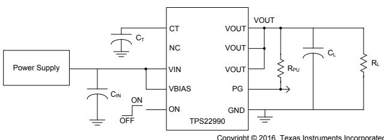

The diagram shows a typical application circuit for the TPS22990. A Power Supply drives the VIN pin, which is tied to the VBIAS pin, with an input capacitor  $C_{IN}$  to ground. The CT pin is connected to a capacitor  $C_T$  to ground. The NC pin is unconnected. The ON pin is driven by an ON/OFF signal. The three VOUT pins are tied together and connected to a load capacitor  $C_L$  and a load resistor  $R_L$  to ground. The PG pin is pulled up to VOUT through the resistor  $R_{PU}$ . The GND pin is connected to ground.

Typical Application circuit diagram showing Power Supply, CT, VIN, VBIAS, ON/OFF, PG, and load switch with Rpu, C\_L, and R\_L.

Copyright © 2016, Texas Instruments Incorporated

On-Resistance vs Input Voltage

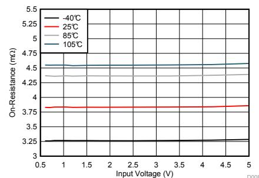

The graph plots On-Resistance (mΩ) on the y-axis (ranging from 3 to 5.5) against Input Voltage (V) on the x-axis (ranging from 0.5 to 5). Four curves are shown for different temperatures: -40°C (black), 25°C (red), 85°C (gray), and 105°C (blue). The resistance is relatively constant across the input voltage range, with higher temperatures resulting in slightly higher on-resistance values.

On-Resistance vs Input Voltage graph showing On-Resistance (mΩ) vs Input Voltage (V) for temperatures -40°C, 25°C, 85°C, and 105°C.

$V_{BIAS} = 5\text{ V}$ ,  $I_{OUT} = -200\text{ mA}$

Important Notice icon

{1}------------------------------------------------

## Table of Contents

|          |                                                                |           |           |                                                               |           |
|----------|----------------------------------------------------------------|-----------|-----------|---------------------------------------------------------------|-----------|
| <b>1</b> | <b>Features .....</b>                                          | <b>1</b>  | 9.2       | Functional Block Diagram .....                                | 16        |
| <b>2</b> | <b>Applications .....</b>                                      | <b>1</b>  | 9.3       | Feature Description .....                                     | 16        |
| <b>3</b> | <b>Description .....</b>                                       | <b>1</b>  | 9.4       | Device Functional Modes .....                                 | 18        |
| <b>4</b> | <b>Revision History .....</b>                                  | <b>2</b>  | <b>10</b> | <b>Application and Implementation .....</b>                   | <b>19</b> |
| <b>5</b> | <b>Device Comparison Table .....</b>                           | <b>3</b>  | 10.1      | Application Information .....                                 | 19        |
| <b>6</b> | <b>Pin Configuration and Functions .....</b>                   | <b>3</b>  | 10.2      | Typical Application .....                                     | 22        |
| <b>7</b> | <b>Specifications .....</b>                                    | <b>4</b>  | <b>11</b> | <b>Power Supply Recommendations .....</b>                     | <b>25</b> |
|          | 7.1 Absolute Maximum Ratings .....                             | 4         | <b>12</b> | <b>Layout .....</b>                                           | <b>25</b> |
|          | 7.2 ESD Ratings .....                                          | 4         | 12.1      | Layout Guidelines .....                                       | 25        |
|          | 7.3 Recommended Operating Conditions .....                     | 4         | 12.2      | Layout Example .....                                          | 25        |
|          | 7.4 Thermal Information .....                                  | 5         | <b>13</b> | <b>Device and Documentation Support .....</b>                 | <b>26</b> |
|          | 7.5 Electrical Characteristics—V BIAS = 5 V .....   | 5         | 13.1      | Documentation Support .....                                   | 26        |
|          | 7.6 Electrical Characteristics—V BIAS = 3.3 V ..... | 6         | 13.2      | Receiving Notification of Documentation Updates .....         | 26        |
|          | 7.7 Switching Characteristics .....                            | 7         | 13.3      | Community Resources .....                                     | 26        |
|          | 7.8 Typical Characteristics .....                              | 9         | 13.4      | Trademarks .....                                              | 26        |
| <b>8</b> | <b>Parameter Measurement Information .....</b>                 | <b>15</b> | 13.5      | Electrostatic Discharge Caution .....                         | 26        |
| <b>9</b> | <b>Detailed Description .....</b>                              | <b>16</b> | 13.6      | Glossary .....                                                | 26        |
|          | 9.1 Overview .....                                             | 16        | <b>14</b> | <b>Mechanical, Packaging, and Orderable Information .....</b> | <b>26</b> |

## 4 Revision History

| Changes from Revision B (September 2016) to Revision C                                                                      | Page |
|-----------------------------------------------------------------------------------------------------------------------------|------|
| • Updated V IH in <i>Recommended Operating Conditions</i> .....                                                  | 4    |
| Changes from Revision A (July 2016) to Revision B                                                                           | Page |
| • Removed the status column from <i>Device Comparison Table</i> .....                                                       | 3    |
| • Added the comment "(TPS22990 Only)" to the "R PD " cell in both <i>Electrical Characteristics</i> tables ..... | 7    |
| Changes from Original (May 2016) to Revision A                                                                              | Page |
| • Changed device status from <i>Product Preview</i> to <i>Production Data</i> .....                                         | 1    |

{2}------------------------------------------------

## 5 Device Comparison Table

| DEVICE    | R ON at V BIAS = 5 V | QOD | I MAX | ENABLE      |
|-----------|--------------------------------------------|-----|------------------|-------------|
| TPS22990  | 3.9 mΩ                                     | Yes | 10 A             | Active high |
| TPS22990N | 3.9 mΩ                                     | No  | 10 A             | Active high |

## 6 Pin Configuration and Functions

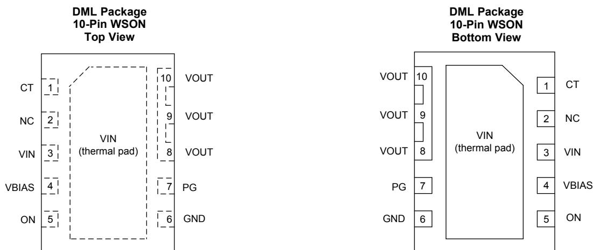

**DML Package 10-Pin WSON Top View**

**DML Package 10-Pin WSON Bottom View**

Pinout diagrams for DML Package 10-Pin WSON. Top View: pins 1 CT, 2 NC, 3 VIN, 4 VBIAS, 5 ON down the left side; pins 6 GND, 7 PG, 8 VOUT, 9 VOUT, 10 VOUT up the right side; the center pad is labeled VIN (thermal pad), drawn dashed with a chamfered corner next to pin 1. Bottom View: the same pins mirrored (pins 1-5 CT, NC, VIN, VBIAS, ON on the right side, pins 6-10 GND, PG, VOUT, VOUT, VOUT on the left side) around the VIN (thermal pad).

**Pin Functions**

| PIN |                   | TYPE | DESCRIPTION                                                                                                                                      |
|-----|-------------------|------|--------------------------------------------------------------------------------------------------------------------------------------------------|
| NO. | NAME              |      |                                                                                                                                                  |
| 1   | CT                | O    | VOUT slew rate control                                                                                                                           |
| 2   | NC                | —    | Not internally connected                                                                                                                         |
| 3   | VIN               | I    | Switch input. Bypass this input with a ceramic capacitor to GND                                                                                  |
| 4   | VBIAS             | P    | Bias voltage. Power supply to the device                                                                                                         |
| 5   | ON                | I    | Active high switch control input. Do not leave floating                                                                                          |
| 6   | GND               | GND  | Device ground                                                                                                                                    |
| 7   | PG                | O    | Power good. Active high, open drain output. Tie to GND if not used                                                                               |
| 8   | VOUT              | O    | Switch output                                                                                                                                    |
| 9   | VOUT              | O    | Switch output                                                                                                                                    |
| 10  | VOUT              | O    | Switch output                                                                                                                                    |
| —   | VIN (Thermal Pad) | I    | Switch input. VIN and thermal pad (exposed center pad) to alleviate thermal stress. See the <a href="#">Layout</a> section for layout guidelines |

{3}------------------------------------------------

## 7 Specifications

### 7.1 Absolute Maximum Ratings

over operating free-air temperature range (unless otherwise noted)(1)

|                   |                                                              | MIN  | MAX | UNIT |
|-------------------|--------------------------------------------------------------|------|-----|------|
| V IN   | Input voltage                                                | –0.3 | 6   | V    |
| V BIAS | Bias voltage                                                 | –0.3 | 6   | V    |
| V OUT  | Output voltage                                               | –0.3 | 6   | V    |
| V ON   | ON voltage                                                   | –0.3 | 6   | V    |
| V PG   | PG voltage                                                   | –0.3 | 6   | V    |
| V CT   | CT voltage                                                   | –0.3 | 15  | V    |
| I MAX  | Maximum continuous switch current at T J = 125°C  |      | 10  | A    |
| I PLS  | Maximum pulsed switch current, pulse < 300 µs, 2% duty cycle |      | 12  | A    |
| T J    | Maximum junction temperature                                 |      | 125 | °C   |
| T LEAD | Maximum lead temperature (10-s soldering time)               |      | 300 | °C   |
| T stg  | Storage temperature                                          | –65  | 150 | °C   |

- (1) Stresses beyond those listed under *Absolute Maximum Ratings* may cause permanent damage to the device. These are stress ratings only, which do not imply functional operation of the device at these or any other conditions beyond those indicated under *Recommended Operating Conditions*. Exposure to absolute-maximum-rated conditions for extended periods may affect device reliability.

### 7.2 ESD Ratings

|                    |                         |                                                                                | VALUE | UNIT |
|--------------------|-------------------------|--------------------------------------------------------------------------------|-------|------|
| V (ESD) | Electrostatic discharge | Human-body model (HBM), per ANSI/ESDA/JEDEC JS-001 (1)              | ±2000 | V    |
|                    |                         | Charged-device model (CDM), per JEDEC specification JESD22-C101 (2) | ±1000 |      |

- (1) JEDEC document JEP155 states that 500-V HBM allows safe manufacturing with a standard ESD control process.  
(2) JEDEC document JEP157 states that 250-V CDM allows safe manufacturing with a standard ESD control process.

### 7.3 Recommended Operating Conditions

over operating free-air temperature range (unless otherwise noted)

|                     |                                |                                                            | MIN              | MAX               | UNIT |
|---------------------|--------------------------------|------------------------------------------------------------|------------------|-------------------|------|
| V IN     | Input voltage                  |                                                            | 0.6              | V BIAS | V    |
| V BIAS   | Bias voltage                   |                                                            | 2.5              | 5.5               | V    |
| V OUT    | Output voltage                 |                                                            |                  | VIN               | V    |
| V ON     | ON voltage                     |                                                            | 0                | 5.5               | V    |
| V PG     | PG voltage                     |                                                            | 0                | 5.5               | V    |
| V IH, ON | High-level input voltage, ON   | V BIAS = 2.5 V to 5 V, T A < 85°C    | 1.05             | 5.5               | V    |
|                     |                                | V BIAS = 2.5 V to 5.5 V, T A < 105°C | 1.2              | 5.5               |      |
| V IL, ON | Low-level input voltage, ON    |                                                            | 0                | 0.5               | V    |
| C IN     | Input capacitor                |                                                            | 1 (1) |                   | µF   |
| T A      | Operating free-air temperature |                                                            | –40              | 105               | °C   |

- (1) See the [Application Information](#) section.

{4}------------------------------------------------

### 7.4 Thermal Information

| THERMAL METRIC (1) |                                              | TPS22990   | UNIT |
|-------------------------------|----------------------------------------------|------------|------|
|                               |                                              | DML (WSON) |      |
|                               |                                              | 10 PINS    |      |
| R θJA              | Junction-to-ambient thermal resistance       | 51.4       | °C/W |
| R θJC(top)         | Junction-to-case (top) thermal resistance    | 65         | °C/W |
| R θJB              | Junction-to-board thermal resistance         | 17         | °C/W |
| ψ JT               | Junction-to-top characterization parameter   | 2.1        | °C/W |
| ψ JB               | Junction-to-board characterization parameter | 17         | °C/W |
| R θJC(bot)         | Junction-to-case (bottom) thermal resistance | 3.7        | °C/W |

(1) For more information about traditional and new thermal metrics, see the [Semiconductor and IC Package Thermal Metrics](#) application report.

### 7.5 Electrical Characteristics—VBIAS = 5 V

Unless otherwise noted, the specification in the following table applies over the operating ambient temp –40°C ≤ TA ≤ +105°C (full) and VBIAS = 5 V. Typical values are for TA = 25°C (unless otherwise noted).

| PARAMETER                                                 | TEST CONDITIONS                                                    | T A           | MIN             | TYP   | MAX | UNIT |
|-----------------------------------------------------------|--------------------------------------------------------------------|--------------------------|-----------------|-------|-----|------|
| <b>POWER SUPPLIES AND CURRENTS</b>                        |                                                                    |                          |                 |       |     |      |
| I Q, VBIAS V BIAS quiescent current | I OUT = 0 A, V IN = V ON = 5 V | –40°C to +85°C           |                 | 63    | 76  | μA   |
|                                                           |                                                                    | –40°C to +105°C          |                 |       | 77  |      |
| I SD, VBIAS V BIAS shutdown current | V ON = 0 V, V OUT = 0 V                      | –40°C to +85°C           |                 | 5.5   | 7   | μA   |
|                                                           |                                                                    | –40°C to +105°C          |                 |       | 7   |      |
| I SD, VIN V IN shutdown current | V ON = 0 V, V OUT = 0 V, V IN = 5 V | –40°C to +85°C |  | 0.004 | 4 | μA |
|  |  | –40°C to +105°C |  |  | 10 |  |
|  | V IN = 3.3 V | –40°C to +85°C |  | 0.003 | 3 |  |
|  |  | –40°C to +105°C |  |  | 7 |  |
|  | V IN = 2.5 V | –40°C to +85°C |  | 0.002 | 2 |  |
|  |  | –40°C to +105°C |  |  | 5 |  |
|  | V IN = 1.8 V | –40°C to +85°C |  | 0.002 | 2 |  |
|  |  | –40°C to +105°C |  |  | 4 |  |
|  | V IN = 1.05 V | –40°C to +85°C |  | 0.001 | 1 |  |
|  |  | –40°C to +105°C |  |  | 3 |  |
|  | V IN = 0.6 V | –40°C to +85°C |  | 0.001 | 1 |  |
|  |  | –40°C to +105°C |  |  | 2 |  |
| I ON ON pin input leakage current              | V ON = 5.5 V                                            | –40°C to +105°C          |                 |       | 0.1 | μA   |
| V HYS,ON ON pin hysteresis                     | V IN = 5 V                                              | 25°C                     |                 | 123   |     | mV   |
| I PG, LKG Leakage current into PG pin          | V PG = 5 V                                              | –40°C to +105°C          |                 |       | 0.5 | μA   |
| V PG,OL PG output low voltage                  | V ON = 0 V, I PG = 1 mA                      | –40°C to +105°C          |                 |       | 0.2 | V    |
| <b>RESISTANCE CHARACTERISTICS</b>                         |                                                                    |                          |                 |       |     |      |

{5}------------------------------------------------

### Electrical Characteristics— $V_{BIAS} = 5\text{ V}$ (continued)

Unless otherwise noted, the specification in the following table applies over the operating ambient temp  $-40^{\circ}\text{C} \leq T_A \leq +105^{\circ}\text{C}$  (full) and  $V_{BIAS} = 5\text{ V}$ . Typical values are for  $T_A = 25^{\circ}\text{C}$  (unless otherwise noted).

| PARAMETER                                            | TEST CONDITIONS                                            |                          | $T_A$           | MIN | TYP | MAX | UNIT |
|------------------------------------------------------|------------------------------------------------------------|--------------------------|-----------------|-----|-----|-----|------|
| $R_{ON}$ On-state resistance                         | $I_{OUT} = -200\text{ mA}$ , $V_{ON} = 5\text{ V}$      | $V_{IN} = 5\text{ V}$    | 25°C            |     | 3.9 | 4.8 | mΩ   |
|                                                      |                                                            |                          | -40°C to +85°C  |     |     | 5.7 |      |
|                                                      |                                                            |                          | -40°C to +105°C |     |     | 6   |      |
|                                                      |                                                            | $V_{IN} = 3.3\text{ V}$  | 25°C            |     | 3.9 | 4.8 |      |
|                                                      |                                                            |                          | -40°C to +85°C  |     |     | 5.7 |      |
|                                                      |                                                            |                          | -40°C to +105°C |     |     | 6   |      |
|                                                      |                                                            | $V_{IN} = 2.5\text{ V}$  | 25°C            |     | 3.9 | 4.8 |      |
|                                                      |                                                            |                          | -40°C to +85°C  |     |     | 5.7 |      |
|                                                      |                                                            |                          | -40°C to +105°C |     |     | 6   |      |
|                                                      |                                                            | $V_{IN} = 1.8\text{ V}$  | 25°C            |     | 3.9 | 4.8 |      |
|                                                      |                                                            |                          | -40°C to +85°C  |     |     | 5.7 |      |
|                                                      |                                                            |                          | -40°C to +105°C |     |     | 6   |      |
|                                                      |                                                            | $V_{IN} = 1.05\text{ V}$ | 25°C            |     | 3.9 | 4.8 |      |
|                                                      |                                                            |                          | -40°C to +85°C  |     |     | 5.7 |      |
|                                                      |                                                            |                          | -40°C to +105°C |     |     | 6   |      |
|                                                      |                                                            | $V_{IN} = 0.6\text{ V}$  | 25°C            |     | 3.9 | 4.8 |      |
|                                                      |                                                            |                          | -40°C to +85°C  |     |     | 5.7 |      |
|                                                      |                                                            |                          | -40°C to +105°C |     |     | 6   |      |
| $R_{PD}$ Output pull-down resistance (TPS22990 Only) | $V_{IN} = V_{OUT} = 5\text{ V}$ , $V_{ON} = 0\text{ V}$ |                          | -40°C to +105°C |     | 218 | 253 | Ω    |

### 7.6 Electrical Characteristics— $V_{BIAS} = 3.3\text{ V}$

Unless otherwise noted, the specification in the following table applies over the operating ambient temp  $-40^{\circ}\text{C} \leq T_A \leq +105^{\circ}\text{C}$  (full) and  $V_{BIAS} = 3.3\text{ V}$ . Typical values are for  $T_A = 25^{\circ}\text{C}$  (unless otherwise noted).

| PARAMETER                                   | TEST CONDITIONS                                              |                          | $T_A$           | MIN | TYP   | MAX | UNIT |
|---------------------------------------------|--------------------------------------------------------------|--------------------------|-----------------|-----|-------|-----|------|
| <b>POWER SUPPLIES AND CURRENTS</b>          |                                                              |                          |                 |     |       |     |      |
| $I_{Q, VBIAS}$ $V_{BIAS}$ quiescent current | $I_{OUT} = 0\text{ A}$ , $V_{IN} = V_{ON} = 3.3\text{ V}$ |                          | -40°C to +85°C  |     | 48    | 58  | μA   |
|                                             |                                                              |                          | -40°C to +105°C |     |       | 59  |      |
| $I_{SD, VBIAS}$ $V_{BIAS}$ shutdown current | $V_{ON} = 0\text{ V}$ , $V_{OUT} = 0\text{ V}$               |                          | -40°C to +85°C  |     | 4.5   | 6   | μA   |
|                                             |                                                              |                          | -40°C to +105°C |     |       | 7   |      |
| $I_{SD, VIN}$ $V_{IN}$ shutdown current     | $V_{ON} = 0\text{ V}$ , $V_{OUT} = 0\text{ V}$            | $V_{IN} = 3.3\text{ V}$  | -40°C to +85°C  |     | 0.003 | 3   | μA   |
|                                             |                                                              |                          | -40°C to +105°C |     |       | 7   |      |
|                                             |                                                              | $V_{IN} = 2.5\text{ V}$  | -40°C to +85°C  |     | 0.002 | 2   |      |
|                                             |                                                              |                          | -40°C to +105°C |     |       | 5   |      |
|                                             |                                                              | $V_{IN} = 1.8\text{ V}$  | -40°C to +85°C  |     | 0.002 | 2   |      |
|                                             |                                                              |                          | -40°C to +105°C |     |       | 4   |      |
|                                             |                                                              | $V_{IN} = 1.05\text{ V}$ | -40°C to +85°C  |     | 0.001 | 1   |      |
|                                             |                                                              |                          | -40°C to +105°C |     |       | 3   |      |
|                                             |                                                              | $V_{IN} = 0.6\text{ V}$  | -40°C to +85°C  |     | 0.001 | 1   |      |
|                                             |                                                              |                          | -40°C to +105°C |     |       | 2   |      |
| $I_{ON}$ ON pin input leakage current       | $V_{ON} = 5.5\text{ V}$                                      |                          | -40°C to +105°C |     |       | 0.1 | μA   |
| $V_{HYS,ON}$ ON pin hysteresis              | $V_{IN} = 3.3\text{ V}$                                      |                          | 25°C            |     | 100   |     | mV   |
| $I_{PG, LKG}$ Leakage current into PG pin   | $V_{PG} = 5\text{ V}$                                        |                          | -40°C to +105°C |     |       | 0.5 | μA   |
| $V_{PG,OL}$ PG output low voltage           | $V_{ON} = 0\text{ V}$ , $I_{PG} = 1\text{ mA}$               |                          | -40°C to +105°C |     |       | 0.2 | V    |
| <b>RESISTANCE CHARACTERISTICS</b>           |                                                              |                          |                 |     |       |     |      |

{6}------------------------------------------------

### Electrical Characteristics— $V_{BIAS} = 3.3\text{ V}$ (continued)

Unless otherwise noted, the specification in the following table applies over the operating ambient temp  $-40^{\circ}\text{C} \leq T_A \leq +105^{\circ}\text{C}$  (full) and  $V_{BIAS} = 3.3\text{ V}$ . Typical values are for  $T_A = 25^{\circ}\text{C}$  (unless otherwise noted).

| PARAMETER                                               | TEST CONDITIONS                                             |                          | $T_A$           | MIN | TYP | MAX | UNIT |
|---------------------------------------------------------|-------------------------------------------------------------|--------------------------|-----------------|-----|-----|-----|------|
| $R_{ON}$ On-state resistance                            | $I_{OUT} = -200\text{ mA},$ $V_{ON} = 5\text{ V}$        | $V_{IN} = 3.3\text{ V}$  | 25°C            |     | 3.9 | 4.8 | mΩ   |
|                                                         |                                                             |                          | -40°C to +85°C  |     |     | 5.7 |      |
|                                                         |                                                             |                          | -40°C to +105°C |     |     | 6   |      |
|                                                         |                                                             | $V_{IN} = 2.5\text{ V}$  | 25°C            |     | 3.9 | 4.8 |      |
|                                                         |                                                             |                          | -40°C to +85°C  |     |     | 5.7 |      |
|                                                         |                                                             |                          | -40°C to +105°C |     |     | 6   |      |
|                                                         |                                                             | $V_{IN} = 1.8\text{ V}$  | 25°C            |     | 3.9 | 4.8 |      |
|                                                         |                                                             |                          | -40°C to +85°C  |     |     | 5.7 |      |
|                                                         |                                                             |                          | -40°C to +105°C |     |     | 6   |      |
|                                                         |                                                             | $V_{IN} = 1.05\text{ V}$ | 25°C            |     | 3.9 | 4.8 |      |
|                                                         |                                                             |                          | -40°C to +85°C  |     |     | 5.7 |      |
|                                                         |                                                             |                          | -40°C to +105°C |     |     | 6   |      |
|                                                         |                                                             | $V_{IN} = 0.6\text{ V}$  | 25°C            |     | 3.9 | 4.8 |      |
|                                                         |                                                             |                          | -40°C to +85°C  |     |     | 5.7 |      |
|                                                         |                                                             |                          | -40°C to +105°C |     |     | 6   |      |
| $R_{PD}$ Output pull-down resistance (TPS22990 Only) | $V_{IN} = V_{OUT} = 3.3\text{ V},$ $V_{ON} = 0\text{ V}$ |                          | -40°C to +105°C |     | 219 | 256 | Ω    |

### 7.7 Switching Characteristics

over operating free-air temperature range (unless otherwise noted)

| PARAMETER (1)                                                                                                      | TEST CONDITIONS                                                                                          | MIN | TYP | MAX | UNIT |
|-------------------------------------------------------------------------------------------------------------------------------|----------------------------------------------------------------------------------------------------------|-----|-----|-----|------|
| <b><math>V_{IN} = 5\text{ V}, V_{ON} = V_{BIAS} = 5\text{ V}, T_A = 25^{\circ}\text{C}</math> (unless otherwise noted)</b>    |                                                                                                          |     |     |     |      |
| $t_{ON}$ Turnon time                                                                                                          | $R_L = 10\text{ Ω}, C_L = 0.1\text{ μF}, C_T = 0\text{ pF}, R_{PU} = 10\text{ kΩ}, C_{IN} = 1\text{ μF}$ |     | 34  |     | μs   |
| $t_{OFF}$ Turnoff time                                                                                                        | $R_L = 10\text{ Ω}, C_L = 0.1\text{ μF}, C_T = 0\text{ pF}, R_{PU} = 10\text{ kΩ}, C_{IN} = 1\text{ μF}$ |     | 5.4 |     |      |
| $t_R$ VOUT rise time                                                                                                          | $R_L = 10\text{ Ω}, C_L = 0.1\text{ μF}, C_T = 0\text{ pF}, R_{PU} = 10\text{ kΩ}, C_{IN} = 1\text{ μF}$ |     | 31  |     |      |
| $t_F$ VOUT fall time                                                                                                          | $R_L = 10\text{ Ω}, C_L = 0.1\text{ μF}, C_T = 0\text{ pF}, R_{PU} = 10\text{ kΩ}, C_{IN} = 1\text{ μF}$ |     | 2.3 |     |      |
| $t_D$ ON delay time                                                                                                           | $R_L = 10\text{ Ω}, C_L = 0.1\text{ μF}, C_T = 0\text{ pF}, R_{PU} = 10\text{ kΩ}, C_{IN} = 1\text{ μF}$ |     | 21  |     |      |
| $t_{PG,ON}$ PG turnon time                                                                                                    | $R_L = 10\text{ Ω}, C_L = 0.1\text{ μF}, C_T = 0\text{ pF}, R_{PU} = 10\text{ kΩ}, C_{IN} = 1\text{ μF}$ |     | 152 |     |      |
| $t_{PG,OFF}$ PG turnoff time                                                                                                  | $R_L = 10\text{ Ω}, C_L = 0.1\text{ μF}, C_T = 0\text{ pF}, R_{PU} = 10\text{ kΩ}, C_{IN} = 1\text{ μF}$ |     | 1.3 |     |      |
| <b><math>V_{IN} = 1.05\text{ V}, V_{ON} = V_{BIAS} = 5\text{ V}, T_A = 25^{\circ}\text{C}</math> (unless otherwise noted)</b> |                                                                                                          |     |     |     |      |
| $t_{ON}$ Turnon time                                                                                                          | $R_L = 10\text{ Ω}, C_L = 0.1\text{ μF}, C_T = 0\text{ pF}, R_{PU} = 10\text{ kΩ}, C_{IN} = 1\text{ μF}$ |     | 30  |     | μs   |
| $t_{OFF}$ Turnoff time                                                                                                        | $R_L = 10\text{ Ω}, C_L = 0.1\text{ μF}, C_T = 0\text{ pF}, R_{PU} = 10\text{ kΩ}, C_{IN} = 1\text{ μF}$ |     | 8   |     |      |
| $t_R$ VOUT rise time                                                                                                          | $R_L = 10\text{ Ω}, C_L = 0.1\text{ μF}, C_T = 0\text{ pF}, R_{PU} = 10\text{ kΩ}, C_{IN} = 1\text{ μF}$ |     | 13  |     |      |
| $t_F$ VOUT fall time                                                                                                          | $R_L = 10\text{ Ω}, C_L = 0.1\text{ μF}, C_T = 0\text{ pF}, R_{PU} = 10\text{ kΩ}, C_{IN} = 1\text{ μF}$ |     | 2.2 |     |      |
| $t_D$ ON delay time                                                                                                           | $R_L = 10\text{ Ω}, C_L = 0.1\text{ μF}, C_T = 0\text{ pF}, R_{PU} = 10\text{ kΩ}, C_{IN} = 1\text{ μF}$ |     | 24  |     |      |
| $t_{PG,ON}$ PG turnon time                                                                                                    | $R_L = 10\text{ Ω}, C_L = 0.1\text{ μF}, C_T = 0\text{ pF}, R_{PU} = 10\text{ kΩ}, C_{IN} = 1\text{ μF}$ |     | 134 |     |      |
| $t_{PG,OFF}$ PG turnoff time                                                                                                  | $R_L = 10\text{ Ω}, C_L = 0.1\text{ μF}, C_T = 0\text{ pF}, R_{PU} = 10\text{ kΩ}, C_{IN} = 1\text{ μF}$ |     | 1.3 |     |      |
| <b><math>V_{IN} = 0.6\text{ V}, V_{ON} = V_{BIAS} = 5\text{ V}, T_A = 25^{\circ}\text{C}</math> (unless otherwise noted)</b>  |                                                                                                          |     |     |     |      |
| $t_{ON}$ Turnon time                                                                                                          | $R_L = 10\text{ Ω}, C_L = 0.1\text{ μF}, C_T = 0\text{ pF}, R_{PU} = 10\text{ kΩ}, C_{IN} = 1\text{ μF}$ |     | 29  |     | μs   |
| $t_{OFF}$ Turnoff time                                                                                                        | $R_L = 10\text{ Ω}, C_L = 0.1\text{ μF}, C_T = 0\text{ pF}, R_{PU} = 10\text{ kΩ}, C_{IN} = 1\text{ μF}$ |     | 8.8 |     |      |
| $t_R$ VOUT rise time                                                                                                          | $R_L = 10\text{ Ω}, C_L = 0.1\text{ μF}, C_T = 0\text{ pF}, R_{PU} = 10\text{ kΩ}, C_{IN} = 1\text{ μF}$ |     | 10  |     |      |
| $t_F$ VOUT fall time                                                                                                          | $R_L = 10\text{ Ω}, C_L = 0.1\text{ μF}, C_T = 0\text{ pF}, R_{PU} = 10\text{ kΩ}, C_{IN} = 1\text{ μF}$ |     | 2.2 |     |      |
| $t_D$ ON delay time                                                                                                           | $R_L = 10\text{ Ω}, C_L = 0.1\text{ μF}, C_T = 0\text{ pF}, R_{PU} = 10\text{ kΩ}, C_{IN} = 1\text{ μF}$ |     | 24  |     |      |
| $t_{PG,ON}$ PG turnon time                                                                                                    | $R_L = 10\text{ Ω}, C_L = 0.1\text{ μF}, C_T = 0\text{ pF}, R_{PU} = 10\text{ kΩ}, C_{IN} = 1\text{ μF}$ |     | 131 |     |      |
| $t_{PG,OFF}$ PG turnoff time                                                                                                  | $R_L = 10\text{ Ω}, C_L = 0.1\text{ μF}, C_T = 0\text{ pF}, R_{PU} = 10\text{ kΩ}, C_{IN} = 1\text{ μF}$ |     | 1.3 |     |      |

(1) Turnoff time and fall time are dependent on the time constant at the load. For TPS22990N, there is no QOD. The time constant is  $R_L \times C_L$ . For TPS22990, internal pull down  $R_{PD}$  is enabled when the switch is disabled. The time constant is  $(R_{PD} // R_L) \times C_L$ .

{7}------------------------------------------------

### Switching Characteristics (continued)

over operating free-air temperature range (unless otherwise noted)

| PARAMETER (1)                                                                                                      |                 | TEST CONDITIONS                                                                                                        | MIN | TYP | MAX | UNIT |
|-------------------------------------------------------------------------------------------------------------------------------|-----------------|------------------------------------------------------------------------------------------------------------------------|-----|-----|-----|------|
| <b>VIN = 3.3 V, VON = 5 V, VBIAS = 3.3 V, TA = 25°C (unless otherwise noted)</b>  |                 |                                                                                                                        |     |     |     |      |
| t ON                                                                                                               | Turnon time     | R L = 10 Ω, C L = 0.1 µF, C T = 0 pF, R PU = 10 kΩ, C IN = 1 µF |     | 33  |     | µs   |
| t OFF                                                                                                              | Turnoff time    | R L = 10 Ω, C L = 0.1 µF, C T = 0 pF, R PU = 10 kΩ, C IN = 1 µF |     | 6.2 |     |      |
| t R                                                                                                                | VOUT rise time  | R L = 10 Ω, C L = 0.1 µF, C T = 0 pF, R PU = 10 kΩ, C IN = 1 µF |     | 24  |     |      |
| t F                                                                                                                | VOUT fall time  | R L = 10 Ω, C L = 0.1 µF, C T = 0 pF, R PU = 10 kΩ, C IN = 1 µF |     | 2.4 |     |      |
| t D                                                                                                                | ON delay time   | R L = 10 Ω, C L = 0.1 µF, C T = 0 pF, R PU = 10 kΩ, C IN = 1 µF |     | 22  |     |      |
| t PG,ON                                                                                                            | PG turnon time  | R L = 10 Ω, C L = 0.1 µF, C T = 0 pF, R PU = 10 kΩ, C IN = 1 µF |     | 132 |     |      |
| t PG,OFF                                                                                                           | PG turnoff time | R L = 10 Ω, C L = 0.1 µF, C T = 0 pF, R PU = 10 kΩ, C IN = 1 µF |     | 1.5 |     |      |
| <b>VIN = 1.05 V, VON = 5 V, VBIAS = 3.3 V, TA = 25°C (unless otherwise noted)</b> |                 |                                                                                                                        |     |     |     |      |
| t ON                                                                                                               | Turnon time     | R L = 10 Ω, C L = 0.1 µF, C T = 0 pF, R PU = 10 kΩ, C IN = 1 µF |     | 30  |     | µs   |
| t OFF                                                                                                              | Turnoff time    | R L = 10 Ω, C L = 0.1 µF, C T = 0 pF, R PU = 10 kΩ, C IN = 1 µF |     | 8.7 |     |      |
| t R                                                                                                                | VOUT rise time  | R L = 10 Ω, C L = 0.1 µF, C T = 0 pF, R PU = 10 kΩ, C IN = 1 µF |     | 12  |     |      |
| t F                                                                                                                | VOUT fall time  | R L = 10 Ω, C L = 0.1 µF, C T = 0 pF, R PU = 10 kΩ, C IN = 1 µF |     | 2.3 |     |      |
| t D                                                                                                                | ON delay time   | R L = 10 Ω, C L = 0.1 µF, C T = 0 pF, R PU = 10 kΩ, C IN = 1 µF |     | 24  |     |      |
| t PG,ON                                                                                                            | PG turnon time  | R L = 10 Ω, C L = 0.1 µF, C T = 0 pF, R PU = 10 kΩ, C IN = 1 µF |     | 122 |     |      |
| t PG,OFF                                                                                                           | PG turnoff time | R L = 10 Ω, C L = 0.1 µF, C T = 0 pF, R PU = 10 kΩ, C IN = 1 µF |     | 1.5 |     |      |
| <b>VIN = 0.6 V, VON = 5 V, VBIAS = 3.3 V, TA = 25°C (unless otherwise noted)</b>  |                 |                                                                                                                        |     |     |     |      |
| t ON                                                                                                               | Turnon time     | R L = 10 Ω, C L = 0.1 µF, C T = 0 pF, R PU = 10 kΩ, C IN = 1 µF |     | 30  |     | µs   |
| t OFF                                                                                                              | Turnoff time    | R L = 10 Ω, C L = 0.1 µF, C T = 0 pF, R PU = 10 kΩ, C IN = 1 µF |     | 9.4 |     |      |
| t R                                                                                                                | VOUT rise time  | R L = 10 Ω, C L = 0.1 µF, C T = 0 pF, R PU = 10 kΩ, C IN = 1 µF |     | 9   |     |      |
| t F                                                                                                                | VOUT fall time  | R L = 10 Ω, C L = 0.1 µF, C T = 0 pF, R PU = 10 kΩ, C IN = 1 µF |     | 2.3 |     |      |
| t D                                                                                                                | ON delay time   | R L = 10 Ω, C L = 0.1 µF, C T = 0 pF, R PU = 10 kΩ, C IN = 1 µF |     | 25  |     |      |
| t PG,ON                                                                                                            | PG turnon time  | R L = 10 Ω, C L = 0.1 µF, C T = 0 pF, R PU = 10 kΩ, C IN = 1 µF |     | 119 |     |      |
| t PG,OFF                                                                                                           | PG turnoff time | R L = 10 Ω, C L = 0.1 µF, C T = 0 pF, R PU = 10 kΩ, C IN = 1 µF |     | 1.5 |     |      |

{8}------------------------------------------------

### 7.8 Typical Characteristics

Figure 1: Quiescent Current vs Bias Voltage. A line graph showing Quiescent Current (µA) on the y-axis (36 to 69) versus Bias Voltage (V) on the x-axis (2.4 to 5.7). Four curves are shown for temperatures: -40°C (black), 25°C (red), 85°C (grey), and 105°C (blue). All curves show a positive linear correlation. Test conditions: VON = 5 V, IOUT = 0 A, VIN = VBIAS.

**Figure 1. Quiescent Current vs Bias Voltage**

Figure 2: Bias Shutdown Current vs Bias Voltage. A line graph showing Bias Shutdown Current (µA) on the y-axis (3.75 to 6.75) versus Bias Voltage (V) on the x-axis (2.4 to 5.7). Four curves are shown for temperatures: -40°C (black), 25°C (red), 85°C (grey), and 105°C (blue). All curves show a positive linear correlation. Test conditions: VON = 0 V, VOUT = 0 V, VIN = VBIAS.

**Figure 2. Bias Shutdown Current vs Bias Voltage**

Figure 3: Input Shutdown Current vs Input Voltage. A line graph showing Input Shutdown Current (µA) on the y-axis (-0.05 to 0.35) versus Input Voltage (V) on the x-axis (0.6 to 3.3). Four curves are shown for temperatures: -40°C (black), 25°C (red), 85°C (grey), and 105°C (blue). The 105°C curve shows the highest current, increasing with input voltage. Test conditions: VON = 0 V, VBIAS = 3.3 V, VOUT = 0 V.

**Figure 3. Input Shutdown Current vs Input Voltage**

Figure 4: Input Shutdown Current vs Input Voltage. A line graph showing Input Shutdown Current (µA) on the y-axis (-0.05 to 0.35) versus Input Voltage (V) on the x-axis (0.5 to 5). Four curves are shown for temperatures: -40°C (black), 25°C (red), 85°C (grey), and 105°C (blue). The 105°C curve shows the highest current, increasing with input voltage. Test conditions: VON = 0 V, VBIAS = 5 V, VOUT = 0 V.

**Figure 4. Input Shutdown Current vs Input Voltage**

Figure 5: On-Resistance vs Ambient Temperature. A line graph showing On-Resistance (mΩ) on the y-axis (3 to 4.75) versus Ambient Temperature (°C) on the x-axis (-40 to 100). Six curves are shown for different VIN values: 3.3 V (black), 1.8 V (red), 1.2 V (grey), 1.05 V (blue), 0.8 V (green), and 0.6 V (brown). On-resistance increases with temperature. Test conditions: VON = 5 V, VBIAS = 3.3 V, IOUT = -200mA.

**Figure 5. On-Resistance vs Ambient Temperature**

Figure 6: On-Resistance vs Ambient Temperature. A line graph showing On-Resistance (mΩ) on the y-axis (3 to 4.75) versus Ambient Temperature (°C) on the x-axis (-40 to 100). Six curves are shown for different VIN values: 5 V (black), 3.3 V (red), 2.5 V (grey), 1.8 V (blue), 1.05 V (green), and 0.6 V (brown). On-resistance increases with temperature. Test conditions: VON = 5 V, VBIAS = 5 V, IOUT = -200mA.

**Figure 6. On-Resistance vs Ambient Temperature**

{9}------------------------------------------------

### **Typical Characteristics (continued)**

Figure 7: On-Resistance vs Input Voltage. A line graph showing On-Resistance (mΩ) on the y-axis (3.25 to 5.5) versus Input Voltage (V) on the x-axis (0.6 to 3.3). Four curves are shown for temperatures: -40°C (black), 25°C (red), 85°C (grey), and 105°C (blue). The 105°C curve is the highest, followed by 85°C, 25°C, and -40°C. All curves show a slight upward trend as input voltage increases. Test conditions: VON = 5 V, VBIAS = 3.3 V, IOUT = -200mA.

**Figure 7. On-Resistance vs Input Voltage**

Figure 8: On-Resistance vs Input Voltage. A line graph showing On-Resistance (mΩ) on the y-axis (3 to 5.5) versus Input Voltage (V) on the x-axis (0.5 to 5). Four curves are shown for temperatures: -40°C (black), 25°C (red), 85°C (grey), and 105°C (blue). The 105°C curve is the highest, followed by 85°C, 25°C, and -40°C. All curves are relatively flat across the input voltage range. Test conditions: VON = 5 V, VBIAS = 5 V, IOUT = -200mA.

**Figure 8. On-Resistance vs Input Voltage**

Figure 9: Output Pull-Down Resistance vs Bias Voltage. A line graph showing Output Pull-Down Resistance (Ω) on the y-axis (217 to 226) versus Bias Voltage (V) on the x-axis (2.4 to 5.7). Four curves are shown for temperatures: -40°C (black), 25°C (red), 85°C (grey), and 105°C (blue). The -40°C curve is the highest, followed by 25°C, 85°C, and 105°C. All curves are relatively flat across the bias voltage range. Test conditions: VON = 0 V, VOUT = VIN = 1.05 V.

**Figure 9. Output Pull-Down Resistance vs Bias Voltage**

Figure 10: High-Level Input Voltage vs Bias Voltage. A line graph showing High-Level Input Voltage (V) on the y-axis (0.775 to 1.05) versus Bias Voltage (V) on the x-axis (2.4 to 5.7). Four curves are shown for temperatures: -40°C (black), 25°C (red), 85°C (grey), and 105°C (blue). All curves show a positive linear correlation between bias voltage and high-level input voltage. The 105°C curve is the highest, followed by 85°C, 25°C, and -40°C. Test condition: IOUT = 0 A.

**Figure 10. High-Level Input Voltage vs Bias Voltage**

Figure 11: Low-Level Input Voltage vs Bias Voltage. A line graph showing Low-Level Input Voltage (V) on the y-axis (0.65 to 0.9) versus Bias Voltage (V) on the x-axis (2.4 to 5.7). Four curves are shown for temperatures: -40°C (black), 25°C (red), 85°C (grey), and 105°C (blue). All curves show a positive linear correlation between bias voltage and low-level input voltage. The -40°C curve is the highest, followed by 25°C, 85°C, and 105°C. Test condition: IOUT = 0 A.

**Figure 11. Low-Level Input Voltage vs Bias Voltage**

Figure 12: Hysteresis vs Bias Voltage. A line graph showing Hysteresis (mV) on the y-axis (60 to 150) versus Bias Voltage (V) on the x-axis (2.4 to 5.7). Four curves are shown for temperatures: -40°C (black), 25°C (red), 85°C (grey), and 105°C (blue). All curves show an increasing trend in hysteresis as bias voltage increases. The 105°C curve is the highest, followed by 85°C, 25°C, and -40°C. Test condition: IOUT = 0 A.

**Figure 12. Hysteresis vs Bias Voltage**

{10}------------------------------------------------

### **Typical Characteristics (continued)**

Figure 13: Turnon Time vs Input Voltage. A line graph showing Turnon Time (µs) on the y-axis (22 to 40) versus Input Voltage (V) on the x-axis (0.6 to 3.3). Four curves represent temperatures: -40 °C (black), 25 °C (red), 85 °C (grey), and 105 °C (blue). All curves show an upward trend as input voltage increases. The -40 °C curve is the highest, followed by 25 °C, 85 °C, and 105 °C is the lowest. Test conditions: V\_BIAS = 3.3 V, C\_IN = 1 µF, V\_ON = 5 V, C\_L = 0.1 µF, R\_L = 10 Ω, C\_T = 0 pF.

**Figure 13. Turnon Time vs Input Voltage**

Figure 14: Turnon Time vs Input Voltage. A line graph showing Turnon Time (µs) on the y-axis (20 to 42.5) versus Input Voltage (V) on the x-axis (0.5 to 5). Four curves represent temperatures: -40 °C (black), 25 °C (red), 85 °C (grey), and 105 °C (blue). All curves show an upward trend as input voltage increases. The -40 °C curve is the highest, followed by 25 °C, 85 °C, and 105 °C is the lowest. Test conditions: V\_BIAS = 5 V, C\_IN = 1 µF, V\_ON = 5 V, C\_L = 0.1 µF, R\_L = 10 Ω, C\_T = 0 pF.

**Figure 14. Turnon Time vs Input Voltage**

Figure 15: Turnoff Time vs Input Voltage. A line graph showing Turnoff Time (µs) on the y-axis (5.5 to 10) versus Input Voltage (V) on the x-axis (0.6 to 3.3). Four curves represent temperatures: -40 °C (black), 25 °C (red), 85 °C (grey), and 105 °C (blue). All curves show a downward trend as input voltage increases. The 105 °C curve is the highest, followed by 85 °C, 25 °C, and -40 °C is the lowest. Test conditions: V\_BIAS = 3.3 V, C\_IN = 1 µF, V\_ON = 5 V, C\_L = 0.1 µF, R\_L = 10 Ω, C\_T = 0 pF.

**Figure 15. Turnoff Time vs Input Voltage**

Figure 16: Turnoff Time vs Input Voltage. A line graph showing Turnoff Time (µs) on the y-axis (4.5 to 9.5) versus Input Voltage (V) on the x-axis (0.5 to 5). Four curves represent temperatures: -40 °C (black), 25 °C (red), 85 °C (grey), and 105 °C (blue). All curves show a downward trend as input voltage increases. The 105 °C curve is the highest, followed by 85 °C, 25 °C, and -40 °C is the lowest. Test conditions: V\_BIAS = 5 V, C\_IN = 1 µF, V\_ON = 5 V, C\_L = 0.1 µF, R\_L = 10 Ω, C\_T = 0 pF.

**Figure 16. Turnoff Time vs Input Voltage**

Figure 17: Rise Time vs Input Voltage. A line graph showing Rise Time (µs) on the y-axis (9 to 31) versus Input Voltage (V) on the x-axis (0.6 to 3.3). Four curves represent temperatures: -40 °C (black), 25 °C (red), 85 °C (grey), and 105 °C (blue). All curves show an upward trend as input voltage increases. The -40 °C curve is the highest, followed by 25 °C, 85 °C, and 105 °C is the lowest. Test conditions: V\_BIAS = 3.3 V, C\_IN = 1 µF, V\_ON = 5 V, C\_L = 0.1 µF, R\_L = 10 Ω, C\_T = 0 pF.

**Figure 17. Rise Time vs Input Voltage**

Figure 18: Rise Time vs Input Voltage. A line graph showing Rise Time (µs) on the y-axis (10 to 37.5) versus Input Voltage (V) on the x-axis (0.5 to 5). Four curves represent temperatures: -40 °C (black), 25 °C (red), 85 °C (grey), and 105 °C (blue). All curves show an upward trend as input voltage increases. The -40 °C curve is the highest, followed by 25 °C, 85 °C, and 105 °C is the lowest. Test conditions: V\_BIAS = 5 V, C\_IN = 1 µF, V\_ON = 5 V, C\_L = 0.1 µF, R\_L = 10 Ω, C\_T = 0 pF.

**Figure 18. Rise Time vs Input Voltage**

{11}------------------------------------------------

#### **Typical Characteristics (continued)**

D020

$V_{BIAS} = 3.3\text{ V}$        $V_{ON} = 5\text{ V}$        $C_T = 0\text{ pF}$   
 $C_{IN} = 1\text{ }\mu\text{F}$        $C_L = 0.1\text{ }\mu\text{F}$        $R_L = 10\text{ }\Omega$

Figure 19: Fall Time vs Input Voltage. A line graph showing Fall Time (µs) on the y-axis (1 to 4) versus Input Voltage (V) on the x-axis (0.6 to 3.3). Four curves represent temperatures: -40°C (black), 25°C (red), 85°C (grey), and 105°C (blue). Fall time increases slightly with input voltage and temperature. Test conditions: V\_BIAS = 3.3 V, C\_IN = 1 µF, V\_ON = 5 V, C\_L = 0.1 µF, C\_T = 0 pF, R\_L = 10 Ω.

**Figure 19. Fall Time vs Input Voltage**

D021

$V_{BIAS} = 5\text{ V}$        $V_{ON} = 5\text{ V}$        $C_T = 0\text{ pF}$   
 $C_{IN} = 1\text{ }\mu\text{F}$        $C_L = 0.1\text{ }\mu\text{F}$        $R_L = 10\text{ }\Omega$

Figure 20: Fall Time vs Input Voltage. A line graph showing Fall Time (µs) on the y-axis (1 to 4) versus Input Voltage (V) on the x-axis (0.5 to 5). Four curves represent temperatures: -40°C (black), 25°C (red), 85°C (grey), and 105°C (blue). Fall time is relatively stable across the input voltage range. Test conditions: V\_BIAS = 5 V, C\_IN = 1 µF, V\_ON = 5 V, C\_L = 0.1 µF, C\_T = 0 pF, R\_L = 10 Ω.

**Figure 20. Fall Time vs Input Voltage**

D026

$V_{BIAS} = 3.3\text{ V}$        $V_{ON} = 5\text{ V}$        $C_T = 0\text{ pF}$   
 $R_{PU} = 10\text{ k}\Omega$        $C_L = 0.1\text{ }\mu\text{F}$        $R_L = 10\text{ }\Omega$

Figure 21: PG Turnon Time vs Input Voltage. A line graph showing PG Turnon Time (µs) on the y-axis (120 to 145) versus Input Voltage (V) on the x-axis (0.6 to 3.3). Four curves represent temperatures: -40°C (black), 25°C (red), 85°C (grey), and 105°C (blue). Turnon time increases linearly with input voltage. Test conditions: V\_BIAS = 3.3 V, R\_PU = 10 kΩ, V\_ON = 5 V, C\_L = 0.1 µF, C\_T = 0 pF, R\_L = 10 Ω.

**Figure 21. PG Turnon Time vs Input Voltage**

D027

$V_{BIAS} = 5\text{ V}$        $V_{ON} = 5\text{ V}$        $C_T = 0\text{ pF}$   
 $R_{PU} = 10\text{ k}\Omega$        $C_L = 0.1\text{ }\mu\text{F}$        $R_L = 10\text{ }\Omega$

Figure 22: PG Turnon Time vs Input Voltage. A line graph showing PG Turnon Time (µs) on the y-axis (132 to 165) versus Input Voltage (V) on the x-axis (0.5 to 5). Four curves represent temperatures: -40°C (black), 25°C (red), 85°C (grey), and 105°C (blue). Turnon time increases linearly with input voltage. Test conditions: V\_BIAS = 5 V, R\_PU = 10 kΩ, V\_ON = 5 V, C\_L = 0.1 µF, C\_T = 0 pF, R\_L = 10 Ω.

**Figure 22. PG Turnon Time vs Input Voltage**

D028

$V_{BIAS} = 3.3\text{ V}$        $V_{ON} = 5\text{ V}$        $C_T = 0\text{ pF}$   
 $R_{PU} = 10\text{ k}\Omega$        $C_L = 0.1\text{ }\mu\text{F}$        $R_L = 10\text{ }\Omega$

Figure 23: PG Turnoff Time vs Input Voltage. A line graph showing Turnoff Time (µs) on the y-axis (1 to 2.4) versus Input Voltage (V) on the x-axis (0.6 to 3.3). Four curves represent temperatures: -40°C (black), 25°C (red), 85°C (grey), and 105°C (blue). Turnoff time is relatively constant across the input voltage range. Test conditions: V\_BIAS = 3.3 V, R\_PU = 10 kΩ, V\_ON = 5 V, C\_L = 0.1 µF, C\_T = 0 pF, R\_L = 10 Ω.

**Figure 23. PG Turnoff vs Input Voltage**

D025

$V_{BIAS} = 5\text{ V}$        $V_{ON} = 5\text{ V}$        $C_T = 0\text{ pF}$   
 $R_{PU} = 10\text{ k}\Omega$        $C_L = 0.1\text{ }\mu\text{F}$        $R_L = 10\text{ }\Omega$

Figure 24: PG Turnoff Time vs Input Voltage. A line graph showing PG Turnoff Time (µs) on the y-axis (1 to 2) versus Input Voltage (V) on the x-axis (0.5 to 5). Four curves represent temperatures: -40°C (black), 25°C (red), 85°C (grey), and 105°C (blue). Turnoff time is relatively constant across the input voltage range. Test conditions: V\_BIAS = 5 V, R\_PU = 10 kΩ, V\_ON = 5 V, C\_L = 0.1 µF, C\_T = 0 pF, R\_L = 10 Ω.

**Figure 24. PG Turnoff Time vs Input Voltage**

{12}------------------------------------------------

#### **Typical Characteristics (continued)**

Figure 25: Rise Time vs Input Voltage graph. The graph plots Rise Time (µs) on the y-axis (10 to 37.5) against Input Voltage (V) on the x-axis (0.5 to 5.5). Four curves are shown for different VBIAS values: 2.5 V (black), 3.3 V (red), 5 V (grey), and 5.5 V (blue). The curves show that rise time increases with input voltage and is higher for higher VBIAS values. Test conditions: TA = 25°C, CL = 0.1 µF, CT = 0 pF, CIN = 1 µF, RL = 10 Ω.

**Figure 25. Rise Time vs Input Voltage**

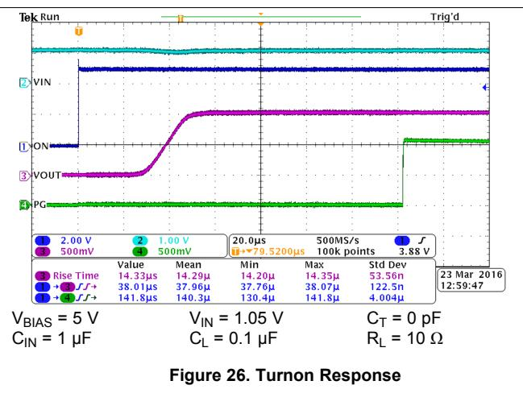

*[AI figure description: measurement table removed (labels/values were mis-transcribed from the scope screenshot). Read values from the image/PDF.]*

Figure 26: Turnon Response oscilloscope trace. The trace shows VIN, VOUT, and PG signals. Test conditions: VBIAS = 5 V, CL = 0.1 µF, CT = 0 pF, CIN = 1 µF, RL = 10 Ω. [Voltage levels and timing values are not transcribed; read them from the image/PDF.]

**Figure 26. Turnon Response**

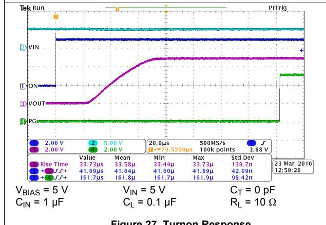

*[AI figure description: measurement table removed (labels/values were mis-transcribed from the scope screenshot). Read values from the image/PDF.]*

Figure 27: Turnon Response oscilloscope trace. Test conditions: VBIAS = 5 V, CL = 0.1 µF, CT = 0 pF, CIN = 1 µF, RL = 10 Ω. [Voltage levels and timing values are not transcribed; read them from the image/PDF.]

**Figure 27. Turnon Response**

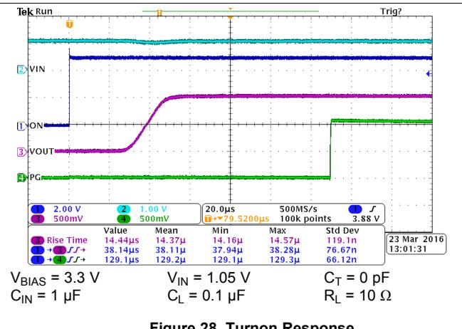

*[AI figure description: measurement table removed (labels/values were mis-transcribed from the scope screenshot). Read values from the image/PDF.]*

Figure 28: Turnon Response oscilloscope trace. Test conditions: VBIAS = 3.3 V, CL = 0.1 µF, CT = 0 pF, CIN = 1 µF, RL = 10 Ω. [Voltage levels and timing values are not transcribed; read them from the image/PDF.]

**Figure 28. Turnon Response**

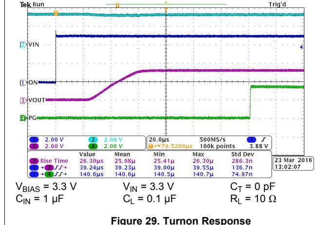

*[AI figure description: measurement table removed (labels/values were mis-transcribed from the scope screenshot). Read values from the image/PDF.]*

Figure 29: Turnon Response oscilloscope trace. Test conditions: VBIAS = 3.3 V, CL = 0.1 µF, CT = 0 pF, CIN = 1 µF, RL = 10 Ω. [Voltage levels and timing values are not transcribed; read them from the image/PDF.]

**Figure 29. Turnon Response**

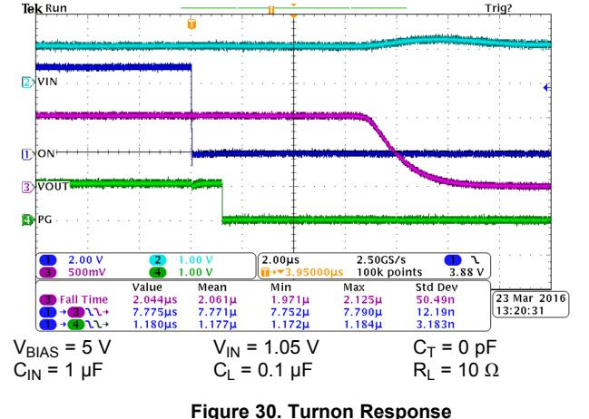

*[AI figure description: measurement table removed (labels/values were mis-transcribed from the scope screenshot). Read values from the image/PDF.]*

Figure 30: Turnon Response oscilloscope trace. Test conditions: VBIAS = 5 V, CL = 0.1 µF, CT = 0 pF, CIN = 1 µF, RL = 10 Ω. [Voltage levels and timing values are not transcribed; read them from the image/PDF.]

**Figure 30. Turnon Response**

{13}------------------------------------------------

#### **Typical Characteristics (continued)**

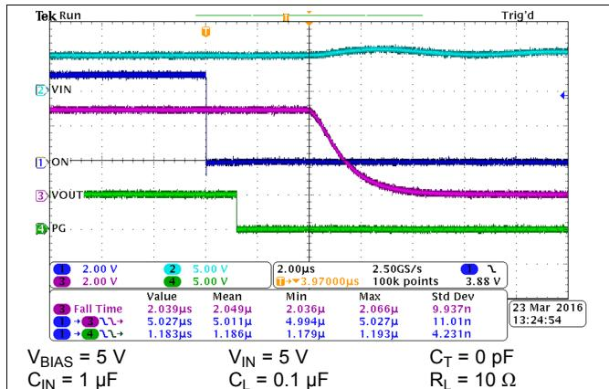

*[AI figure description: measurement table removed (labels/values were mis-transcribed from the scope screenshot). Read values from the image/PDF.]*

$V_{BIAS} = 5\text{ V}$        $V_{IN} = 5\text{ V}$        $C_T = 0\text{ pF}$   
 $C_{IN} = 1\text{ }\mu\text{F}$        $C_L = 0.1\text{ }\mu\text{F}$        $R_L = 10\text{ }\Omega$

Figure 31: Turnoff Response. Oscilloscope screenshot showing VIN, IN, VOUT, and PG signals. [Voltage levels and timing values are not transcribed; read them from the image/PDF.]

**Figure 31. Turnoff Response**

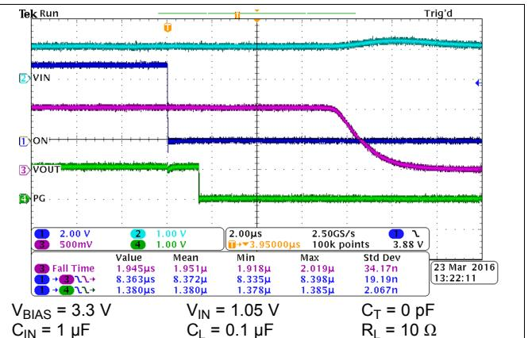

*[AI figure description: measurement table removed (labels/values were mis-transcribed from the scope screenshot). Read values from the image/PDF.]*

$V_{BIAS} = 3.3\text{ V}$        $V_{IN} = 1.05\text{ V}$        $C_T = 0\text{ pF}$   
 $C_{IN} = 1\text{ }\mu\text{F}$        $C_L = 0.1\text{ }\mu\text{F}$        $R_L = 10\text{ }\Omega$

Figure 32: Turnoff Response. Oscilloscope screenshot showing VIN, IN, VOUT, and PG signals. [Voltage levels and timing values are not transcribed; read them from the image/PDF.]

**Figure 32. Turnoff Response**

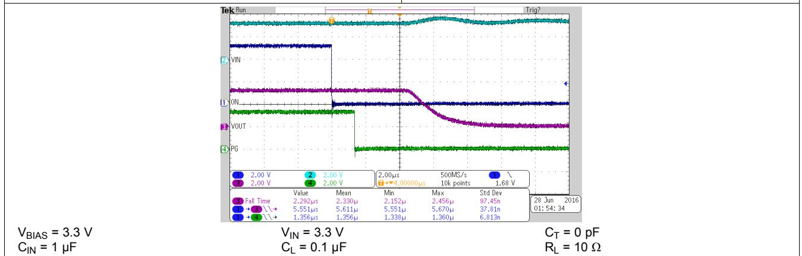

*[AI figure description: measurement table removed (labels/values were mis-transcribed from the scope screenshot). Read values from the image/PDF.]*

$V_{BIAS} = 3.3\text{ V}$        $V_{IN} = 3.3\text{ V}$        $C_T = 0\text{ pF}$   
 $C_{IN} = 1\text{ }\mu\text{F}$        $C_L = 0.1\text{ }\mu\text{F}$        $R_L = 10\text{ }\Omega$

Figure 33: Turnoff Response. Oscilloscope screenshot showing VIN, IN, VOUT, and PG signals. [Voltage levels and timing values are not transcribed; read them from the image/PDF.]

**Figure 33. Turnoff Response**

{14}------------------------------------------------

## 8 Parameter Measurement Information

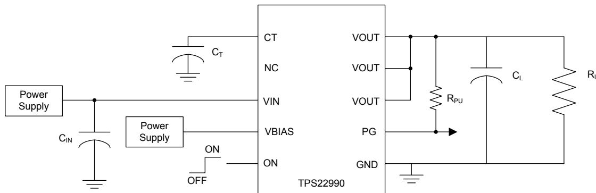

The diagram shows the timing test circuit for the TPS22990. The device is a 10-pin IC with pins labeled: CT, NC, VIN, VBIAS, ON, PG, VOUT (three pins), and GND. The test circuit includes:
 

- A power supply connected to VIN and VBIAS.
- A timing capacitor  $C_T$  connected between CT and GND.
- A switchable power supply connected to the ON pin, with positions for ON and OFF.
- A load network on the VOUT pins consisting of a resistor  $R_{PU}$  in series with a parallel combination of a capacitor  $C_L$  and a resistor  $R_L$ .
- A ground connection for the PG pin.

Timing Test Circuit diagram for TPS22990

Copyright © 2016, Texas Instruments Incorporated

**Figure 34. Timing Test Circuit**

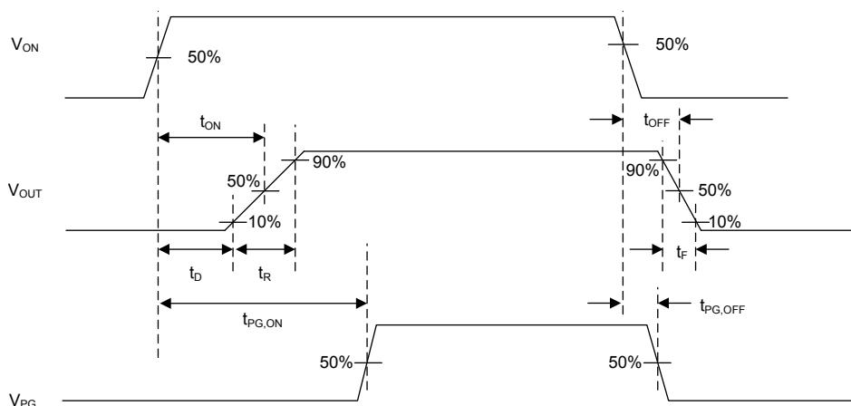

The diagram shows timing waveforms for  $V_{ON}$ ,  $V_{OUT}$ , and  $V_{PG}$ . 
 

- $V_{ON}$  is a square wave with 50% rise/fall times.  $t_{ON}$  is the time from 50% rise to 90% rise.  $t_{OFF}$  is the time from 90% fall to 50% fall.
- $V_{OUT}$  shows turn-on (rise) and turn-off (fall) times. Turn-on:  $t_D$  (delay),  $t_R$  (rise time from 10% to 90%). Turn-off:  $t_F$  (fall time from 90% to 10%).
- $V_{PG}$  is a square wave with 50% rise/fall times.  $t_{PG,ON}$  is the time from  $V_{ON}$  50% rise to  $V_{PG}$  50% rise.  $t_{PG,OFF}$  is the time from  $V_{ON}$  50% fall to  $V_{PG}$  50% fall.

Timing Waveforms diagram for TPS22990

Rise and fall times of the control signals is 100 ns.

**Figure 35. Timing Waveforms**

{15}------------------------------------------------

## 9 Detailed Description

### 9.1 Overview

The TPS22990 device is a single channel load switch with a controlled adjustable turnon and integrated PG indicator. The device contains an N-channel MOSFET that can operate over an input voltage range of 0.6 V to 5.5 V and can support a maximum continuous current of 10 A. The wide input voltage range and high current capability enable the devices to be used across multiple designs and end equipment. 3.9-m $\Omega$  On-resistance minimizes the voltage drop across the load switch and power loss from the load switch.

The controlled rise time for the device greatly reduces inrush current caused by large bulk load capacitances, thereby reducing or eliminating power supply droop. The adjustable slew rate through CT provides the design flexibility to trade off the inrush current and power up timing requirements. Integrated PG indicator notifies the system about the status of the load switch to facilitate seamless power sequencing.

During shutdown, the device has very low leakage current, thereby reducing unnecessary leakages for downstream modules during standby. The TPS22990 has an optional 218- $\Omega$  On-chip resistor for quick discharge of the output when switch is disabled.

### 9.2 Functional Block Diagram

![Functional Block Diagram of the TPS22990 device. The diagram shows the internal components and their connections. On the left, there are pins for VIN, VBIAS, ON, and CT. VIN and VBIAS are connected to a 'Control Logic' block and a 'Charge Pump' block. The 'Control Logic' block also receives input from the ON pin and provides output to a 'Driver' block. The 'Driver' block drives the gate of an N-channel MOSFET. The MOSFET's source is connected to GND, and its drain is connected to the VOUT pin. A 'PG' (Power Good) pin is connected to the drain of the MOSFET through a pull-down network. A dashed box labeled 'TPS22990 Only' contains an inverter and a MOSFET, which is connected to the CT pin and the VOUT pin. The VOUT pin is also connected to the drain of the MOSFET in the dashed box.](img/f57a881fcbcaf494a7dedc4f61224991_img.jpg)

Functional Block Diagram of the TPS22990 device. The diagram shows the internal components and their connections. On the left, there are pins for VIN, VBIAS, ON, and CT. VIN and VBIAS are connected to a 'Control Logic' block and a 'Charge Pump' block. The 'Control Logic' block also receives input from the ON pin and provides output to a 'Driver' block. The 'Driver' block drives the gate of an N-channel MOSFET. The MOSFET's source is connected to GND, and its drain is connected to the VOUT pin. A 'PG' (Power Good) pin is connected to the drain of the MOSFET through a pull-down network. A dashed box labeled 'TPS22990 Only' contains an inverter and a MOSFET, which is connected to the CT pin and the VOUT pin. The VOUT pin is also connected to the drain of the MOSFET in the dashed box.

Copyright © 2016, Texas Instruments Incorporated

### 9.3 Feature Description

#### 9.3.1 On and Off Control

The ON pin controls the state of the load switch. Asserting the pin high enables the switch. The minimum voltage that guarantees logic high is 1.2 V. This pin cannot be left floating and must be tied either high or low for proper functionality.

{16}------------------------------------------------

### Feature Description (continued)

#### 9.3.2 Adjustable Rise Time

The TPS22990 has controlled rise time for inrush current control. A capacitor to GND on the CT pin adjusts the rise time. Without any capacitor on the CT, the rise time is at its minimum for fastest timing. The voltage on the CT pin can be as high as 15 V; therefore the minimum voltage rating for the CT capacitor must be 25 V for optimal performance. An approximate equation for the relationship between  $C_T$ ,  $V_{IN}$  and rise time when  $V_{BIAS}$  is set to 5 V is shown in [Equation 1](#). As shown in [Figure 35](#), rise time is defined as from 10% to 90% measurement on  $V_{OUT}$ .

$$t_R = (0.011 \times V_{IN} + 0.002) \times C_T + 4.7 \times V_{IN} + 7.8$$

where

- $t_R$  is the rise time (in  $\mu s$ )
- $V_{IN}$  is the input voltage (in V)
- $C_T$  is the capacitance value on the CT pin (in pF)
- (1)

[Table 1](#) contains rise time values measured on a typical device. Rise times shown below are only valid for the power-up sequence where  $V_{IN}$  and  $V_{BIAS}$  are already in steady state condition before the ON pin is asserted high.

**Table 1. Rise Time vs CT Capacitor**

| $C_T$ (pF) | Rise Time ( $\mu s$ ) at 25°C $C_L = 0.1 \mu F$ , $C_{IN} = 1 \mu F$ , $R_L = 10 \Omega$ , $V_{BIAS} = 5 V$ |                  |                  |                   |                  |
|------------|----------------------------------------------------------------------------------------------------------------|------------------|------------------|-------------------|------------------|
|            | $V_{IN} = 5 V$                                                                                                 | $V_{IN} = 3.3 V$ | $V_{IN} = 1.8 V$ | $V_{IN} = 1.05 V$ | $V_{IN} = 0.6 V$ |
| 0          | 30.5                                                                                                           | 24.8             | 17.5             | 12.6              | 9.5              |
| 220        | 44.6                                                                                                           | 34               | 22.7             | 15.8              | 11.4             |
| 470        | 56.6                                                                                                           | 42.2             | 27.1             | 18.8              | 13.2             |
| 1000       | 85                                                                                                             | 61.1             | 38.9             | 25.2              | 17.9             |
| 2200       | 154.6                                                                                                          | 107              | 64.7             | 40.9              | 27.7             |
| 4700       | 284.6                                                                                                          | 193.5            | 114.4            | 72.8              | 48.1             |
| 10000      | 598.5                                                                                                          | 404.8            | 233.2            | 146.9             | 98.6             |

#### 9.3.3 Power Good (PG)

The TPS22990 has a power good (PG) output signal to indicate the gate of the pass FET is driven high and the switch is on with the On-resistance close to its final value (full load ready). The signal is an active high and open drain output which can be connected to a voltage source through an external pull up resistor,  $R_{PU}$ . This voltage source can be  $V_{OUT}$  from the TPS22990 or another external voltage.  $V_{BIAS}$  is required for PG to have a valid output. [Equation 2](#) below shows the approximate equation for the relationship between  $C_T$ ,  $V_{IN}$  and PG turnon time ( $t_{PG,ON}$ ) when  $V_{BIAS}$  is set to 5 V.

$$t_{PG,ON} = (0.013 \times V_{IN} + 0.04) \times C_T + 4.7 \times V_{IN} + 129$$

where

- $t_{PG,ON}$  is the PG turnon time (in  $\mu s$ )
- $V_{IN}$  is the input voltage (in V)
- $C_T$  is the capacitance value on the CT pin (in pF)
- (2)

[Table 2](#) contains PG turnon time values measured on a typical device.

{17}------------------------------------------------

**Table 2. PG Turnon Time vs CT Capacitor**

| <b>CT (pF)</b> | <b>Typical PG turnon time (us) at 25°C CL = 0.1 uF, CIN = 1 uF, RL = 10 Ω, VBIAS = 5 V, RPU = 10 kΩ</b> |                               |                               |                                |                               |
|---------------------------|--------------------------------------------------------------------------------------------------------------------------------------------------------------------|-------------------------------|-------------------------------|--------------------------------|-------------------------------|
|                           | <b>VIN = 5 V</b>                                                                                                                                        | <b>VIN = 3.3 V</b> | <b>VIN = 1.8 V</b> | <b>VIN = 1.05 V</b> | <b>VIN = 0.6 V</b> |
| 0                         | 151.9                                                                                                                                                              | 144.4                         | 137.5                         | 133.9                          | 131.3                         |
| 220                       | 177.7                                                                                                                                                              | 164.6                         | 153.3                         | 147.1                          | 143.5                         |
| 470                       | 200.9                                                                                                                                                              | 183.2                         | 167.4                         | 159.2                          | 154.4                         |
| 1000                      | 257.2                                                                                                                                                              | 227.8                         | 202.5                         | 189.5                          | 181.3                         |
| 2200                      | 390.6                                                                                                                                                              | 332.3                         | 282.4                         | 257.1                          | 241.6                         |
| 4700                      | 636.4                                                                                                                                                              | 525.6                         | 429.8                         | 382.7                          | 353.3                         |
| 10000                     | 1239                                                                                                                                                               | 999.8                         | 792.4                         | 689.4                          | 627.4                         |

#### 9.3.4 Quick Output Discharge (QOD) (TPS22990 Only)

The TPS22990 family includes an optional QOD feature. When the switch is disabled, a discharge resistor is connected between VOUT and GND. This resistor has a typical value of 218 Ω and prevents the output from floating while the switch is disabled.

### 9.4 Device Functional Modes

[Table 3](#) shows the function table for TPS22990.

**Table 3. Function Table**

| <b>ON</b> | <b>VIN to VOUT</b> | <b>OUTPUT DISCHARGE (1)</b> |
|-----------|--------------------|----------------------------------------|
| L         | OFF                | ENABLED                                |
| H         | ON                 | DISABLED                               |

(1) This feature is in the TPS22990 only (not in TPS22990N).

{18}------------------------------------------------

## 10 Application and Implementation

#### NOTE

Information in the following applications sections is not part of the TI component specification, and TI does not warrant its accuracy or completeness. TI's customers are responsible for determining suitability of components for their purposes. Customers should validate and test their design implementation to confirm system functionality.

### 10.1 Application Information

#### 10.1.1 Input to Output Voltage Drop

The input to output voltage drop in the device is determined by the  $R_{ON}$  of the device and the load current. The  $R_{ON}$  of the device depends upon the  $V_{IN}$  and  $V_{BIAS}$  condition of the device. See the  $R_{ON}$  specification in the [Electrical Characteristics— \$V\_{BIAS} = 5\text{ V}\$](#)  table of this datasheet. Once the  $R_{ON}$  of the device is determined based upon the  $V_{IN}$  and  $V_{BIAS}$  conditions, use [Equation 3](#) to calculate the input to output voltage drop.

$$\Delta V = I_{LOAD} \times R_{ON}$$

where

- $\Delta V$  is the voltage drop from VIN to VOUT
- $I_{LOAD}$  is the load current
- $R_{ON}$  is the on-resistance of the device for a specific VIN and VBIAS
- An appropriate  $I_{LOAD}$  must be chosen such that the IMAX specification of the device is not violated (3)

#### 10.1.2 Input Capacitor

It is recommended to use a capacitor between VIN and GND close to the device pins. This helps limit the voltage drop on the input supply caused by transient inrush currents when the switch is turned on into a discharged capacitor at the load. A 1- $\mu\text{F}$  ceramic capacitor,  $C_{IN}$ , is usually sufficient. Higher values of  $C_{IN}$  can be used to further reduce the voltage drop. A  $C_{IN}$  to  $C_L$  ratio of 10 to 1 is recommended for minimizing VIN dip caused by inrush currents during startup, where  $C_L$  is the load capacitance.

#### 10.1.3 Thermal Consideration

The maximum junction temperature should be limited to below 125°C. Use [Equation 4](#) to calculate the maximum allowable dissipation,  $P_{D(max)}$  for a given output load current and ambient temperature.  $R_{\theta JA}$  is highly dependent upon board layout.

$$P_{D(max)} = \frac{T_{J(max)} - T_A}{R_{\theta JA}}$$

where

- $P_{D(max)}$  is the maximum allowable power dissipation
- $T_{J(max)}$  is the maximum allowable junction temperature
- $T_A$  is the ambient temperature
- $R_{\theta JA}$  is the junction-to-air thermal impedance (4)

#### 10.1.4 PG Pull Up Resistor

The PG output is an open drain signal which connects to a voltage source through a pull up resistor  $R_{PU}$ . The PG signal can be used to drive the enable pins of downstream devices, EN. PG is active high, and its voltage is given by [Equation 5](#).

{19}------------------------------------------------

## Application Information (continued)

$$V_{PG} = V_{OUT} - (I_{PG,LK} + I_{EN,LK}) \times R_{PU}$$

where

- $V_{OUT}$  is the voltage where PG is tied to
- $I_{PG,LK}$  is the leakage current into PG pin
- $I_{EN,LK}$  is the leakage current into the EN pin driven by PG
- $R_{PU}$  is the pull up resistance
- (5)

$V_{PG}$  needs to be higher than  $V_{IH, MIN}$  of the EN pin to be treated as logic high. The maximum  $R_{PU}$  is determined by [Equation 6](#).

$$R_{PU,MAX} = \frac{V_{OUT} - V_{IH,MIN}}{I_{PG,LK} + I_{EN,LK}}$$
(6)

When PG is disabled, with 1 mA current into PG pin ( $I_{PG} = 1 \text{ mA}$ ),  $V_{PG,OL}$  is less than 0.2 V and treated as logic low as long as  $V_{IL,MAX}$  of the EN pin is greater than 0.2 V. The minimum  $R_{PU}$  is determined by [Equation 7](#).

$$R_{PU,MIN} = \frac{V_{OUT}}{I_{PG} + I_{EN,LK}}$$
(7)

$R_{PU}$  can be chosen within the range defined by  $R_{PU,MIN}$  and  $R_{PU,MAX}$ .  $R_{PU} = 10 \text{ k}\Omega$  is used for characterization.

#### 10.1.5 Power Sequencing

The TPS22990 has an integrated power good indicator which can be used for power sequencing. As shown in [Figure 36](#), the switch to the second load is controlled by the PG signal from the first switch. This ensures that the power to load 2 is only enabled after the power to load 1 is enabled and the first switch is full load ready.

{20}------------------------------------------------

### **Application Information (continued)**

![Schematic diagram of Figure 36: Power Sequencing. Two TPS22990 power sequencers are shown. The top sequencer is controlled by 'Power Supply 1' and an 'MCU' via a 'GPIO' pin. It has a current sense pin 'CT' connected to a capacitor 'CT' to ground. Its 'VBIAS' pin is connected to 'Power Supply 1'. Its 'VIN' pin is also connected to 'Power Supply 1' and has an input capacitor 'CIN' to ground. It has three 'VOUT' pins connected to 'Load 1' and a pull-up resistor 'RPU' to 'PG'. Its 'PG' pin is connected to the 'ON' pin of the bottom sequencer. Its 'GND' pin is connected to ground. The bottom sequencer is controlled by 'Power Supply 2' and has a current sense pin 'CT' connected to a capacitor 'CT' to ground. Its 'VBIAS' pin is connected to 'Power Supply 2'. Its 'VIN' pin is connected to 'Power Supply 2' and has an input capacitor 'CIN' to ground. It has three 'VOUT' pins connected to 'Load 2' and a pull-up resistor 'RPU' to 'PG'. Its 'PG' pin is connected to the 'ON' pin of the top sequencer. Its 'GND' pin is connected to ground.](img/a24e89a6fe9bb70c83f8bf5202baba95_img.jpg)

Schematic diagram of Figure 36: Power Sequencing. Two TPS22990 power sequencers are shown. The top sequencer is controlled by 'Power Supply 1' and an 'MCU' via a 'GPIO' pin. It has a current sense pin 'CT' connected to a capacitor 'CT' to ground. Its 'VBIAS' pin is connected to 'Power Supply 1'. Its 'VIN' pin is also connected to 'Power Supply 1' and has an input capacitor 'CIN' to ground. It has three 'VOUT' pins connected to 'Load 1' and a pull-up resistor 'RPU' to 'PG'. Its 'PG' pin is connected to the 'ON' pin of the bottom sequencer. Its 'GND' pin is connected to ground. The bottom sequencer is controlled by 'Power Supply 2' and has a current sense pin 'CT' connected to a capacitor 'CT' to ground. Its 'VBIAS' pin is connected to 'Power Supply 2'. Its 'VIN' pin is connected to 'Power Supply 2' and has an input capacitor 'CIN' to ground. It has three 'VOUT' pins connected to 'Load 2' and a pull-up resistor 'RPU' to 'PG'. Its 'PG' pin is connected to the 'ON' pin of the top sequencer. Its 'GND' pin is connected to ground.

Copyright © 2016, Texas Instruments Incorporated

**Figure 36. Power Sequencing**

#### **10.1.6 Standby Power Reduction**

Any end equipment that is being powered from a battery has a need to reduce current consumption in order to maintain the battery charge for a longer time. The TPS22990 devices help to accomplish this reduction by turning off the supply to the downstream modules that are in standby state and significantly reduce the leakage current overhead of the standby modules as shown in [Figure 37](#).

{21}------------------------------------------------

### **Application Information (continued)**

![Circuit diagram for Figure 37: Standby Power Reduction. The TPS22990 is configured as a power switch. Its VBIAS pin is connected to a Power Supply and an MCU. The ON pin is connected to the MCU. The CT pin has a capacitor CT to ground. The VIN pin is connected to a Power Supply and an 'Always ON Module'. The VOUT pins are connected to a 'Standby Module'. The PG pin is connected to ground. The GND pin is also connected to ground. An input capacitor CIN is shown between the Power Supply and ground.](img/7d3d5fb5d09c0cd35a9d637be241651e_img.jpg)

Circuit diagram for Figure 37: Standby Power Reduction. The TPS22990 is configured as a power switch. Its VBIAS pin is connected to a Power Supply and an MCU. The ON pin is connected to the MCU. The CT pin has a capacitor CT to ground. The VIN pin is connected to a Power Supply and an 'Always ON Module'. The VOUT pins are connected to a 'Standby Module'. The PG pin is connected to ground. The GND pin is also connected to ground. An input capacitor CIN is shown between the Power Supply and ground.

Copyright © 2016, Texas Instruments Incorporated

**Figure 37. Standby Power Reduction**

### **10.2 Typical Application**

Figure 38 demonstrates how to use TPS22990 to limit inrush current to output capacitance.

![Circuit diagram for Figure 38: Powering a Downstream Module. The TPS22990 is used as a power switch. Its VBIAS pin is connected to a Power Supply. The ON pin is connected to a switch with ON and OFF positions. The CT pin has a capacitor CT to ground. The VIN pin is connected to a Power Supply and the input of a downstream module. The VOUT pins are connected to the output of the downstream module, which includes a capacitor CL and a resistor RL in parallel. A power supply is also connected to the VBIAS pin. The PG pin is connected to a pull-up resistor RPU and the output of a switch. The GND pin is connected to ground.](img/04dc3838022e96d8d5548bb1b777b38c_img.jpg)

Circuit diagram for Figure 38: Powering a Downstream Module. The TPS22990 is used as a power switch. Its VBIAS pin is connected to a Power Supply. The ON pin is connected to a switch with ON and OFF positions. The CT pin has a capacitor CT to ground. The VIN pin is connected to a Power Supply and the input of a downstream module. The VOUT pins are connected to the output of the downstream module, which includes a capacitor CL and a resistor RL in parallel. A power supply is also connected to the VBIAS pin. The PG pin is connected to a pull-up resistor RPU and the output of a switch. The GND pin is connected to ground.

Copyright © 2016, Texas Instruments Incorporated

**Figure 38. Powering a Downstream Module**

{22}------------------------------------------------

### Typical Application (continued)

#### 10.2.1 Design Requirements

For this design example, use the input parameters shown in [Table 4](#).

**Table 4. Design Parameters**

| DESIGN PARAMETER                  | EXAMPLE VALUE |
|-----------------------------------|---------------|
| $V_{BIAS}$                        | 3.3 V         |
| $V_{IN}$                          | 1.05 V        |
| $C_L$                             | 10 $\mu$ F    |
| $R_L$                             | None          |
| Maximum acceptable inrush current | 100 mA        |

#### 10.2.2 Detailed Design Procedure

##### 10.2.2.1 Managing Inrush Current

When the switch is enabled, the output capacitors must be charged up from 0 V to  $V_{IN}$ . This charge arrives in the form of inrush current. Inrush current can be calculated using [Equation 8](#).

$$I_{INRUSH} = C_L \times \frac{dV}{dt} \approx C_L \times \frac{0.8 \times V_{IN}}{t_R}$$

where

- $I_{INRUSH}$  is the Inrush current
- $C_L$  is the Load capacitance
- $dV/dt$  is the Output slew rate
- $V_{IN}$  is the Input voltage
- $t_R$  is the rise time
- (8)

Minimum acceptable rise time can be calculated using the design requirements and the inrush current equation. See [Equation 9](#).

$$t_R = \frac{0.8 \times V_{IN} \times C_L}{I_{INRUSH}} = 84 \mu s$$
(9)

The TPS22990 has very fast timing without a CT capacitor ( $C_T$ ). The typical rise time is 12  $\mu$ s at  $V_{BIAS} = 3.3$  V,  $V_{IN} = 1.05$  V,  $R_L = 10 \Omega$ , and  $C_L = 0.1 \mu$ F. As shown in [Figure 39](#), the rise time is much smaller than 84  $\mu$ s and the inrush current is 460 mA without  $C_T$ . The  $C_T$  for the required rise time must be calculated using [Equation 1](#). For 84  $\mu$ s, the calculated  $C_T = 5259$  pF. [Figure 40](#) shows the inrush current is less than 100 mA with  $C_T = 6800$  pF.

{23}------------------------------------------------

#### 10.2.3 Application Curves

Figure 39. . Inrush Current with  $C_T = 0$  pF

Oscilloscope screenshot showing inrush current with CT = 0 pF. The plot shows four channels: 1) ON (blue), 2) PG (green), 3) VOUT (purple), and 4) IOUT (cyan). When the power supply is turned on, the VOUT (purple) rises and the IOUT (cyan) shows a sharp peak of approximately 200mA. The PG (green) signal is a step function. The ON (blue) signal is a square wave. The IOUT peak occurs at approximately 79.7700µs.

Figure 40. Inrush Current with  $C_T = 6800$  pF

Oscilloscope screenshot showing inrush current with CT = 6800 pF. The plot shows four channels: 1) ON (blue), 2) PG (green), 3) VOUT (purple), and 4) IOUT (cyan). When the power supply is turned on, the VOUT (purple) rises and the IOUT (cyan) shows a smaller peak of approximately 100mA. The PG (green) signal is a step function. The ON (blue) signal is a square wave. The IOUT peak occurs at approximately 297.000µs.

{24}------------------------------------------------

## 11 Power Supply Recommendations

The device is designed to operate with a  $V_{BIAS}$  range of 2.5 V to 5.5 V, and a  $V_{IN}$  range of 0.6 V to  $V_{BIAS}$ . The supply must be well regulated and placed as close to the device terminal as possible with the recommended 1- $\mu$ F bypass capacitor. If the supply is located more than a few inches from the device terminals, additional bulk capacitance may be required in addition to the ceramic bypass capacitors. In the case where the power supply is slow to respond to a large load current step, additional bulk may also be required. If additional bulk capacitance is required, an electrolytic, tantalum, or ceramic capacitor of 10  $\mu$ F may be sufficient.

## 12 Layout

### 12.1 Layout Guidelines

For best performance, all traces must be as short as possible. To be most effective, the input and output capacitors must be placed close to the device to minimize the effects that parasitic trace inductances may have on normal operation. Using wide traces for VIN, VOUT, and GND helps minimize the parasitic electrical effects. The CT trace must be as short as possible to reduce parasitic capacitance.

### 12.2 Layout Example

![PCB layout diagram for the TPS22990 device. The diagram shows a 10-pin package with pins 1-10. Pin 1 is CT, connected to a CT Capacitor. Pin 2 is NC. Pin 3 is VIN, connected to a VIN Bypass Capacitor. Pin 4 is VBIAS, connected to a VBIAS Bypass Capacitor. Pin 5 is ON, connected to a 'To GPIO control' pin. Pin 6 is GND, connected to a Power Ground Plane. Pin 7 is PG, connected to a VOUT Bypass Capacitor through a pull-up resistor Rpu. Pin 8 is VOUT, connected to a VOUT Bypass Capacitor. Pin 9 is VOUT, connected to a VOUT Bypass Capacitor. Pin 10 is VOUT, connected to a VOUT Bypass Capacitor. The VIN pin is also connected to a VIN Bypass Capacitor. The VIN pin area is labeled 'VIN (thermal pad)'. The diagram includes various traces and vias (circles) indicating connections to the Power Ground Plane and VIN Plane.](img/dd380ccd5aca1151074fede04826f1a4_img.jpg)

○ VIA to Power Ground Plane  
 ◌ VIA to VIN Plane

PCB layout diagram for the TPS22990 device. The diagram shows a 10-pin package with pins 1-10. Pin 1 is CT, connected to a CT Capacitor. Pin 2 is NC. Pin 3 is VIN, connected to a VIN Bypass Capacitor. Pin 4 is VBIAS, connected to a VBIAS Bypass Capacitor. Pin 5 is ON, connected to a 'To GPIO control' pin. Pin 6 is GND, connected to a Power Ground Plane. Pin 7 is PG, connected to a VOUT Bypass Capacitor through a pull-up resistor Rpu. Pin 8 is VOUT, connected to a VOUT Bypass Capacitor. Pin 9 is VOUT, connected to a VOUT Bypass Capacitor. Pin 10 is VOUT, connected to a VOUT Bypass Capacitor. The VIN pin is also connected to a VIN Bypass Capacitor. The VIN pin area is labeled 'VIN (thermal pad)'. The diagram includes various traces and vias (circles) indicating connections to the Power Ground Plane and VIN Plane.

Copyright © 2016, Texas Instruments Incorporated

**Figure 41. Layout Example**

{25}------------------------------------------------

## 13 Device and Documentation Support

### 13.1 Documentation Support

#### 13.1.1 Related Documentation

For related documentation see the following:

- *TPS22990 Load Switch Evaluation Module*, [SLVUAS2](#)
- *Fundamentals of On-Resistance in Load Switches*, [SLVA771](#)

### 13.2 Receiving Notification of Documentation Updates

To receive notification of documentation updates, navigate to the device product folder on [ti.com](http://ti.com). In the upper right corner, click on *Alert me* to register and receive a weekly digest of any product information that has changed. For change details, review the revision history included in any revised document.

### 13.3 Community Resources

The following links connect to TI community resources. Linked contents are provided "AS IS" by the respective contributors. They do not constitute TI specifications and do not necessarily reflect TI's views; see TI's [Terms of Use](#).

**TI E2E™ Online Community** *TI's Engineer-to-Engineer (E2E) Community*. Created to foster collaboration among engineers. At [e2e.ti.com](http://e2e.ti.com), you can ask questions, share knowledge, explore ideas and help solve problems with fellow engineers.

**Design Support** *TI's Design Support* Quickly find helpful E2E forums along with design support tools and contact information for technical support.

### 13.4 Trademarks

E2E is a trademark of Texas Instruments.

All other trademarks are the property of their respective owners.

### 13.5 Electrostatic Discharge Caution

Electrostatic Discharge Caution icon: a triangle with a hand inside, indicating a warning about ESD damage.

This integrated circuit can be damaged by ESD. Texas Instruments recommends that all integrated circuits be handled with appropriate precautions. Failure to observe proper handling and installation procedures can cause damage.

ESD damage can range from subtle performance degradation to complete device failure. Precision integrated circuits may be more susceptible to damage because very small parametric changes could cause the device not to meet its published specifications.

### 13.6 Glossary

[SLYZ022](#) — *TI Glossary*.

This glossary lists and explains terms, acronyms, and definitions.

## 14 Mechanical, Packaging, and Orderable Information

The following pages include mechanical, packaging, and orderable information. This information is the most current data available for the designated devices. This data is subject to change without notice and revision of this document. For browser-based versions of this data sheet, refer to the left-hand navigation.

{26}------------------------------------------------

### PACKAGING INFORMATION

| Orderable part number         | Status (1) | Material type (2) | Package   Pins  | Package qty   Carrier | RoHS (3) | Lead finish/ Ball material (4) | MSL rating/ Peak reflow (5) | Op temp (°C) | Part marking (6) |
|-------------------------------|---------------|----------------------|-----------------|-----------------------|-------------|--------------------------------------|-----------------------------------|--------------|---------------------|
| <a href="#">TPS22990DMLR</a>  | Active        | Production           | WSON (DML)   10 | 3000   LARGE T&R      | Yes         | NIPDAU   NIPDAUAG                    | Level-2-260C-1 YEAR               | -40 to 105   | RB990               |
| TPS22990DMLR.A                | Active        | Production           | WSON (DML)   10 | 3000   LARGE T&R      | Yes         | NIPDAU                               | Level-2-260C-1 YEAR               | -40 to 105   | RB990               |
| <a href="#">TPS22990DMLT</a>  | Active        | Production           | WSON (DML)   10 | 250   SMALL T&R       | Yes         | NIPDAU   NIPDAUAG                    | Level-2-260C-1 YEAR               | -40 to 105   | RB990               |
| TPS22990DMLT.A                | Active        | Production           | WSON (DML)   10 | 250   SMALL T&R       | Yes         | NIPDAU                               | Level-2-260C-1 YEAR               | -40 to 105   | RB990               |
| <a href="#">TPS22990NDMLR</a> | Active        | Production           | WSON (DML)   10 | 3000   LARGE T&R      | Yes         | Call TI   Nipdauag                   | Level-2-260C-1 YEAR               | -40 to 105   | RB990N              |
| TPS22990NDMLR.A               | Active        | Production           | WSON (DML)   10 | 3000   LARGE T&R      | Yes         | NIPDAUAG                             | Level-2-260C-1 YEAR               | -40 to 105   | RB990N              |
| <a href="#">TPS22990NDMLT</a> | Active        | Production           | WSON (DML)   10 | 250   SMALL T&R       | Yes         | Call TI   Nipdauag                   | Level-2-260C-1 YEAR               | -40 to 105   | RB990N              |
| TPS22990NDMLT.A               | Active        | Production           | WSON (DML)   10 | 250   SMALL T&R       | Yes         | NIPDAUAG                             | Level-2-260C-1 YEAR               | -40 to 105   | RB990N              |

(1) **Status:** For more details on status, see our [product life cycle](#).

(2) **Material type:** When designated, preproduction parts are prototypes/experimental devices, and are not yet approved or released for full production. Testing and final process, including without limitation quality assurance, reliability performance testing, and/or process qualification, may not yet be complete, and this item is subject to further changes or possible discontinuation. If available for ordering, purchases will be subject to an additional waiver at checkout, and are intended for early internal evaluation purposes only. These items are sold without warranties of any kind.

(3) **RoHS values:** Yes, No, RoHS Exempt. See the [TI RoHS Statement](#) for additional information and value definition.

(4) **Lead finish/Ball material:** Parts may have multiple material finish options. Finish options are separated by a vertical ruled line. Lead finish/Ball material values may wrap to two lines if the finish value exceeds the maximum column width.

(5) **MSL rating/Peak reflow:** The moisture sensitivity level ratings and peak solder (reflow) temperatures. In the event that a part has multiple moisture sensitivity ratings, only the lowest level per JEDEC standards is shown. Refer to the shipping label for the actual reflow temperature that will be used to mount the part to the printed circuit board.

(6) **Part marking:** There may be an additional marking, which relates to the logo, the lot trace code information, or the environmental category of the part.

Multiple part markings will be inside parentheses. Only one part marking contained in parentheses and separated by a "~" will appear on a part. If a line is indented then it is a continuation of the previous line and the two combined represent the entire part marking for that device.

**Important Information and Disclaimer:** The information provided on this page represents TI's knowledge and belief as of the date that it is provided. TI bases its knowledge and belief on information provided by third parties, and makes no representation or warranty as to the accuracy of such information. Efforts are underway to better integrate information from third parties. TI has taken and continues to take reasonable steps to provide representative and accurate information but may not have conducted destructive testing or chemical analysis on incoming materials and chemicals. TI and TI suppliers consider certain information to be proprietary, and thus CAS numbers and other limited information may not be available for release.

{27}------------------------------------------------

In no event shall TI's liability arising out of such information exceed the total purchase price of the TI part(s) at issue in this document sold by TI to Customer on an annual basis.

{28}------------------------------------------------

### TAPE AND REEL INFORMATION

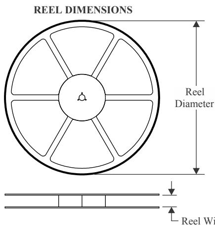

**REEL DIMENSIONS**

Reel Diameter

Reel Width (W1)

REEL DIMENSIONS diagram showing a reel with Reel Diameter and a cross-section showing Reel Width (W1).

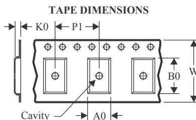

**TAPE DIMENSIONS**

K0 P1

Cavity

A0

B0

W

TAPE DIMENSIONS diagram showing a tape strip with dimensions K0, P1, A0, B0, and W. It also labels a Cavity.

|    |                                                           |
|----|-----------------------------------------------------------|
| A0 | Dimension designed to accommodate the component width     |
| B0 | Dimension designed to accommodate the component length    |
| K0 | Dimension designed to accommodate the component thickness |
| W  | Overall width of the carrier tape                         |
| P1 | Pitch between successive cavity centers                   |

### QUADRANT ASSIGNMENTS FOR PIN 1 ORIENTATION IN TAPE

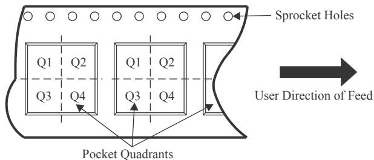

Sprocket Holes

Q1 Q2

Q3 Q4

Q1 Q2

Q3 Q4

Pocket Quadrants

User Direction of Feed

Diagram of a tape strip showing sprocket holes, pocket quadrants (Q1, Q2, Q3, Q4), and the user direction of feed.

\*All dimensions are nominal

| Device       | Package Type | Package Drawing | Pins | SPQ  | Reel Diameter (mm) | Reel Width W1 (mm) | A0 (mm) | B0 (mm) | K0 (mm) | P1 (mm) | W (mm) | Pin1 Quadrant |
|--------------|--------------|-----------------|------|------|--------------------|--------------------|---------|---------|---------|---------|--------|---------------|
| TPS22990DMLR | WSON         | DML             | 10   | 3000 | 180.0              | 8.4                | 2.3     | 3.2     | 1.0     | 4.0     | 8.0    | Q1            |

{29}------------------------------------------------

#### **TAPE AND REEL BOX DIMENSIONS**

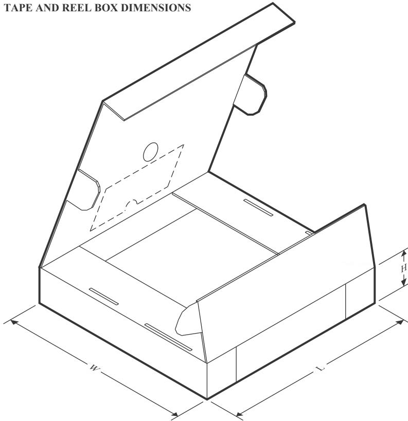

An isometric line drawing of an open tape and reel box. The box is shown from a three-quarter perspective, with its lid propped open. The interior of the box is empty, showing the bottom and the inside of the lid. Dimension lines with arrows indicate the length (L), width (W), and height (H) of the box. The drawing is a simple black-and-white line art representation.

Isometric line drawing of an open tape and reel box with dimension labels L, W, and H.

\*All dimensions are nominal

| Device       | Package Type | Package Drawing | Pins | SPQ  | Length (mm) | Width (mm) | Height (mm) |
|--------------|--------------|-----------------|------|------|-------------|------------|-------------|
| TPS22990DMLR | WSON         | DML             | 10   | 3000 | 213.0       | 191.0      | 35.0        |

{30}------------------------------------------------

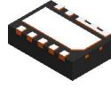

3D perspective view of the WSON package.

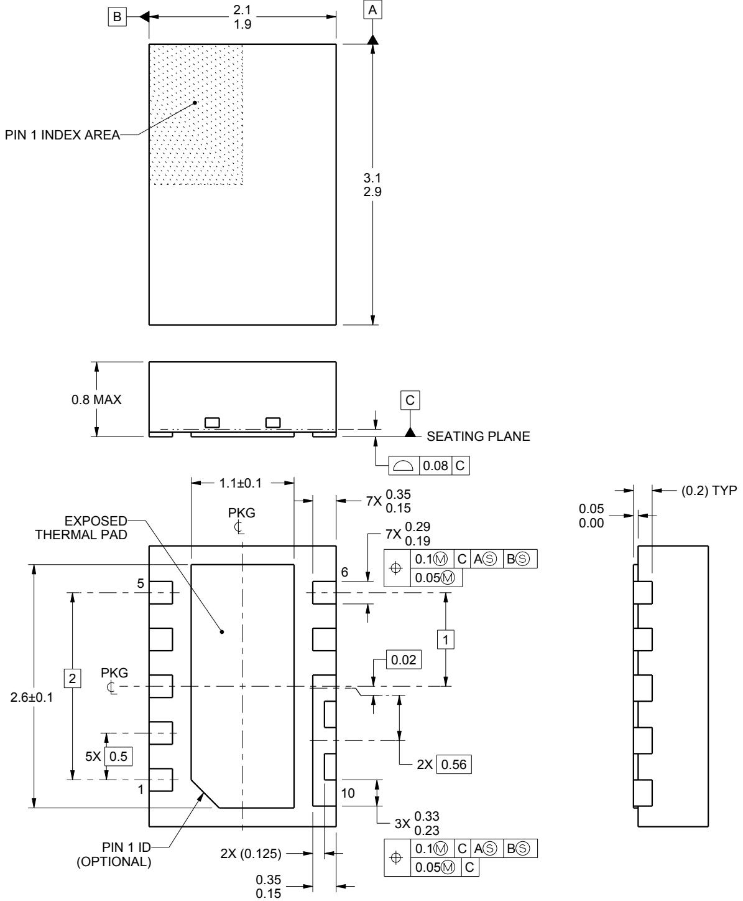

The figure shows the package outline for the DML0010A WSON package. It includes the following views and dimensions:

- Top View:** Shows a rectangular package with a width of 2.1 mm (1.9 mm) and a length of 3.1 mm (2.9 mm). A shaded area in the top-left corner is labeled "PIN 1 INDEX AREA".
- Side View:** Shows the package profile with a maximum height of 0.8 mm. It indicates the "SEATING PLANE" and a flatness tolerance of 0.08 relative to the seating plane.
- Bottom View:** Shows the package from below, including the "EXPOSED THERMAL PAD". Dimensions include a width of 1.1 ± 0.1 mm, a total width of 2.6 ± 0.1 mm, and a length of 10 mm. It specifies pin spacing of 0.5 mm (5X) and 0.125 mm (2X). Callouts for pin 1 and pin 6 are shown with position tolerances of 0.1 (Maximum Material Condition) and 0.05 (Maximum Material Condition) relative to datums C, A, and B.
- End View:** Shows the package from the side with a thickness of 0.05 mm (0.00 to 0.2 mm typical).

Technical drawing of the WSON package showing top, side, and bottom views with dimensions and callouts.

4222524/A 11/2015

#### NOTES:

1. All linear dimensions are in millimeters. Any dimensions in parenthesis are for reference only. Dimensioning and tolerancing per ASME Y14.5M.
2. This drawing is subject to change without notice.
3. The package thermal pad must be soldered to the printed circuit board for thermal and mechanical performance.

{31}------------------------------------------------

### EXAMPLE BOARD LAYOUT

DML0010A

WSON - 0.8 mm max height

PLASTIC SMALL OUTLINE - NO LEAD

![LAND PATTERN EXAMPLE diagram showing a top-down view of a PCB layout for a WSON package. The package area is outlined in red dashed lines. Dimensions include 7X (0.45) for the package width, 7X (0.24) for the package height, 3X (0.45) for the package length, 2X (0.125) for the package width, 3X (0.28) for the package height, 10 for the package width, 2X (0.56) for the package height, (0.02) for the package width, 2X (1) for the package height, (1.1) for the package width, and (1.95) for the package length. Other labels include PKG, (R0.05) TYP, (Ø 0.2) VIA TYP, and 5, 6.](img/5bf611979ab0126ebd219a1c6eda6b1e_img.jpg)

LAND PATTERN EXAMPLE diagram showing a top-down view of a PCB layout for a WSON package. The package area is outlined in red dashed lines. Dimensions include 7X (0.45) for the package width, 7X (0.24) for the package height, 3X (0.45) for the package length, 2X (0.125) for the package width, 3X (0.28) for the package height, 10 for the package width, 2X (0.56) for the package height, (0.02) for the package width, 2X (1) for the package height, (1.1) for the package width, and (1.95) for the package length. Other labels include PKG, (R0.05) TYP, (Ø 0.2) VIA TYP, and 5, 6.

LAND PATTERN EXAMPLE  
SCALE:25X

0.05 MAX  
ALL AROUND

SOLDER MASK  
OPENING

METAL

NON SOLDER MASK  
DEFINED

Solder mask detail diagram for a non-solder mask defined area. It shows a green rectangle representing the solder mask opening and a red rectangle representing the metal area. The distance between the metal area and the solder mask opening is labeled 0.05 MAX ALL AROUND.

0.05 MIN  
ALL AROUND

METAL UNDER  
SOLDER MASK

SOLDER MASK  
OPENING

SOLDER MASK  
DEFINED  
THERMAL PAD & PADS 8-10

Solder mask detail diagram for a solder mask defined area. It shows a green rectangle representing the solder mask opening and a red rectangle representing the metal under solder mask area. The distance between the metal under solder mask area and the solder mask opening is labeled 0.05 MIN ALL AROUND.

SOLDER MASK DETAILS

4222524/A 11/2015

NOTES: (continued)

4. This package is designed to be soldered to a thermal pad on the board. For more information, see Texas Instruments literature number SLUA271 ([www.ti.com/lit/slua271](http://www.ti.com/lit/slua271)).
5. Vias are optional depending on application, refer to device data sheet. If some or all are implemented, recommended via locations are shown.

{32}------------------------------------------------

### EXAMPLE STENCIL DESIGN

DML0010A

WSON - 0.8 mm max height

PLASTIC SMALL OUTLINE - NO LEAD

![Technical drawing of a solder mask for a WSON package. The drawing shows a central package area (PKG) with exposed metal and solder mask edges. Dimensions are provided for various features, including 7X (0.45), 7X (0.24), 5X (0.5), 2X (1.038), 3X (0.45), 3X (0.28), 2X (0.56), 2X (0.674), and 2X (1.148). Labels include 'SOLDER MASK EDGE, TYP', 'EXPOSED METAL', 'PKG', 'METAL UNDER SOLDER MASK TYP', and '(R0.05) TYP'. The drawing is a top-down view of the package and its surrounding area, showing the layout of the solder mask and the exposed metal areas.](img/3e2a8dc8c5537dbe703cdcb0e21e4e1b_img.jpg)

Technical drawing of a solder mask for a WSON package. The drawing shows a central package area (PKG) with exposed metal and solder mask edges. Dimensions are provided for various features, including 7X (0.45), 7X (0.24), 5X (0.5), 2X (1.038), 3X (0.45), 3X (0.28), 2X (0.56), 2X (0.674), and 2X (1.148). Labels include 'SOLDER MASK EDGE, TYP', 'EXPOSED METAL', 'PKG', 'METAL UNDER SOLDER MASK TYP', and '(R0.05) TYP'. The drawing is a top-down view of the package and its surrounding area, showing the layout of the solder mask and the exposed metal areas.

SOLDER PASTE EXAMPLE  
BASED ON 0.125 mm THICK STENCIL

EXPOSED PAD  
83% PRINTED SOLDER COVERAGE BY AREA  
SCALE:35X

4222524/A 11/2015

NOTES: (continued)

6. Laser cutting apertures with trapezoidal walls and rounded corners may offer better paste release. IPC-7525 may have alternate design recommendations.

{33}------------------------------------------------

### **IMPORTANT NOTICE AND DISCLAIMER**

TI PROVIDES TECHNICAL AND RELIABILITY DATA (INCLUDING DATASHEETS), DESIGN RESOURCES (INCLUDING REFERENCE DESIGNS), APPLICATION OR OTHER DESIGN ADVICE, WEB TOOLS, SAFETY INFORMATION, AND OTHER RESOURCES "AS IS" AND WITH ALL FAULTS, AND DISCLAIMS ALL WARRANTIES, EXPRESS AND IMPLIED, INCLUDING WITHOUT LIMITATION ANY IMPLIED WARRANTIES OF MERCHANTABILITY, FITNESS FOR A PARTICULAR PURPOSE OR NON-INFRINGEMENT OF THIRD PARTY INTELLECTUAL PROPERTY RIGHTS.

These resources are intended for skilled developers designing with TI products. You are solely responsible for (1) selecting the appropriate TI products for your application, (2) designing, validating and testing your application, and (3) ensuring your application meets applicable standards, and any other safety, security, regulatory or other requirements.

These resources are subject to change without notice. TI grants you permission to use these resources only for development of an application that uses the TI products described in the resource. Other reproduction and display of these resources is prohibited. No license is granted to any other TI intellectual property right or to any third party intellectual property right. TI disclaims responsibility for, and you fully indemnify TI and its representatives against any claims, damages, costs, losses, and liabilities arising out of your use of these resources.

TI's products are provided subject to [TI's Terms of Sale](#), [TI's General Quality Guidelines](#), or other applicable terms available either on [ti.com](#) or provided in conjunction with such TI products. TI's provision of these resources does not expand or otherwise alter TI's applicable warranties or warranty disclaimers for TI products. Unless TI explicitly designates a product as custom or customer-specified, TI products are standard, catalog, general purpose devices.

TI objects to and rejects any additional or different terms you may propose.

Copyright © 2026, Texas Instruments Incorporated

Last updated 10/2025