{0}------------------------------------------------

# TPS6287Bxx 2.7V to 6V Input, 10A,15A, 20A, 25A, and 30A Fast Transient, Synchronous Step-Down Converter With I2C Interface and Remote Sense

## 1 Features

- Input voltage range: 2.7V to 6V
- Family of pin-to-pin compatible devices: 10A, 15A, 20A, 25A, and 30A
- Three selectable output voltage ranges from 0.4V to 1.675V
  - 0.4V to 0.71875V with 1.25mV steps
  - 0.4V to 1.0375V with 2.5mV steps
  - 0.4V to 1.675V with 5mV steps
- Output voltage accuracy: ±0.8%
- Internal power MOSFETs: 2.6mΩ and 1.5mΩ
- Adjustable soft start
- External compensation
- Selectable start-up output voltage through the VSET1 and VSET2 pins
  - 0.4V to 0.775V with 25mV of steps
  - 0.8V to 1.55V with 50mV of steps
- Selectable switching frequency of 1.5MHz, 2.25MHz, 2.5MHz, or 3MHz through FSEL pin only for TPS6287BxxJE2 (see [Table 4-2](#))
- Forced PWM or power-save mode operation
- Start-up output voltage selection by external resistor or I2C
- I2C-compatible interface with up to 3.4MHz
- Optional stacked operation for increased output current capability
- Differential remote sense
- Thermal pre-warning and thermal shutdown
- Output discharge
- Optional spread spectrum clocking
- Power-good output with window comparator

## 2 Applications

- [FPGA, ASIC, and digital core supply](#)
- [Optical networks](#)
- [Storage](#)

## 3 Description

The TPS6287B10, TPS6287B15, TPS6287B20, TPS6287B25, and TPS6287B30 are a family of pin-to-pin, 10A, 15A, 20A, 25A, and 30A synchronous step-down DC/DC converters with I2C interface and differential remote sense. All devices offer high efficiency and ease of use. Low-resistance power switches allow up to 30A output current at high ambient temperature. The devices can operate in stacked mode to deliver higher output currents or to spread the power dissipation across multiple devices.

The TPS6287Bxx family implements a fixed-frequency DCS-Control scheme that supports a fast transient response. The devices can operate in power-save mode for maximum efficiency or forced-PWM mode for best transient performance and lowest output voltage ripple.

An optional remote sensing feature maximizes voltage regulation at the point-of-load, and the device achieves ±0.8% DC voltage accuracy for the full output voltage range.

The I2C compatible interface offers several control, monitoring and warning features, such as voltage monitoring and temperature related warnings. The output voltage can be quickly adjusted to adapt the load's power consumption to the performance needs. The default start-up voltage is resistor selectable through the VSET1 and VSET2 pins.

**Device Information**

| DEVICE NUMBER (3) | OUTPUT CURRENT | PACKAGE (1) | PACKAGE SIZE (2) |
|------------------------------|----------------|------------------------|-----------------------------|
| TPS6287B10                   | 10A            | RZV (WQFN-FCRLF, 24)   | 3.05mm × 4.05mm             |
| TPS6287B15                   | 15A            |                        |                             |
| TPS6287B20                   | 20A            |                        |                             |
| TPS6287B25                   | 25A            |                        |                             |
| TPS6287B30                   | 30A            |                        |                             |

- (1) For more information, see [Section 13](#).
- (2) The package size (length × width) is a nominal value and includes pins, where applicable.
- (3) See the [Device Options](#) tables.

![Simplified Schematic diagram of the TPS6287Bxx converter. The diagram shows the input section with VIN (2.7V to 6V), VIN pin, and a soft-start network with R_EN and C_IN. The converter core includes MODE/SYNC, EN, VOSNS, GOSNS, SDA, SCL, VSET1, VSET2, COMP, PG, SYNC_OUT, AGND, and GND pins. The output section features a power switch (SW), an inductor (L), an output capacitor (COUT), and a load. A remote sense network with R_Z, C_C, and C_C2 is connected to the COMP pin. A power-good output (PG) is shown with a resistor R_PG and a capacitor C_PG to ground.](4d4c0d9569f139f1b68b2c2549c9a299_img.jpg)

Simplified Schematic diagram of the TPS6287Bxx converter. The diagram shows the input section with VIN (2.7V to 6V), VIN pin, and a soft-start network with R\_EN and C\_IN. The converter core includes MODE/SYNC, EN, VOSNS, GOSNS, SDA, SCL, VSET1, VSET2, COMP, PG, SYNC\_OUT, AGND, and GND pins. The output section features a power switch (SW), an inductor (L), an output capacitor (COUT), and a load. A remote sense network with R\_Z, C\_C, and C\_C2 is connected to the COMP pin. A power-good output (PG) is shown with a resistor R\_PG and a capacitor C\_PG to ground.

**Simplified Schematic**

Important Notice icon

{1}------------------------------------------------

## Table of Contents

|                                                         |    |                                                                                    |    |
|---------------------------------------------------------|----|------------------------------------------------------------------------------------|----|
| <b>1 Features</b> .....                                 | 1  | <b>10 Application and Implementation</b> .....                                     | 45 |
| <b>2 Applications</b> .....                             | 1  | 10.1 Application Information.....                                                  | 45 |
| <b>3 Description</b> .....                              | 1  | 10.2 Typical Application.....                                                      | 45 |
| <b>4 Device Options</b> .....                           | 3  | 10.3 Typical Application - TPS6287BxV Devices .....                                | 54 |
| <b>5 Pin Configuration and Functions</b> .....          | 4  | 10.4 Typical Application Using Two TPS6287B25 in a Stacked Configuration.....   | 55 |
| <b>6 Specifications</b> .....                           | 6  | 10.5 Typical Application Using Three TPS6287B25 in a Stacked Configuration..... | 60 |
| 6.1 Absolute Maximum Ratings.....                       | 6  | 10.6 Power Supply Recommendations.....                                             | 61 |
| 6.2 ESD Ratings.....                                    | 6  | 10.7 Layout.....                                                                   | 61 |
| 6.3 Recommended Operating Conditions.....               | 6  | <b>11 Device and Documentation Support</b> .....                                   | 63 |
| 6.4 Thermal Information.....                            | 7  | 11.1 Documentation Support.....                                                    | 63 |
| 6.5 Electrical Characteristics.....                     | 7  | 11.2 Receiving Notification of Documentation Updates..                             | 63 |
| 6.6 I 2 C Interface Timing Requirements..... | 11 | 11.3 Support Resources.....                                                        | 63 |
| 6.7 Typical Characteristics.....                        | 13 | 11.4 Trademarks.....                                                               | 63 |
| <b>7 Parameter Measurement Information</b> .....        | 14 | 11.5 Electrostatic Discharge Caution.....                                          | 63 |
| <b>8 Detailed Description</b> .....                     | 15 | 11.6 Glossary.....                                                                 | 63 |
| 8.1 Overview.....                                       | 15 | <b>12 Revision History</b> .....                                                   | 63 |
| 8.2 Functional Block Diagram.....                       | 15 | <b>13 Mechanical, Packaging, and Orderable Information</b> .....               | 64 |
| 8.3 Feature Description.....                            | 16 |                                                                                    |    |
| 8.4 Device Functional Modes.....                        | 34 |                                                                                    |    |
| 8.5 Programming.....                                    | 35 |                                                                                    |    |
| <b>9 Device Registers</b> .....                         | 39 |                                                                                    |    |

{2}------------------------------------------------

## 4 Device Options

**Table 4-1. Device With I2C Interface**

| DEVICE NUMBER      | OUTPUT CURRENT | HICCUP | START-UP OUTPUT VOLTAGE    | DEFAULT SWITCHING FREQUENCY | DROOP COMPENSATION    | SPREAD SPECTRUM CLOCKING | SOFT-START TIME       | PINS 19, 20 |
|--------------------|----------------|--------|----------------------------|-----------------------------|-----------------------|--------------------------|-----------------------|-------------|
| TPS6287B10LA0WRZVR | 10A            | Off    | 0.4V to 0.775V, Selectable | 1.5MHz                      | Default setting = off | Default setting = off    | Default setting = 1ms | SDA/SCL     |
| TPS6287B15LA0WRZVR | 15A            |        |                            |                             |                       |                          |                       |             |
| TPS6287B20LA0WRZVR | 20A            |        |                            |                             |                       |                          |                       |             |
| TPS6287B25LA0WRZVR | 25A            |        |                            |                             |                       |                          |                       |             |
| TPS6287B30LA0WRZVR | 30A            |        |                            |                             |                       |                          |                       |             |
| TPS6287B10HA0WRZVR | 10A            | Off    | 0.8V to 1.55V, Selectable  | 1.5MHz                      | Default setting = off | Default setting = off    | Default setting = 1ms | SDA/SCL     |
| TPS6287B15HA0WRZVR | 15A            |        |                            |                             |                       |                          |                       |             |
| TPS6287B20HA0WRZVR | 20A            |        |                            |                             |                       |                          |                       |             |
| TPS6287B25HA0WRZVR | 25A            |        |                            |                             |                       |                          |                       |             |

**Table 4-2. Device to Power Jacinto Platform With I2C Interface**

| DEVICE NUMBER      | OUTPUT CURRENT | HICCUP | VSEL SETTING FOR START-UP VOLTAGE AND I2C ADDRESS                                                                                               | SSC | DEFAULT DROOP | TRANS. NONSYNC MODE | SOFT-START TIME | PIN 3, PIN 19, 20 |
|--------------------|----------------|--------|-------------------------------------------------------------------------------------------------------------------------------------------------|-----|---------------|---------------------|-----------------|-------------------|
| TPS6287B15JE2WRZVR | 15A            | Off    | VSET with 6.2kΩ to GND: 0.8V, 0x44 VSET shorted to GND: 0.8V, 0x45 VSET shorted to VIN: 0.875V, 0x46 VSET with 47kΩ to VIN: 0.8V, 0x47 | Off | On            | On                  | 1ms             | FSET/SDA/SCL      |
| TPS6287B20JE2WRZVR | 20A            |        |                                                                                                                                                 |     |               |                     |                 |                   |
| TPS6287B25JE2WRZVR | 25A            |        |                                                                                                                                                 |     |               |                     |                 |                   |

**Table 4-3. Device Without I2C Interface**

| DEVICE NUMBER      | OUTPUT CURRENT | HICCUP | START-UP OUTPUT VOLTAGE    | DEFAULT SWITCHING FREQUENCY | DROOP COMPENSATION    | SPREAD SPECTRUM CLOCKING | SOFT-START TIME       | PINS 19, 20 |  |  |  |  |  |  |
|--------------------|----------------|--------|----------------------------|-----------------------------|-----------------------|--------------------------|-----------------------|-------------|--|--|--|--|--|--|
| TPS6287B10VA0WRZVR | 10A            | Off    | 0.4V to 1.675V, Selectable | 1.5MHz                      | Default setting = off | Default setting = off    | Default setting = 1ms | VSET4/VSET3 |  |  |  |  |  |  |
| TPS6287B10VA1WRZVR | 10A            | On     |                            |                             |                       |                          |                       |             |  |  |  |  |  |  |
| TPS6287B15VA0WRZVR | 15A            | Off    |                            |                             |                       |                          |                       |             |  |  |  |  |  |  |
| TPS6287B20VA0WRZVR | 20A            |        |                            |                             |                       |                          |                       |             |  |  |  |  |  |  |
| TPS6287B25VA0WRZVR | 25A            |        |                            |                             |                       |                          |                       |             |  |  |  |  |  |  |

Unless otherwise noted, device variants without I2C operate with the same default settings as device variants with I2C.

{3}------------------------------------------------

## 5 Pin Configuration and Functions

Figure 5-1. RZV Package 24 Pin WQFN-FCRLF. The diagram shows the top and bottom views of a 24-pin WQFN package. The top view shows pin numbers 1-8 on the left and 20-13 on the right. The bottom view shows pin numbers 20-13 on the left and 1-8 on the right. Pin functions are labeled: 1: VOSNS, 2: EN, 3: VSET1 or FSET, 4: VSET2, 5, 6: VIN, 7, 8: GND, 9-12: SW, 13-16: GND, 17: SYNC\_OUT, 18: MODE/ SYNC, 19: SDA or VSET4, 20: SCL or VSET3, 21: PG, 22: AGND, 23: COMP, 24: GOSNS.

**Figure 5-1. RZV Package 24 Pin WQFN-FCRLF**

**Table 5-1. Pin Functions**

| PIN           |       | TYPE (1) | DESCRIPTION                                                                                                                                                                                                                                                                                                                                                                                                                                             |
|---------------|-------|---------------------|---------------------------------------------------------------------------------------------------------------------------------------------------------------------------------------------------------------------------------------------------------------------------------------------------------------------------------------------------------------------------------------------------------------------------------------------------------|
| NO.           | NAME  |                     |                                                                                                                                                                                                                                                                                                                                                                                                                                                         |
| 1             | VOSNS | I                   | Output voltage sense (differential output voltage sensing).                                                                                                                                                                                                                                                                                                                                                                                             |
| 2             | EN    | I                   | This pin is the enable pin of the device. Connect to this pin using a series resistor of at least 15kΩ. A logic low level on this pin disables the device, and a logic high level on the pin enables the device. Do not leave this pin unconnected. For stacked operation interconnect EN pins of all stacked devices with a resistor to the supply voltage or a GPIO of a processor. See <a href="#">Section 8.3.18</a> for a detailed description. |
| 3             | VSET1 | I                   | Start-up output voltage set pin. A resistor or short-circuit to GND or V IN defines the selected output voltage. See <a href="#">Table 8-5</a>                                                                                                                                                                                                                                                                                               |
| 3             | FSET  | I                   | Only applies to TPS6287BxxJE2WRZVR. Frequency select pin. A resistor or a short circuit to GND or VIN determines the switching frequency if not externally synchronized. See <a href="#">Section 8.3.6</a> for the frequency options.                                                                                                                                                                                                                   |
| 4             | VSET2 | I                   | Start-up output voltage set pin. A resistor or short-circuit to GND or V IN defines the selected output voltage. See <a href="#">Table 8-5</a>                                                                                                                                                                                                                                                                                               |
| 5, 6, 15, 16  | VIN   | P                   | Power supply input. Connect the input capacitor as close as possible between pin VIN and GND.                                                                                                                                                                                                                                                                                                                                                           |
| 7, 8, 13, 14  | GND   | GND                 | Ground pin                                                                                                                                                                                                                                                                                                                                                                                                                                              |
| 9, 10, 11, 12 | SW    | O                   | This pin is the switch pin of the converter and is connected to the internal Power MOSFETs.                                                                                                                                                                                                                                                                                                                                                             |

{4}------------------------------------------------

**Table 5-1. Pin Functions (continued)**

| PIN                  |           | TYPE (1) | DESCRIPTION                                                                                                                                                                                                                                                                                                                                                                                                                                                                                                                                                                 |
|----------------------|-----------|---------------------|-----------------------------------------------------------------------------------------------------------------------------------------------------------------------------------------------------------------------------------------------------------------------------------------------------------------------------------------------------------------------------------------------------------------------------------------------------------------------------------------------------------------------------------------------------------------------------|
| NO.                  | NAME      |                     |                                                                                                                                                                                                                                                                                                                                                                                                                                                                                                                                                                             |
| 17                   | SYNCOUT   | O                   | Internal clock output pin for synchronization in stacked mode. Leave this pin floating for single device operation. Connect this pin to the MODE/SYNC pin of the next device in the daisy-chain in stacked operation. Do not use this pin to connect to a non-TPS6287Bxx-device. During start-up, this pin is used to identify if a device must operate as a secondary converter in stacked operation. Connect a 47kΩ resistor from this pin to GND to define a secondary converter in stacked operation. See <a href="#">Section 8.3.18</a> for a detailed description. |
| 18                   | MODE/SYNC | I                   | The device runs in Power-Save mode when this pin is pulled low. If the pin is pulled high, the device runs in Forced-PWM mode. Do not leave this pin unconnected. The mode pin can also be used to synchronize the device to an external clock.                                                                                                                                                                                                                                                                                                                             |
| 19                   | VSET4     | I                   | Start-up output voltage set pin. A logic low level or a logic high level on the pin defines the start-up output voltage according to <a href="#">Table 8-7</a>                                                                                                                                                                                                                                                                                                                                                                                                              |
| 19                   | SDA       | I/O                 | I 2 C serial data pin. Do not leave this pin floating. Connect a pullup to logic high level. Connect to GND for secondary devices in stacked operation.                                                                                                                                                                                                                                                                                                                                                                                                          |
| 20                   | VSET3     | I                   | Start-up output voltage set pin. A logic low level or a logic high level on the pin defines the start-up output voltage according to <a href="#">Table 8-7</a>                                                                                                                                                                                                                                                                                                                                                                                                              |
| 20                   | SCL       | I/O                 | I 2 C serial clock pin. Do not leave this pin floating. Connect a pullup resistor to a logic high level. Connect to GND for secondary devices in stacked operation.                                                                                                                                                                                                                                                                                                                                                                                              |
| 21                   | PG        | I/O                 | Open drain power-good output. Low impedance when not "power good", high impedance when "power good". This pin can be left open or be tied to GND when not used in single device operation. In stacked operation interconnect the PG pins of all stacked devices. Only the PG pin of the primary converter in stacked operation is an open drain output. For devices that are defined as secondary converters in stacked mode the pin is an input pin. See <a href="#">Section 8.3.18</a> for a detailed description.                                                     |
| 22                   | AGND      | GND                 | Analog Ground. Connect to GND.                                                                                                                                                                                                                                                                                                                                                                                                                                                                                                                                              |
| 23                   | COMP      | —                   | Device compensation input. A resistor and capacitor from this pin to AGND define the compensation of the control loop. In stacked operation connect the COMP pins of all stacked devices together and connect a resistor and capacitor between the common COMP node and AGND.                                                                                                                                                                                                                                                                                            |
| 24                   | GOSNS     | —                   | Output ground sense (differential output voltage sensing)                                                                                                                                                                                                                                                                                                                                                                                                                                                                                                                   |
| Exposed Thermal Pads |           | —                   | The thermal pads must be soldered to GND to achieve an appropriate thermal resistance and for mechanical stability.                                                                                                                                                                                                                                                                                                                                                                                                                                                         |

(1) I = input, O = output, P = power, GND = ground

{5}------------------------------------------------

## 6 Specifications

### 6.1 Absolute Maximum Ratings

over operating temperature range (unless otherwise noted)(1)

|                        |                                                  | MIN  | MAX                   | UNIT |
|------------------------|--------------------------------------------------|------|-----------------------|------|
| Voltage (2) | VIN (4)                               | -0.3 | 6.5                   | V    |
|                        | SW (DC)                                          | -0.3 | V IN + 0.3 | V    |
|                        | COMP                                             | -0.3 | V IN       | V    |
|                        | SW (AC, less than 10ns) (3)           | -3   | 10                    | V    |
|                        | VOSNS                                            | -0.3 | 1.8                   | V    |
| Voltage (2) | SCL, SDA, VSET3, VSET4                           | -0.3 | 5.5                   | V    |
| Voltage (2) | SYNC_OUT                                         | -0.3 | 2                     | V    |
| Voltage (2) | PG                                               | -0.3 | 6.5                   | V    |
| Voltage (2) | VSET1, VSET2, FSET, EN, MODE/SYNC (4) | -0.3 | 6.5                   | V    |
| Voltage (2) | GOSNS                                            | -0.3 | 0.3                   | V    |
| T stg       | Storage temperature                              | -65  | 150                   | °C   |

- (1) Operation outside the Absolute Maximum Ratings may cause permanent device damage. Absolute Maximum Ratings do not imply functional operation of the device at these or any other conditions beyond those listed under Recommended Operating Conditions. If used outside the Recommended Operating Conditions but within the Absolute Maximum Ratings, the device may not be fully functional, and this may affect device reliability, functionality, performance, and shorten the device lifetime.
- (2) All voltage values are with respect to the network ground terminal.
- (3) While switching.
- (4) The voltage at the pin can exceed the 6.5V absolute max condition for a short period of time, but must remain less than 8V. VIN at 8V for a 100ms duration is equivalent to approximately 8 hours of aging for the device at room temperature.

### 6.2 ESD Ratings

|                    |                         |                                                                                 | VALUE | UNIT |
|--------------------|-------------------------|---------------------------------------------------------------------------------|-------|------|
| V (ESD) | Electrostatic discharge | Human body model (HBM), per ANSI/ESDA/JEDEC JS-001, all pins (1)     | ±2000 | V    |
|                    |                         | Charged device model (CDM), per ANSI/ESDA/JEDEC JS-002, all pins (2) | ±750  |      |

- (1) JEDEC document JEP155 states that 500-V HBM allows safe manufacturing with a standard ESD control process.
- (2) JEDEC document JEP157 states that 250-V CDM allows safe manufacturing with a standard ESD control process.

### 6.3 Recommended Operating Conditions

Over operating temperature range (unless otherwise noted)

|                                                             |                                                                                | MIN | NOM | MAX                                                 | UNIT |
|-------------------------------------------------------------|--------------------------------------------------------------------------------|-----|-----|-----------------------------------------------------|------|
| V IN                                             | Input voltage range                                                            | 2.7 |     | 6                                                   | V    |
| V OUT                                            | Output voltage range                                                           | 0.4 |     | 1.675 V or (V IN - 1.5 V) (1) | V    |
| Voltage                                                     | Nominal pull-up voltage on pins SDA and SCL                                    | 1.2 |     | 5                                                   | V    |
| L                                                           | Effective inductance for f SW = 1.5 MHz                             | 100 | 150 | 200                                                 | nH   |
| C IN                                             | Effective input capacitance per power input pin                                | 10  | 22  |                                                     | µF   |
| C OUT                                            | Effective output capacitance                                                   | 47  |     | (2)                                      | µF   |
| C PAR                                            | Parasitic capacitance on VSET1, VSET2, FSET pin                                |     |     | 100                                                 | pF   |
| C PAR                                            | Parasitic capacitance on SYNC_OUT pin                                          |     |     | 20                                                  | pF   |
| R EN                                             | Pull-up resistance on EN pin                                                   | 15  |     |                                                     | kΩ   |
| R VSET1 , R VSET2 , R FSET | Resistance on VSET1, VSET2, FSET pin to GND if not directly tied to GND or VIN |     | 6.2 |                                                     | kΩ   |

{6}------------------------------------------------

### 6.3 Recommended Operating Conditions (continued)

Over operating temperature range (unless otherwise noted)

|                                  |                                                                                | MIN | NOM | MAX  | UNIT |
|----------------------------------|--------------------------------------------------------------------------------|-----|-----|------|------|
| $R_{VSET1}, R_{VSET2}, R_{FSET}$ | Resistance on VSET1, VSET2, FSET pin to VIN if not directly tied to GND or VIN |     | 47  |      | kΩ   |
| $R_{VSET1}, R_{VSET2}, R_{FSET}$ | Resistor tolerance on VSET1, VSET2, FSET pin                                   |     |     | ± 2% |      |
| $I_{SINK\_PG}$                   | Sink current at PG pin                                                         | 0   |     | 1    | mA   |
| $T_J$                            | Operating junction temperature                                                 | -40 |     | 125  | °C   |

- (1) Whatever  $V_{OUT}$  value is lower.
- (2) The maximum recommended output capacitance depends on the specific operating conditions of an application. Output capacitance values of up to a few millifarads are typically possible.

### 6.4 Thermal Information

| THERMAL METRIC (1) |                                              | TPS6287Bx   | TPS6287Bx | UNIT |
|-------------------------------|----------------------------------------------|-------------|-----------|------|
|                               |                                              | RZV (JEDEC) | RZV (EVM) |      |
|                               |                                              | 24 PINS     | 24 PINS   |      |
| $R_{θJA}$                     | Junction-to-ambient thermal resistance       | 34.7        | 28        | °C/W |
| $R_{θJC(top)}$                | Junction-to-case (top) thermal resistance    | 14.9        | -         | °C/W |
| $R_{θJB}$                     | Junction-to-board thermal resistance         | 6.5         | -         | °C/W |
| $\Psi_{JT}$                   | Junction-to-top characterization parameter   | 1.5         | -         | °C/W |
| $Y_{JB}$                      | Junction-to-board characterization parameter | 6.5         | -         | °C/W |
| $R_{θJC(bot)}$                | Junction-to-case (bottom) thermal resistance | 4.8         | -         | °C/W |

- (1) For more information about traditional and new thermal metrics, see the [Semiconductor and IC Package Thermal Metrics](#) application note.

### 6.5 Electrical Characteristics

over operating junction temperature ( $T_J = -40\text{ °C}$  to  $+125\text{ °C}$ ) and  $V_{IN} = 2.7\text{ V}$  to  $6\text{ V}$ . Typical values at  $V_{IN} = 5\text{ V}$  and  $T_J = 25\text{ °C}$  (unless otherwise noted).

| PARAMETER        | TEST CONDITIONS                                       | MIN                                                                    | TYP | MAX | UNIT   |
|------------------|-------------------------------------------------------|------------------------------------------------------------------------|-----|-----|--------|
| <b>SUPPLY</b>    |                                                       |                                                                        |     |     |        |
| $I_Q$            | Quiescent current                                     | EN = High, $I_{OUT} = 0\text{ mA}$ , device not switching; MODE = Low  |     | 2.1 | 4.6 mA |
| $I_{SD}$         | Shutdown current                                      | EN = Low, $V_{(SW)} = 0\text{ V}$ , max value at $T_J = 125\text{ °C}$ |     | 18  | 450 µA |
| $V_{IT+ (UVLO)}$ | Positive-going UVLO threshold voltage (VIN)           | 2.5                                                                    | 2.6 | 2.7 | V      |
| $V_{IT-(UVLO)}$  | Negative-going UVLO threshold voltage (VIN)           | 2.4                                                                    | 2.5 | 2.6 | V      |
| $V_{hys(UVLO)}$  | UVLO hysteresis voltage (VIN)                         | 80                                                                     |     |     | mV     |
| $V_{IT+ (OVLO)}$ | Positive-going OVLO threshold voltage (VIN)           | 6.1                                                                    | 6.3 | 6.5 | V      |
| $V_{IT-(OVLO)}$  | Negative-going OVLO threshold voltage (VIN)           | 6.0                                                                    | 6.2 | 6.4 | V      |
| $V_{hys(OVLO)}$  | OVLO hysteresis voltage (VIN)                         | 80                                                                     |     |     | mV     |
| $V_{IT-(POR)}$   | Negative-going power-on reset threshold voltage (VIN) | 1.4                                                                    |     |     | V      |

{7}------------------------------------------------

### **6.5 Electrical Characteristics (continued)**

over operating junction temperature ( $T_J = -40\text{ }^\circ\text{C}$  to  $+125\text{ }^\circ\text{C}$ ) and  $V_{IN} = 2.7\text{ V}$  to  $6\text{ V}$ . Typical values at  $V_{IN} = 5\text{ V}$  and  $T_J = 25\text{ }^\circ\text{C}$  (unless otherwise noted).

| PARAMETER                    |                                                                        | TEST CONDITIONS                                                                                     | MIN  | TYP  | MAX  | UNIT             |
|------------------------------|------------------------------------------------------------------------|-----------------------------------------------------------------------------------------------------|------|------|------|------------------|
| $T_{SD}$                     | Thermal shutdown threshold temperature                                 | $T_J$ rising                                                                                        |      | 170  |      | $^\circ\text{C}$ |
|                              | Thermal shutdown hysteresis                                            |                                                                                                     |      | 20   |      | $^\circ\text{C}$ |
| $T_W$                        | Thermal warning threshold temperature                                  | $T_J$ rising                                                                                        |      | 150  |      | $^\circ\text{C}$ |
|                              | Thermal warning hysteresis                                             |                                                                                                     |      | 20   |      | $^\circ\text{C}$ |
| <b>CONTROL and INTERFACE</b> |                                                                        |                                                                                                     |      |      |      |                  |
| $V_{IT+}$                    | Positive-going input threshold voltage (EN)                            |                                                                                                     | 0.97 | 1.0  | 1.03 | V                |
| $V_{IT-}$                    | Negative-going input threshold voltage (EN)                            |                                                                                                     | 0.87 | 0.9  | 0.93 | V                |
| $V_{hys}$                    | Hysteresis voltage (EN)                                                |                                                                                                     | 95   |      |      | mV               |
| $R_{(EN)}$                   | Input resistance to GND (EN)                                           | Only active during start-up in stacked operation.                                                   | 1.4  | 1.8  | 3    | k $\Omega$       |
| $I_{IH}$                     | High-level input current (EN)                                          | $V_{IH} = V_{IN}$ , internal pulldown resistor disabled                                             |      |      | 3    | $\mu\text{A}$    |
| $I_{IL}$                     | Low-level input current (EN)                                           | $V_{IL} = 0\text{V}$ , internal pulldown resistor disabled                                          | -200 |      |      | nA               |
| $V_{IH}$                     | High-level input voltage (MODE/SYNC, VSET1, VSET2, FSET, SYNC_OUT, PG) |                                                                                                     | 0.8  |      |      | V                |
| $V_{IH}$                     | High-level input voltage (VSET3, VSET4)                                |                                                                                                     | 0.95 |      |      | V                |
| $V_{IH}$                     | High-level input voltage (SDA, SCL)                                    |                                                                                                     | 0.95 |      |      | V                |
| $V_{IL}$                     | Low-level input voltage (MODE/SYNC, VSET1, VSET2, FSET, SYNC_OUT, PG)  |                                                                                                     |      |      | 0.4  | V                |
| $V_{IL}$                     | Low-level input voltage (VSET3, VSET4)                                 |                                                                                                     |      |      | 0.5  | V                |
| $V_{IL}$                     | Low-level input voltage (SDA, SCL)                                     |                                                                                                     |      |      | 0.5  | V                |
| $R_{IN}$                     | Input resistance to GND on pins MODE/ SYNC, EN and PG                  |                                                                                                     | 2    | 3    | 4    | M $\Omega$       |
| $V_{OL}$                     | Low-level output voltage (SDA)                                         | $I_{OL} = 9\text{mA}$                                                                               |      |      | 0.4  | V                |
| $V_{OL}$                     | Low-level output voltage (SDA)                                         | $I_{OL} = 5\text{mA}$                                                                               |      |      | 0.2  | V                |
| $I_{LKG}$                    | Input leakage current into SDA, SCL                                    | $V_{OH} = 3.3\text{V}$                                                                              |      |      | 200  | nA               |
| $I_{IL}$                     | Low-level input current (MODE/SYNC)                                    | $V_{IL} = 0\text{V}$                                                                                | -100 |      | 100  | nA               |
| $I_{IH}$                     | High-level input current (MODE/SYNC)                                   | $V_{IH} = V_{IN}$                                                                                   |      |      | 3    | $\mu\text{A}$    |
| $I_{IL}$                     | Low-level input current (SYNC_OUT)                                     | $V_{IL} = 0\text{V}$                                                                                | -230 |      |      | nA               |
| $I_{IH}$                     | High-level input current (SYNC_OUT)                                    | $V_{IH} = 2\text{V}$                                                                                |      |      | 110  | nA               |
| $V_{OL}$                     | Low-level output voltage (SYNC_OUT)                                    | $I_{OL} = 1\text{mA}$                                                                               |      |      | 0.3  | V                |
| $V_{OH}$                     | High-level output voltage (SYNC_OUT)                                   | $I_{OH} = 0.1\text{mA}$                                                                             | 1.3  |      | 2.1  | V                |
| $t_{d(EN)1}$                 | Enable delay time when EN tied to $V_{IN}$                             | Measured from when EN goes high to when device starts switching, $SR_{VIN} = 1\text{V}/\mu\text{s}$ |      | 200  | 600  | $\mu\text{s}$    |
| $t_{d(EN)2}$                 | Enable delay time when $V_{IN}$ already applied                        | Measured from when EN goes high to when device starts switching                                     |      | 40   | 100  | $\mu\text{s}$    |
| $t_d(\text{Ramp})$           | Output voltage ramp time for CONTROL2[1:0] = 00                        | Measured from when device starts switching to rising edge of PG                                     | 0.35 | 0.5  | 0.65 | ms               |
|                              | Output voltage ramp time for CONTROL2[1:0] = 01                        |                                                                                                     | 0.54 | 0.77 | 1.0  | ms               |
|                              | Output voltage ramp time for CONTROL2[1:0] = 10, default               |                                                                                                     | 0.7  | 1    | 1.3  | ms               |
|                              | Output voltage ramp time for CONTROL2[1:0] = 11                        |                                                                                                     | 1.4  | 2    | 2.6  | ms               |

{8}------------------------------------------------

### 6.5 Electrical Characteristics (continued)

over operating junction temperature ( $T_J = -40\text{ }^\circ\text{C}$  to  $+125\text{ }^\circ\text{C}$ ) and  $V_{IN} = 2.7\text{ V}$  to  $6\text{ V}$ . Typical values at  $V_{IN} = 5\text{ V}$  and  $T_J = 25\text{ }^\circ\text{C}$  (unless otherwise noted).

| PARAMETER         |                                                                        | TEST CONDITIONS                                                                     | MIN   | TYP   | MAX  | UNIT |
|-------------------|------------------------------------------------------------------------|-------------------------------------------------------------------------------------|-------|-------|------|------|
| $f_{(SYNC)}$      | Synchronization clock frequency range (MODE/SYNC)                      | $f_{(SW)nom} = 1.5\text{MHz}$ , $D_{(MODE/SYNC)} = 45\%\dots55\%$                   | 1.2   |       | 1.8  | MHz  |
| $D_{(MODE/SYNC)}$ | Duty cycle of synchronization clock frequency (MODE/SYNC)              |                                                                                     | 45    |       | 55   | %    |
|                   | Phase shift at SYNC_OUT with reference to internal CLK or external CLK | CONTROL2:SYNC_OUT_PHASE = 0b0                                                       |       | 120   |      | °    |
|                   | Phase shift at SYNC_OUT with reference to internal CLK or external CLK | CONTROL2:SYNC_OUT_PHASE = 0b1                                                       |       | 180   |      | °    |
|                   | Time to lock to external frequency                                     |                                                                                     |       | 50    |      | μs   |
|                   | Resistance on VSET1, VSET2, FSET to GND if not tied to GND directly    |                                                                                     |       | 6.2   |      | kΩ   |
|                   | Resistance on VSET1, VSET2, FSET to VIN if not tied to VIN directly    |                                                                                     |       | 47    |      | kΩ   |
| $V_{T+(UVP)}$     | Positive-going power good threshold voltage (output undervoltage)      |                                                                                     | 94    | 96    | 98   | %    |
| $V_{T-(UVP)}$     | Negative-going power good threshold voltage (output undervoltage)      |                                                                                     | 92    | 94    | 96   | %    |
| $V_{T+(OVP)}$     | Positive-going power good threshold voltage (output overvoltage)       |                                                                                     | 104   | 106   | 108  | %    |
| $V_{T-(OVP)}$     | Negative-going power good threshold voltage (output overvoltage)       |                                                                                     | 102   | 104   | 106  | %    |
| $V_{OL}$          | Low-level output voltage (PG)                                          | $I_{OL} = 1\text{mA}$                                                               |       | 0.012 | 0.3  | V    |
| $I_{OH}$          | High-level output current (PG)                                         | $V_{OH} = 5\text{V}$                                                                |       |       | 3    | μA   |
| $I_{IH}$          | High-level input current (PG)                                          | Device configured as secondary device in stacked operation                          |       |       | 3    | μA   |
| $I_{IL}$          | Low-level input current (PG)                                           | Device configured as secondary device in stacked operation                          | -1    |       |      | μA   |
| $t_{d(PG)}$       | Deglitch time (PG)                                                     | High-to-low or low-to-high transition on the PG pin                                 | 34    | 40    | 46   | μs   |
| <b>OUTPUT</b>     |                                                                        |                                                                                     |       |       |      |      |
| $\Delta V_{OUT}$  | Output voltage accuracy                                                | $V_{IN} \geq V_{OUT} + 1.6\text{V}$ , droop compensation disabled                   | -0.8  |       | 0.8  | %    |
| $\Delta V_{OUT}$  | Output voltage change from no current to rated current                 | droop compensation enabled                                                          |       | ±12   |      | mV   |
|                   | Accuracy of droop compensation voltage; TPS6287B10; TPS6287B15         | device in forced PWM mode                                                           | -3.75 |       | 3.75 | mV   |
|                   | Accuracy of droop compensation voltage; TPS6287B20                     | device in forced PWM mode                                                           | -3.5  |       | 3.5  | mV   |
|                   | Accuracy of droop compensation voltage; TPS6287B25 and TPS6287B30      | device in forced PWM mode                                                           | -3    |       | 3    | mV   |
|                   | Line regulation                                                        | $I_{OUT} = 15\text{A}$ , $V_{IN} \geq V_{OUT} + 1.6\text{V}$                        |       | 0.02  |      | %/V  |
| $I_{IB}$          | Input bias current (GOSNS)                                             | EN = High; $V_{(GOSNS)} = -100\text{mV}$ to $100\text{mV}$                          | -60   |       | 3    | μA   |
| $I_{IB}$          | Input bias current (VOSNS)                                             | $V_{(VOSNS)} = 1.675\text{ V}$ , $V_{IN} = 6\text{V}$ , droop compensation disabled | -5.5  |       | 5.5  | μA   |
| $I_{IB}$          | Input bias current (VOSNS)                                             | $V_{(VOSNS)} = 1.675\text{V}$ , $V_{IN} = 6\text{V}$ , droop compensation enabled   | -13.2 |       | 13.2 | μA   |
| $V_{ICR}$         | Input common-mode range (GOSNS)                                        |                                                                                     | -100  |       | 100  | mV   |
| $R_{DIS}$         | Output discharge resistance                                            | $V_{OUT} \leq 1\text{V}$                                                            |       | 2.7   | 9.2  | Ω    |
| $f_{SW}$          | Switching frequency (SW)                                               | $f_{SW} = 1.5\text{ MHz}$ , PWM operation                                           | 1.35  | 1.5   | 1.65 | MHz  |

{9}------------------------------------------------

### 6.5 Electrical Characteristics (continued)

over operating junction temperature ( $T_J = -40\text{ }^\circ\text{C}$  to  $+125\text{ }^\circ\text{C}$ ) and  $V_{IN} = 2.7\text{ V}$  to  $6\text{ V}$ . Typical values at  $V_{IN} = 5\text{ V}$  and  $T_J = 25\text{ }^\circ\text{C}$  (unless otherwise noted).

| PARAMETER       |                                                                | TEST CONDITIONS                                                                    | MIN           | TYP           | MAX   | UNIT       |
|-----------------|----------------------------------------------------------------|------------------------------------------------------------------------------------|---------------|---------------|-------|------------|
| $f_{SW}$        | Switching frequency (SW)                                       | $f_{SW} = 2.25\text{ MHz}$ , PWM operation, only applies to TPS6287BxxJE2          | 2.025         | 2.25          | 2.475 | MHz        |
| $f_{SW}$        | Switching frequency (SW)                                       | $f_{SW} = 2.5\text{ MHz}$ , PWM operation, only applies to TPS6287BxxJE2           | 2.25          | 2.5           | 2.75  | MHz        |
| $f_{SW}$        | Switching frequency (SW)                                       | $f_{SW} = 3\text{ MHz}$ , PWM operation, only applies to TPS6287BxxJE2             | 2.7           | 3             | 3.3   | MHz        |
| $f_{SSC}$ | Modulation frequency |  |  | $f_{SW}/2048$ |  | kHz |
| $\Delta f_{SW}$ | Switching frequency variation during spread spectrum operation |  | $f_{SW}-10\%$ |  | $f_{SW}+10\%$ |  |
| $g_m$ | Transconductance of OTA on COMP pin |  |  | 1.5 |  | mS |
| $\tau$          | Emulated current time constant                                 |                                                                                    | 11.87         | 12.5          | 13.2  | $\mu s$    |
| $R_{DS(ON)}$ | High-side FET static on-resistance | $V_{IN} = 3.3\text{ V}$ |  | 3.4 | 6.4 | m $\Omega$ |
| $R_{DS(ON)}$ | Low-side FET static on-resistance | $V_{IN} = 3.3\text{ V}$ |  | 1.9 | 3.6 | m $\Omega$ |
| $I_{(SW)(off)}$ | SW pin current when HS-FET and LS-FET are off | $V_{IN} = 6\text{ V}$ ; $V_{(SW)} = 0\text{ V}$ , $T_J = 25\text{ }^\circ\text{C}$ | -1.5 |  | 0.1 | $\mu A$ |
|  | SW pin current when HS-FET and LS-FET are off | $V_{IN} = 6\text{ V}$ ; $V_{(SW)} = 6\text{ V}$ , $T_J = 25\text{ }^\circ\text{C}$ | 60 |  | 130 | $\mu A$ |
|  | SW pin current when HS-FET and LS-FET are off | $V_{(SW)} = 0.4\text{ V}$ , current into SW pin |  | 11 | 3000 | $\mu A$ |
| ILIM            | High-side FET forward switch current limit, DC                 | TPS6287B10; TPS6287B15                                                             | 19            | 22.5          | 26    | A          |
| ILIM            | High-side FET forward switch current limit, DC                 | TPS6287B20                                                                         | 24            | 28.5          | 32    | A          |
| ILIM            | High-side FET forward switch current limit, DC                 | TPS6287B25                                                                         | 29            | 34            | 39    | A          |
| ILIM            | High-side FET forward switch current limit, DC                 | TPS6287B30                                                                         | 34            | 39            | 44    | A          |
| ILIM            | Low-side FET forward switch current limit, DC                  | TPS6287B10; TPS6287B15                                                             | 15            | 20            | 24    | A          |
| ILIM            | Low-side FET forward switch current limit, DC                  | TPS6287B20                                                                         | 20            | 24.5          | 29    | A          |
| ILIM            | Low-side FET forward switch current limit, DC                  | TPS6287B25                                                                         | 24.5          | 29            | 33    | A          |
| ILIM            | Low-side FET forward switch current limit, DC                  | TPS6287B30                                                                         | 29.5          | 33.5          | 38    | A          |
| ILIM | Low-side FET negative current limit, DC |  |  | -10 |  | A |
| $t_{on, min}$ | Minimum on-time of HS FET | $V_{IN} = 3.3\text{ V}$ |  | 45 | 53 | ns |
| $t_{on, min}$ | Minimum on-time of HS FET | $V_{IN} = 5\text{ V}$ |  | 35 | 44 | ns |
| $t_{off, min}$ | Minimum off-time of HS FET | $V_{IN} = 5\text{ V}$ |  | 70 | 100 | ns |
|  | Maximum duty cycle of power stage | DC operation for TPS6287B25 only, $T_J = 125\text{ }^\circ\text{C}$ |  | 40 |  | % |
|  | Maximum duty cycle of power stage | DC operation for TPS6287B30 only, $T_J = 125\text{ }^\circ\text{C}$ |  | 25 |  | % |

{10}------------------------------------------------

### 6.6 I2C Interface Timing Requirements

| PARAMETER                        |                                           | TEST CONDITIONS                                   | MIN  | TYP | MAX  | UNIT |
|----------------------------------|-------------------------------------------|---------------------------------------------------|------|-----|------|------|
| f SCL                 | SCL clock frequency                       | Standard mode                                     |      |     | 100  | kHz  |
|                                  |                                           | Fast mode                                         |      |     | 400  | kHz  |
|                                  |                                           | Fast mode plus                                    |      |     | 1    | MHz  |
|                                  |                                           | High-speed mode (write operation), CB – 100pF max |      |     | 3.4  | MHz  |
|                                  |                                           | High-speed mode (read operation), CB – 100pF max  |      |     | 3.4  | MHz  |
|                                  |                                           | High-speed mode (write operation), CB – 400pF max |      |     | 1.7  | MHz  |
|                                  |                                           | High-speed mode (read operation), CB – 400pF max  |      |     | 1.7  | MHz  |
| t HD, tSTA | Hold time (repeated) START condition      | Standard mode                                     | 4    |     |      | μs   |
|                                  |                                           | Fast mode                                         | 0.6  |     |      | μs   |
|                                  |                                           | Fast mode plus                                    | 0.26 |     |      | μs   |
|                                  |                                           | High-speed mode                                   | 0.16 |     |      | μs   |
| t LOW                 | LOW period of the SCL clock               | Standard mode                                     | 4.7  |     |      | μs   |
|                                  |                                           | Fast mode                                         | 1.3  |     |      | μs   |
|                                  |                                           | Fast mode plus                                    | 0.5  |     |      | μs   |
|                                  |                                           | High-speed mode, CB – 100pF max                   | 0.16 |     |      | μs   |
|                                  |                                           | High-speed mode, CB – 400pF max                   | 0.32 |     |      | μs   |
| t HIGH                | HIGH period of the SCL clock              | Standard mode                                     | 4    |     |      | μs   |
|                                  |                                           | Fast mode                                         | 0.6  |     |      | μs   |
|                                  |                                           | Fast mode plus                                    | 0.26 |     |      | μs   |
|                                  |                                           | High-speed mode, CB – 100pF max                   | 0.06 |     |      | μs   |
|                                  |                                           | High-speed mode, CB – 400pF max                   | 0.12 |     |      | μs   |
| t SU, tSTA | Setup time for a repeated START condition | Standard mode                                     | 4.7  |     |      | μs   |
|                                  |                                           | Fast mode                                         | 0.6  |     |      | μs   |
|                                  |                                           | Fast mode plus                                    | 0.26 |     |      | μs   |
|                                  |                                           | High-speed mode                                   | 0.16 |     |      | μs   |
| t SU, tDAT | Data setup time                           | Standard mode                                     | 250  |     |      | ns   |
|                                  |                                           | Fast mode                                         | 100  |     |      | ns   |
|                                  |                                           | Fast mode plus                                    | 50   |     |      | ns   |
|                                  |                                           | High-speed mode, CB – 100pF max                   | 10   |     |      | ns   |
| t HD, tDAT | Data hold time                            | Standard mode                                     | 0    |     | 3.45 | μs   |
|                                  |                                           | Fast mode                                         | 0    |     | 0.9  | μs   |
|                                  |                                           | Fast mode plus                                    | 0    |     |      | μs   |
|                                  |                                           | High-speed mode, CB – 100pF max                   | 0    |     | 70   | ns   |
|                                  |                                           | High-speed mode, CB – 400pF max                   | 0    |     | 150  | ns   |
| t RCL                 | Rise time of both SDA and SCL signals     | Standard mode                                     |      |     | 1000 | ns   |
|                                  |                                           | Fast mode                                         | 20   |     | 300  | ns   |
|                                  |                                           | Fast mode plus                                    |      |     | 120  | ns   |
|                                  |                                           | High-speed mode, CB – 100pF max                   | 10   |     | 40   | ns   |
|                                  |                                           | High-speed mode, CB – 400pF max                   | 20   |     | 80   | ns   |

{11}------------------------------------------------

### **6.6 I2C Interface Timing Requirements (continued)**

| PARAMETER                          |                                                      | TEST CONDITIONS                 | MIN                               | TYP | MAX | UNIT |
|------------------------------------|------------------------------------------------------|---------------------------------|-----------------------------------|-----|-----|------|
| t FCL                   | Fall time of both SDA and SCL signals (1) | Standard mode                   |                                   |     | 300 | ns   |
|                                    |                                                      | Fast mode                       | 20 × V DD /5.5 V |     | 300 | ns   |
|                                    |                                                      | Fast mode plus                  | 20 × V DD /5.5 V |     | 120 | ns   |
|                                    |                                                      | High-speed mode, CB – 100pF max | 10                                |     | 40  | ns   |
|                                    |                                                      | High-speed mode, CB – 400pF max | 20                                |     | 80  | ns   |
| t SU , t STO | Setup time of STOP Condition                         | Standard mode                   | 4                                 |     |     | μs   |
|                                    |                                                      | Fast mode                       | 0.6                               |     |     | μs   |
|                                    |                                                      | Fast mode plus                  | 0.26                              |     |     | μs   |
|                                    |                                                      | High-Speed mode                 | 0.16                              |     |     | μs   |
| CB                                 | Capacitive load for SDA and SCL                      | Standard mode                   |                                   |     | 400 | pF   |
|                                    |                                                      | Fast mode                       |                                   |     | 400 | pF   |
|                                    |                                                      | Fast mode plus                  |                                   |     | 550 | pF   |
|                                    |                                                      | High-Speed mode                 |                                   |     | 400 | pF   |
| t BUF                   | Bus free time between a STOP and a START condition   | Standard mode                   | 4.7                               |     |     | μs   |
|                                    |                                                      | Fast mode                       | 1.3                               |     |     | μs   |
|                                    |                                                      | Fast mode plus                  | 0.5                               |     |     | μs   |

(1) VDD is the pullup voltage of SDA and SCL.

{12}------------------------------------------------

### 6.7 Typical Characteristics

Figure 6-1: RDS(on) of High Side Switch. A line graph showing RDS(on) in mΩ on the y-axis (ranging from 1 to 7) versus Junction Temperature in °C on the x-axis (ranging from -40 to 160). Five curves are plotted for different input voltages: VIN = 2.7 V (black), VIN = 3.3 V (red), VIN = 4.0 V (grey), VIN = 5.0 V (blue), and VIN = 6.0 V (green). All curves show a positive linear correlation between temperature and on-resistance, with higher VIN values resulting in lower RDS(on).

**Figure 6-1.  $R_{DS(ON)}$  of High Side Switch**

Figure 6-2: RDS(on) of Low Side Switch. A line graph showing RDS(on) in mΩ on the y-axis (ranging from 1 to 4) versus Junction Temperature in °C on the x-axis (ranging from -40 to 160). Five curves are plotted for different input voltages: VIN = 2.7 V (black), VIN = 3.3 V (red), VIN = 4.0 V (grey), VIN = 5.0 V (blue), and VIN = 6.0 V (green). All curves show a positive linear correlation between temperature and on-resistance, with higher VIN values resulting in lower RDS(on).

**Figure 6-2.  $R_{DS(ON)}$  of Low Side Switch**

Figure 6-3: Shutdown Current vs Temperature. A line graph showing Shutdown Current (ISD) in µA on the y-axis (ranging from 10 to 70) versus Junction Temperature in °C on the x-axis (ranging from -40 to 160). Five curves are plotted for different input voltages: VIN = 2.7 V (black), VIN = 3.3 V (red), VIN = 4.0 V (grey), VIN = 5.0 V (blue), and VIN = 6.0 V (green). The curves show a gradual increase in shutdown current with temperature, followed by a sharp increase starting around 120°C.

**Figure 6-3. Shutdown Current vs Temperature**

Figure 6-4: Quiescent Current vs Temperature. A line graph showing Quiescent Current (IQ) in mA on the y-axis (ranging from 2 to 3) versus Junction Temperature in °C on the x-axis (ranging from -40 to 160). Five curves are plotted for different input voltages: VIN = 2.7 V (black), VIN = 3.3 V (red), VIN = 4.0 V (grey), VIN = 5.0 V (blue), and VIN = 6.0 V (green). All curves show a linear increase in quiescent current as temperature increases.

**Figure 6-4. Quiescent Current vs Temperature**

Figure 6-5: Switching Frequency vs Temperature. A line graph showing Switching Frequency in MHz on the y-axis (ranging from 1.45 to 1.55) versus Junction Temperature in °C on the x-axis (ranging from -40 to 140). Two curves are plotted: VIN = 5.0 V (black) and VIN = 3.3 V (red). Both curves show a slight increase in switching frequency with temperature, with the VIN = 3.3 V curve consistently higher than the VIN = 5.0 V curve.

**Figure 6-5. Switching Frequency vs Temperature**

{13}------------------------------------------------

## 7 Parameter Measurement Information

![Figure 7-1. Measurement Setup for TPS6287Bxx. This schematic diagram shows the connection of a TPS6287Bxx buck converter for parameter measurement. The input voltage VIN (2.7 V to 6 V) is connected to the VIN pin and a voltage divider for VIO. An input capacitor CIN (2 x 22 uF) is connected between VIN and ground. The enable pin (EN) is connected to a resistor REN (22 k ohms) to ground. The I2C pins (SDA, SCL) are shown. The output voltage is set by two resistors RVSET1 and RVSET2 connected to the VSET1 and VSET2 pins. The output stage consists of an inductor L, an output capacitor COUT (4 x 22 uF), and a load. The converter's output is also connected to a measurement circuit consisting of a resistor RZ (2.1 k ohms), a capacitor CC (1.8 nF), and a capacitor CC2 (10 pF) in parallel, followed by a comparator (COMP) and a power good (PG) pin. The PG pin is connected to a 100 k ohm resistor RPG to ground. The converter's ground pins (AGND, GND) are connected to a common ground point. The output voltage VIO is measured across the load.](a33da0f14e456f92539ce3e9b7d81f9a_img.jpg)

Figure 7-1. Measurement Setup for TPS6287Bxx. This schematic diagram shows the connection of a TPS6287Bxx buck converter for parameter measurement. The input voltage VIN (2.7 V to 6 V) is connected to the VIN pin and a voltage divider for VIO. An input capacitor CIN (2 x 22 uF) is connected between VIN and ground. The enable pin (EN) is connected to a resistor REN (22 k ohms) to ground. The I2C pins (SDA, SCL) are shown. The output voltage is set by two resistors RVSET1 and RVSET2 connected to the VSET1 and VSET2 pins. The output stage consists of an inductor L, an output capacitor COUT (4 x 22 uF), and a load. The converter's output is also connected to a measurement circuit consisting of a resistor RZ (2.1 k ohms), a capacitor CC (1.8 nF), and a capacitor CC2 (10 pF) in parallel, followed by a comparator (COMP) and a power good (PG) pin. The PG pin is connected to a 100 k ohm resistor RPG to ground. The converter's ground pins (AGND, GND) are connected to a common ground point. The output voltage VIO is measured across the load.

Figure 7-1. Measurement Setup for TPS6287Bxx

Table 7-1. List of Components

| Reference          | Description                                 | Manufacturer      |
|--------------------|---------------------------------------------|-------------------|
| IC                 | TPS6287B25BA0WRYUR                          | Texas Instruments |
| L                  | 744302010-105nH                             | Wuerth Elektronik |
| C IN    | 2 × 22µF / 10V; GCM31CR71A226KE02L          | Murata            |
| C OUT   | 4 × 22µF / 10V; GCM31CR71A226KE02L          | Murata            |
| C C     | 1.8nF                                       | any               |
| R Z     | 2.1kΩ                                       | any               |
| C C2    | 10pF                                        | Any               |
| R EN    | 22kΩ                                        | Any               |
| R VSET1 | See <a href="#">Output Voltage Setpoint</a> | Any               |
| R VSET2 | See <a href="#">Output Voltage Setpoint</a> | Any               |
| R PG    | 100kΩ                                       | Any               |

{14}------------------------------------------------

## 8 Detailed Description

### 8.1 Overview

The TPS6287Bxx devices are synchronous step-down (buck) DC/DC converters. These devices use an enhanced DCS-Control scheme that combines fast transient response with fixed frequency operation, which, together with the low output voltage ripple, high DC accuracy and differential remote sensing makes them designed for supplying the cores of modern high-performance processors.

The three devices in this family are identical except for the current rating:

- The TPS6287B10 is a 10A rated device.
- The TPS6287B15 is a 15A rated device.
- The TPS6287B20 is a 20A rated device.
- The TPS6287B25 is a 25A rated device.
- The TPS6287B30 is a 30A rated device.

To further increase the output current capability, combine multiple devices in a *stack*. For example, a stack of two TPS6287B25 devices has a current capability of 50A.

The TPS6287Bxx devices have a built-in I2C-compatible interface to control and monitor the operation. If the I2C-compatible interface is not used, connect the SCL and SDA pins to GND.

### 8.2 Functional Block Diagram

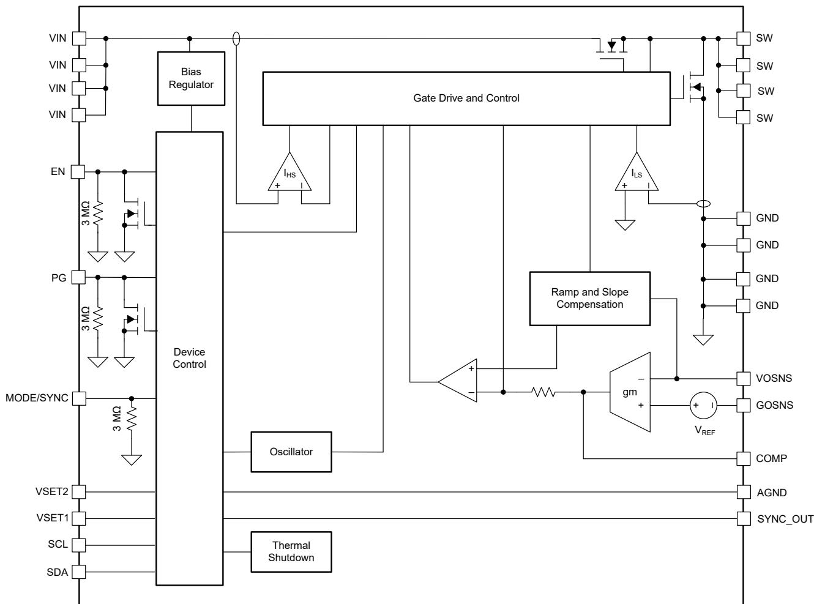

The diagram illustrates the internal architecture of the TPS6287Bxx devices. Key components include:

- VIN:** Input voltage pins connected to a common rail.
- Bias Regulator:** Provides bias voltage to the internal circuitry.
- EN (Enable):** Input pin with a 3 M $\Omega$  pull-up resistor to VIN. It controls the **Device Control** block.
- PG (Power Good):** Input pin with a 3 M $\Omega$  pull-up resistor to VIN. It is connected to the **Device Control** block.
- MODE/SYNC:** Input pin with a 3 M $\Omega$  pull-up resistor to VIN. It is connected to the **Device Control** block.
- VSET2, VSET1:** Input pins connected to the **Device Control** block.
- SCL, SDA:** I2C interface pins connected to the **Device Control** block.
- Thermal Shutdown:** Internal block connected to the **Device Control** block.
- Oscillator:** Internal block providing a clock signal to the **Gate Drive and Control** block.
- Gate Drive and Control:** Central block controlling the power switches. It includes current sense amplifiers  $I_{HS}$  and  $I_{LS}$ .
- Ramp and Slope Compensation:** Internal block providing compensation to the control loop.
- VOSNS, GOSNS:** Remote sense pins connected to a differential amplifier with gain  $g_m$  and a reference voltage  $V_{REF}$ .
- COMP:** Compensation pin connected to the control loop.
- AGND:** Analog ground pin.
- SYNC\_OUT:** Synchronization output pin.
- SW:** Power switch pins connected to the output inductor.
- GND:** Ground pins for the power switches and the output inductor.

Functional Block Diagram of the TPS6287Bxx devices showing internal components and pin connections.

{15}------------------------------------------------

### 8.3 Feature Description

#### 8.3.1 Fixed-Frequency DCS-Control Topology

Figure 8-1 shows a simplified block diagram of the fixed-frequency DCS-Control topology used in the TPS6287Bxx devices. This topology comprises an inner emulated current loop and an outer voltage-regulating loop.

![Figure 8-1: Fixed-Frequency DCS-Control Topology (Simplified). This block diagram illustrates the control architecture. It features a feedback loop where the output voltage (VOUT) is compared against a reference voltage (VREF) using an error amplifier. The error signal is processed by 'Control Logic' which includes a frequency source (fsw) and a switch (SW) to generate a clock for a flip-flop (R, Q). The flip-flop output (Q) drives a 'Gate Driver' for the power switch (MOSFET). The output of the switch is connected to an inductor (L) and a load resistor (RLoad). The inductor current is sensed via a sense resistor (RSNS) and fed back to the error amplifier. A 'Slope Compensation' block is shown, which adds a ramp signal to the feedback signal to ensure stable operation. The diagram also shows the input voltage (VIN) and the output capacitor (COUT).](a83ba9e3e2c1e21dd69953a7b09e45b4_img.jpg)

Figure 8-1: Fixed-Frequency DCS-Control Topology (Simplified). This block diagram illustrates the control architecture. It features a feedback loop where the output voltage (VOUT) is compared against a reference voltage (VREF) using an error amplifier. The error signal is processed by 'Control Logic' which includes a frequency source (fsw) and a switch (SW) to generate a clock for a flip-flop (R, Q). The flip-flop output (Q) drives a 'Gate Driver' for the power switch (MOSFET). The output of the switch is connected to an inductor (L) and a load resistor (RLoad). The inductor current is sensed via a sense resistor (RSNS) and fed back to the error amplifier. A 'Slope Compensation' block is shown, which adds a ramp signal to the feedback signal to ensure stable operation. The diagram also shows the input voltage (VIN) and the output capacitor (COUT).

Figure 8-1. Fixed-Frequency DCS-Control Topology (Simplified)

#### 8.3.2 Forced-PWM and Power-Save Modes

The device can control the inductor current in three different ways to regulate the output:

- Pulse-width modulation with continuous inductor current (PWM-CCM)
- Pulse-width modulation with discontinuous inductor current (PWM-DCM)
- Pulse-frequency modulation with discontinuous inductor current and pulse skipping (PFM-CCM)

During PWM-CCM operation, the device switches at a constant frequency and the inductor current is continuous (see Figure 8-2). PWM operation achieves the lowest output voltage ripple and the best transient performance.

Figure 8-2: Continuous Conduction Mode (CCM) Current Waveform. This graph plots 'Inductor Current' on the vertical axis against 'Time' on the horizontal axis. The waveform shows a sawtooth pattern where the current rises linearly to a peak and then falls linearly, never reaching zero. The time interval between two consecutive peaks is labeled as 1/fsw, representing the switching period.

Figure 8-2. Continuous Conduction Mode (CCM) Current Waveform

During PWM-DCM operation the device switches at a constant frequency and the inductor current is discontinuous (see Figure 8-3). In this mode the device controls the peak inductor current to maintain the selected switching frequency while still being able to regulate the output.

{16}------------------------------------------------

Figure 8-3: Discontinuous Conduction Mode (DCM) Waveform. A graph showing Inductor Current on the y-axis and Time on the x-axis. The waveform consists of a series of triangular pulses. The peak current of each pulse is constant. The time between the start of consecutive pulses is labeled as 1/fsw. The current returns to zero between pulses.

**Figure 8-3. Discontinuous Conduction Mode (DCM) Waveform**

During PFM-DCM operation the device keeps the peak inductor current constant (at a level corresponding to the minimum on-time of the converter) and skips pulses to regulate the output (see [Figure 8-4](#)). The switching pulses that occur during PFM-DCM operation are synchronized to the internal clock.

Figure 8-4: Discontinuous Conduction Mode (PFM-DCM) Current Waveform. A graph showing Inductor Current on the y-axis and Time on the x-axis. The waveform shows triangular pulses. The minimum on-time is indicated for the first pulse. Subsequent pulses are shown as dashed lines, labeled 'Skipped Pulses'. The time between the start of consecutive pulses is labeled as 1/fsw.

**Figure 8-4. Discontinuous Conduction Mode (PFM-DCM) Current Waveform**

Use [Equation 1](#) to calculate the output current threshold at which the device enters PFM-DCM:

$$I_{OUT(PFM)} = \frac{(V_{IN} - V_{OUT})}{2L} t_{ON}^2 \left( \frac{V_{IN}}{V_{OUT}} \right) f_{sw} \quad (1)$$

The following figure shows how this threshold typically varies with  $V_{IN}$  and  $V_{OUT}$  for a switching frequency of 1.5MHz.

| Output Voltage (V) | V IN = 2.7 V (A) | V IN = 3.3 V (A) | V IN = 5 V (A) |
|--------------------|-----------------------------|-----------------------------|---------------------------|
| 0.4                | 0.30                        | 0.48                        | 0.78                      |
| 0.5                | 0.22                        | 0.38                        | 0.62                      |
| 0.6                | 0.18                        | 0.30                        | 0.52                      |
| 0.7                | 0.15                        | 0.25                        | 0.45                      |
| 0.8                | 0.13                        | 0.20                        | 0.40                      |
| 0.9                | 0.11                        | 0.17                        | 0.36                      |
| 1.0                | 0.10                        | 0.15                        | 0.32                      |
| 1.1                | 0.09                        | 0.13                        | 0.29                      |
| 1.2                | 0.08                        | 0.12                        | 0.26                      |
| 1.3                | 0.07                        | 0.11                        | 0.24                      |
| 1.4                | 0.06                        | 0.10                        | 0.22                      |
| 1.5                | 0.05                        | 0.09                        | 0.20                      |
| 1.6                | 0.04                        | 0.08                        | 0.18                      |
| 1.7                | 0.03                        | 0.07                        | 0.16                      |

Figure 8-5: Output Current PFM-DCM Entry Threshold for fsw = 1.5MHz and L= 105nH. A line graph showing Output Current (A) on the y-axis (0 to 0.8) versus Output Voltage (V) on the x-axis (0.4 to 1.7). Three curves are shown for different input voltages: Vin = 2.7 V (black line), Vin = 3.3 V (red line), and Vin = 5 V (blue line). All curves show a decreasing trend as output voltage increases.

**Figure 8-5. Output Current PFM-DCM Entry Threshold for  $f_{sw} = 1.5MHz$  and  $L = 105nH$**

Configure the device to use either Forced-PWM (FPWM) mode or Power-Save Mode (PSM):

- In forced-PWM mode, the device uses PWM-CCM at all times.

{17}------------------------------------------------

- In power-save mode, the device uses PWM-CCM at medium and high loads, PWM-DCM at low loads, and PFM-DCM at very low loads. Transition between the different operating modes is seamless.

Table 8-1 shows the function table of the MODE/SYNC pin and the FPWMEN bit in the CONTROL1 register, which control the operating mode of the device.

**Table 8-1. FPWM Mode and Power-Save Mode Selection**

| MODE/SYNC Pin | FPWMEN Bit | Operating Mode | Remark                                |
|---------------|------------|----------------|---------------------------------------|
| Low           | 0          | PSM            | Do not use in a stacked configuration |
|               | 1          | FPWM           |                                       |
| High          | X          | FPWM           |                                       |
| Sync Clock    | X          | FPWM           |                                       |

#### **8.3.3 Transient Non-Synchronous Mode (optional)**

The TPS6287Bxx has a transient non-synchronous mode that helps to minimize the output voltage overshoot during a load release. When the high side FET is turned off, the decay in inductor current is mainly determined by the output voltage as there is little voltage drop over the low side FET. For very low output voltages the current decays slowly so the output voltage overshoot is typically larger than the undershoot during a load step. Non-synchronous mode turns off the low side FET for 6 switching cycles so the inductor current decays through the body diode. This adds extra voltage across the inductor so the current decays quicker and the output voltage overshoot is lower.

#### **8.3.4 Precise Enable**

The Enable (EN) pin is bidirectional, and has two functions:

- As an input, the pin enables and disables the DC/DC converter in the device.
- As an output, the pin provides a SYSTEM\_READY signal to other devices in a stacked configuration.

![Figure 8-6. Enable Functional Block Diagram. The diagram shows the internal logic of the Enable pin. The EN pin is connected to the non-inverting input (+) of a comparator. The inverting input (-) of the comparator is connected to a reference voltage VIT(EN). The output of the comparator is labeled 'ENABLE'. Below the comparator, there is an N-channel MOSFET with its gate connected to the 'ENABLE' output and its source connected to ground. The drain of the MOSFET is connected to the input of a logic AND gate. The other input to the AND gate is connected to the 'CONTROL3:SINGLE' pin. The output of the AND gate is labeled 'SYSTEM_READY'.](e928f4874ed492d3ad4c6fa2d29aedbc_img.jpg)

Figure 8-6. Enable Functional Block Diagram. The diagram shows the internal logic of the Enable pin. The EN pin is connected to the non-inverting input (+) of a comparator. The inverting input (-) of the comparator is connected to a reference voltage VIT(EN). The output of the comparator is labeled 'ENABLE'. Below the comparator, there is an N-channel MOSFET with its gate connected to the 'ENABLE' output and its source connected to ground. The drain of the MOSFET is connected to the input of a logic AND gate. The other input to the AND gate is connected to the 'CONTROL3:SINGLE' pin. The output of the AND gate is labeled 'SYSTEM\_READY'.

**Figure 8-6. Enable Functional Block Diagram**

Because there is an internal open-drain transistor connected to the EN pin, do not drive this pin directly from a low-impedance source. Instead, use a resistor to limit the current flowing into the EN pin (see Section 10.1).

When power is first applied to the VIN pin, the device pulls the EN pin low until the device has loaded the default register settings from nonvolatile memory and read the state of the VSET1, VSET2 and SYNC\_OUT pins. The device also pulls EN low if a fault such as thermal shutdown or overvoltage lockout occurs. In a stacked configuration all devices share a common enable signal, which means that the DC/DC converters in the stack cannot start to switch until *all* devices in the stack have completed the initialization. Similarly, a fault in one or more devices in the stack disables *all* converters in the stack (see Section 8.3.18).

In stand-alone (non-stacked) applications, you can disable the active pulldown of the EN pin if you set SINGLE = 1 in the CONTROL3 register. Fault conditions have no effect on the EN pin when SINGLE = 1. (Note that the EN pin is *always* pulled down during device initialization.) In stacked applications, make sure that SINGLE = 0.

When the internal SYSTEM\_READY signal is low (that is, initialization is complete and there are no fault conditions), the internal open-drain transistor is high impedance and the EN pin functions like a standard input:

{18}------------------------------------------------

A high level on the EN pin enables the DC/DC converter in the device and a low level disables the DC/DC converter in the device. (The I2C interface is enabled as soon as the device has completed the initialization and is not affected by the state of the internal ENABLE or SYSTEM\_READY signals.)

A low level on the EN pin forces the device into shutdown. During shutdown, the MOSFETs in the power stage are off, the internal control circuitry is disabled, and the device consumes only 20µA (typical).

The rising threshold voltage of the EN pin is 1.0V and the falling threshold voltage is 0.9V. The tolerance of the threshold voltages is ±30mV, which means that you can use the EN pin to implement precise turn-on and turn-off behavior.

#### 8.3.5 Start-Up

When the voltage on the VIN pin exceeds the positive-going UVLO threshold, the device initializes as follows:

- The device pulls the EN pin low.
- The device enables the internal reference voltage.
- The device reads the state of the VSET1, VSET2, VSET3, VSET4, FSET and SYNC\_OUT pins.
- The device loads the default values into the device registers.

When initialization is complete, the device enables I2C communication and releases the EN pin. The external circuitry controlling the EN pin now determines the behavior of the device:

- If the EN pin is low, the device is disabled: write to and read from the device registers, but the DC/DC converter does not operate.
- If the EN pin is high, the device is enabled: write to and read from the device registers and, after a short delay from EN pin going high, the DC/DC converter starts to ramp up the output.

Figure 8-7 shows the start-up sequence when the EN pin is pulled up to VIN.

![Timing diagram for Figure 8-7 showing the start-up sequence when the EN pin is pulled up to V_IN. The diagram shows four signals: V_IN, EN, V_OUT, and PG. V_IN rises above the UVLO threshold (VIT+(UVLO)). When it does, the EN pin is pulled low internally. After device initialization is complete, V_OUT begins to ramp up. The PG signal is undefined during the initialization period and then goes high after a delay (td(PG)). Timing parameters include t_d(EN)1 (delay from V_IN crossing UVLO to EN going low), t_d(RAMP) (output ramp time), and t_d(PG) (delay from V_OUT ramp start to PG going high).](99acc13de9c992bf42e0fcdddf0b09d3_img.jpg)

Timing diagram for Figure 8-7 showing the start-up sequence when the EN pin is pulled up to V\_IN. The diagram shows four signals: V\_IN, EN, V\_OUT, and PG. V\_IN rises above the UVLO threshold (VIT+(UVLO)). When it does, the EN pin is pulled low internally. After device initialization is complete, V\_OUT begins to ramp up. The PG signal is undefined during the initialization period and then goes high after a delay (td(PG)). Timing parameters include t\_d(EN)1 (delay from V\_IN crossing UVLO to EN going low), t\_d(RAMP) (output ramp time), and t\_d(PG) (delay from V\_OUT ramp start to PG going high).

**Figure 8-7. Start-Up Timing When EN is Pulled Up to VIN**

Figure 8-8 shows the start-up sequence when an external signal is connected to the EN pin.

{19}------------------------------------------------

Figure 8-8: Start-Up Timing When an External Signal is Connected to the EN Pin. This timing diagram shows the relationship between VIN, EN, VOUT, and PG pins. VIN rises above VIT+(UVLO), then EN rises above VIT+(EN). VOUT then ramps up from a prebias level to a final level. The ramp time is divided into tD(EN)2 and tD(RAMP). The PG pin goes from an undefined state to a high state after the ramp is complete, with a delay tD(PG).

**Figure 8-8. Start-Up Timing When an External Signal is Connected to the EN Pin**

The SSTIME[1:0] bits in the CONTROL2 register select the duration of the soft-start ramp:

- $t_{d(RAMP)} = 500\mu s$
- $t_{d(RAMP)} = 770\mu s$  (default for TPS6287BxxLA0)
- $t_{d(RAMP)} = 1ms$  (default for TPS6287BxxHA0, TPS6287BxxJE2 and TPS6287BxxVA0)
- $t_{d(RAMP)} = 2ms$

If the user programs the new output voltage setpoint (VSET[7:0]), output voltage range (VRANGE[1:0]), or soft-start time (SSTIME[1:0]) settings when the device has already begun the soft-start sequence, the device ignores the new values until the soft-start sequence is complete. For example, if the user changes the value of VSET[7:0] during soft start, the device first ramps to the value that VSET[7:0] had when the soft-start sequence began and then, when soft start is complete, ramps up or down to the new value.

The device can start up into a prebiased output. In this case, only a portion of the internal voltage ramp is seen externally (see Figure 8-9).

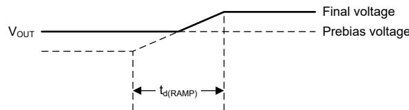

Figure 8-9: Start-Up into a Prebiased Output. This graph shows VOUT ramping from a prebias voltage level to a final voltage level. The ramp duration is labeled tD(RAMP).

**Figure 8-9. Start-Up into a Prebiased Output**

Note that the device *always* operates in DCM/PFM allowed during the start-up ramp, regardless of other configuration settings or operating conditions.

#### **8.3.6 Switching Frequency Selection, Only Applies to TPS6287BxxJE2**

During device initialization, a resistor-to-digital converter in the device determines the state of the FSET pin and sets the switching frequency of the DC/DC converter according to Table 8-2.

**Table 8-2. Switching Frequency Options**

| Resistor at FSET (1%) | Switching Frequency |
|-----------------------|---------------------|
| 6.2 kΩ to GND         | 1.5 MHz             |
| Short to GND          | 2.25 MHz            |
| Short to VIN          | 2.5 MHz             |
| 47 kΩ to VIN          | 3 MHz               |

{20}------------------------------------------------

The following figure shows a simplified block diagram of the R2D converter used to detect the state of the FSET pin (an identical circuit detects the state of the VSET pin – see *Output Voltage Setpoint*).

![Figure 8-10. FSET R2D Converter Functional Block Diagram. The diagram shows a circuit with an input voltage VIN connected to a switch S1. S1 is in series with a 6.5 kΩ resistor. The other end of this resistor is connected to the FSET pin and a node. From this node, a 1.6 kΩ resistor is connected to a switch S2, which is then connected to ground. The FSET pin is also connected to the non-inverting input (+) of a comparator. The comparator's output is the signal from the R2D converter. The comparator's inverting input (-) is connected to the node between the 6.5 kΩ and 1.6 kΩ resistors. The comparator's input levels are specified as VIL = < 0.4 V and VIH = > 0.8 V.](a3472689858b068ef469213682965325_img.jpg)

Figure 8-10. FSET R2D Converter Functional Block Diagram. The diagram shows a circuit with an input voltage VIN connected to a switch S1. S1 is in series with a 6.5 kΩ resistor. The other end of this resistor is connected to the FSET pin and a node. From this node, a 1.6 kΩ resistor is connected to a switch S2, which is then connected to ground. The FSET pin is also connected to the non-inverting input (+) of a comparator. The comparator's output is the signal from the R2D converter. The comparator's inverting input (-) is connected to the node between the 6.5 kΩ and 1.6 kΩ resistors. The comparator's input levels are specified as VIL = < 0.4 V and VIH = > 0.8 V.

**Figure 8-10. FSET R2D Converter Functional Block Diagram**

Detection of the state of the FSET pin works as follows:

To detect the most significant bit (MSB), the circuit opens S1 and S2, and the input buffer detects if a high or a low level is connected to the FSET pin.

To detect the least significant bit (LSB):

- If the MSB is 0, the circuit closes S1. If the input buffer detects a high level, the LSB = 1; if the circuit detects a low level, the LSB = 0.
- If the MSB is 1, the circuit closes S2. If the input buffer detects a low level, the LSB = 0; if the circuit detects a high level, the LSB = 1.

The propagation delay of the current-sensing comparator limits the minimum on-time of the device. In practice, this means that the maximum switching frequency the device can support decreases with small duty cycles. *Figure 6-5* shows the practical operating range of the device with 3.3-V and 5-V supplies.

#### 8.3.7 Output Voltage Setting

##### 8.3.7.1 Output Voltage Range

The device has three different voltage ranges. The VRANGE[1:0] bits in the CONTROL1 register control which range is active (see *Table 8-3*). For TPS6287BxxHA0, TPS6287BxxJE2 and TPS6287BxxVA0 the default output voltage range after device initialization is 0.4 V to 1.675 V in 5-mV steps. For TPS6287BxxLA0, the default output voltage range after device initialization is 0.4 V to 1.0375V in 2.5mV steps.

**Table 8-3. Voltage Ranges**

| VRANGE[1:0] | Voltage Range                     |
|-------------|-----------------------------------|
| 0b00        | 0.4 V to 0.71875V in 1.25mV steps |
| 0b01        | 0.4 V to 1.0375V in 2.5mV steps   |
| 0b10        | 0.4V to 1.675V in 5mV steps       |
| 0b11        | 0.4V to 1.675V in 5mV steps       |

{21}------------------------------------------------

Note that every change to the VRANGE[1:0] bits must be followed by a write to the VSET register – even if the value of the VSET[7:0] bits does not change. This sequence is necessary for the device to start to use the new voltage range.

##### **8.3.7.2 Output Voltage Setpoint**

Together with the selected range, the VSET[7:0] bits in the VSET register control the output voltage setpoint of the device (see [Table 8-4](#)).

**Table 8-4. Start-Up Voltage Settings**

| VRANGE[1:0] | Output Voltage Setpoint          |
|-------------|----------------------------------|
| 0b00        | $0.4V + VSET[7:0] \times 1.25mV$ |
| 0b01        | $0.4V + VSET[7:0] \times 2.5mV$  |
| 0b10        | $0.4V + VSET[7:0] \times 5mV$    |
| 0b11        | $0.4V + VSET[7:0] \times 5mV$    |

During initialization, the device reads the state of the VSET1 and VSET2 pins and selects the default output voltage according to . Note that the VSET1 and VSET2 pins also selects the I2C target address of the device (see below). Please see the *Device Options* table for the complete list of device versions and the output voltage setpoint.

**Table 8-5. Default Output Voltage Setpoints for TPS6287BxxL**

| VSET1 Pin                        | VSET2 Pin                        | I 2 C Device Address | Output Voltage Setpoint |
|----------------------------------|----------------------------------|---------------------------------|-------------------------|
| Short Circuit to GND             | Short Circuit to GND             | 0x45                            | 400mV                   |
| Short Circuit to GND             | 6.2kΩ to GND                     | 0x44                            | 425mV                   |
| Short Circuit to GND             | 47kΩ to V IN          | 0x47                            | 450mV                   |
| Short Circuit to GND             | Short Circuit to V IN | 0x46                            | 475mV                   |
| 6.2kΩ to GND                     | Short Circuit to GND             | 0x45                            | 500mV                   |
| 6.2kΩ to GND                     | 6.2kΩ to GND                     | 0x44                            | 525mV                   |
| 6.2kΩ to GND                     | 47kΩ to V IN          | 0x47                            | 550mV                   |
| 6.2kΩ to GND                     | Short Circuit to V IN | 0x46                            | 575mV                   |
| 47kΩ to V IN          | Short Circuit to GND             | 0x45                            | 600mV                   |
| 47kΩ to V IN          | 6.2kΩ to GND                     | 0x44                            | 625mV                   |
| 47kΩ to V IN          | 47kΩ to V IN          | 0x47                            | 650mV                   |
| 47kΩ to V IN          | Short Circuit to V IN | 0x46                            | 675mV                   |
| Short Circuit to V IN | Short Circuit to GND             | 0x45                            | 700mV                   |
| Short Circuit to V IN | 6.2kΩ to GND                     | 0x44                            | 725mV                   |
| Short Circuit to V IN | 47kΩ to V IN          | 0x47                            | 750mV                   |
| Short Circuit to V IN | Short Circuit to V IN | 0x46                            | 775mV                   |

**Table 8-6. Default Output Voltage Setpoints for TPS6287BxxH**

| VSET1 Pin               | VSET2 Pin                        | I 2 C Device Address | Output Voltage Setpoint |
|-------------------------|----------------------------------|---------------------------------|-------------------------|
| Short Circuit to GND    | Short Circuit to GND             | 0x45                            | 800mV                   |
| Short Circuit to GND    | 6.2kΩ to GND                     | 0x44                            | 850mV                   |
| Short Circuit to GND    | 47kΩ to V IN          | 0x47                            | 900mV                   |
| Short Circuit to GND    | Short Circuit to V IN | 0x46                            | 950mV                   |
| 6.2kΩ to GND            | Short Circuit to GND             | 0x45                            | 1000mV                  |
| 6.2kΩ to GND            | 6.2kΩ to GND                     | 0x44                            | 1050mV                  |
| 6.2kΩ to GND            | 47kΩ to V IN          | 0x47                            | 1100mV                  |
| 6.2kΩ to GND            | Short Circuit to V IN | 0x46                            | 1150mV                  |
| 47kΩ to V IN | Short Circuit to GND             | 0x45                            | 1200mV                  |

{22}------------------------------------------------

**Table 8-6. Default Output Voltage Setpoints for TPS6287BxxH (continued)**

| VSET1 Pin                        | VSET2 Pin                        | I 2 C Device Address | Output Voltage Setpoint |
|----------------------------------|----------------------------------|---------------------------------|-------------------------|
| 47kΩ to V IN          | 6.2kΩ to GND                     | 0x44                            | 1250mV                  |
| 47kΩ to V IN          | 47kΩ to V IN          | 0x47                            | 1300mV                  |
| 47kΩ to V IN          | Short Circuit to V IN | 0x46                            | 1350mV                  |
| Short Circuit to V IN | Short Circuit to GND             | 0x45                            | 1400mV                  |
| Short Circuit to V IN | 6.2kΩ to GND                     | 0x44                            | 1450mV                  |
| Short Circuit to V IN | 47kΩ to V IN          | 0x47                            | 1500mV                  |
| Short Circuit to V IN | Short Circuit to V IN | 0x46                            | 1550mV                  |

**Table 8-7. Default Voltage Setpoints for TPS6287BxxV**

| VSET1 Pin                        | VSET2 Pin                        | VSET4 = LOW |              | VSET4=HIGH  |              |
|----------------------------------|----------------------------------|-------------|--------------|-------------|--------------|
|                                  |                                  | VSET3 = LOW | VSET3 = HIGH | VSET3 = LOW | VSET3 = HIGH |
| Short Circuit to GND             | Short Circuit to GND             | 400mV       | 425mV        | 900mV       | 925mV        |
| Short Circuit to GND             | 6.2kΩ to GND                     | 450 mV      | 475 mV       | 950 mV      | 975 mV       |
| Short Circuit to GND             | 47kΩ to V IN          | 500 mV      | 525 mV       | 1000 mV     | 1025 mV      |
| Short Circuit to GND             | Short Circuit to V IN | 550 mV      | 575 mV       | 1050 mV     | 1075 mV      |
| 6.2kΩ to GND                     | Short Circuit to GND             | 600mV       | 625 mV       | 1100 mV     | 1125 mV      |
| 6.2kΩ to GND                     | 6.2kΩ to GND                     | 650 mV      | 675 mV       | 1150 mV     | 1175 mV      |
| 6.2kΩ to GND                     | 47kΩ to V IN          | 700 mV      | 725 mV       | 1200 mV     | 1225 mV      |
| 6.2kΩ to GND                     | Short Circuit to V IN | 750 mV      | 775 mV       | 1250 mV     | 1275 mV      |
| 47kΩ to V IN          | Short Circuit to GND             | 800 mV      | 825 mV       | 1300 mV     | 1325 mV      |
| 47kΩ to V IN          | 6.2kΩ to GND                     | 850 mV      | 875 mV       | 1350 mV     | 1375 mV      |
| 47kΩ to V IN          | 47kΩ to V IN          | 900 mV      | 925 mV       | 1400 mV     | 1425 mV      |
| 47kΩ to V IN          | Short Circuit to V IN | 950 mV      | 975 mV       | 1450 mV     | 1475 mV      |
| Short Circuit to V IN | Short Circuit to GND             | 1000 mV     | 1025 mV      | 1500 mV     | 1525 mV      |
| Short Circuit to V IN | 6.2kΩ to GND                     | 1050 mV     | 1075 mV      | 1550 mV     | 1575 mV      |
| Short Circuit to V IN | 47kΩ to V IN          | 1100 mV     | 1125 mV      | 1600 mV     | 1625 mV      |
| Short Circuit to V IN | Short Circuit to V IN | 1150 mV     | 1175 mV      | 1650 mV     | 1675 mV      |

**Table 8-8. Default Output Voltage Setpoints for TPS6287BxxJE2**

| VSEL Pin 1            | VSET[7:0] | I 2 C Device Address | Output Voltage Setpoint |
|----------------------------------|-----------|---------------------------------|-------------------------|
| 6.2kΩ to GND                     | 0x50      | 0x44                            | 800mV                   |
| Short-Circuit to GND             | 0x50      | 0x45                            | 800mV                   |
| Short-Circuit to V IN | 0x5F      | 0x46                            | 875mV                   |
| 47kΩ to V IN          | 0x50      | 0x47                            | 800mV                   |

If you program new output voltage setpoint (VSET[7:0]), output voltage range (VRANGE[1:0]), or soft-start time (SSTIME[1:0]) settings when the device has already begun the soft-start sequence, the device ignores the new values until the soft-start sequence is complete. For example, if you change the value of VSET[7:0] during soft-start, the device first ramps to the value that VSET[7:0] had when the soft-start sequence began and then, when soft-start is complete, ramps up or down to the new value.

If the user changes VSET[7:0], VRAMP[1:0], or SSTIME[1:0] while EN is low, the device uses the new values the next time the user enables it.

During start-up the output voltage ramps up to the target value set by the VSET1 and VSET2 pins before ramping up or down to any new value programmed to the device over the I2C interface.

1 For reliable voltage setting, make sure that there is no stray current path connected to the VSEL pin and that the parasitic capacitance between the VSET1 and VSET2 pins and GND is less than 30pF.

{23}------------------------------------------------

##### 8.3.7.3 Non-Default Output Voltage Setpoint

If none of the default voltage range, voltage setpoint combinations are an excellent choice for the application, the user can change these device settings through I2C before enabling the device. Then, when pulling the EN pin high, the device starts up with the desired start-up voltage.

Note that if you change the device settings through I2C *while the device is ramping*, the device ignores the changes until the ramp is complete.

##### 8.3.7.4 Dynamic Voltage Scaling

If you change the output voltage setpoint while the DC/DC converter is operating, the device ramps up or down to the new voltage setting in a controlled way.

The VRAMP[1:0] bits in the CONTROL1 register set the slew rate when the device ramps from one voltage to another during DVS (see [Table 8-9](#)).

**Table 8-9. Dynamic Voltage Scaling Slew Rate**

| VRAMP[1:0]     | DVS Slew Rate |
|----------------|---------------|
| 0b00           | 10mV/μs       |
| 0b01           | 5mV/μs        |
| 0b10 (default) | 1.25mV/μs     |
| 0b11           | 0.5mV/μs      |

Note that ramping the output to a higher voltage requires additional output current, so that during DVS the converter must generate a total output current given by:

$$I_{OUT} = I_{OUT(DC)} + C_{OUT} \frac{dV_{OUT}}{dt} \quad (2)$$

where:

- $I_{OUT}$  is the total current the converter must generate while ramping to a higher voltage
- $I_{OUT(DC)}$  is the DC load current
- $C_{OUT}$  is the total output capacitance
- $dV_{OUT}/dt$  is the slew rate of the output voltage (programmable in the range 0.5mV/μs to 10mV/μs)

For correct operation, make sure that the total output current during DVS does not exceed the current limit of the device.

##### 8.3.7.5 Droop Compensation

Droop compensation scales the nominal output voltage based on the output current. This action is done such that the output voltage is set to a higher value with no output current and to a lower value than the nominal value with the maximum output current. Droop compensation therefore provides a higher margin during a load transient and helps to keep the output voltage within a certain tolerance band in case of a heavy load step or at load release or allows to use a lower output capacitance. The voltage scaling is absolute instead of relative. The voltage scaling vs output current depends on the output current version of TPS6287Bxx based on the rated output current of 10A, 15A, 20A, 25A and 30A, respectively. The behavior is shown in the graph in [Figure 8-11](#). See the [Device Options](#) table for the specific version if droop compensation is disabled or enabled by default. Droop compensation can be enabled by bit CONTROL3:DROOPEN. Enabling droop compensation must be done while the device is disabled otherwise a transient output voltage deviation can occur.

{24}------------------------------------------------

Figure 8-11: Voltage Scaling With Output Current. A line graph showing Output Voltage on the y-axis versus Output Current on the x-axis. The y-axis has markers at +12 mV, Nominal Output Voltage, and -12 mV. The x-axis has markers at 0 A, 50% of rated output current, and Rated output current. A straight line starts at +12 mV on the y-axis at 0 A, crosses the x-axis at 50% of rated output current, and continues to -12 mV at the Rated output current.

**Figure 8-11. Voltage Scaling With Output Current**

#### 8.3.8 Compensation (COMP)

The COMP pin is the connection point for an external compensation network. A series-connected resistor and capacitor to AGND is sufficient for typical applications and provides enough scope to optimize the loop response for a wide range of operating conditions.

When using multiple devices in a stacked configuration, all devices share a common compensation network, and the COMP pin makes sure of equal current sharing between the devices (see [Section 8.3.18](#)).

#### 8.3.9 Mode Selection / Clock Synchronization (MODE/SYNC)

A high level on the MODE/SYNC pin selects forced-PWM operation. A low level on the MODE/SYNC pin selects power-save operation, in which the device automatically transitions between PWM and PFM, according to the load conditions.

If you apply a valid clock signal to the MODE/SYNC pin, the device synchronizes the switching cycles to the external clock and automatically selects forced-PWM operation.

The MODE/SYNC pin is logically ORed with the FPWMEN bit in the CONTROL1 register (see [Table 8-1](#)).

When multiple devices are used together in a stacked configuration the MODE/SYNC pin of the secondary devices is the input for the clock signal (see [Section 8.3.18](#)).

#### 8.3.10 Spread Spectrum Clocking (SSC)

The device has a spread spectrum clocking function that can reduce electromagnetic interference (EMI). When the SSC function is active, the device modulates the switching frequency  $\pm 10\%$  about the nominal value. The frequency modulation has a triangular characteristic (see [Figure 8-12](#)).

Figure 8-12: Spread Spectrum Clocking Behavior. A graph showing Switching Frequency on the y-axis versus Time on the x-axis. The y-axis has markers at +10%, Nominal fsw, and -10%. The x-axis shows a triangular wave oscillating between +10% and -10% of the nominal switching frequency. The period of one full cycle is labeled as 2048/fsw.

**Figure 8-12. Spread Spectrum Clocking Behavior**

{25}------------------------------------------------

To use the SSC function, make sure that:

- SSCEN = 1 in the CONTROL1 register
- Forced-PWM operation is selected (MODE pin is high or FPWMEN = 1 in the CONTROL1 register)
- The device is not synchronized to an external clock

To disable the SSC function, make sure that SCCEN = 0 in the CONTROL1 register.

To use the SSC function with multiple devices in a stacked configuration, make sure that the primary converter runs from the internal oscillator and synchronize all secondary converters to the primary clock (see [Section 10.4](#)).

#### **8.3.11 Output Discharge**

The device has an output discharge function which makes sure of a defined ramp down of the output voltage when the device is disabled and keeps the output voltage close to 0V while the device is off. The output discharge function is enabled when DISCHEN = 1 in the CONTROL1 register. The output discharge function is enabled by default.

If enabled, the device discharges the output under the following conditions:

- A low level is applied to the EN pin
- SWEN = 0 in the CONTROL1 register
- A thermal shutdown event occurs
- An UVLO event occurs
- An OVLO event occurs

The output discharge function is not available until you have enabled the device at least once after power up. During power-down, the device continues to discharge the output for as long as the supply voltage is greater than approximately 1.8V.

#### **8.3.12 Undervoltage Lockout (UVLO)**

The TPS6287Bxx has an undervoltage lockout function that disables the device if the supply voltage is too low for correct operation. The negative-going threshold of the UVLO function is 2.5V (typical). If the supply voltage decreases below this value, the device stops switching and, if DISCHEN = 1 in the CONTROL1 register, turns on the output discharge.

#### **8.3.13 Overvoltage Lockout (OVLO)**

The TPS6287Bxx has an overvoltage lockout function that disables the DC/DC converter if the supply voltage is too high for correct operation. The positive-going threshold of the OVLO function is 6.3V (typical). If the supply voltage increases above this value, the device stops switching and, if DISCHEN = 1 in the CONTROL1 register, turns on the output discharge.

The device automatically starts switching again – the device begins a new soft-start sequence – when the supply voltage falls below 6.2V (typical).

#### **8.3.14 Overcurrent Protection**

##### **8.3.14.1 Cycle-by-Cycle Current Limiting**

If the peak inductor current increases above the high-side current limit threshold, the device turns off the high-side switch and turns on the low-side switch to ramp down the inductor current. The device only turns on the high-side switch again if the inductor current has decreased below the low-side current limit threshold.

Note that because of the propagation delay of the current limit comparator, the current limit threshold in practice can be greater than the DC value specified in the Electrical Characteristics. The current limit in practice is given by:

{26}------------------------------------------------

$$I_L = I_{LIMH} + \left( \frac{V_{IN} - V_{OUT}}{L} \right) t_{pd} \quad (3)$$

where:

- $I_L$  is the peak inductor current
- $I_{LIMH}$  is the high-side current limit threshold measured at DC
- $V_{IN}$  is the input voltage
- $V_{OUT}$  is the output voltage
- $L$  is the effective inductance at the peak current level
- $t_{pd}$  is the propagation delay of the current limit comparator (typically 50ns)

##### 8.3.14.2 Hiccup Mode

To enable hiccup operation, make sure that HICCUPEN = 1 in the CONTROL1 register. The HICCUP function is disabled by default.

If hiccup operation is enabled and the high-side switch current exceeds the current limit threshold on 32 consecutive switching cycles, the device:

- Stops switching for 128µs, after which the device automatically starts switching again (starts a new soft-start sequence).
- Sets the HICCUP bit in the STATUS register.
- Pulls the PG pin low. The PG pin stays low until the overload condition goes away and the device can start up correctly and regulate the output voltage. Note that power-good function has a deglitch circuit, which delays the rising edge of the power-good signal by 40µs (typical).

Hiccup operation continues – in a repeating sequence of 32 cycles in current limit, followed by a pause of 128µs, followed by a soft-start attempt – for as long as the output overload condition exists.

The device clears the HICCUP bit if you read the STATUS register when the overload condition has been removed.

##### 8.3.14.3 Current-Limit Mode

To enable current-limit mode, make sure that HICCUPEN = 0 in the CONTROL1 register.

When current limit operation is enabled, the device limits the high-side switch current cycle-by-cycle for as long as the overload condition exists. If the device limits the high-side switch current for four or more consecutive switching cycle, the device sets ILIM = 1 in the STATUS register.

The device clears the ILIM bit if the user reads the STATUS register when the overload condition no longer exists.

#### 8.3.15 Power Good (PG)

The Power-Good (PG) pin is bidirectional and has two functions:

- In a standalone configuration, and in the primary device of a stacked configuration, the PG pin is an open-drain output that indicates the status of the converter or stack.
- In a secondary device of a stacked configuration, the PG pin is an input that indicates when the soft-start sequence is complete and all converters in the stack can change from DCM switching to CCM switching.

{27}------------------------------------------------

![Timing diagram for Figure 8-13. PG Timing. It shows the relationship between the Power Good (PG) signal and the output voltage (VOUT) relative to Overvoltage Protection (OVP) and Undervoltage Protection (UVP) thresholds. The PG signal is low when VOUT is below V_T-(OVP) or above V_T+(OVP), and high when VOUT is between V_T-(OVP) and V_T+(OVP). The diagram illustrates the delay t_d(PG) from the point where VOUT crosses the threshold to the point where the PG signal changes state. It also shows the PG signal going low during a soft start period and during thermal shutdown or disable.](abc0eb594f9d2c0daa0e60df05f2a666_img.jpg)

Timing diagram for Figure 8-13. PG Timing. It shows the relationship between the Power Good (PG) signal and the output voltage (VOUT) relative to Overvoltage Protection (OVP) and Undervoltage Protection (UVP) thresholds. The PG signal is low when VOUT is below V\_T-(OVP) or above V\_T+(OVP), and high when VOUT is between V\_T-(OVP) and V\_T+(OVP). The diagram illustrates the delay t\_d(PG) from the point where VOUT crosses the threshold to the point where the PG signal changes state. It also shows the PG signal going low during a soft start period and during thermal shutdown or disable.

Figure 8-13. PG Timing

##### 8.3.15.1 Standalone, Primary Device Behavior

The primary purpose of the PG pin is to indicate if the output voltage is in regulation, but the PG pin also indicates if the device is in thermal shutdown or disabled. Table 8-10 summarizes the behavior of the PG pin in a stand-alone or primary device.

Table 8-10. Power-Good Function Table

| V IN                                                   | EN | V OUT                                                                   | SOFT START | PGBLNKDVS AND DVS_active | T J                   | PG        |
|-------------------------------------------------------------------|----|------------------------------------------------------------------------------------|------------|--------------------------|----------------------------------|-----------|
| V IN < 2V                                              | X  | X                                                                                  | X          | X                        | X                                | Undefined |
| V IT-(UVLO) ≥ V IN ≥ 2V                     | X  | X                                                                                  | X          | X                        | X                                | Low       |
| V IT-(UVLO) < V IN < V IT+(OVLO) | L  | X                                                                                  | X          | X                        | X                                | Low       |
|                                                                   | H  | X                                                                                  | Active     | X                        | X                                | Low       |
|                                                                   |    | V OUT > V T+(OVP) or V OUT < V T-(UVP) | Inactive   | 0                        | X                                | low       |
|                                                                   |    | V T-(OVP) > V OUT > V T+(UVP)                     |            | 1                        | T J < T SD | Hi-Z      |
|                                                                   |    | X                                                                                  | X          | X                        | T J < T SD | Hi-Z      |
| V IN > V IT+(OVLO)                          | X  | X                                                                                  | X          | X                        | T J > T SD | Low       |
|                                                                   |    | X                                                                                  | X          | X                        | X                                | Low       |

Figure 8-14 shows a functional block diagram of the power-good function in a stand-alone or primary device. A window comparator monitors the output voltage, and the output of the comparator goes high if the output voltage is either less than 95% (typical) or greater than 105% (typical) of the nominal output voltage. The output of the window comparator is deglitched – the typical deglitch time is 40μs – and then used to drive the open-drain PG pin.

{28}------------------------------------------------

![Figure 8-14. Power-Good Functional Block Diagram (Standalone / Primary Device). The diagram shows the internal logic for power-good detection. It includes a Hiccup Control block receiving CONTROL1:HICCUPEN and outputting to converter control logic and a STATUS Register. The STATUS Register outputs PBOV, PBUV, ILIM, and HICCUP. A Current Comparator receives Isw and feeds into the Hiccup Control and a 4 Consecutive Pulses Detection block, which also feeds into the STATUS Register. A Window Comparator receives Vout and feeds into a 40-µs Deglitch block, which then feeds into a Blanking block. The Blanking block also receives DVS Active and CONTROL3:PGBLNKDVS signals. The Blanking block output and the STATUS Register HICCUP output are combined with Thermal Shutdown conditions (VIN > VIT(OVLO), VIN < VIT(UVLO), VEN < VIT(EN)) in an OR gate to control the PG pin via a PMOS transistor.](28d75f39a24203712ee907b32cf0bbe5_img.jpg)

Figure 8-14. Power-Good Functional Block Diagram (Standalone / Primary Device). The diagram shows the internal logic for power-good detection. It includes a Hiccup Control block receiving CONTROL1:HICCUPEN and outputting to converter control logic and a STATUS Register. The STATUS Register outputs PBOV, PBUV, ILIM, and HICCUP. A Current Comparator receives Isw and feeds into the Hiccup Control and a 4 Consecutive Pulses Detection block, which also feeds into the STATUS Register. A Window Comparator receives Vout and feeds into a 40-µs Deglitch block, which then feeds into a Blanking block. The Blanking block also receives DVS Active and CONTROL3:PGBLNKDVS signals. The Blanking block output and the STATUS Register HICCUP output are combined with Thermal Shutdown conditions (VIN > VIT(OVLO), VIN < VIT(UVLO), VEN < VIT(EN)) in an OR gate to control the PG pin via a PMOS transistor.

**Figure 8-14. Power-Good Functional Block Diagram (Standalone / Primary Device)**

During DVS activity, when the DC/DC converter transitions from one output voltage setting to another, the output voltage can temporarily exceed the limits of the window comparator and pull the PG pin low. The device has a feature to disable this behavior: if PGBLNKDVS = 1 in the CONTROL3 register, the device ignores the output of the power-good window comparator while DVS is active.

Note that the PG pin is always low – regardless of the output of the window comparator – when:

- The device is in thermal shutdown
- The device is disabled
- The device is in undervoltage lockout
- The device is in overvoltage lockout
- The device is in soft start
- The device is in HICCUP mode

##### 8.3.15.2 Secondary Device Behavior

Figure 8-15 shows a functional block diagram of the power-good function in a secondary device. During initialization, the device presets FF2, which pulls down the PG pin and forces the devices in a stack to operate in DCM. When the device completes the internal start-up sequence, the device resets FF2, which turns off Q1. In a stacked configuration all devices share the same PG signal, and therefore the PG pin stays low until *all* devices in the stack have completed the start-up. When that happens, FF1 is set and the converters operate in CCM. FF1 and FF2 are preset such that DCM is allowed each time the converter is disabled, either by the EN pin, EN bit, thermal shutdown or UVLO.

{29}------------------------------------------------

![Figure 8-15. Power-Good Functional Block Diagram (Secondary Device). The diagram shows a functional block diagram for a secondary device. It includes two flip-flops, FF1 and FF2. FF1 is connected to a Latch, which is connected to the DCM / CCM input. FF1 also has an Input Buffer with VIL = < 0.4 V and VIH = > 0.8 V. The output of the Input Buffer is connected to the PG pin. FF2 is connected to a Latch, which is connected to the Internal start-up sequence completed input. The output of the Latch is connected to the gate of a PMOS transistor Q1, which is connected to the PG pin and ground.](fa01531ea2c45beeb4036005da3037a4_img.jpg)

Figure 8-15. Power-Good Functional Block Diagram (Secondary Device). The diagram shows a functional block diagram for a secondary device. It includes two flip-flops, FF1 and FF2. FF1 is connected to a Latch, which is connected to the DCM / CCM input. FF1 also has an Input Buffer with VIL = < 0.4 V and VIH = > 0.8 V. The output of the Input Buffer is connected to the PG pin. FF2 is connected to a Latch, which is connected to the Internal start-up sequence completed input. The output of the Latch is connected to the gate of a PMOS transistor Q1, which is connected to the PG pin and ground.

Figure 8-15. Power-Good Functional Block Diagram (Secondary Device)

#### 8.3.16 Remote Sense

The device has two pins, VOSNS and GOSNS, to remotely sense the output voltage. Remote sensing lets the converter sense the output voltage directly at the point-of-load and increases the accuracy of the output voltage regulation.

In a stacked configuration, you must connect the VOSNS and GOSNS of the primary device directly at the point-of-load. For the secondary devices, you can connect the VOSNS and GOSNS pins to the local output capacitor or both pins to AGND (see [Section 8.3.18](#)).

#### 8.3.17 Thermal Warning and Shutdown

The device has a two-level overtemperature detection function.

If the junction temperature rises above the thermal warning threshold of 150 °C (typical), the device sets the TWARN bit in the STATUS register. The device clears the TWARN bit if you read the STATUS register when the junction temperature is below the TWARN threshold of 130°C (typical).

If the junction temperature rises above the thermal shutdown threshold of 170°C (typical), the device:

- Stops switching
- Pulls down the EN pin (if SINGLE = 0 in the CONTROL3 register)
- Enables the output discharge (if DISCHEN = 1 in the CONTROL1 register)
- Sets the TSHUT bit in the STATUS register
- Pulls the PG pin low

If the junction temperature falls below the thermal shutdown threshold of 150°C (typical), the device:

- Starts switching again, starting with a new soft-start sequence
- Sets the EN pin to high impedance
- Sets the PG pin to high-impedance

The device clears the TSHUT bit if you read the STATUS register when the junction temperature is below the TSHUT threshold of 150°C (typical).

In a stacked configuration, in which all devices share a common enable signal, a thermal shutdown condition in one device disables the entire stack. When the hot device cools down, the whole stack automatically starts switching again.

#### 8.3.18 Stacked Operation

Connect multiple TPS6287Bxx devices in parallel in what is known as a "stack"; for example, to increase output current capability or reduce device junction temperature. A stack comprises one *primary* device and one or more *secondary* devices. During initialization, each device monitors the SYNCOUT pin to determine if the device must operate as a primary device or a secondary device:

{30}------------------------------------------------

- If there is a  $47\text{k}\Omega$  resistor between the SYNCOUT pin and ground, the device operates as a secondary device
- If the SYNCOUT pin is high impedance, the device operates as a primary device

Figure 8-16 shows the recommended interconnections in a stack of two TPS6287Bxx devices.

{31}------------------------------------------------

![Schematic diagram of two TPS6287Bxx devices in a stacked configuration. The primary device (top) is connected to VIN (2.7V to 6V), VIO, I2C, and a load. It has a feedback loop with VSET1/VSET2 pins connected to resistors RVSET1 and RVSET2. Its SW pin is connected to a 100 nH inductor and a 100 pF capacitor. Its VOSNS and GOSNS pins are connected to a 100 pF capacitor. Its SYNC_OUT pin is connected to the MODE/SYNC pin of the secondary device. The secondary device (bottom) is connected to the primary device's SW pin, VIO, and a 47 kΩ resistor. Its SW pin is connected to a 100 nH inductor and a 100 pF capacitor. Its VOSNS and GOSNS pins are connected to a 100 pF capacitor. Its SYNC_OUT pin is connected to the primary device's SYNC_OUT pin. Both devices have AGND, GND, and PG pins connected to ground.](14252bcd35912bd656e98b16b2ee51c0_img.jpg)

Schematic diagram of two TPS6287Bxx devices in a stacked configuration. The primary device (top) is connected to VIN (2.7V to 6V), VIO, I2C, and a load. It has a feedback loop with VSET1/VSET2 pins connected to resistors RVSET1 and RVSET2. Its SW pin is connected to a 100 nH inductor and a 100 pF capacitor. Its VOSNS and GOSNS pins are connected to a 100 pF capacitor. Its SYNC\_OUT pin is connected to the MODE/SYNC pin of the secondary device. The secondary device (bottom) is connected to the primary device's SW pin, VIO, and a 47 kΩ resistor. Its SW pin is connected to a 100 nH inductor and a 100 pF capacitor. Its VOSNS and GOSNS pins are connected to a 100 pF capacitor. Its SYNC\_OUT pin is connected to the primary device's SYNC\_OUT pin. Both devices have AGND, GND, and PG pins connected to ground.

**Figure 8-16. Two TPS6287Bxx Devices in a Stacked Configuration**

The key points to note are:

- All the devices in the stack share a common enable signal, which must be pulled up with a resistance of at least 15kΩ.

{32}------------------------------------------------

- All the devices in the stack share a common power-good signal.
- All the devices in the stack share a common compensation signal.
- All secondary devices must connect a 47kΩ resistor between the SYNC\_OUT pin and ground.
- The remote sense pins (VOSNS and GOSNS) *of each device* must be connected (do not leave these pins floating).
- VOSNS and GOSNS of the primary device must be connected to the capacitor at the load
- VOSNS and GOSNS of the secondary devices can either be connected to the output capacitor at the device or alternatively both pins can be tied to AGND.
- The primary device must be configured for forced-PWM operation (secondary devices are automatically configured for forced-PWM operation).
- A stacked configuration can support synchronization to an external clock or spread-spectrum clocking.
- Only the VSET1 and VSET2 pins of the primary device is used to set the default output voltage. The VSET1 and VSET2 pins of secondary devices is not used and must be connected to ground.
- The SDA and SCL pins of secondary devices are not used and must be connected to ground.
- A stacked configuration uses a daisy-chained clocking signal, in which each device switches with a phase offset of approximately 120° relative to the adjacent devices in the daisy-chain. To daisy-chain the clocking signal, connect the SYNCOUT pin of the primary device to the MODE/SYNC pin of the first secondary device. Connect the SYNCOUT pin of the first secondary device to the MODE/SYNC pin of the second secondary device. Continue this connection scheme for all devices in the stack, to daisy-chain them together.
- CONTROL2:SYNC\_OUT\_PHASE = 1 sets a phase shift of 180° from the primary to the first secondary device. Please see the DEVICE OPTIONS table for the complete list of available OTP spins.
- Hiccup overcurrent protection must not be used in a stacked configuration.

In a stacked configuration, the common enable signal also acts as a SYSTEM\_READY signal (see [Section 8.3.4](#)). Each device in the stack can pull the EN pin low during device start-up or when a fault occurs. Thus, the stack is only enabled when all devices have completed the start-up sequence and are fault-free. A fault in any one device disables the whole stack for as long as the fault condition exists.

During start-up, the primary device pulls the COMP pin low for as long as the enable signal (SYSTEM\_READY) is low. When the enable signal goes high, the primary device actively controls the COMP pin and all devices in the stack follow the COMP voltage. During start-up, each device in the stack pulls the PG pin low while the pin initializes. When initialization is complete, each secondary device in the stack sets the PG pin to a high impedance and the primary device alone controls the state of the PG signal. The PG pin goes high when the stack has completed the start-up ramp and the output voltage is within specification. The secondary devices in the stack detect the rising edge of the power-good signal and switch from DCM operation to CCM operation. After the stack has successfully started up, the primary device controls the power-good signal in the normal way. In a stacked configuration, there are some faults that only affect individual devices, and other faults that affect all devices. For example, if one device enters current limit, only that device is affected. But a thermal shutdown or undervoltage lockout event in one device disables all devices through the shared enable (SYSTEM\_READY) signal.

##### Functionality During Stacked Operation

Some device features are not available during stacked operation, or are only available in the primary converter. [Table 8-11](#) summarizes the available functionality during stacked operation.

**Table 8-11. Functionality During Stacked Operation**

| Function            | Primary Device | Secondary Device | Remark                              |
|---------------------|----------------|------------------|-------------------------------------|
| UVLO                | Yes            | Yes              | Common enable signal                |
| OVLO                | Yes            | Yes              | Common enable signal                |
| OCP – current limit | Yes            | Yes              | Individual                          |
| OCP – hiccup OCP    | No             | No               | Do not use during stacked operation |
| Thermal shutdown    | Yes            | Yes              | Common enable signal                |

{33}------------------------------------------------

**Table 8-11. Functionality During Stacked Operation (continued)**

| Function                       | Primary Device       | Secondary Device | Remark                                                 |
|--------------------------------|----------------------|------------------|--------------------------------------------------------|
| Power-Good (window comparator) | Yes                  | No               | Primary device only                                    |
| I 2 C Interface     | Yes                  | No               | Primary device only                                    |
| DVS                            | Via I 2 C | No               | Voltage loop controlled by primary device only         |
| SSC                            | Via I 2 C | No               | Daisy-chained from primary device to secondary devices |
| SYNC                           | Yes                  | Yes              | Synchronization clock applied to primary device        |
| Precise Enable                 | No                   | No               | Only binary enable                                     |
| Output Discharge               | Yes                  | Yes              | Always enabled in secondary devices                    |

##### Fault Handling During Stacked Operation

In a stacked configuration, there are some faults that only affect individual devices, and other faults that affect all devices. For example, if one device enters current limit, only that device is affected. But a thermal shutdown or undervoltage lockout event in one device disables all devices through the shared enable (SYSTEM\_READY) signal. [Table 8-12](#) summarizes the fault handling of the TPS6287Bxx devices during stacked operation.

**Table 8-12. Fault Handling During Stacked Operation**

| Fault Condition                         | Device Response                                        | System Response                                                                              |
|-----------------------------------------|--------------------------------------------------------|----------------------------------------------------------------------------------------------|
| UVLO                                    | Enable signal pulled low                               | New soft start                                                                               |
| OVLO                                    |                                                        |                                                                                              |
| Thermal shutdown                        |                                                        |                                                                                              |
| Current limit                           | Enable signal remains high                             | Error amplifier clamped                                                                      |
| External CLK applied to MODE/SYNC fails | SYNC_OUT and power-stage switch to internal oscillator | System active but switching frequency is not synchronized if clk to a secondary device fails |

### 8.4 Device Functional Modes

#### 8.4.1 Power-On Reset

The device operates in POR mode when the supply voltage is less than the POR threshold.

In POR mode no functions are available and the content of the device registers is not valid.

The device leaves POR mode and enters UVLO mode when the supply voltage increases above the POR threshold.

#### 8.4.2 Undervoltage Lockout

The device operates in UVLO mode when the supply voltage is between the POR and UVLO thresholds.

If the device enters UVLO mode from POR mode, no functions are available. If the device enters UVLO mode from Standby mode, the output discharge function is available. The content of the device registers is valid in UVLO mode.

The device leaves UVLO mode and enters POR mode when the supply voltage decreases below the POR threshold. The device leaves UVLO mode and enters Standby mode when the supply voltage increases above the UVLO threshold.

{34}------------------------------------------------

#### 8.4.3 Standby

The device operates in standby mode when the supply voltage is greater than the UVLO threshold and the device has completed the initialization2. Any of the following conditions is true:

- A low level is applied to the EN pin.
- SWEN = 0 in the CONTROL1 register.
- The device junction temperature is greater than the thermal shutdown threshold.
- The supply voltage is greater than the OVLO threshold.

The following functions are available in standby mode:

- I2C interface
- Output discharge
- Power good

The device leaves standby mode and enters UVLO mode when the supply voltage decreases below the UVLO threshold. The device leaves standby mode and enters on mode when all of the following conditions are true:

- A high-level is applied to the EN pin.
- SWEN = 1 in the CONTROL1 register.
- The device junction temperature is below the thermal shutdown threshold.
- The supply voltage is below the OVLO threshold.

#### 8.4.4 On

The device operates in On mode when the supply voltage is greater than the UVLO threshold and all of the following conditions are true:

- A high-level is applied to the EN pin
- SWEN = 1 in the CONTROL1 register
- The device junction temperature is below the thermal shutdown threshold
- The supply voltage is below the OVLO threshold

All functions are available in On mode.

The device leaves On mode and enters UVLO mode when the supply voltage decreases below the UVLO threshold. The device leaves On mode and enters the Standby mode when any of the following conditions is true:

- A low level is applied to the EN pin
- SWEN = 0 in the CONTROL1 register
- The device junction temperature is greater than the thermal shutdown threshold
- The supply voltage is greater than the OVLO threshold

### 8.5 Programming

#### 8.5.1 Serial Interface Description

I2C™ is a 2-wire serial interface developed by Philips Semiconductor, now NXP Semiconductors (see I2C-Bus Specification and User's Manual, Revision 6, 4 April 2014). The bus consists of a data line (SDA) and a clock line (SCL) with pull-up structures. When the bus is *idle*, both SDA and SCL lines are pulled high. All the I2C compatible devices connect to the I2C bus through open drain I/O pins, SDA and SCL. A controller, usually a microcontroller or a digital signal processor, controls the bus. The controller is responsible for generating the SCL signal and device addresses. The controller also generates specific conditions that indicate the START and STOP of data transfer. A target receives or transmits data on the bus under control of the controller.

The TPS6287Bxx device operates as a target and supports the following data transfer *modes*, as defined in the I2C-Bus Specification: standard mode (100kbps) and fast mode (400kbps) and fast mode plus (1Mbps). The

2 The device initializes for 400 µs (typical) after the supply voltage increases above the UVLO threshold voltage following a device power-on reset (if the supply voltage decreases below the UVLO threshold but not below the POR threshold, the device does not reinitialize when the supply voltage increases again). During initialization the device reads the state of the VSET1, VSET2, and SYNC\_OUT pins.

{35}------------------------------------------------

interface adds flexibility to the power supply design, enabling most functions to be programmed to new values depending on the instantaneous application requirements. Register contents remain intact as long as the input voltage remains above 1.4V.

The protocol for high-speed mode is different from F/S-mode and is referred to as HS-mode.

TI recommends that the I2C controller initiates a STOP condition on the I2C bus after the initial power up of SDA and SCL pullup voltages to make sure of reset of the I2C engine.

#### 8.5.2 Standard-, Fast-, Fast-Mode Plus Protocol

The controller initiates data transfer by generating a start condition. The start condition is when a high-to-low transition occurs on the SDA line while SCL is high, as shown in Figure 8-17. All I2C-compatible devices must recognize a start condition.

Figure 8-17: START and STOP Conditions. This timing diagram shows the SDA (DATA) and SCL (CLK) lines. The SCL line is high when the START Condition occurs, which is defined as a high-to-low transition on the SDA line. The STOP Condition occurs when the SDA line transitions from low to high while the SCL line is high. Dashed boxes labeled 'S' and 'P' indicate the START and STOP conditions respectively.

Figure 8-17. START and STOP Conditions

The controller then generates the SCL pulses, and transmits the 7-bit address and the read/write direction bit R/W on the SDA line. During all transmissions, the controller makes sure that data is valid. A valid data condition requires the SDA line to be stable during the entire high period of the clock pulse (see Figure 8-18). All devices recognize the address sent by the primary device and compare the address to the internal fixed addresses. Only the target with a matching address generates an acknowledge (see Figure 8-19) by pulling the SDA line low during the entire high period of the ninth SCL cycle. Upon detecting this acknowledge, the controller knows that the communication link with a target has been established.

Figure 8-18: Bit Transfer on the Serial Interface. This timing diagram shows the SDA (DATA) and SCL (CLK) lines. The SCL line is high during the 'Data line stable data valid' period. The SDA line is stable during this period. The SCL line is low during the 'Change of data allowed' period, where the SDA line can change state.

Figure 8-18. Bit Transfer on the Serial Interface

The controller generates further SCL cycles to either transmit data to the target (write command;  $R/\overline{W} = 0$ ) or receive data from the target (read command;  $R/\overline{W} = 1$ ). In either case, the receiver needs to acknowledge the data sent by the transmitter. So an acknowledge signal can either be generated by the controller or by the target, depending on which one is the receiver. 9-bit valid data sequences consisting of 8-bit data and 1-bit acknowledge can continue as long as necessary.

To signal the end of the data transfer, the controller generates a stop condition by pulling the SDA line from low to high while the SCL line is high (see Figure 8-17). This releases the bus and stops the communication link with the addressed target. All I2C compatible devices must recognize the stop condition. Upon the receipt of a stop condition, all devices know that the bus is released, and the devices wait for a start condition followed by a matching address.

Attempting to read data from register addresses not listed in this section results in 00h being read out.

{36}------------------------------------------------

![Figure 8-19: Acknowledge on the I²C Bus. This timing diagram shows three signals: Data Output by Transmitter, Data Output by Receiver, and SCL from Controller. The SCL signal shows a START condition (S) and clock pulses for bytes 1, 2, 8, and 9. The Transmitter's data output shows a high-impedance state during the START condition and then transmits data. The Receiver's data output shows a 'Not Acknowledge' state followed by an 'Acknowledge' state during the 9th clock pulse. A 'Clock Pulse for Acknowledgement' is specifically labeled for the 9th pulse.](65a73373b57df71e5c2ce1ce0eb7b65d_img.jpg)

Figure 8-19: Acknowledge on the I²C Bus. This timing diagram shows three signals: Data Output by Transmitter, Data Output by Receiver, and SCL from Controller. The SCL signal shows a START condition (S) and clock pulses for bytes 1, 2, 8, and 9. The Transmitter's data output shows a high-impedance state during the START condition and then transmits data. The Receiver's data output shows a 'Not Acknowledge' state followed by an 'Acknowledge' state during the 9th clock pulse. A 'Clock Pulse for Acknowledgement' is specifically labeled for the 9th pulse.

**Figure 8-19. Acknowledge on the I2C Bus**

![Figure 8-20: Bus Protocol. This detailed timing diagram illustrates the I²C bus protocol. It shows SDA and SCL signals. Key events include: 1) Recognize START or REPEATED START condition (S or Sr) on SCL. 2) SDA shows MSB, followed by bytes 1, 2, 7, 8, 9. 3) Generate ACKNOWLEDGE signal from Target on SDA during the 9th clock pulse (byte complete, interrupt within target). 4) SCL is held low while interrupts are serviced. 5) SDA shows acknowledgement signal from receiver. 6) Recognize STOP or REPEATED START condition (P, Sr or P) on SCL. The diagram also shows SCL being held low duringacknowledgement and while interrupts are serviced.](a0fdaf0b566e05f53f0085cf41e2dbad_img.jpg)

Figure 8-20: Bus Protocol. This detailed timing diagram illustrates the I²C bus protocol. It shows SDA and SCL signals. Key events include: 1) Recognize START or REPEATED START condition (S or Sr) on SCL. 2) SDA shows MSB, followed by bytes 1, 2, 7, 8, 9. 3) Generate ACKNOWLEDGE signal from Target on SDA during the 9th clock pulse (byte complete, interrupt within target). 4) SCL is held low while interrupts are serviced. 5) SDA shows acknowledgement signal from receiver. 6) Recognize STOP or REPEATED START condition (P, Sr or P) on SCL. The diagram also shows SCL being held low duringacknowledgement and while interrupts are serviced.

**Figure 8-20. Bus Protocol**

#### **8.5.3 HS-Mode Protocol**

The controller generates a start condition followed by a valid serial byte containing HS controller code 00001XXX. This transmission is made in F/S-mode at no more than 400Kbps. No device is allowed to acknowledge the HS controller code, but all devices must recognize the code and switch the internal setting to support 3.4Mbps operation.

The controller then generates a *repeated start condition* (a repeated start condition has the same timing as the start condition). After this repeated start condition, the protocol is the same as F/S-mode, except that transmission speeds up to 3.4Mbps are allowed. A stop condition ends the HS-mode and switches all the internal settings of the target devices to support the F/S-mode. Instead of using a stop condition, repeated start conditions must be used to secure the bus in HS-mode.

Attempting to read data from register addresses not listed in this section results in 00h being read out.

#### **8.5.4 I2C Update Sequence**

This requires a start condition, a valid I2C address, a register address byte, and a data byte for a single update. After the receipt of each byte, device acknowledges by pulling the SDA line low during the high period of a single clock pulse. A valid I2C address selects the device. The device performs an update on the falling edge of the acknowledge signal that follows the LSB byte.

![Figure 8-21: 'Write' Data Transfer Format in Standard-, Fast, Fast-Plus Modes. This diagram shows the byte sequence for a write operation. The sequence is: S (1 bit), Device Address (7 bits), R/W (1 bit, '0' for Write), A (1 bit, Acknowledge), Register Address (8 bits), A (1 bit, Acknowledge), Data (8 bits), A/A-bar (1 bit, Acknowledge/Not Acknowledge), and P (1 bit, STOP condition). A legend indicates that shaded boxes represent data 'From Controller to Target' and white boxes represent data 'From Target to Controller'. Definitions for A, A-bar, S, Sr, and P are provided.](71c152ac7a8ce3d70adcd78b3363a65e_img.jpg)

|   |                |     |   |                  |   |      |      |   |
|---|----------------|-----|---|------------------|---|------|------|---|
| 1 | 7              | 1   | 1 | 8                | 1 | 8    | 1    | 1 |
| S | Device Address | R/W | A | Register Address | A | Data | A/A̅ | P |

[Shaded Box] From Controller to Target  
 [White Box] From Target to Controller

A = Acknowledge (SDA low)  
 A̅ = Not acknowledge (SDA high)  
 S = START condition  
 Sr = REPEATED START condition  
 P = STOP condition

Figure 8-21: 'Write' Data Transfer Format in Standard-, Fast, Fast-Plus Modes. This diagram shows the byte sequence for a write operation. The sequence is: S (1 bit), Device Address (7 bits), R/W (1 bit, '0' for Write), A (1 bit, Acknowledge), Register Address (8 bits), A (1 bit, Acknowledge), Data (8 bits), A/A-bar (1 bit, Acknowledge/Not Acknowledge), and P (1 bit, STOP condition). A legend indicates that shaded boxes represent data 'From Controller to Target' and white boxes represent data 'From Target to Controller'. Definitions for A, A-bar, S, Sr, and P are provided.

**Figure 8-21. : “Write” Data Transfer Format in Standard-, Fast, Fast-Plus Modes**

{37}------------------------------------------------

![Figure 8-22: 'Read' Data Transfer Format in Standard-, Fast, Fast-Plus Modes. The diagram shows a sequence of I2C bytes: S (1), Device Address (7), R/W (1), A (1), Register Address (8), A (1), Sr (1), Device Address (7), R/W (1), A (1), Data (8), A (1), and P (1). Arrows indicate the direction of data transfer: from Controller to Target for S, Device Address, R/W, A, Register Address, A, Sr, Device Address, R/W, A, Data, A, and P; and from Target to Controller for the second A. Labels '0' Write and '1' Read are placed above the R/W and A bytes respectively. A legend defines the symbols for data transfer direction and the meaning of the I2C conditions.](02bb4edc0dbdf4f0749ffd3e0ea2805c_img.jpg)

S | Device Address | R/W | A | Register Address | A | Sr | Device Address | R/W | A | Data | A | P  
 "0" Write | "1" Read

[ ] From Controller to Target  
 [ ] From Target to Controller

A = Acknowledge (SDA low)  
 A̅ = Not acknowledge (SDA high)  
 S = START condition  
 Sr = REPEATED START condition  
 P = STOP condition

Figure 8-22: 'Read' Data Transfer Format in Standard-, Fast, Fast-Plus Modes. The diagram shows a sequence of I2C bytes: S (1), Device Address (7), R/W (1), A (1), Register Address (8), A (1), Sr (1), Device Address (7), R/W (1), A (1), Data (8), A (1), and P (1). Arrows indicate the direction of data transfer: from Controller to Target for S, Device Address, R/W, A, Register Address, A, Sr, Device Address, R/W, A, Data, A, and P; and from Target to Controller for the second A. Labels '0' Write and '1' Read are placed above the R/W and A bytes respectively. A legend defines the symbols for data transfer direction and the meaning of the I2C conditions.

**Figure 8-22. “Read” Data Transfer Format in Standard-, Fast, Fast-Plus Modes**

S | HS-Code | A̅ | Sr | Device Address | R/W | A | Register Address | A | Data | A/A̅ | P

[ ] From Controller to Target  
 [ ] From Target to Controller

A = Acknowledge (SDA low)  
 A̅ = Not acknowledge (SDA high)  
 S = START condition  
 Sr = REPEATED START condition  
 P = STOP condition

Figure 8-23: Data Transfer Format in HS-Mode. The diagram shows a sequence of I2C bytes: S (1), HS-Code (8), A̅ (1), Sr (1), Device Address (7), R/W (1), A (1), Register Address (8), A (1), Data (8), A/A̅ (1), and P (1). The sequence is divided into F/S Mode and HS Mode. A legend defines the symbols for data transfer direction and the meaning of the I2C conditions.

**Figure 8-23. Data Transfer Format in HS-Mode**

#### **8.5.5 I2C Register Reset**

The I2C registers can be reset by:

- pulling the input voltage below 1.4V (typical).
- or setting the Reset bit in the CONTROL register. When Reset is set to 1, all registers are reset to the default values and a new startup is begun immediately. After tDelay, the I2C registers can be programmed again.

#### **8.5.6 Dynamic Voltage Scaling (DVS)**

To optimize the power consumption of the system, the output voltage of the TPS6287Bxx can be adapted during operation based on the actual power requirement of the load.

The device starts up into the default output voltage selected through the external VSET1 and VSET2 pins or the settings in the VSET register. The output voltage can be dynamically adapted through the I2C interface by writing the new target output voltage to the VSET register. The output voltage then increases or decrease to the desired value with the voltage ramp speed defined in the CONTROL1 register.

##### **Switching between different output voltage ranges**

TPS6287Bxx devices offer three different output voltages ranges as defined in the CONTROL2 register. To change the output voltage range of TPS6287Bxx, first step to the closest output voltage value within the currently used range, then change the VRANGE bit in the CONTROL2 register to the next VRANGE setting. After that set the target output voltage in the VSET register.

Note that a change in the output voltage range always must be followed by writing to the VSET Register, even though the output voltage does not change. The code in the VSET register must be updated to the correct value in the new range.

{38}------------------------------------------------

## 9 Device Registers

Table 9-1 lists the memory-mapped registers for the Device registers. All register offset addresses not listed in Table 9-1 should be considered as reserved locations and the register contents should not be modified.

**Table 9-1. DEVICE Registers**

| Offset | Acronym  | Register Name           | Section                     |
|--------|----------|-------------------------|-----------------------------|
| 0h     | VSET     | Output Voltage Setpoint | <a href="#">Section 9.1</a> |
| 1h     | CONTROL1 | Control 1               | <a href="#">Section 9.2</a> |
| 2h     | CONTROL2 | Control 2               | <a href="#">Section 9.3</a> |
| 3h     | CONTROL3 | Control 3               | <a href="#">Section 9.4</a> |
| 4h     | STATUS   | Status                  | <a href="#">Section 9.5</a> |

Complex bit access types are encoded to fit into small table cells. Table 9-2 shows the codes that are used for access types in this section.

**Table 9-2. Device Access Type Codes**

| Access Type            | Code | Description                            |
|------------------------|------|----------------------------------------|
| Read Type              |      |                                        |
| R                      | R    | Read                                   |
| Write Type             |      |                                        |
| W                      | W    | Write                                  |
| Reset or Default Value |      |                                        |
| -n                     |      | Value after reset or the default value |

{39}------------------------------------------------

### **9.1 VSET Register (Offset = 0h) [Reset = XXh]**

VSET is shown in [Figure 9-1](#) and described in [Table 9-3](#).

Return to the [Summary Table](#).

This register controls the output voltage setpoint

**Figure 9-1. VSET Register**

|               |   |   |   |   |   |   |   |
|---------------|---|---|---|---|---|---|---|
| 7             | 6 | 5 | 4 | 3 | 2 | 1 | 0 |
| VSET          |   |   |   |   |   |   |   |
| R/W-xxxxxxxxb |   |   |   |   |   |   |   |

**Table 9-3. VSET Register Field Descriptions**

| Bit | Field | Type | Reset     | Description                                                                                                                                                                                                                                                                                                                                                    |
|-----|-------|------|-----------|----------------------------------------------------------------------------------------------------------------------------------------------------------------------------------------------------------------------------------------------------------------------------------------------------------------------------------------------------------------|
| 7-0 | VSET  | R/W  | xxxxxxxxb | Output voltage setpoint (see also the range-setting bits in the CONTROL2 register). Range 1: Output voltage setpoint = 0.4 V + VSET[7:0] × 1.25 mV Range 2: Output voltage setpoint = 0.4 V + VSET[7:0] × 2.5 mV Range 3: Output voltage setpoint = 0.4 V + VSET[7:0] × 5 mV The state of the VSET pin during power up determines the reset value. |

{40}------------------------------------------------

### 9.2 CONTROL1 Register (Offset = 1h) [Reset = 2Xh]

CONTROL1 is shown in [Figure 9-2](#) and described in [Table 9-4](#).

Return to the [Summary Table](#).

This register controls various device configuration options

**Figure 9-2. CONTROL1 Register**

| 7      | 6      | 5      | 4      | 3       | 2        | 1       | 0 |
|--------|--------|--------|--------|---------|----------|---------|---|
| RESET  | SSCEN  | SWEN   | FPWMEN | DISCHEN | HICCUPEN | VRAMP   |   |
| R/W-0b | R/W-0b | R/W-1b | R/W-0b | R/W-1b  | R/W-xb   | R/W-00b |   |

**Table 9-4. CONTROL1 Register Field Descriptions**

| Bit | Field    | Type | Reset | Description                                                                                                                                                                                                                                                                                                |
|-----|----------|------|-------|------------------------------------------------------------------------------------------------------------------------------------------------------------------------------------------------------------------------------------------------------------------------------------------------------------|
| 7   | RESET    | R/W  | 0b    | Reset device. 0b = No effect 1b = The device is powered down, the pin status is read and all registers are reset to their default value. The device is then powered up again starting with a soft-start cycle. Reading this bit always returns 0.                                                 |
| 6   | SSCEN    | R/W  | 0b    | Spread spectrum clocking enable. Please see the DEVICE OPTIONS table if SSC is enabled by default. 0b = SSC operation disabled 1b = SSC operation enabled                                                                                                                                            |
| 5   | SWEN     | R/W  | 1b    | Software enable. 0b = Switching disabled (register values retained) 1b = Switching enabled (without the enable delay)                                                                                                                                                                                |
| 4   | FPWMEN   | R/W  | 0b    | Forced-PWM enable. 0b = Power-save operation enabled 1b = Forced-PWM operation enabled This bit is logically ORed with the MODE/SYNC pin: If a high level or a synchronization clock is applied to the the MODE/SYNC pin, the device operates in Forced-PWM, regardless of the state of this bit. |
| 3   | DISCHEN  | R/W  | 1b    | Output discharge enable. 0b = Output discharge disabled. 1b = Output discharge enabled.                                                                                                                                                                                                              |
| 2   | HICCUPEN | R/W  | xb    | Hiccup operation enable. 0b = Hiccup operation disabled 1b = Hiccup operation enabled. Do not enable Hiccup operation during stacked operation. The reset value depends on the device version.                                                                                                       |
| 1-0 | VRAMP    | R/W  | 00b   | Output voltage ramp speed when changing from one output voltage setting to another. 00b = 10 mV/μs 01b = 5 mV/μs 10b = 1.25 mV/μs 11b = 0.5 mV/μs                                                                                                                                              |

{41}------------------------------------------------

### **9.3 CONTROL2 Register (Offset = 2h) [Reset = 0Xh]**

CONTROL2 is shown in [Figure 9-3](#) and described in [Table 9-5](#).

Return to the [Summary Table](#).

This register controls various device configuration options

**Figure 9-3. CONTROL2 Register**

| 7        | 6 | 5 | 4                  | 3       | 2 | 1       | 0 |
|----------|---|---|--------------------|---------|---|---------|---|
| RESERVED |   |   | SYNC_OUT_P HASE | VRANGE  |   | SSTIME  |   |
| R-0b     |   |   | R/W-0b             | R/W-xxb |   | R/W-10b |   |

**Table 9-5. CONTROL2 Register Field Descriptions**

| Bit | Field          | Type | Reset | Description                                                                                                                                                                                                                                                                  |
|-----|----------------|------|-------|------------------------------------------------------------------------------------------------------------------------------------------------------------------------------------------------------------------------------------------------------------------------------|
| 7-5 | RESERVED       | R    | 0b    | Reserved for future use. To ensure compatibility with future device variants, program these bits to 0.                                                                                                                                                                       |
| 4   | SYNC_OUT_PHASE | R/W  | 0b    | Phase shift of SYNC_OUT with reference to internal clk or external clk applied at MODE/SYNC. 0b = SYNC_OUT is phase shifted by 120° 1b = SYNC_OUT is phase shifted by 180° The phase relation of 180° is only valid from the primary to the first secondary converter. |
| 3-2 | VRANGE         | R/W  | xxb   | Output voltage range. 00b = 0.4 V to 0.71875 V in 1.25-mV steps 01b = 0.4 V to 1.0375 V in 2.5-mV steps 10b = 0.4 V to 1.675 V in 5-mV steps 11b = 0.4 V to 1.675 V in 5-mV steps The reset value depends on the device version                               |
| 1-0 | SSTIME         | R/W  | 10b   | Soft-start ramp time. 00b = 0.5 ms 01b = 0.77 ms 10b = 1 ms 11b = 2 ms                                                                                                                                                                                           |

{42}------------------------------------------------

### 9.4 CONTROL3 Register (Offset = 3h) [Reset = 0Xh]

CONTROL3 is shown in [Figure 9-4](#) and described in [Table 9-6](#).

Return to the [Summary Table](#).

This register controls various device configuration options

**Figure 9-4. CONTROL3 Register**

| 7        | 6 | 5 | 4 | 3       | 2      | 1         | 0 |
|----------|---|---|---|---------|--------|-----------|---|
| RESERVED |   |   |   | DROOPEN | SINGLE | PGBLNKDVS |   |
| R-0b     |   |   |   | R/W-xb  | R/W-0b | R/W-0b    |   |

**Table 9-6. CONTROL3 Register Field Descriptions**

| Bit | Field     | Type | Reset | Description                                                                                                                                                                                                                         |
|-----|-----------|------|-------|-------------------------------------------------------------------------------------------------------------------------------------------------------------------------------------------------------------------------------------|
| 7-3 | RESERVED  | R    | 0b    | Reserved for future use. To ensure compatibility with future device variants, program these bits to 0.                                                                                                                              |
| 2   | DROOPEN   | R/W  | xb    | Droop compensation enable. Please see the DEVICE OPTIONS table if droop compensation is enabled by default. 0b = droop compensation disabled 1b = droop compensation enabled The reset value depends on the device version |
| 1   | SINGLE    | R/W  | 0b    | Single operation. This bit controls the internal EN pulldown and SYNCOUT functions. 0b = EN pin pulldown and SYNCOUT enabled 1b = EN pin pulldown and SYNCOUT disabled. Do not set during stacked operation                   |
| 0   | PGBLNKDVS | R/W  | 0b    | Power-good blanking during DVS. 0b = PG pin reflects the output of the window comparator 1b = PG pin is high impedance during DVS                                                                                             |

{43}------------------------------------------------

### **9.5 STATUS Register (Offset = 4h) [Reset = 00h]**

STATUS is shown in [Figure 9-5](#) and described in [Table 9-7](#).

Return to the [Summary Table](#).

This register returns the device status flags

**Figure 9-5. STATUS Register**

| 7        | 6 | 5      | 4    | 3     | 2     | 1    | 0    |
|----------|---|--------|------|-------|-------|------|------|
| RESERVED |   | HICCUP | ILIM | TWARN | TSHUT | PBUV | PBOV |
| R-0b     |   | R-0b   | R-0b | R-0b  | R-0b  | R-0b | R-0b |

**Table 9-7. STATUS Register Field Descriptions**

| Bit | Field    | Type | Reset | Description                                                                                                                                                                                                                                             |
|-----|----------|------|-------|---------------------------------------------------------------------------------------------------------------------------------------------------------------------------------------------------------------------------------------------------------|
| 7-6 | RESERVED | R    | 0b    | Reserved for future use. To ensure compatibility with future device variants, ignore these bits.                                                                                                                                                        |
| 5   | HICCUP   | R    | 0b    | Hiccup. This bit reports whether a hiccup event occurred since the last time the STATUS register was read. 0b = No hiccup event occurred 1b = A hiccup event occurred                                                                             |
| 4   | ILIM     | R    | 0b    | Current limit. This bit reports whether an current limit event occurred since the last time the STATUS register was read. 0b = No current limit event occurred 1b = An current limit event occurred                                               |
| 3   | TWARN    | R    | 0b    | Thermal warning. This bit reports whether a thermal warning event occurred since the last time the STATUS register was read. 0b = No thermal warning event occurred 1b = A thermal warning event occurred                                         |
| 2   | TSHUT    | R    | 0b    | Thermal shutdown. This bit reports whether a thermal shutdown event occurred since the last time the STATUS register was read. 0b = No thermal shutdown event occurred 1b = A thermal shutdown event occurred                                     |
| 1   | PBUV     | R    | 0b    | Power-bad undervoltage. This bit reports whether a power-bad event (output voltage too low) occurred since the last time the STATUS register was read. 0b = No power-bad undervoltage event occurred 1b = A power-bad undervoltage event occurred |
| 0   | PBOV     | R    | 0b    | Power-bad overvoltage. This bit reports whether a power-bad event (output voltage too high) occurred since the last time the STATUS register was read. 0b = No power-bad overvoltage event occurred 1b = A power-bad overvoltage event occurred   |

{44}------------------------------------------------

## 10 Application and Implementation

### Note

Information in the following applications sections is not part of the TI component specification, and TI does not warrant its accuracy or completeness. TI's customers are responsible for determining suitability of components for their purposes, as well as validating and testing their design implementation to confirm system functionality.

### 10.1 Application Information

The following section discusses selection of the external components to complete the power supply design for a typical application.

### 10.2 Typical Application

![Typical Application Schematic for TPS6287Bx. The diagram shows a buck converter circuit. Input voltage VIN (2.7V to 6V) is connected to the VIN pin and a 2.2µF input capacitor CIN. The output voltage VOUT is set by a resistor divider RSET1 and RSET2 connected to the VSET1 and VSET2 pins. The output is connected to a load through an inductor L and an output capacitor COUT. The SW pin is connected to the inductor. The MODE/SYNC pin is connected to the output of a comparator (COMP) which also receives feedback from the output voltage through a resistor RZ and capacitor CC. The PG pin is connected to the output of a power good detector (PGD) which also receives feedback from the output voltage through a resistor RPG. The SDA and SCL pins are connected to an I2C interface. The SYNC_OUT pin is shown with a cross, indicating it is not used. The AGND, GND, and PGND pins are connected to ground.](9edb407536d4d4d4a6ac391527af047c_img.jpg)

Typical Application Schematic for TPS6287Bx. The diagram shows a buck converter circuit. Input voltage VIN (2.7V to 6V) is connected to the VIN pin and a 2.2µF input capacitor CIN. The output voltage VOUT is set by a resistor divider RSET1 and RSET2 connected to the VSET1 and VSET2 pins. The output is connected to a load through an inductor L and an output capacitor COUT. The SW pin is connected to the inductor. The MODE/SYNC pin is connected to the output of a comparator (COMP) which also receives feedback from the output voltage through a resistor RZ and capacitor CC. The PG pin is connected to the output of a power good detector (PGD) which also receives feedback from the output voltage through a resistor RPG. The SDA and SCL pins are connected to an I2C interface. The SYNC\_OUT pin is shown with a cross, indicating it is not used. The AGND, GND, and PGND pins are connected to ground.

**Figure 10-1. Typical Application Schematic**

#### 10.2.1 Design Requirements

Table 10-1 lists the operating parameters for this application example.

**Table 10-1. Design Parameters**

| SYMBOL           | PARAMETER                                                | VALUE |
|------------------|----------------------------------------------------------|-------|
| $V_{IN}$         | Input voltage                                            | 3.3V  |
| $V_{OUT}$        | Output voltage                                           | 0.75V |
| $TOL_{VOUT}$     | Output voltage tolerance allowed by the application      | ±3.3% |
| $TOL_{DC}$       | Output voltage tolerance of the TPS6287Bxx (DC accuracy) | ±0.8% |
| $\Delta I_{OUT}$ | Output current load step                                 | ±7.5A |
| $t_r$            | Load step rise time                                      | 1µs   |
| $t_f$            | Load step fall time                                      | 1µs   |

{45}------------------------------------------------

**Table 10-1. Design Parameters (continued)**

| SYMBOL             | PARAMETER                                                               | VALUE   |
|--------------------|-------------------------------------------------------------------------|---------|
| $f_{SW}$           | Switching frequency                                                     | 1.5 MHz |
| $L$                | Inductance                                                              | 105nH   |
| $g_m$              | Error amplifier transconductance                                        | 1.5mS   |
| $\tau$             | Emulated current time constant                                          | 12.5μs  |
| $k_{BW}$           | Ratio of switching frequency to converter bandwidth (must be $\geq 4$ ) | 4       |
| $k_{COUT}$         | Ratio of minimum to maximum output capacitance (typically 2)            | 2       |
| $R_{PG}$           | Pullup resistor on power-good output                                    | 10kΩ    |
| $R_{EN}$           | Pullup resistor on enable                                               | 22kΩ    |
| $R_{SCL}, R_{SDA}$ | Pullup resistors on SDA and SCL                                         | 680Ω    |

##### **Preliminary Calculations**

With a total allowable output voltage tolerance of  $\pm 3.3\%$  and a maximum DC error of  $\pm 0.8\%$ , the allowable output voltage tolerance during a load step is given by:

$$\Delta V_{OUT} = \pm V_{OUT} \times (TOL_{VOUT} - TOL_{DC}) \quad (4)$$

$$\Delta V_{OUT} = \pm 0.75 \times (0.033 - 0.008) = \pm 18.75 \text{ mV} \quad (5)$$

#### **10.2.2 Detailed Design Procedure**

The following subsections describe how to calculate the external components required to meet the specified transient requirements of a given application. The calculations include the worst-case variation of components and use the RMS method to combine the variation of uncorrelated parameters.

##### **10.2.2.1 Inductor Selection**

The TPS6287Bxx devices have been optimized for inductors in the range 100nH to 200nH. If the transient response of the converter is limited by the slew rate of the current in the inductor, using a smaller inductor can improve performance. However, the output ripple current increases as the value of the inductor decreases, and higher output current ripple generates higher output voltage ripple, which adds to the transient over or undershoot. The optimum configuration for a given application is a trade-off between a number of parameters. TI recommends a starting value of 105nH for typical applications.

The inductor ripple current is given by:

$$I_{L(PP)} = \frac{V_{OUT}}{V_{IN}} \left( \frac{V_{IN} - V_{OUT}}{L \times f_{SW}} \right) \quad (6)$$

$$I_{L(PP)} = \frac{0.75}{3.3} \left( \frac{3.3 - 0.75}{105 \times 10^{-9} \times 1.5 \times 10^6} \right) \text{ A} = 3.68 \text{ A} \quad (7)$$

The following table lists a number of inductors designed for use with this application. This list is not exhaustive, however, and other inductors from other manufacturers can also be an excellent choice.

{46}------------------------------------------------

**Table 10-2. Typical Inductors**

| PART NUMBER   | INDUCTANCE [ $\mu$ H]   | CURRENT [A] | DC RESISTANCE   | DIMENSIONS [LxWxH] mm      | MANUFACTURER |
|---------------|-------------------------|-------------|-----------------|-------------------------------|--------------|
| XEL4030-101ME | 0.10 $\mu$ H, $\pm$ 20% | 22          | 1.5m $\Omega$   | 4 $\times$ 4 $\times$ 3.2     | Coilcraft    |
| 744302010     | 0.105 $\mu$ H           | 30          | 0.235m $\Omega$ | 7 $\times$ 7 $\times$ 4.8     | Wurth        |
| XGL5030-161ME | 0.16 $\mu$ H            | 25          | 1.3m $\Omega$   | 5.3 $\times$ 5.5 $\times$ 3   | Coilcraft    |
| CLT32-R11     | 0.110 $\mu$ H           | 20          | 1m $\Omega$     | 2.5 $\times$ 3.2 $\times$ 2.5 | TDK          |

##### 10.2.2.2 Selecting the Input Capacitors

As with all buck converters, the input current of the TPS6287Bxx devices is discontinuous. The input capacitors provide a low-impedance energy source for the device, and the value, type, and location are critical for correct operation. TI recommends low-ESR multilayer ceramic capacitors for best performance. In practice, the total input capacitance typically comprises a combination of different capacitors, in which larger capacitors provide the decoupling at lower frequencies and smaller capacitors provide the decoupling at higher frequencies.

The TPS6287Bxx devices feature a *butterfly* layout with two VIN pin pairs on opposite sides of the package. This allows the input capacitors to be placed symmetrically on the PCB such that the electromagnetic fields generated cancel each other out, thereby reducing EMI.

The duty cycle of the converter is given by:

$$D = \frac{V_{OUT}}{\eta \times V_{IN}} \tag{8}$$

where:

- $V_{IN}$  is the input voltage
- $V_{OUT}$  is the output voltage
- $\eta$  is the efficiency

$$D = \frac{0.75}{0.9 \times 3.3} = 0.253 \tag{9}$$

The value of input capacitance needed to meet the input voltage ripple requirements is given by:

$$C_{IN} = \frac{D \times (1 - D) \times I_{OUT}}{V_{IN(PP)} \times f_{sw}} \tag{10}$$

where:

- $D$  is the duty cycle
- $f_{sw}$  is the switching frequency
- $V_{IN(PP)}$  is the input voltage ripple
- $I_{OUT}$  is the output current

$$C_{IN} = \frac{0.253 \times (1 - 0.253) \times 11.3}{0.1 \times 1.5 \times 10^6} \text{ F} = 14.2 \text{ } \mu\text{F} \tag{11}$$

The value of  $C_{IN}$  calculated with [Equation 10](#) is the *effective* capacitance after all derating, tolerance, and aging effects have been considered. We recommend multilayer ceramic capacitors with an X7R dielectric (or similar) for  $C_{IN}$ , and these capacitors must be placed as close to the VIN and GND pins as possible, so as to minimize the loop area.

[Table 10-3](#) lists a number of capacitors that are an excellent choice for this application. This list is not exhaustive, however, and other capacitors from other manufacturers can also be an excellent choice.

{47}------------------------------------------------

**Table 10-3. List of Recommended Input Capacitors**

| CAPACITANCE | DIMENSIONS  | VOLTAGE RATING | MANUFACTURER, PART NUMBER  |
|-------------|-------------|----------------|----------------------------|
|             | mm (inch)   |                |                            |
| 470nF ±10%  | 1005 (0402) | 10V            | Murata, GCM155C71A474KE36D |
| 470nF ±10%  | 1005 (0402) | 10V            | TDK, CGA2B3X7S1A474K050BB  |
| 10µF ±10%   | 2012 (0805) | 10V            | Murata, GCM21BR71A106KE22L |
| 10µF ±10%   | 2012 (0805) | 10V            | TDK, CGA4J3X7S1A106K125AB  |
| 22µF ±10%   | 3216 (1206) | 10V            | Murata, GCM31CR71A226KE02L |
| 22µF ±20%   | 3216 (1206) | 10V            | TDK, CGA5L1X7S1A226M160AC  |

##### **10.2.2.3 Selecting the Compensation Resistor**

Use [Equation 12](#) to calculate the recommended value of compensation resistor  $R_Z$ :

$$R_Z = \frac{1}{g_m} \left( \frac{\pi \times \Delta I_{OUT} \times L}{4 \times \tau \times \Delta V_{OUT}} \right) (1 + TOL_{IND}) \quad (12)$$

$$R_Z = \frac{1}{1.5 \times 10^{-3}} \left( \frac{\pi \times 7.5 \times 105 \times 10^{-9}}{4 \times 12.5 \times 10^{-6} \times 18.75 \times 10^{-3}} \right) (1 + 0.2) \Omega = 2.114 \text{ k}\Omega \quad (13)$$

Rounding up, the closest standard value from the E24 series is 2.1kΩ.

##### **10.2.2.4 Selecting the Output Capacitors**

In practice, the total output capacitance typically comprises a combination of different capacitors, in which larger capacitors provide the load current at lower frequencies and smaller capacitors provide the load current at higher frequencies. The value, type, and location of the output capacitors are critical for correct operation. TI recommends low-ESR multilayer ceramic capacitors with an X7R dielectric (or similar) for best performance.

The TPS6287Bxx devices feature a butterfly layout with two GND pins on opposite sides of the package. This feature allows the output capacitors to be placed symmetrically on the PCB such that the electromagnetic fields generated cancel each other out, thereby reducing EMI.

The transient response of the converter is defined by one of two criteria:

- The loop bandwidth, which must be at least 4 times smaller than the switching frequency.
- The slew rate of the current through the inductor and the output capacitance.

In typical low-output-voltage application, this is limited by the value of the output voltage and the inductors.

Which of the above criteria applies in any given application depends on the operating conditions and component values used. We therefore recommend calculating the output capacitance for both cases, and selecting the higher of the two values.

If the converter remains in regulation, the minimum output capacitance required is given by:

$$C_{OUT(min)(reg)} = \left( \frac{\tau \times g_m \times R_Z}{2 \times \pi \times L \times \frac{f_{SW}}{4}} \right) \left( 1 + \sqrt{TOL_{IND}^2 + TOL_{fSW}^2} \right) \quad (14)$$

$$C_{OUT(min)(reg)} = \left( \frac{12.5 \times 10^{-6} \times 1.5 \times 10^{-3} \times 2.1 \times 10^3}{2 \times \pi \times 105 \times 10^{-9} \times \frac{1.5 \times 10^6}{4}} \right) \left( 1 + \sqrt{20\%^2 + 10\%^2} \right) F = 195 \mu F \quad (15)$$

If the converter loop saturates, the minimum output capacitance is given by:

{48}------------------------------------------------

$$C_{OUT(min)(sat)} = \frac{1}{\Delta V_{OUT}} \left( \frac{L \times \left( \Delta I_{OUT} + \frac{I_L(PP)}{2} \right)^2}{2 \times V_{OUT}} - \frac{\Delta I_{OUT} \times t_t}{2} \right) (1 + TOL_{IND}) \quad (16)$$

$$C_{OUT(min)(sat)} = \frac{1}{18.75 \times 10^{-3}} \left( \frac{105 \times 10^{-9} \times \left( 7.5 + \frac{3.68}{2} \right)^2}{2 \times 0.75} - \frac{7.5 \times 1 \times 10^{-6}}{2} \right) (1 + 20\%) F = 150 \mu F \quad (17)$$

In this case, choose  $C_{OUT(min)} = 195 \mu F$ , as the larger of the two values, for the output capacitance.

When calculating worst-case component values, use the value calculated above as the *minimum* output capacitance required. For ceramic capacitors, the *nominal* capacitance when considering tolerance, DC bias, temperature, and aging effects is typically two times the minimum capacitance. In this case, the nominal capacitance is thus 390  $\mu F$ .

**Table 10-4. List of Recommended Output Capacitors**

| CAPACITANCE            | DIMENSIONS  | VOLTAGE RATING | MANUFACTURER, PART NUMBER |
|------------------------|-------------|----------------|---------------------------|
|                        | mm (inch)   |                |                           |
| 22 $\mu F$ $\pm 20\%$  | 2012 (0805) | 6.3V           | TDK, CGA4J1X7T0J226M125AC |
| 22 $\mu F$ $\pm 10\%$  | 2012 (0805) | 6.3V           | Murata, GCM31CR71A226KE02 |
| 47 $\mu F$ $\pm 20\%$  | 3216 (1206) | 4V             | TDK, CGA5L1X7T0G476M160AC |
| 47 $\mu F$ $\pm 20\%$  | 3225 (1210) | 6.3V           | Murata, GCM32ER70J476ME19 |
| 100 $\mu F$ $\pm 20\%$ | 3225 (1210) | 4V             | TDK, CGA6P1X7T0G107M250AC |
| 100 $\mu F$ $\pm 20\%$ | 3216 (1210) | 6.3V           | Murata, GRT32EC70J107ME13 |

##### 10.2.2.5 Selecting the Compensation Capacitor $C_C$

First, use [Equation 18](#) to calculate the bandwidth of the loop:

$$BW = \frac{\tau \times g_m \times R_Z}{2 \times \pi \times L \times C_{OUT,min} \times k_{COUT}} \quad (18)$$

$$BW = \frac{12.5 \times 10^{-6} \times 1.5 \times 10^{-3} \times 2.1 \times 10^3}{2 \times \pi \times 105 \times 10^{-9} \times 195 \times 10^{-6} \times 2} = 153.1 kHz \quad (19)$$

Use [Equation 20](#) to calculate the recommended value of  $C_C$ .

$$C_C = \frac{k_{BW}}{2 \times \pi \times BW \times R_Z} \quad (20)$$

$$C_C = \frac{4}{2 \times \pi \times 153 \times 10^3 \times 2.1 \times 10^3} = 1.981 nF \quad (21)$$

The closest standard value from the E12 series is 1.8 nF.

##### 10.2.2.6 Selecting the Compensation Capacitor $C_{C2}$

The compensation capacitor  $C_{C2}$  is an optional capacitor that TI recommends to include to bypass high-frequency noise from the COMP pin. The value of this capacitor is not critical; 10 pF or 22 pF capacitors are an excellent choice for typical applications.

{49}------------------------------------------------

#### 10.2.3 Application Curves

The [TPS6287B25EVM-024](#) BOM is used in this section and  $f_{SW}= 1.5\text{MHz}$ , unless otherwise noted.

$V_{IN} = 5.0\text{V}$  FPWM  $T_A = 25^\circ\text{C}$

Figure 10-2: Efficiency vs Output Current graph for VIN = 5.0V, FPWM, TA = 25°C. The graph shows efficiency (%) on the y-axis (45 to 95) versus output current (A) on the x-axis (0 to 30). Multiple curves are plotted for different VOUT values: 0.4V, 0.5V, 0.6V, 0.8V, 1.0V, 1.2V, 1.35V, and 1.5V. Efficiency is high (above 85%) for currents up to about 10A and then gradually decreases.

**Figure 10-2. Efficiency vs Output Current**

$V_{IN} = 5.0\text{V}$  FPWM  $T_A = 85^\circ\text{C}$

Figure 10-3: Efficiency vs Output Current graph for VIN = 5.0V, FPWM, TA = 85°C. The graph shows efficiency (%) on the y-axis (30 to 95) versus output current (A) on the x-axis (0 to 30). Multiple curves are plotted for different VOUT values: 0.4V, 0.5V, 0.6V, 0.8V, 1.0V, 1.2V, 1.35V, and 1.5V. Efficiency is high (above 80%) for currents up to about 10A and then gradually decreases.

**Figure 10-3. Efficiency vs Output Current**

$V_{IN} = 3.3\text{V}$  FPWM  $T_A = 25^\circ\text{C}$

Figure 10-4: Efficiency vs Output Current graph for VIN = 3.3V, FPWM, TA = 25°C. The graph shows efficiency (%) on the y-axis (30 to 100) versus output current (A) on the x-axis (0 to 30). Multiple curves are plotted for different VOUT values: 0.4V, 0.5V, 0.6V, 0.8V, 1.0V, 1.2V, 1.35V, and 1.5V. Efficiency is high (above 85%) for currents up to about 10A and then gradually decreases.

**Figure 10-4. Efficiency vs Output Current**

$V_{IN} = 3.3\text{V}$  FPWM  $T_A = 85^\circ\text{C}$

Figure 10-5: Efficiency vs Output Current graph for VIN = 3.3V, FPWM, TA = 85°C. The graph shows efficiency (%) on the y-axis (30 to 95) versus output current (A) on the x-axis (0 to 30). Multiple curves are plotted for different VOUT values: 0.4V, 0.5V, 0.6V, 0.8V, 1.0V, 1.2V, 1.35V, and 1.5V. Efficiency is high (above 80%) for currents up to about 10A and then gradually decreases.

**Figure 10-5. Efficiency vs Output Current**

$V_{IN} = 5.0\text{V}$  Nat. convection  $T_{JMAX} = 125^\circ\text{C}$

Figure 10-6: Safe Operating Area graph for VIN = 5.0V, Nat. convection, TJMAX = 125°C. The graph shows output current (A) on the y-axis (0 to 33) versus ambient temperature (°C) on the x-axis (75 to 120). Multiple curves are plotted for different VOUT values: 0.4V, 0.5V, 0.6V, 0.8V, 1V, 1.2V, 1.35V, and 1.5V. The curves show a decreasing trend of output current as ambient temperature increases, starting from around 30A at 75°C and dropping to about 10A at 120°C.

**Figure 10-6. Safe Operating Area**

$V_{IN} = 3.3\text{V}$  Nat. convection  $T_{JMAX} = 125^\circ\text{C}$

Figure 10-7: Safe Operating Area graph for VIN = 3.3V, Nat. convection, TJMAX = 125°C. The graph shows output current (A) on the y-axis (0 to 33) versus ambient temperature (°C) on the x-axis (75 to 120). Multiple curves are plotted for different VOUT values: 0.4V, 0.5V, 0.6V, 0.8V, 1V, 1.2V, 1.35V, and 1.5V. The curves show a decreasing trend of output current as ambient temperature increases, starting from around 30A at 75°C and dropping to about 10A at 120°C.

**Figure 10-7. Safe Operating Area**

{50}------------------------------------------------

Graph of Output Voltage vs Output Current for VOUT = 0.4V, droop disabled. The y-axis ranges from 0.397 to 0.4015 V, and the x-axis ranges from 0 to 30 A. Six curves are shown for ambient temperatures: -40 °C (black), 25 °C (red), 85 °C (blue), 105 °C (cyan), and 125 °C (green). The 25 °C curve is the highest, and the 125 °C curve is the lowest. All curves show a slight downward trend as current increases.

$V_{IN} = 5.0V$  FPWM; TPS6287B25  $V_{OUT} = 0.4V$   
droop disabled

**Figure 10-8. Output Voltage vs Output Current**

Graph of Output Voltage vs Output Current for VOUT = 0.4V, droop enabled. The y-axis ranges from 0.3874 to 0.4114 V, and the x-axis ranges from 0 to 30 A. Six curves are shown for ambient temperatures: -40 °C (black), 25 °C (red), 85 °C (blue), 105 °C (cyan), and 125 °C (green). The curves are more linear and lower than in Figure 10-8, with the 25 °C curve being the highest and the 125 °C curve being the lowest.

$V_{IN} = 5.0V$  FPWM; TPS6287B25  $V_{OUT} = 0.4V$   
droop enabled

**Figure 10-9. Output Voltage vs Output Current**

Graph of Output Voltage vs Output Current for VOUT = 0.8V, droop disabled. The y-axis ranges from 0.794 to 0.8036 V, and the x-axis ranges from 0 to 30 A. Six curves are shown for ambient temperatures: -40 °C (black), 25 °C (red), 85 °C (blue), 105 °C (cyan), and 125 °C (green). The 25 °C curve is the highest, and the 125 °C curve is the lowest. All curves show a slight downward trend as current increases.

$V_{IN} = 5.0V$  FPWM; TPS6287B25  $V_{OUT} = 0.8V$   
droop disabled

**Figure 10-10. Output Voltage vs Output Current**

Graph of Output Voltage vs Output Current for VOUT = 0.8V, droop enabled. The y-axis ranges from 0.7869 to 0.8133 V, and the x-axis ranges from 0 to 30 A. Six curves are shown for ambient temperatures: -40 °C (black), 25 °C (red), 85 °C (blue), 105 °C (cyan), and 125 °C (green). The curves are more linear and lower than in Figure 10-10, with the 25 °C curve being the highest and the 125 °C curve being the lowest.

$V_{IN} = 5.0V$  FPWM; TPS6287B25  $V_{OUT} = 0.8V$   
droop enabled

**Figure 10-11. Output Voltage vs Output Current**

Graph of Output Voltage vs Output Current for VOUT = 1.675V, droop disabled. The y-axis ranges from 1.662 to 1.683 V, and the x-axis ranges from 0 to 30 A. Six curves are shown for ambient temperatures: -40 °C (black), 25 °C (red), 85 °C (blue), 105 °C (cyan), and 125 °C (green). The 25 °C curve is the highest, and the 125 °C curve is the lowest. All curves show a slight downward trend as current increases.

$V_{IN} = 5.0V$  FPWM; TPS6287B25  $V_{OUT} = 1.675V$   
droop disabled

**Figure 10-12. Output Voltage vs Output Current**

Graph of Output Voltage vs Output Current for VOUT = 1.675V, droop enabled. The y-axis ranges from 1.6603 to 1.6891 V, and the x-axis ranges from 0 to 30 A. Six curves are shown for ambient temperatures: -40 °C (black), 25 °C (red), 85 °C (blue), 105 °C (cyan), and 125 °C (green). The curves are more linear and lower than in Figure 10-12, with the 25 °C curve being the highest and the 125 °C curve being the lowest.

$V_{IN} = 5.0V$  FPWM; TPS6287B25  $V_{OUT} = 1.675V$   
droop enabled

**Figure 10-13. Output Voltage vs Output Current**

{51}------------------------------------------------

$V_{IN} = 3.3V$  FPWM; TPS6287B25  $V_{OUT} = 0.4V$   
droop disabled

Figure 10-14: Output Voltage vs Output Current for VOUT = 0.4V, droop disabled. The graph shows Output Voltage (V) on the y-axis (0.397 to 0.4015) and Output Current (A) on the x-axis (0 to 30). Five curves are shown for ambient temperatures: -40 °C (black), 25 °C (red), 85 °C (blue), 105 °C (cyan), and 125 °C (green). The 25 °C curve is the highest, followed by 85 °C, 105 °C, 125 °C, and -40 °C. All curves show a slight downward trend as current increases.

**Figure 10-14. Output Voltage vs Output Current**

$V_{IN} = 3.3V$  FPWM; TPS6287B25  $V_{OUT} = 0.4V$   
droop enabled

Figure 10-15: Output Voltage vs Output Current for VOUT = 0.4V, droop enabled. The graph shows Output Voltage (V) on the y-axis (0.3877 to 0.4117) and Output Current (A) on the x-axis (0 to 30). Five curves are shown for ambient temperatures: -40 °C (black), 25 °C (red), 85 °C (blue), 105 °C (cyan), and 125 °C (green). The 25 °C curve is the highest, followed by 85 °C, 105 °C, 125 °C, and -40 °C. All curves show a significant downward trend as current increases.

**Figure 10-15. Output Voltage vs Output Current**

$V_{IN} = 3.3V$  FPWM; TPS6287B25  $V_{OUT} = 0.8V$   
droop disabled

Figure 10-16: Output Voltage vs Output Current for VOUT = 0.8V, droop disabled. The graph shows Output Voltage (V) on the y-axis (0.793 to 0.8034) and Output Current (A) on the x-axis (0 to 30). Five curves are shown for ambient temperatures: -40 °C (black), 25 °C (red), 85 °C (blue), 105 °C (cyan), and 125 °C (green). The 25 °C curve is the highest, followed by 85 °C, 105 °C, 125 °C, and -40 °C. All curves show a slight downward trend as current increases.

**Figure 10-16. Output Voltage vs Output Current**

$V_{IN} = 3.3V$  FPWM; TPS6287B25  $V_{OUT} = 0.8V$   
droop enabled

Figure 10-17: Output Voltage vs Output Current for VOUT = 0.8V, droop enabled. The graph shows Output Voltage (V) on the y-axis (0.7868 to 0.8132) and Output Current (A) on the x-axis (0 to 30). Five curves are shown for ambient temperatures: -40 °C (black), 25 °C (red), 85 °C (blue), 105 °C (cyan), and 125 °C (green). The 25 °C curve is the highest, followed by 85 °C, 105 °C, 125 °C, and -40 °C. All curves show a significant downward trend as current increases.

**Figure 10-17. Output Voltage vs Output Current**

$V_{IN} = 3.3V$  FPWM; TPS6287B25  $V_{OUT} = 1.675V$   
droop disabled

Figure 10-18: Output Voltage vs Output Current for VOUT = 1.675V, droop disabled. The graph shows Output Voltage (V) on the y-axis (1.66 to 1.6808) and Output Current (A) on the x-axis (0 to 30). Five curves are shown for ambient temperatures: -40 °C (black), 25 °C (red), 85 °C (blue), 105 °C (cyan), and 125 °C (green). The 25 °C curve is the highest, followed by 85 °C, 105 °C, 125 °C, and -40 °C. All curves show a slight downward trend as current increases.

**Figure 10-18. Output Voltage vs Output Current**

$V_{IN} = 3.3V$  FPWM; TPS6287B25  $V_{OUT} = 1.675V$   
droop enabled

Figure 10-19: Output Voltage vs Output Current for VOUT = 1.675V, droop enabled. The graph shows Output Voltage (V) on the y-axis (1.657 to 1.6882) and Output Current (A) on the x-axis (0 to 30). Five curves are shown for ambient temperatures: -40 °C (black), 25 °C (red), 85 °C (blue), 105 °C (cyan), and 125 °C (green). The 25 °C curve is the highest, followed by 85 °C, 105 °C, 125 °C, and -40 °C. All curves show a significant downward trend as current increases.

**Figure 10-19. Output Voltage vs Output Current**

{52}------------------------------------------------

Oscilloscope screenshot showing start-up timing. The top trace is VIN, which steps up from 0V to 5V. The bottom trace is VOUT, which rises from 0V to 0.75V. The PWM signal is shown as a high-frequency square wave starting after VIN steps up. Scale bars: 200µs, 500k points, 1.60V.

VOUT = 0.75V      PWM      TA = 25°C  
VIN = 5V      RLOAD = 66mΩ

**Figure 10-20. Start-Up Timing**

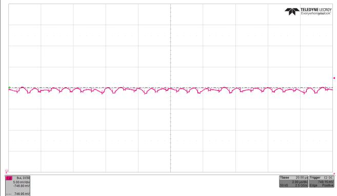

Oscilloscope screenshot showing output voltage ripple. The trace shows a steady-state voltage with small high-frequency oscillations (ripple). Scale bars: 200µs, 500k points, 1.60V.

VOUT = 0.75V      PWM      TA = 25°C  
VIN = 3.3V      IOUT = 11.3A

**Figure 10-21. Output Voltage Ripple**

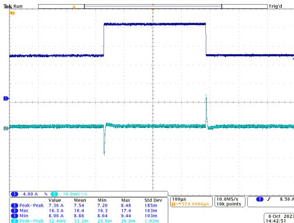

Oscilloscope screenshot showing load transient response with droop disabled. The top trace shows VIN stepping up. The bottom trace shows VOUT with a small transient dip. Scale bars: 100µs, 10.0MS/s, 10k points, 8.56A.

VOUT = 0.75V      PWM,      TA = 25°C  
TPS6287B25 droop      IOUT = 8.75A to 16.25A to 8.75A  
disabled

**Figure 10-22. Load Transient Response**

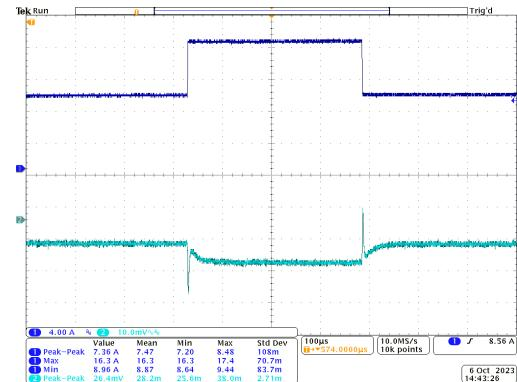

Oscilloscope screenshot showing load transient response with droop enabled. The top trace shows VIN stepping up. The bottom trace shows VOUT with a larger transient dip. Scale bars: 100µs, 10.0MS/s, 10k points, 8.56A.

VOUT = 0.75V      PWM,      TA = 25°C  
TPS6287B25 droop      IOUT = 8.75A to 16.25A to 8.75A  
enabled

**Figure 10-23. Load Transient Response**

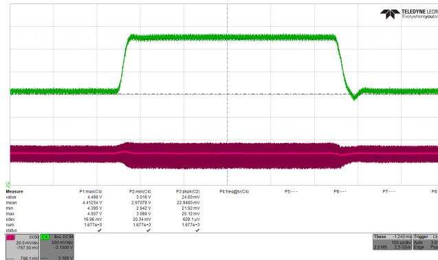

Oscilloscope screenshot showing line transient response. The top trace shows VIN stepping up from 3.0V to 4.5V. The bottom trace shows VOUT with a small transient dip. Scale bars: 100µs, 10.0MS/s, 10k points, 8.56A.

VOUT = 0.75V  
VIN = 3.0V to 4.5V to 3.0V

FPWM      TA = 25°C  
IOUT = 16.25A

**Figure 10-24. Line Transient Response**

{53}------------------------------------------------

### 10.3 Typical Application - TPS6287BxV Devices

![Typical Application Schematic for TPS6287BxV. The diagram shows a buck converter circuit. The input voltage VIN (2.7V to 6V) is connected to the VIN pin and a filter network consisting of REN and CIN. The EN pin is connected to the output of the filter. The VSET4, VSET3, VSET2, and VSET1 pins are connected to ground. The MODE/SYNC pin is connected to the output of a compensation network consisting of RZ, CC, and CC2. The COMP pin is connected to the output of the compensation network. The PG pin is connected to the output of a resistor RPG. The SW pin is connected to the SW pin of the load. The VOSNS and GOSNS pins are connected to the load. The SYNC_OUT pin is connected to the output of the load. The AGND, GND, and GND pins are connected to ground.](0a73b03fba21af142d619a9a662e6490_img.jpg)

Typical Application Schematic for TPS6287BxV. The diagram shows a buck converter circuit. The input voltage VIN (2.7V to 6V) is connected to the VIN pin and a filter network consisting of REN and CIN. The EN pin is connected to the output of the filter. The VSET4, VSET3, VSET2, and VSET1 pins are connected to ground. The MODE/SYNC pin is connected to the output of a compensation network consisting of RZ, CC, and CC2. The COMP pin is connected to the output of the compensation network. The PG pin is connected to the output of a resistor RPG. The SW pin is connected to the SW pin of the load. The VOSNS and GOSNS pins are connected to the load. The SYNC\_OUT pin is connected to the output of the load. The AGND, GND, and GND pins are connected to ground.

Figure 10-25. Typical Application Schematic for TPS6287BxV

#### 10.3.1 Design Requirements for TPS6287BxV

For this design example, refer to [Table 10-5](#) for operating parameters and [Table 8-7](#) for different  $V_{OUT}$  combinations at Start-up.

Table 10-5. Design Parameters

| SYMBOL    | PARAMETER              | VALUE      |
|-----------|------------------------|------------|
| $V_{IN}$  | Input voltage          | 2.7V to 6V |
| $V_{OUT}$ | Output voltage         | 0.4V       |
| $I_{OUT}$ | Maximum Output Current | 25A        |
| L         | Inductance             | 105nH      |

{54}------------------------------------------------

### 10.4 Typical Application Using Two TPS6287B25 in a Stacked Configuration

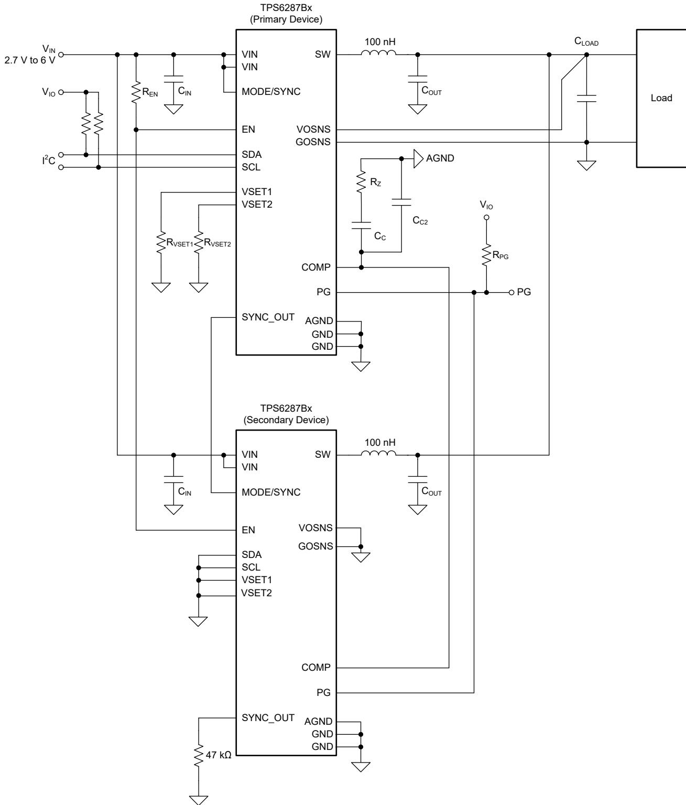

{55}------------------------------------------------

#### 10.4.1 Design Requirements For Two Stacked Devices

Table 10-6 lists the operating parameters for this application example.

**Table 10-6. Design Parameters**

| SYMBOL                              | PARAMETER                                                        | VALUE   |
|-------------------------------------|------------------------------------------------------------------|---------|
| V IN                     | Input voltage                                                    | 3.3V    |
| V OUT                    | Output voltage                                                   | 0.75 V  |
| TOL VOUT                 | Output voltage tolerance allowed by the application              | ±4%     |
| TOL DC                   | Output voltage tolerance of the TPS6287B25 (DC accuracy)         | ±0.8%   |
| ΔI OUT                   | Output current load step                                         | ±24A    |
| t r                      | Load step rise time                                              | 1μs     |
| t f                      | Load step fall time                                              | 1μs     |
| f SW                     | Switching frequency                                              | 1.5 MHz |
| L                                   | Inductance                                                       | 105 nH  |
| g m                      | Error amplifier transconductance                                 | 1.5mS   |
| τ                                   | Emulated current time constant                                   | 12.5μs  |
| k BW                     | Ratio of switching frequency to converter bandwidth (must be ≥4) | 4       |
| N Φ                      | Number of phases (number of stacked devices)                     | 2       |
| k COUT                   | Ratio of minimum to maximum output capacitance (typically 2)     | 2       |
| R PG                     | Pullup resistor on power-good output                             | 10kΩ    |
| R EN                     | Pullup resistor on enable                                        | 22kΩ    |
| R SCL , R SDA | Pullup resistors on SDA and SCL                                  | 680Ω    |

##### Preliminary Calculations

With a total allowable output voltage tolerance of ±4% and a maximum DC error of ±0.8%, the allowable output voltage tolerance during a load step is given by:

$$\Delta V_{OUT} = \pm V_{OUT} \times (TOL_{VOUT} - TOL_{DC}) \quad (22)$$

$$\Delta V_{OUT} = \pm 0.75 \times (0.04 - 0.008) = \pm 24 \text{ mV} \quad (23)$$

#### 10.4.2 Detailed Design Procedure

##### 10.4.2.1 Selecting the Compensation Resistor

The calculation for a stack of two converters is similar to the single device expect that the parameter "number of phases" NΦ is added to the equations. Use Equation 24 to calculate the recommended value of compensation resistor RZ:

$$R_Z = \frac{1}{g_m} \left( \frac{\pi \times \Delta I_{OUT} \times L}{4 \times \tau \times N_{\Phi} \times \Delta V_{OUT}} \right) (1 + TOL_{IND}) \quad (24)$$

$$R_Z = \frac{1}{1.5 \times 10^{-3}} \left( \frac{\pi \times 24 \times 105 \times 10^{-9}}{4 \times 12.5 \times 10^{-6} \times 2 \times 24 \times 10^{-3}} \right) (1 + 0.2) \Omega = 3.382 \text{ k}\Omega \quad (25)$$

Rounding up, the closest standard value from the E24 series is 3.3kΩ.

{56}------------------------------------------------

##### 10.4.2.2 Selecting the Output Capacitors

If the converter remains in regulation, the minimum output capacitance required is given by:

$$C_{OUT(min)(reg)} = \left( \frac{\tau \times g_m \times R_Z}{2 \times \pi \times \frac{L}{N_\phi} \times \frac{f_{SW}}{4}} \right) \left( 1 + \sqrt{TOL_{IND}^2 + TOL_{fSW}^2} \right) \quad (26)$$

$$C_{OUT(min)(reg)} = \left( \frac{12.5 \times 10^{-6} \times 1.5 \times 10^{-3} \times 3.3 \times 10^3}{2 \times \pi \times \frac{105 \times 10^{-9}}{2} \times \frac{1.5 \times 10^6}{4}} \right) \left( 1 + \sqrt{20\%^2 + 10\%^2} \right) F = 612.7 \mu F \quad (27)$$

If the converter loop saturates, the minimum output capacitance is given by:

$$C_{OUT(min)(sat)} = \frac{1}{\Delta V_{OUT}} \left( \frac{\frac{L}{N_\phi} \times \left( \Delta I_{OUT} + \frac{I_{L(PP)}}{2} \right)^2}{2 \times V_{OUT}} - \frac{\Delta I_{OUT} \times t_t}{2} \right) (1 + TOL_{IND}) \quad (28)$$

$$C_{OUT(min)(sat)} = \frac{1}{24 \times 10^{-3}} \left( \frac{105 \times 10^{-9} \times \left( 24 + \frac{1.84}{2} \right)^2}{2 \times 0.75} - \frac{24 \times 1 \times 10^{-6}}{2} \right) (1 + 20\%) F = 623 \mu F \quad (29)$$

In this case, choose  $C_{OUT(min)} = 623 \mu F$ , as the larger of the two values, for the output capacitance.

When calculating worst-case component values, use the value calculated above as the *minimum* output capacitance required. For ceramic capacitors, the *nominal* capacitance when considering tolerance, DC bias, temperature, and aging effects is typically two times the minimum capacitance. In this case the nominal capacitance is thus  $1246 \mu F$ .

##### 10.4.2.3 Selecting the Compensation Capacitor $C_C$

$$BW = \frac{\tau \times g_m \times R_Z}{2 \times \pi \times \frac{L}{N_\phi} \times C_{OUT,min} \times k_{COUT}} \quad (30)$$

$$BW = \frac{12.5 \times 10^{-6} \times 1.5 \times 10^{-3} \times 3.3 \times 10^3}{2 \times \pi \times \frac{105 \times 10^{-9}}{2} \times 623 \times 10^{-6} \times 2} = 150.5 \text{ kHz} \quad (31)$$

Next, calculate  $C_C$ :

$$C_C = \frac{k_{BW}}{2 \times \pi \times BW \times R_Z} \quad (32)$$

$$C_C = \frac{4}{2 \times \pi \times 150.5 \times 10^3 \times 3.3 \times 10^3} = 1.282 \text{ nF} \quad (33)$$

The closest standard value from the E12 series is  $1.5 \text{ nF}$ .

{57}------------------------------------------------

#### **10.4.3 Application Curves for Two Stacked Devices**

Figure 10-27: Efficiency vs Output Current graph for VOUT = 0.8V, PWM, TA = 25°C. The graph shows efficiency (%) on the y-axis (60 to 95) versus output current (A) on the x-axis (0 to 50). Five curves are shown for different VIN values: 2.7V (black), 3.3V (red), 4.0V (blue), 5.0V (cyan), and 6.0V (green). Efficiency rises sharply from 0A to about 10A and then gradually declines as current increases to 50A.

**Figure 10-27. Efficiency vs Output Current**

Figure 10-28: Output Voltage vs Output Current graph for VOUT = 0.8V, PWM, TA = 25°C. The graph shows output voltage (V) on the y-axis (0.792 to 0.808) versus output current (A) on the x-axis (0 to 50). Five curves are shown for different VIN values: 2.7V (black), 3.3V (red), 4.0V (blue), 5.0V (cyan), and 6.0V (green). Output voltage remains relatively stable around 0.799V across the current range.

**Figure 10-28. Output Voltage vs Output Current**

Figure 10-29: Efficiency vs Output Current graph for VOUT = 0.8V, PWM, TA = 85°C. The graph shows efficiency (%) on the y-axis (60 to 95) versus output current (A) on the x-axis (0 to 50). Five curves are shown for different VIN values: 2.7V (black), 3.3V (red), 4.0V (blue), 5.0V (cyan), and 6.0V (green). Efficiency is slightly lower than at 25°C, peaking around 90-92% at 10-15A.

**Figure 10-29. Efficiency vs Output Current**

Figure 10-30: Output Voltage vs Output Current graph for VOUT = 0.8V, PWM, TA = 85°C. The graph shows output voltage (V) on the y-axis (0.792 to 0.808) versus output current (A) on the x-axis (0 to 50). Five curves are shown for different VIN values: 2.7V (black), 3.3V (red), 4.0V (blue), 5.0V (cyan), and 6.0V (green). Output voltage is stable around 0.799V.

**Figure 10-30. Output Voltage vs Output Current**

Figure 10-31: Load Transient Response graph for VOUT = 0.75V, PWM; TPS6287B25, droop disabled, TA = 25°C. The graph shows two waveforms: a top blue waveform for output current and a bottom green waveform for output voltage. The current is stepped from 13.0A to 37.0A and back to 13.0A. The voltage shows a small dip during the load increase. Text below the graph specifies: VIN = 5V, Iout = 13.0A to 37.0A to 13.0A.

**Figure 10-31. Load Transient Response**

Figure 10-32: Load Transient Response graph for VOUT = 0.75V, PWM; TPS628776, droop enabled, TA = 25°C. The graph shows two waveforms: a top blue waveform for output current and a bottom green waveform for output voltage. The current is stepped from 13.0A to 37.0A and back to 13.0A. The voltage shows a more pronounced dip during the load increase compared to Figure 10-31. Text below the graph specifies: VIN = 5V, Iout = 13.0A to 37.0A to 13.0A.

**Figure 10-32. Load Transient Response**

{58}------------------------------------------------

Bandwidth: 5.00 MHz  
Timebase: 10.00 µs  
Trigger: C2 EC

$V_{OUT} = 0.75V$   
 $V_{IN} = 5V$

PWM

$T_A = 25^{\circ}C$   
 $R_{LOAD} = 20m\Omega$

**Figure 10-33. Output Voltage Ripple**

Oscilloscope screenshot showing output voltage ripple. The waveform is a pink line with high-frequency noise. The grid shows 10 divisions horizontally and 2 divisions vertically. The Teledyne LeCroy logo is in the top right. The oscilloscope settings are: Bandwidth: 5.00 MHz, Timebase: 10.00 µs, Trigger: C2 EC.

{59}------------------------------------------------

### 10.5 Typical Application Using Three TPS6287B25 in a Stacked Configuration

![Circuit diagram showing three TPS6287B25 devices stacked vertically. The top device is the Primary Device, and the two below are Secondary Devices. The Primary Device's VSET1 and VSET2 pins are connected to a resistor divider (R_VSET1, R_VSET2) between V_IN and ground. Its COMP pin is connected to a compensation network (R_z, C_c, C_c2) and an op-amp. Its PG pin is connected to the PG pins of the Secondary Devices. The Secondary Devices have their VSET1 and VSET2 pins connected to ground through 47 kΩ resistors. The SW pins of all three devices are connected in series through inductors (L) to a common output node. The output node is connected to a load through a switch and a capacitor (C_LOAD). The output voltage (V_O) is measured across the load. The input voltage (V_IN) is between 2.7 V and 6 V. The input current (I^2C) is measured at the input. The input voltage (V_O) is measured at the output. The input current (I^2C) is measured at the input. The input voltage (V_IN) is between 2.7 V and 6 V. The input current (I^2C) is measured at the input.](b34c69e1ec326b01c3a485b27b1df5f6_img.jpg)

The diagram illustrates a stacked configuration of three TPS6287B25 buck converters. The top converter is designated as the 'Primary Device', while the two bottom converters are 'Secondary Devices'.  
- **Primary Device:** Its  $V_{SET1}$  and  $V_{SET2}$  pins are connected to a resistor divider ( $R_{VSET1}$ ,  $R_{VSET2}$ ) between  $V_{IN}$  and ground. The  $COMP$  pin is connected to a compensation network consisting of a resistor  $R_z$  in series with a parallel combination of capacitors  $C_c$  and  $C_{C2}$ . The  $PG$  pin is connected to the  $PG$  pins of the secondary devices. The  $SW$  pin connects to an inductor  $L$  and the output node. The  $V_{IN}$  pin is connected to the input voltage source ( $V_{IN}$  = 2.7 V to 6 V). The  $V_{OUT}$  pin is connected to the output voltage ( $V_O$ ). The  $I^2C$  pin is connected to the input current ( $I^2C$ ).  
- **Secondary Devices:** Both have their  $V_{SET1}$  and  $V_{SET2}$  pins connected to ground through  $47\text{ k}\Omega$  resistors. Their  $PG$  pins are connected to the  $PG$  pin of the primary device. The  $SW$  pins are connected in series through inductors  $L$  to a common output node. The  $V_{IN}$  pins are connected to the output node. The  $V_{OUT}$  pins are connected to the output voltage ( $V_O$ ). The  $I^2C$  pins are connected to the input current ( $I^2C$ ).  
- **Output Stage:** The common output node is connected to the load through a switch and a capacitor ( $C_{LOAD}$ ). The output voltage ( $V_O$ ) is measured across the load. The input current ( $I^2C$ ) is measured at the input.

Circuit diagram showing three TPS6287B25 devices stacked vertically. The top device is the Primary Device, and the two below are Secondary Devices. The Primary Device's VSET1 and VSET2 pins are connected to a resistor divider (R\_VSET1, R\_VSET2) between V\_IN and ground. Its COMP pin is connected to a compensation network (R\_z, C\_c, C\_c2) and an op-amp. Its PG pin is connected to the PG pins of the Secondary Devices. The Secondary Devices have their VSET1 and VSET2 pins connected to ground through 47 kΩ resistors. The SW pins of all three devices are connected in series through inductors (L) to a common output node. The output node is connected to a load through a switch and a capacitor (C\_LOAD). The output voltage (V\_O) is measured across the load. The input voltage (V\_IN) is between 2.7 V and 6 V. The input current (I^2C) is measured at the input. The input voltage (V\_O) is measured at the output. The input current (I^2C) is measured at the input. The input voltage (V\_IN) is between 2.7 V and 6 V. The input current (I^2C) is measured at the input.

Figure 10-35. Stacking Three Devices

{60}------------------------------------------------

#### 10.5.1 Application Curves

Figure 10-36: Efficiency vs Output Current graph at TA = 25°C and VOUT = 0.8V. The graph shows efficiency (%) on the y-axis (60 to 95) versus output current (A) on the x-axis (0 to 75). Five curves are plotted for different input voltages: VIN = 2.7V (black), 3.3V (red), 4.0V (blue), 5.0V (cyan), and 6.0V (green). Efficiency rises sharply from 0A to about 15A and then gradually declines.

**Figure 10-36. Efficiency vs Output Current**

Figure 10-37: Output Voltage vs Output Current graph at TA = 25°C and VOUT = 0.8V. The graph shows output voltage (V) on the y-axis (0.792 to 0.808) versus output current (A) on the x-axis (0 to 75). Five curves are plotted for VIN = 2.7V, 3.3V, 4.0V, 5.0V, and 6.0V. The output voltage remains very stable around 0.8V across the entire current range.

**Figure 10-37. Output Voltage vs Output Current**

Figure 10-38: Efficiency vs Output Current graph at TA = 85°C and VOUT = 0.8V. The graph shows efficiency (%) on the y-axis (60 to 95) versus output current (A) on the x-axis (0 to 75). Five curves are plotted for VIN = 2.7V, 3.3V, 4.0V, 5.0V, and 6.0V. The efficiency curves are slightly lower than those at 25°C, peaking around 92-93%.

**Figure 10-38. Efficiency vs Output Current**

Figure 10-39: Output Voltage vs Output Current graph at TA = 85°C and VOUT = 0.8V. The graph shows output voltage (V) on the y-axis (0.792 to 0.808) versus output current (A) on the x-axis (0 to 50). Five curves are plotted for VIN = 2.7V, 3.3V, 4.0V, 5.0V, and 6.0V. The output voltage is stable around 0.8V, with a very slight downward trend at higher currents.

**Figure 10-39. Output Voltage vs Output Current**

### 10.6 Power Supply Recommendations

The TPS6287Bxx device family has no special requirements for input power supply. The input power supply output current must be rated according to the supply voltage, output voltage, and output current of the TPS6287Bxx.

### 10.7 Layout

Achieving the performance the TPS6287Bxx devices are capable of requires proper PDN and PCB design. TI therefore recommends the user perform a power integrity analysis on the design. There are a number of commercially available power integrity software tools, and the user can use these tools to model the effects on performance of the PCB layout and passive components.

In addition to the use of power integrity tools, TI recommends the following basic principles:

- Place the input capacitors close to the VIN and GND pins. Position the input capacitors in order of increasing size, starting with the smallest capacitors closest to the VIN and GND pins. Use an identical layout for both VIN-GND pin pairs of the package, to gain maximum benefit from the butterfly configuration.
- Place the inductor close to the device and keep the SW node small.

{61}------------------------------------------------

- Connect the exposed thermal pad and the GND pins of the device together. Use multiple thermal vias to connect the exposed thermal pad of the device to one or more ground planes (TI's EVM uses nine 150µm thermal vias).
- Use multiple power and ground planes.
- Route the VOSNS and GOSNS remote sense lines on the primary device as a differential pair and connect them to the lowest-impedance point of the PDN. If the desired connection point is not the lowest impedance point of the PDN, optimize the PDN until the desired connection point is the lowest impedance point of the PDN. Do not route the VOSNS and GOSNS close to any of the switch nodes.
- Connect the compensation components between COMP and AGND. Do not connect the compensation components directly to power ground.
- If possible, distribute the output capacitors evenly between the TPS6287Bxx device and the point-of-load, rather than placing them altogether in one place.
- Use multiple vias to connect each capacitor pad to the power and ground planes (TI's EVM typically uses four vias per pad).
- Use plenty of stitching vias to make sure of a low impedance connection between different power and ground planes.

#### 10.7.1 Layout Guidelines

Figure 10-40 shows the top layer of one of the evaluation modules for this device. The figure demonstrates the practical implementation of the PCB layout principles previously listed. The user can find a complete set drawings of all the layers used in this PCB in the evaluation module user's guide [TPS6287B25 Buck Converter Evaluation Module User's Guide](#).

#### 10.7.2 Layout Example

PCB layout diagram for the TPS6287B25 evaluation module (EVM) top layer. The board is red with white traces and purple components. Key components are labeled: VIN (input voltage), CIN (input capacitors), GND (ground), VOUT (output voltage), L (inductor), COUT (output capacitors), and VSET1/VSET2 (voltage sense pins). The layout shows the placement of these components and the routing of the traces connecting them.

Figure 10-40. TPS6287B25 EVM Top Layer

{62}------------------------------------------------

## 11 Device and Documentation Support

### 11.1 Documentation Support

#### 11.1.1 Related Documentation

For related documentation, see the following:

Texas Instruments, [TPS6287B25 Buck Converter Evaluation Module EVM user's guide](#)

### 11.2 Receiving Notification of Documentation Updates

To receive notification of documentation updates, navigate to the device product folder on [ti.com](#). Click on *Notifications* to register and receive a weekly digest of any product information that has changed. For change details, review the revision history included in any revised document.

### 11.3 Support Resources

[TI E2E™ support forums](#) are an engineer's go-to source for fast, verified answers and design help — straight from the experts. Search existing answers or ask your own question to get the quick design help you need.

Linked content is provided "AS IS" by the respective contributors. They do not constitute TI specifications and do not necessarily reflect TI's views; see TI's [Terms of Use](#).

### 11.4 Trademarks

I2C™ is a trademark of NXP Semiconductors.

TI E2E™ is a trademark of Texas Instruments.

All trademarks are the property of their respective owners.

### 11.5 Electrostatic Discharge Caution

Electrostatic Discharge Caution symbol: a triangle with a hand and a lightning bolt inside.

This integrated circuit can be damaged by ESD. Texas Instruments recommends that all integrated circuits be handled with appropriate precautions. Failure to observe proper handling and installation procedures can cause damage.

ESD damage can range from subtle performance degradation to complete device failure. Precision integrated circuits may be more susceptible to damage because very small parametric changes could cause the device not to meet its published specifications.

### 11.6 Glossary

[TI Glossary](#) This glossary lists and explains terms, acronyms, and definitions.

## 12 Revision History

NOTE: Page numbers for previous revisions may differ from page numbers in the current version.

| <b>Changes from Revision D (April 2025) to Revision E (October 2025)</b> | <b>Page</b>        |
|--------------------------------------------------------------------------|--------------------|
| • Added VSET3, VSET4, and FSET pins to description.....                  | <a href="#">19</a> |
| • Updated the device name.....                                           | <a href="#">47</a> |

| <b>Changes from Revision C (October 2024) to Revision D (April 2025)</b>                                                         | <b>Page</b>        |
|----------------------------------------------------------------------------------------------------------------------------------|--------------------|
| • Added TPS6287B10VA1WRZVR to the <i>Device Options</i> table.....                                                               | <a href="#">3</a>  |
| • Changed "GND" to "AGND" in <i>Compensation (COMP)</i> .....                                                                    | <a href="#">25</a> |
| • Updated efficiency, safe operating area, and output voltage accuracy figures up to 30A in the <i>Applications Curves</i> ..... | <a href="#">50</a> |

{63}------------------------------------------------

## 13 Mechanical, Packaging, and Orderable Information

The following pages include mechanical, packaging, and orderable information. This information is the most current data available for the designated devices. This data is subject to change without notice and revision of this document. For browser-based versions of this data sheet, refer to the left-hand navigation.

{64}------------------------------------------------

### PACKAGING INFORMATION

| Orderable part number              | Status (1) | Material type (2) | Package   Pins        | Package qty   Carrier | RoHS (3) | Lead finish/ Ball material (4) | MSL rating/ Peak reflow (5) | Op temp (°C)           | Part marking (6) |
|------------------------------------|---------------|----------------------|-----------------------|-----------------------|-------------|--------------------------------------|-----------------------------------|------------------------|---------------------|
| <a href="#">TPS6287B10HA0WRZVR</a> | Active        | Production           | WQFN-FCRLF (RZV)   24 | 3000   LARGE T&R      | Yes         | NIPDAU                               | Level-2-260C-1 YEAR               | -40 to 125             | 7B10HA0             |
| TPS6287B10HA0WRZVR.A               | Active        | Production           | null (null)           | 3000   LARGE T&R      | -           | NIPDAU                               | Level-2-260C-1 YEAR               | See TPS6287B10HA0WRZVR | 7B10HA0             |
| <a href="#">TPS6287B10LA0WRZVR</a> | Active        | Production           | WQFN-FCRLF (RZV)   24 | 3000   LARGE T&R      | Yes         | NIPDAU                               | Level-2-260C-1 YEAR               | -40 to 125             | 7B10LA0             |
| TPS6287B10LA0WRZVR.A               | Active        | Production           | null (null)           | 3000   LARGE T&R      | -           | NIPDAU                               | Level-2-260C-1 YEAR               | See TPS6287B10LA0WRZVR | 7B10LA0             |
| <a href="#">TPS6287B10VA0WRZVR</a> | Active        | Production           | WQFN-FCRLF (RZV)   24 | 3000   LARGE T&R      | Yes         | NIPDAU                               | Level-2-260C-1 YEAR               | -40 to 125             | 7B10VA0             |
| TPS6287B10VA0WRZVR.A               | Active        | Production           | null (null)           | 3000   LARGE T&R      | -           | NIPDAU                               | Level-2-260C-1 YEAR               | See TPS6287B10VA0WRZVR | 7B10VA0             |
| <a href="#">TPS6287B10VA1WRZVR</a> | Active        | Production           | WQFN-FCRLF (RZV)   24 | 3000   LARGE T&R      | Yes         | NIPDAU                               | Level-2-260C-1 YEAR               | -40 to 125             | 7B10VA1             |
| TPS6287B10VA1WRZVR.A               | Active        | Production           | null (null)           | 3000   LARGE T&R      | -           | NIPDAU                               | Level-2-260C-1 YEAR               | See TPS6287B10VA1WRZVR | 7B10VA1             |
| <a href="#">TPS6287B15HA0WRZVR</a> | Active        | Production           | WQFN-FCRLF (RZV)   24 | 3000   LARGE T&R      | Yes         | NIPDAU                               | Level-2-260C-1 YEAR               | -40 to 125             | 7B15HA0             |
| TPS6287B15HA0WRZVR.A               | Active        | Production           | null (null)           | 3000   LARGE T&R      | -           | NIPDAU                               | Level-2-260C-1 YEAR               | See TPS6287B15HA0WRZVR | 7B15HA0             |
| <a href="#">TPS6287B15JE2WRZVR</a> | Active        | Production           | WQFN-FCRLF (RZV)   24 | 3000   LARGE T&R      | Yes         | NIPDAU                               | Level-2-260C-1 YEAR               | -40 to 125             | 7B15JE2             |
| TPS6287B15JE2WRZVR.A               | Active        | Production           | null (null)           | 3000   LARGE T&R      | -           | NIPDAU                               | Level-2-260C-1 YEAR               | See TPS6287B15JE2WRZVR | 7B15JE2             |
| <a href="#">TPS6287B15LA0WRZVR</a> | Active        | Production           | WQFN-FCRLF (RZV)   24 | 3000   LARGE T&R      | Yes         | NIPDAU                               | Level-2-260C-1 YEAR               | -40 to 125             | 7B15LA0             |
| TPS6287B15LA0WRZVR.A               | Active        | Production           | null (null)           | 3000   LARGE T&R      | -           | NIPDAU                               | Level-2-260C-1 YEAR               | See TPS6287B15LA0WRZVR | 7B15LA0             |
| <a href="#">TPS6287B15VA0WRZVR</a> | Active        | Production           | WQFN-FCRLF (RZV)   24 | 3000   LARGE T&R      | Yes         | NIPDAU                               | Level-2-260C-1 YEAR               | -40 to 125             | 7B15VA0             |
| TPS6287B15VA0WRZVR.A               | Active        | Production           | null (null)           | 3000   LARGE T&R      | -           | NIPDAU                               | Level-2-260C-1 YEAR               | See TPS6287B15VA0WRZVR | 7B15VA0             |

{65}------------------------------------------------

| Orderable part number              | Status (1) | Material type (2) | Package   Pins        | Package qty   Carrier | RoHS (3) | Lead finish/ Ball material (4) | MSL rating/ Peak reflow (5) | Op temp (°C)           | Part marking (6) |
|------------------------------------|---------------|----------------------|-----------------------|-----------------------|-------------|--------------------------------------|-----------------------------------|------------------------|---------------------|
| <a href="#">TPS6287B20HA0WRZVR</a> | Active        | Production           | WQFN-FCRLF (RZV)   24 | 3000   LARGE T&R      | Yes         | NIPDAU                               | Level-2-260C-1 YEAR               | -40 to 125             | 7B20HA0             |
| TPS6287B20HA0WRZVR.A               | Active        | Production           | null (null)           | 3000   LARGE T&R      | -           | NIPDAU                               | Level-2-260C-1 YEAR               | See TPS6287B20HA0WRZVR | 7B20HA0             |
| <a href="#">TPS6287B20JE2WRZVR</a> | Active        | Production           | WQFN-FCRLF (RZV)   24 | 3000   LARGE T&R      | Yes         | NIPDAU                               | Level-2-260C-1 YEAR               | -40 to 125             | 7B20JE2             |
| TPS6287B20JE2WRZVR.A               | Active        | Production           | null (null)           | 3000   LARGE T&R      | -           | NIPDAU                               | Level-2-260C-1 YEAR               | See TPS6287B20JE2WRZVR | 7B20JE2             |
| <a href="#">TPS6287B20LA0WRZVR</a> | Active        | Production           | WQFN-FCRLF (RZV)   24 | 3000   LARGE T&R      | Yes         | NIPDAU                               | Level-2-260C-1 YEAR               | -40 to 125             | 7B20LA0             |
| TPS6287B20LA0WRZVR.A               | Active        | Production           | null (null)           | 3000   LARGE T&R      | -           | NIPDAU                               | Level-2-260C-1 YEAR               | See TPS6287B20LA0WRZVR | 7B20LA0             |
| <a href="#">TPS6287B20VA0WRZVR</a> | Active        | Production           | WQFN-FCRLF (RZV)   24 | 3000   LARGE T&R      | Yes         | NIPDAU                               | Level-2-260C-1 YEAR               | -40 to 125             | 7B20VA0             |
| TPS6287B20VA0WRZVR.A               | Active        | Production           | null (null)           | 3000   LARGE T&R      | -           | NIPDAU                               | Level-2-260C-1 YEAR               | See TPS6287B20VA0WRZVR | 7B20VA0             |
| <a href="#">TPS6287B25HA0WRZVR</a> | Active        | Production           | WQFN-FCRLF (RZV)   24 | 3000   LARGE T&R      | Yes         | NIPDAU                               | Level-2-260C-1 YEAR               | -40 to 125             | 7B25HA0             |
| TPS6287B25HA0WRZVR.A               | Active        | Production           | null (null)           | 3000   LARGE T&R      | -           | NIPDAU                               | Level-2-260C-1 YEAR               | See TPS6287B25HA0WRZVR | 7B25HA0             |
| <a href="#">TPS6287B25JE2WRZVR</a> | Active        | Production           | WQFN-FCRLF (RZV)   24 | 3000   LARGE T&R      | Yes         | NIPDAU                               | Level-2-260C-1 YEAR               | -40 to 125             | 7B25JE2             |
| TPS6287B25JE2WRZVR.A               | Active        | Production           | null (null)           | 3000   LARGE T&R      | -           | NIPDAU                               | Level-2-260C-1 YEAR               | See TPS6287B25JE2WRZVR | 7B25JE2             |
| <a href="#">TPS6287B25LA0WRZVR</a> | Active        | Production           | WQFN-FCRLF (RZV)   24 | 3000   LARGE T&R      | Yes         | NIPDAU                               | Level-2-260C-1 YEAR               | -40 to 125             | 7B25LA0             |
| TPS6287B25LA0WRZVR.A               | Active        | Production           | null (null)           | 3000   LARGE T&R      | -           | NIPDAU                               | Level-2-260C-1 YEAR               | See TPS6287B25LA0WRZVR | 7B25LA0             |
| <a href="#">TPS6287B25VA0WRZVR</a> | Active        | Production           | WQFN-FCRLF (RZV)   24 | 3000   LARGE T&R      | Yes         | NIPDAU                               | Level-2-260C-1 YEAR               | -40 to 125             | 7B25VA0             |
| TPS6287B25VA0WRZVR.A               | Active        | Production           | null (null)           | 3000   LARGE T&R      | -           | NIPDAU                               | Level-2-260C-1 YEAR               | See TPS6287B25VA0WRZVR | 7B25VA0             |
| <a href="#">TPS6287B30LA0WRZVR</a> | Active        | Production           | WQFN-FCRLF (RZV)   24 | 3000   LARGE T&R      | Yes         | NIPDAU                               | Level-2-260C-1 YEAR               | -40 to 125             | 7B30LA0             |

{66}------------------------------------------------

| Orderable part number | Status (1) | Material type (2) | Package   Pins | Package qty   Carrier | RoHS (3) | Lead finish/ Ball material (4) | MSL rating/ Peak reflow (5) | Op temp (°C)              | Part marking (6) |
|-----------------------|---------------|----------------------|----------------|-----------------------|-------------|--------------------------------------|-----------------------------------|---------------------------|---------------------|
| TPS6287B30LA0WRZVR.A  | Active        | Production           | null (null)    | 3000   LARGE T&R      | -           | NIPDAU                               | Level-2-260C-1 YEAR               | See TPS6287B30LA0WRZVF | 7B30LA0             |

(1) **Status:** For more details on status, see our [product life cycle](#).

(2) **Material type:** When designated, preproduction parts are prototypes/experimental devices, and are not yet approved or released for full production. Testing and final process, including without limitation quality assurance, reliability performance testing, and/or process qualification, may not yet be complete, and this item is subject to further changes or possible discontinuation. If available for ordering, purchases will be subject to an additional waiver at checkout, and are intended for early internal evaluation purposes only. These items are sold without warranties of any kind.

(3) **RoHS values:** Yes, No, RoHS Exempt. See the [TI RoHS Statement](#) for additional information and value definition.

(4) **Lead finish/Ball material:** Parts may have multiple material finish options. Finish options are separated by a vertical ruled line. Lead finish/Ball material values may wrap to two lines if the finish value exceeds the maximum column width.

(5) **MSL rating/Peak reflow:** The moisture sensitivity level ratings and peak solder (reflow) temperatures. In the event that a part has multiple moisture sensitivity ratings, only the lowest level per JEDEC standards is shown. Refer to the shipping label for the actual reflow temperature that will be used to mount the part to the printed circuit board.

(6) **Part marking:** There may be an additional marking, which relates to the logo, the lot trace code information, or the environmental category of the part.

Multiple part markings will be inside parentheses. Only one part marking contained in parentheses and separated by a "~" will appear on a part. If a line is indented then it is a continuation of the previous line and the two combined represent the entire part marking for that device.

**Important Information and Disclaimer:** The information provided on this page represents TI's knowledge and belief as of the date that it is provided. TI bases its knowledge and belief on information provided by third parties, and makes no representation or warranty as to the accuracy of such information. Efforts are underway to better integrate information from third parties. TI has taken and continues to take reasonable steps to provide representative and accurate information but may not have conducted destructive testing or chemical analysis on incoming materials and chemicals. TI and TI suppliers consider certain information to be proprietary, and thus CAS numbers and other limited information may not be available for release.

In no event shall TI's liability arising out of such information exceed the total purchase price of the TI part(s) at issue in this document sold by TI to Customer on an annual basis.

{67}------------------------------------------------

### **TAPE AND REEL INFORMATION**

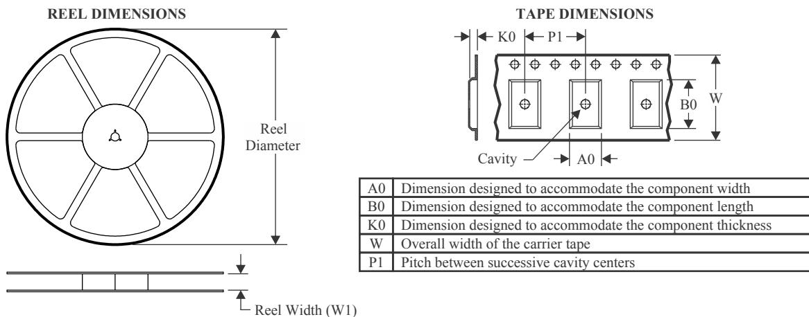

**REEL DIMENSIONS**

Reel Diameter

Reel Width (W1)

**TAPE DIMENSIONS**

K0, P1, A0, B0, W

Cavity

|    |                                                           |
|----|-----------------------------------------------------------|
| A0 | Dimension designed to accommodate the component width     |
| B0 | Dimension designed to accommodate the component length    |
| K0 | Dimension designed to accommodate the component thickness |
| W  | Overall width of the carrier tape                         |
| P1 | Pitch between successive cavity centers                   |

Diagrams of Reel and Tape Dimensions with a descriptive table.

### **QUADRANT ASSIGNMENTS FOR PIN 1 ORIENTATION IN TAPE**

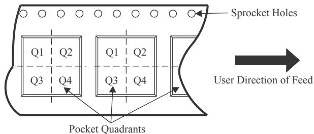

Sprocket Holes

Q1, Q2, Q3, Q4

Pocket Quadrants

User Direction of Feed

Diagram showing pocket quadrants (Q1-Q4) and sprocket holes with a feed direction arrow.

\*All dimensions are nominal

| Device             | Package Type | Package Drawing | Pins | SPQ  | Reel Diameter (mm) | Reel Width W1 (mm) | A0 (mm) | B0 (mm) | K0 (mm) | P1 (mm) | W (mm) | Pin1 Quadrant |
|--------------------|--------------|-----------------|------|------|--------------------|--------------------|---------|---------|---------|---------|--------|---------------|
| TPS6287B10HA0WRZVR | WQFN-FCRLF   | RZV             | 24   | 3000 | 330.0              | 12.4               | 3.3     | 4.4     | 0.8     | 8.0     | 12.0   | Q1            |
| TPS6287B10LA0WRZVR | WQFN-FCRLF   | RZV             | 24   | 3000 | 330.0              | 12.4               | 3.3     | 4.4     | 0.8     | 8.0     | 12.0   | Q1            |
| TPS6287B10VA0WRZVR | WQFN-FCRLF   | RZV             | 24   | 3000 | 330.0              | 12.4               | 3.3     | 4.4     | 0.8     | 8.0     | 12.0   | Q1            |
| TPS6287B10VA1WRZVR | WQFN-FCRLF   | RZV             | 24   | 3000 | 330.0              | 12.4               | 3.3     | 4.4     | 0.8     | 8.0     | 12.0   | Q1            |
| TPS6287B15HA0WRZVR | WQFN-FCRLF   | RZV             | 24   | 3000 | 330.0              | 12.4               | 3.3     | 4.4     | 0.8     | 8.0     | 12.0   | Q1            |
| TPS6287B15JE2WRZVR | WQFN-FCRLF   | RZV             | 24   | 3000 | 330.0              | 12.4               | 3.3     | 4.4     | 0.8     | 8.0     | 12.0   | Q1            |
| TPS6287B15LA0WRZVR | WQFN-FCRLF   | RZV             | 24   | 3000 | 330.0              | 12.4               | 3.3     | 4.4     | 0.8     | 8.0     | 12.0   | Q1            |
| TPS6287B15VA0WRZVR | WQFN-FCRLF   | RZV             | 24   | 3000 | 330.0              | 12.4               | 3.3     | 4.4     | 0.8     | 8.0     | 12.0   | Q1            |
| TPS6287B20HA0WRZVR | WQFN-FCRLF   | RZV             | 24   | 3000 | 330.0              | 12.4               | 3.3     | 4.4     | 0.8     | 8.0     | 12.0   | Q1            |

{68}------------------------------------------------

| Device             | Package Type | Package Drawing | Pins | SPQ  | Reel Diameter (mm) | Reel Width W1 (mm) | A0 (mm) | B0 (mm) | K0 (mm) | P1 (mm) | W (mm) | Pin1 Quadrant |
|--------------------|--------------|-----------------|------|------|--------------------|--------------------|---------|---------|---------|---------|--------|---------------|
| TPS6287B20JE2WRZVR | WQFN-FCRLF   | RZV             | 24   | 3000 | 330.0              | 12.4               | 3.3     | 4.4     | 0.8     | 8.0     | 12.0   | Q1            |
| TPS6287B20LA0WRZVR | WQFN-FCRLF   | RZV             | 24   | 3000 | 330.0              | 12.4               | 3.3     | 4.4     | 0.8     | 8.0     | 12.0   | Q1            |
| TPS6287B20VA0WRZVR | WQFN-FCRLF   | RZV             | 24   | 3000 | 330.0              | 12.4               | 3.3     | 4.4     | 0.8     | 8.0     | 12.0   | Q1            |
| TPS6287B25HA0WRZVR | WQFN-FCRLF   | RZV             | 24   | 3000 | 330.0              | 12.4               | 3.3     | 4.4     | 0.8     | 8.0     | 12.0   | Q1            |
| TPS6287B25JE2WRZVR | WQFN-FCRLF   | RZV             | 24   | 3000 | 330.0              | 12.4               | 3.3     | 4.4     | 0.8     | 8.0     | 12.0   | Q1            |
| TPS6287B25LA0WRZVR | WQFN-FCRLF   | RZV             | 24   | 3000 | 330.0              | 12.4               | 3.3     | 4.4     | 0.8     | 8.0     | 12.0   | Q1            |
| TPS6287B25VA0WRZVR | WQFN-FCRLF   | RZV             | 24   | 3000 | 330.0              | 12.4               | 3.3     | 4.4     | 0.8     | 8.0     | 12.0   | Q1            |
| TPS6287B30LA0WRZVR | WQFN-FCRLF   | RZV             | 24   | 3000 | 330.0              | 12.4               | 3.3     | 4.4     | 0.8     | 8.0     | 12.0   | Q1            |

{69}------------------------------------------------

### **TAPE AND REEL BOX DIMENSIONS**

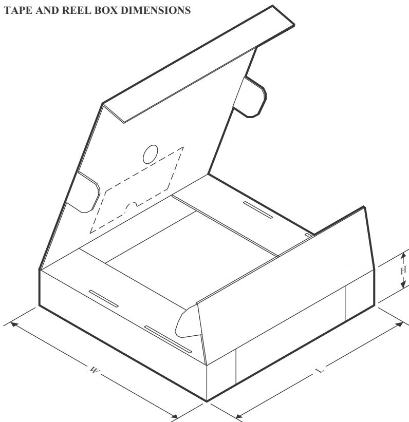

An isometric line drawing of an open rectangular box. The box is shown from a three-quarter perspective, with its lid propped open. Dimension lines with arrows indicate the following measurements: 'L' for the length of the box, 'W' for the width, and 'H' for the height. The drawing is a simple black-and-white line art representation.

Isometric line drawing of an open tape and reel box with dimension lines for Length (L), Width (W), and Height (H).

\*All dimensions are nominal

| Device             | Package Type | Package Drawing | Pins | SPQ  | Length (mm) | Width (mm) | Height (mm) |
|--------------------|--------------|-----------------|------|------|-------------|------------|-------------|
| TPS6287B10HA0WRZVR | WQFN-FCRLF   | RZV             | 24   | 3000 | 338.0       | 355.0      | 35.0        |
| TPS6287B10LA0WRZVR | WQFN-FCRLF   | RZV             | 24   | 3000 | 338.0       | 355.0      | 35.0        |
| TPS6287B10VA0WRZVR | WQFN-FCRLF   | RZV             | 24   | 3000 | 338.0       | 355.0      | 35.0        |
| TPS6287B10VA1WRZVR | WQFN-FCRLF   | RZV             | 24   | 3000 | 338.0       | 355.0      | 35.0        |
| TPS6287B15HA0WRZVR | WQFN-FCRLF   | RZV             | 24   | 3000 | 338.0       | 355.0      | 35.0        |
| TPS6287B15JE2WRZVR | WQFN-FCRLF   | RZV             | 24   | 3000 | 338.0       | 355.0      | 35.0        |
| TPS6287B15LA0WRZVR | WQFN-FCRLF   | RZV             | 24   | 3000 | 338.0       | 355.0      | 35.0        |
| TPS6287B15VA0WRZVR | WQFN-FCRLF   | RZV             | 24   | 3000 | 338.0       | 355.0      | 35.0        |
| TPS6287B20HA0WRZVR | WQFN-FCRLF   | RZV             | 24   | 3000 | 338.0       | 355.0      | 35.0        |
| TPS6287B20JE2WRZVR | WQFN-FCRLF   | RZV             | 24   | 3000 | 338.0       | 355.0      | 35.0        |
| TPS6287B20LA0WRZVR | WQFN-FCRLF   | RZV             | 24   | 3000 | 338.0       | 355.0      | 35.0        |
| TPS6287B20VA0WRZVR | WQFN-FCRLF   | RZV             | 24   | 3000 | 338.0       | 355.0      | 35.0        |
| TPS6287B25HA0WRZVR | WQFN-FCRLF   | RZV             | 24   | 3000 | 338.0       | 355.0      | 35.0        |
| TPS6287B25JE2WRZVR | WQFN-FCRLF   | RZV             | 24   | 3000 | 338.0       | 355.0      | 35.0        |
| TPS6287B25LA0WRZVR | WQFN-FCRLF   | RZV             | 24   | 3000 | 338.0       | 355.0      | 35.0        |
| TPS6287B25VA0WRZVR | WQFN-FCRLF   | RZV             | 24   | 3000 | 338.0       | 355.0      | 35.0        |
| TPS6287B30LA0WRZVR | WQFN-FCRLF   | RZV             | 24   | 3000 | 338.0       | 355.0      | 35.0        |

{70}------------------------------------------------

#### RZV0024A

### PACKAGE OUTLINE

## WQFN-FCRLF - 0.7 mm max height

PLASTIC QUAD FLAT PACK- NO LEAD

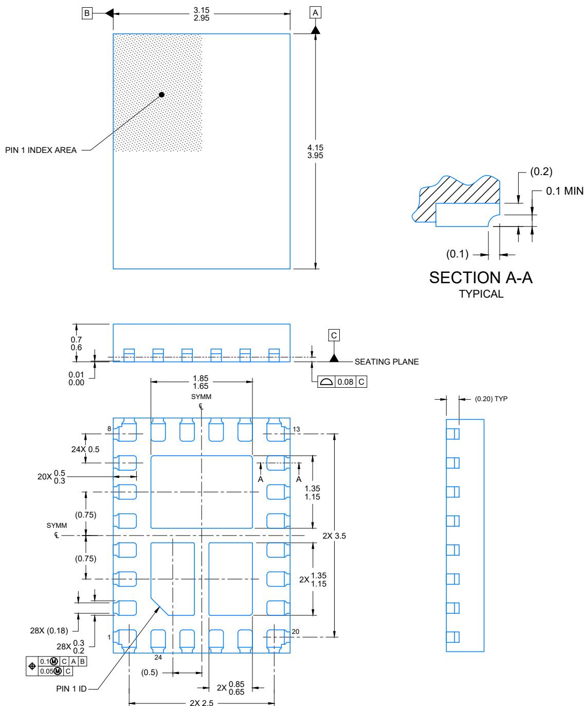

Package outline drawing for 24-pin WQFN-FCRLF:

- Top View:** Body size 3.15/2.95 mm × 4.15/3.95 mm with Pin 1 Index Area at upper left; Datums A and B indicated.
- Side View:** Total height 0.7/0.6 mm, seating plane height 0.01/0.00 mm, Seating Plane datum C with coplanarity tolerance 0.08 C. Side view thickness (0.20) TYP.
- Bottom View:** Exposed thermal pad layout and 24 perimeter pins (plus additional inner contacts). Pitch and spacing include (0.5) mm, 2X 2.5 mm, 2X 0.85/0.65 mm, 2X 1.35/1.15 mm, 2X 3.5 mm, 1.85/1.65 mm. Pin dimensions: 24X 0.5 mm, 20X 0.5/0.3 mm, 28X (0.18) mm, 28X 0.3/0.2 mm. True position tolerance: 0.1(M) C|A|B / 0.05(M) C.
- Section A-A (Typical):** Detail showing lead terminal profile with dimensions (0.2), 0.1 MIN, and (0.1).

Engineering drawing of the RZV0024A package outline (WQFN-FCRLF, 24-pin plastic quad flat pack - no lead) detailing top, side, and bottom views, along with SECTION A-A typical cross-section and mechanical dimensions in millimeters.

4228538/A 02/2022

### **NOTES:**

1. All linear dimensions are in millimeters. Any dimensions in parenthesis are for reference only. Dimensioning and tolerancing per ASME Y14.5M.
2. This drawing is subject to change without notice.
3. The package thermal pad must be soldered to the printed circuit board for optimal thermal and mechanical performance.

{71}------------------------------------------------

LAND PATTERN EXAMPLE diagram showing dimensions and layout for a WQFN-FCRLF package. The diagram shows a central rectangular area for the package with dimensions (2.85) and (2.5) for the top and (3.5) and (3.85) for the right side. It includes various pad sizes and spacing dimensions such as 2X (0.5), 2X (0.75), 20X (0.6), 2X (0.75), 25X (0.5), and (0.25) TYP. Symmetry markers (SYMM) are indicated. The diagram shows exposed metal areas in blue and solder mask openings in green.

LAND PATTERN EXAMPLE  
EXPOSED METAL SHOWN  
SCALE: 20X

SOLDER MASK DETAILS diagram showing two views of a pad. The left view shows 'NON- SOLDER MASK DEFINED (PREFERRED)' with labels for '0.05 MAX ALL AROUND', 'METAL', 'SOLDER MASK OPENING', and 'EXPOSED METAL'. The right view shows 'SOLDER MASK DEFINED' with labels for '0.05 MAX ALL AROUND', 'EXPOSED METAL', 'SOLDER MASK OPENING', and 'METAL UNDER SOLDER MASK'.

SOLDER MASK DETAILS

4228538/A 02/2022

NOTES: (continued)

- 4. This package is designed to be soldered to a thermal pad on the board. For more information, see Texas Instruments literature number SLUA271 ([www.ti.com/lit/slua271](http://www.ti.com/lit/slua271)).
- 5. Vias are optional depending on application, refer to device data sheet. If any vias are implemented, refer to their locations shown on this view. It is recommended that vias under paste be filled, plugged or tented.

{72}------------------------------------------------

![Technical drawing of a solder paste stencil for a WQFN-FCRLF package. The drawing shows a top-down view of the stencil with dimensions in millimeters. The overall width is (2.85) mm and the overall height is (3.85) mm. The package itself is (2.5) mm wide and (3.5) mm high. There are 24 solder paste areas, each (0.5) mm wide and (0.71) mm high. The stencil is symmetrical about both axes, as indicated by 'SYMM' and centering symbols. Various other dimensions are provided, including (2.0X (0.6)), (2X (0.75)), (2X (1.17)), (25X (0.5)), (0.75), (1.17), (1.59), and (0.25) TYP. A note indicates (R0.05) TYP for the corners of the package.](347010b7ac06d3ae97927fde0f784d7c_img.jpg)

Technical drawing of a solder paste stencil for a WQFN-FCRLF package. The drawing shows a top-down view of the stencil with dimensions in millimeters. The overall width is (2.85) mm and the overall height is (3.85) mm. The package itself is (2.5) mm wide and (3.5) mm high. There are 24 solder paste areas, each (0.5) mm wide and (0.71) mm high. The stencil is symmetrical about both axes, as indicated by 'SYMM' and centering symbols. Various other dimensions are provided, including (2.0X (0.6)), (2X (0.75)), (2X (1.17)), (25X (0.5)), (0.75), (1.17), (1.59), and (0.25) TYP. A note indicates (R0.05) TYP for the corners of the package.

**SOLDER PASTE EXAMPLE**  
 BASED ON 0.1 mm THICK STENCIL

SCALE: 15X

4228538/A 02/2022

NOTES: (continued)

6. Laser cutting apertures with trapezoidal walls and rounded corners may offer better paste release. IPC-7525 may have alternate design recommendations.

{73}------------------------------------------------

### **IMPORTANT NOTICE AND DISCLAIMER**

TI PROVIDES TECHNICAL AND RELIABILITY DATA (INCLUDING DATASHEETS), DESIGN RESOURCES (INCLUDING REFERENCE DESIGNS), APPLICATION OR OTHER DESIGN ADVICE, WEB TOOLS, SAFETY INFORMATION, AND OTHER RESOURCES "AS IS" AND WITH ALL FAULTS, AND DISCLAIMS ALL WARRANTIES, EXPRESS AND IMPLIED, INCLUDING WITHOUT LIMITATION ANY IMPLIED WARRANTIES OF MERCHANTABILITY, FITNESS FOR A PARTICULAR PURPOSE OR NON-INFRINGEMENT OF THIRD PARTY INTELLECTUAL PROPERTY RIGHTS.

These resources are intended for skilled developers designing with TI products. You are solely responsible for (1) selecting the appropriate TI products for your application, (2) designing, validating and testing your application, and (3) ensuring your application meets applicable standards, and any other safety, security, regulatory or other requirements.

These resources are subject to change without notice. TI grants you permission to use these resources only for development of an application that uses the TI products described in the resource. Other reproduction and display of these resources is prohibited. No license is granted to any other TI intellectual property right or to any third party intellectual property right. TI disclaims responsibility for, and you fully indemnify TI and its representatives against any claims, damages, costs, losses, and liabilities arising out of your use of these resources.

TI's products are provided subject to [TI's Terms of Sale](#), [TI's General Quality Guidelines](#), or other applicable terms available either on [ti.com](#) or provided in conjunction with such TI products. TI's provision of these resources does not expand or otherwise alter TI's applicable warranties or warranty disclaimers for TI products. Unless TI explicitly designates a product as custom or customer-specified, TI products are standard, catalog, general purpose devices.

TI objects to and rejects any additional or different terms you may propose.

Copyright © 2026, Texas Instruments Incorporated

Last updated 10/2025