{0}------------------------------------------------

Product Folder icon

Order Now icon

Technical Documents icon

Tools & Software icon

Support & Community icon

# TPS63070 2-V to 16-V Buck-Boost Converter With 3.6-A Switch Current

## 1 Features

- Input Voltage Range: 2.0 V to 16 V
- Output Voltage Range: 2.5 V to 9 V
- Up to 95% Efficiency
- +/- 1% dc accuracy in PWM mode
- +3% / -1% dc accuracy in PFM mode
- 2 A Output Current in Buck Mode
- 2 A Output Current in Boost Mode (VIN = 4 V; Vout = 5 V)
- Precise ENABLE input allows
  - user defined undervoltage lockout
  - exact sequencing
- Automatic Transition Between Step Down and Boost Mode
- Typical Device Quiescent Current: 50 µA
- Fixed and Adjustable Output Voltage Options
- Output Discharge Option
- Power Save Mode for Improved Efficiency at Low Output Power
- Forced Fixed Frequency Operation at 2.4 MHz and Synchronization Option
- Power Good Output
- VSEL simply allows output voltage change
- Load Disconnect During Shutdown
- Overtemperature Protection
- Input / Output Overvoltage Protection
- Available in QFN Package

## 2 Applications

- Dual Li-Ion Applications
- Industrial Metering Equipment
- DSC's and Camcorders
- Notebook Computers
- Ultra Mobile PC's and Mobile Internet Devices
- Personal Medical Products

## 3 Description

The TPS6307x is a high efficiency, low quiescent current buck-boost converter suitable for applications where the input voltage can be higher or lower than the output voltage. Output currents can go as high as 2 A in boost mode and in buck mode. The buck-boost converter is based on a fixed frequency, pulse-width-modulation (PWM) controller using synchronous rectification to obtain maximum efficiency. At low load currents, the converter enters Power Save Mode to maintain high efficiency over a wide load current range. The converter can be disabled to minimize battery drain. During shutdown, the load is disconnected from the battery. The device is available in a 2.5 mm x 3 mm QFN package.

Device Information(1)

| PART NUMBER | PACKAGE | BODY SIZE (NOM) |
|-------------|---------|-----------------|
| TPS63070    | VQFN    | 2.5 mm x 3 mm   |
| TPS630701   | VQFN    | 2.5 mm x 3 mm   |
| TPS630702   | VQFN    | 2.5 mm x 3 mm   |

(1) For all available packages, see the orderable addendum at the end of the datasheet.

Simplified Schematic

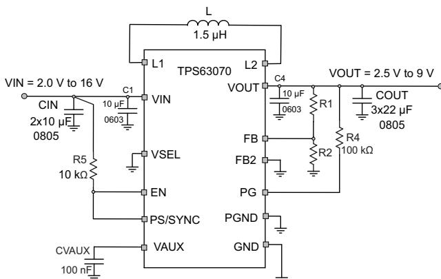

Description written from the drawing: the input VIN = 2.0 V to 16 V drives the VIN pin, decoupled by CIN (2x10 µF, 0805) and C1 (10 µF, 0603) to ground. R5 (10 kΩ) connects VIN to EN, and EN is tied to PS/SYNC. VSEL and FB2 are connected to ground. VAUX has CVAUX (100 nF) to ground. The inductor L (1.5 µH) connects L1 and L2. VOUT is decoupled by C4 (10 µF, 0603) and COUT (3x22 µF, 0805) to ground and is the output VOUT = 2.5 V to 9 V. The divider R1/R2 from VOUT to ground sets FB. R4 (100 kΩ) pulls PG up to VOUT. PGND and GND are connected to ground.

Copyright © 2016, Texas Instruments Incorporated

Efficiency vs Output Current; Vo = 5 V

*[Graph not extracted as an image in this conversion; see PDF p1. Description written from the drawing.]*

Line graph of Efficiency (0 to 100%) versus Output Current (A) on a logarithmic axis from 100µ to 2, with one curve per input voltage: 3 V (black), 4.2 V (red), 5 V (gray), 7 V (blue), 9 V (green) and 12 V (brown). Efficiency rises with output current and flattens out at higher currents; at light load the lower input voltages give higher efficiency. At the highest currents the 3 V curve drops steeply and the 4.2 V curve drops less. Read values from the PDF.

D001

{1}------------------------------------------------

## Table of Contents

|          |                                              |          |           |                                                               |           |
|----------|----------------------------------------------|----------|-----------|---------------------------------------------------------------|-----------|
| <b>1</b> | <b>Features .....</b>                        | <b>1</b> | <b>9</b>  | <b>Application and Implementation .....</b>                   | <b>16</b> |
| <b>2</b> | <b>Applications .....</b>                    | <b>1</b> | 9.1       | Application Information.....                                  | 16        |
| <b>3</b> | <b>Description .....</b>                     | <b>1</b> | 9.2       | Typical Application for adjustable version .....              | 16        |
| <b>4</b> | <b>Revision History.....</b>                 | <b>2</b> | 9.3       | Typical Application for Fixed Voltage Version .....           | 26        |
| <b>5</b> | <b>Device Comparison Table .....</b>         | <b>3</b> | <b>10</b> | <b>Power Supply Recommendations .....</b>                     | <b>31</b> |
| <b>6</b> | <b>Pin Configuration and Functions .....</b> | <b>3</b> | 10.1      | Thermal Information .....                                     | 31        |
| <b>7</b> | <b>Specifications .....</b>                  | <b>4</b> | <b>11</b> | <b>Layout.....</b>                                            | <b>32</b> |
| 7.1      | Absolute Maximum Ratings .....               | 4        | 11.1      | Layout Guidelines .....                                       | 32        |
| 7.2      | ESD Ratings .....                            | 4        | 11.2      | Layout Example .....                                          | 32        |
| 7.3      | Recommended Operating Conditions .....       | 4        | <b>12</b> | <b>Device and Documentation Support .....</b>                 | <b>33</b> |
| 7.4      | Thermal Information .....                    | 5        | 12.1      | Device Support .....                                          | 33        |
| 7.5      | Electrical Characteristics.....              | 6        | 12.2      | Related Links .....                                           | 33        |
| 7.6      | Typical Characteristics.....                 | 8        | 12.3      | Receiving Notification of Documentation Updates .....         | 33        |
| <b>8</b> | <b>Detailed Description .....</b>            | <b>9</b> | 12.4      | Community Resources.....                                      | 33        |
| 8.1      | Overview .....                               | 9        | 12.5      | Trademarks .....                                              | 33        |
| 8.2      | Functional Block Diagram TPS63070 .....      | 9        | 12.6      | Electrostatic Discharge Caution .....                         | 33        |
| 8.3      | Functional Block Diagram TPS630701 .....     | 10       | 12.7      | Glossary .....                                                | 33        |
| 8.4      | Feature Description.....                     | 10       | <b>13</b> | <b>Mechanical, Packaging, and Orderable Information .....</b> | <b>34</b> |
| 8.5      | Device Functional Modes.....                 | 14       |           |                                                               |           |

## 4 Revision History

NOTE: Page numbers for previous revisions may differ from page numbers in the current version.

| Changes from Revision A (August 2016) to Revision B                        | Page |
|----------------------------------------------------------------------------|------|
| • Added Various minor editorial updates and corrections .....              | 1    |
| • Added TPS630702 Variant.....                                             | 1    |
| • Added TPS630702 Variant with "output discharge=on" option .....          | 3    |
| • Added TPS630702 VOUT info .....                                          | 7    |
| • Added TPS630702 VFB info at 3 instances .....                            | 7    |
| • Added Parameter Name ROD to output discharge resistance row.....         | 7    |
| • Added Link to TechNote SLVAE62 .....                                     | 13   |
| • Added more descriptive text for better understanding.....                | 15   |
| • Changed Description of Discharge Feature, reflecting TPS630702.....      | 15   |
| • Changed description of output voltage programming to match EC table..... | 17   |
| • Added table of content for application curves .....                      | 20   |
| • Added TPS630702 Variant.....                                             | 33   |

| Changes from Original (June 2016) to Revision A | Page |
|-------------------------------------------------|------|
| • Added full Production Data .....              | 1    |

{2}------------------------------------------------

## 5 Device Comparison Table

| Device Number | Features               | Output Voltage | Marking |
|---------------|------------------------|----------------|---------|
| TPS63070      | output discharge = off | adjustable     | 3070    |
| TPS630701     | output discharge = off | fixed 5 V      | 0701    |
| TPS630702     | output discharge = on  | adjustable     | 0702    |

## 6 Pin Configuration and Functions

**QFN PACKAGE**

Top View

Bottom View

Top View diagram of the QFN package showing pin numbers 1-15 and their functions: VIN (12, 13), L1 (11), PGND (10), L2 (9), VOUT (7, 8), EN (14), FB2 (6), FB (5), VSEL (15), PS/S (1), PG (2), VAUX (3), GND (4). Bottom View diagram of the QFN package showing pin numbers 1-15 and their functions: VSEL (15), PS/S (1), PG (2), VAUX (3), GND (4), FB (5), FB2 (6), EN (14), VIN (12, 13), L1 (11), PGND (10), L2 (9), VOUT (7, 8).

**Pin Functions**

| PIN NAME | NO.    | I/O | DESCRIPTION                                                                                                                                                                                                                                       |
|----------|--------|-----|---------------------------------------------------------------------------------------------------------------------------------------------------------------------------------------------------------------------------------------------------|
| EN       | 14     | I   | Enable input. Pull high to enable the device, pull low to disable the device.                                                                                                                                                                     |
| FB       | 5      | I   | Voltage feedback of adjustable versions, must be connected to VOUT on fixed output voltage versions                                                                                                                                               |
| GND      | 4      |     | Control / logic ground                                                                                                                                                                                                                            |
| L1       | 11     | I   | Connection for Inductor                                                                                                                                                                                                                           |
| L2       | 9      | I   | Connection for Inductor                                                                                                                                                                                                                           |
| PS/SYNC  | 1      | I   | Pull to low for forced PWM, pull high for PWM/PFM (power save) mode. Apply a clock signal to synchronize to an external frequency.                                                                                                                |
| PG       | 2      | O   | Open drain power good output                                                                                                                                                                                                                      |
| PGND     | 10     |     | Power ground                                                                                                                                                                                                                                      |
| VIN      | 12, 13 | I   | Supply voltage for power stage                                                                                                                                                                                                                    |
| VOUT     | 7,8    | O   | Buck-boost converter output                                                                                                                                                                                                                       |
| VAUX     | 3      | O   | Connection for Capacitor of internal voltage regulator. This pin must not be loaded externally.                                                                                                                                                   |
| VSEL     | 15     | I   | Voltage scaling input. A high level on this pin enables a transistor which pulls pin FB2 to GND.                                                                                                                                                  |
| FB2      | 6      | O   | Voltage scaling output. Connect a resistor from FB to FB2 to change the voltage divider ratio on the feedback pin. A logic high level on VSEL will change the output voltage to a higher value. Leave the pin open or connect to GND if not used. |

{3}------------------------------------------------

## 7 Specifications

### 7.1 Absolute Maximum Ratings

over operating junction temperature range (unless otherwise noted) (1)

|                                                |                                          | MIN  | MAX | UNIT |
|------------------------------------------------|------------------------------------------|------|-----|------|
| Voltage range                                  | VIN, PS/SYNC, EN, VSEL                   | –0.3 | 20  | V    |
|                                                | L1                                       | –0.3 | 20  | V    |
|                                                | L1 (transient for t<10ns) (2) | –3   | 25  | V    |
|                                                | L2, PG, VOUT, FB                         | –0.3 | 12  | V    |
|                                                | L2 (transient for t<10ns) (2) | –3   | 15  | V    |
|                                                | AUX                                      | –0.3 | 7   | V    |
|                                                | FB2                                      | –0.3 | 3   | V    |
| Operating junction temperature, T j |                                          | –40  | 150 | °C   |
| Storage temperature range, T stg    |                                          | –65  | 150 | °C   |

- (1) Stresses beyond those listed under *Absolute Maximum Ratings* may cause permanent damage to the device. These are stress ratings only, which do not imply functional operation of the device at these or any other conditions beyond those indicated under *Recommended Operating Conditions*. Exposure to absolute-maximum-rated conditions for extended periods may affect device reliability.
- (2) While switching

### 7.2 ESD Ratings

|                    |                         |                                                                                          | VALUE | UNIT |
|--------------------|-------------------------|------------------------------------------------------------------------------------------|-------|------|
| V (ESD) | Electrostatic discharge | Human body model (HBM), per ANSI/ESDA/JEDEC JS-001, all pins (1)              | ±2000 | V    |
|                    |                         | Charged device model (CDM), per JEDEC specification JESD22-C101, all pins (2) | ±500  |      |

- (1) JEDEC document JEP155 states that 500-V HBM allows safe manufacturing with a standard ESD control process.
- (2) JEDEC document JEP157 states that 250-V CDM allows safe manufacturing with a standard ESD control process.

### 7.3 Recommended Operating Conditions

over operating junction temperature range (unless otherwise noted)

|                                                                                                                                                                                    | MIN | NOM | MAX | UNIT |
|------------------------------------------------------------------------------------------------------------------------------------------------------------------------------------|-----|-----|-----|------|
| Supply voltage at VIN                                                                                                                                                              | 2.0 |     | 16  | V    |
| Output Voltage                                                                                                                                                                     | 2.5 |     | 9   | V    |
| Effective Inductance                                                                                                                                                               | 0.7 | 1.5 | 2.8 | µH   |
| Capacitance connected to VIN pin                                                                                                                                                   | 4.7 | 10  |     | µF   |
| Capacitance connected to VAUX pin                                                                                                                                                  |     | 100 |     | nF   |
| Total capacitance connected to VOUT pin (1)                                                                                                                             | 15  | 47  | 470 | µF   |
| duty cycle in buck mode over recommended operating conditions                                                                                                                      | 30  |     |     | %    |
| duty cycle in buck mode over recommended operating conditions but effective output capacitance Cout,eff ≥ 40uF; effective inductance L,eff = 0.7µH to 1.8uH                             | 20  |     |     | %    |
| Operating junction temperature range, T J                                                                                                                               | –40 |     | 125 | °C   |

- (1) Due to the dc bias effect of ceramic capacitors, the effective capacitance is lower than the nominal value when a voltage is applied. This is why the capacitance is specified to allow the selection of the minimal capacitor required with the dc bias effect for this type of capacitor in mind. The capacitance range given above is for the nominal inductance of 1.5 µH. Please also see the detailed design procedure in the application section about the ratio of inductance and minimum output capacitance.

{4}------------------------------------------------

### 7.4 Thermal Information

| THERMAL METRIC (1) |                                              | TPS63070x | UNIT |
|-------------------------------|----------------------------------------------|-----------|------|
|                               |                                              | VQFN      |      |
|                               |                                              | 13 PINS   |      |
| R θJA              | Junction-to-ambient thermal resistance       | 63        | °C/W |
| R θJC(top)         | Junction-to-case (top) thermal resistance    | 42        | °C/W |
| R θJB              | Junction-to-board thermal resistance         | 13        | °C/W |
| ψ JT               | Junction-to-top characterization parameter   | 2.4       | °C/W |
| ψ JB               | Junction-to-board characterization parameter | 13        | °C/W |
| R θJC(bot)         | Junction-to-case (bottom) thermal resistance | n/a       | °C/W |

(1) For more information about traditional and new thermal metrics, see the *IC Package Thermal Metrics* application report, [SPRA953](#).

{5}------------------------------------------------

### 7.5 Electrical Characteristics

over VIN = 2V to 16V; Tj = -40°C to 125°C; typical values are at Tj = 25°C (unless otherwise noted)

| PARAMETER                                   |                                                                                               | TEST CONDITIONS                                                                              | MIN  | TYP  | MAX  | UNIT |
|---------------------------------------------|-----------------------------------------------------------------------------------------------|----------------------------------------------------------------------------------------------|------|------|------|------|
| <b>SUPPLY</b>                               |                                                                                               |                                                                                              |      |      |      |      |
| VIN                                         | Input voltage range                                                                           | once started; Vout ≥ 3.0 V                                                                   | 2.0  |      | 16   | V    |
| VIN                                         | Input voltage range                                                                           | for start-up; Vout < 3.0 V                                                                   | 3.0  |      | 16   | V    |
| IOUT                                        | Output current                                                                                | during operation with either VIN ≥ 4.5 V or VOUT ≥ 4.5 V and the boost factor (VOUT/VIN) ≤ 1 |      |      | 2    | A    |
| I Q                              | Quiescent current                                                                             | into VIN; IOUT= 0 mA, V EN = VIN = 6 V, PFM VOUT = 5 V; Tj = -40°C to 85°C        |      | 54   | 103  | µA   |
| I Q                              | Quiescent current                                                                             | into VIN; IOUT= 0 mA, V EN = VIN = 6 V, PFM VOUT = 5 V; Tj = -40°C to 125°C       |      |      | 133  | µA   |
| I Q                              | Quiescent current                                                                             | into VOUT; IOUT= 0 mA, V EN = VIN = 6 V, VOUT = 5 V, PFM Tj = -40°C to 85°C       |      | 5    | 9    | µA   |
| I Q                              | Quiescent current                                                                             | into VOUT; IOUT= 0 mA, V EN = VIN = 6 V, VOUT = 5 V, PFM Tj = -40°C to 125°C      |      |      | 17   | µA   |
| I SD                             | Shutdown current                                                                              | V EN = 0 V; Tj = -40°C to 85°C; VIN = 5V                                          |      | 2    | 12   | µA   |
| I SD                             | Shutdown current                                                                              | V EN = 0 V; Tj = -40°C to 85°C                                                    |      |      | 26   | µA   |
| V UVLO                           | Undervoltage lockout threshold                                                                | VIN voltage falling                                                                          | 1.7  | 1.85 | 1.95 | V    |
| V UVLO,TH                        | Undervoltage lockout hysteresis                                                               | VIN voltage rising                                                                           | 525  | 850  |      | mV   |
| T SD                             | Thermal shutdown                                                                              |                                                                                              |      | 160  |      | °C   |
| T SD                             | Thermal shutdown hysteresis                                                                   |                                                                                              |      | 20   |      | °C   |
| <b>LOGIC SIGNALS: EN, PS/SYNC, PG, VSEL</b> |                                                                                               |                                                                                              |      |      |      |      |
| V THR                            | Threshold Voltage rising edge for EN pin and PS/SYNC used for PWM/PFM mode change             |                                                                                              | 0.77 | 0.8  | 0.83 | V    |
| V THF                            | Threshold Voltage falling edge for EN pin and PS/SYNC used for PWM/PFM mode change            |                                                                                              | 0.67 | 0.7  | 0.73 | V    |
| V IL                             | VSEL low level input voltage; PS/SYNC low level input voltage when used for synchronization   |                                                                                              |      |      | 0.3  | V    |
| V IH                             | VSEL high level input voltage; PS/SYNC high level input voltage when used for synchronization |                                                                                              | 1.1  |      |      | V    |
|                                             | EN, PS/SYNC, VSEL input current                                                               |                                                                                              |      |      | 0.2  | µA   |
| V OL                             | PG output low voltage                                                                         | I PG = -1 mA                                                                      |      |      | 0.4  | V    |
| I LKG                            | PG output leakage current                                                                     | PG pin high impedance; V PG = 5 V                                                 |      |      | 0.2  | µA   |
| I PG                             | PG sink current                                                                               |                                                                                              |      |      | 1    | mA   |
| V TH_PG                          | Power Good Threshold Voltage, rising Vout                                                     |                                                                                              | 94.5 | 96   | 98.5 | %    |
| V TH_PG                          | Power Good Threshold Voltage, falling Vout                                                    |                                                                                              | 90   | 92   | 94.5 | %    |

{6}------------------------------------------------

### Electrical Characteristics (continued)

over VIN = 2V to 16V; Tj = -40°C to 125°C; typical values are at Tj = 25°C (unless otherwise noted)

| PARAMETER                 |                                                        | TEST CONDITIONS                                                                           | MIN        | TYP  | MAX  | UNIT |
|---------------------------|--------------------------------------------------------|-------------------------------------------------------------------------------------------|------------|------|------|------|
| <b>OUTPUT</b>             |                                                        |                                                                                           |            |      |      |      |
| VOUT                      | TPS63070/TPS630702 output voltage range (1) |                                                                                           | 2.5        |      | 9    | V    |
| VOUT                      | TPS630701 output voltage                               |                                                                                           |            | 5.0  |      | V    |
| V FB           | TPS63070/TPS630702 feedback voltage                    | PS/SYNC = VIN                                                                             |            | 800  |      | mV   |
|                           | feedback impedance                                     | for fixed voltage versions                                                                |            | 1.5  |      | MΩ   |
|                           | feedback leakage                                       | for adjustable version; VFB = 0.8V                                                        |            |      | 100  | nA   |
| V FB           | TPS63070/TPS630702 feedback voltage accuracy           | PS/SYNC = GND (PWM mode)                                                                  | -1         |      | 1    | %    |
| VOUT                      | TPS630701 output voltage accuracy                      | PS/SYNC = GND (PWM mode)                                                                  | -1         |      | 1    | %    |
| V FB           | TPS63070/TPS630702 feedback voltage accuracy           | PS/SYNC = VIN (PFM mode); VIN ≥ 3V                                                        | -1         |      | 3    | %    |
| VOUT                      | TPS630701 output voltage accuracy                      | PS/SYNC = VIN (PFM mode); VIN ≥ 3V                                                        | -1         |      | 3    | %    |
| f SW           | Oscillator frequency                                   |                                                                                           | 2100       | 2400 | 2700 | kHz  |
|                           | Frequency range for synchronization                    |                                                                                           | 2100       |      | 2800 | kHz  |
| IIN,max                   | Average, positive input current limit                  | VIN = 5.0V; VOUT = 6.5V; Tj = 0°C to 125°C                                                | 3050       | 3600 | 4150 | mA   |
| IIN,max                   | Average, negative input current limit                  | VIN = 5.0V; VOUT = 6.5V; Tj = 0°C to 125°C                                                | 1100       | 1800 |      | mA   |
| R DS(ON)-BUCK  | High side switch on resistance                         | VIN = 5 V                                                                                 |            | 50   | 80   | mΩ   |
|                           | Low side switch on resistance                          | VIN = 5 V                                                                                 |            | 100  | 160  | mΩ   |
| R DS(ON)-BOOST | High side switch on resistance                         | VIN = 5 V                                                                                 |            | 40   | 70   | mΩ   |
|                           | Low side switch on resistance                          | VIN = 5 V                                                                                 |            | 80   | 125  | mΩ   |
| R DS(ON)-FB2   | FB2 resistance to GND with VSEL = high                 |                                                                                           |            | 25   | 100  | Ω    |
| I LKG          | Input leakage current into FB2 with VSEL=low           | VFB = VFB2 = 0.8V                                                                         |            |      | 100  | nA   |
|                           | FB2 sink current                                       |                                                                                           |            |      | 100  | μA   |
|                           | Line regulation                                        | Power Save Mode disabled                                                                  |            | 0.07 |      | %/V  |
|                           | Load regulation                                        | Power Save Mode disabled                                                                  |            | 0.2  |      | %/A  |
| V AUX          | Maximum bias voltage                                   | VIN ≥ VOUT; VIN < 6V                                                                      | VIN - 0.3  |      | 7    | V    |
|                           |                                                        | VIN < VOUT                                                                                | VOUT - 0.3 |      | 7    | V    |
| R OD           | Output discharge resistance (only in TPS630702)        | VIN = 5 V; VOUT = 5V                                                                      |            | 200  |      | Ω    |
| t delay        | Start-up delay                                         | time from EN = V IH to device starts switching                                 |            | 70   |      | μs   |
| t SS           | soft-start time                                        | time to ramp from 5% to 95% of Vout; buck mode; VIN = 7.2 V, Vout = 3.3 V, Iout = 500 mA  |            | 400  |      | μs   |
|                           |                                                        | time to ramp from 5% to 95% of Vout; boost mode; VIN = 3.0 V, Vout = 3.3 V, Iout = 250 mA |            | 850  |      | μs   |

(1) Please observe the minimum duty cycle in buck mode

{7}------------------------------------------------

### 7.6 Typical Characteristics

![Figure 1: Rds(on) of High-side Buck Switch. A line graph showing Rds(on) [mΩ] vs VIN [V] for Vout = 5V and I = 1A. Four curves are shown for temperatures: -40°C (black), 30°C (red), 85°C (grey), and 125°C (blue). Rds(on) is higher at higher temperature; it rises with VIN at low VIN and is nearly flat at high VIN.](img/7ff005f9556dc6518981bb92091d36ab_img.jpg)

*[AI figure description: curve-data table removed (values were estimated from the plot, not printed in the PDF). Read values from the image/PDF.]*

Figure 1: Rds(on) of High-side Buck Switch. A line graph showing Rds(on) [mΩ] vs VIN [V] for Vout = 5V and I = 1A. Four curves are shown for temperatures: -40°C (black), 30°C (red), 85°C (grey), and 125°C (blue). Rds(on) is higher at higher temperature; it rises with VIN at low VIN and is nearly flat at high VIN.

Vout = 5V

I = 1A

**Figure 1. Rds(on) of High-side Buck Switch**

![Figure 2: Rds(on) of High-side Boost Switch. A line graph showing Rds(on) [mΩ] vs VIN [V] for Vout = 5V and I = 1A. Four curves are shown for temperatures: -40°C (black), 30°C (red), 80°C (grey), and 125°C (blue). Rds(on) is flat at low VIN, decreases in the middle of the VIN range and is flat again at high VIN; the legend prints 80 for the gray curve.](img/aa14b9ec884bf40ce06c161be468cd84_img.jpg)

*[AI figure description: curve-data table removed (values were estimated from the plot, not printed in the PDF). Read values from the image/PDF.]*

Figure 2: Rds(on) of High-side Boost Switch. A line graph showing Rds(on) [mΩ] vs VIN [V] for Vout = 5V and I = 1A. Four curves are shown for temperatures: -40°C (black), 30°C (red), 80°C (grey), and 125°C (blue). Rds(on) is flat at low VIN, decreases in the middle of the VIN range and is flat again at high VIN; the legend prints 80 for the gray curve.

Vout = 5V

I = 1A

**Figure 2. Rds(on) of High-side Boost Switch**

![Figure 3: Rds(on) of Low-side Boost Switch. A line graph showing Rds(on) [mΩ] vs VIN [V] for Vout = 5V and I = 1A. Four curves are shown for temperatures: -40°C (black), 30°C (red), 85°C (grey), and 125°C (blue). Rds(on) is relatively constant across VIN for each temperature.](img/f5e70cbe66e71e65b4ae4aa7816d266a_img.jpg)

*[AI figure description: curve-data table removed (values were estimated from the plot, not printed in the PDF). Read values from the image/PDF.]*

Figure 3: Rds(on) of Low-side Boost Switch. A line graph showing Rds(on) [mΩ] vs VIN [V] for Vout = 5V and I = 1A. Four curves are shown for temperatures: -40°C (black), 30°C (red), 85°C (grey), and 125°C (blue). Rds(on) is relatively constant across VIN for each temperature.

Vout = 5V

I = 1A

**Figure 3. Rds(on) of Low-side Boost Switch**

![Figure 4: Rds(on) of Low-side Buck Switch. A line graph showing Rds(on) [mΩ] vs VIN [V] for Vout = 5V and I = 1A. Four curves are shown for temperatures: -40°C (black), 30°C (red), 85°C (grey), and 125°C (blue). Rds(on) is relatively constant across VIN for each temperature.](img/635262c3456135a70f7585ae445951e7_img.jpg)

*[AI figure description: curve-data table removed (values were estimated from the plot, not printed in the PDF). Read values from the image/PDF.]*

Figure 4: Rds(on) of Low-side Buck Switch. A line graph showing Rds(on) [mΩ] vs VIN [V] for Vout = 5V and I = 1A. Four curves are shown for temperatures: -40°C (black), 30°C (red), 85°C (grey), and 125°C (blue). Rds(on) is relatively constant across VIN for each temperature.

Vout = 5V

I = 1A

**Figure 4. Rds(on) of Low-side Buck Switch**

{8}------------------------------------------------

## 8 Detailed Description

### 8.1 Overview

The TPS6307x use 4 internal N-channel MOSFETs to maintain synchronous power conversion at all possible operating conditions. This enables the device to keep high efficiency over a wide input voltage and output power range. To regulate the output voltage at all possible input voltage conditions, the device automatically switches from buck operation to boost operation and back as required by the configuration. It always uses one active switch, one rectifying switch, one switch on, and one switch held off. Therefore, it operates as a buck converter when the input voltage is higher than the output voltage, and as a boost converter when the input voltage is lower than the output voltage. There is no mode of operation in which all 4 switches are switching. The RMS current through the switches and the inductor is kept at a minimum, to minimize switching and conduction losses. For the remaining 2 switches, one is kept on and the other is kept off, thus causing no switching losses. Controlling the switches this way allows the converter to always keep high efficiency over the complete input voltage range. The device provides a seamless transition from buck to boost or from boost to buck operation.

### 8.2 Functional Block Diagram TPS63070

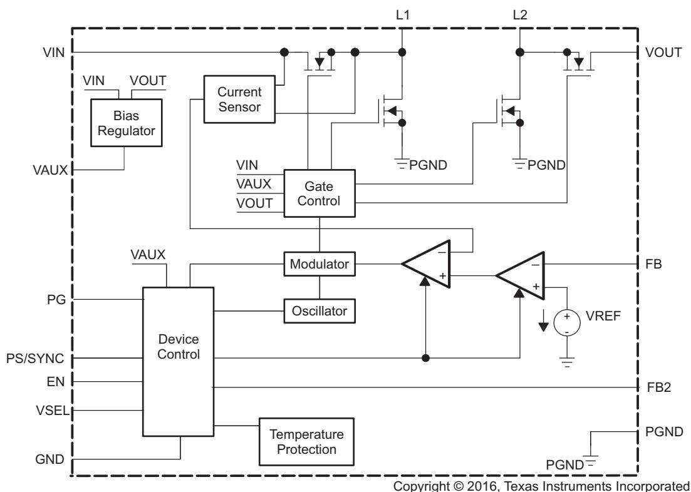

Functional block diagram of the TPS63070 (adjustable version). Pins VIN, VAUX, PG, PS/SYNC, EN, VSEL and GND are on the left, L1 and L2 at the top, VOUT, FB, FB2 and PGND on the right. Power stage: VIN connects through the input high-side MOSFET to the L1 node, and a low-side MOSFET connects L1 to PGND; a second low-side MOSFET connects the L2 node to PGND, and the output high-side MOSFET connects L2 to VOUT (all four are N-channel MOSFETs drawn with their body diodes). The Current Sensor measures the current of the input high-side MOSFET. The Gate Control block, supplied from VIN, VAUX and VOUT, drives the four MOSFET gates and is driven by the Modulator. The Bias Regulator is supplied from VIN and VOUT and its output is the VAUX pin. Regulation loop: the FB pin goes to the inverting input of the voltage error amplifier, whose non-inverting input is the reference VREF (a voltage source to ground); its output goes to the non-inverting input of the current amplifier, whose inverting input is the Current Sensor output. The current amplifier output drives the Modulator, which is clocked by the Oscillator. The Device Control block, supplied from VAUX and connected to GND, connects to the PG, PS/SYNC, EN and VSEL pins, to the Modulator, the Oscillator and the Temperature Protection block, to an enable input of both amplifiers, and to the FB2 pin. The PGND pin is connected to the internal PGND.

Copyright © 2016, Texas Instruments Incorporated

**Figure 5. Functional Block Diagram**

{9}------------------------------------------------

### 8.3 Functional Block Diagram TPS630701

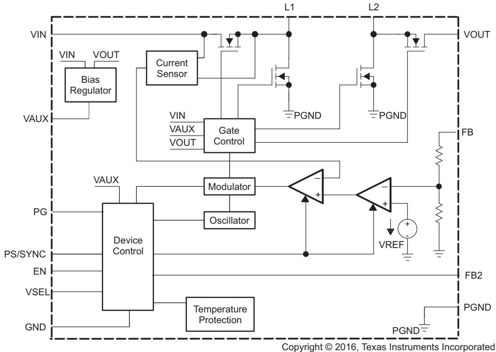

Functional block diagram of the TPS630701 (fixed output voltage version). Pins VIN, VAUX, PG, PS/SYNC, EN, VSEL and GND are on the left, L1 and L2 at the top, VOUT, FB, FB2 and PGND on the right. Power stage: VIN connects through the input high-side MOSFET to the L1 node, and a low-side MOSFET connects L1 to PGND; a second low-side MOSFET connects the L2 node to PGND, and the output high-side MOSFET connects L2 to VOUT (all four are N-channel MOSFETs drawn with their body diodes). The Current Sensor measures the current of the input high-side MOSFET. The Gate Control block, supplied from VIN, VAUX and VOUT, drives the four MOSFET gates and is driven by the Modulator. The Bias Regulator is supplied from VIN and VOUT and its output is the VAUX pin. Regulation loop: the FB pin goes to an internal resistor divider to ground, and the divider tap goes to the inverting input of the voltage error amplifier, whose non-inverting input is the reference VREF (a voltage source to ground); its output goes to the non-inverting input of the current amplifier, whose inverting input is the Current Sensor output. The current amplifier output drives the Modulator, which is clocked by the Oscillator. The Device Control block, supplied from VAUX and connected to GND, connects to the PG, PS/SYNC, EN and VSEL pins, to the Modulator, the Oscillator and the Temperature Protection block, to an enable input of both amplifiers, and to the FB2 pin. The PGND pin is connected to the internal PGND.

Copyright © 2016, Texas Instruments Incorporated

**Figure 6. Functional Block Diagram**

### 8.4 Feature Description

#### 8.4.1 Control Loop Description

The controller circuit of the device is based on an average current mode topology. The average inductor current is regulated by a fast current regulator loop which is controlled by a voltage control loop.

The non inverting input of the transconductance amplifier gmv can be assumed to be constant. The output of gmv defines the average inductor current. The inductor current is reconstructed by measuring the current through the high side buck MOSFET. This current corresponds exactly to the inductor current in boost mode. In buck mode, the current is measured during the on-time of the same MOSFET. During the off-time, the current is reconstructed internally starting from the peak value reached at the end of the on-time cycle. The average current is then compared to the desired value and the difference, or current error, is amplified and compared to the sawtooth ramp of either the Buck or the Boost. Depending on which of the two ramps is crossed by the signal, either the Buck MOSFETs or the Boost MOSFETs are activated. When the input voltage is close to the output voltage, one buck cycle is followed by a boost cycle. In this condition, not more than three cycle in a row of the same mode are allowed. This control method in the buck-boost region ensures a robust control and the highest efficiency.

For an input voltage above 9 V, and Vout below 2.2 V, the switching frequency is reduced by a factor of 2 to keep the minimum on-time at a reasonable value. For short circuit protection, at an output voltage below 1.2V, the low side input FET and the high side output FET are not actively switched but their back-gate diode used for conduction.

TPS6307x also contains a negative current limit. This allows the inductor current to reverse and flow from the output to the input. This is required for forced PWM operation at low output current but also for applications that require a fairly high current from the output to the input like TEC (thermo electric cooling) applications where the TEC cell is placed between input and output of the converter,

{10}------------------------------------------------

### Feature Description (continued)

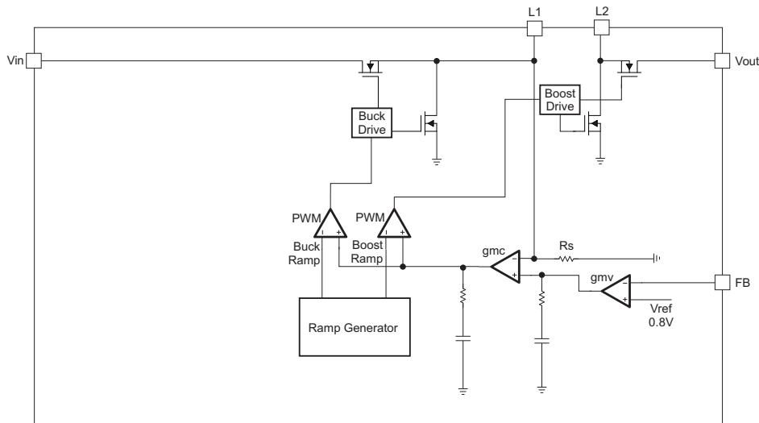

Figure 7: Average Current Mode Control block diagram, written from the drawing. Power stage: Vin connects through the buck high-side MOSFET to the L1 node, and the buck low-side MOSFET connects L1 to ground; both are driven by Buck Drive. At the L2 node the boost low-side MOSFET connects to ground and the boost high-side MOSFET connects to Vout; both are driven by Boost Drive. Control: the transconductance amplifier gmv compares FB (inverting input) with Vref 0.8V (non-inverting input); its output, with a series R-C to ground, is the non-inverting input of the current amplifier gmc. The gmc inverting input is the sensed inductor current, drawn as a node at L1 with the sense resistor Rs to ground. The gmc output, with a series R-C to ground, feeds two PWM comparators: one compares it with the Buck Ramp and drives Buck Drive, the other compares it with the Boost Ramp and drives Boost Drive. Both ramps come from the Ramp Generator.

Copyright © 2016, Texas Instruments Incorporated

**Figure 7. Average Current Mode Control**

#### 8.4.2 Precise Enable

The enable pin of the TPS63070 is not just a simple digital input but compares the voltage applied to a fixed threshold of 0.8V for a rising voltage. This allows to drive the pin by a slowly changing voltage and enables the use of an external RC network to achieve a precise power-up delay. The enable input threshold for a falling edge is typically 100mV lower than the rising edge threshold. The TPS63070 starts operation when the rising threshold is exceeded. For proper operation, the EN pin must be terminated and must not be left floating. Pulling the EN pin low forces the device into shutdown. In this mode, the internal high side and low side MOSFETs are turned off and the entire internal-control circuitry is switched off. The enable pin can also be used with an external voltage divider to set a user-defined minimum supply voltage.

It is recommended to not connect EN directly to VIN but use a resistor in series in the range of 1kΩ to 1MΩ. If several inputs like EN and PS/SYNC are connected to VIN, the resistor can be shared. No resistor is required if the pin is driven from an analog or digital signal rather than a supply voltage.

#### 8.4.3 Power Good

The device has a built in power good output that indicates whether the output voltage has reached its nominal value. The PG signal is generated based on the status of the output voltage monitor. The power good circuit operates as long as the converter is enabled and VIN is above the undervoltage lockout threshold.

If the output voltage has not reached the regulated condition, the PG pin is held low. When the regulated condition is reached, PG is high impedance.

The PG output needs an external pull-up resistor. This resistor can be pulled to any voltage up to the maximum output voltage rating.

**Table 1. Power Good Status**

| EN   | output voltage status                                                                                          | PG             |
|------|----------------------------------------------------------------------------------------------------------------|----------------|
| low  | output off                                                                                                     | low            |
| high | output voltage above power good threshold                                                                      | high impedance |
| high | output voltage below power good threshold, in thermal shutdown or input / output overvoltage protection active | low            |

{11}------------------------------------------------

#### 8.4.4 Soft Start

To minimize inrush current during start up, the device has a soft start. When the EN pin is set high, after a thermal shutdown or after the undervoltage lockout threshold is exceeded, a soft-start cycle is started and the input current is ramped until the output voltage reaches regulation. The device ramps up the output voltage in a controlled manner, even if a large capacitor is connected at the output. During soft-start, as long as the output voltage is below the power good threshold, the input current limit is reduced to typically 1A. The soft-start time is defined by the current limit during the soft-start phase along with the load current, output capacitance and the input to output voltage ratio.

#### 8.4.5 PS/SYNC

The PS/SYNC pin has two functions:

- switching between forced PWM mode and power save mode
- synchronizing to an external clock applied at pin PS/SYNC

When PS/SYNC is set high, the device operates in power save mode at low output current. For an average inductor current above a certain threshold the device switches to forced PWM mode. The automatic switch-over from PFM to PWM and vice versa is done such that the efficiency is kept at the maximum possible level. It is not based on a fixed threshold but at a current that depends on input voltage and output voltage to keep the efficiency at the maximum possible level.

The power save mode is disabled when PS/SYNC is set low. The device then operates in forced fixed frequency PWM mode independent of the output current.

TPS6307x can be synchronized to an external clock applied at pin PS/SYNC. Details about the voltage level and frequency range can be found in the electrical characteristics. When an external clock is detected, TPS6307x switches from internal clock or power save mode to fixed frequency operation based on the external clock frequency. When the external clock is removed, TPS6307x switches back to internal clock or power save mode depending on the average inductor current and status of the PS/SYNC pin. The PS/SYNC pin has two parallel input stages, a slow one with the precise threshold for PWM/PFM mode change and a fast digital input stage for an external clock signal for synchronization.

It is recommended to not connect PS/SYNC directly to VIN but use a resistor in series in the range of 1kΩ to 1MΩ. If several inputs like EN and PS/SYNC are connected to VIN, the resistor can be shared. No resistor is required if the pin is driven from an analog or digital signal rather than a supply voltage.

#### 8.4.6 Short Circuit Protection

The TPS6307x provides short circuit protection to protect itself and the application. When the output voltage is below 1.2 V, the back-gate diodes of the low side input FET and high side output FET are used for rectification. For an input voltage above 9 V and an output voltage below 2.2 V, the switching frequency is scaled to ½ of its nominal value.

{12}------------------------------------------------

#### 8.4.7 VSEL and FB2 pins

The VSEL pin allows to dynamically select between two different output voltages on the adjustable version. The voltage is set by a resistor that is connected between the FB and the FB2 pin. FB2 is connected to GND if VSEL = high. FB2 is high impedance if VSEL= low. The transition speed during a voltage change is defined by the loop bandwidth of the device and can be adjusted by adding a feed-forward capacitor in parallel to R1.

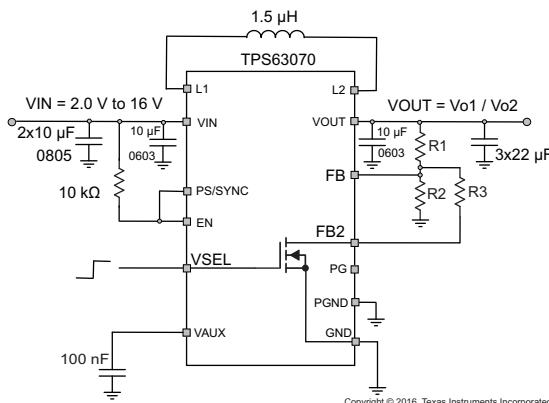

Schematic written from the drawing: VIN = 2.0 V to 16 V drives the VIN pin, decoupled by 2x10 µF (0805) and 10 µF (0603) to ground. A 10 kΩ resistor from VIN feeds PS/SYNC and EN, which are tied together. The 1.5 µH inductor connects L1 and L2. VOUT = Vo1 / Vo2 is decoupled by 10 µF (0603) and 3x22 µF to ground. R1 connects VOUT to FB and R2 connects FB to ground; R3 connects FB to FB2. A logic step drives VSEL, which switches an internal MOSFET from FB2 to GND. VAUX has 100 nF to ground. PG is not connected; PGND and GND are connected to ground.

Copyright © 2016, Texas Instruments Incorporated

**Figure 8. Typical Application using VSEL**

The resistor values for the feedback divider and FB2 are in the 50-500kΩ range. R3 is calculated as follows:

|                                                                                                  |     |
|--------------------------------------------------------------------------------------------------|-----|
| $R3 = \frac{Vo1 \times R1 \times R2^2}{(Vo2 - Vo1)(R1 \times R2 + R2^2)} \text{ for } Vo2 > Vo1$ | (1) |
|--------------------------------------------------------------------------------------------------|-----|

For more details on how to use VSEL see [Technote SLVAE62](#).

#### 8.4.8 Overvoltage Protection

TPS6307x has a built in over-voltage protection which limits the output voltage. The voltage is internally sensed on the VOUT pin. In case the voltage on the feedback pin is not set correctly or the connection is open, this limits the output voltage to a value that protects the output stage from a too high voltage by limiting it to a internally set value.

Input over-voltage protection forces PFM mode to make sure the device is protected against boosting from the output to the input. This may happen if there is a large capacitor charged above the nominal voltage on the output and the supply on the input is removed. In PWM mode, the device is able to provide current from the output to the input causing a rise in the input voltage. In PFM mode, the current to the input is blocked so the input voltage can not rise. The input over-voltage protection does not protect the device from a too high voltage applied to the input but just from operating such that the device itself causes a rise of the input voltage above critical levels. Both over-voltage sensors are de-glitched by approximately 1µs.

#### 8.4.9 Undervoltage Lockout

When the input voltage drops, the undervoltage lockout prevents mis-operation by switching off the device. The converter starts operation when the input voltage exceeds the threshold by a hysteresis of typically 850 mV. This relatively large hysteresis is needed to allow operation down to 2-V of supply voltage for the case when the output voltage is up at 3-V or above but restrict start-up for the case when the output voltage is zero. For start-up when the output voltage has not yet ramped, the rising UVLO threshold was set to a level that allows to start TPS63070 at a supply voltage where the load does not demand much load current.

#### 8.4.10 Overtemperature Protection

The junction temperature (Tj) of the device is monitored by an internal temperature sensor. When Tj exceeds the thermal shutdown temperature, the device goes into thermal shutdown. The power stage is turned off and PG goes low. When Tj decreases below the hysteresis amount, the converter resumes normal operation, beginning with a Soft Start cycle. To avoid unstable conditions, a hysteresis of typically 20°C is implemented on the thermal shutdown temperature. In addition, the thermal shutdown is debounced by approximately 10 µs.

{13}------------------------------------------------

### 8.5 Device Functional Modes

#### 8.5.1 Power Save Mode

Depending on the load current, in order to provide the best efficiency over the complete load range, the device works in PWM mode at an inductor current of approximately 650 mA or higher. At lighter load, the device switches automatically in to Power Save Mode to reduce power consumption and extend battery life. The PFM/PWM pin can be used to select between the two different operation modes. To enable Power Save Mode, the PFM/PWM pin must be set high.

During Power Save Mode, the part operates with a reduced switching frequency and supply current to maintain high efficiency. The output voltage is monitored by a comparator for the threshold "comp low" and "comp high" at every clock cycle. When the device enters Power Save Mode, the converter stops operating and the output voltage drops. The slope of the output voltage depends on the load and the output capacitance. When the output voltage reaches the comp low threshold, at the next clock cycle the device ramps up the output voltage again by starting operation. Operation can last for one or several pulses until the "comp high" threshold is reached. At the next PFM cycle, if the inductor current is still lower than about 650 mA, the device switches off again and the same operation is repeated. Instead, if at the next PFM cycle, the inductor current is above approximately 650 mA, the device automatically switches to PWM mode.

In order to keep high efficiency in PFM mode, there is only a comparator active to keep the output voltage regulated. The AC ripple in this condition is increased, compared to the voltage in PWM mode. The amplitude of this voltage ripple typically is 50 mV pk-pk, with 22 µF effective capacitance. In order to avoid a critical voltage drop when switching from 0 A to full load, the output voltage in PFM is typically 1 % above the nominal value in PWM. This allows the converter to operate with a small output capacitor and still have a low absolute voltage drop during heavy load transients.

Power Save Mode can be disabled by programming the PFM/PWM pin low.

![Figure 9: Dynamic Voltage Positioning. A graph showing output voltage (VOUT) versus time. The y-axis has markers for +1%*Vo, Vo, and a lower level for 'Absolute Voltage drop with positioning'. The x-axis represents time. The graph shows a sawtooth waveform for 'PFM mode at light load current' oscillating between 'Comparator high' and 'Comparator low' thresholds, with a '50mV ripple in PFM' indicated. A red arrow labeled 'Heavy Load transient step' points to a point on the waveform. After this point, the voltage drops sharply to the 'Absolute Voltage drop with positioning' level and then rises back and settles around the Vo level with a small ripple, labeled 'PWM mode'; the +1%*Vo level is the dashed line midway between 'Comparator high' and 'Comparator low'.](img/70f5f44cb855bbb0c203c00187b2113e_img.jpg)

Figure 9: Dynamic Voltage Positioning. A graph showing output voltage (VOUT) versus time. The y-axis has markers for +1%\*Vo, Vo, and a lower level for 'Absolute Voltage drop with positioning'. The x-axis represents time. The graph shows a sawtooth waveform for 'PFM mode at light load current' oscillating between 'Comparator high' and 'Comparator low' thresholds, with a '50mV ripple in PFM' indicated. A red arrow labeled 'Heavy Load transient step' points to a point on the waveform. After this point, the voltage drops sharply to the 'Absolute Voltage drop with positioning' level and then rises back and settles around the Vo level with a small ripple, labeled 'PWM mode'; the +1%\*Vo level is the dashed line midway between 'Comparator high' and 'Comparator low'.

**Figure 9. Dynamic Voltage Positioning**

#### 8.5.2 Current Limit

it is possible to calculate the output current in the different conditions in boost mode using [Equation 2](#) and [Equation 3](#) and in buck mode using [Equation 4](#) and [Equation 5](#).

$$\text{Duty Cycle Boost} \quad D = \frac{V_{OUT} - V_{IN}}{V_{OUT}} \quad (2)$$

$$\text{Output Current Boost} \quad I_{OUT} = \eta \times I_{IN} (1-D) \quad (3)$$

$$\text{Duty Cycle Buck} \quad D = \frac{V_{OUT}}{V_{IN}} \quad (4)$$

$$\text{Output Current Buck} \quad I_{OUT} = (\eta \times I_{IN}) / D \quad (5)$$

{14}------------------------------------------------

### Device Functional Modes (continued)

With,

$\eta$  = Estimated converter efficiency (use the number from the efficiency curves or 0.90 as an assumption)

$I_{IN}$  = Minimum average input current

The maximum output current TPS63070 can provide, can directly be seen from the graphs "Maximum Load Current vs Input Voltage" for different output voltages at ([Figure 43](#), [Figure 20](#) and [Figure 22](#) ). The start-up current is lower because the current limit is set to typically 1A to limit the inrush current at start-up as long as the power good signal is low. Please see the typical start-up current graphs at [Figure 42](#), [Figure 19](#) and [Figure 21](#). Once the power good comparator indicates "power good", the current limit is set to its nominal value as given in the electrical characteristics.

#### 8.5.3 Output Discharge Function (TPS630702 only)

To make sure the load applied at TPS630702 is powered up from 0 V once TPS630702 is enabled, the device features an internal discharge resistor for the output capacitor. The discharge function is enabled as soon as the device is disabled, in thermal shutdown or in undervoltage lockout. The minimum supply voltage required for the discharge function to remain active when enabled is approximately 2 V. The discharge function is only active after the device has been enabled at least once after supply voltage was applied. This feature is only enabled in TPS630702 and it is the only difference between TPS63070 and TPS630702.

{15}------------------------------------------------

## 9 Application and Implementation

#### NOTE

Information in the following applications sections is not part of the TI component specification, and TI does not warrant its accuracy or completeness. TI's customers are responsible for determining suitability of components for their purposes. Customers should validate and test their design implementation to confirm system functionality.

### 9.1 Application Information

The TPS6307x is a high efficiency, low quiescent current buck-boost converter suitable for applications where the input voltage can be higher or lower than the output voltage. The TPS63070 is internally supplied from the higher of the input voltage or output voltage. For proper operation either one or both need to have a voltage of 3.0 V or above but must not exceed their maximum rating.

### 9.2 Typical Application for adjustable version

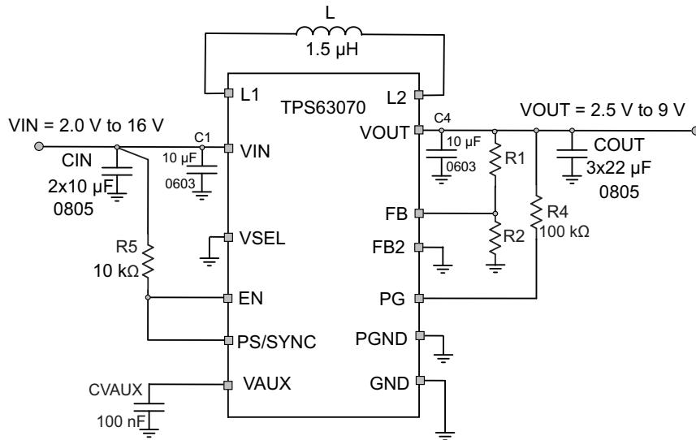

Schematic written from the drawing (same circuit as the Simplified Schematic on page 1): the input VIN = 2.0 V to 16 V drives the VIN pin, decoupled by CIN (2x10 µF, 0805) and C1 (10 µF, 0603) to ground. R5 (10 kΩ) connects VIN to EN, and EN is tied to PS/SYNC. VSEL and FB2 are connected to ground. VAUX has CVAUX (100 nF) to ground. The inductor L (1.5 µH) connects L1 and L2. VOUT is decoupled by C4 (10 µF, 0603) and COUT (3x22 µF, 0805) to ground and is the output VOUT = 2.5 V to 9 V. The divider R1/R2 from VOUT to ground sets FB. R4 (100 kΩ) pulls PG up to VOUT. PGND and GND are connected to ground.

Copyright © 2016, Texas Instruments Incorporated

**Figure 10. Typical Application For Adjustable Version**

#### 9.2.1 Design Requirements

The design guidelines provide a component selection to operate the device within the recommended operating conditions. The input and output capacitors have been split into a small 0603 size capacitor close to the device pins and 0805 size capacitors to get the required capacitance.

**Table 2. Bill of Materials**

| REFERENCE | DESCRIPTION        | VALUE                         | MANUFACTURER      |
|-----------|--------------------|-------------------------------|-------------------|
| IC        | TPS63070RNM        |                               | Texas Instruments |
| L         | XFL4020-152ME      | 1.5 µH                        | Coilcraft         |
| CIN       | GRM21BC71E106ME11L | 2 x 10 µF / 25 V / X7S / 0805 | Murata            |
| C1        | TMK107BBJ106MA-T   | 10 µF / 25 V / X5R / 0603     | Taiyo Yuden       |
| COUT      | GRM21BC81C226ME44L | 3 x 22 µF / 16 V / X6S / 0805 | Murata            |
| C4        | TMK107BBJ106MA-T   | 10 µF / 25 V / X5R / 0603     | Taiyo Yuden       |

{16}------------------------------------------------

**Table 2. Bill of Materials (continued)**

| REFERENCE | DESCRIPTION              | VALUE                               | MANUFACTURER |
|-----------|--------------------------|-------------------------------------|--------------|
| CVAUX     | TMK105B7104MV-FR         | 100 nF / 25V / X7R / 0402           | Taiyo Yuden  |
| R1, R2    | Metal Film Resistor ; 1% | depending on desired output voltage |              |
| R4        | Metal Film Resistor ; 1% | 100 kΩ                              |              |

#### 9.2.2 Detailed Design Procedure

The TPS6307x series of buck-boost converter has internal loop compensation. Therefore, the external L-C filter has to be selected according to the internal compensation. It's important to consider that the effective inductance, due to inductor tolerance and current derating can vary between 20% and -30%. The same for the capacitance of the output filter: the effective capacitance can vary between +20% and -80% of the specified datasheet value, due to capacitor tolerance and bias voltage. For this reason, [Output Filter Selection](#) shows the nominal capacitance and inductance value allowed. The effective capacitance of the adjustable version TPS63070 on the output (in µF) needs to be at least 10 times higher than the effective inductance (in µH) to ensure a good transient response and stable operation.

**Table 3. Output Filter Selection**

| INDUCTOR VALUE [µH] (1) | OUTPUT CAPACITOR VALUE [µF] (2) |                  |    |     |
|---------------------------------------|--------------------------------------------|------------------|----|-----|
|                                       | 22                                         | 47               | 68 | 100 |
| 1.0                                   |                                            | √                | √  | √   |
| 1.5                                   |                                            | √ (3) | √  | √   |
| 2.2                                   |                                            |                  | √  | √   |

- (1) Inductor tolerance and current de-rating is anticipated. The effective inductance can vary by +20% and –30%.
- (2) Capacitance tolerance and bias voltage de-rating of +20% and -50% is anticipated. For capacitors with larger dc bias effect, a larger nominal value needs to be selected.
- (3) Typical application. Other check marks indicates recommended filter combinations

##### 9.2.2.1 Programming The Output Voltage

While the output voltage of the TPS63070 is adjustable, the TPS630701 is set to a fixed voltage. For fixed output versions, the FB pin must be connected to the output directly. The adjustable version can be programmed for output voltages from 2.5V to 9V by using a resistive divider from VOUT to GND. The voltage at the FB pin (VREF)is regulated to 800mV. The value of the output voltage is set by the selection of the resistive divider from [Equation 6](#) . It is recommended to choose resistor values which allow a current of at least 2uA, meaning the value of R2 shouldn't exceed 400kΩ. Lower resistor values are recommended for highest accuracy and most robust design.

$$R_1 = R_2 \left( \frac{V_{OUT}}{0.8V} - 1 \right) \quad (6)$$

**Table 4. Typical Resistor Values**

| Output Voltage | R1     | R2     |
|----------------|--------|--------|
| 3.3 V          | 470 kΩ | 150 kΩ |
| 5.0 V          | 680 kΩ | 130 kΩ |
| 5.3 V          | 560 kΩ | 100 kΩ |
| 5.5 V          | 300 kΩ | 51 kΩ  |
| 6.5 V          | 360 kΩ | 51 kΩ  |
| 9 V            | 402 kΩ | 39 kΩ  |

{17}------------------------------------------------

##### 9.2.2.2 Inductor Selection

For high efficiencies, the inductor should have a low dc resistance to minimize conduction losses. Especially at high switching frequencies, the core material has a higher impact on efficiency. When using small chip inductors, the efficiency is reduced mainly due to higher inductor core losses. This needs to be considered when selecting the appropriate inductor. The inductor value determines the inductor ripple current. The larger the inductor value, the smaller the inductor ripple current and the lower the conduction losses of the converter. Conversely, larger inductor values cause a slower load transient response. To avoid saturation of the inductor, the peak current for the inductor in steady state operation is calculated using [Equation 8](#). Only the equation which defines the switch current in boost mode is shown, because this provides the highest value of current and represents the critical current value for selecting the right inductor.

$$\text{Duty Cycle Boost} \quad D = \frac{V_{OUT} - V_{IN}}{V_{OUT}} \quad (7)$$

$$I_{PEAK} = \frac{I_{out}}{\eta \times (1 - D)} + \frac{V_{in} \times D}{2 \times f \times L} \quad (8)$$

Where,

D =Duty Cycle in Boost mode

f = Converter switching frequency (typical 2.4MHz)

L = Selected inductor value

$\eta$  = Estimated converter efficiency (use the number from the efficiency curves or 0.90 as an assumption)

**Note:** The calculation must be done for the minimum input voltage which is possible to have in boost mode

Calculating the maximum inductor current using the actual operating conditions gives the minimum saturation current of the inductor needed. It is recommended to choose an inductor with a saturation current 20% higher than the value calculated from [Equation 8](#). The following inductors are recommended for use:

**Table 5. Inductor Selection**

| INDUCTOR VALUE | COMPONENT SUPPLIER (1) | SIZE (LxWxH /mm) | Isat/DCR                |
|----------------|-----------------------------------|------------------|-------------------------|
| 1.2 µH         | Coilcraft, XFL4015-122ME          | 4 x 4 x 1.5      | 4.5 A / 18.8 mΩ         |
| 1.5 µH         | Coilcraft, XFL4020-152ME          | 4 x 4 x 2.1      | 4.6 A / 14.4 mΩ         |
| 1.0 µH         | Coilcraft, XFL4020-102ME          | 4 x 4 x 2.1      | 5.4 A / 10.8 mΩ         |
| 1 µH           | Murata, 1277AS-H-1R0M             | 3.2 x 2.5 x 1.2  | 3.7 A / 45 mΩ           |

(1) See [Third-party Products Disclaimer](#)

The inductor value also affects the stability of the feedback loop. In particular the boost transfer function exhibits a right half-plane zero. The frequency of the right half plane zero is inverse proportional to the inductor value and the load current. This means the higher the value of the inductance and load current, the more the right half plane zero is moved to a lower frequency. This degrades the phase margin of the feedback loop. It is recommended to choose the inductor's value in order to have the frequency of the right half plane zero >400 kHz. The frequency of the RHPZ is calculated using [Equation 9](#).

$$f_{RHPZ} = \frac{(1 - D)^2 \times V_{out}}{2\pi \times I_{out} \times L} \quad (9)$$

With,

D =Duty Cycle in Boost mode

**Note:** The calculation must be done for the minimum input voltage which is possible to have in boost mode

If the operating conditions results in a frequency of the RHPZ of less than 400kHz, more output capacitance should be added to reduce the cross over frequency. The RHPZ moves to lowest frequency at lowest input voltage (highest boost factor) and largest output current. Device stability should therefore be observed mainly under these worst case operating conditions.

{18}------------------------------------------------

##### 9.2.2.3 Capacitor Selection

###### 9.2.2.3.1 Input Capacitor

It is recommended to use a combination of capacitors on the input. A small size ceramic capacitor as close as possible from the VIN pin to GND to block high frequency noise and a larger one in parallel for the required capacitance on for good transient behavior of the regulator. X5R or X7R ceramic capacitor are recommended. The input capacitor needs to be large enough to avoid supply voltage dips shorter than 5us as the undervoltage lockout circuitry needs time to react.

###### 9.2.2.3.2 Output Capacitor

Same as the input, the output capacitor should be a combination of capacitors optimized for suppressing high frequency noise and a larger capacitor for low output voltage ripple and stable operation. The use of small X5R or X7R ceramic capacitors placed as close as possible to the VOUT and GND pins of the IC is recommended. A 0603 size capacitor close to the pins of the IC and as many 0805 capacitors as required to get the capacitance given the output voltage and dc bias effect of the ceramic capacitors is best. The recommended typical output capacitor values are outlined in [Output Filter Selection](#). Please also see the [Recommended Operating Conditions](#) for the minimum and maximum capacitance at the output.

Larger capacitors will cause lower output voltage ripple as well as lower output voltage drop during load transients.

**Table 6. Typical Capacitors**

| VALUE | PART NUMBER       | COMPONENT SUPPLIER (1) | COMMENT                                                                 | SIZE (LxWxH mm) |
|-------|-------------------|-----------------------------------|-------------------------------------------------------------------------|-----------------|
| 22 µF | EMK212BBJ226MG-T  | Taiyo Yuden                       | input capacitor for Vin ≤ 8 V                                           | 2 x 1.25 x 1.25 |
| 22 µF | TMK316BBJ226ML    | Taiyo Yuden                       | input capacitor                                                         | 3.2 x 1.6 x 1.6 |
| 10 µF | TMK107BBJ106MA-T  | Taiyo Yuden                       | bypass capacitor directly at device pins on VIN to GND and VOUT to GND  | 1.6 x 0.8 x 0.8 |
| 10 µF | GRM21BC71E106ME11 | Murata                            | small body size; 2 parts required if used at VIN > 6V                   | 2 x 1.25 x 1.25 |
| 22 µF | GRM21BC81C226ME44 | Murata                            | small body size; 3 parts required if used at Vo > 5V; otherwise 2 parts | 2 x 1.25 x 1.25 |

(1) See [Third-party Products Disclaimer](#)

{19}------------------------------------------------

#### 9.2.3 Application Curves

**Table 7. Typical Application Curves for Adjustable Version**

| Parameter                                 | Conditions                                                                                 | Figure    |
|-------------------------------------------|--------------------------------------------------------------------------------------------|-----------|
| <b>Efficiency</b>                         |                                                                                            |           |
| Efficiency vs Output Current (PFM/PWM)    | V IN = 3 V, 4.2 V, 5 V, 7 V, 9 V, 12 V, V OUT = 7 V , PS/SYNC = Low  | Figure 11 |
| Efficiency vs Output Current (PWM only)   | V IN = 3 V, 4.2 V, 5 V, 7 V, 9 V, 12 V, V OUT = 7 V , PS/SYNC = High | Figure 12 |
| Efficiency vs Output Current (PFM/PWM)    | V IN = 3 V, 4.2 V, 5 V, 7 V, 9 V, 12 V, V OUT = 9 V , PS/SYNC = Low  | Figure 13 |
| Efficiency vs Output Current (PWM only)   | V IN = 3 V, 4.2 V, 5 V, 7 V, 9 V, 12 V, V OUT = 9 V , PS/SYNC = High | Figure 14 |
| <b>Load Regulation</b>                    |                                                                                            |           |
| Load Regulation, PFM/PWM Operation        | V IN = 3 V, 4.2 V, 5 V, 7 V, 9 V, 12 V, V OUT = 7 V , PS/SYNC = Low  | Figure 15 |
| Load Regulation, PWM Operation            | V IN = 3 V, 4.2 V, 5 V, 7 V, 9 V, 12 V, V OUT = 7 V , PS/SYNC = High | Figure 16 |
| Load Regulation, PFM/PWM Operation        | V IN = 3 V, 4.2 V, 5 V, 7 V, 9 V, 12 V, V OUT = 9 V , PS/SYNC = Low  | Figure 17 |
| Load Regulation, PWM Operation            | V IN = 3 V, 4.2 V, 5 V, 7 V, 9 V, 12 V, V OUT = 9 V , PS/SYNC = High | Figure 18 |
| <b>Output Current</b>                     |                                                                                            |           |
| Typical Start-up Current vs Input Voltage | V OUT = 7 V, T J = -40 °C, 25 °C, 85 °C, 125 °C                      | Figure 19 |
| Maximum Load Current vs Input Voltage     | V OUT = 7 V, T J = -40 °C, 25 °C, 85 °C, 125 °C, PG = high           | Figure 20 |
| Typical Start-up Current vs Input Voltage | V OUT = 9 V, T J = -40 °C, 25 °C, 85 °C, 125 °C                      | Figure 21 |
| Maximum Load Current vs Input Voltage     | V OUT = 9V, T J = -40 °C, 25 °C, 85 °C, 125 °C, PG = high            | Figure 22 |
| <b>Regulation Accuracy</b>                |                                                                                            |           |
| Load Transient, PFM/PWM Boost Operation   | V IN = 4.2 V, V OUT = 7 V, Load = 100 mA to 1 A, PS/SYNC = Low       | Figure 23 |
| Load Transient, PFM/PWM Buck Operation    | V IN = 12 V, V OUT = 7 V, Load = 200 mA to 1.8 A, PS/SYNC = Low      | Figure 24 |
| Load Transient, PFM/PWM Boost Operation   | V IN = 4.2 V, V OUT = 9 V, Load = 100 mA to 1 A, PS/SYNC = Low       | Figure 25 |
| Load Transient, PFM/PWM Buck Operation    | V IN = 12 V, V OUT = 9 V, Load = 200 mA to 1.8 A, PS/SYNC = Low      | Figure 26 |
| Line Transient, PFM/PWM Operation         | V IN = 5 V to 9 V, V OUT = 7 V, Load = 1 A, PS/SYNC = Low            | Figure 27 |
| Line Transient, PFM/PWM Operation         | V IN = 8 V to 12 V, V OUT = 9 V, Load = 1 A, PS/SYNC = Low           | Figure 28 |
| <b>Output Voltage Ripple</b>              |                                                                                            |           |
| Output Voltage Ripple, PFM/PWM Operation  | V IN = 5 V, V OUT = 7 V, Load = 0.3 A, PS/SYNC = Low                 | Figure 29 |
| Output Voltage Ripple, PWM Operation      | V IN = 5 V, V OUT = 7 V, Load = 1 A, PS/SYNC = high                  | Figure 30 |
| Output Voltage Ripple, PFM/PWM Operation  | V IN = 12 V, V OUT = 7 V, Load = 0.3 A, PS/SYNC = Low                | Figure 31 |
| Output Voltage Ripple, PFM/PWM Operation  | V IN = 5 V, V OUT = 9 V, Load = 0.1 A, PS/SYNC = Low                 | Figure 32 |
| Output Voltage Ripple, PWM Operation      | V IN = 5 V, V OUT = 9 V, Load = 0.5 A, PS/SYNC = high                | Figure 33 |
| Output Voltage Ripple, PFM/PWM Operation  | V IN = 12 V, V OUT = 9 V, Load = 0.1 A, PS/SYNC = Low                | Figure 34 |

{20}------------------------------------------------

**Table 7. Typical Application Curves for Adjustable Version (continued)**

| Parameter                                               | Conditions                                                                     | Figure    |
|---------------------------------------------------------|--------------------------------------------------------------------------------|-----------|
| <b>Startup</b>                                          |                                                                                |           |
| Start-up Behavior from Rising Enable, PFM/PWM Operation | $V_{IN} = 4.5\text{ V}$ , $V_{OUT} = 7\text{ V}$ , Load = 0.5 A, PS/SYNC = Low | Figure 35 |
| Start-up Behavior from Rising Enable, PFM/PWM Operation | $V_{IN} = 7\text{ V}$ , $V_{OUT} = 9\text{ V}$ , Load = 0.5 A, PS/SYNC = Low   | Figure 36 |

Figure 11: Efficiency vs Output Current, PFM, Vout = 7 V, T = 25 °C. Efficiency (0 to 100%) versus Output Current (A) on a logarithmic axis from 100µ to 2, one curve per input voltage VIN = 3 V, 4.2 V, 5 V, 7 V, 9 V and 12 V. Efficiency rises with output current and flattens out; at light load the lower input voltages give higher efficiency and the 12 V curve is lowest. At the highest currents the 3 V curve drops steeply and the 4.2 V and 5 V curves drop less. Read values from the image/PDF.

Vout = 7 V

PFM

T = 25 °C

**Figure 11. Efficiency vs Output Current**

Figure 12: Efficiency vs Output Current, PWM, Vout = 7 V, T = 25 °C. Efficiency (0 to 100%) versus Output Current (A) on a logarithmic axis from 100µ to 1, one curve per input voltage VIN = 3 V, 4.2 V, 5 V, 7 V, 9 V and 12 V. Efficiency is very low at light load and rises steeply with output current; the 12 V curve is the lowest along the rising part. At the highest currents the 3 V curve drops. Read values from the image/PDF.

Vout = 7 V

PWM

T = 25 °C

**Figure 12. Efficiency vs Output Current**

Figure 13: Efficiency vs Output Current, PFM, Vout = 9 V, T = 25 °C. Efficiency (0 to 100%) versus Output Current (A) on a logarithmic axis from 100µ to 2, one curve per input voltage VIN = 3 V, 4.2 V, 5 V, 7 V, 9 V and 12 V. Efficiency rises with output current and flattens out; the 3 V curve stays below the others in the middle of the range and drops at the highest currents, where the 4.2 V curve also drops. Read values from the image/PDF.

Vout = 9 V

PFM

T = 25 °C

**Figure 13. Efficiency vs Output Current**

Figure 14: Efficiency vs Output Current, PWM, Vout = 9 V, T = 25 °C. Efficiency (0 to 100%) versus Output Current (A) on a logarithmic axis from 100µ to 2, one curve per input voltage VIN = 3 V, 4.2 V, 5 V, 7 V, 9 V and 12 V. Efficiency is very low at light load and rises steeply with output current; the 12 V curve is the lowest along the rising part. At the highest currents the 3 V curve drops. Read values from the image/PDF.

Vout = 9 V

PWM

T = 25 °C

**Figure 14. Efficiency vs Output Current**

Figure 15: Output Voltage vs Output Current, PFM, Vout = 7 V, T = 25 °C. Output Voltage (V) from 6.79 to 7.28 versus Output Current (A) on a logarithmic axis from 100µ to 2, one curve per input voltage VIN = 3 V, 4.2 V, 5 V, 7 V, 9 V and 12 V. At light load the output voltage sits slightly above the 7 V gridline (PFM) and is nearly flat; at higher currents it moves down to 7 V. At the highest currents the 3 V curve and then the 4.2 V curve collapse. Read values from the image/PDF.

Vout = 7 V

PFM

T = 25 °C

**Figure 15. Output Voltage vs Output Current**

Figure 16: Output Voltage vs Output Current, PWM, Vout = 7 V, T = 25 °C. Output Voltage (V) from 6.79 to 7.28 versus Output Current (A) on a logarithmic axis from 100µ to 2, one curve per input voltage VIN = 3 V, 4.2 V, 5 V, 7 V, 9 V and 12 V. The output voltage is flat at the 7 V gridline over the whole range; at the highest currents the 3 V curve and then the 4.2 V curve collapse. Read values from the image/PDF.

Vout = 7 V

PWM

T = 25 °C

**Figure 16. Output Voltage vs Output Current**

{21}------------------------------------------------

![Figure 17: Output Voltage vs Output Current, PFM, Vout = 9 V, T = 25 °C. Output Voltage (V) from 8.73 to 9.36 versus Output Current (A) on a logarithmic axis from 100µ to 2, one curve per input voltage VIN = 3 V (black), 4.2 V (red), 5 V (gray), 7 V (blue), 9 V (green) and 12 V (brown). At light load the output voltage sits slightly above the 9 V gridline (PFM) and is nearly flat; at higher currents it steps down to 9 V. At the highest currents the 3 V, 4.2 V and 5 V curves collapse. Read values from the image/PDF.](img/c4c8cd9c58f395c25a2a2b217ca7c2fb_img.jpg)

Figure 17: Output Voltage vs Output Current, PFM, Vout = 9 V, T = 25 °C. Output Voltage (V) from 8.73 to 9.36 versus Output Current (A) on a logarithmic axis from 100µ to 2, one curve per input voltage VIN = 3 V (black), 4.2 V (red), 5 V (gray), 7 V (blue), 9 V (green) and 12 V (brown). At light load the output voltage sits slightly above the 9 V gridline (PFM) and is nearly flat; at higher currents it steps down to 9 V. At the highest currents the 3 V, 4.2 V and 5 V curves collapse. Read values from the image/PDF.

Vout = 9 V

PFM

T = 25 °C

**Figure 17. Output Voltage vs Output Current**

Figure 18: Output Voltage vs Output Current, PWM, Vout = 9 V, T = 25 °C. Output Voltage (V) from 8.73 to 9.36 versus Output Current (A) on a logarithmic axis from 100µ to 2, one curve per input voltage VIN = 3 V (black), 4.2 V (red), 5 V (gray), 7 V (blue), 9 V (green) and 12 V (brown). The output voltage is flat at the 9 V gridline over the whole range; at the highest currents the 3 V, 4.2 V and 5 V curves collapse. Read values from the image/PDF.

Vout = 9 V

PWM

T = 25 °C

**Figure 18. Output Voltage vs Output Current**

Figure 19: Typical Start-up Current, Vout = 7 V, resistive load. Output Current (A) from 0 to 1 versus Input Voltage (V) from 3 to 16, one curve per junction temperature -40°C (black), 25°C (red), 85°C (gray) and 125°C (blue). The start-up current rises in steps with input voltage and then stays flat; the 85°C curve reaches the highest plateau, followed by 25°C and 125°C, and the -40°C curve is lowest. Read values from the image/PDF.

Vout = 7 V

resistive load

**Figure 19. Typical Start-up Current**

Figure 20: Maximum Load Current vs Input Voltage, Vout = 7 V, after start-up with PG = high. Max Output Current (A) from 0 to 4.5 versus Input Voltage (V) from 2 to 16, one curve per junction temperature -40°C (black), 25°C (red), 85°C (gray) and 125°C (blue). The maximum load current rises with input voltage to a peak and then decreases slowly; the -40°C curve is highest, followed by 25°C and 85°C, and the 125°C curve is lowest. Read values from the image/PDF.

Vout = 7 V

after start-up with PG = high

**Figure 20. Maximum Load Current vs Input Voltage**

Figure 21: Typical Start-up Current, Vout = 9 V, resistive load. Output Current (A) from 0 to 1 versus Input Voltage (V) from 3 to 16, one curve per junction temperature -40°C (black), 25°C (red), 85°C (gray) and 125°C (blue). The start-up current rises in steps with input voltage and then stays flat; the -40°C, 25°C and 85°C curves nearly overlap and reach the same plateau, while the 125°C curve levels off earlier at a lower plateau. Read values from the image/PDF.

Vout = 9 V

resistive load

**Figure 21. Typical Start-up Current**

Figure 22: Maximum Load Current vs Input Voltage, Vout = 9 V, after start-up with PG = high. Max Output Current (A) from 0 to 4.5 versus Input Voltage (V) from 2 to 16, one curve per junction temperature -40°C (black), 25°C (red), 85°C (gray) and 125°C (blue). The maximum load current rises with input voltage to a peak and then decreases slowly; the -40°C curve is highest, followed by 25°C and 85°C, and the 125°C curve is lowest. Read values from the image/PDF.

Vout = 9 V

after start-up with PG = high

**Figure 22. Maximum Load Current vs Input Voltage**

{22}------------------------------------------------

![Figure 23: Load Transient Response, oscilloscope capture, Vout = 7 V, PFM, Vin = 4.2V. Channel 2 VOUT (200mV/div) is on top and channel 3 output current (500mA/div) at the bottom, 200µs/div. The output current steps from its low level to its high level and back. VOUT dips at the load step-up and recovers, and overshoots briefly at the load step-down; before the step-up and after the step-down VOUT shows a wider ripple band. The on-screen measurement readouts (Peak-Peak and Mean of VOUT, High and Low of the output current) are part of the image; read their values from the image/PDF.](img/50fecd0e7c9bf4ebf321d8367d42cc94_img.jpg)

Figure 23: Load Transient Response, oscilloscope capture, Vout = 7 V, PFM, Vin = 4.2V. Channel 2 VOUT (200mV/div) is on top and channel 3 output current (500mA/div) at the bottom, 200µs/div. The output current steps from its low level to its high level and back. VOUT dips at the load step-up and recovers, and overshoots briefly at the load step-down; before the step-up and after the step-down VOUT shows a wider ripple band. The on-screen measurement readouts (Peak-Peak and Mean of VOUT, High and Low of the output current) are part of the image; read their values from the image/PDF.

Vout = 7 V

PFM

Vin = 4.2V

**Figure 23. Load Transient Response**

![Figure 24: Load Transient Response, oscilloscope capture, Vout = 7 V, PFM, Vin = 12V. Channel 2 VOUT (200mV/div) is on top and channel 3 output current (1.00 A/div) at the bottom, 200µs/div. The output current steps from its low level to its high level and back. VOUT dips at the load step-up and recovers, and overshoots briefly at the load step-down; before the step-up and after the step-down VOUT shows a wider ripple band. The on-screen measurement readouts (Peak-Peak and Mean of VOUT, High and Low of the output current) are part of the image; read their values from the image/PDF.](img/65a9654ccb3d0d452378b0f4c0c392f7_img.jpg)

Figure 24: Load Transient Response, oscilloscope capture, Vout = 7 V, PFM, Vin = 12V. Channel 2 VOUT (200mV/div) is on top and channel 3 output current (1.00 A/div) at the bottom, 200µs/div. The output current steps from its low level to its high level and back. VOUT dips at the load step-up and recovers, and overshoots briefly at the load step-down; before the step-up and after the step-down VOUT shows a wider ripple band. The on-screen measurement readouts (Peak-Peak and Mean of VOUT, High and Low of the output current) are part of the image; read their values from the image/PDF.

Vout = 7 V

PFM

Vin = 12V

**Figure 24. Load Transient Response**

![Figure 25: Load Transient Response, oscilloscope capture, Vout = 9 V, PFM, Vin = 4.2V. Channel 2 VOUT (200mV/div) is on top and channel 3 output current (500mA/div) at the bottom, 200µs/div. The output current steps from its low level to its high level and back. VOUT dips at the load step-up and recovers, and overshoots briefly at the load step-down; before the step-up and after the step-down VOUT shows a wider ripple band. The on-screen measurement readouts (Peak-Peak and Mean of VOUT, High and Low of the output current) are part of the image; read their values from the image/PDF.](img/ebb257e664fc85a1eb4d6534842794bb_img.jpg)

Figure 25: Load Transient Response, oscilloscope capture, Vout = 9 V, PFM, Vin = 4.2V. Channel 2 VOUT (200mV/div) is on top and channel 3 output current (500mA/div) at the bottom, 200µs/div. The output current steps from its low level to its high level and back. VOUT dips at the load step-up and recovers, and overshoots briefly at the load step-down; before the step-up and after the step-down VOUT shows a wider ripple band. The on-screen measurement readouts (Peak-Peak and Mean of VOUT, High and Low of the output current) are part of the image; read their values from the image/PDF.

Vout = 9 V

PFM

Vin = 4.2V

**Figure 25. Load Transient Response**

![Figure 26: Load Transient Response, oscilloscope capture, Vout = 9 V, PFM, Vin = 12V. Channel 2 VOUT (200mV/div) is on top and channel 3 output current (1.00 A/div) at the bottom, 200µs/div. The output current steps from its low level to its high level and back. VOUT dips at the load step-up and recovers, and overshoots briefly at the load step-down; before the step-up and after the step-down VOUT shows a wider ripple band. The on-screen measurement readouts (Peak-Peak and Mean of VOUT, High and Low of the output current) are part of the image; read their values from the image/PDF.](img/4a0acd64a680ef89f832de06989e2544_img.jpg)

Figure 26: Load Transient Response, oscilloscope capture, Vout = 9 V, PFM, Vin = 12V. Channel 2 VOUT (200mV/div) is on top and channel 3 output current (1.00 A/div) at the bottom, 200µs/div. The output current steps from its low level to its high level and back. VOUT dips at the load step-up and recovers, and overshoots briefly at the load step-down; before the step-up and after the step-down VOUT shows a wider ripple band. The on-screen measurement readouts (Peak-Peak and Mean of VOUT, High and Low of the output current) are part of the image; read their values from the image/PDF.

Vout = 9 V

PFM

Vin = 12V

**Figure 26. Load Transient Response**

Figure 27: Line Transient Response, oscilloscope capture, Vout = 7 V, PFM, Io = 1A. Channel 2 VOUT (200mV/div) is on top and channel 1 VIN (2.00 V/div) at the bottom, 1.00ms/div, with a 'Mode=PFM' annotation. VIN steps up and back down; VOUT stays flat apart from a short spike at each VIN edge. The on-screen measurement readouts (Peak-Peak and Mean of VOUT, High and Low of VIN) are part of the image; read their values from the image/PDF.

Vout = 7 V

PFM

Io = 1A

**Figure 27. Line Transient Response**

Figure 28: Line Transient Response, oscilloscope capture, Vout = 9 V, PFM, Io = 1A. Channel 2 VOUT (100mV/div) is on top and channel 1 VIN (2.00 V/div) at the bottom, 1.00ms/div, with a 'Mode=PFM' annotation. VIN steps up and back down; VOUT stays flat apart from a short spike at each VIN edge. The on-screen measurement readouts (Peak-Peak and Mean of VOUT, High and Low of VIN) are part of the image; read their values from the image/PDF.

Vout = 9 V

PFM

Io = 1A

**Figure 28. Line Transient Response**

{23}------------------------------------------------

![Figure 29: Output Voltage Ripple, oscilloscope capture, Vin = 5V; Vout = 7 V, PFM, Io = 0.3A. Channel 2 VOUT (50.0mV/div) is on top and channel 4 inductor current (500mA/div) at the bottom, 10.0µs/div. The inductor current flows in bursts of switching pulses separated by intervals without current; VOUT rises during each burst and falls between bursts, giving a sawtooth-like ripple. The on-screen measurement readouts (Peak-Peak and Mean of VOUT, Mean of the inductor current) are part of the image; read their values from the image/PDF.](img/06ccd604e7eac77c7a5a323b6a913f15_img.jpg)

Figure 29: Output Voltage Ripple, oscilloscope capture, Vin = 5V; Vout = 7 V, PFM, Io = 0.3A. Channel 2 VOUT (50.0mV/div) is on top and channel 4 inductor current (500mA/div) at the bottom, 10.0µs/div. The inductor current flows in bursts of switching pulses separated by intervals without current; VOUT rises during each burst and falls between bursts, giving a sawtooth-like ripple. The on-screen measurement readouts (Peak-Peak and Mean of VOUT, Mean of the inductor current) are part of the image; read their values from the image/PDF.

Vin = 5V; Vout = 7 V

PFM

Io = 0.3A

**Figure 29. Output Voltage Ripple**

Figure 30: Output Voltage Ripple, oscilloscope capture, Vin = 5V; Vout = 7 V, PWM, Io = 1A. Channel 2 VOUT (50.0mV/div) is on top and channel 4 inductor current (200mA/div) at the bottom, 1.00µs/div. The inductor current is a continuous triangular waveform at the switching frequency; VOUT shows a small ripple at the same frequency. The on-screen measurement readouts (Peak-Peak and Mean of VOUT, Mean of the inductor current) are part of the image; read their values from the image/PDF.

Vin = 5V; Vout = 7 V

PWM

Io = 1A

**Figure 30. Output Voltage Ripple**

![Figure 31: Output Voltage Ripple, oscilloscope capture, Vin = 12V; Vout = 7 V, PFM, Io = 0.3A. Channel 2 VOUT (50.0mV/div) is on top and channel 4 inductor current (500mA/div) at the bottom, 10.0µs/div. The inductor current flows in bursts of switching pulses separated by intervals without current; VOUT rises during each burst and falls between bursts, giving a sawtooth-like ripple. The on-screen measurement readouts (Peak-Peak and Mean of VOUT, Mean of the inductor current) are part of the image; read their values from the image/PDF.](img/ab6316c825b60543e705763f0ba8edf7_img.jpg)

Figure 31: Output Voltage Ripple, oscilloscope capture, Vin = 12V; Vout = 7 V, PFM, Io = 0.3A. Channel 2 VOUT (50.0mV/div) is on top and channel 4 inductor current (500mA/div) at the bottom, 10.0µs/div. The inductor current flows in bursts of switching pulses separated by intervals without current; VOUT rises during each burst and falls between bursts, giving a sawtooth-like ripple. The on-screen measurement readouts (Peak-Peak and Mean of VOUT, Mean of the inductor current) are part of the image; read their values from the image/PDF.

Vin = 12V; Vout = 7 V

PFM

Io = 0.3A

**Figure 31. Output Voltage Ripple**

![Figure 32: Output Voltage Ripple, oscilloscope capture, Vin = 5V; Vout = 9 V, PFM, Io = 0.1A. Channel 3 VOUT (50.0mV/div) is on top and channel 4 inductor current (500mA/div) at the bottom, 10.0µs/div. The inductor current flows in bursts of switching pulses separated by intervals without current; VOUT rises during each burst and falls between bursts, giving a sawtooth-like ripple. The on-screen measurement readouts (Peak-Peak and Mean of VOUT, Mean of the inductor current) are part of the image; read their values from the image/PDF.](img/87dfa94e14e0a4089d677c36b602c793_img.jpg)

Figure 32: Output Voltage Ripple, oscilloscope capture, Vin = 5V; Vout = 9 V, PFM, Io = 0.1A. Channel 3 VOUT (50.0mV/div) is on top and channel 4 inductor current (500mA/div) at the bottom, 10.0µs/div. The inductor current flows in bursts of switching pulses separated by intervals without current; VOUT rises during each burst and falls between bursts, giving a sawtooth-like ripple. The on-screen measurement readouts (Peak-Peak and Mean of VOUT, Mean of the inductor current) are part of the image; read their values from the image/PDF.

Vin = 5V; Vout = 9 V

PFM

Io = 0.1A

**Figure 32. Output Voltage Ripple**

Figure 33: Output Voltage Ripple, oscilloscope capture, Vin = 5V; Vout = 9 V, PWM, Io = 0.5A. Channel 3 VOUT (50.0mV/div) is on top and channel 4 inductor current (500mA/div) at the bottom, 1.00µs/div. The inductor current is a continuous triangular waveform at the switching frequency; VOUT shows a small ripple at the same frequency. The on-screen measurement readouts (Peak-Peak and Mean of VOUT, Mean of the inductor current) are part of the image; read their values from the image/PDF.

Vin = 5V; Vout = 9 V

PWM

Io = 0.5A

**Figure 33. Output Voltage Ripple**

![Figure 34: Output Voltage Ripple, oscilloscope capture, Vin = 12V; Vout = 9 V, PFM, Io = 0.1A. Channel 3 VOUT (50.0mV/div) is on top and channel 4 inductor current (500mA/div) at the bottom, 10.0µs/div. The inductor current flows in bursts of switching pulses separated by intervals without current; VOUT rises during each burst and falls between bursts, giving a sawtooth-like ripple. The on-screen measurement readouts (Peak-Peak and Mean of VOUT, Mean of the inductor current) are part of the image; read their values from the image/PDF.](img/faff597c28a922cfcd18d2bce4f91d3e_img.jpg)

Figure 34: Output Voltage Ripple, oscilloscope capture, Vin = 12V; Vout = 9 V, PFM, Io = 0.1A. Channel 3 VOUT (50.0mV/div) is on top and channel 4 inductor current (500mA/div) at the bottom, 10.0µs/div. The inductor current flows in bursts of switching pulses separated by intervals without current; VOUT rises during each burst and falls between bursts, giving a sawtooth-like ripple. The on-screen measurement readouts (Peak-Peak and Mean of VOUT, Mean of the inductor current) are part of the image; read their values from the image/PDF.

Vin = 12V; Vout = 9 V

PFM

Io = 0.1A

**Figure 34. Output Voltage Ripple**

{24}------------------------------------------------

![Figure 35: Start-up Timing, oscilloscope capture, Vin = 4.5V; Vout = 7 V, PFM, Io = 0.5A. Channel 1 Enable (5.00 V/div) on top, channel 2 VOUT (2.00 V/div) in the middle and channel 3 PG (2.00 V/div) at the bottom, 200µs/div. Enable steps high at the trigger point; after a short delay VOUT ramps up smoothly and levels off at its final value, and PG steps from low to high when VOUT has reached its final level. The on-screen readouts (High and Low of VOUT) are part of the image; read their values from the image/PDF.](img/cb74fd9f5ec715dd3e2e325b864b48bc_img.jpg)

Figure 35: Start-up Timing, oscilloscope capture, Vin = 4.5V; Vout = 7 V, PFM, Io = 0.5A. Channel 1 Enable (5.00 V/div) on top, channel 2 VOUT (2.00 V/div) in the middle and channel 3 PG (2.00 V/div) at the bottom, 200µs/div. Enable steps high at the trigger point; after a short delay VOUT ramps up smoothly and levels off at its final value, and PG steps from low to high when VOUT has reached its final level. The on-screen readouts (High and Low of VOUT) are part of the image; read their values from the image/PDF.

Vin = 4.5V; Vout = 7 V

PFM

Io = 0.5A

**Figure 35. Start-up Timing**

![Figure 36: Start-up Timing, oscilloscope capture, Vin = 7V; Vout = 9 V, PFM, Io = 0.5A. Channel 1 Enable (5.00 V/div) on top, channel 2 VOUT (5.00 V/div) in the middle and channel 3 PG (5.00 V/div) at the bottom, 400µs/div. Enable steps high at the trigger point; after a short delay VOUT ramps up smoothly and levels off at its final value, and PG steps from low to high when VOUT has reached its final level. The on-screen readouts (High and Low of VOUT) are part of the image; read their values from the image/PDF.](img/0245dc88c1db93181871e732bc0655dd_img.jpg)

Figure 36: Start-up Timing, oscilloscope capture, Vin = 7V; Vout = 9 V, PFM, Io = 0.5A. Channel 1 Enable (5.00 V/div) on top, channel 2 VOUT (5.00 V/div) in the middle and channel 3 PG (5.00 V/div) at the bottom, 400µs/div. Enable steps high at the trigger point; after a short delay VOUT ramps up smoothly and levels off at its final value, and PG steps from low to high when VOUT has reached its final level. The on-screen readouts (High and Low of VOUT) are part of the image; read their values from the image/PDF.

Vin = 7V; Vout = 9 V

PFM

Io = 0.5A

**Figure 36. Start-up Timing**

{25}------------------------------------------------

### 9.3 Typical Application for Fixed Voltage Version

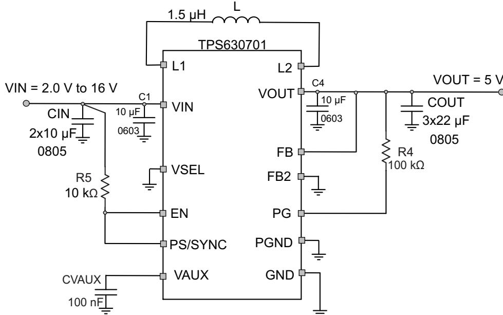

Schematic written from the drawing: the input VIN = 2.0 V to 16 V drives the VIN pin of the TPS630701, decoupled by CIN (2x10 µF, 0805) and C1 (10 µF, 0603) to ground. R5 (10 kΩ) connects VIN to EN, and EN is tied to PS/SYNC. VSEL and FB2 are connected to ground. VAUX has CVAUX (100 nF) to ground. The inductor L (1.5 µH) connects L1 and L2. VOUT is decoupled by C4 (10 µF, 0603) and COUT (3x22 µF, 0805) to ground and is the output VOUT = 5 V; FB is connected directly to VOUT (no divider). R4 (100 kΩ) pulls PG up to VOUT. PGND and GND are connected to ground.

Copyright © 2016, Texas Instruments Incorporated

**Figure 37. Typical Application For Fixed Voltage Version With Minimum External Part Count And Minimum Soft Start Time**

#### 9.3.1 Design Requirements

The design guidelines provide a component selection to operate the device within the recommended operating conditions. The input and output capacitors have been split into a small 0603 size capacitor close to the device pins and 0805 size capacitors to get the required capacitance.

**Table 8. Bill of Materials**

| REFERENCE | DESCRIPTION              | VALUE                         | MANUFACTURER      |
|-----------|--------------------------|-------------------------------|-------------------|
| IC        | TPS630701RNM             |                               | Texas Instruments |
| L         | XFL4020-1.5µH            | 1.5 µH                        | Coilcraft         |
| CIN       | GRM21BC71E106ME11L       | 2 x 10 µF / 25 V / X7S / 0805 | Murata            |
| C1        | TMK107BBJ106MA-T         | 10 µF / 25 V / X5R / 0603     | Taiyo Yuden       |
| COUT      | GRM21BC81C226ME44L       | 3 x 22 µF / 16 V / X6S / 0805 | Murata            |
| C4        | TMK107BBJ106MA-T         | 10 µF / 25 V / X5R / 0603     | Taiyo Yuden       |
| CVAUX     | TMK105B7104MV-FR         | 100 nF / 25V / X7R / 0402     | Taiyo Yuden       |
| R4        | Metal Film Resistor ; 1% | 100 kΩ                        | -                 |

{26}------------------------------------------------

#### 9.3.2 Detailed Design Procedure

The TPS6307x series of buck-boost converter has internal loop compensation. Therefore, the external L-C filter has to be selected according to the internal compensation. It's important to consider that the effective inductance, due to inductor tolerance and current derating can vary between 20% and -30%. The same for the capacitance of the output filter: the effective capacitance can vary between +20% and -80% of the specified datasheet value, due to capacitor tolerance and bias voltage. For this reason, [Output Filter Selection](#) shows the nominal capacitance and inductance value allowed. For the fixed voltage version TPS630701, the effective capacitance on the output (in µF) needs to be at least 15 times higher than the effective inductance (in µH) to ensure a good transient response and stable operation.

#### 9.3.3 Application Curves

**Table 9. Typical Application Curves for Fixed Voltage Version**

| Parameter                                               | Conditions                                                                                                                                                             | Figure                    |
|---------------------------------------------------------|------------------------------------------------------------------------------------------------------------------------------------------------------------------------|---------------------------|
| <b>Efficiency</b>                                       |                                                                                                                                                                        |                           |
| Efficiency vs Output Current (PFM/PWM)                  | $V_{\text{IN}} = 3\text{ V}, 4.2\text{ V}, 5\text{ V}, 7\text{ V}, 9\text{ V}, 12\text{ V}, V_{\text{OUT}} = 5\text{ V}, \text{PS}/\text{SYNC} = \text{Low}$           | <a href="#">Figure 38</a> |
| Efficiency vs Output Current (PWM only)                 | $V_{\text{IN}} = 3\text{ V}, 4.2\text{ V}, 5\text{ V}, 7\text{ V}, 9\text{ V}, 12\text{ V}, V_{\text{OUT}} = 5\text{ V}, \text{PS}/\text{SYNC} = \text{High}$          | <a href="#">Figure 39</a> |
| <b>Load Regulation</b>                                  |                                                                                                                                                                        |                           |
| Load Regulation, PFM/PWM Operation                      | $V_{\text{IN}} = 3\text{ V}, 4.2\text{ V}, 5\text{ V}, 7\text{ V}, 9\text{ V}, 12\text{ V}, V_{\text{OUT}} = 5\text{ V}, \text{PS}/\text{SYNC} = \text{Low}$           | <a href="#">Figure 40</a> |
| Load Regulation, PWM Operation                          | $V_{\text{IN}} = 3\text{ V}, 4.2\text{ V}, 5\text{ V}, 7\text{ V}, 9\text{ V}, 12\text{ V}, V_{\text{OUT}} = 5\text{ V}, \text{PS}/\text{SYNC} = \text{High}$          | <a href="#">Figure 41</a> |
| <b>Output Current</b>                                   |                                                                                                                                                                        |                           |
| Typical Start-up Current vs Input Voltage               | $V_{\text{OUT}} = 5\text{ V}, T_J = -40\text{ }^\circ\text{C}, 25\text{ }^\circ\text{C}, 85\text{ }^\circ\text{C}, 125\text{ }^\circ\text{C}$                          | <a href="#">Figure 42</a> |
| Maximum Load Current vs Input Voltage                   | $V_{\text{OUT}} = 5\text{ V}, T_J = -40\text{ }^\circ\text{C}, 25\text{ }^\circ\text{C}, 85\text{ }^\circ\text{C}, 125\text{ }^\circ\text{C}, \text{PG} = \text{high}$ | <a href="#">Figure 43</a> |
| <b>Regulation Accuracy</b>                              |                                                                                                                                                                        |                           |
| Load Transient, PFM/PWM Boost Operation                 | $V_{\text{IN}} = 4.2\text{ V}, V_{\text{OUT}} = 5\text{ V}, \text{Load} = 100\text{ mA to } 1\text{ A}, \text{PS}/\text{SYNC} = \text{Low}$                            | <a href="#">Figure 44</a> |
| Load Transient, PFM/PWM Buck Operation                  | $V_{\text{IN}} = 12\text{ V}, V_{\text{OUT}} = 5\text{ V}, \text{Load} = 200\text{ mA to } 1.8\text{ A}, \text{PS}/\text{SYNC} = \text{Low}$                           | <a href="#">Figure 45</a> |
| Line Transient, PFM/PWM Operation                       | $V_{\text{IN}} = 4.2\text{ V to } 7\text{ V}, V_{\text{OUT}} = 5\text{ V}, \text{Load} = 1\text{ A}, \text{PS}/\text{SYNC} = \text{Low}$                               | <a href="#">Figure 46</a> |
| <b>Output Voltage Ripple</b>                            |                                                                                                                                                                        |                           |
| Output Voltage Ripple, PFM/PWM Operation                | $V_{\text{IN}} = 4.2\text{ V}, V_{\text{OUT}} = 5\text{ V}, \text{Load} = 0.3\text{ A}, \text{PS}/\text{SYNC} = \text{Low}$                                            | <a href="#">Figure 47</a> |
| Output Voltage Ripple, PWM Operation                    | $V_{\text{IN}} = 4.2\text{ V}, V_{\text{OUT}} = 5\text{ V}, \text{Load} = 1\text{ A}, \text{PS}/\text{SYNC} = \text{high}$                                             | <a href="#">Figure 48</a> |
| Output Voltage Ripple, PFM/PWM Operation                | $V_{\text{IN}} = 7.2\text{ V}, V_{\text{OUT}} = 5\text{ V}, \text{Load} = 0.3\text{ A}, \text{PS}/\text{SYNC} = \text{Low}$                                            | <a href="#">Figure 49</a> |
| <b>Startup</b>                                          |                                                                                                                                                                        |                           |
| Start-up Behavior from Rising Enable, PFM/PWM Operation | $V_{\text{IN}} = 4.5\text{ V}, V_{\text{OUT}} = 5\text{ V}, \text{Load} = 0.5\text{ A}, \text{PS}/\text{SYNC} = \text{Low}$                                            | <a href="#">Figure 50</a> |

{27}------------------------------------------------

![Figure 38: Efficiency vs Output Current, PFM, Vout = 5 V, T = 25 °C. Efficiency (0 to 100%) versus Output Current (A) on a logarithmic axis from 100µ to 2, one curve per input voltage 3 V (black), 4.2 V (red), 5 V (gray), 7 V (blue), 9 V (green) and 12 V (brown). Efficiency rises with output current and flattens out; at light load the lower input voltages give higher efficiency and the 12 V curve is lowest. At the highest currents the 3 V curve drops steeply and the 4.2 V curve drops less. Read values from the image/PDF.](img/6fc99b56d4021cf515d190c3a0da183f_img.jpg)

D001

Figure 38: Efficiency vs Output Current, PFM, Vout = 5 V, T = 25 °C. Efficiency (0 to 100%) versus Output Current (A) on a logarithmic axis from 100µ to 2, one curve per input voltage 3 V (black), 4.2 V (red), 5 V (gray), 7 V (blue), 9 V (green) and 12 V (brown). Efficiency rises with output current and flattens out; at light load the lower input voltages give higher efficiency and the 12 V curve is lowest. At the highest currents the 3 V curve drops steeply and the 4.2 V curve drops less. Read values from the image/PDF.

Vout = 5 V

PFM

T = 25 °C

**Figure 38. Efficiency vs Output Current**

D002

Figure 39: Efficiency vs Output Current, PWM, Vout = 5 V, T = 25 °C. Efficiency (0 to 100%) versus Output Current (A) on a logarithmic axis from 100µ to 2, one curve per input voltage 3 V (black), 4.2 V (red), 5 V (gray), 7 V (blue), 9 V (green) and 12 V (brown). Efficiency is very low at light load and rises steeply with output current; the 3 V, 4.2 V and 5 V curves rise first and the 12 V curve last. At the highest currents the 3 V curve drops steeply. Read values from the image/PDF.

Vout = 5 V

PWM

T = 25 °C

**Figure 39. Efficiency vs Output Current**

D007

Figure 40: Output Voltage vs Output Current, PFM, Vout = 5 V, T = 25 °C. Output Voltage (V) from 4.85 to 5.25 versus Output Current (A) on a logarithmic axis from 100µ to 2, one curve per input voltage 3 V (black), 4.2 V (red), 5 V (gray), 7 V (blue), 9 V (green) and 12 V (brown). At light load the output voltage sits slightly above the 5 V gridline (PFM) and is nearly flat; at higher currents it steps down to 5 V. At the highest current the 3 V curve collapses. Read values from the image/PDF.

Vout = 5 V

PFM

T = 25 °C

**Figure 40. Output Voltage vs Output Current**

D008

Figure 41: Output Voltage vs Output Current, PWM, Vout = 5 V, T = 25 °C. Output Voltage (V) from 4.85 to 5.2 versus Output Current (A) on a logarithmic axis from 100µ to 2, one curve per input voltage 3 V (black), 4.2 V (red), 5 V (gray), 7 V (blue), 9 V (green) and 12 V (brown). The output voltage is flat just below the 5 V gridline over the whole range; at the highest current the 3 V curve collapses. Read values from the image/PDF.

Vout = 5 V

PWM

T = 25 °C

**Figure 41. Output Voltage vs Output Current**

D013

Figure 42: Typical Start-up Current, Vout = 5 V, resistive load. Output Current (A) from 0 to 1 versus Input Voltage (V) from 3 to 16, one curve per junction temperature -40°C (black), 25°C (red), 85°C (gray) and 125°C (blue). The start-up current rises in steps at low input voltage and is flat above; the 25°C and 85°C curves end on the same highest plateau, the 125°C curve is lower and the -40°C curve is lowest. Read values from the image/PDF.

Vout = 5 V

resistive load

**Figure 42. Typical Start-up Current**

![Figure 43: Maximum Load Current vs Input Voltage, Vout = 5 V, after start-up with PG = high. Max Output Current (A) from 0 to 4.5 versus Input Voltage (V) from 2 to 16, one curve per junction temperature -40°C (black), 25°C (red), 85°C (gray) and 125°C (blue). The maximum load current rises steeply at low input voltage to a peak and then stays roughly flat or decreases slowly; the -40°C curve is highest over most of the range (the 25°C curve is close and ends higher at the top of the range), the 85°C curve is lower and the 125°C curve is lowest. Read values from the image/PDF.](img/2c637344ff0da5ad653151532d4041a9_img.jpg)

D016

Figure 43: Maximum Load Current vs Input Voltage, Vout = 5 V, after start-up with PG = high. Max Output Current (A) from 0 to 4.5 versus Input Voltage (V) from 2 to 16, one curve per junction temperature -40°C (black), 25°C (red), 85°C (gray) and 125°C (blue). The maximum load current rises steeply at low input voltage to a peak and then stays roughly flat or decreases slowly; the -40°C curve is highest over most of the range (the 25°C curve is close and ends higher at the top of the range), the 85°C curve is lower and the 125°C curve is lowest. Read values from the image/PDF.

Vout = 5 V

after start-up with PG = high

**Figure 43. Maximum Load Current vs Input Voltage**

{28}------------------------------------------------

![Figure 44: Load Transient Response, oscilloscope capture, Vout = 5 V, PFM, Vin = 4.2V. Channel 2 VOUT (200mV/div) is on top and channel 3 output current (500mA/div) at the bottom, 200µs/div. The output current steps from its low level to its high level and back. VOUT dips at the load step-up and recovers, and overshoots briefly at the load step-down; before the step-up and after the step-down VOUT shows a wider ripple band. The on-screen measurement readouts (Peak-Peak and Mean of VOUT, High and Low of the output current) are part of the image; read their values from the image/PDF.](img/23816aaa8e6defc50fc888da62fd59cc_img.jpg)

Figure 44: Load Transient Response, oscilloscope capture, Vout = 5 V, PFM, Vin = 4.2V. Channel 2 VOUT (200mV/div) is on top and channel 3 output current (500mA/div) at the bottom, 200µs/div. The output current steps from its low level to its high level and back. VOUT dips at the load step-up and recovers, and overshoots briefly at the load step-down; before the step-up and after the step-down VOUT shows a wider ripple band. The on-screen measurement readouts (Peak-Peak and Mean of VOUT, High and Low of the output current) are part of the image; read their values from the image/PDF.

Vout = 5 V

PFM

Vin = 4.2V

**Figure 44. Load Transient Response**

![Figure 45: Load Transient Response, oscilloscope capture, Vout = 5 V, PFM, Vin = 12V. Channel 2 VOUT (200mV/div) is on top and channel 3 output current (1.00 A/div) at the bottom, 200µs/div. The output current steps from its low level to its high level and back. VOUT dips at the load step-up and recovers, and overshoots briefly at the load step-down; before the step-up and after the step-down VOUT shows a wider ripple band. The on-screen measurement readouts (Peak-Peak and Mean of VOUT, High and Low of the output current) are part of the image; read their values from the image/PDF.](img/1033ab90cd19fd4c5901966aeec07a86_img.jpg)

Figure 45: Load Transient Response, oscilloscope capture, Vout = 5 V, PFM, Vin = 12V. Channel 2 VOUT (200mV/div) is on top and channel 3 output current (1.00 A/div) at the bottom, 200µs/div. The output current steps from its low level to its high level and back. VOUT dips at the load step-up and recovers, and overshoots briefly at the load step-down; before the step-up and after the step-down VOUT shows a wider ripple band. The on-screen measurement readouts (Peak-Peak and Mean of VOUT, High and Low of the output current) are part of the image; read their values from the image/PDF.

Vout = 5 V

PFM

Vin = 12V

**Figure 45. Load Transient Response**

Figure 46: Line Transient Response, oscilloscope capture, Vout = 5 V, PFM, Io = 1A. Channel 2 VOUT (100mV/div) is on top and channel 1 VIN (2.00 V/div) at the bottom, 1.00ms/div, with a 'Mode=PFM' annotation. VIN steps up and back down; VOUT stays flat apart from a short spike at each VIN edge. The on-screen measurement readouts (Peak-Peak and Mean of VOUT, High and Low of VIN) are part of the image; read their values from the image/PDF.

Vout = 5 V

PFM

Io = 1A

**Figure 46. Line Transient Response**

![Figure 47: Output Voltage Ripple, oscilloscope capture, Vin = 4.2V; Vout = 5 V, PFM, Io = 0.3A. Channel 2 VOUT (50.0mV/div) is on top and channel 4 inductor current (500mA/div) at the bottom, 10.0µs/div. The inductor current flows in bursts of switching pulses separated by intervals without current; VOUT rises during each burst and falls between bursts, giving a sawtooth-like ripple. The on-screen measurement readouts (Peak-Peak and Mean of VOUT, Mean of the inductor current) are part of the image; read their values from the image/PDF.](img/f3c5e85b70f94b9c3c521f594d69539f_img.jpg)

Figure 47: Output Voltage Ripple, oscilloscope capture, Vin = 4.2V; Vout = 5 V, PFM, Io = 0.3A. Channel 2 VOUT (50.0mV/div) is on top and channel 4 inductor current (500mA/div) at the bottom, 10.0µs/div. The inductor current flows in bursts of switching pulses separated by intervals without current; VOUT rises during each burst and falls between bursts, giving a sawtooth-like ripple. The on-screen measurement readouts (Peak-Peak and Mean of VOUT, Mean of the inductor current) are part of the image; read their values from the image/PDF.

Vin = 4.2V; Vout = 5 V

PFM

Io = 0.3A

**Figure 47. Output Voltage Ripple**

Figure 48: Output Voltage Ripple, oscilloscope capture, Vin = 4.2V; Vout = 5 V, PWM, Io = 1A. Channel 2 VOUT (50.0mV/div) is on top and channel 4 inductor current (200mA/div) at the bottom, 1.00µs/div. The inductor current is a continuous triangular waveform at the switching frequency; VOUT shows a small ripple at the same frequency. The on-screen measurement readouts (Peak-Peak and Mean of VOUT, Mean of the inductor current) are part of the image; read their values from the image/PDF.

Vin = 4.2V; Vout = 5 V

PWM

Io = 1A

**Figure 48. Output Voltage Ripple**

![Figure 49: Output Voltage Ripple, oscilloscope capture, Vin = 7.2V; Vout = 5 V, PFM, Io = 0.3A. Channel 2 VOUT (50.0mV/div) is on top and channel 4 inductor current (500mA/div) at the bottom, 10.0µs/div. The inductor current flows in bursts of switching pulses separated by intervals without current; VOUT rises during each burst and falls between bursts, giving a sawtooth-like ripple. The on-screen measurement readouts (Peak-Peak and Mean of VOUT, Mean of the inductor current) are part of the image; read their values from the image/PDF. As printed, this capture appears to be the same screenshot as Figure 31 (Vin = 12V; Vout = 7 V): the readouts, including a VOUT Mean near 7 V, and the time stamp are identical.](img/bc9b32ae69d991e56f9a5f1e1d383d3a_img.jpg)

Figure 49: Output Voltage Ripple, oscilloscope capture, Vin = 7.2V; Vout = 5 V, PFM, Io = 0.3A. Channel 2 VOUT (50.0mV/div) is on top and channel 4 inductor current (500mA/div) at the bottom, 10.0µs/div. The inductor current flows in bursts of switching pulses separated by intervals without current; VOUT rises during each burst and falls between bursts, giving a sawtooth-like ripple. The on-screen measurement readouts (Peak-Peak and Mean of VOUT, Mean of the inductor current) are part of the image; read their values from the image/PDF. As printed, this capture appears to be the same screenshot as Figure 31 (Vin = 12V; Vout = 7 V): the readouts, including a VOUT Mean near 7 V, and the time stamp are identical.

Vin = 7.2V; Vout = 5 V

PFM

Io = 0.3A

**Figure 49. Output Voltage Ripple**

{29}------------------------------------------------

![Figure 50: Start-up Timing, oscilloscope capture, Vin = 4.5V; Vout = 5 V, PFM, Io = 0.5A. Channel 1 Enable (5.00 V/div) on top, channel 2 VOUT (2.00 V/div) in the middle and channel 3 PG (2.00 V/div) at the bottom, 200µs/div. Enable steps high at the trigger point; after a short delay VOUT ramps up smoothly and levels off at its final value, and PG steps from low to high when VOUT has reached its final level. The on-screen readouts (High and Low of VOUT) are part of the image; read their values from the image/PDF. As printed, this capture appears to be the same screenshot as Figure 35 (Vin = 4.5V; Vout = 7 V): the traces, readouts and time stamp are identical.](img/99938fa8d7d80af041634eba601e418b_img.jpg)

Figure 50: Start-up Timing, oscilloscope capture, Vin = 4.5V; Vout = 5 V, PFM, Io = 0.5A. Channel 1 Enable (5.00 V/div) on top, channel 2 VOUT (2.00 V/div) in the middle and channel 3 PG (2.00 V/div) at the bottom, 200µs/div. Enable steps high at the trigger point; after a short delay VOUT ramps up smoothly and levels off at its final value, and PG steps from low to high when VOUT has reached its final level. The on-screen readouts (High and Low of VOUT) are part of the image; read their values from the image/PDF. As printed, this capture appears to be the same screenshot as Figure 35 (Vin = 4.5V; Vout = 7 V): the traces, readouts and time stamp are identical.

Vin = 4.5V; Vout = 5 V

PFM

Io = 0.5A

**Figure 50. Start-up Timing**

{30}------------------------------------------------

## 10 Power Supply Recommendations

The TPS63070 device family has no special requirements for its power supply. The power supply output current needs to be rated according to the supply voltage, output voltage and output current of TPS63070. Please see the layout guidelines about the placement of the external components.

### 10.1 Thermal Information

Implementation of integrated circuits in low-profile and fine-pitch surface-mount packages typically requires special attention to power dissipation. Many system-dependent issues such as thermal coupling, airflow, added heat sinks and convection surfaces, and the presence of other heat-generating components affect the power-dissipation limits of a given component.

Three basic approaches for enhancing thermal performance are listed below.

- Improving the power dissipation capability of the PCB design
- Improving the thermal coupling of the component to the PCB by soldering the PowerPAD™
- Introducing airflow in the system

For more details on how to use the thermal parameters in the dissipation ratings table please check the [Thermal Characteristics Application Note \(SZZA017\)](#) and the [IC Package Thermal Metrics Application Note \(SPRA953\)](#).

{31}------------------------------------------------

## 11 Layout

### 11.1 Layout Guidelines

For all switching power supplies, the layout is an important step in the design, especially at high peak currents and high switching frequencies. If the layout is not carefully done, the regulator could show stability problems as well as EMI problems. Therefore, use wide and short traces for the main current path and for the power ground connection. The input capacitor, output capacitor, and the inductor should be placed as close as possible to the IC. Use a common ground node for power ground and a different one for control ground to minimize the effects of ground noise. Connect these ground nodes at any place close to one of the ground pin of the IC.

A ceramic capacitor each, as close as possible from the VIN pin to GND and one from the VOUT pin to GND, shown as C1 and C4 in the layout proposal are used to suppress high frequency noise. The case size should be 0603 or smaller for good high frequency performance. Additional 0805 size input and output capacitors are used to get the required capacitance on the input and output depending on the supply voltage range and the output voltage.

The feedback divider should be placed as close as possible to the feedback pin of the IC. To lay out the control ground, short traces are recommended as well, separation from the power ground traces. This avoids ground shift problems, which can occur due to superimposition of power ground current and control ground current.

In case any of the digital inputs EN, VSEL or PS/SYNC need to be tied to the input supply voltage VIN, a 10k resistor must be used in series. One common resistor for all digital inputs that are tied to VIN is sufficient.

### 11.2 Layout Example

The diagram illustrates the physical layout of the EVM. The central component is the TPS63070 IC. Surrounding the IC are various passive components: input capacitors (CIN, C1) connected to the VIN pin, an output capacitor (C4) connected to the VOUT pin, and a feedback divider (R1, R2, R3) connected to the FB pin. A auxiliary capacitor (CVAUX) is connected to the VSEL pin. The layout is divided into three main sections: VIN (input), VOUT (output), and GND (ground). The VIN section includes the input capacitors and the VIN pin of the IC. The VOUT section includes the output capacitor and the VOUT pin of the IC. The GND section includes the ground pins of the IC and the feedback divider. The layout shows the physical arrangement of these components on the PCB, with traces connecting them to the IC pins.

PCB layout diagram for the TPS63070 EVM. The diagram shows the placement of components including the IC, input capacitors (CIN, C1), output capacitors (C4, COUT), an inductor (L1), a feedback divider (R1, R2, R3), and a auxiliary capacitor (CVAUX). The layout is divided into VIN, VOUT, and GND sections.

Figure 51. EVM Layout

{32}------------------------------------------------

## 12 Device and Documentation Support

### 12.1 Device Support

#### 12.1.1 Third-Party Products Disclaimer

TI'S PUBLICATION OF INFORMATION REGARDING THIRD-PARTY PRODUCTS OR SERVICES DOES NOT CONSTITUTE AN ENDORSEMENT REGARDING THE SUITABILITY OF SUCH PRODUCTS OR SERVICES OR A WARRANTY, REPRESENTATION OR ENDORSEMENT OF SUCH PRODUCTS OR SERVICES, EITHER ALONE OR IN COMBINATION WITH ANY TI PRODUCT OR SERVICE.

### 12.2 Related Links

The table below lists quick access links. Categories include technical documents, support and community resources, tools and software, and quick access to order now.

**Table 10. Related Links**

| PARTS     | PRODUCT FOLDER             | ORDER NOW                  | TECHNICAL DOCUMENTS        | TOOLS & SOFTWARE           | SUPPORT & COMMUNITY        |
|-----------|----------------------------|----------------------------|----------------------------|----------------------------|----------------------------|
| TPS63070  | <a href="#">Click here</a> | <a href="#">Click here</a> | <a href="#">Click here</a> | <a href="#">Click here</a> | <a href="#">Click here</a> |
| TPS630701 | <a href="#">Click here</a> | <a href="#">Click here</a> | <a href="#">Click here</a> | <a href="#">Click here</a> | <a href="#">Click here</a> |
| TPS630702 | <a href="#">Click here</a> | <a href="#">Click here</a> | <a href="#">Click here</a> | <a href="#">Click here</a> | <a href="#">Click here</a> |

### 12.3 Receiving Notification of Documentation Updates

To receive notification of documentation updates, navigate to the device product folder on ti.com. In the upper right corner, click on *Alert me* to register and receive a weekly digest of any product information that has changed. For change details, review the revision history included in any revised document.

### 12.4 Community Resources

The following links connect to TI community resources. Linked contents are provided "AS IS" by the respective contributors. They do not constitute TI specifications and do not necessarily reflect TI's views; see TI's [Terms of Use](#).

**TI E2E™ Online Community** *TI's Engineer-to-Engineer (E2E) Community.* Created to foster collaboration among engineers. At e2e.ti.com, you can ask questions, share knowledge, explore ideas and help solve problems with fellow engineers.

**Design Support** *TI's Design Support* Quickly find helpful E2E forums along with design support tools and contact information for technical support.

### 12.5 Trademarks

E2E is a trademark of Texas Instruments.  
All other trademarks are the property of their respective owners.

### 12.6 Electrostatic Discharge Caution

Electrostatic Discharge Caution icon: a triangle with a lightning bolt and a hand with a finger pointing up.

This integrated circuit can be damaged by ESD. Texas Instruments recommends that all integrated circuits be handled with appropriate precautions. Failure to observe proper handling and installation procedures can cause damage.

ESD damage can range from subtle performance degradation to complete device failure. Precision integrated circuits may be more susceptible to damage because very small parametric changes could cause the device not to meet its published specifications.

### 12.7 Glossary

[SLYZ022 — TI Glossary](#).

This glossary lists and explains terms, acronyms, and definitions.

{33}------------------------------------------------

## 13 Mechanical, Packaging, and Orderable Information

The following pages include mechanical, packaging, and orderable information. This information is the most current data available for the designated devices. This data is subject to change without notice and revision of this document. For browser-based versions of this data sheet, refer to the left-hand navigation.

{34}------------------------------------------------

### PACKAGING INFORMATION

| Orderable part number         | Status (1) | Material type (2) | Package   Pins     | Package qty   Carrier | RoHS (3) | Lead finish/ Ball material (4) | MSL rating/ Peak reflow (5) | Op temp (°C) | Part marking (6) |
|-------------------------------|---------------|----------------------|--------------------|-----------------------|-------------|--------------------------------------|-----------------------------------|--------------|---------------------|
| <a href="#">TPS630701RNMR</a> | Active        | Production           | VQFN-HR (RNM)   15 | 3000   LARGE T&R      | Yes         | Call TI   Sn                         | Level-1-260C-UNLIM                | -40 to 125   | 0701                |
| TPS630701RNMR.A               | Active        | Production           | VQFN-HR (RNM)   15 | 3000   LARGE T&R      | Yes         | SN                                   | Level-1-260C-UNLIM                | -40 to 125   | 0701                |
| <a href="#">TPS630701RNMT</a> | Active        | Production           | VQFN-HR (RNM)   15 | 250   SMALL T&R       | Yes         | Call TI   Sn                         | Level-1-260C-UNLIM                | -40 to 125   | 0701                |
| TPS630701RNMT.A               | Active        | Production           | VQFN-HR (RNM)   15 | 250   SMALL T&R       | Yes         | SN                                   | Level-1-260C-UNLIM                | -40 to 125   | 0701                |
| <a href="#">TPS630702RNMR</a> | Active        | Production           | VQFN-HR (RNM)   15 | 3000   LARGE T&R      | Yes         | SN                                   | Level-1-260C-UNLIM                | -40 to 125   | 0702                |
| TPS630702RNMR.A               | Active        | Production           | VQFN-HR (RNM)   15 | 3000   LARGE T&R      | Yes         | SN                                   | Level-1-260C-UNLIM                | -40 to 125   | 0702                |
| <a href="#">TPS630702RNMT</a> | Active        | Production           | VQFN-HR (RNM)   15 | 250   SMALL T&R       | Yes         | Call TI   Sn                         | Level-1-260C-UNLIM                | -40 to 125   | 0702                |
| TPS630702RNMT.A               | Active        | Production           | VQFN-HR (RNM)   15 | 250   SMALL T&R       | Yes         | SN                                   | Level-1-260C-UNLIM                | -40 to 125   | 0702                |
| <a href="#">TPS63070RNMR</a>  | Active        | Production           | VQFN-HR (RNM)   15 | 3000   LARGE T&R      | Yes         | Call TI   Sn                         | Level-1-260C-UNLIM                | -40 to 125   | 3070                |
| TPS63070RNMR.A                | Active        | Production           | VQFN-HR (RNM)   15 | 3000   LARGE T&R      | Yes         | SN                                   | Level-1-260C-UNLIM                | -40 to 125   | 3070                |
| <a href="#">TPS63070RNMT</a>  | Active        | Production           | VQFN-HR (RNM)   15 | 250   SMALL T&R       | Yes         | Call TI   Sn                         | Level-1-260C-UNLIM                | -40 to 125   | 3070                |
| TPS63070RNMT.A                | Active        | Production           | VQFN-HR (RNM)   15 | 250   SMALL T&R       | Yes         | SN                                   | Level-1-260C-UNLIM                | -40 to 125   | 3070                |

(1) **Status:** For more details on status, see our [product life cycle](#).

(2) **Material type:** When designated, preproduction parts are prototypes/experimental devices, and are not yet approved or released for full production. Testing and final process, including without limitation quality assurance, reliability performance testing, and/or process qualification, may not yet be complete, and this item is subject to further changes or possible discontinuation. If available for ordering, purchases will be subject to an additional waiver at checkout, and are intended for early internal evaluation purposes only. These items are sold without warranties of any kind.

(3) **RoHS values:** Yes, No, RoHS Exempt. See the [TI RoHS Statement](#) for additional information and value definition.

(4) **Lead finish/Ball material:** Parts may have multiple material finish options. Finish options are separated by a vertical ruled line. Lead finish/Ball material values may wrap to two lines if the finish value exceeds the maximum column width.

(5) **MSL rating/Peak reflow:** The moisture sensitivity level ratings and peak solder (reflow) temperatures. In the event that a part has multiple moisture sensitivity ratings, only the lowest level per JEDEC standards is shown. Refer to the shipping label for the actual reflow temperature that will be used to mount the part to the printed circuit board.

(6) **Part marking:** There may be an additional marking, which relates to the logo, the lot trace code information, or the environmental category of the part.

Multiple part markings will be inside parentheses. Only one part marking contained in parentheses and separated by a "~" will appear on a part. If a line is indented then it is a continuation of the previous line and the two combined represent the entire part marking for that device.

{35}------------------------------------------------

**Important Information and Disclaimer:** The information provided on this page represents TI's knowledge and belief as of the date that it is provided. TI bases its knowledge and belief on information provided by third parties, and makes no representation or warranty as to the accuracy of such information. Efforts are underway to better integrate information from third parties. TI has taken and continues to take reasonable steps to provide representative and accurate information but may not have conducted destructive testing or chemical analysis on incoming materials and chemicals. TI and TI suppliers consider certain information to be proprietary, and thus CAS numbers and other limited information may not be available for release.

In no event shall TI's liability arising out of such information exceed the total purchase price of the TI part(s) at issue in this document sold by TI to Customer on an annual basis.

{36}------------------------------------------------

### **TAPE AND REEL INFORMATION**

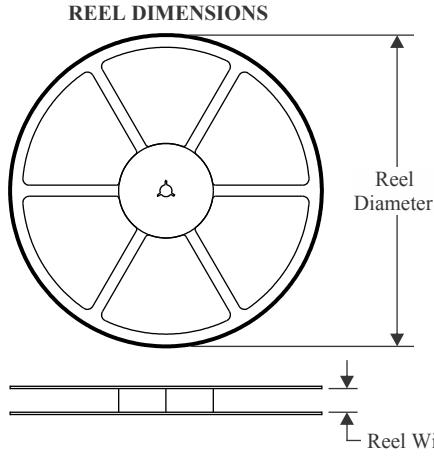

**REEL DIMENSIONS**

Reel Diameter

Reel Width (W1)

REEL DIMENSIONS diagram showing a reel with Reel Diameter and a side view with Reel Width (W1).

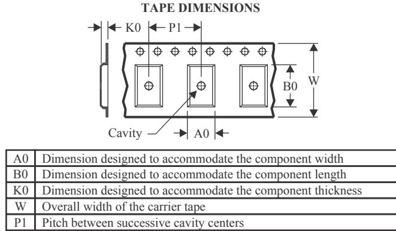

**TAPE DIMENSIONS**

|    |                                                           |
|----|-----------------------------------------------------------|
| A0 | Dimension designed to accommodate the component width     |
| B0 | Dimension designed to accommodate the component length    |
| K0 | Dimension designed to accommodate the component thickness |
| W  | Overall width of the carrier tape                         |
| P1 | Pitch between successive cavity centers                   |

TAPE DIMENSIONS diagram showing a tape strip with dimensions A0, B0, K0, P1, and W, and a corresponding table of definitions.

### **QUADRANT ASSIGNMENTS FOR PIN 1 ORIENTATION IN TAPE**

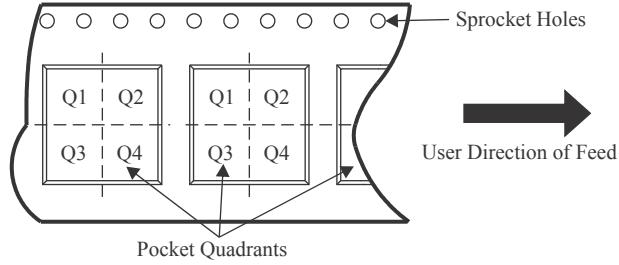

Sprocket Holes

Q1 Q2 Q3 Q4

Pocket Quadrants

User Direction of Feed

Diagram of a tape strip showing sprocket holes, pocket quadrants (Q1, Q2, Q3, Q4), and the user direction of feed.

\*All dimensions are nominal

| Device        | Package Type | Package Drawing | Pins | SPQ  | Reel Diameter (mm) | Reel Width W1 (mm) | A0 (mm) | B0 (mm) | K0 (mm) | P1 (mm) | W (mm) | Pin1 Quadrant |
|---------------|--------------|-----------------|------|------|--------------------|--------------------|---------|---------|---------|---------|--------|---------------|
| TPS630701RNMT | VQFN-HR      | RNM             | 15   | 250  | 180.0              | 12.4               | 2.8     | 3.3     | 1.2     | 8.0     | 12.0   | Q1            |
| TPS630702RNMR | VQFN-HR      | RNM             | 15   | 3000 | 330.0              | 12.4               | 2.8     | 3.3     | 1.2     | 8.0     | 12.0   | Q1            |
| TPS63070RNMR  | VQFN-HR      | RNM             | 15   | 3000 | 180.0              | 12.4               | 2.8     | 3.3     | 1.1     | 4.0     | 12.0   | Q1            |
| TPS63070RNMT  | VQFN-HR      | RNM             | 15   | 250  | 180.0              | 12.4               | 2.8     | 3.3     | 1.1     | 4.0     | 12.0   | Q1            |

{37}------------------------------------------------

### TAPE AND REEL BOX DIMENSIONS

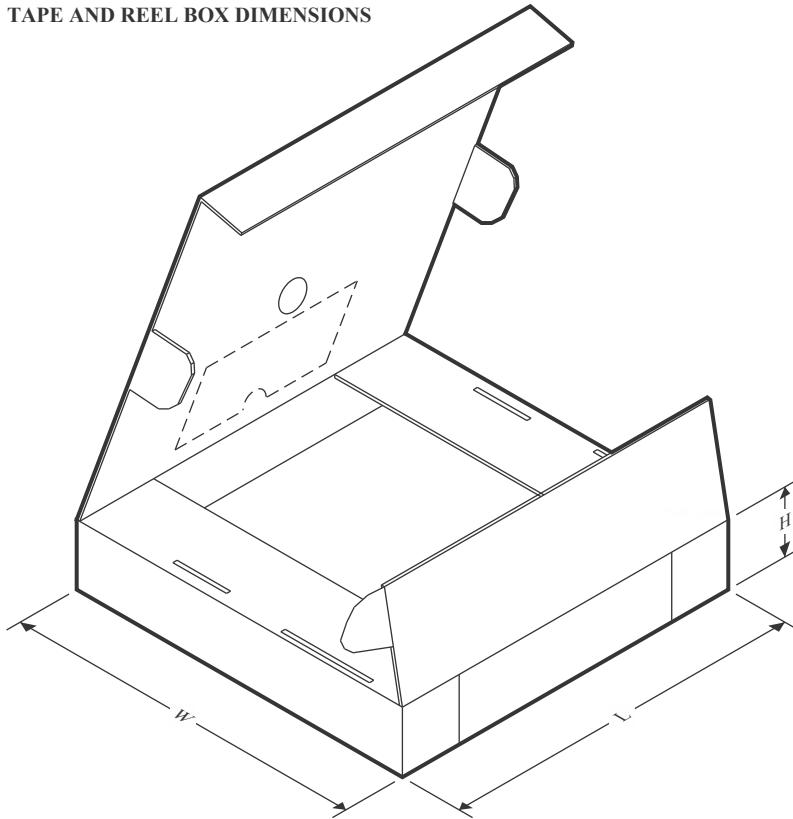

An isometric line drawing of an open tape and reel box. The box is shown from a three-quarter perspective, with its lid propped open. The interior of the box is empty, showing the bottom and the inside of the lid. Dimension lines with arrows indicate the length (L), width (W), and height (H) of the box. The drawing is a simple black-and-white line art representation.

Isometric line drawing of an open tape and reel box with dimension labels L, W, and H.

\*All dimensions are nominal

| Device        | Package Type | Package Drawing | Pins | SPQ  | Length (mm) | Width (mm) | Height (mm) |
|---------------|--------------|-----------------|------|------|-------------|------------|-------------|
| TPS630701RNMT | VQFN-HR      | RNM             | 15   | 250  | 341.0       | 182.0      | 80.0        |
| TPS630702RNMR | VQFN-HR      | RNM             | 15   | 3000 | 346.0       | 346.0      | 33.0        |
| TPS63070RNMR  | VQFN-HR      | RNM             | 15   | 3000 | 210.0       | 185.0      | 35.0        |
| TPS63070RNMT  | VQFN-HR      | RNM             | 15   | 250  | 210.0       | 185.0      | 35.0        |

{38}------------------------------------------------

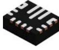

Isometric view of the RNM0015A VQFN package showing the top and leads.

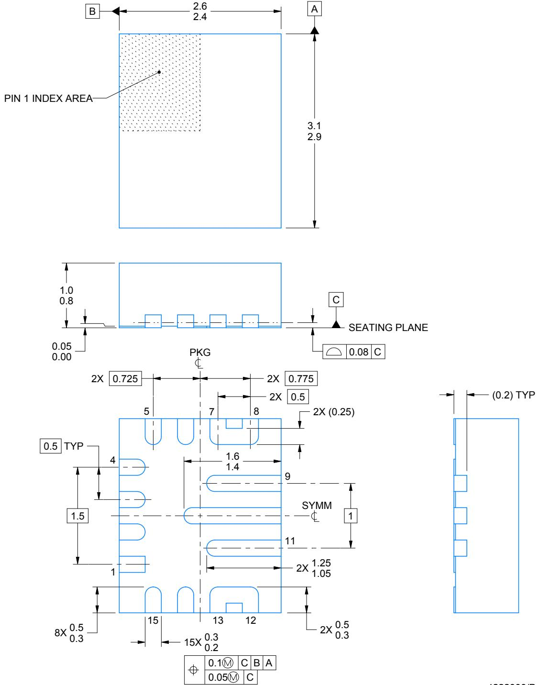

The figure shows the package outline for the RNM0015A VQFN. It includes a top view, a side view, and a bottom view. The top view shows a 2.6 x 3.1 mm area with a shaded 'PIN 1 INDEX AREA' in the top-left corner. The side view shows a maximum height of 1.0 mm and a seating plane. The bottom view shows the lead layout with dimensions for pitch (0.725 mm), lead width (0.25 mm), and lead length (0.5 mm). A pinout table is provided at the bottom.

|   |       |   |   |   |
|---|-------|---|---|---|
| ⊕ | 0.1Ⓜ  | C | B | A |
|   | 0.05Ⓜ | C |   |   |

Technical drawing of the RNM0015A VQFN package showing top, side, and bottom views with dimensions and pinout.

4222000/B 03/2020

#### NOTES:

- 1. All linear dimensions are in millimeters. Any dimensions in parenthesis are for reference only. Dimensioning and tolerancing per ASME Y14.5M.
- 2. This drawing is subject to change without notice.

{39}------------------------------------------------

### EXAMPLE BOARD LAYOUT

RNM0015A

VQFN - 1 mm max height

PLASTIC QUAD FLATPACK - NO LEAD

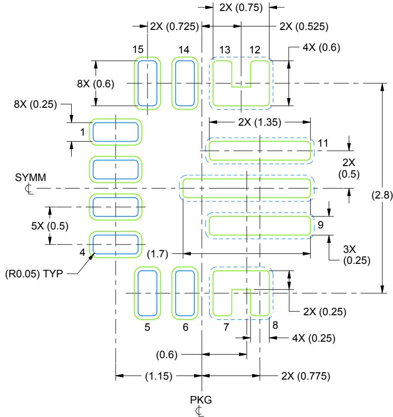

The diagram illustrates a land pattern for a 15-pin VQFN package. It features a central package area with pins numbered 1 through 15. Dimensions are provided for the package and individual pads. Key dimensions include: package width of 2.8 mm, package length of 1.7 mm, and a pitch of 0.6 mm. Pad dimensions are specified as 2X (0.75), 2X (0.725), 2X (0.525), 4X (0.6), 2X (1.35), 2X (0.5), 3X (0.25), 2X (0.25), 4X (0.25), (0.6), (1.15), 2X (0.775), 8X (0.6), 8X (0.25), 5X (0.5), and (R0.05) TYP. A symmetry line (SYMM) is indicated, and the package center is marked (PKG).

LAND PATTERN EXAMPLE diagram showing a 15-pin VQFN package layout with dimensions and pin numbers.

LAND PATTERN EXAMPLE  
SCALE:20X

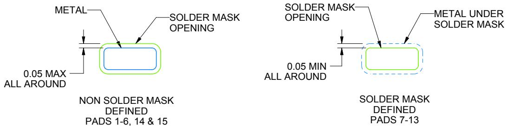

The diagram shows two types of solder mask openings. On the left, for 'NON SOLDER MASK DEFINED PADS 1-6, 14 & 15', a 'SOLDER MASK OPENING' is shown with a 'METAL' layer and a '0.05 MAX ALL AROUND' clearance. On the right, for 'SOLDER MASK DEFINED PADS 7-13', a 'SOLDER MASK OPENING' is shown with 'METAL UNDER SOLDER MASK' and a '0.05 MIN ALL AROUND' clearance.

SOLDER MASK DETAILS diagram showing two types of solder mask openings for pads 1-6, 14 & 15, and pads 7-13.

SOLDER MASK DETAILS

4222000/B 03/2020

NOTES: (continued)

- 3. For more information, see Texas Instruments literature number SLUA271 ([www.ti.com/lit/slua271](http://www.ti.com/lit/slua271)).
- 4. Solder mask tolerances between and around signal pads can vary based on board fabrication site.

{40}------------------------------------------------

### EXAMPLE STENCIL DESIGN

RNM0015A

VQFN - 1 mm max height

PLASTIC QUAD FLATPACK - NO LEAD

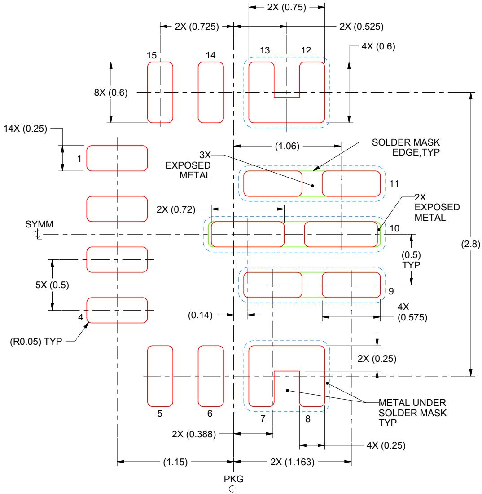

The diagram illustrates a stencil design for a VQFN package. It features 15 pads arranged in a grid. Pads 1-4 are on the left, 5-8 on the bottom, 9-11 in the center, and 12-15 on the right. Dimensions are provided for pad sizes and spacing. Symmetry markers (SYMM and PKG) are shown. Labels include 'SOLDER MASK EDGE, TYP', '3X EXPOSED METAL', '2X EXPOSED METAL', and 'METAL UNDER SOLDER MASK TYP'.

Dimensions and labels from the diagram:

- Pad 1: 14X (0.25) vertical, 2X (0.72) horizontal.
- Pad 4: 5X (0.5) vertical, (R0.05) TYP radius.
- Pad 15: 8X (0.6) vertical, 2X (0.725) horizontal.
- Pad 14: 8X (0.6) vertical, 2X (0.525) horizontal.
- Pad 13: 4X (0.6) vertical, 2X (0.75) horizontal.
- Pad 12: 4X (0.6) vertical, 2X (0.525) horizontal.
- Pad 11: 2X (0.75) horizontal, 2X (0.525) horizontal.
- Pad 10: 2X (0.72) horizontal, 2X (0.5) vertical.
- Pad 9: 4X (0.575) horizontal, 2X (0.25) vertical.
- Pad 8: 4X (0.25) vertical, 2X (0.388) horizontal.
- Pad 7: 2X (0.388) horizontal, 2X (0.25) vertical.
- Pad 6: 2X (0.388) horizontal, 2X (0.72) vertical.
- Pad 5: 2X (0.388) horizontal, 2X (0.72) vertical.

Symmetry markers: SYMM (center of pad 1), PKG (center of pad 7).

Other dimensions: (1.06), (0.14), (2.8), (1.15), 2X (1.163), 4X (0.6), 2X (0.75), 2X (0.525), 2X (0.725), 8X (0.6), 14X (0.25), 5X (0.5), (0.5) TYP, (0.05) TYP.

Technical drawing of a VQFN stencil design showing 15 pads with dimensions and symmetry markers.

SOLDER PASTE EXAMPLE  
BASED ON 0.125 mm THICK STENCIL

FOR EXPOSED PADS 9-11  
85% PRINTED SOLDER COVERAGE BY AREA  
SCALE:30X

4222000/B 03/2020

NOTES: (continued)

5. For alternate stencil design recommendations, see IPC-7525 or board assembly site preference.

{41}------------------------------------------------

### **IMPORTANT NOTICE AND DISCLAIMER**

TI PROVIDES TECHNICAL AND RELIABILITY DATA (INCLUDING DATASHEETS), DESIGN RESOURCES (INCLUDING REFERENCE DESIGNS), APPLICATION OR OTHER DESIGN ADVICE, WEB TOOLS, SAFETY INFORMATION, AND OTHER RESOURCES "AS IS" AND WITH ALL FAULTS, AND DISCLAIMS ALL WARRANTIES, EXPRESS AND IMPLIED, INCLUDING WITHOUT LIMITATION ANY IMPLIED WARRANTIES OF MERCHANTABILITY, FITNESS FOR A PARTICULAR PURPOSE OR NON-INFRINGEMENT OF THIRD PARTY INTELLECTUAL PROPERTY RIGHTS.

These resources are intended for skilled developers designing with TI products. You are solely responsible for (1) selecting the appropriate TI products for your application, (2) designing, validating and testing your application, and (3) ensuring your application meets applicable standards, and any other safety, security, regulatory or other requirements.

These resources are subject to change without notice. TI grants you permission to use these resources only for development of an application that uses the TI products described in the resource. Other reproduction and display of these resources is prohibited. No license is granted to any other TI intellectual property right or to any third party intellectual property right. TI disclaims responsibility for, and you fully indemnify TI and its representatives against any claims, damages, costs, losses, and liabilities arising out of your use of these resources.

TI's products are provided subject to [TI's Terms of Sale](#), [TI's General Quality Guidelines](#), or other applicable terms available either on [ti.com](#) or provided in conjunction with such TI products. TI's provision of these resources does not expand or otherwise alter TI's applicable warranties or warranty disclaimers for TI products. Unless TI explicitly designates a product as custom or customer-specified, TI products are standard, catalog, general purpose devices.

TI objects to and rejects any additional or different terms you may propose.

Copyright © 2025, Texas Instruments Incorporated

Last updated 10/2025