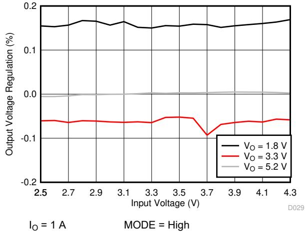
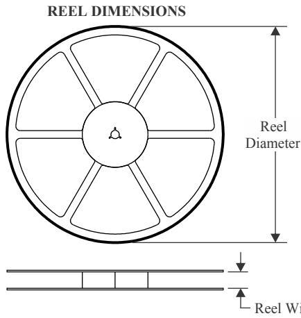
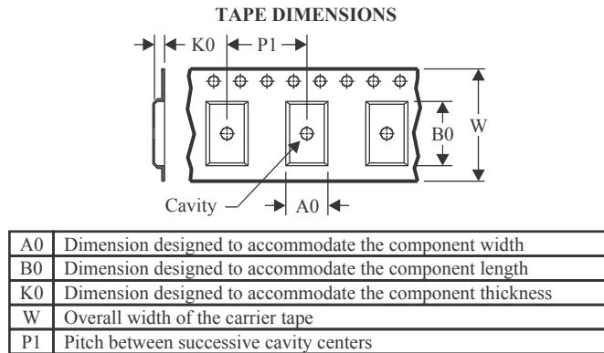
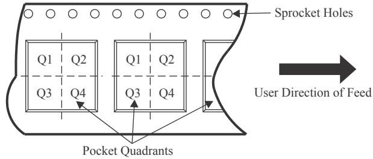
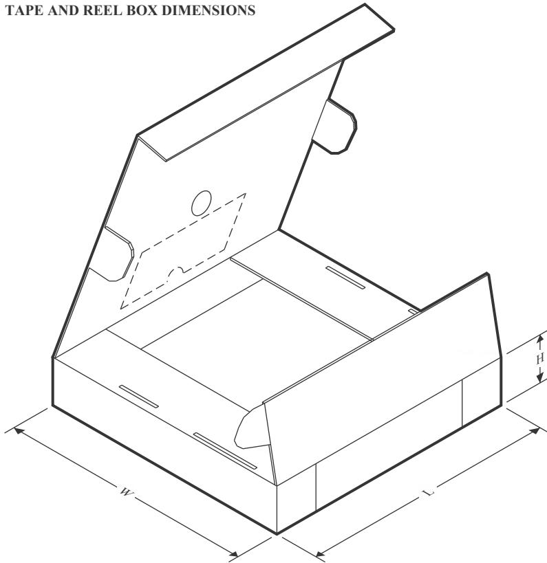
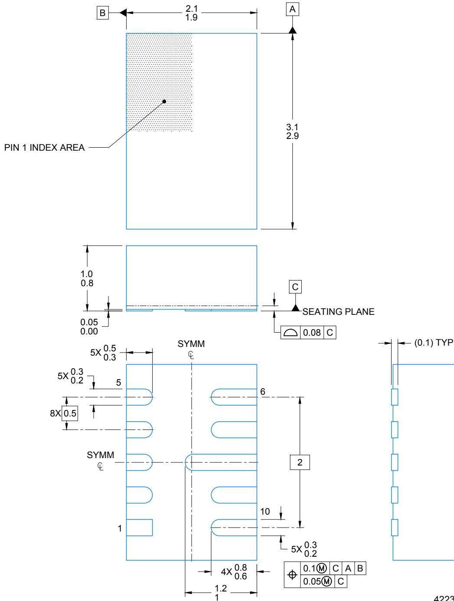
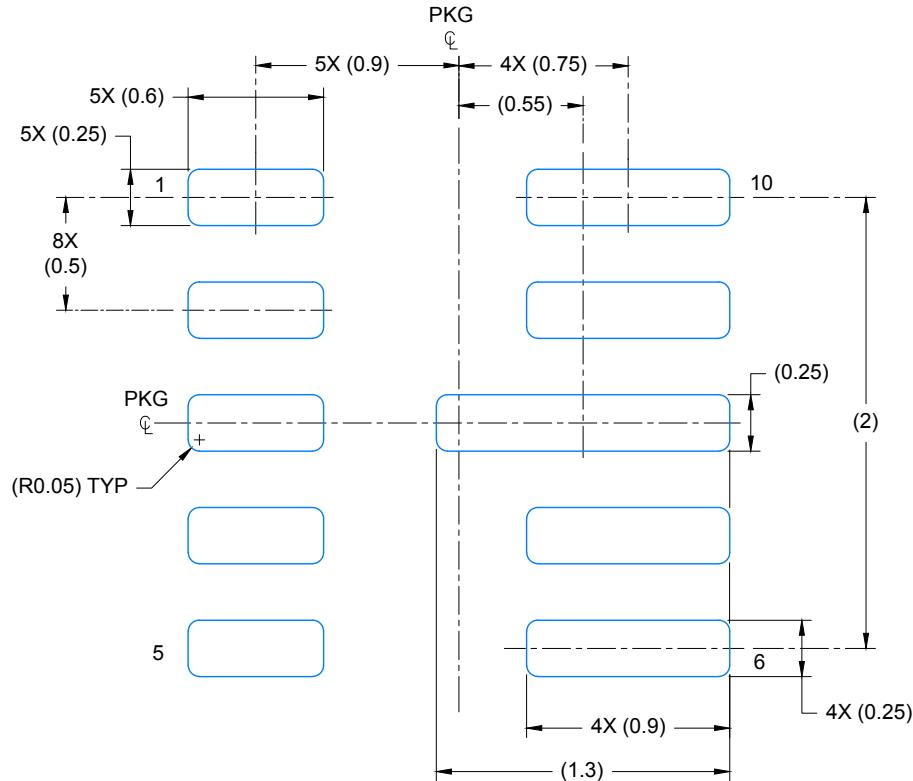
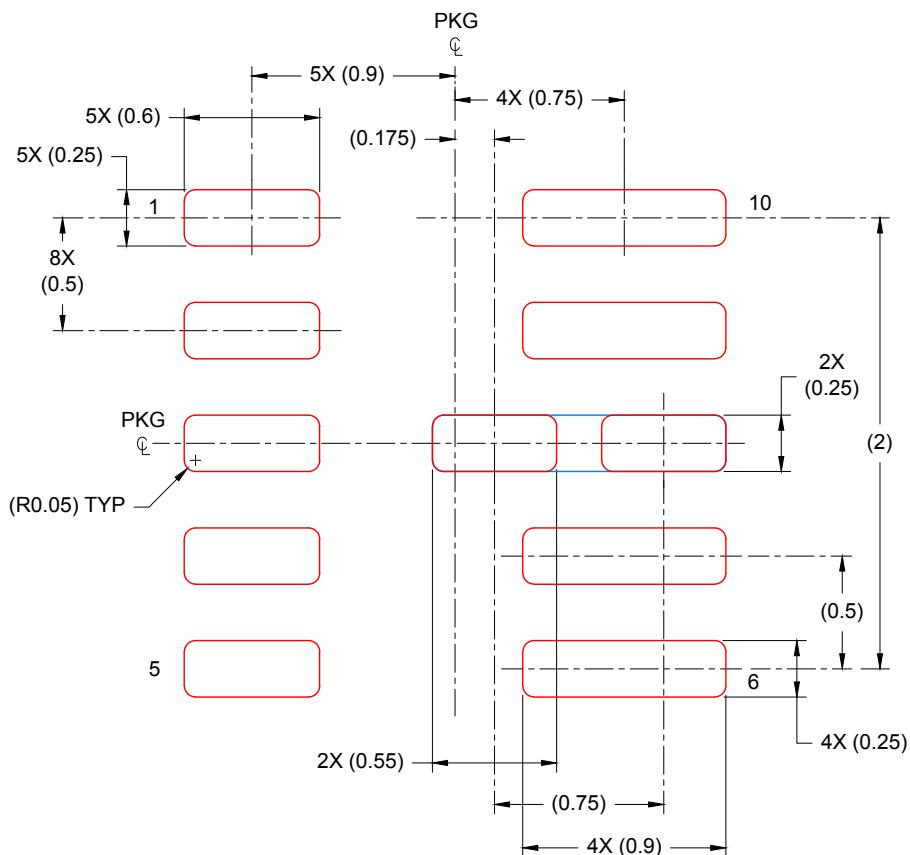

{0}------------------------------------------------

# TPS63802 2-A, High-efficient, Low IQ Buck-boost Converter in DFN Package

## 1 Features

- Input voltage range: 1.3 V to 5.5 V
  - Device input voltage > 1.8 V for start-up
- Output voltage range: 1.8 V to 5.2 V (adjustable)
- 2-A output current for VI ≥ 2.3 V, VO = 3.3 V
- High efficiency over the entire load range
  - 11-µA operating quiescent current
  - Power save mode and mode selection for forced PWM-mode
- Peak current buck-boost mode architecture
  - Defined transition points between buck, buck-boost, and boost operation modes
  - Forward and reverse current operation
  - Start-up into pre-biased outputs
- Safety and robust operation features
  - Integrated soft start
  - Overtemperature- and overvoltage-protection
  - True shutdown function with load disconnect
  - Forward and backward current limit
- Small solution size of 21.5 mm2
  - Tiny SON/DFN package (similar to QFN)
  - Small 0.47-µH inductor
  - Works with a 22-µF minimum output capacitor
- Create a custom design using the TPS63802 with the [WEBENCH® Power Designer](#)

## 2 Applications

- [System pre-regulator \(tracking and telematics, portable POS, home automation, IP network camera\)](#)
- Point-of-load regulation (wired sensor, port/cable adapter and dongle, [electronic smart lock](#), IoT)
- Battery back-up supply ([electricity meter](#), [data concentrator](#), power quality meter)
- Thermoelectric device supply (TEC, [optical modules](#))
- General purpose voltage stabilizer and converter

## 3 Description

The TPS63802 is a high efficiency, high output current buck-boost converter. Depending on the input voltage, it automatically operates in boost, buck, or in a novel 4-cycle buck-boost mode when the input voltage is approximately equal to the output voltage. The transitions between modes happen at defined thresholds and avoid unwanted toggling within the modes to reduce output voltage ripple. The device output voltages are individually set by a resistive divider within a wide output voltage range. An 11-µA quiescent current enables the highest efficiency for little to no-load conditions.

## Device Information

| PART NUMBER | PACKAGE (1)        | BODY SIZE (NOM) |
|-------------|-------------------------------|-----------------|
| TPS63802    | 10-Pin VSON-HR (0.5 mm pitch) | 3.0 mm × 2.0 mm |

(1) For all available packages, see the orderable addendum at the end of the datasheet.

![Typical Application circuit of the TPS63802 (description written from the drawing): the input VIN = 1.3 V – 5.5 V drives the VIN pin, decoupled by a 10 µF capacitor to ground; EN is tied to VIN. The 0.47 µH inductor connects L1 and L2. VOUT is the output VOUT = 3.3 V, decoupled by a 22 µF capacitor to ground. A resistive divider from VOUT to AGND sets FB. A pull-up resistor connects PG to a separate pull-up line drawn above the VOUT line (no junction dot, not connected to VOUT). MODE is tied to GND, which is grounded; AGND is grounded. No resistor values are printed.](img/acdccfc1d546eaad16a58be576456caf_img.jpg)

Typical Application circuit of the TPS63802 (description written from the drawing): the input VIN = 1.3 V – 5.5 V drives the VIN pin, decoupled by a 10 µF capacitor to ground; EN is tied to VIN. The 0.47 µH inductor connects L1 and L2. VOUT is the output VOUT = 3.3 V, decoupled by a 22 µF capacitor to ground. A resistive divider from VOUT to AGND sets FB. A pull-up resistor connects PG to a separate pull-up line drawn above the VOUT line (no junction dot, not connected to VOUT). MODE is tied to GND, which is grounded; AGND is grounded. No resistor values are printed.

**Typical Application**

![Efficiency vs Output Current (VO = 3.3 V): Efficiency (0 to 100%) versus Output Current (A) on a logarithmic axis from 100µ to 2, one curve per input voltage: VIN = 3.0 V (black), 3.3 V (red), 3.6 V (gray) and 4.2 V (blue). The four curves lie close together: efficiency rises from the lightest load, flattens out from about 1m upward and stays nearly flat; at light load the 4.2 V curve is slightly lowest, at the highest currents the 4.2 V curve is highest and the 3.0 V curve drops most, followed by 3.3 V. Read values from the image/PDF.](img/0f1e4e69e7cc7604dffb307f26feeaa8_img.jpg)

Efficiency vs Output Current (VO = 3.3 V): Efficiency (0 to 100%) versus Output Current (A) on a logarithmic axis from 100µ to 2, one curve per input voltage: VIN = 3.0 V (black), 3.3 V (red), 3.6 V (gray) and 4.2 V (blue). The four curves lie close together: efficiency rises from the lightest load, flattens out from about 1m upward and stays nearly flat; at light load the 4.2 V curve is slightly lowest, at the highest currents the 4.2 V curve is highest and the 3.0 V curve drops most, followed by 3.3 V. Read values from the image/PDF.

**Efficiency vs Output Current (VO = 3.3 V)**

Important Notice icon showing a triangle with balance scales.

{1}------------------------------------------------

## Table of Contents

|                                                |    |                                                                  |    |
|------------------------------------------------|----|------------------------------------------------------------------|----|
| <b>1 Features</b> .....                        | 1  | 9.4 Device Functional Modes.....                                 | 13 |
| <b>2 Applications</b> .....                    | 1  | <b>10 Application and Implementation</b> .....                   | 17 |
| <b>3 Description</b> .....                     | 1  | 10.1 Application Information.....                                | 17 |
| <b>4 Revision History</b> .....                | 2  | 10.2 Typical Application.....                                    | 17 |
| <b>5 Description (continued)</b> .....         | 3  | <b>11 Power Supply Recommendations</b> .....                     | 27 |
| <b>6 Device Comparison Table</b> .....         | 3  | <b>12 Layout</b> .....                                           | 28 |
| <b>7 Pin Configuration and Functions</b> ..... | 4  | 12.1 Layout Guidelines.....                                      | 28 |
| <b>8 Specifications</b> .....                  | 5  | 12.2 Layout Example.....                                         | 28 |
| 8.1 Absolute Maximum Ratings.....              | 5  | <b>13 Device and Documentation Support</b> .....                 | 29 |
| 8.2 ESD Ratings.....                           | 5  | 13.1 Device Support.....                                         | 29 |
| 8.3 Recommended Operating Conditions.....      | 5  | 13.2 Documentation Support.....                                  | 29 |
| 8.4 Thermal Information.....                   | 5  | 13.3 Receiving Notification of Documentation Updates.....        | 29 |
| 8.5 Electrical Characteristics.....            | 6  | 13.4 Support Resources.....                                      | 30 |
| 8.6 Typical Characteristics.....               | 8  | 13.5 Trademarks.....                                             | 30 |
| <b>9 Detailed Description</b> .....            | 9  | 13.6 Electrostatic Discharge Caution.....                        | 30 |
| 9.1 Overview.....                              | 9  | 13.7 Glossary.....                                               | 30 |
| 9.2 Functional Block Diagram.....              | 9  | <b>14 Mechanical, Packaging, and Orderable Information</b> ..... | 30 |
| 9.3 Feature Description.....                   | 10 |                                                                  |    |

## 4 Revision History

| <b>Changes from Revision C (June 2020) to Revision D (January 2021)</b>                                                                                                                                                                                                                                            | <b>Page</b> |
|--------------------------------------------------------------------------------------------------------------------------------------------------------------------------------------------------------------------------------------------------------------------------------------------------------------------|-------------|
| • Updated the numbering format for tables, figures and cross-references throughout the document. ....                                                                                                                                                                                                              | 1           |
| <b>Changes from Revision B (September 2019) to Revision C (June 2020)</b>                                                                                                                                                                                                                                          | <b>Page</b> |
| • Added device comparison .....                                                                                                                                                                                                                                                                                    | 3           |
| • Changed 1x 22 µF to 2x 22 µF.....                                                                                                                                                                                                                                                                                | 19          |
| • Changed Part Number from TPS63802RMW to TPS63802DLA .....                                                                                                                                                                                                                                                        | 20          |
| • Change MODE from High to Low in <i>Application Curves</i> .....                                                                                                                                                                                                                                                  | 20          |
| • Deleted layout guideline to separate AGND and PGND .....                                                                                                                                                                                                                                                         | 28          |
| • Changed Use a common-power GND, but connect AGND and PGND through via at a different layer. to Use a common ground node for power ground and a different one for control ground to minimize the effects of ground noise. Connect these ground nodes at any place close to one of the ground pins of the IC. .... | 28          |
| <b>Changes from Revision A (January 2019) to Revision B (September 2019)</b>                                                                                                                                                                                                                                       | <b>Page</b> |
| • Changed the device status from <i>Advanced Information</i> to <i>Production Data</i> .....                                                                                                                                                                                                                       | 1           |
| • Changed package group name .....                                                                                                                                                                                                                                                                                 | 1           |
| • Added related documentation .....                                                                                                                                                                                                                                                                                | 29          |

{2}------------------------------------------------

## 5 Description (continued)

The TPS63802 comes in a 1.4 mm x 2.3 mm thermally enhanced HotRod™ dual flat no-lead (DFN) package. With the tiny bill-off material, the solution size can be small.

## 6 Device Comparison Table

| PART NUMBER                                          | OUTPUT VOLTAGE                                          | $I_{(Q;VIN)}$ (TYP.) | $C_{(O,EFF)}$ (MIN.) | SWITCH CURRENT LIMIT BOOST (MIN.) | PACKAGE |
|------------------------------------------------------|---------------------------------------------------------|----------------------|----------------------|-----------------------------------|---------|
| TPS63802                                             | Adjustable                                              | 11 µA                | 7 µF                 | 4 A                               | VSON    |
| <b>SIMILAR TI PARTS</b>                              |                                                         |                      |                      |                                   |         |
| <a href="#">TPS63805</a>                             | Adjustable                                              | 11 µA                | 7 µF                 | 4 A                               | WCSP    |
| <a href="#">TPS63810</a> <a href="#">TPS63811</a> | fixed: 3.3 V/3.45 V or I 2 C programmable | 15 µA                | 16 µF                | 5.2 A                             | WCSP    |

{3}------------------------------------------------

## 7 Pin Configuration and Functions

Figure 7-1. 10-Pin DLA Package (Top View). The diagram shows a 10-pin package layout. Pin 1 is EN, Pin 2 is MODE, Pin 3 is AGND, Pin 4 is FB, Pin 5 is PG, Pin 6 is VOUT, Pin 7 is L2, Pin 8 is GND, Pin 9 is L1, and Pin 10 is VIN. The pins are arranged in two columns of five. The left column contains pins 1 through 5, and the right column contains pins 10 through 6 from top to bottom.

Not to scale

**Figure 7-1. 10-Pin DLA Package (Top View)**

**Table 7-1. Pin Functions**

| PIN  |     | DESCRIPTION                                                                                                      |
|------|-----|------------------------------------------------------------------------------------------------------------------|
| NAME | NO. |                                                                                                                  |
| EN   | 1   | Device Enable input. Set HIGH to enable and LOW to disable. It must not be left floating.                        |
| MODE | 2   | PFM/PWM mode selection. Set LOW for power save mode, set HIGH for forced PWM mode. It must not be left floating. |
| AGND | 3   | Analog ground                                                                                                    |
| FB   | 4   | Voltage feedback sensing pin                                                                                     |
| PG   | 5   | Power good indicator, open-drain output                                                                          |
| VOUT | 6   | Power stage output                                                                                               |
| L2   | 7   | Connection for inductor                                                                                          |
| GND  | 8   | Power ground                                                                                                     |
| L1   | 9   | Connection for inductor                                                                                          |
| VIN  | 10  | Supply voltage input                                                                                             |

{4}------------------------------------------------

## 8 Specifications

### 8.1 Absolute Maximum Ratings

over junction temperature range (unless otherwise noted)(1)

|                                                |                                                               | MIN  | MAX | UNIT |
|------------------------------------------------|---------------------------------------------------------------|------|-----|------|
| Voltage (2)                         | VIN, L1, L2, EN, MODE, VOUT, FB, PG                           | –0.3 | 6   | V    |
|                                                | L1, L2 (AC, less than 10 ns)                                  | –3   | 9   | V    |
| Operating junction temperature, T J |                                                               | –40  | 150 | °C   |
| Storage temperature, T stg          |                                                               | –65  | 150 | °C   |

- (1) Stresses beyond those listed under *Absolute Maximum Ratings* may cause permanent damage to the device. These are stress ratings only, which do not imply functional operation of the device at these or any other conditions beyond those indicated under *Recommended Operating Conditions*. Exposure to absolute-maximum-rated conditions for extended periods may affect device reliability.
- (2) All voltage values are with respect to network ground pin.

### 8.2 ESD Ratings

|                    |                         |                                                                                | VALUE | UNIT |
|--------------------|-------------------------|--------------------------------------------------------------------------------|-------|------|
| V (ESD) | Electrostatic discharge | Human-body model (HBM), per ANSI/ESDA/JEDEC JS-001 (1)              | ±2000 | V    |
|                    |                         | Charged-device model (CDM), per JEDEC specification JESD22-C101 (2) | ±500  |      |

- (1) JEDEC document JEP155 states that 500-V HBM allows safe manufacturing with a standard ESD control process.
- (2) JEDEC document JEP157 states that 250-V CDM allows safe manufacturing with a standard ESD control process.

### 8.3 Recommended Operating Conditions

|                |                                                              |                                | MIN                | NOM  | MAX                | UNIT |
|----------------|--------------------------------------------------------------|--------------------------------|--------------------|------|--------------------|------|
| V I | Input voltage                                                |                                | 1.3 (1) |      | 5.5                | V    |
| V O | Output voltage                                               |                                | 1.8                |      | 5.2 (2) | V    |
| C I | Effective capacitance connected to V IN           |                                | 4                  | 5    |                    | µF   |
| L              | Effective inductance                                         |                                | 0.37               | 0.47 | 0.57               | µH   |
| C O | TPS63802 Effective capacitance connected to V OUT | 1.8 V ≤ V O ≤ 2.3 V | 10                 |      |                    | µF   |
|                |                                                              | V O > 2.3 V         | 7                  | 8.2  |                    | µF   |
| T J | Operating junction temperature                               | Operating junction temperature | –40                |      | 125                | °C   |

- (1) Minimum startup voltage of VI > 1.8 V until power good
- (2) VO margin for accuracy and load steps is considerd in absolut maximum ratings

### 8.4 Thermal Information

over operating free-air temperature range (unless otherwise noted)(1)

| THERMAL METRIC        |                                              | TPS63802 | UNIT |
|-----------------------|----------------------------------------------|----------|------|
|                       |                                              | VSON     |      |
|                       |                                              | 10 PINS  |      |
| R ΘJA      | Junction-to-ambient thermal resistance       | 81.0     | °C/W |
| R ΘJC(top) | Junction-to-case (top) thermal resistance    | 36.4     | °C/W |
| R ΘJB      | Junction-to-board thermal resistance         | 23.4     | °C/W |
| Ψ JT       | Junction-to-top characterization parameter   | 0.9      | °C/W |
| Ψ JB       | Junction-to-board characterization parameter | 23.5     | °C/W |
| R ΘJC(bot) | Junction-to-case (bottom) thermal resistance | n/a      | °C/W |

- (1) For more information about traditional and new thermal metrics, see the [Semiconductor and IC Package Thermal Metrics](#) application report.

{5}------------------------------------------------

### 8.5 Electrical Characteristics

$V_{IN}$  = 1.8 V to 5.5 V,  $V_{OUT}$  = 1.8 V to 5.2 V,  $T_J$  = -40°C to +125°C, typical values are at  $V_{IN}$  = 3.6 V,  $V_{OUT}$  = 3.3 V and  $T_J$  = 25°C (unless otherwise noted)

| PARAMETER                     |                                                   | TEST CONDITIONS                                                                                                                                | MIN                                                                     | TYP  | MAX  | UNIT |
|-------------------------------|---------------------------------------------------|------------------------------------------------------------------------------------------------------------------------------------------------|-------------------------------------------------------------------------|------|------|------|
| <b>SUPPLY</b>                 |                                                   |                                                                                                                                                |                                                                         |      |      |      |
| $V_{IN;LOAD}$                 | Minimum input voltage for full load, once started | $I_{OUT} = 2\text{ A}$ , VOUT = 3.3 V, $T_J = 25^\circ\text{C}$                                                                   |                                                                         | 2.3  |      | V    |
| $I_{Q;VIN}$                   | Quiescent current into VIN                        | TPS63802; $T_J = 25^\circ\text{C}$ , $EN = V_{IN} = 3.6\text{ V}$ , $V_{OUT} = 3.3\text{ V}$ , not switching                                   |                                                                         | 11   |      | μA   |
| $I_{SD}$                      | Shutdown current into VIN                         | $EN = \text{low}$ , $-40^\circ\text{C} \leq T_J \leq 85^\circ\text{C}$ , $V_{IN} = 3.6\text{ V}$ , $V_{OUT} = 0\text{ V}$                      |                                                                         | 45   | 600  | nA   |
| $UVLO$                        | Undervoltage lockout threshold                    | $V_{IN}$ falling, VOUT ≥ 1.8 V, once started                                                                                   | 1.2                                                                     | 1.25 | 1.29 | V    |
|                               | Undervoltage lockout threshold                    | $V_{IN}$ rising                                                                                                                                | 1.6                                                                     | 1.7  | 1.79 | V    |
| $T_{SD}$                      | Thermal shutdown                                  | Temperature rising                                                                                                                             |                                                                         | 150  |      | °C   |
| $T_{SD;HYST}$                 | Thermal shutdown hysteresis                       |                                                                                                                                                |                                                                         | 20   |      | °C   |
| <b>SOFT-START, POWER GOOD</b> |                                                   |                                                                                                                                                |                                                                         |      |      |      |
| $T_{ramp}$                    | Soft-start, Current limit ramp time               | $T_J = 25^\circ\text{C}$ , $V_{IN} = 3.6\text{ V}$ , $V_{OUT} = 3.3\text{ V}$ , $I_O = 3.5\text{ A}$ , time from first switching to power good |                                                                         | 224  |      | μs   |
| $T_{delay}$                   | Delay from EN-edge until rising $V_{OUT}$         | $T_J = 25^\circ\text{C}$ , $V_{IN} = 3.6\text{ V}$ , $V_{OUT} = 3.3\text{ V}$ , Delay from EN-edge until rising first switching                |                                                                         | 321  |      | μs   |
| <b>LOGIC SIGNALS EN, MODE</b> |                                                   |                                                                                                                                                |                                                                         |      |      |      |
| $V_{THR;EN}$                  | Threshold Voltage rising for EN-Pin               |                                                                                                                                                | 1.07                                                                    | 1.1  | 1.13 | V    |
| $V_{THF;EN}$                  | Threshold Voltage falling for EN-Pin              |                                                                                                                                                | 0.97                                                                    | 1    | 1.03 | V    |
| $V_{IH}$                      | High-level input voltage                          |                                                                                                                                                | 1.2                                                                     |      |      | V    |
| $V_{IL}$                      | Low-level input voltage                           |                                                                                                                                                |                                                                         |      | 0.4  | V    |
| $V_{PG;rising}$               | Power Good threshold voltage                      | VOUT rising, referenced to VOUT nominal                                                                                              |                                                                         | 95   |      | %    |
| $V_{PG;falling}$              |                                                   | VOUT falling, referenced to VOUT nominal                                                                                             |                                                                         | 90   |      | %    |
| $V_{PG;Low}$                  | Power Good low-level output voltage               | $I_{SINK} = 1\text{ mA}$                                                                                                                       |                                                                         |      | 0.4  | V    |
| $t_{PG;delay}$                | Power Good delay time                             | $V_{FB}$ falling                                                                                                                               |                                                                         | 14   |      | μs   |
| $I_{lkg}$                     | Input leakage current                             |                                                                                                                                                |                                                                         | 0.01 | 0.2  | μA   |
| <b>OUTPUT</b>                 |                                                   |                                                                                                                                                |                                                                         |      |      |      |
| $I_{SD}$                      | Shutdown current into VOUT                        | $EN = \text{low}$ , $-40^\circ\text{C} \leq T_J \leq 85^\circ\text{C}$ , $V_{IN} = 3.6\text{ V}$ , $V_{OUT} = 3.3\text{ V}$                    |                                                                         | ±0.5 | ±600 | nA   |
| $V_{FB}$                      | Feedback Regulation Voltage                       |                                                                                                                                                |                                                                         | 500  |      | mV   |
| $V_{FB}$                      | Feedback Voltage accuracy                         | PWM mode                                                                                                                                       | –1                                                                      |      | 1    | %    |
|                               | Overvoltage Protection Threshold                  | $V_{OUT}$ rising                                                                                                                               | 5.5                                                                     | 5.7  | 5.9  | V    |
|                               |                                                   | $V_{IN}$ rising                                                                                                                                | 5.5                                                                     | 5.7  | 5.9  | V    |
| $I_{PWM/PFM}$                 | Peak Inductor Current to enter PFM-Mode           | $V_{IN} = 3.6\text{ V}$ ; $V_{OUT} = 3.3\text{ V}$                                                                                             |                                                                         | 1.06 |      | A    |
| $I_{FB}$                      | Feedback Input Bias Current                       | $V_{FB} = 500\text{ mV}$                                                                                                                       |                                                                         | 5    | 100  | nA   |
| $I_{PK}$                      | Peak Current Limit, Boost Mode                    | TPS63802; $V_{IN} \geq 2.5\text{ V}$                                                                                                           | 4                                                                       | 5    | 5.75 | A    |
|                               | Peak Current Limit, Buck-Boost Mode               | TPS63802; $V_{IN} \geq 2.5\text{ V}$                                                                                                           |                                                                         | 5    |      | A    |
|                               | Peak Current Limit, Buck Mode                     | TPS63802; $V_{IN} \geq 2.5\text{ V}$                                                                                                           |                                                                         | 3.8  |      | A    |
| $I_{PK;Reverse}$              | Peak Current Limit for Reverse Operation          | $V_I = 5\text{ V}$ , $V_O = 3.3\text{ V}$                                                                                                      |                                                                         | –0.9 |      | A    |
| Buck $R_{DS;ON}$ | High-side FET on-resistance | $V_{IN} = 3\text{ V}$ , $V_{OUT} = 3.3\text{ V}$ ; $I_{(L2)} = 0.19\text{ A}$ $V_{IN} = 3\text{ V}$ , $V_{OUT} = 3.3\text{ V}$ ; $I_O = 0.5\text{ A}$ |  | 47 |  | mΩ |
|  | Low-side FET on-resistance | $V_{IN} = 3\text{ V}$ , $V_{OUT} = 3.3\text{ V}$ ; $I_{(L2)} = 0.19\text{ A}$ $V_{IN} = 3\text{ V}$ , $V_{OUT} = 3.3\text{ V}$ ; $I_O = 0.5\text{ A}$ |  | 30 |  | mΩ |
| Boost $R_{DS;ON}$ | High-side FET on-resistance | $V_{IN} = 3\text{ V}$ , $V_{OUT} = 3.3\text{ V}$ ; $I_{(L1)} = 0.19\text{ A}$ $V_{IN} = 3\text{ V}$ , $V_{OUT} = 3.3\text{ V}$ ; $I_O = 0.5\text{ A}$ |  | 43 |  | mΩ |
|  | Low-side FET on-resistance | $V_{IN} = 3\text{ V}$ , $V_{OUT} = 3.3\text{ V}$ ; $I_{(L1)} = 0.19\text{ A}$ $V_{IN} = 3\text{ V}$ , $V_{OUT} = 3.3\text{ V}$ ; $I_O = 0.5\text{ A}$ |  | 18 |  | mΩ |

{6}------------------------------------------------

$V_{IN}$ = 1.8 V to 5.5 V,  $V_{OUT}$  = 1.8 V to 5.2 V,  $T_J$ = –40°C to +125°C, typical values are at  $V_{IN}$ = 3.6 V,  $V_{OUT}$  = 3.3 V and  $T_J$ = 25°C (unless otherwise noted)

| PARAMETER |                                               | TEST CONDITIONS                                                             | MIN | TYP | MAX | UNIT |
|-----------|-----------------------------------------------|-----------------------------------------------------------------------------|-----|-----|-----|------|
| $f_{SW}$  | Inductor Switching Frequency, Boost Mode      | $V_{IN}$ = 2.3V, $V_{OUT}$ = 3.3V, no Load, MODE = HIGH, $T_J$ = 25°C       |     | 2.1 |     | MHz  |
|           | Inductor Switching Frequency, Buck-Boost Mode | $V_{IN}$ = 3.3V, $V_{OUT}$ = 3.3V, no Load, MODE = HIGH, $T_J$ = 25°C       |     | 1.4 |     | MHz  |
|           | Inductor Switching Frequency, Buck Mode       | $V_{IN}$ = 4.3, $V_{OUT}$ = 3.3V, no Load, MODE = HIGH, $T_J$ = 25°C        |     | 1.6 |     | MHz  |
|           | Line regulation                               | $V_{IN}$ = 2.4 V to 5.5 V, $V_{OUT}$ = 3.3V, $I_{OUT}$ = 2 A                |     | 0.3 |     | %    |
|           | Load regulation                               | $V_{IN}$ = 3.6 V, $V_{OUT}$ = 3.3V, $I_{OUT}$ = 0 A to 2 A, forced-PWM mode |     | 0.1 |     | %    |

{7}------------------------------------------------

### 8.6 Typical Characteristics

Figure 8-1: Quiescent Current vs. Temperature. A line graph showing Quiescent Current (µA) on the y-axis (0 to 16) versus Temperature (°C) on the x-axis (-40 to 140). Three curves are shown for different input voltages: VI = 1.8 V (black), VI = 3.6 V (red), and VI = 5.5 V (grey). The 5.5 V curve is the highest, followed by 3.6 V, and then 1.8 V. All curves show a slight upward trend with temperature. Test conditions: MODE = LOW, VO = 3.3 V, IO = 0 mA, not switching.

Quiescent Current (µA)

Temperature (°C)

—  $V_I = 1.8\text{ V}$   
—  $V_I = 3.6\text{ V}$   
—  $V_I = 5.5\text{ V}$

MODE = LOW      $V_O = 3.3\text{ V}$       $I_O = 0\text{ mA}$ , not switching

D006

**Figure 8-1. Quiescent Current vs. Temperature**

*[AI figure description: curve-data table removed (values were estimated from the plot, not printed in the PDF). Read values from the image/PDF.]*

Figure 8-2: Shutdown Current vs. Temperature. A line graph showing Shutdown Current (µA) on the y-axis (-0.2 to 1.4) versus Temperature (°C) on the x-axis (-40 to 140). Three curves are shown for different input voltages: VI = 1.8 V (black), VI = 3.6 V (red), and VI = 5.5 V (grey). The curves are near zero until approximately 80°C, after which they rise sharply. The 5.5 V curve rises most steeply, followed by 3.6 V, and then 1.8 V. Test condition: EN = LOW.

Shutdown Current (µA)

Temperature (°C)

—  $V_I = 1.8\text{ V}$   
—  $V_I = 3.6\text{ V}$   
—  $V_I = 5.5\text{ V}$

EN = LOW

D004

**Figure 8-2. Shutdown Current vs. Temperature**

*[AI figure description: curve-data table removed (values were estimated from the plot, not printed in the PDF). Read values from the image/PDF.]*

{8}------------------------------------------------

## 9 Detailed Description

### 9.1 Overview

The TPS63802 buck-boost converter uses four internal switches to maintain synchronous power conversion at all possible operating conditions. This enables the device to keep high efficiency over a wide input voltage and output load range. To regulate the output voltage at all possible input voltage conditions, the device automatically transitions between buck, buck-boost, and boost operation as required by the operating conditions. Therefore, it operates as a buck converter when the input voltage is higher than the output voltage, and as a boost converter when the input voltage is lower than the output voltage. When the input voltage is close to the output voltage, it operates in a 3-cycle buck-boost operation. In this mode, all four switches are active (see *[Section 9.4.1.3](#)*). The RMS current through the switches and the inductor is kept at a minimum to minimize switching and conduction losses. Controlling the switches this way allows the converter to always keep high efficiency over the complete input voltage range. The device provides a seamless transition between all modes.

### 9.2 Functional Block Diagram

*[Diagram not extracted as an image in this conversion; see PDF p9. Description written from the drawing.]*

Functional block diagram of the TPS63802 (description written from the drawing). Pins VIN, EN, MODE and GND are on the left, L1 and L2 at the top, VOUT, PG, FB and AGND on the right. External parts: CIN from VIN to ground, the inductor L between L1 and L2, COUT from VOUT to ground. Power stage: VIN passes through a Current Sensor (drawn as a current-sense loop on the VIN line) to a high-side MOSFET (drawn with its body diode) that connects VIN to the L1 node; a low-side MOSFET connects L1 to the power ground node. On the output side a low-side MOSFET connects the L2 node to the same ground node and a high-side MOSFET (with body diode) connects L2 to VOUT. One Gate Driver drives both input-side MOSFETs and a second Gate Driver drives both output-side MOSFETs; each Gate Driver is controlled by 'Device Control'. A VMAX Switch, connected to VIN and VOUT, feeds the 'Device Control' block (Power Safe Mode, Protection, Current Limit, Buck/Boost Control, Off-time calculation, Soft-Start), which also has inputs VIN, MODE, VOUT and L1, L2 and outputs Gate Driver and Power Good. EN drives the + input of a comparator with hysteresis whose – input is Ref 1.1 V; its output goes to Device Control. FB drives the + input of an error amplifier (transconductance symbol) whose – input is Ref 500 mV. Its output node is compensated to AGND by a capacitor in parallel with a series resistor-capacitor and drives the – input of a comparator; the + input of that comparator is the Current Sensor signal, and its output goes to Device Control. PG is an open-drain output: an N-channel MOSFET, gate driven by Device Control, pulls PG to ground. GND goes to the power ground; AGND is the ground of the compensation network.

{9}------------------------------------------------

### 9.3 Feature Description

#### 9.3.1 Control Loop Description

The TPS63802 uses a peak current mode control architecture. It has an inner current loop where it measures the peak current of the boost high-side MOSFET and compares it to a reference current. This current is the output of the outer voltage loop. It measures the output voltage via the FB-pin and compares it with the internal voltage reference. That means, the outer voltage loop measures the voltage error ( $V_{REF}-V_{FB}$ ), and transforms it into the system current demand ( $I_{REF}$ ) for the inner current loop.

Figure 9-1 shows the simplified schematic of the control loop. The error amplifier and the type-2 compensation represent the voltage loop. The voltage output is converted into the reference current  $I_{REF}$  and fed into the current comparator.

The scheme shows the skip-comparator handling the power-save mode (PFM) to achieve high efficiency at light loads. See [Section 9.4.2](#) for further details.

![Figure 9-1: Control Loop Architecture Scheme (description written from the drawing). FB drives the + input of the error amplifier (transconductance symbol) whose – input is Ref 500mV. Its output node VEA is compensated to ground by a series resistor-capacitor in parallel with a capacitor (type-2 compensation) and controls a variable current source that produces IREF. IREF passes through a switch to the + input of the current comparator, whose – input is IPK, sensed by a current-sense loop on the line from the VIN pin to the MOSFET (drawn with its body diode) that connects VIN to L1; the comparator output goes to the Gate Driver. The skip comparator (with hysteresis) compares IREF (+ input) with ISKIP (– input) and its output opens or closes the switch in the IREF path.](img/54fabc351eda5228d2fa28cd9ba07971_img.jpg)

Figure 9-1: Control Loop Architecture Scheme (description written from the drawing). FB drives the + input of the error amplifier (transconductance symbol) whose – input is Ref 500mV. Its output node VEA is compensated to ground by a series resistor-capacitor in parallel with a capacitor (type-2 compensation) and controls a variable current source that produces IREF. IREF passes through a switch to the + input of the current comparator, whose – input is IPK, sensed by a current-sense loop on the line from the VIN pin to the MOSFET (drawn with its body diode) that connects VIN to L1; the comparator output goes to the Gate Driver. The skip comparator (with hysteresis) compares IREF (+ input) with ISKIP (– input) and its output opens or closes the switch in the IREF path.

**Figure 9-1. Control Loop Architecture Scheme**

#### 9.3.2 Precise Device Enable: Threshold- or Delayed Enable

The enable-pin is a digital input to enable or disable the device by applying a high or low level. The device enters shutdown when EN is set low. In addition, this input features a precise threshold and can be used as a comparator that enables and disables the part at a defined threshold. This allows you to drive the state by a slowly changing voltage and enables the use of an external RC network to achieve a precise power-up delay. The enable pin can also be used with an external voltage divider to set a user-defined minimum supply voltage. For proper operation, the EN pin must be terminated and must not be left floating.

Figure 9-2: Circuit Example for How to Use the Precise Device Enable Feature. This diagram shows two circuit configurations for the EN pin. The left configuration shows a voltage divider with resistors R4 and R5 connected between V\_THRESHOLD and ground, with the EN pin connected to the midpoint. The right configuration shows a RC network with resistor R4 and capacitor C5 connected between V\_DELAY and ground, with the EN pin connected to the midpoint.

**Figure 9-2. Circuit Example for How to Use the Precise Device Enable Feature**

{10}------------------------------------------------

#### 9.3.3 Mode Selection (PFM/PWM)

The mode-pin is a digital input to enable the automatic PWM/PFM mode that features the highest efficiency by allowing pulse-frequency-modulation for lower output currents. This mode is enabled by applying a low level. The device can be forced in PWM operation regardless of the output current to achieve minimum output ripple by applying a high level. This pin must not be left floating.

#### 9.3.4 Undervoltage Lockout (UVLO)

To avoid mis-operation of the device at low input voltages, an undervoltage lockout is included. It activates the device once the input voltage ( $V_I$ ) has increased the  $UVLO_{rising}$  value. Once active, the device allows operation down to even smaller input voltages, which is determined by the  $UVLO_{falling}$ . This behavior requires  $V_O$  to be higher than the minimum value of 1.8 V.

Figure 9-3: Rising and Falling Undervoltage Lockout Behavior. The diagram shows two waveforms: VIN and Device active. VIN is a trapezoidal wave. The Device active signal is low when VIN is below UVLO\_falling, transitions to high when VIN crosses UVLO\_rising, and returns to low when VIN falls below UVLO\_falling. Blue arrows indicate the transition points at the UVLO\_rising and UVLO\_falling thresholds.

**Figure 9-3. Rising and Falling Undervoltage Lockout Behavior**

#### 9.3.5 Soft Start

To minimize inrush current and output voltage overshoot during start-up, the device features a controlled soft start-up. After the device is enabled, the device starts all internal reference and control circuits within the enable delay time,  $T_{delay}$ . After that, the maximum switch current limit rises monotonically from 0 mA to the current limit. The loop stops switching once  $V_O$  is reached. This allows a quick output voltage ramp for small capacitors at the output. The bigger the output capacitor, the longer it takes to settle  $V_o$ . A potential load during start-up will lengthen the duration of the output voltage ramp as well. The gradual ramp of the current limit allows a small inrush current for no-load conditions, as well as the possibility to start into high loads at start-up.

The converter can start-up into pre-biased loads by a forced operation in PFM during the soft-start until the first switching cycle request from the output voltage control loop.

{11}------------------------------------------------

![Figure 9-4. Device Start-up Scheme (description written from the drawing). Timing diagram with the traces VIN, EN, Current Limit, Inductor Current, VOUT and Power Good. VIN rises first, then EN goes high. Tdelay runs from the EN edge to the start of switching. The Current Limit trace starts to ramp up shortly before the end of Tdelay and continues to rise linearly to its final level. During Tramp the Inductor Current is a rising sawtooth and VOUT rises from zero; when VOUT reaches 0.95 x VOUT (red marker) Power Good goes high, the inductor current returns to zero and VOUT settles at its final level. TStart-up spans Tdelay plus Tramp.](img/42ff8b598a0818ca8b6ef30850ad5f4e_img.jpg)

Figure 9-4. Device Start-up Scheme (description written from the drawing). Timing diagram with the traces VIN, EN, Current Limit, Inductor Current, VOUT and Power Good. VIN rises first, then EN goes high. Tdelay runs from the EN edge to the start of switching. The Current Limit trace starts to ramp up shortly before the end of Tdelay and continues to rise linearly to its final level. During Tramp the Inductor Current is a rising sawtooth and VOUT rises from zero; when VOUT reaches 0.95 x VOUT (red marker) Power Good goes high, the inductor current returns to zero and VOUT settles at its final level. TStart-up spans Tdelay plus Tramp.

**Figure 9-4. Device Start-up Scheme**

#### 9.3.6 Adjustable Output Voltage

The device's output voltage is adjusted by applying an external resistive divider between  $V_O$ , the FB-pin, and GND. This allows you to program the output voltage in the recommended range. The divider must provide a low-side resistor of less than 100 k $\Omega$ . The high-side resistor is chosen accordingly.

#### 9.3.7 Overtemperature Protection - Thermal Shutdown

The device has a built-in temperature sensor which monitors the junction temperature. If the temperature exceeds the threshold, the device stops operating. As soon as the IC temperature has decreased below the programmed threshold, it starts operating again. There is a built-in hysteresis to avoid unstable operation at junction temperatures at the overtemperature threshold.

#### 9.3.8 Input Overvoltage - Reverse-Boost Protection (IVP)

The TPS63802 can operate in reverse mode where the device transfers energy from the output back to the input. If the source is not able to sink the revers current, the negative current builds up a charge to the input capacitance and  $V_{IN}$  rises. To protect the device and other components from that scenario, the device features an input voltage protection (IVP) for reverse boost operation. Once the input voltage is above the threshold, the converter forces PFM mode and the negative current operation is interrupted.

The PG signal goes low to indicate that behavior.

#### 9.3.9 Output Overvoltage Protection (OVP)

In case of a broken feedback-path connection, the device can loose  $V_O$  information and is not able to regulate. To avoid an uncontrolled boosting of  $V_O$ , the TPS63802 features output overvoltage protection. It measures the voltage on the VOUT pin and stops switching when  $V_O$  is greater than the threshold to avoid harm to the converter and other components.

#### 9.3.10 Power-Good Indicator

The power good goes high-impedance once the output is above 95% of the nominal voltage, and is driven low once the output voltage falls below typically 90% of the nominal voltage. This feature also indicates overvoltage and device shutdown cases as shown in [Table 9-1](#). The PG pin is an open-drain output and is specified to sink up to 1 mA. The power-good output requires a pullup resistor connecting to any voltage rail less than 5.5 V. The PG signal can be used to sequence multiple rails by connecting it to the EN pin of other converters. Leave the PG pin unconnected when not used.

{12}------------------------------------------------

**Table 9-1. Power-Good Indicator Truth Table**

| LOGIC SIGNALS |                                               |                |      |      | PG LOGIC STATUS |
|---------------|-----------------------------------------------|----------------|------|------|-----------------|
| EN            | V O                                | V I | OVP  | IVP  |                 |
| X             | < 1.8 V                                       | < UVLO_R       | X    | X    | Undefined       |
| LOW           | X                                             | > UVLO_F       | X    | X    | LOW             |
| HIGH          | V O < 0.9 × target-V O  | > 1.3V         | X    | X    | LOW             |
| HIGH          | X                                             | > UVLO_F       | HIGH | X    | LOW             |
| HIGH          | X                                             | > UVLO_F       | X    | HIGH | LOW             |
| HIGH          | V O > 0.95 × target-V O | > UVLO_F       | LOW  | LOW  | HIGH Z          |

### 9.4 Device Functional Modes

#### 9.4.1 Peak-Current Mode Architecture

The TPS63802 is based on a peak-current mode architecture. The error amplifier provides a peak-current target (voltage that is translated into an equivalent current, see [Figure 9-1](#)), based on the current demand from the voltage loop. This target is compared to the actual inductor current during the ON-time. The ON-time is ended once the inductor current is equal to the current target and OFF-time is initiated. The OFF-time is calculated by the control and a function of VI and VO.

![Figure 9-5: Peak-Current Architecture Operation. A graph showing the relationship between current and time. The x-axis is labeled 'time' and the y-axis represents current. A red sawtooth waveform represents the inductor current (I_IND). The peak of the waveform is labeled I_PEAK. The peak-to-peak current is labeled I_PK-PK. The time interval from the start of the ramp to the peak is labeled T_ON, and the time interval from the peak to the start of the next ramp is labeled T_OFF. A horizontal dashed green line represents the error amplifier output voltage (V_EAmp).](img/c222a9006d6d60a8d81e6ffbfc0e74ad_img.jpg)

Figure 9-5: Peak-Current Architecture Operation. A graph showing the relationship between current and time. The x-axis is labeled 'time' and the y-axis represents current. A red sawtooth waveform represents the inductor current (I\_IND). The peak of the waveform is labeled I\_PEAK. The peak-to-peak current is labeled I\_PK-PK. The time interval from the start of the ramp to the peak is labeled T\_ON, and the time interval from the peak to the start of the next ramp is labeled T\_OFF. A horizontal dashed green line represents the error amplifier output voltage (V\_EAmp).

**Figure 9-5. Peak-Current Architecture Operation**

##### 9.4.1.1 Reverse Current Operation, Negative Current

When the TPS63802 is forced to PWM operation (MODE = HIGH), the device current can flow in reverse direction. This happens by the negative current capability of the TPS63802 . The error amplifier provides a peak-current target (voltage that is translated into an equivalent current, see [Figure 9-1](#)), even if the target has a negative value. The maximum average current is even more negative than the peak current.

{13}------------------------------------------------

Figure 9-6: Peak-Current Operation, Reverse Current (description written from the drawing). Current versus time with the 0 line at the top: the whole inductor current IIND (red triangle wave) lies below zero. Its peaks (IPEAK, red dots) touch the green dashed VEAmp line, the red dashed IAVG line lies between peaks and valleys, and IPK-PK is marked from a peak to the following valley.

**Figure 9-6. Peak-Current Operation, Reverse Current**

##### 9.4.1.2 Boost Operation

When  $V_I$  is smaller than  $V_O$  (and the voltages are not close enough to trigger buck-boost operation), the TPS63802 operates in boost mode where the boost high-side and low-side switches are active. The buck high-side switch is always turned on and the buck low-side switch is always turned off. This lets the TPS63802 operate as a classical boost converter.

Figure 9-7: Peak-Current Boost Operation (description written from the drawing). The inductor current IIND (red triangle wave) rises during TON until its peak (IPEAK, red dots) reaches the green dashed VEAmp line, then falls during TOFF; TON is drawn shorter than TOFF. No IAVG or IPK-PK marking is drawn.

**Figure 9-7. Peak-Current Boost Operation**

##### 9.4.1.3 Buck-Boost Operation

When  $V_I$  is close to  $V_O$ , the TPS63802 operates in buck-boost mode where all switches are active and the device repeats 3-cycles:

- $T_{ON}$ : Boost-charge phase where boost low-side and buck high-side are closed and the inductor current is built up
- $T_{OFF}$ : Buck discharge phase where boost high-side and buck low-side are closed and the inductor is discharged
- $T_{COM}$ :  $V_I$  connected to  $V_O$  where all high-side switches are closed and the input is connected to the output

{14}------------------------------------------------

![Figure 9-8: Peak-Current Buck-Boost Operation (description written from the drawing). The inductor current IIND (red) rises during TON until its peak (IPEAK, red dots) reaches the green dashed VEAmp line, stays flat at that level during TCOM, falls during TOFF, and stays flat at the lower level during a second TCOM before the next TON; each cycle is TON, TCOM, TOFF, TCOM.](img/177e8bc1c595b7fe3461d9919f87e044_img.jpg)

Figure 9-8: Peak-Current Buck-Boost Operation (description written from the drawing). The inductor current IIND (red) rises during TON until its peak (IPEAK, red dots) reaches the green dashed VEAmp line, stays flat at that level during TCOM, falls during TOFF, and stays flat at the lower level during a second TCOM before the next TON; each cycle is TON, TCOM, TOFF, TCOM.

**Figure 9-8. Peak-Current Buck-Boost Operation**

##### 9.4.1.4 Buck Operation

When  $V_I$  is greater than  $V_O$  (and the voltages are not close enough to trigger buck-boost operation), the TPS63802 operates in buck mode where the buck high-side and low-side switches are active. The boost high-side switch is always turned on and the boost low-side switch is always turned off. This lets the TPS63802 operate as a classical buck converter.

Figure 9-9: Peak-Current Buck Operation (description written from the drawing). The inductor current IIND (red triangle wave) rises during TON until its peak (IPEAK, red dots) reaches the green dashed VEAmp line, then falls during TOFF; TON is drawn longer than TOFF.

**Figure 9-9. Peak-Current Buck Operation**

#### 9.4.2 Power Save Mode Operation

Besides continuos conduction mode (PWM), the TPS63802 features power safe mode (PFM) operation to achieve high efficiency at light load currents. This is implemented by pausing the switching operation, depending on the load current.

The skip comparator manages the switching or pause operation. It compares the current demand signal from the voltage loop,  $I_{REF}$ , with the skip threshold,  $I_{SKIP}$ , as shown in Figure 9-1. If the current demand is lower than the skip value, the comparator pauses switching operation. If the current demand goes higher (due to falling  $V_O$ ), the comparator activates the current loop and allows switching according to the loop behavior. Whenever the current loop has risen  $V_O$  by bringing charge to the output, the voltage loop output,  $I_{REF}$  (respectively  $V_{EA}$ ), decreases. When  $I_{REF}$  falls below  $I_{SKIP}$ -hysteresis, it automatically pauses again.

{15}------------------------------------------------

![Figure 9-10: Power Safe Mode Operation Curves (description written from the drawing). Four traces versus time t: ICOIL, VO, VEA / IREF and SKIP Yes/No. VO falls slowly until VEA / IREF rises to the blue ISKIP level; then SKIP goes high ('Switching') and ICOIL shows a few triangular current pulses with decreasing peaks while VO rises in steps. VEA / IREF then decreases; when it has fallen by the 'Hysteresis' (blue double arrow) below ISKIP, SKIP goes low ('Pause'), ICOIL returns to zero and VO decays slowly again. Dashed vertical lines mark the start and end of switching.](img/cbc4516eb885829fe8c9dabc0946dcbe_img.jpg)

Figure 9-10: Power Safe Mode Operation Curves (description written from the drawing). Four traces versus time t: ICOIL, VO, VEA / IREF and SKIP Yes/No. VO falls slowly until VEA / IREF rises to the blue ISKIP level; then SKIP goes high ('Switching') and ICOIL shows a few triangular current pulses with decreasing peaks while VO rises in steps. VEA / IREF then decreases; when it has fallen by the 'Hysteresis' (blue double arrow) below ISKIP, SKIP goes low ('Pause'), ICOIL returns to zero and VO decays slowly again. Dashed vertical lines mark the start and end of switching.

**Figure 9-10. Power Safe Mode Operation Curves**

##### 9.4.2.1 Current Limit Operation

To limit current and protect the device and application, the maximum peak inductor current is limited internally on the IC. It is measured at the buck high-side switch which turns into an input current detection. To provide a certain load current across all operation modes, the boost and buck-boost peak current limit is higher than in buck mode. It limits the input current and allows no further increase of the delivered current. When using the device in this mode, it behaves similar to a current source.

The current limit depends on the operation mode (buck, buck-boost, or boost mode).

{16}------------------------------------------------

## 10 Application and Implementation

##### Note

Information in the following applications sections is not part of the TI component specification, and TI does not warrant its accuracy or completeness. TI's customers are responsible for determining suitability of components for their purposes, as well as validating and testing their design implementation to confirm system functionality.

### 10.1 Application Information

The TPS63802 is a high efficiency, low quiescent current, non-inverting buck-boost converter, suitable for applications that need a regulated output voltage from an input supply that can be higher or lower than the output voltage.

### 10.2 Typical Application

![Figure 10-1 schematic (description written from the drawing): the input VIN 1.3V – 5.5V drives the VIN pin, decoupled by C1 (10 µF) to ground; EN is tied to VIN. MODE is tied to GND, which is grounded. The inductor L1 (0.47 µH) connects pins L1 and L2. VOUT is the output VOUT = 3.3V, decoupled by C2 (22 µF) to ground. The divider R1 (511kΩ) from VOUT to FB and R2 (91kΩ) from FB to AGND sets the output voltage; AGND is grounded. R3 (100kΩ) pulls PG up to VIN; its wire crosses the VOUT line with a hop (no connection, not a diode).](img/43837b056625d3d6ce615e4c02f163bb_img.jpg)

Figure 10-1 schematic (description written from the drawing): the input VIN 1.3V – 5.5V drives the VIN pin, decoupled by C1 (10 µF) to ground; EN is tied to VIN. MODE is tied to GND, which is grounded. The inductor L1 (0.47 µH) connects pins L1 and L2. VOUT is the output VOUT = 3.3V, decoupled by C2 (22 µF) to ground. The divider R1 (511kΩ) from VOUT to FB and R2 (91kΩ) from FB to AGND sets the output voltage; AGND is grounded. R3 (100kΩ) pulls PG up to VIN; its wire crosses the VOUT line with a hop (no connection, not a diode).

**Figure 10-1. 3.3 VOUT Typical Application**

#### 10.2.1 Design Requirements

The design guideline provides a component selection to operate the device within [Table 10-1](#).

[Table 10-1](#) shows the list of components for the application characteristic curves.

**Table 10-1. Matrix of Output Capacitor and Inductor Combinations**

| NOMINAL INDUCTOR VALUE [µH] (1) | NOMINAL OUTPUT CAPACITOR VALUE [µF] (2) |                  |    |    |     |
|--------------------------------------------------|----------------------------------------------------|------------------|----|----|-----|
|                                                  | 10                                                 | 22               | 47 | 66 | 100 |
| 0.47                                             | -                                                  | + (3) | +  | +  | +   |

(1) Inductor tolerance and current derating is anticipated. The effective inductance can vary by 20% and –30%.

(2) Capacitance tolerance and DC bias voltage derating is anticipated. The effective capacitance can vary by 20% and –50%.

(3) TPS63802 typical application. Other check marks indicate possible filter combinations.

#### 10.2.2 Detailed Design Procedure

The first step is the selection of the output filter components. To simplify this process, [Section 8.1](#) outlines minimum and maximum values for inductance and capacitance. Take tolerance and derating into account when selecting nominal inductance and capacitance.

##### 10.2.2.1 Custom Design With WEBENCH® Tools

[Click here](#) to create a custom design using the TPS63802 device with the WEBENCH® Power Designer.

{17}------------------------------------------------

1. Start by entering the input voltage ( $V_{IN}$ ), output voltage ( $V_{OUT}$ ), and output current ( $I_{OUT}$ ) requirements.
2. Optimize the design for key parameters such as efficiency, footprint, and cost using the optimizer dial.
3. Compare the generated design with other possible solutions from Texas Instruments.

The WEBENCH Power Designer provides a customized schematic along with a list of materials with real-time pricing and component availability.

In most cases, these actions are available:

- Run electrical simulations to see important waveforms and circuit performance
- Run thermal simulations to understand board thermal performance
- Export customized schematic and layout into popular CAD formats
- Print PDF reports for the design, and share the design with colleagues

Get more information about WEBENCH tools at [www.ti.com/WEBENCH](http://www.ti.com/WEBENCH).

##### 10.2.2.2 Inductor Selection

The inductor selection is affected by several parameters such as the following:

- Inductor ripple current
- Output voltage ripple
- Transition point into power save mode
- Efficiency

See [Table 10-2](#) for typical inductors.

For high efficiencies, the inductor must have a low DC resistance to minimize conduction losses. Especially at high-switching frequencies, the core material has a high impact on efficiency. When using small chip inductors, the efficiency is reduced, mainly due to higher inductor core losses. This needs to be considered when selecting the appropriate inductor. The inductor value determines the inductor ripple current. The larger the inductor value, the smaller the inductor ripple current and the lower the conduction losses of the converter. Conversely, larger inductor values cause a slower load transient response. To avoid saturation of the inductor, the peak current for the inductor in steady-state operation is calculated using [Equation 2](#). Only the equation which defines the switch current in boost mode is shown because this provides the highest value of current and represents the critical current value for selecting the right inductor.

$$\text{Duty Cycle Boost} \quad D = \frac{V_{OUT} - V_{IN}}{V_{OUT}} \quad (1)$$

$$I_{PEAK} = \frac{\text{Iout}}{\eta \times (1 - D)} + \frac{\text{Vin} \times D}{2 \times f \times L} \quad (2)$$

where

- $D$  = Duty Cycle in Boost mode
- $f$  = Converter switching frequency
- $L$  = Inductor value
- $\eta$  = Estimated converter efficiency (use the number from the efficiency curves or 0.9 as an assumption)

##### Note

The calculation must be done for the minimum input voltage in boost mode.

Calculating the maximum inductor current using the actual operating conditions gives the minimum saturation current of the inductor needed. It is recommended to choose an inductor with a saturation current 20% higher than the value calculated using [Equation 2](#). [Table 10-2](#) lists the possible inductors.

{18}------------------------------------------------

**Table 10-2. List of Recommended Inductors**

| INDUCTOR VALUE [μH] | SATURATION CURRENT [A] | DCR [mΩ] | PART NUMBER   | MANUFACTURER (1) | SIZE (LxWxH mm) |
|---------------------|------------------------|----------|---------------|-----------------------------|-----------------|
| 0.47                | 5.4                    | 7.6      | XFL4015-471ME | Coilcraft                   | 4 x 4 x 2       |
| 0.47                | 5.5                    | 26       | DFE201612E    | Toko                        | 2.0 x 1.6 x 1.2 |

(1) See [Third-party Products Disclaimer](#).

##### 10.2.2.3 Output Capacitor Selection

For the output capacitor, it is recommended to use small ceramic capacitors placed as close as possible to the VOUT and PGND pins of the IC. The recommended nominal output capacitor value is a single 22 μF for all programmed output voltages ≤ 3.6 V. Above that voltage, 2x 22 μF capacitors are recommended.

It is important that the effective capacitance is given according to the recommended value in [Section 8.3](#). In general, consider DC bias effects resulting in less effective capacitance. The choice of the output capacitance is mainly a trade-off between size and transient behavior since higher capacitance reduces transient response overshoot and undershoot and increases transient response time. [Table 10-3](#) lists possible output capacitors.

There is no upper limit for the output capacitance value.

**Table 10-3. List of Recommended Capacitors (1)**

| CAPACITOR [μF] | VOLTAGE RATING [V] | ESR [mΩ] | PART NUMBER       | MANUFACTURER | SIZE (METRIC) |
|----------------|--------------------|----------|-------------------|--------------|---------------|
| 22             | 6.3                | 10       | GRM188R60J226MEA0 | Murata       | 0603 (1608)   |
| 22             | 6.3                | 10       | GRM187R61A226ME15 | Murata       | 0603 (1608)   |
| 22             | 10                 | 40       | GRM188R61A226ME15 | Murata       | 0603 (1608)   |
| 22             | 10                 | 10       | GRM187R60J226ME15 | Murata       | 0603 (1608)   |
| 47             | 6.3                | 43       | GRM188R60J476ME15 | Murata       | 0603 (1608)   |
| 47             | 6.3                | 43       | GRM219R60J476ME44 | Murata       | 0805 (2012)   |

(1) See [Third-party Products Disclaimer](#).

##### 10.2.2.4 Input Capacitor Selection

A 10 μF input capacitor is recommended to improve line transient behavior of the regulator and EMI behavior of the total power supply circuit. An X5R or X7R ceramic capacitor placed as close as possible to the VIN and PGND pins of the IC is recommended. This capacitance can be increased without limit. If the input supply is located more than a few inches from the TPS63802 converter, additional bulk capacitance can be required in addition to the ceramic bypass capacitors. An electrolytic or tantalum capacitor with a value of 47 μF is a typical choice.

**Table 10-4. List of Recommended Capacitors (1)**

| CAPACITOR [μF] | VOLTAGE RATING [V] | ESR [mΩ] | PART NUMBER       | MANUFACTURER | SIZE (METRIC) |
|----------------|--------------------|----------|-------------------|--------------|---------------|
| 10             | 6.3                | 10       | GRM188R60J106ME84 | Murata       | 0603 (1608)   |
| 10             | 10                 | 40       | GRM188R61A106ME69 | Murata       | 0603 (1608)   |
| 22             | 6.3                | 10       | GRM188R60J226MEA0 | Murata       | 0603 (1608)   |

##### 10.2.2.5 Setting The Output Voltage

The output voltage is set by an external resistor divider. The resistor divider must be connected between VOUT, FB, and GND. The feedback voltage is 500 mV nominal. The low-side resistor R2 (between FB and GND) must not exceed 100 kΩ. The high-side resistor (between FB and VOUT) R1 is calculated by [Equation 3](#).

$$R1 = R2 \times \left( \frac{V_{OUT}}{V_{FB}} - 1 \right) \tag{3}$$

{19}------------------------------------------------

where

- $V_{FB} = 500\text{ mV}$

**Table 10-5. Resistor Selection for Typ. Voltages**

| $V_O$ [V] | R1 [kΩ] | R2 [kΩ] |
|-----------|------------------|------------------|
| 2.5       | 365              | 91               |
| 3.3       | 511              | 91               |
| 3.6       | 562              | 91               |
| 5         | 806              | 91               |

#### 10.2.3 Application Curves

**Table 10-6. Components for Application Characteristic Curves (1)**

| REFERENCE | DESCRIPTION                                                | PART NUMBER       | MANUFACTURER      | COMMENT                 |
|-----------|------------------------------------------------------------|-------------------|-------------------|-------------------------|
|           | TPS63802 2 A Buck-Boost Converter (2 mm x 3 mm QFN)        | TPS63802DLA       | Texas Instruments |                         |
| L1        | 0.47 µH, 4 mm x 4 mm x 1.5 mm, 5.4 A, 7.6 mΩ | XFL4015-471ME     | Coilcraft         |                         |
| C1        | 10 µF, 0603, Ceramic Capacitor, ±20%, 6.3 V    | GRM188R60J106ME84 | Murata            |                         |
| C2        | 1x 22 µF, 0603, Ceramic Capacitor, ±20%, 6.3 V | GRM188R60J226MEA0 | Murata            | $V_O \leq 3.6\text{ V}$ |
| C2        | 2x 22 µF, 0603, Ceramic Capacitor, ±20%, 6.3 V | GRM188R60J226MEA0 | Murata            | $V_O > 3.6\text{ V}$    |
| R1        | 511 kΩ, 0603 Resistor, 1%, 100 mW                 | Standard          | Standard          | $V_O = 3.3\text{ V}$    |
| R1        | 562 kΩ, 0603 Resistor, 1%, 100 mW                 | Standard          | Standard          | $V_O = 3.6\text{ V}$    |
| R1        | 806 kΩ, 0603 Resistor, 1%, 100 mW                 | Standard          | Standard          | $V_O = 5\text{ V}$      |
| R2        | 91 kΩ, 0603 Resistor, 1%, 100 mW                  | Standard          | Standard          |                         |
| R3        | 100 kΩ, 0603 Resistor, 1%, 100 mW                 | Standard          | Standard          |                         |

(1) See [Third-party Products Disclaimer](#).

{20}------------------------------------------------

**Table 10-7. Typical Characteristics Curves**

| PARAMETER                                                 | CONDITIONS                                                                              | FIGURE       |
|-----------------------------------------------------------|-----------------------------------------------------------------------------------------|--------------|
| <b>Output Current Capability</b>                          |                                                                                         |              |
| Typical Output Current Capability versus Input Voltage    | $V_O = 3.3\text{ V}$                                                                    | Figure 10-2  |
| <b>Switching Frequency</b>                                |                                                                                         |              |
| Typical Inductor Switching Frequency versus Input Voltage | $I_O = 0\text{ A}$ , MODE = High                                                        | Figure 10-3  |
| Typical Inductor Burst Frequency versus Output Current    | $V_O = 3.3\text{ V}$                                                                    | Figure 10-4  |
| <b>Efficiency</b>                                         |                                                                                         |              |
| Efficiency versus Output Current (PFM/PWM)                | $V_I = 2.5\text{ V to } 4.2\text{ V}$ , $V_O = 3.3\text{ V}$ , MODE = Low               | Figure 10-5  |
| Efficiency versus Output Current (PWM only)               | $V_I = 2.5\text{ V to } 4.2\text{ V}$ , $V_O = 3.3\text{ V}$ , MODE = High              | Figure 10-6  |
| Efficiency versus Output Current (PFM/PWM)                | $V_I = 1.8\text{ V to } 5\text{ V}$ , $V_O = 3.3\text{ V}$ , MODE = Low                 | Figure 10-7  |
| Efficiency versus Output Current (PWM only)               | $V_I = 1.8\text{ V to } 5\text{ V}$ , $V_O = 3.3\text{ V}$ , MODE = High                | Figure 10-8  |
| Efficiency versus. Input Voltage (PFM/PWM)                | $V_O = 3.3\text{ V}$ , MODE = Low                                                       | Figure 10-9  |
| Efficiency versus Input Voltage (PWM only)                | $I_O = 1\text{ A}$ , MODE = High                                                        | Figure 10-10 |
| <b>Regulation Accuracy</b>                                |                                                                                         |              |
| Load Regulation, PWM Operation                            | $V_O = 3.3\text{ V}$ , MODE = High                                                      | Figure 10-11 |
| Load Regulation, PFM/PWM Operation                        | $V_O = 3.3\text{ V}$ , MODE = Low                                                       | Figure 10-12 |
| Line Regulation, PWM Operation                            | $I_O = 1\text{ A}$ , MODE = High                                                        | Figure 10-13 |
| Line Regulation, PFM/PWM Operation                        | $I_O = 1\text{ A}$ , MODE = Low                                                         | Figure 10-14 |
| <b>Switching Waveforms</b>                                |                                                                                         |              |
| Switching Waveforms, PFM Boost Operation                  | $V_I = 2.3\text{ V}$ , $V_O = 3.3\text{ V}$ , MODE = Low                                | Figure 10-15 |
| Switching Waveforms, PFM Buck-Boost Operation             | $V_I = 3.3\text{ V}$ , $V_O = 3.3\text{ V}$ , MODE = Low                                | Figure 10-16 |
| Switching Waveforms, PFM Buck Operation                   | $V_I = 4.3\text{ V}$ , $V_O = 3.3\text{ V}$ , MODE = Low                                | Figure 10-17 |
| Switching Waveforms, PWM Boost Operation                  | $V_I = 2.3\text{ V}$ , $V_O = 3.3\text{ V}$ , MODE = High                               | Figure 10-18 |
| Switching Waveforms, PWM Buck-Boost Operation             | $V_I = 3.3\text{ V}$ , $V_O = 3.3\text{ V}$ , MODE = High                               | Figure 10-19 |
| Switching Waveforms, PWM Buck Operation                   | $V_I = 4.3\text{ V}$ , $V_O = 3.3\text{ V}$ , MODE = High                               | Figure 10-20 |
| <b>Transient Performance</b>                              |                                                                                         |              |
| Load Transient, PFM/PWM Boost Operation                   | $V_I = 2.5\text{ V}$ , $V_O = 3.3\text{ V}$ , Load = 100 mA to 1A, MODE = Low           | Figure 10-21 |
| Load Transient, PFM/PWM Buck-Boost Operation              | $V_I = 3.3\text{ V}$ , $V_O = 3.3\text{ V}$ , Load = 100 mA to 1A, MODE = Low           | Figure 10-22 |
| Load Transient, PFM/PWM Buck Operation                    | $V_I = 4.2\text{ V}$ , $V_O = 3.3\text{ V}$ , Load = 100 mA to 1A, MODE = Low           | Figure 10-23 |
| Load Transient, PWM Boost Operation                       | $V_I = 2.5\text{ V}$ , $V_O = 3.3\text{ V}$ , Load = 100 mA to 1A, MODE = High          | Figure 10-24 |
| Load Transient, PWM Buck-Boost Operation                  | $V_I = 3.3\text{ V}$ , $V_O = 3.3\text{ V}$ , Load = 100 mA to 1A, MODE = High          | Figure 10-25 |
| Load Transient, PWM Buck Operation                        | $V_I = 4.2\text{ V}$ , $V_O = 3.3\text{ V}$ , Load = 100 mA to 1A, MODE = High          | Figure 10-26 |
| Line Transient, PWM Operation                             | $V_I = 2.3\text{ V to } 4.3\text{ V}$ , $V_O = 3.3\text{ V}$ , Load = 0.5 A, MODE = Low | Figure 10-27 |
| Line Transient, PWM Operation                             | $V_I = 2.3\text{ V to } 4.3\text{ V}$ , $V_O = 3.3\text{ V}$ , Load = 1 A, MODE = Low   | Figure 10-28 |
| Line Transient, PWM Operation                             | $V_I = 3\text{ V to } 3.6\text{ V}$ , $V_O = 3.3\text{ V}$ , Load = 0.5 A, MODE = Low   | Figure 10-29 |
| <b>Start-up</b>                                           |                                                                                         |              |
| Start-up Behavior from Rising Enable, PFM Operation       | $V_I = 2.2\text{ V}$ , $V_O = 3.3\text{ V}$ , Load = 10 mA, MODE = Low                  | Figure 10-30 |
| Start-up Behavior from Rising Enable, PWM Operation       | $V_I = 2.2\text{ V}$ , $V_O = 3.3\text{ V}$ , Load = 10 mA, MODE = High                 | Figure 10-31 |

{21}------------------------------------------------

![Figure 10-2: Typical Output Current Capability versus Input Voltage, MODE = High. Maximum Output Current (A) versus Input Voltage (1.3 V to 5.3 V), one curve per output voltage: VO = 3.3 V (black), 3.6 V (red) and 5 V (gray). The current capability rises with input voltage in a sawtooth pattern, dropping sharply at a few input voltages and rising again. The 3.3 V and 3.6 V curves reach their maxima below 4.3 V input and then fall to a nearly flat, lower level; the 3.6 V curve has the highest peak. The 5 V curve is lowest at low input voltage, drops once and keeps rising to the end of the axis, where it is highest. Read values from the image/PDF.](img/7f687094e6abe34a9cf491942b296d9a_img.jpg)

Figure 10-2: Typical Output Current Capability versus Input Voltage, MODE = High. Maximum Output Current (A) versus Input Voltage (1.3 V to 5.3 V), one curve per output voltage: VO = 3.3 V (black), 3.6 V (red) and 5 V (gray). The current capability rises with input voltage in a sawtooth pattern, dropping sharply at a few input voltages and rising again. The 3.3 V and 3.6 V curves reach their maxima below 4.3 V input and then fall to a nearly flat, lower level; the 3.6 V curve has the highest peak. The 5 V curve is lowest at low input voltage, drops once and keeps rising to the end of the axis, where it is highest. Read values from the image/PDF.

MODE = High

**Figure 10-2. Typical Output Current Capability versus Input Voltage**

![Figure 10-3: Typical Inductor Switching Frequency versus Input Voltage, IO = 0 A, MODE = High, VI rising. Switching Frequency (MHz) versus Input Voltage (2.5 V to 4.3 V), one curve per output voltage: VO = 1.8 V (black), 3.3 V (red) and 5.2 V (gray). The 5.2 V curve is highest and decreases linearly over the whole range. The 1.8 V curve rises slowly with input voltage. The 3.3 V curve decreases slightly, drops in a step to a lower, nearly flat level, dips sharply to a minimum and then rises again toward the end of the range. Read values from the image/PDF.](img/0add961f6fd54a7ae5391d00c7e58f3c_img.jpg)

Figure 10-3: Typical Inductor Switching Frequency versus Input Voltage, IO = 0 A, MODE = High, VI rising. Switching Frequency (MHz) versus Input Voltage (2.5 V to 4.3 V), one curve per output voltage: VO = 1.8 V (black), 3.3 V (red) and 5.2 V (gray). The 5.2 V curve is highest and decreases linearly over the whole range. The 1.8 V curve rises slowly with input voltage. The 3.3 V curve decreases slightly, drops in a step to a lower, nearly flat level, dips sharply to a minimum and then rises again toward the end of the range. Read values from the image/PDF.

IO = 0 A

MODE = High

VI rising

**Figure 10-3. Typical Inductor Switching Frequency versus Input Voltage**

![Figure 10-4: Typical Inductor Burst Frequency versus Output Current, VO = 3.6 V, MODE = Low. PFM Burst Frequency (Hz, logarithmic, 1k to 1M) versus Output Current (A, logarithmic, 1m to 100m and beyond), one curve per input voltage: VI = 2.5 V (black), 3.6 V (red) and 4.8 V (gray). The burst frequency rises proportionally with output current (straight lines on the log-log axes); the 3.6 V curve is lowest and the 2.5 V and 4.8 V curves nearly overlap. Above about 100m the curves flatten and become irregular: the 2.5 V curve dips sharply and then rises off the top of the graph and the 4.8 V curve jumps up, as the device leaves burst operation. Read values from the image/PDF.](img/5adf12d50dfea82178ca002a2c48641b_img.jpg)

Figure 10-4: Typical Inductor Burst Frequency versus Output Current, VO = 3.6 V, MODE = Low. PFM Burst Frequency (Hz, logarithmic, 1k to 1M) versus Output Current (A, logarithmic, 1m to 100m and beyond), one curve per input voltage: VI = 2.5 V (black), 3.6 V (red) and 4.8 V (gray). The burst frequency rises proportionally with output current (straight lines on the log-log axes); the 3.6 V curve is lowest and the 2.5 V and 4.8 V curves nearly overlap. Above about 100m the curves flatten and become irregular: the 2.5 V curve dips sharply and then rises off the top of the graph and the 4.8 V curve jumps up, as the device leaves burst operation. Read values from the image/PDF.

VO = 3.6 V

MODE = Low

**Figure 10-4. Typical Inductor Burst Frequency versus Output Current**

![Figure 10-5: Efficiency versus Output Current (PFM/PWM), VO = 3.3 V, MODE = Low. Efficiency (60 to 100%) versus Output Current (A, logarithmic, 100µ to 2), one curve per input voltage: VI = 2.5 V (black), 3.6 V (red) and 4.2 V (gray). Efficiency rises from the lightest load and flattens out from about 1m upward; the 4.2 V curve is highest over most of the range, the 2.5 V and 3.6 V curves nearly overlap. At the highest currents all curves fall, the 2.5 V curve most. Read values from the image/PDF.](img/fbfbbc91a80a21fc8d0ff7ba9e5865e3_img.jpg)

Figure 10-5: Efficiency versus Output Current (PFM/PWM), VO = 3.3 V, MODE = Low. Efficiency (60 to 100%) versus Output Current (A, logarithmic, 100µ to 2), one curve per input voltage: VI = 2.5 V (black), 3.6 V (red) and 4.2 V (gray). Efficiency rises from the lightest load and flattens out from about 1m upward; the 4.2 V curve is highest over most of the range, the 2.5 V and 3.6 V curves nearly overlap. At the highest currents all curves fall, the 2.5 V curve most. Read values from the image/PDF.

VO = 3.3 V

MODE = Low

**Figure 10-5. Efficiency versus Output Current (PFM/PWM)**

![Figure 10-6: Efficiency versus Output Current (PWM Only), VO = 3.3 V, MODE = High. Efficiency (0 to 100%) versus Output Current (A, logarithmic, 1m to 2), one curve per input voltage: VI = 2.5 V (black), 3.6 V (red) and 4.2 V (gray). Efficiency is low at light load, rises steeply in an S-shape and flattens out above about 100m. The 3.6 V curve is highest and the 4.2 V curve lowest over the rising part; at the highest currents the curves fall slightly, the 2.5 V curve most. Read values from the image/PDF.](img/17cd95aa220e50963bf6eb9818e33163_img.jpg)

Figure 10-6: Efficiency versus Output Current (PWM Only), VO = 3.3 V, MODE = High. Efficiency (0 to 100%) versus Output Current (A, logarithmic, 1m to 2), one curve per input voltage: VI = 2.5 V (black), 3.6 V (red) and 4.2 V (gray). Efficiency is low at light load, rises steeply in an S-shape and flattens out above about 100m. The 3.6 V curve is highest and the 4.2 V curve lowest over the rising part; at the highest currents the curves fall slightly, the 2.5 V curve most. Read values from the image/PDF.

VO = 3.3 V

MODE = High

**Figure 10-6. Efficiency versus Output Current (PWM Only)**

![Figure 10-7: Efficiency versus Output Current (PFM/PWM), VO = 3.3 V, MODE = Low. Efficiency (60 to 100%) versus Output Current (A, logarithmic, 100µ to 2), one curve per input voltage: VI = 1.8 V (black), 3.3 V (red) and 5.0 V (gray). Efficiency rises from the lightest load and flattens out from about 1m upward. The 3.3 V curve is highest over most of the range; the 1.8 V and 5.0 V curves are lower and close together. Above about 100m the 1.8 V curve falls steeply, while the 5.0 V curve rises to the top of the group. Read values from the image/PDF.](img/e5a88700fea39ece3263b40902162d61_img.jpg)

Figure 10-7: Efficiency versus Output Current (PFM/PWM), VO = 3.3 V, MODE = Low. Efficiency (60 to 100%) versus Output Current (A, logarithmic, 100µ to 2), one curve per input voltage: VI = 1.8 V (black), 3.3 V (red) and 5.0 V (gray). Efficiency rises from the lightest load and flattens out from about 1m upward. The 3.3 V curve is highest over most of the range; the 1.8 V and 5.0 V curves are lower and close together. Above about 100m the 1.8 V curve falls steeply, while the 5.0 V curve rises to the top of the group. Read values from the image/PDF.

VO = 3.3 V

MODE = Low

**Figure 10-7. Efficiency versus Output Current (PFM/PWM)**

{22}------------------------------------------------

![Figure 10-8: Efficiency versus Input Voltage (PWM Only), VO = 3.3 V, MODE = High. Although the caption says 'versus Input Voltage', the graph plots Efficiency (0 to 100%) versus Output Current (A, logarithmic, 1m to 2), one curve per input voltage: VI = 1.8 V (black), 3.3 V (red) and 5.0 V (gray). Efficiency is low at light load, rises in an S-shape and flattens out at high current. The 1.8 V curve is slightly highest at light load with the 3.3 V curve just below it, and the 5.0 V curve is lowest and rises later. At the highest currents the 1.8 V curve peaks first and falls steeply, the 3.3 V curve falls slightly and the 5.0 V curve is highest. Read values from the image/PDF.](img/9b5411fa2d169b66f6185fbf67b49766_img.jpg)

Figure 10-8: Efficiency versus Input Voltage (PWM Only), VO = 3.3 V, MODE = High. Although the caption says 'versus Input Voltage', the graph plots Efficiency (0 to 100%) versus Output Current (A, logarithmic, 1m to 2), one curve per input voltage: VI = 1.8 V (black), 3.3 V (red) and 5.0 V (gray). Efficiency is low at light load, rises in an S-shape and flattens out at high current. The 1.8 V curve is slightly highest at light load with the 3.3 V curve just below it, and the 5.0 V curve is lowest and rises later. At the highest currents the 1.8 V curve peaks first and falls steeply, the 3.3 V curve falls slightly and the 5.0 V curve is highest. Read values from the image/PDF.

Efficiency (%)

Output Current (A)

Legend:  $V_I = 1.8\text{ V}$ ,  $V_I = 3.3\text{ V}$ ,  $V_I = 5.0\text{ V}$

$V_O = 3.3\text{ V}$  MODE = High

D022

**Figure 10-8. Efficiency versus Input Voltage (PWM Only)**

![Figure 10-9: Efficiency versus Input Voltage (PFM/PWM), VO = 3.3 V, MODE = Low. Efficiency (50 to 100%) versus Input Voltage (2.5 V to beyond 4.1 V), one curve per output current: IO = 100 µA (black), 10 mA (red), 100 mA (gray), 1 A (blue) and 1.5 A (green). The 100 µA curve is nearly flat and lies well below the others. The other four curves lie close together near the top: the 10 mA and 100 mA curves nearly overlap, the 1.5 A curve starts lowest and has a dip at low input voltage, the 1 A curve is highest over most of the range with a dip just before the step. All curves show a small step near 3.8 V input. Read values from the image/PDF.](img/50fecd0e7c9bf4ebf321d8367d42cc94_img.jpg)

Figure 10-9: Efficiency versus Input Voltage (PFM/PWM), VO = 3.3 V, MODE = Low. Efficiency (50 to 100%) versus Input Voltage (2.5 V to beyond 4.1 V), one curve per output current: IO = 100 µA (black), 10 mA (red), 100 mA (gray), 1 A (blue) and 1.5 A (green). The 100 µA curve is nearly flat and lies well below the others. The other four curves lie close together near the top: the 10 mA and 100 mA curves nearly overlap, the 1.5 A curve starts lowest and has a dip at low input voltage, the 1 A curve is highest over most of the range with a dip just before the step. All curves show a small step near 3.8 V input. Read values from the image/PDF.

Efficiency (%)

Input Voltage (V)

Legend:  $I_O = 100\text{ }\mu\text{A}$ ,  $I_O = 10\text{ mA}$ ,  $I_O = 100\text{ mA}$ ,  $I_O = 1\text{ A}$ ,  $I_O = 1.5\text{ A}$

$V_O = 3.3\text{ V}$  MODE = Low

D023

**Figure 10-9. Efficiency versus Input Voltage (PFM/PWM)**

![Figure 10-10: Efficiency versus Input Voltage (PWM Only), IO = 1 A, MODE = Low (as printed). Efficiency (60 to 100%) versus Input Voltage (1.8 V to beyond 5.3 V), one curve per output voltage: VO = 1.8 V (black), 3.3 V (red) and 5.2 V (gray). All curves rise steeply at the lowest input voltages. The 1.8 V curve jumps to a flat level and then declines steadily with input voltage, ending lowest. The 3.3 V curve has small steps and is highest over the middle of the range. The 5.2 V curve starts lowest, rises, has a step and ends slightly above the 3.3 V curve at the highest input voltage. Read values from the image/PDF.](img/65a9654ccb3d0d452378b0f4c0c392f7_img.jpg)

Figure 10-10: Efficiency versus Input Voltage (PWM Only), IO = 1 A, MODE = Low (as printed). Efficiency (60 to 100%) versus Input Voltage (1.8 V to beyond 5.3 V), one curve per output voltage: VO = 1.8 V (black), 3.3 V (red) and 5.2 V (gray). All curves rise steeply at the lowest input voltages. The 1.8 V curve jumps to a flat level and then declines steadily with input voltage, ending lowest. The 3.3 V curve has small steps and is highest over the middle of the range. The 5.2 V curve starts lowest, rises, has a step and ends slightly above the 3.3 V curve at the highest input voltage. Read values from the image/PDF.

Efficiency (%)

Input Voltage (V)

Legend:  $V_O = 1.8\text{ V}$ ,  $V_O = 3.3\text{ V}$ ,  $V_O = 5.2\text{ V}$

$I_O = 1\text{ A}$  MODE = Low

D024

**Figure 10-10. Efficiency versus Input Voltage (PWM Only)**

Figure 10-11: Load Regulation (PWM Only), VO = 3.3 V, MODE = High. Output Voltage Regulation (−0.3 to 0.2%) versus Output Current (0 A to 2.0 A), one curve per input voltage: VI = 2.5 V (black), 3.6 V (red) and 4.2 V (gray). All three curves lie slightly below zero and are nearly flat; with increasing current the 3.6 V curve rises a little, the 4.2 V curve less and the 2.5 V curve stays flat. Read values from the image/PDF.

Output Voltage Regulation (%)

Output Current (A)

Legend:  $V_I = 2.5\text{ V}$ ,  $V_I = 3.6\text{ V}$ ,  $V_I = 4.2\text{ V}$

$V_O = 3.3\text{ V}$  MODE = High

D026

**Figure 10-11. Load Regulation (PWM Only)**

![Figure 10-12: Load Regulation (PFM/PWM), VO = 3.3 V, MODE = Low. Output Voltage Regulation (−1.5 to 1.5%) versus Output Current (0 A to 2.0 A), one curve per input voltage: VI = 2.5 V (black), 3.6 V (red) and 4.2 V (gray). At light load (PFM) the regulation is positive and falls in a jagged way with increasing current; the 3.6 V curve starts highest and reaches zero last, the 2.5 V curve is next and the 4.2 V curve is lowest. Above the PFM range all curves are flat and close to zero. Read values from the image/PDF.](img/4a0acd64a680ef89f832de06989e2544_img.jpg)

Figure 10-12: Load Regulation (PFM/PWM), VO = 3.3 V, MODE = Low. Output Voltage Regulation (−1.5 to 1.5%) versus Output Current (0 A to 2.0 A), one curve per input voltage: VI = 2.5 V (black), 3.6 V (red) and 4.2 V (gray). At light load (PFM) the regulation is positive and falls in a jagged way with increasing current; the 3.6 V curve starts highest and reaches zero last, the 2.5 V curve is next and the 4.2 V curve is lowest. Above the PFM range all curves are flat and close to zero. Read values from the image/PDF.

Output Voltage Regulation (%)

Output Current (A)

Legend:  $V_I = 2.5\text{ V}$ ,  $V_I = 3.6\text{ V}$ ,  $V_I = 4.2\text{ V}$

$V_O = 3.3\text{ V}$  MODE = Low

D027

**Figure 10-12. Load Regulation (PFM/PWM)**

Figure 10-13: Line Regulation (PWM Only), IO = 1 A, MODE = Low (as printed). Output Voltage Regulation (−0.3 to 0.3%) versus Input Voltage (2.5 V to 4.3 V), one curve per output voltage: VO = 1.8 V (black), 3.3 V (red) and 5.2 V (gray). All curves are nearly flat over the input voltage range; the 1.8 V curve has a positive offset, the 5.2 V curve is close to zero and the 3.3 V curve has a negative offset. Read values from the image/PDF.

Output Voltage Regulation (%)

Input Voltage (V)

Legend:  $V_O = 1.8\text{ V}$ ,  $V_O = 3.3\text{ V}$ ,  $V_O = 5.2\text{ V}$

$I_O = 1\text{ A}$  MODE = Low

D028

**Figure 10-13. Line Regulation (PWM Only)**

{23}------------------------------------------------

Figure 10-14: Line Regulation (PFM/PWM) graph showing Output Voltage Regulation (%) vs Input Voltage (V) for V\_O = 1.8 V, 3.3 V, and 5.2 V at I\_O = 1 A, MODE = High.

Output Voltage Regulation (%)

Input Voltage (V)

—  $V_O = 1.8\text{ V}$   
 —  $V_O = 3.3\text{ V}$   
 —  $V_O = 5.2\text{ V}$

$I_O = 1\text{ A}$       MODE = High

**Figure 10-14. Line Regulation (PFM/PWM)**

![Figure 10-15: Switching Waveforms, PFM Boost Operation, VI = 2.3 V, VO = 3.3 V, MODE = Low, IO = 40 mA. Oscilloscope capture, 2 µs/div, channels: Vo (Ch1, 50 mV/div), IL (Ch2, 500 mA/div), L1 (Ch3, 3 V/div), L2 (Ch4, 3 V/div). Two PFM bursts are visible. During each burst L1 stays high while L2 switches three times and IL forms three triangular current pulses; between the bursts L1 and L2 are low (L2 rings briefly after the burst) and IL is zero. Vo steps up during each burst and decays slowly until the next burst. Read values from the image/PDF.](img/b6bd6d8ee5821226bc79251ca5937e07_img.jpg)

Figure 10-15: Switching Waveforms, PFM Boost Operation, VI = 2.3 V, VO = 3.3 V, MODE = Low, IO = 40 mA. Oscilloscope capture, 2 µs/div, channels: Vo (Ch1, 50 mV/div), IL (Ch2, 500 mA/div), L1 (Ch3, 3 V/div), L2 (Ch4, 3 V/div). Two PFM bursts are visible. During each burst L1 stays high while L2 switches three times and IL forms three triangular current pulses; between the bursts L1 and L2 are low (L2 rings briefly after the burst) and IL is zero. Vo steps up during each burst and decays slowly until the next burst. Read values from the image/PDF.

$V_I = 2.3\text{ V}, V_O = 3.3\text{ V}$       MODE = Low       $I_O = 40\text{ mA}$

**Figure 10-15. Switching Waveforms, PFM Boost Operation**

![Figure 10-16: Switching Waveforms, PFM Buck-Boost Operation, VI = 3.3 V, VO = 3.3 V, MODE = Low, IO = 40 mA. Oscilloscope capture, 2 µs/div, channels: Vo (Ch1, 50 mV/div), IL (Ch2, 500 mA/div), L1 (Ch3, 3 V/div), L2 (Ch4, 3 V/div). Two PFM bursts are visible. In each burst L1 and L2 are high in two pulses each and IL forms two current pulses with a rising edge, a nearly flat top and a falling edge; between the bursts L1, L2 and IL are at zero (L2 rings briefly after the burst). Vo steps up during each burst and decays slowly until the next burst. Read values from the image/PDF.](img/f1c3ae01c82d4410b559fad6174a2f1a_img.jpg)

Figure 10-16: Switching Waveforms, PFM Buck-Boost Operation, VI = 3.3 V, VO = 3.3 V, MODE = Low, IO = 40 mA. Oscilloscope capture, 2 µs/div, channels: Vo (Ch1, 50 mV/div), IL (Ch2, 500 mA/div), L1 (Ch3, 3 V/div), L2 (Ch4, 3 V/div). Two PFM bursts are visible. In each burst L1 and L2 are high in two pulses each and IL forms two current pulses with a rising edge, a nearly flat top and a falling edge; between the bursts L1, L2 and IL are at zero (L2 rings briefly after the burst). Vo steps up during each burst and decays slowly until the next burst. Read values from the image/PDF.

$V_I = 3.3\text{ V}, V_O = 3.3\text{ V}$       MODE = Low       $I_O = 40\text{ mA}$

**Figure 10-16. Switching Waveforms, PFM Buck-Boost Operation**

![Figure 10-17: Switching Waveforms, PFM Buck Operation, VI = 4.2 V, VO = 3.3 V, MODE = Low, IO = 40 mA. Oscilloscope capture, 2 µs/div, channels: Vo (Ch1, 50 mV/div), IL (Ch2, 500 mA/div), L1 (Ch3, 3 V/div), L2 (Ch4, 3 V/div). Two PFM bursts are visible. In each burst L2 stays high while L1 switches twice (one short low pulse) and IL forms two sawtooth current ramps; between the bursts L1, L2 and IL are at zero (L2 rings briefly after the burst). Vo rises during each burst and decays slowly until the next burst. Read values from the image/PDF.](img/367ee68d9b8e16d27f4271a3c5c8ed18_img.jpg)

Figure 10-17: Switching Waveforms, PFM Buck Operation, VI = 4.2 V, VO = 3.3 V, MODE = Low, IO = 40 mA. Oscilloscope capture, 2 µs/div, channels: Vo (Ch1, 50 mV/div), IL (Ch2, 500 mA/div), L1 (Ch3, 3 V/div), L2 (Ch4, 3 V/div). Two PFM bursts are visible. In each burst L2 stays high while L1 switches twice (one short low pulse) and IL forms two sawtooth current ramps; between the bursts L1, L2 and IL are at zero (L2 rings briefly after the burst). Vo rises during each burst and decays slowly until the next burst. Read values from the image/PDF.

$V_I = 4.2\text{ V}, V_O = 3.3\text{ V}$       MODE = Low       $I_O = 40\text{ mA}$

**Figure 10-17. Switching Waveforms, PFM Buck Operation**

Figure 10-18: Switching Waveforms, PWM Boost Operation, VI = 2.3 V, VO = 3.3 V, MODE = Low (as printed), IO = 2 A. Oscilloscope capture, 2 µs/div, channels: Vo (Ch1, 20 mV/div), IL (Ch2, 500 mA/div), L1 (Ch3, 3 V/div), L2 (Ch4, 3 V/div). Continuous switching: L1 stays at a constant level, L2 switches continuously as a square wave and IL is a continuous triangle wave; Vo shows a small ripple with spikes at the switching edges. Read values from the image/PDF.

$V_I = 2.3\text{ V}, V_O = 3.3\text{ V}$       MODE = Low       $I_O = 2\text{ A}$

**Figure 10-18. Switching Waveforms, PWM Boost Operation**

![Figure 10-19: Switching Waveforms, PWM Buck-Boost Operation, VI = 3.3 V, VO = 3.3 V, MODE = Low (as printed), IO = 2 A. Oscilloscope capture, 2 µs/div, channels: Vo (Ch1, 20 mV/div), IL (Ch2, 500 mA/div), L1 (Ch3, 3 V/div), L2 (Ch4, 3 V/div). Continuous switching: both L1 and L2 are mostly high with short low pulses every cycle, and IL is a periodic waveform with a steep rise, a rounded peak, a falling edge and a short flat bottom; Vo shows a small ripple with spikes at the switching edges. Read values from the image/PDF.](img/6350c3c1007ce4254a7d803c527ee254_img.jpg)

Figure 10-19: Switching Waveforms, PWM Buck-Boost Operation, VI = 3.3 V, VO = 3.3 V, MODE = Low (as printed), IO = 2 A. Oscilloscope capture, 2 µs/div, channels: Vo (Ch1, 20 mV/div), IL (Ch2, 500 mA/div), L1 (Ch3, 3 V/div), L2 (Ch4, 3 V/div). Continuous switching: both L1 and L2 are mostly high with short low pulses every cycle, and IL is a periodic waveform with a steep rise, a rounded peak, a falling edge and a short flat bottom; Vo shows a small ripple with spikes at the switching edges. Read values from the image/PDF.

$V_I = 3.3\text{ V}, V_O = 3.3\text{ V}$       MODE = Low       $I_O = 2\text{ A}$

**Figure 10-19. Switching Waveforms, PWM Buck-Boost Operation**

{24}------------------------------------------------

Figure 10-20: Switching Waveforms, PWM Buck Operation, VI = 4.2 V, VO = 3.3 V, MODE = Low (as printed), IO = 2 A. Oscilloscope capture, 2 µs/div, channels: Vo (Ch1, 20 mV/div), IL (Ch2, 500 mA/div), L1 (Ch3, 3 V/div), L2 (Ch4, 3 V/div). Continuous switching: L1 is mostly high with short low pulses every cycle, L2 stays at a constant level and IL is a sawtooth with a slow rise and a steep fall; Vo is nearly flat with a small ripple. Read values from the image/PDF.

$V_I = 4.2\text{ V}, V_O = 3.3\text{ V} \quad \text{MODE} = \text{Low} \quad I_O = 2\text{ A}$

**Figure 10-20. Switching Waveforms, PWM Buck Operation**

![Figure 10-21: Load Transient, PFM/PWM Boost Operation, VI = 2.5 V, VO = 3.3 V, IO from 100 mA to 1 A, tr = 1 µs, tf = 1 µs, MODE = Low. Oscilloscope capture, 100 µs/div: Vo (Ch1, 100 mV/div) and ILoad (Ch2, 400 mA/div). ILoad steps up at 0 s and back down at 500 µs. Before the step Vo shows the PFM sawtooth ripple. At the load step Vo drops sharply and recovers within a short time to a steady PWM level with a wide ripple band. At the load release Vo overshoots and then returns to the PFM sawtooth ripple. Two horizontal cursors (C2.1, C2.2) mark the Vo level and the undershoot; their values are shown in a 'Cursor Result 2' box (Y1, Y2, ΔY) below the screen. Read values from the image/PDF.](img/d8d893dd559845f86c5dd46147ef98b6_img.jpg)

Figure 10-21: Load Transient, PFM/PWM Boost Operation, VI = 2.5 V, VO = 3.3 V, IO from 100 mA to 1 A, tr = 1 µs, tf = 1 µs, MODE = Low. Oscilloscope capture, 100 µs/div: Vo (Ch1, 100 mV/div) and ILoad (Ch2, 400 mA/div). ILoad steps up at 0 s and back down at 500 µs. Before the step Vo shows the PFM sawtooth ripple. At the load step Vo drops sharply and recovers within a short time to a steady PWM level with a wide ripple band. At the load release Vo overshoots and then returns to the PFM sawtooth ripple. Two horizontal cursors (C2.1, C2.2) mark the Vo level and the undershoot; their values are shown in a 'Cursor Result 2' box (Y1, Y2, ΔY) below the screen. Read values from the image/PDF.

$V_I = 2.5\text{ V}, V_O = 3.3\text{ V} \quad I_O \text{ from } 100\text{ mA to } 1\text{ A } t_r = 1\text{ }\mu\text{s}, t_f = 1\text{ }\mu\text{s} \quad \text{MODE} = \text{Low}$

**Figure 10-21. Load Transient, PFM/PWM Boost Operation**

![Figure 10-22: Load Transient, PFM/PWM Buck-Boost Operation, VI = 3.3 V, VO = 3.3 V, IO from 100 mA to 1 A, tr = 1 µs, tf = 1 µs, MODE = Low. Oscilloscope capture, 100 µs/div: Vo (Ch1, 100 mV/div) and ILoad (Ch2, 400 mA/div). ILoad steps up at 0 s and back down at 500 µs. Before the step Vo shows the PFM sawtooth ripple. At the load step Vo drops sharply and recovers within a short time to a steady PWM level with a wide ripple band. At the load release Vo overshoots and then returns to the PFM sawtooth ripple. Two horizontal cursors (C2.1, C2.2) mark the Vo level and the undershoot; their values are shown in a 'Cursor Result 2' box (Y1, Y2, ΔY) below the screen. Read values from the image/PDF.](img/a52ceaa1a0038c4e12cf866ad1ddd6bb_img.jpg)

Figure 10-22: Load Transient, PFM/PWM Buck-Boost Operation, VI = 3.3 V, VO = 3.3 V, IO from 100 mA to 1 A, tr = 1 µs, tf = 1 µs, MODE = Low. Oscilloscope capture, 100 µs/div: Vo (Ch1, 100 mV/div) and ILoad (Ch2, 400 mA/div). ILoad steps up at 0 s and back down at 500 µs. Before the step Vo shows the PFM sawtooth ripple. At the load step Vo drops sharply and recovers within a short time to a steady PWM level with a wide ripple band. At the load release Vo overshoots and then returns to the PFM sawtooth ripple. Two horizontal cursors (C2.1, C2.2) mark the Vo level and the undershoot; their values are shown in a 'Cursor Result 2' box (Y1, Y2, ΔY) below the screen. Read values from the image/PDF.

$V_I = 3.3\text{ V}, V_O = 3.3\text{ V} \quad I_O \text{ from } 100\text{ mA to } 1\text{ A } t_r = 1\text{ }\mu\text{s}, t_f = 1\text{ }\mu\text{s} \quad \text{MODE} = \text{Low}$

**Figure 10-22. Load Transient, PFM/PWM Buck-Boost Operation**

![Figure 10-23: Load Transient, PFM/PWM Buck Operation, VI = 5 V, VO = 3.3 V, IO from 100 mA to 1 A, tr = 1 µs, tf = 1 µs, MODE = Low. Oscilloscope capture, 100 µs/div: Vo (Ch1, 100 mV/div) and ILoad (Ch2, 400 mA/div). ILoad steps up at 0 s and back down at 500 µs. Before the step Vo shows the PFM sawtooth ripple. At the load step Vo drops sharply and recovers within a short time to a steady PWM level with a narrower ripple band than in Figures 10-21 and 10-22. At the load release Vo overshoots and then returns to the PFM sawtooth ripple. Two horizontal cursors (C2.1, C2.2) mark the Vo level and the undershoot; their values are shown in a 'Cursor Result 2' box (Y1, Y2, ΔY) below the screen. Read values from the image/PDF.](img/ed4ac651ede0d26d4aeae595c3d8200c_img.jpg)

Figure 10-23: Load Transient, PFM/PWM Buck Operation, VI = 5 V, VO = 3.3 V, IO from 100 mA to 1 A, tr = 1 µs, tf = 1 µs, MODE = Low. Oscilloscope capture, 100 µs/div: Vo (Ch1, 100 mV/div) and ILoad (Ch2, 400 mA/div). ILoad steps up at 0 s and back down at 500 µs. Before the step Vo shows the PFM sawtooth ripple. At the load step Vo drops sharply and recovers within a short time to a steady PWM level with a narrower ripple band than in Figures 10-21 and 10-22. At the load release Vo overshoots and then returns to the PFM sawtooth ripple. Two horizontal cursors (C2.1, C2.2) mark the Vo level and the undershoot; their values are shown in a 'Cursor Result 2' box (Y1, Y2, ΔY) below the screen. Read values from the image/PDF.

$V_I = 5\text{ V}, V_O = 3.3\text{ V} \quad I_O \text{ from } 100\text{ mA to } 1\text{ A } t_r = 1\text{ }\mu\text{s}, t_f = 1\text{ }\mu\text{s} \quad \text{MODE} = \text{Low}$

**Figure 10-23. Load Transient, PFM/PWM Buck Operation**

![Figure 10-24: Load Transient, PWM Boost Operation, VI = 2.5 V, VO = 3.3 V, IO from 100 mA to 1 A, tr = 1 µs, tf = 1 µs, MODE = High. Oscilloscope capture, 100 µs/div: Vo (Ch1, 100 mV/div) and ILoad (Ch2, 400 mA/div). ILoad steps up at 0 s and back down at 500 µs. Before the step Vo is flat (PWM operation). At the load step Vo drops sharply and recovers within a short time to a steady level with a wide ripple band. At the load release Vo overshoots and decays back to the flat level. Two horizontal cursors (C2.1, C2.2) mark the Vo level and the undershoot; their values are shown in a 'Cursor Result 2' box (Y1, Y2, ΔY) below the screen. Read values from the image/PDF.](img/83263653e3d47accb69769332ca97817_img.jpg)

Figure 10-24: Load Transient, PWM Boost Operation, VI = 2.5 V, VO = 3.3 V, IO from 100 mA to 1 A, tr = 1 µs, tf = 1 µs, MODE = High. Oscilloscope capture, 100 µs/div: Vo (Ch1, 100 mV/div) and ILoad (Ch2, 400 mA/div). ILoad steps up at 0 s and back down at 500 µs. Before the step Vo is flat (PWM operation). At the load step Vo drops sharply and recovers within a short time to a steady level with a wide ripple band. At the load release Vo overshoots and decays back to the flat level. Two horizontal cursors (C2.1, C2.2) mark the Vo level and the undershoot; their values are shown in a 'Cursor Result 2' box (Y1, Y2, ΔY) below the screen. Read values from the image/PDF.

$V_I = 2.5\text{ V}, V_O = 3.3\text{ V} \quad I_O \text{ from } 100\text{ mA to } 1\text{ A } t_r = 1\text{ }\mu\text{s}, t_f = 1\text{ }\mu\text{s} \quad \text{MODE} = \text{High}$

**Figure 10-24. Load Transient, PWM Boost Operation**

![Figure 10-25: Load Transient, PWM Buck-Boost Operation, VI = 3.3 V, VO = 3.3 V, IO from 100 mA to 1 A, tr = 1 µs, tf = 1 µs, MODE = High. Oscilloscope capture, 100 µs/div: Vo (Ch1, 100 mV/div) and ILoad (Ch2, 400 mA/div). ILoad steps up at 0 s and back down at 500 µs. Before the step Vo is flat (PWM operation). At the load step Vo drops sharply and recovers within a short time to a steady level with a wide ripple band. At the load release Vo overshoots and decays back to the flat level. Two horizontal cursors (C2.1, C2.2) mark the Vo level and the undershoot; their values are shown in a 'Cursor Result 2' box (Y1, Y2, ΔY) below the screen. Read values from the image/PDF.](img/dc8d4323c2d4a62089422b77927e9e00_img.jpg)

Figure 10-25: Load Transient, PWM Buck-Boost Operation, VI = 3.3 V, VO = 3.3 V, IO from 100 mA to 1 A, tr = 1 µs, tf = 1 µs, MODE = High. Oscilloscope capture, 100 µs/div: Vo (Ch1, 100 mV/div) and ILoad (Ch2, 400 mA/div). ILoad steps up at 0 s and back down at 500 µs. Before the step Vo is flat (PWM operation). At the load step Vo drops sharply and recovers within a short time to a steady level with a wide ripple band. At the load release Vo overshoots and decays back to the flat level. Two horizontal cursors (C2.1, C2.2) mark the Vo level and the undershoot; their values are shown in a 'Cursor Result 2' box (Y1, Y2, ΔY) below the screen. Read values from the image/PDF.

$V_I = 3.3\text{ V}, V_O = 3.3\text{ V} \quad I_O \text{ from } 100\text{ mA to } 1\text{ A } t_r = 1\text{ }\mu\text{s}, t_f = 1\text{ }\mu\text{s} \quad \text{MODE} = \text{High}$

**Figure 10-25. Load Transient, PWM Buck-Boost Operation**

{25}------------------------------------------------

![Figure 10-26: Load Transient, PWM Buck Operation, VI = 5 V, VO = 3.3 V, IO from 100 mA to 1 A, tr = 1 µs, tf = 1 µs, MODE = High. Oscilloscope capture, 100 µs/div: Vo (Ch1, 100 mV/div) and ILoad (Ch2, 400 mA/div). ILoad steps up at 0 s and back down at 500 µs. Before the step Vo is flat (PWM operation). At the load step Vo drops sharply and recovers within a short time; at the load release Vo overshoots and decays back to the flat level. Two horizontal cursors (C2.1, C2.2) mark the Vo level and the undershoot; their values are shown in a 'Cursor Result 2' box (Y1, Y2, ΔY) below the screen. Read values from the image/PDF.](img/c17eaf807acd5faec68da19dd16929be_img.jpg)

Figure 10-26: Load Transient, PWM Buck Operation, VI = 5 V, VO = 3.3 V, IO from 100 mA to 1 A, tr = 1 µs, tf = 1 µs, MODE = High. Oscilloscope capture, 100 µs/div: Vo (Ch1, 100 mV/div) and ILoad (Ch2, 400 mA/div). ILoad steps up at 0 s and back down at 500 µs. Before the step Vo is flat (PWM operation). At the load step Vo drops sharply and recovers within a short time; at the load release Vo overshoots and decays back to the flat level. Two horizontal cursors (C2.1, C2.2) mark the Vo level and the undershoot; their values are shown in a 'Cursor Result 2' box (Y1, Y2, ΔY) below the screen. Read values from the image/PDF.

VI = 5 V, VO = 3.3 V      IO from 100 mA to 1 A tr = 1 µs, tf = 1 µs      MODE = High

**Figure 10-26. Load Transient, PWM Buck Operation**

![Figure 10-27: Line Transient, PWM Operation, IO = 0.5 A, VI from 2.2 V to 4.2 V, tr = 1 µs, tf = 1 µs, MODE = High. Oscilloscope capture, 500 µs/div: Vo (Ch1, 100 mV/div) and Vi (Ch3, 500 mV/div). Vi steps up at 0 s and back down at 3 ms. Vo shows a short overshoot at the rising input step and a short undershoot at the falling step, and otherwise stays flat with a narrow ripple band. Two horizontal cursors (C2.1, C2.2) bracket the Vo deviations; their values are shown in a 'Cursor Result 2' box (Y1, Y2, ΔY) below the screen. Read values from the image/PDF.](img/62a4c9055642dbb00663e633332f04d3_img.jpg)

Figure 10-27: Line Transient, PWM Operation, IO = 0.5 A, VI from 2.2 V to 4.2 V, tr = 1 µs, tf = 1 µs, MODE = High. Oscilloscope capture, 500 µs/div: Vo (Ch1, 100 mV/div) and Vi (Ch3, 500 mV/div). Vi steps up at 0 s and back down at 3 ms. Vo shows a short overshoot at the rising input step and a short undershoot at the falling step, and otherwise stays flat with a narrow ripple band. Two horizontal cursors (C2.1, C2.2) bracket the Vo deviations; their values are shown in a 'Cursor Result 2' box (Y1, Y2, ΔY) below the screen. Read values from the image/PDF.

IO = 0.5 A      VI from 2.2 V to 4.2 V tr =1 µs, tf = 1 µs      MODE = High

**Figure 10-27. Line Transient, PWM Operation**

![Figure 10-28: Line Transient, PWM Operation, IO = 1 A, VI from 2.2 V to 4.2 V, tr = 1 µs, tf = 1 µs, MODE = High. Oscilloscope capture, 500 µs/div: Vo (Ch1, 100 mV/div) and Vi (Ch3, 500 mV/div). Vi steps up at 0 s and back down at 3 ms. Vo shows a short overshoot at the rising input step and a short undershoot at the falling step, and otherwise stays flat with a wider ripple band than in Figure 10-27. Two horizontal cursors (C2.1, C2.2) bracket the Vo deviations; their values are shown in a 'Cursor Result 2' box (Y1, Y2, ΔY) below the screen. Read values from the image/PDF.](img/b07036873d6afa06a24ea45f9f323810_img.jpg)

Figure 10-28: Line Transient, PWM Operation, IO = 1 A, VI from 2.2 V to 4.2 V, tr = 1 µs, tf = 1 µs, MODE = High. Oscilloscope capture, 500 µs/div: Vo (Ch1, 100 mV/div) and Vi (Ch3, 500 mV/div). Vi steps up at 0 s and back down at 3 ms. Vo shows a short overshoot at the rising input step and a short undershoot at the falling step, and otherwise stays flat with a wider ripple band than in Figure 10-27. Two horizontal cursors (C2.1, C2.2) bracket the Vo deviations; their values are shown in a 'Cursor Result 2' box (Y1, Y2, ΔY) below the screen. Read values from the image/PDF.

IO = 1 A      VI from 2.2 V to 4.2 V tr = 1 µs, tf = 1 µs      MODE = High

**Figure 10-28. Line Transient, PWM Operation**

![Figure 10-29: Line Transient, PWM Operation, IO = 0.5 A, VI from 3 V to 3.6 V, tr = 1 µs, tf = 1 µs, MODE = High. Oscilloscope capture, 500 µs/div: Vo (Ch1, 100 mV/div) and Vi (Ch3, 500 mV/div). Vi steps up at 0 s and back down at 3 ms. Vo shows a short overshoot at the rising input step and a short undershoot at the falling step, and otherwise stays flat with a narrow ripple band. Two horizontal cursors (C2.1, C2.2) bracket the Vo deviations; their values are shown in a 'Cursor Result 2' box (Y1, Y2, ΔY) below the screen. Read values from the image/PDF.](img/6e63447db1c11224a74c7add39be1b4e_img.jpg)

Figure 10-29: Line Transient, PWM Operation, IO = 0.5 A, VI from 3 V to 3.6 V, tr = 1 µs, tf = 1 µs, MODE = High. Oscilloscope capture, 500 µs/div: Vo (Ch1, 100 mV/div) and Vi (Ch3, 500 mV/div). Vi steps up at 0 s and back down at 3 ms. Vo shows a short overshoot at the rising input step and a short undershoot at the falling step, and otherwise stays flat with a narrow ripple band. Two horizontal cursors (C2.1, C2.2) bracket the Vo deviations; their values are shown in a 'Cursor Result 2' box (Y1, Y2, ΔY) below the screen. Read values from the image/PDF.

IO = 0.5 A      VI from 3 V to 3.6 V tr = 1 µs, tf = 1 µs      MODE = High

**Figure 10-29. Line Transient, PWM Operation**

![Figure 10-30: Start-up Behavior from Rising Enable, PFM Operation, VI = 4.2 V, VO = 3.3 V, MODE = Low, 100 mΩ resistive load (as printed). Oscilloscope capture, 100 µs/div: Vo (Ch1, 2 V/div), IL (Ch2, 1 A/div), EN (Ch3, 3 V/div), PG (Ch4, 3 V/div). EN goes high at 0 s. After a delay IL starts switching with an envelope that grows almost linearly (soft-start current-limit ramp) while Vo rises; when Vo reaches its final level IL drops back and shortly afterwards PG goes high. Afterwards the device runs in PFM: IL shows short, widely spaced current pulses and Vo stays at its final level. Read values from the image/PDF.](img/30acff57dc88eb1c2ba6e9b4a68ed20b_img.jpg)

Figure 10-30: Start-up Behavior from Rising Enable, PFM Operation, VI = 4.2 V, VO = 3.3 V, MODE = Low, 100 mΩ resistive load (as printed). Oscilloscope capture, 100 µs/div: Vo (Ch1, 2 V/div), IL (Ch2, 1 A/div), EN (Ch3, 3 V/div), PG (Ch4, 3 V/div). EN goes high at 0 s. After a delay IL starts switching with an envelope that grows almost linearly (soft-start current-limit ramp) while Vo rises; when Vo reaches its final level IL drops back and shortly afterwards PG goes high. Afterwards the device runs in PFM: IL shows short, widely spaced current pulses and Vo stays at its final level. Read values from the image/PDF.

VI = 4.2 V, VO = 3.3 V      MODE = Low      100 mΩ resistive load

**Figure 10-30. Start-up Behavior from Rising Enable, PFM Operation**

![Figure 10-31: Start-up Behavior from Rising Enable, PWM Operation, VI = 4.2 V, VO = 3.3 V, MODE = High, 100 mΩ resistive load (as printed). Oscilloscope capture, 100 µs/div: Vo (Ch1, 2 V/div), IL (Ch2, 1 A/div), EN (Ch3, 3 V/div), PG (Ch4, 3 V/div). EN goes high at 0 s. After a delay IL starts switching with an envelope that grows almost linearly (soft-start current-limit ramp) while Vo rises; when Vo reaches its final level IL drops back and shortly afterwards PG goes high. Afterwards the device runs in forced PWM: IL is a continuous switching band around zero and Vo shows a small notch before settling at its final level. Read values from the image/PDF.](img/52e16c0d3cc98d66da95364faae869f0_img.jpg)

Figure 10-31: Start-up Behavior from Rising Enable, PWM Operation, VI = 4.2 V, VO = 3.3 V, MODE = High, 100 mΩ resistive load (as printed). Oscilloscope capture, 100 µs/div: Vo (Ch1, 2 V/div), IL (Ch2, 1 A/div), EN (Ch3, 3 V/div), PG (Ch4, 3 V/div). EN goes high at 0 s. After a delay IL starts switching with an envelope that grows almost linearly (soft-start current-limit ramp) while Vo rises; when Vo reaches its final level IL drops back and shortly afterwards PG goes high. Afterwards the device runs in forced PWM: IL is a continuous switching band around zero and Vo shows a small notch before settling at its final level. Read values from the image/PDF.

VI = 4.2 V, VO = 3.3 V      MODE = High      100 mΩ resistive load

**Figure 10-31. Start-up Behavior from Rising Enable, PWM Operation**

{26}------------------------------------------------

## 11 Power Supply Recommendations

The TPS63802 device family has no special requirements for its input power supply. The input power supply output current needs to be rated according to the supply voltage, output voltage, and output current of the TPS63802.

{27}------------------------------------------------

## 12 Layout

### 12.1 Layout Guidelines

The PCB layout is an important step to maintain the high performance of the TPS63802 device.

1. Place input and output capacitors as close as possible to the IC. Traces need to be kept short. Route wide and direct traces to the input and output capacitor results in low trace resistance and low parasitic inductance.
2. Use a common ground node for power ground and a different one for control ground to minimize the effects of ground noise. Connect these ground nodes at any place close to one of the ground pins of the IC.
3. Use separate traces for the supply voltage of the power stage and the supply voltage of the analog stage.
4. The sense trace connected to FB is signal trace. Keep these traces away from L1 and L2 nodes.

### 12.2 Layout Example

PCB layout diagram for the TPS63802 IC. The diagram shows the IC package in the center with various components placed around it. C1 and C2 are input and output capacitors placed close to the IC. L1 is an inductor placed above the IC. R1 and R2 are resistors placed below the IC. The layout shows the physical arrangement of these components and their connections to the IC pins.

**Figure 12-1. TPS63802 Layout**

{28}------------------------------------------------

## 13 Device and Documentation Support

### 13.1 Device Support

#### 13.1.1 Third-Party Products Disclaimer

TI'S PUBLICATION OF INFORMATION REGARDING THIRD-PARTY PRODUCTS OR SERVICES DOES NOT CONSTITUTE AN ENDORSEMENT REGARDING THE SUITABILITY OF SUCH PRODUCTS OR SERVICES OR A WARRANTY, REPRESENTATION OR ENDORSEMENT OF SUCH PRODUCTS OR SERVICES, EITHER ALONE OR IN COMBINATION WITH ANY TI PRODUCT OR SERVICE.

#### 13.1.2 Development Support

[QFN/SON Package FAQs](#)

##### 13.1.2.1 Custom Design With WEBENCH® Tools

[Click here](#) to create a custom design using the TPS63802 device with the WEBENCH® Power Designer.

1. Start by entering the input voltage ( $V_{IN}$ ), output voltage ( $V_{OUT}$ ), and output current ( $I_{OUT}$ ) requirements.
2. Optimize the design for key parameters such as efficiency, footprint, and cost using the optimizer dial.
3. Compare the generated design with other possible solutions from Texas Instruments.

The WEBENCH Power Designer provides a customized schematic along with a list of materials with real-time pricing and component availability.

In most cases, these actions are available:

- Run electrical simulations to see important waveforms and circuit performance
- Run thermal simulations to understand board thermal performance
- Export customized schematic and layout into popular CAD formats
- Print PDF reports for the design, and share the design with colleagues

Get more information about WEBENCH tools at [www.ti.com/WEBENCH](http://www.ti.com/WEBENCH).

### 13.2 Documentation Support

#### 13.2.1 Related Documentation

For related documentation, see the following:

- Texas Instruments, [Selecting a DC/DC Converter for Maximum Battery Life in Pulsed-Load Applications Application Report](#)
- Texas Instruments, [Selecting the Right DC/DC Converter for Maximum Battery Life Application Report](#)
- Texas Instruments, [Supercapacitor Backup Power Supply with TPS63802 Application Report](#)
- Texas Instruments, [Extend Battery Lifetime in Wireless Network Cameras and Video Doorbells Application Note](#)
- Texas Instruments, [Prevent Battery Overdischarge with Precise Threshold Enable Pin Application Note](#)
- Texas Instruments, [Using Non-Inverting Buck-Boost Converter for Voltage Stabilization Application Report](#)
- Texas Instruments, [Precise Delayed Start-up with Precise Threshold Enable-pin Application Note](#)
- Texas Instruments, [Buck-Boost Converters Solving Power Challenges in Optical Modules Application Note](#)
- Texas Instruments, [Improving Load Transient Response for Controlled Loads Application Report](#)
- Texas Instruments, [TPS63802EVM User's Guide](#)
- Texas Instruments, [HotRod QFN Package PCB Attachment Application Report](#)

### 13.3 Receiving Notification of Documentation Updates

To receive notification of documentation updates, navigate to the device product folder on [ti.com](http://ti.com). Click on *Subscribe to updates* to register and receive a weekly digest of any product information that has changed. For change details, review the revision history included in any revised document.

{29}------------------------------------------------

### 13.4 Support Resources

TI E2E™ [support forums](#) are an engineer's go-to source for fast, verified answers and design help — straight from the experts. Search existing answers or ask your own question to get the quick design help you need.

Linked content is provided "AS IS" by the respective contributors. They do not constitute TI specifications and do not necessarily reflect TI's views; see TI's [Terms of Use](#).

### 13.5 Trademarks

TI E2E™ is a trademark of Texas Instruments.

WEBENCH® is a registered trademark of Texas Instruments.

All trademarks are the property of their respective owners.

### 13.6 Electrostatic Discharge Caution

Electrostatic Discharge Caution symbol: a triangle with a hand inside, indicating a warning for ESD damage.

This integrated circuit can be damaged by ESD. Texas Instruments recommends that all integrated circuits be handled with appropriate precautions. Failure to observe proper handling and installation procedures can cause damage.

ESD damage can range from subtle performance degradation to complete device failure. Precision integrated circuits may be more susceptible to damage because very small parametric changes could cause the device not to meet its published specifications.

### 13.7 Glossary

[TI Glossary](#) This glossary lists and explains terms, acronyms, and definitions.

## 14 Mechanical, Packaging, and Orderable Information

The following pages include mechanical, packaging, and orderable information. This information is the most current data available for the designated devices. This data is subject to change without notice and revision of this document. For browser-based versions of this data sheet, refer to the left-hand navigation.

{30}------------------------------------------------

### PACKAGING INFORMATION

| Orderable part number        | Status (1) | Material type (2) | Package   Pins     | Package qty   Carrier | RoHS (3) | Lead finish/ Ball material (4) | MSL rating/ Peak reflow (5) | Op temp (°C) | Part marking (6) |
|------------------------------|---------------|----------------------|--------------------|-----------------------|-------------|--------------------------------------|-----------------------------------|--------------|---------------------|
| <a href="#">TPS63802DLAR</a> | Active        | Production           | VSON-HR (DLA)   10 | 3000   LARGE T&R      | Yes         | Call TI   Sn                         | Level-1-260C-UNLIM                | -40 to 125   | 63802               |
| TPS63802DLAR.A               | Active        | Production           | VSON-HR (DLA)   10 | 3000   LARGE T&R      | Yes         | SN                                   | Level-1-260C-UNLIM                | -40 to 125   | 63802               |
| TPS63802DLARG4               | Active        | Production           | VSON-HR (DLA)   10 | 3000   LARGE T&R      | Yes         | NIPDAU                               | Level-1-260C-UNLIM                | -40 to 125   | 63802               |
| TPS63802DLARG4.A             | Active        | Production           | VSON-HR (DLA)   10 | 3000   LARGE T&R      | Yes         | NIPDAU                               | Level-1-260C-UNLIM                | -40 to 125   | 63802               |
| <a href="#">TPS63802DLAT</a> | Active        | Production           | VSON-HR (DLA)   10 | 250   SMALL T&R       | Yes         | Call TI   Sn                         | Level-1-260C-UNLIM                | -40 to 125   | 63802               |
| TPS63802DLAT.A               | Active        | Production           | VSON-HR (DLA)   10 | 250   SMALL T&R       | Yes         | SN                                   | Level-1-260C-UNLIM                | -40 to 125   | 63802               |

(1) **Status:** For more details on status, see our [product life cycle](#).

(2) **Material type:** When designated, preproduction parts are prototypes/experimental devices, and are not yet approved or released for full production. Testing and final process, including without limitation quality assurance, reliability performance testing, and/or process qualification, may not yet be complete, and this item is subject to further changes or possible discontinuation. If available for ordering, purchases will be subject to an additional waiver at checkout, and are intended for early internal evaluation purposes only. These items are sold without warranties of any kind.

(3) **RoHS values:** Yes, No, RoHS Exempt. See the [TI RoHS Statement](#) for additional information and value definition.

(4) **Lead finish/Ball material:** Parts may have multiple material finish options. Finish options are separated by a vertical ruled line. Lead finish/Ball material values may wrap to two lines if the finish value exceeds the maximum column width.

(5) **MSL rating/Peak reflow:** The moisture sensitivity level ratings and peak solder (reflow) temperatures. In the event that a part has multiple moisture sensitivity ratings, only the lowest level per JEDEC standards is shown. Refer to the shipping label for the actual reflow temperature that will be used to mount the part to the printed circuit board.

(6) **Part marking:** There may be an additional marking, which relates to the logo, the lot trace code information, or the environmental category of the part.

Multiple part markings will be inside parentheses. Only one part marking contained in parentheses and separated by a "~" will appear on a part. If a line is indented then it is a continuation of the previous line and the two combined represent the entire part marking for that device.

**Important Information and Disclaimer:** The information provided on this page represents TI's knowledge and belief as of the date that it is provided. TI bases its knowledge and belief on information provided by third parties, and makes no representation or warranty as to the accuracy of such information. Efforts are underway to better integrate information from third parties. TI has taken and continues to take reasonable steps to provide representative and accurate information but may not have conducted destructive testing or chemical analysis on incoming materials and chemicals. TI and TI suppliers consider certain information to be proprietary, and thus CAS numbers and other limited information may not be available for release.

In no event shall TI's liability arising out of such information exceed the total purchase price of the TI part(s) at issue in this document sold by TI to Customer on an annual basis.

{31}------------------------------------------------

{32}------------------------------------------------

### TAPE AND REEL INFORMATION

**REEL DIMENSIONS**

The diagram shows a reel with a central hub and spokes. A vertical dimension line indicates the **Reel Diameter**. A side view of the reel below it carries a vertical dimension across its thickness, labeled **Reel Width (W1)**.

REEL DIMENSIONS diagram showing a reel with Reel Diameter and Reel Width (W1) dimensions.

**TAPE DIMENSIONS**

The diagram shows a tape strip with three pockets. Dimensions are labeled: **K0** (pocket depth, dimensioned on the tape side profile at the left), **P1** (pitch between pocket centers), **A0** (pocket width), **B0** (pocket height), and **W** (overall tape width). A 'Cavity' label points to the pocket area.

|    |                                                           |
|----|-----------------------------------------------------------|
| A0 | Dimension designed to accommodate the component width     |
| B0 | Dimension designed to accommodate the component length    |
| K0 | Dimension designed to accommodate the component thickness |
| W  | Overall width of the carrier tape                         |
| P1 | Pitch between successive cavity centers                   |

TAPE DIMENSIONS diagram showing a tape strip with dimensions A0, B0, K0, P1, W and a corresponding table defining these parameters.

### QUADRANT ASSIGNMENTS FOR PIN 1 ORIENTATION IN TAPE

The diagram shows a tape strip with sprocket holes along the top edge. The pockets are divided into four quadrants: **Q1** (top-left), **Q2** (top-right), **Q3** (bottom-left), and **Q4** (bottom-right). An arrow indicates the **User Direction of Feed** is to the right.

Diagram showing pocket quadrants (Q1, Q2, Q3, Q4) and sprocket holes with an arrow indicating User Direction of Feed.

\*All dimensions are nominal

| Device       | Package Type | Package Drawing | Pins | SPQ | Reel Diameter (mm) | Reel Width W1 (mm) | A0 (mm) | B0 (mm) | K0 (mm) | P1 (mm) | W (mm) | Pin1 Quadrant |
|--------------|--------------|-----------------|------|-----|--------------------|--------------------|---------|---------|---------|---------|--------|---------------|
| TPS63802DLAT | VSON-HR      | DLA             | 10   | 250 | 180.0              | 8.4                | 2.25    | 3.25    | 1.05    | 4.0     | 8.0    | Q1            |

{33}------------------------------------------------

### TAPE AND REEL BOX DIMENSIONS

An isometric line drawing of an open tape and reel box. The box is shown from a three-quarter perspective, with its lid propped open. The interior of the box is empty, showing the bottom and the inside of the lid. Dimension lines with arrows indicate the length (L), width (W), and height (H) of the box. The drawing is a simple black-and-white line art representation.

Isometric line drawing of an open tape and reel box with dimension labels L, W, and H.

\*All dimensions are nominal

| Device       | Package Type | Package Drawing | Pins | SPQ | Length (mm) | Width (mm) | Height (mm) |
|--------------|--------------|-----------------|------|-----|-------------|------------|-------------|
| TPS63802DLAT | VSON-HR      | DLA             | 10   | 250 | 341.0       | 182.0      | 80.0        |

{34}------------------------------------------------

### PACKAGE OUTLINE

DLA0010A

VSON-HR - 1 mm max height

PLASTIC SMALL OUTLINE - NO LEAD

PIN 1 INDEX AREA

B

2.1  
1.9

A

3.1  
2.9

1.0  
0.8

0.05  
0.00

C

SEATING PLANE

0.08 C

SYMM  
℄

5X 0.5  
0.3

5X 0.3  
0.2

5

8X 0.5

SYMM  
℄

1

6

2

10

5X 0.3  
0.2

4X 0.8  
0.6

1.2  
1

⊕ 0.1(M) C A B  
0.05(M) C

(0.1) TYP

The figure shows the package outline for the DLA0010A VSON-HR package (all dimensions in mm):

- Top View: body 2.1/1.9 wide (datum B) and 3.1/2.9 long (datum A); a dotted "PIN 1 INDEX AREA" in the top-left corner.
- Side View: 1.0/0.8 height above the "SEATING PLANE" (datum C), standoff 0.05/0.00, with a 0.08 C surface-profile tolerance on the terminals.
- Bottom View: pins 1-5 on the left side (pin 1 at the bottom, with a square end; the others have rounded ends), pins 6-10 on the right side (pin 6 at the top, pin 10 at the bottom). Pin 8 (right side, on the horizontal SYMM centerline) is a long finger that reaches past the vertical SYMM centerline, length 1.2/1 from the body edge. Left terminals: lengths 5X 0.5/0.3, widths 5X 0.3/0.2. Right terminals: lengths 4X 0.8/0.6, widths 5X 0.3/0.2. Basic dimensions: 8X 0.5 pitch, 2 between the pin 6 and pin 10 centerlines. Position tolerances 0.1 Ⓜ C A B and 0.05 Ⓜ C. SYMM centerlines are marked.
- End View: the terminals are dimensioned (0.1) TYP.

4223750/D 03/2019

### NOTES:

1. All linear dimensions are in millimeters. Any dimensions in parenthesis are for reference only. Dimensioning and tolerancing per ASME Y14.5M.
2. This drawing is subject to change without notice.

{35}------------------------------------------------

### EXAMPLE BOARD LAYOUT

DLA0010A

VSON-HR - 1 mm max height

PLASTIC SMALL OUTLINE - NO LEAD

LAND PATTERN EXAMPLE  
EXPOSED METAL SHOWN  
SCALE: 30X

LAND PATTERN EXAMPLE diagram (top view, all dimensions in mm for reference). Pads 1-5 run down the left side (pad 1 at the top) and pads 6-10 up the right side (pad 6 at the bottom, pad 10 at the top). Pad 8 (on the horizontal PKG centerline) is a long pad that reaches past the vertical PKG centerline, (1.3) long and (0.25) wide. Left pads 5X (0.6) long and 5X (0.25) wide; right pads 4X (0.9) long and 4X (0.25) wide; corner radius (R0.05) TYP. Pitch 8X (0.5), (2) between the pad 6 and pad 10 centerlines. 5X (0.9) from the left pad centers to the vertical PKG centerline, 4X (0.75) from that centerline to the right pad centers and (0.55) to the center of pad 8. PKG centerlines are marked.

SOLDER MASK DETAILS

SOLDER MASK DETAILS diagram showing two types of solder mask openings. The left side shows a 'NON- SOLDER MASK DEFINED (PREFERRED)' opening with a 0.07 MAX ALL AROUND tolerance. The right side shows a 'SOLDER MASK DEFINED' opening with a 0.07 MIN ALL AROUND tolerance. The left one labels 'METAL', 'SOLDER MASK OPENING' and 'EXPOSED METAL'; the right one labels 'SOLDER MASK OPENING', 'METAL UNDER SOLDER MASK' and 'EXPOSED METAL'.

4223750/D 03/2019

NOTES: (continued)

3. For more information, see Texas Instruments literature number SLUA271 ([www.ti.com/lit/slua271](http://www.ti.com/lit/slua271)).
4. Solder mask tolerances between and around signal pads can vary based on board fabrication site.

{36}------------------------------------------------

### EXAMPLE STENCIL DESIGN

DLA0010A

VSON-HR - 1 mm max height

PLASTIC SMALL OUTLINE - NO LEAD

The diagram shows the solder paste apertures (top view, all dimensions in mm for reference). Apertures 1-5 run down the left side (1 at the top) and apertures 6-10 up the right side (6 at the bottom, 10 at the top). Pad 8 (on the horizontal PKG centerline) is printed as two separate apertures, 2X (0.55) long and 2X (0.25) wide. Left apertures 5X (0.6) long and 5X (0.25) wide; right apertures 4X (0.9) long and 4X (0.25) wide; corner radius (R0.05) TYP. Pitch 8X (0.5), (0.5) between the aperture 6 and 7 centerlines, (2) between the aperture 6 and 10 centerlines. 5X (0.9) from the left aperture centers to the vertical PKG centerline and 4X (0.75) from that centerline to the right aperture centers; a line (0.175) right of the PKG centerline is dimensioned (0.75) to the center of the outer pad 8 aperture. PKG centerlines are marked.

SOLDER PASTE EXAMPLE  
BASED ON 0.1 mm THICK STENCIL

PRINTED SOLDER COVERAGE BY AREA UNDER PACKAGE  
PAD 8: 83%  
SCALE: 30X

4223750/D 03/2019

NOTES: (continued)

5. Laser cutting apertures with trapezoidal walls and rounded corners may offer better paste release. IPC-7525 may have alternate design recommendations.

{37}------------------------------------------------

### **IMPORTANT NOTICE AND DISCLAIMER**

TI PROVIDES TECHNICAL AND RELIABILITY DATA (INCLUDING DATASHEETS), DESIGN RESOURCES (INCLUDING REFERENCE DESIGNS), APPLICATION OR OTHER DESIGN ADVICE, WEB TOOLS, SAFETY INFORMATION, AND OTHER RESOURCES "AS IS" AND WITH ALL FAULTS, AND DISCLAIMS ALL WARRANTIES, EXPRESS AND IMPLIED, INCLUDING WITHOUT LIMITATION ANY IMPLIED WARRANTIES OF MERCHANTABILITY, FITNESS FOR A PARTICULAR PURPOSE OR NON-INFRINGEMENT OF THIRD PARTY INTELLECTUAL PROPERTY RIGHTS.

These resources are intended for skilled developers designing with TI products. You are solely responsible for (1) selecting the appropriate TI products for your application, (2) designing, validating and testing your application, and (3) ensuring your application meets applicable standards, and any other safety, security, regulatory or other requirements.

These resources are subject to change without notice. TI grants you permission to use these resources only for development of an application that uses the TI products described in the resource. Other reproduction and display of these resources is prohibited. No license is granted to any other TI intellectual property right or to any third party intellectual property right. TI disclaims responsibility for, and you fully indemnify TI and its representatives against any claims, damages, costs, losses, and liabilities arising out of your use of these resources.

TI's products are provided subject to [TI's Terms of Sale](#), [TI's General Quality Guidelines](#), or other applicable terms available either on [ti.com](#) or provided in conjunction with such TI products. TI's provision of these resources does not expand or otherwise alter TI's applicable warranties or warranty disclaimers for TI products. Unless TI explicitly designates a product as custom or customer-specified, TI products are standard, catalog, general purpose devices.

TI objects to and rejects any additional or different terms you may propose.

Copyright © 2025, Texas Instruments Incorporated

Last updated 10/2025