{0}------------------------------------------------

Product Folder icon

Order Now icon

Technical Documents icon

Tools & Software icon

Support & Community icon

Texas Instruments logo

# TS3A5018 10-Ω Quad SPDT Analog Switch

## 1 Features

- Low ON-State Resistance (10 Ω)
- Low Charge Injection
- Excellent ON-State Resistance Matching
- Low Total Harmonic Distortion (THD)
- 1.8-V to 3.6-V Single-Supply Operation
- Latch-Up Performance Exceeds 100 mA Per JESD 78, Class II
- ESD Performance Tested Per JESD 22
  - 2000-V Human-Body Mode (A114-B, Class II)
  - 1000-V Charged-Device Model (C101)

## 2 Applications

- Sample-and-Hold Circuits
- Battery-Powered Equipment
- Audio and Video Signal Routing
- Communication Circuits

## 3 Description

The TS3A5018 device is a quad single-pole double-throw (SPDT) analog switch that is designed to operate from 1.8 V to 3.6 V. This device can handle digital and analog signals, and signals up to V+ can be transmitted in either direction.

Device Information(1)

| PART NUMBER | PACKAGE    | BODY SIZE (NOM)   |
|-------------|------------|-------------------|
| TS3A5018    | SOIC (16)  | 9.90 mm × 6.00 mm |
|             | SSOP (16)  | 6.00 mm × 4.90 mm |
|             | TSSOP (16) | 5.00 mm × 4.40 mm |
|             | TVSOP (16) | 4.40 mm × 3.60 mm |
|             | UQFN (16)  | 2.50 mm × 1.80 mm |
|             | VQFN (16)  | 4.00 mm × 3.50 mm |

(1) For all available packages, see the orderable addendum at the end of the data sheet.

Block Diagram

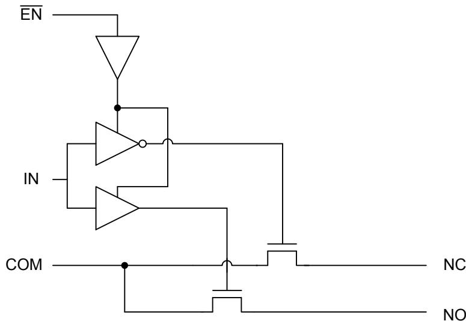

Block diagram of one switch channel (description written from the drawing). The EN input (printed with an overbar) goes through a buffer whose output enables two gate drivers. IN drives both: an inverting driver (output bubble) controls the gate of the switch between COM and NC, a non-inverting driver controls the gate of the switch between COM and NO. COM is connected to both switches; NC and NO are the two switched terminals.

Important Notice icon

{1}------------------------------------------------

## Table of Contents

|          |                                                   |           |           |                                                               |           |
|----------|---------------------------------------------------|-----------|-----------|---------------------------------------------------------------|-----------|
| <b>1</b> | <b>Features .....</b>                             | <b>1</b>  | 8.1       | Overview .....                                                | 17        |
| <b>2</b> | <b>Applications .....</b>                         | <b>1</b>  | 8.2       | Functional Block Diagram (Each Switch) .....                  | 17        |
| <b>3</b> | <b>Description .....</b>                          | <b>1</b>  | 8.3       | Feature Description .....                                     | 17        |
| <b>4</b> | <b>Revision History .....</b>                     | <b>2</b>  | 8.4       | Device Functional Modes .....                                 | 17        |
| <b>5</b> | <b>Pin Configuration and Functions .....</b>      | <b>3</b>  | <b>9</b>  | <b>Application and Implementation .....</b>                   | <b>18</b> |
| <b>6</b> | <b>Specifications .....</b>                       | <b>4</b>  | 9.1       | Application Information .....                                 | 18        |
| 6.1      | Absolute Maximum Ratings .....                    | 4         | 9.2       | Typical Application .....                                     | 18        |
| 6.2      | ESD Ratings .....                                 | 4         | <b>10</b> | <b>Power Supply Recommendations .....</b>                     | <b>19</b> |
| 6.3      | Recommended Operating Conditions .....            | 4         | <b>11</b> | <b>Layout .....</b>                                           | <b>19</b> |
| 6.4      | Thermal Information .....                         | 4         | 11.1      | Layout Guidelines .....                                       | 19        |
| 6.5      | Electrical Characteristics for 3.3-V Supply ..... | 5         | 11.2      | Layout Example .....                                          | 19        |
| 6.6      | Electrical Characteristics for 2.5-V Supply ..... | 6         | <b>12</b> | <b>Device and Documentation Support .....</b>                 | <b>20</b> |
| 6.7      | Electrical Characteristics for 2.1-V Supply ..... | 7         | 12.1      | Device Support .....                                          | 20        |
| 6.8      | Electrical Characteristics for 1.8-V Supply ..... | 7         | 12.2      | Documentation Support .....                                   | 21        |
| 6.9      | Switching Characteristics for 3.3-V Supply .....  | 8         | 12.3      | Receiving Notification of Documentation Updates .....         | 21        |
| 6.10     | Switching Characteristics for 2.5-V Supply .....  | 8         | 12.4      | Community Resources .....                                     | 21        |
| 6.11     | Switching Characteristics for 1.8-V Supply .....  | 9         | 12.5      | Trademarks .....                                              | 21        |
| 6.12     | Typical Characteristics .....                     | 10        | 12.6      | Electrostatic Discharge Caution .....                         | 21        |
| <b>7</b> | <b>Parameter Measurement Information .....</b>    | <b>13</b> | 12.7      | Glossary .....                                                | 21        |
| <b>8</b> | <b>Detailed Description .....</b>                 | <b>17</b> | <b>13</b> | <b>Mechanical, Packaging, and Orderable Information .....</b> | <b>21</b> |

## 4 Revision History

NOTE: Page numbers for previous revisions may differ from page numbers in the current version.

| Changes from Revision G (March 2015) to Revision H                                                                                   | Page |
|--------------------------------------------------------------------------------------------------------------------------------------|------|
| • Changed the pinout images.....                                                                                                     | 3    |
| • Changed the $r_{on}$ MAX value at 25°C From: 8 Ω To: 17 Ω in the <i>Electrical Characteristics for 1.8-V Supply</i> table.....     | 7    |
| • Changed the $r_{on}$ MAX value at Full From: 14.55 Ω To: 32 Ω in the <i>Electrical Characteristics for 1.8-V Supply</i> table..... | 7    |

| Changes from Revision F (June 2013) to Revision G                                                                                                                                                                                                                                                                                                                                                                                                                                                          | Page |
|------------------------------------------------------------------------------------------------------------------------------------------------------------------------------------------------------------------------------------------------------------------------------------------------------------------------------------------------------------------------------------------------------------------------------------------------------------------------------------------------------------|------|
| • Added <i>Applications</i> , <i>Device Information</i> table, <i>Pin Functions</i> table, <i>ESD Ratings</i> table, <i>Thermal Information</i> table, <i>Typical Characteristics</i> , <i>Feature Description</i> section, <i>Device Functional Modes</i> , <i>Application and Implementation</i> section, <i>Power Supply Recommendations</i> section, <i>Layout</i> section, <i>Device and Documentation Support</i> section, and <i>Mechanical, Packaging, and Orderable Information</i> section. .... | 1    |
| • Deleted <i>Ordering Information</i> table. ....                                                                                                                                                                                                                                                                                                                                                                                                                                                          | 1    |

{2}------------------------------------------------

## 5 Pin Configuration and Functions

**D, DBQ, DGV and PW Package  
16-Pin SOIC, SSOP, TVSOP and TSSOP  
(Top View)**

Top view diagram of a 16-pin SOIC, SSOP, TVSOP, and TSSOP package. The pins are numbered 1 through 16. Pin 1 is IN, 2 is NC1, 3 is NO1, 4 is COM1, 5 is NC2, 6 is NO2, 7 is COM2, 8 is GND, 9 is COM3, 10 is NO3, 11 is NC3, 12 is COM4, 13 is NO4, 14 is NC4, 15 is EN (printed with an overbar), and 16 is V+. A small circle indicates the orientation. Marked 'Not to scale'.

**Logic Circuit**

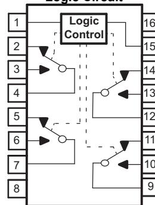

Logic circuit diagram (description written from the drawing): a 16-pin outline with pins 1-8 on the left and 16-9 on the right, and a 'Logic Control' block at the top connected to pin 1 (IN) and pin 15 (EN). Dashed control lines from Logic Control go to four SPDT switches: pin 4 (COM1) switches to pin 2 or 3, pin 7 (COM2) to pin 5 or 6, pin 12 (COM4) to pin 14 or 13, and pin 9 (COM3) to pin 11 or 10. Pins 8 and 16 have no internal connection drawn.

**RGY Package  
16-Pin VQFN  
(Top View)**

Top view diagram of a 16-pin VQFN package. The pins are numbered 1 through 16. Pin 1 is IN, 2 is NC1, 3 is NO1, 4 is COM1, 5 is NC2, 6 is NO2, 7 is COM2, 8 is GND, 9 is COM3, 10 is NO3, 11 is NC3, 12 is COM4, 13 is NO4, 14 is NC4, 15 is EN (printed with an overbar), and 16 is V+. A 'Thermal Pad' is indicated in the center. A small circle indicates the orientation. Marked 'Not to scale'.

**RSV Package  
16-Pin UQFN  
(Top View)**

Top view diagram of a 16-pin UQFN package. The pins are numbered 1 through 16. Pin 1 is NO1, 2 is COM1, 3 is NC2, 4 is NO2 (left side, top to bottom), 5 is COM2, 6 is GND, 7 is COM3, 8 is NO3 (bottom side, left to right), 9 is NC3, 10 is COM4, 11 is NO4, 12 is NC4 (right side, bottom to top), 13 is EN (printed with an overbar), 14 is V+, 15 is IN, and 16 is NC1 (top side, right to left). A small circle indicates the orientation. Marked 'Not to scale'.

### Pin Functions

| PIN                    |                             |          | TYPE | DESCRIPTION                     |
|------------------------|-----------------------------|----------|------|---------------------------------|
| NAME                   | SOIC, SSOP, TVSOP, VQFN NO. | UQFN NO. |      |                                 |
| COM1                   | 4                           | 2        | I/O  | Common path for switch          |
| COM2                   | 7                           | 5        | I/O  | Common path for switch          |
| COM3                   | 9                           | 7        | I/O  | Common path for switch          |
| COM4                   | 12                          | 10       | I/O  | Common path for switch          |
| $\overline{\text{EN}}$ | 15                          | 13       | I    | Active-low switch enable input  |
| GND                    | 8                           | 6        | —    | Ground                          |
| IN                     | 1                           | 15       | I    | Switch path selector input      |
| NC1                    | 2                           | 16       | I/O  | Normally closed path for switch |
| NC2                    | 5                           | 3        | I/O  | Normally closed path for switch |
| NC3                    | 11                          | 9        | I/O  | Normally closed path for switch |
| NC4                    | 14                          | 12       | I/O  | Normally closed path for switch |
| NO1                    | 3                           | 1        | I/O  | Normally open path for switch   |
| NO2                    | 6                           | 4        | I/O  | Normally open path for switch   |
| NO3                    | 10                          | 8        | I/O  | Normally open path for switch   |
| NO4                    | 13                          | 11       | I/O  | Normally open path for switch   |
| V+                     | 16                          | 14       | —    | Supply voltage                  |

{3}------------------------------------------------

## 6 Specifications

### 6.1 Absolute Maximum Ratings

over operating free-air temperature range (unless otherwise noted)(1)(2)

| | | | MIN | MAX | UNIT |
|-|-|-|-|-|-|
| V + | Supply voltage (3) |  | -0.5 | 4.6 | V |
| V NC | Analog voltage (3)(4) |  | -0.5 | 4.6 | V |
| V NO |  |  |  |  |  |
| V COM |  |  |  |  |  |
| I K | Analog port diode current | V NC , V NO , V COM < 0 | -50 | | mA |
| I NC | ON-state switch current | V NC , V NO , V COM = 0 to 7 V | -64 | 64 | mA |
| I NO |  |  |  |  |  |
| I COM |  |  |  |  |  |
| V I | Digital input voltage (3)(4) |  | -0.5 | 4.6 | V |
| I IK | Digital input clamp current | V I < 0 | -50 | | mA |
| I + | Continuous current through V + |  | -100 | 100 | mA |
| I GND | Continuous current through GND |  | -100 | 100 | mA |
| T stg | Storage temperature |  | -65 | 150 | °C |

- (1) Stresses beyond those listed under *Absolute Maximum Ratings* may cause permanent damage to the device. These are stress ratings only, and functional operation of the device at these or any other conditions beyond those indicated under *Recommended Operating Conditions* is not implied. Exposure to absolute-maximum-rated conditions for extended periods may affect device reliability.
- (2) The algebraic convention, whereby the most negative value is a minimum and the most positive value is a maximum
- (3) All voltages are with respect to ground, unless otherwise specified.
- (4) The input and output voltage ratings may be exceeded if the input and output clamp-current ratings are observed.

### 6.2 ESD Ratings

| | | | VALUE | UNIT |
|-|-|-|-|-|
| V (ESD) | Electrostatic discharge | Human-body model (HBM), per ANSI/ESDA/JEDEC JS-001 (1) | ±2000 | V |
| | | Charged-device model (CDM), per JEDEC specification JESD22-C101 (2) | ±1000 | V |

- (1) JEDEC document JEP155 states that 500-V HBM allows safe manufacturing with a standard ESD control process.
- (2) JEDEC document JEP157 states that 250-V CDM allows safe manufacturing with a standard ESD control process.

### 6.3 Recommended Operating Conditions

over operating free-air temperature range (unless otherwise noted)

|                  |                                 | MIN  | MAX            | UNIT |
|------------------|---------------------------------|------|----------------|------|
| V I/O | Switch input and output voltage | 0    | V + | V    |
| V +   | Supply voltage                  | 1.65 | 3.6            | V    |
| V I   | Control input voltage           | 0    | 3.6            | V    |
| T A   | Operating temperature           | -40  | 85             | °C   |

### 6.4 Thermal Information

| THERMAL METRIC (1) | TS3A5018                               |            |             |            |            |            | UNIT     |
|-------------------------------|----------------------------------------|------------|-------------|------------|------------|------------|----------|
|                               | D (SOIC)                               | DBQ (SSOP) | DGV (TVSOP) | PW (TSSOP) | RGY (VQFN) | RSV (UQFN) |          |
|                               | 16 PINS                                | 16 PINS    | 16 PINS     | 16 PINS    | 16 PINS    | 16 PINS    |          |
| R θJA Junction-to-ambient thermal resistance | 73 | 90 | 120 | 108 | 51 | 184 | °C/W |

- (1) For more information about traditional and new thermal metrics, see the [Semiconductor and IC Package Thermal Metrics](#) application report.

{4}------------------------------------------------

### 6.5 Electrical Characteristics for 3.3-V Supply

$V_+ = 3\text{ V}$  to  $3.6\text{ V}$ ,  $T_A = -40^\circ\text{C}$  to  $85^\circ\text{C}$  (unless otherwise noted)(1)

| PARAMETER                                                  | TEST CONDITIONS                                                                                                                                                                                                | $T_A$ | $V_+$ | MIN  | TYP  | MAX   | UNIT          |
|------------------------------------------------------------|----------------------------------------------------------------------------------------------------------------------------------------------------------------------------------------------------------------|-------|-------|------|------|-------|---------------|
| <b>Analog Switch</b>                                       |                                                                                                                                                                                                                |       |       |      |      |       |               |
| $V_{COM}, V_{NO}, V_{NC}$ Analog signal range              |                                                                                                                                                                                                                |       |       | 0    |      | $V_+$ | V             |
| $r_{on}$ ON-state resistance                               | $0 \leq (V_{NC} \text{ or } V_{NO}) \leq V_+, I_{COM} = -32\text{ mA}$ , Switch ON, see Figure 17                                                                                                              | 25°C  | 3 V   |      | 7    | 10    | $\Omega$      |
|                                                            |                                                                                                                                                                                                                | Full  |       |      |      | 12    |               |
| $\Delta r_{on}$ ON-state resistance match between channels | $V_{NC} \text{ or } V_{NO} = 2.1\text{ V}, I_{COM} = -32\text{ mA}$ , Switch ON, see Figure 17                                                                                                                 | 25°C  | 3 V   |      | 0.3  | 0.8   | $\Omega$      |
|                                                            |                                                                                                                                                                                                                | Full  |       |      |      | 1     |               |
| $r_{on(flat)}$ ON-state resistance flatness                | $0 \leq (V_{NC} \text{ or } V_{NO}) \leq V_+, I_{COM} = -32\text{ mA}$ , Switch ON, see Figure 17                                                                                                              | 25°C  | 3 V   |      | 5    | 7     | $\Omega$      |
|                                                            |                                                                                                                                                                                                                | Full  |       |      |      | 8     |               |
| $I_{NC(OFF)}, I_{NO(OFF)}$ NC, NO OFF leakage current      | $V_{NC} \text{ or } V_{NO} = 1\text{ V}, V_{COM} = 3\text{ V}$ , or $V_{NC} \text{ or } V_{NO} = 3\text{ V}, V_{COM} = 1\text{ V}$ , Switch OFF, see Figure 18                                                 | 25°C  | 3.6 V | -0.1 | 0.05 | 0.1   | $\mu\text{A}$ |
|                                                            |                                                                                                                                                                                                                | Full  |       | -0.2 |      | 0.2   |               |
|                                                            | $V_{NC} \text{ or } V_{NO} = 0 \text{ to } 3.6\text{ V}, V_{COM} = 3.6\text{ V to } 0$ , or $V_{NC} \text{ or } V_{NO} = 3.6\text{ V to } 0, V_{COM} = 0 \text{ to } 3.6\text{ V}$ , Switch OFF, see Figure 18 | 25°C  | 0 V   | -2   | 0.05 | 2     |               |
|                                                            |                                                                                                                                                                                                                | Full  |       | -10  |      | 10    |               |
| $I_{COM(OFF)}$ COM OFF leakage current                     | $V_{COM} = 1\text{ V}, V_{NC} \text{ or } V_{NO} = 3\text{ V}$ , or $V_{COM} = 3\text{ V}, V_{NC} \text{ or } V_{NO} = 3\text{ V}$ , Switch OFF, see Figure 18                                                 | 25°C  | 3.6 V | -0.1 | 0.05 | 0.1   | $\mu\text{A}$ |
|                                                            |                                                                                                                                                                                                                | Full  |       | -0.2 |      | 0.2   |               |
|                                                            | $V_{COM} = 0 \text{ to } 3.6\text{ V}, V_{NC} \text{ or } V_{NO} = 3.6\text{ V to } 0$ , or $V_{COM} = 3.6\text{ V to } 0, V_{NC} \text{ or } V_{NO} = 0 \text{ to } 3.6\text{ V}$ , Switch OFF, see Figure 18 | 25°C  | 0 V   | -2   | 0.05 | 2     |               |
|                                                            |                                                                                                                                                                                                                | Full  |       | -10  |      | 10    |               |
| $I_{NC(ON)}, I_{NO(ON)}$ NC, NO ON leakage current         | $V_{NC} \text{ or } V_{NO} = 1\text{ V}, V_{COM} = \text{Open}$ , or $V_{NC} \text{ or } V_{NO} = 3\text{ V}, V_{COM} = \text{Open}$ , Switch ON, see Figure 19                                                | 25°C  | 3.6 V | -0.1 | 0.05 | 0.1   | $\mu\text{A}$ |
|                                                            |                                                                                                                                                                                                                | Full  |       | -0.2 |      | 0.2   |               |
| $I_{COM(ON)}$ COM ON leakage current                       | $V_{COM} = 1\text{ V}, V_{NC} \text{ or } V_{NO} = \text{Open}$ , or $V_{COM} = 3\text{ V}, V_{NC} \text{ or } V_{NO} = \text{Open}$ , Switch ON, see Figure 19                                                | 25°C  | 3.6 V | -0.1 | 0.05 | 0.1   | $\mu\text{A}$ |
|                                                            |                                                                                                                                                                                                                | Full  |       | -0.2 |      | 0.2   |               |
| $V_{IH}$ Input logic high                                  |                                                                                                                                                                                                                | Full  |       | 2    |      | $V_+$ | V             |
| $V_{IL}$ Input logic low                                   |                                                                                                                                                                                                                | Full  |       | 0    |      | 0.8   | V             |
| $I_{IH}, I_{IL}$ Input leakage current                     | $V_I = V_+ \text{ or } 0$                                                                                                                                                                                      | 25°C  | 3.6 V | -1   | 0.05 | 1     | $\mu\text{A}$ |
|                                                            |                                                                                                                                                                                                                | Full  |       | -1   |      | 1     |               |
| $Q_C$ Charge injection                                     | $V_{GEN} = 0, R_{GEN} = 0, C_L = 0.1\text{ nF}$ , see Figure 26                                                                                                                                                | 25°C  | 3.3 V |      | 2    |       | pC            |
| $C_{NC(OFF)}, C_{NO(OFF)}$ NC, NO OFF capacitance          | $V_{NC} \text{ or } V_{NO} = V_+ \text{ or GND}$ , Switch OFF, see Figure 20                                                                                                                                   | 25°C  | 3.3 V |      | 4.5  |       | pF            |
| $C_{COM(OFF)}$ COM OFF capacitance                         | $V_{COM} = V_+ \text{ or GND}$ , Switch OFF, see Figure 20                                                                                                                                                     | 25°C  | 3.3 V |      | 9    |       | pF            |
| $C_{NC(ON)}, C_{NO(ON)}$ NC, NO ON capacitance             | $V_{NC} \text{ or } V_{NO} = V_+ \text{ or GND}$ , Switch ON, see Figure 20                                                                                                                                    | 25°C  | 3.3 V |      | 16   |       | pF            |
| $C_{COM(ON)}$ COM ON capacitance                           | $V_{COM} = V_+ \text{ or GND}$ , Switch ON, see Figure 20                                                                                                                                                      | 25°C  | 3.3 V |      | 16   |       | pF            |

(1) The algebraic convention is used in this data sheet; the most negative value is shown in the minimum column.

{5}------------------------------------------------

### Electrical Characteristics for 3.3-V Supply (continued)

$V_+ = 3\text{ V to } 3.6\text{ V}$ ,  $T_A = -40^\circ\text{C to } 85^\circ\text{C}$  (unless otherwise noted)(1)

| PARAMETER                          | TEST CONDITIONS                                                                                                   | $T_A$ | $V_+$ | MIN | TYP   | MAX | UNIT          |
|------------------------------------|-------------------------------------------------------------------------------------------------------------------|-------|-------|-----|-------|-----|---------------|
| $C_I$ Digital input capacitance    | $V_I = V_+$ or GND, See <a href="#">Figure 20</a>                                                                 | 25°C  | 3.3 V |     | 3     |     | pF            |
| BW Bandwidth                       | $R_L = 50\ \Omega$ , Switch ON, see <a href="#">Figure 22</a>                                                     | 25°C  | 3.3 V |     | 300   |     | MHz           |
| $O_{ISO}$ OFF isolation            | $R_L = 50\ \Omega$ , $f = 10\text{ MHz}$ , Switch OFF, see <a href="#">Figure 23</a>                              | 25°C  | 3.3 V |     | -48   |     | dB            |
| $X_{TALK}$ Crosstalk               | $R_L = 50\ \Omega$ , $f = 10\text{ MHz}$ , Switch ON, see <a href="#">Figure 24</a>                               | 25°C  | 3.3 V |     | -48   |     | dB            |
| $X_{TALK(ADJ)}$ Crosstalk adjacent | $R_L = 50\ \Omega$ , $f = 10\text{ MHz}$ , Switch ON, see <a href="#">Figure 25</a>                               | 25°C  | 3.3 V |     | -81   |     | dB            |
| THD Total harmonic distortion      | $R_L = 600\ \Omega$ , $C_L = 50\text{ pF}$ , $f = 20\text{ Hz to } 20\text{ kHz}$ , see <a href="#">Figure 27</a> | 25°C  | 3.3 V |     | 0.21% |     |               |
| $I_+$ Positive supply current      | $V_I = V_+$ or GND, Switch ON or OFF                                                                              | 25°C  | 3.6 V |     | 2.5   | 7   | $\mu\text{A}$ |
|                                    |                                                                                                                   | Full  |       |     |       | 10  |               |

### 6.6 Electrical Characteristics for 2.5-V Supply

$V_+ = 2.3\text{ V to } 2.7\text{ V}$ ,  $T_A = -40^\circ\text{C to } 85^\circ\text{C}$  (unless otherwise noted)(1)

| PARAMETER                                                  | TEST CONDITIONS                                                                                                                                                                                                                    | $T_A$ | $V_+$ | MIN  | TYP  | MAX   | UNIT          |
|------------------------------------------------------------|------------------------------------------------------------------------------------------------------------------------------------------------------------------------------------------------------------------------------------|-------|-------|------|------|-------|---------------|
| $V_{COM}$ , $V_{NC}$ , $V_{NO}$ Analog signal range        |                                                                                                                                                                                                                                    |       |       | 0    |      | $V_+$ | V             |
| $r_{on}$ ON-state resistance                               | $0 \leq (V_{NC} \text{ or } V_{NO}) \leq V_+$ , $I_{COM} = -24\text{ mA}$ , Switch ON, see <a href="#">Figure 17</a>                                                                                                               | 25°C  | 2.3 V |      | 12   | 20    | $\Omega$      |
|                                                            |                                                                                                                                                                                                                                    | Full  |       |      |      | 22    |               |
| $\Delta r_{on}$ ON-state resistance match between channels | $V_{NC} \text{ or } V_{NO} = 1.6\text{ V}$ , $I_{COM} = -24\text{ mA}$ , Switch ON, see <a href="#">Figure 17</a>                                                                                                                  | 25°C  | 2.3 V |      | 0.3  | 1     | $\Omega$      |
|                                                            |                                                                                                                                                                                                                                    | Full  |       |      |      | 2     |               |
| $r_{on(flat)}$ ON-state resistance flatness                | $0 \leq (V_{NC} \text{ or } V_{NO}) \leq V_+$ , $I_{COM} = -24\text{ mA}$ , Switch ON, see <a href="#">Figure 17</a>                                                                                                               | 25°C  | 2.3 V |      | 14   | 18    | $\Omega$      |
|                                                            |                                                                                                                                                                                                                                    | Full  |       |      |      | 20    |               |
| $I_{NC(OFF)}$ , $I_{NO(OFF)}$ NC, NO OFF leakage current   | $V_{NC} \text{ or } V_{NO} = 0.5\text{ V}$ , $V_{COM} = 2.2\text{ V}$ , or $V_{NC} \text{ or } V_{NO} = 2.2\text{ V}$ , $V_{COM} = 0.5\text{ V}$ , Switch OFF, see <a href="#">Figure 18</a>                                       | 25°C  | 2.7 V | -0.1 | 0.05 | 0.1   | $\mu\text{A}$ |
|                                                            |                                                                                                                                                                                                                                    | Full  |       | -0.2 |      | 0.2   |               |
|                                                            | $V_{NC} \text{ or } V_{NO} = 0\text{ to } 3.6\text{ V}$ , $V_{COM} = 3.6\text{ V to } 0$ , or $V_{NC} \text{ or } V_{NO} = 3.6\text{ V to } 0$ , $V_{COM} = 0\text{ to } 3.6\text{ V}$ , Switch OFF, see <a href="#">Figure 18</a> | 25°C  | 0 V   | -2   | 0.05 | 2     |               |
|                                                            |                                                                                                                                                                                                                                    | Full  |       | -10  |      | 10    |               |
| $I_{COM(OFF)}$ COM OFF leakage current                     | $V_{COM} = 0.5\text{ V}$ , $V_{NC} \text{ or } V_{NO} = 2.2\text{ V}$ , or $V_{COM} = 2.2\text{ V}$ , $V_{NC} \text{ or } V_{NO} = 0.5\text{ V}$ , Switch OFF, see <a href="#">Figure 18</a>                                       | 25°C  | 2.7 V | -0.1 | 0.05 | 0.1   | $\mu\text{A}$ |
|                                                            |                                                                                                                                                                                                                                    | Full  |       | -0.2 |      | 0.2   |               |
|                                                            | $V_{COM} = 0\text{ to } 3.6\text{ V}$ , $V_{NC} \text{ or } V_{NO} = 3.6\text{ V to } 0$ , or $V_{COM} = 3.6\text{ V to } 0$ , $V_{NC} \text{ or } V_{NO} = 0\text{ to } 3.6\text{ V}$ , Switch OFF, see <a href="#">Figure 18</a> | 25°C  | 0 V   | -2   | 0.05 | 2     |               |
|                                                            |                                                                                                                                                                                                                                    | Full  |       | -10  |      | 10    |               |
| $I_{NC(ON)}$ , $I_{NO(ON)}$ NC, NO ON leakage current      | $V_{NC} \text{ or } V_{NO} = 0.5\text{ V}$ , $V_{COM} = \text{Open}$ , or $V_{NC} \text{ or } V_{NO} = 2.2\text{ V}$ , $V_{COM} = \text{Open}$ , Switch ON, see <a href="#">Figure 19</a>                                          | 25°C  | 2.7 V | -0.1 | 0.05 | 0.1   | $\mu\text{A}$ |
|                                                            |                                                                                                                                                                                                                                    | Full  |       | -0.2 |      | 0.2   |               |
| $I_{COM(ON)}$ COM ON leakage current                       | $V_{COM} = 0.5\text{ V}$ , $V_{NC} \text{ or } V_{NO} = \text{Open}$ , or $V_{COM} = 2.2\text{ V}$ , $V_{NC} \text{ or } V_{NO} = \text{Open}$ , Switch ON, see <a href="#">Figure 19</a>                                          | 25°C  | 2.7 V | -0.1 | 0.05 | 0.1   | $\mu\text{A}$ |
|                                                            |                                                                                                                                                                                                                                    | Full  |       | -0.2 |      | 0.2   |               |
| $V_{IH}$ Input logic high                                  |                                                                                                                                                                                                                                    | Full  |       | 1.7  |      | $V_+$ | V             |
| $V_{IL}$ Input logic low                                   |                                                                                                                                                                                                                                    | Full  |       | 0    |      | 0.7   | V             |

(1) The algebraic convention is used in this data sheet; the most negative value is shown in the minimum column.

{6}------------------------------------------------

### Electrical Characteristics for 2.5-V Supply (continued)

$V_+ = 2.3\text{ V to } 2.7\text{ V}, T_A = -40^\circ\text{C to } 85^\circ\text{C}$  (unless otherwise noted)(1)

| PARAMETER                                              | TEST CONDITIONS                               |                                                        | $T_A$ | $V_+$ | MIN  | TYP   | MAX | UNIT |
|--------------------------------------------------------|-----------------------------------------------|--------------------------------------------------------|-------|-------|------|-------|-----|------|
| $I_{IH}, I_{IL}$ Input leakage current                 | $V_I = V_+$ or 0                              |                                                        | 25°C  | 2.7 V | -0.1 | 0.05  | 0.1 | μA   |
|                                                        |                                               |                                                        | Full  |       | -1   |       | 1   |      |
| $Q_C$ Charge injection                                 | $V_{GEN} = 0,$ $R_{GEN} = 0,$              | $C_L = 0.1\text{ nF},$ see Figure 26                | 25°C  | 2.5 V |      | 1     |     | pC   |
| $C_{NC(OFF)},$ $C_{NO(OFF)}$ NC, NO OFF capacitance | $V_{NC}$ or $V_{NO} = V_+$ or GND,            | Switch OFF, see Figure 20                           | 25°C  | 2.5 V |      | 3     |     | pF   |
| $C_{COM(OFF)}$ COM OFF capacitance                     | $V_{COM} = V_+$ or GND,                       | Switch OFF, see Figure 20                           | 25°C  | 2.5 V |      | 9     |     | pF   |
| $C_{NC(ON)},$ $C_{NO(ON)}$ NC, NO ON capacitance    | $V_{NC}$ or $V_{NO} = V_+$ or GND,            | Switch ON, see Figure 20                            | 25°C  | 2.5 V |      | 16    |     | pF   |
| $C_{COM(ON)}$ COM ON capacitance                       | $V_{COM} = V_+$ or GND,                       | Switch ON, see Figure 20                            | 25°C  | 2.5 V |      | 16    |     | pF   |
| $C_I$ Digital input capacitance                        | $V_I = V_+$ or GND,                           | See Figure 20                                          | 25°C  | 2.5 V |      | 3     |     | pF   |
| BW Bandwidth                                           | $R_L = 50\ \Omega,$                           | Switch ON, see Figure 22                            | 25°C  | 2.5 V |      | 300   |     | MHz  |
| $O_{ISO}$ OFF isolation                                | $R_L = 50\ \Omega,$ $f = 10\text{ MHz},$   | Switch OFF, see Figure 23                           | 25°C  | 2.5 V |      | -48   |     | dB   |
| $X_{TALK}$ Crosstalk                                   | $R_L = 50\ \Omega,$ $f = 10\text{ MHz},$   | Switch ON, see Figure 24                            | 25°C  | 2.5 V |      | -48   |     | dB   |
| $X_{TALK(ADJ)}$ Crosstalk adjacent                     | $R_L = 50\ \Omega,$ $f = 10\text{ MHz},$   | Switch ON, see Figure 25                            | 25°C  | 3.3 V |      | -81   |     | dB   |
| THD Total harmonic distortion                          | $R_L = 600\ \Omega,$ $C_L = 50\text{ pF},$ | $f = 20\text{ Hz to } 20\text{ kHz},$ see Figure 27 | 25°C  | 2.5 V |      | 0.33% |     |      |
| $I_+$ Positive supply current                          | $V_I = V_+$ or GND,                           | Switch ON or OFF                                       | 25°C  | 2.7 V |      | 2.5   | 7   | μA   |
|                                                        |                                               |                                                        | Full  |       |      |       | 10  |      |

### 6.7 Electrical Characteristics for 2.1-V Supply

$V_+ = 2.00\text{ V to } 2.20\text{ V}, T_A = -40^\circ\text{C to } 85^\circ\text{C}$  (unless otherwise noted)(1)

| PARAMETER                 | TEST CONDITIONS | $T_A$ | $V_+$ | MIN | TYP | MAX | UNIT |
|---------------------------|-----------------|-------|-------|-----|-----|-----|------|
| $V_{IH}$ Input logic high |                 | Full  |       | 1.2 |     | 4.3 | V    |
| $V_{IL}$ Input logic low  |                 | Full  |       | 0   |     | 0.5 | V    |

(1) The algebraic convention is used in this data sheet; the most negative value is shown in the minimum column.

### 6.8 Electrical Characteristics for 1.8-V Supply

$V_+ = 1.65\text{ V to } 1.95\text{ V}, T_A = -40^\circ\text{C to } 85^\circ\text{C}$  (unless otherwise noted)(1)

| PARAMETER                                                  | TEST CONDITIONS                                                              |                             | $T_A$ | $V_+$  | MIN | TYP | MAX   | UNIT |
|------------------------------------------------------------|------------------------------------------------------------------------------|-----------------------------|-------|--------|-----|-----|-------|------|
| $V_{COM}, V_{NC}, V_{NO}$ Analog signal range              |                                                                              |                             |       |        | 0   |     | $V_+$ | V    |
| $r_{on}$ ON-state resistance                               | $0 \leq (V_{NC} \text{ or } V_{NO}) \leq V_+,$ $I_{COM} = -32\text{ mA},$ | Switch ON, see Figure 17 | 25°C  | 1.65 V |     | 5.5 | 17    | Ω    |
|                                                            |                                                                              |                             | Full  |        |     |     | 32    |      |
| $\Delta r_{on}$ ON-state resistance match between channels | $V_{NC} \text{ or } V_{NO} = 1.5\text{ V},$ $I_{COM} = -32\text{ mA},$    | Switch ON, see Figure 17 | 25°C  | 1.65 V |     | 0.3 | 1     | Ω    |
|                                                            |                                                                              |                             | Full  |        |     |     | 1.2   |      |
| $r_{on(flat)}$ ON-state resistance flatness                | $0 \leq (V_{NC} \text{ or } V_{NO}) \leq V_+,$ $I_{COM} = -32\text{ mA},$ | Switch ON, see Figure 17 | 25°C  | 1.65 V |     | 2.7 | 5.5   | Ω    |
|                                                            |                                                                              |                             | Full  |        |     |     | 7.3   |      |

(1) The algebraic convention is used in this data sheet; the most negative value is shown in the minimum column.

{7}------------------------------------------------

### Electrical Characteristics for 1.8-V Supply (continued)

V+ = 1.65 V to 1.95 V, TA = –40°C to 85°C (unless otherwise noted)(1)

| PARAMETER | | TEST CONDITIONS | T A | V + | MIN | TYP | MAX | UNIT |
|-|-|-|-|-|-|-|-|-|
| I NC(OFF) , I NO(OFF) | NC, NO OFF leakage current | V NC or V NO = 0.3 V, V COM = 1.65V, or V NC or V NO = 1.65V, V COM = 0.3 V, Switch OFF, see Figure 18 | 25°C | 1.95 V | –0.25 | 0.03 | 0.25 | μA |
|  |  |  | Full |  | –4.5 |  | 4.5 |  |
|  |  | V NC or V NO = 1.95 V to 0 V, V COM = 0 V to 1.95 V, or V NC or V NO = 0 V to 1.95 V, V COM = 1.95 V to 0 V, Switch OFF, see Figure 18 | 25°C | 0 V | –0.4 | 0.01 | 0.4 |  |
|  |  |  | Full |  | –6.5 |  | 6.5 |  |
| I COM(OFF) | COM OFF leakage current | V COM = 1.65 V, V NC or V NO = 0.3V, or V COM = 0.3 V, V NC or V NO = 1.65V, Switch OFF, see Figure 18 | 25°C | 1.95 V | –0.4 | 0.02 | 0.4 | μA |
|  |  |  | Full |  | –0.9 |  | 0.9 |  |
|  |  | V COM = 0 V to 1.95 V, V NC or V NO = 1.95 V to 0 V, or V COM = 1.95 V to 0, V NC or V NO = 0 to 1.95 V, Switch OFF, see Figure 18 | 25°C | 0 V | –0.4 | 0.02 | 0.4 |  |
|  |  |  | Full |  | –4.5 |  | 4.5 |  |
| I NC(ON) , I NO(ON) | NC, NO ON leakage current | V NC or V NO = 0.3 V, V COM = Open, or V NC or V NO = 1.65 V, V COM = Open, Switch ON, see Figure 19 | 25°C | 1.95 V | –2. | 0.02 | 2 | μA |
|  |  |  | Full |  | –2 | 0.02 | 2 |  |
| I COM(ON) | COM ON leakage current | V COM = 0.3 V, V NC or V NO = Open, or V COM = 1.65 V, V NC or V NO = Open, Switch ON, see Figure 19 | 25°C | 1.95 V | –4.5 |  | 4.5 | μA |
|  |  |  | Full |  |  |  |  |  |
| V IH | Input logic high | V I = V + or GND | Full | 1.95 V | 1 |  | 3.6 | V |
| V IL | Input logic low |  | Full | 1.95 V | 0 |  | 0.4 | V |
| I IH , I IL | Input leakage current | V I = V + or 0 | 25°C | 1.95 V | –0.1 | 0.01 | 0.1 | μA |
|  |  |  | Full |  | –2.1 |  | 2.1 |  |

### 6.9 Switching Characteristics for 3.3-V Supply

over operating free-air temperature range (unless otherwise noted)

| PARAMETER | | TEST CONDITIONS | T A | V + | MIN | TYP | MAX | UNIT |
|-|-|-|-|-|-|-|-|-|
| t ON | Turnon time | V COM = 2 V, R L = 300 Ω, C L = 35 pF, see Figure 21 | 25°C | 3.3 V | 2.5 | 3.5 | 8 | ns |
|  |  |  | Full | 3 V to 3.6 V | 2.5 |  | 9 |  |
| t OFF | Turnoff time | V COM =2 V, R L = 300 Ω, C L = 35 pF, see Figure 21 | 25°C | 3.3 V | 0.5 | 2 | 6.5 | ns |
|  |  |  | Full | 3 V to 3.6 V | 0.5 |  | 7 |  |

### 6.10 Switching Characteristics for 2.5-V Supply

over operating free-air temperature range (unless otherwise noted)

| PARAMETER | | TEST CONDITIONS | T A | V + | MIN | TYP | MAX | UNIT |
|-|-|-|-|-|-|-|-|-|
| t ON | Turnon time | V COM = 1.5 V, R L = 300 Ω, C L = 35 pF, see Figure 21 | 25°C | 2.5 V | 2.5 | 5 | 9.5 | ns |
|  |  |  | Full | 2.3 V to 2.7 V | 2.5 |  | 10.5 |  |
| t OFF | Turnoff time | V COM =1.5 V, R L = 300 Ω, C L = 35 pF, see Figure 21 | 25°C | 2.5 V | 0.5 | 3 | 7.5 | ns |
|  |  |  | Full | 2.3 V to 2.7 V | 0.5 |  | 9 |  |

{8}------------------------------------------------

### 6.11 Switching Characteristics for 1.8-V Supply

over operating free-air temperature range (unless otherwise noted)

| PARAMETER        |                            | TEST CONDITIONS                                                                                                   |                                                          | T A | V +         | MIN | TYP  | MAX  | UNIT |
|------------------|----------------------------|-------------------------------------------------------------------------------------------------------------------|----------------------------------------------------------|----------------|------------------------|-----|------|------|------|
| t ON  | Turnon time                | V COM = V + , R L = 50 Ω,                                                  | C L = 35 pF, see <a href="#">Figure 21</a> | 25°C           | 1.8 V                  |     | 14.1 | 49.3 | ns   |
|                  |                            |                                                                                                                   |                                                          | Full           | 1.65 V to 1.95 V |     | 49.3 | 56.7 |      |
| t OFF | Turnoff time               | V COM = V + , R L = 50 Ω,                                                  | C L = 35 pF, see <a href="#">Figure 21</a> | 25°C           | 1.8 V                  |     | 16.1 | 26.5 | ns   |
|                  |                            |                                                                                                                   |                                                          | Full           | 1.65 V to 1.95 V |     |      | 31.2 |      |
| t BBM | Break-before- make time | V NC = V NO = V + /2, R L = 50 Ω,                                  | C L = 35 pF, see <a href="#">Figure 21</a> | 25°C           | 1.8 V                  | 5.3 | 18.4 | 58   | ns   |
|                  |                            |                                                                                                                   |                                                          | Full           | 1.65 V to 1.95 V |     |      | 58   |      |

{9}------------------------------------------------

### 6.12 Typical Characteristics

![Figure 1: ron vs VCOM, TA = 25°C. ron (Ω) versus VCOM (V), two curves labeled V+ = 2.5 V (red) and V+ = 3.3 V (black). The 2.5 V curve is higher: it rises with VCOM to a sharp peak and falls again, ending where it meets the 3.3 V curve. The 3.3 V curve rises slowly with a small shoulder, reaches a broad peak at a higher VCOM than the 2.5 V curve and then decreases to the end of its range. Read values from the image/PDF.](img/8ee3b76dd49f31624d287885bc2c81ee_img.jpg)

Figure 1: ron vs VCOM, TA = 25°C. ron (Ω) versus VCOM (V), two curves labeled V+ = 2.5 V (red) and V+ = 3.3 V (black). The 2.5 V curve is higher: it rises with VCOM to a sharp peak and falls again, ending where it meets the 3.3 V curve. The 3.3 V curve rises slowly with a small shoulder, reaches a broad peak at a higher VCOM than the 2.5 V curve and then decreases to the end of its range. Read values from the image/PDF.

**Figure 1.  $r_{on}$  vs  $V_{COM}$  ( $V_+ = 3.3$  V)**

Figure 2: ron vs VCOM (V+ = 2.5 V). ron (Ω) versus VCOM (V), three black curves labeled 85°C (top), 25°C (middle) and –40°C (bottom). All three have the same shape: a slow rise with a shoulder, a peak and a decrease toward the end of the VCOM axis; ron is higher at higher temperature over the whole range. Read values from the image/PDF.

**Figure 2.  $r_{on}$  vs  $V_{COM}$  ( $V_+ = 2.5$  V)**

![Figure 3: Leakage Current vs Temperature (V+ = 3.6 V). Leakage Current (nA) versus TA (°C), six piecewise-linear curves labeled INC(ON), ICOM(ON), INO(ON), ICOM(OFF), INC(OFF) and INO(OFF). The three ON-leakage curves are nearly flat from –40°C to 25°C and then rise linearly to 85°C, where they are at the top of the graph. The three OFF-leakage curves start near zero, rise slightly up to 25°C and then rise linearly with different slopes: the steepest (labeled INC(OFF)) reaches the level of the ON curves at 85°C, the lowest is labeled INO(OFF). Read values from the image/PDF.](img/64bacf564ff025df294b6d30341c76df_img.jpg)

Figure 3: Leakage Current vs Temperature (V+ = 3.6 V). Leakage Current (nA) versus TA (°C), six piecewise-linear curves labeled INC(ON), ICOM(ON), INO(ON), ICOM(OFF), INC(OFF) and INO(OFF). The three ON-leakage curves are nearly flat from –40°C to 25°C and then rise linearly to 85°C, where they are at the top of the graph. The three OFF-leakage curves start near zero, rise slightly up to 25°C and then rise linearly with different slopes: the steepest (labeled INC(OFF)) reaches the level of the ON curves at 85°C, the lowest is labeled INO(OFF). Read values from the image/PDF.

**Figure 3. Leakage Current vs Temperature ( $V_+ = 3.6$  V)**

![Figure 4: Leakage Current vs Temperature (V+ = 1.8 V). Leakage Current (nA) versus Temperature (°C), six curves with the legend INC_ON (blue), INO_ON (green), ICOM_ON (red), INC_OFF (purple), INO_OFF (orange) and ICOM_OFF (brown); graph tag G005. INC_ON, ICOM_ON and ICOM_OFF are in an upper group and change little with temperature; INO_ON is in the same group but rises to a maximum near room temperature and falls at both ends of the range. INC_OFF and INO_OFF are much lower and nearly flat, INO_OFF being the lowest curve. Read values from the image/PDF.](img/71d82d389da5fe06a4aefb661ea17af9_img.jpg)

Figure 4: Leakage Current vs Temperature (V+ = 1.8 V). Leakage Current (nA) versus Temperature (°C), six curves with the legend INC_ON (blue), INO_ON (green), ICOM_ON (red), INC_OFF (purple), INO_OFF (orange) and ICOM_OFF (brown); graph tag G005. INC_ON, ICOM_ON and ICOM_OFF are in an upper group and change little with temperature; INO_ON is in the same group but rises to a maximum near room temperature and falls at both ends of the range. INC_OFF and INO_OFF are much lower and nearly flat, INO_OFF being the lowest curve. Read values from the image/PDF.

**Figure 4. Leakage Current vs Temperature ( $V_+ = 1.8$  V)**

![Figure 5: Charge Injection (QC) vs VCOM. Charge Injection (pC) versus VCOM (V), two piecewise-linear curves labeled V+ = 3.3 V (red, upper) and V+ = 2.5 V (black, lower). Both are highest at VCOM = 0 and decrease to a minimum. The 3.3 V curve has its minimum at a higher VCOM and then rises to the end of its range; the 2.5 V curve rises after its minimum and then falls again at the end of its range. Read values from the image/PDF.](img/07496ee9f5697ea2702f9c108db04713_img.jpg)

Figure 5: Charge Injection (QC) vs VCOM. Charge Injection (pC) versus VCOM (V), two piecewise-linear curves labeled V+ = 3.3 V (red, upper) and V+ = 2.5 V (black, lower). Both are highest at VCOM = 0 and decrease to a minimum. The 3.3 V curve has its minimum at a higher VCOM and then rises to the end of its range; the 2.5 V curve rises after its minimum and then falls again at the end of its range. Read values from the image/PDF.

**Figure 5. Charge Injection ( $Q_C$ ) vs  $V_{COM}$**

Figure 6: Charge Injection (QC) vs VCOM (V+ = 1.8 V). Charge Injection - pC versus VCOM - V, one black curve. The charge injection is negative at low VCOM, with a shallow minimum near the left end of the axis, then rises steadily through zero, flattens briefly and rises steeply to the end of the curve. Read values from the image/PDF.

**Figure 6. Charge Injection ( $Q_C$ ) vs  $V_{COM}$  ( $V_+ = 1.8$  V)**

{10}------------------------------------------------

### Typical Characteristics (continued)

Figure 7: tON and tOFF vs Supply Voltage. tON/tOFF (ns) versus V+ (V), two curves labeled tON (black, upper) and tOFF (red, lower). tON decreases slowly as V+ increases; tOFF is nearly flat. Read values from the image/PDF.

**Figure 7.  $t_{ON}$  and  $t_{OFF}$  vs Supply Voltage**

Figure 8: tON and tOFF vs Temperature (V+ = 3.3 V). tON/tOFF (ns) versus TA (°C) at –40, 25 and 85, two black curves labeled tON (upper) and tOFF (lower). Both increase with temperature; tON rises more steeply above 25°C, tOFF more steeply below 25°C. Read values from the image/PDF.

**Figure 8.  $t_{ON}$  and  $t_{OFF}$  vs Temperature ( $V_+ = 3.3\text{ V}$ )**

Figure 9: Logic-Level Threshold vs V+, TA = 25°C. Logic Level Threshold (V) versus V+ (V), two curves with the legend VIH (blue) and VIL (olive green); graph tag G001. Both thresholds rise almost linearly with V+, VIH slightly above VIL over most of the range, the two curves meeting at the right end of the axis. Read values from the image/PDF.

**Figure 9. Logic-Level Threshold vs  $V_+$**

Figure 10: Gain vs Frequency Bandwidth (V+ = 3.3 V). Gain (dB) versus Frequency (MHz) on a logarithmic axis from 1 to 1K, one black curve. The gain is flat close to 0 dB up to about 100 MHz and then rolls off steeply, with small ripples, toward the end of the curve. Read values from the image/PDF.

**Figure 10. Gain vs Frequency Bandwidth ( $V_+ = 3.3\text{ V}$ )**

Figure 11: OFF Isolation vs Frequency (V+ = 1.8 V). Gain - dB versus f - Frequency - MHz on a logarithmic axis from 1 to 1000, one black curve. The curve rises steadily from the low-frequency end, flattens, then shows a peak, a sharp dip and a higher peak near the high-frequency end before falling again at the end of the axis. Read values from the image/PDF.

**Figure 11. OFF Isolation vs Frequency ( $V_+ = 1.8\text{ V}$ )**

Figure 12: Crosstalk Adjacent vs Frequency (V+ = 1.8 V). Gain - dB versus f - Frequency - MHz on a logarithmic axis from 1 to 1000, one black curve. The curve rises slowly and noisily at low frequency, then steeply to a peak, dips and rises to a second peak near the high-frequency end. Read values from the image/PDF.

**Figure 12. Crosstalk Adjacent vs Frequency ( $V_+ = 1.8\text{ V}$ )**

{11}------------------------------------------------

### Typical Characteristics (continued)

Figure 13: Crosstalk vs Frequency (V+ = 1.8 V). Gain - dB versus f - Frequency - MHz on a logarithmic axis from 1 to 1000, one black curve. The curve rises steadily from the low-frequency end, flattens briefly, steps up, stays nearly flat and then rises to a peak near the high-frequency end before falling at the end of the axis. Read values from the image/PDF.

**Figure 13. Crosstalk vs Frequency (V+ = 1.8 V)**

Figure 14: OFF Isolation vs Frequency (V+ = 3.3 V). Gain (dB) versus Frequency (MHz) on a logarithmic axis from 1 to 1k, one black curve. The curve rises steadily with frequency, flattens, then shows a small peak, a sharp dip and a recovery near the high-frequency end. Read values from the image/PDF.

**Figure 14. OFF Isolation vs Frequency (V+ = 3.3 V)**

Figure 15: Total Harmonic Distortion vs Frequency. THD (%) versus Frequency (MHz) on a logarithmic axis labeled 10, 100, 1000, 10 K, 100 K (axis title as printed), one black curve. THD is highest at the low-frequency end, decreases steeply to a constant level that stays flat over most of the axis, and drops by a small step near the end of the curve. Read values from the image/PDF.

**Figure 15. Total Harmonic Distortion vs Frequency**

Figure 16: Power-Supply Current vs Temperature (V+ = 3.3 V). I+ (µA) versus TA (°C) at –40, 25 and 85, one black curve. The supply current decreases with increasing temperature, more steeply above 25°C. Read values from the image/PDF.

**Figure 16. Power-Supply Current vs Temperature (V+ = 3.3 V)**

{12}------------------------------------------------

## 7 Parameter Measurement Information

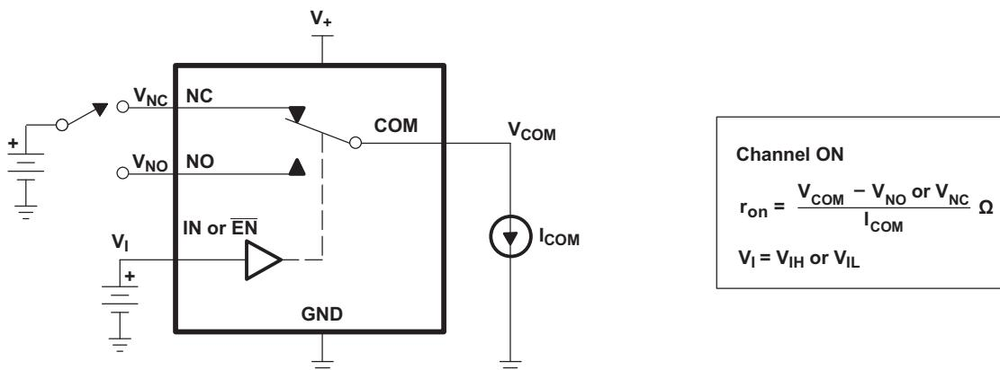

**Channel ON**

$$r_{on} = \frac{V_{COM} - V_{NO} \text{ or } V_{NC}}{I_{COM}} \Omega$$

$V_I = V_{IH} \text{ or } V_{IL}$

Figure 17: ON-State Resistance (ron) test circuit (description written from the drawing). The device is drawn as a box with V+ at the top and GND at the bottom (grounded). A grounded voltage source is connected through an external selector switch to the VNC terminal (NC pin); the VNO terminal (NO pin) is drawn open. A grounded source VI drives IN or EN (EN with an overbar) through a buffer, whose dashed control line goes to the internal switch, drawn connecting COM to NC. COM is the VCOM node, loaded by the current source ICOM to ground. The box on the right reads Channel ON, the ron equation and VI = VIH or VIL.

**Figure 17. ON-State Resistance ( $r_{on}$ )**

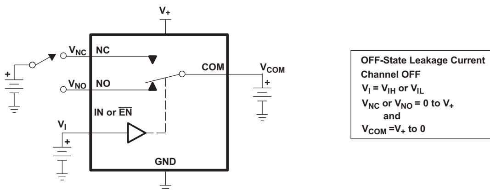

**OFF-State Leakage Current**  
**Channel OFF**  
 $V_I = V_{IH} \text{ or } V_{IL}$   
 $V_{NC} \text{ or } V_{NO} = 0 \text{ to } V_+$   
 and  
 $V_{COM} = V_+ \text{ to } 0$

Figure 18: OFF-State Leakage Current test circuit (description written from the drawing). Same arrangement as Figure 17: a grounded voltage source is connected through an external selector switch to the VNC terminal (NC pin), VNO is drawn open, VI drives IN or EN (EN with an overbar) through a buffer. The internal switch is drawn connecting COM to NO, so NC is the OFF channel. The VCOM node is driven by a second grounded voltage source (no current source). The box on the right reads OFF-State Leakage Current, Channel OFF, VI = VIH or VIL, VNC or VNO = 0 to V+ and VCOM = V+ to 0.

**Figure 18. OFF-State Leakage Current ( $I_{COM(OFF)}$ ,  $I_{NC(OFF)}$ ,  $I_{NO(OFF)}$ )**

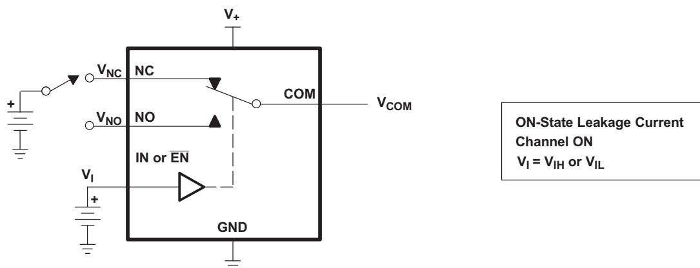

**ON-State Leakage Current**  
**Channel ON**  
 $V_I = V_{IH} \text{ or } V_{IL}$

Figure 19: ON-State Leakage Current test circuit (description written from the drawing). Same arrangement as Figure 17: a grounded voltage source is connected through an external selector switch to the VNC terminal (NC pin), VNO is drawn open, VI drives IN or EN (EN with an overbar) through a buffer, and the internal switch is drawn connecting COM to NC. The VCOM terminal is left open (no source or load). The box on the right reads ON-State Leakage Current, Channel ON, VI = VIH or VIL.

**Figure 19. ON-State Leakage Current ( $I_{COM(ON)}$ ,  $I_{NC(ON)}$ )**

{13}------------------------------------------------

### Parameter Measurement Information (continued)

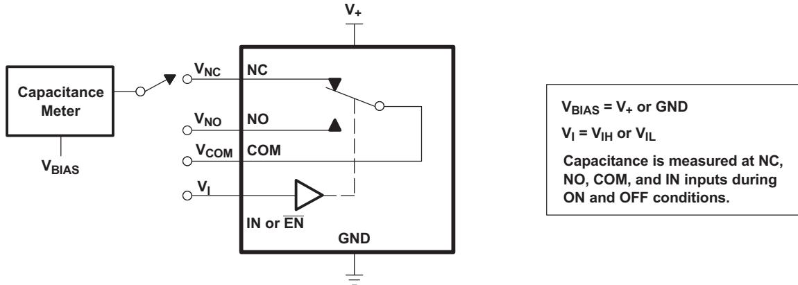

Figure 20: Capacitance test circuit (description written from the drawing). A Capacitance Meter, with its VBIAS terminal, is connected through an external selector switch to the VNC terminal (NC pin); the VNO (NO), VCOM (COM) and VI terminals are drawn as open circles. VI drives IN or EN (EN with an overbar) through a buffer whose dashed control line goes to the internal switch, drawn connecting COM to NC. V+ is at the top of the device and GND at the bottom (grounded). The box on the right reads VBIAS = V+ or GND, VI = VIH or VIL, and 'Capacitance is measured at NC, NO, COM, and IN inputs during ON and OFF conditions.'

**Figure 20. Capacitance ( $C_I$ ,  $C_{COM(OFF)}$ ,  $C_{COM(ON)}$ ,  $C_{NC(OFF)}$ ,  $C_{NC(ON)}$ )**

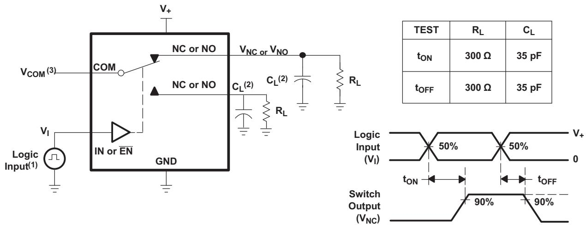

| TEST | RL    | CL    |
|------|-------|-------|
| tON  | 300 Ω | 35 pF |
| tOFF | 300 Ω | 35 pF |

Figure 21: Turnon and turnoff time test circuit (description written from the drawing). COM is driven by VCOM (3). Both NC or NO outputs are loaded to ground by CL (2) in parallel with RL; the output node of the switched channel is labeled VNC or VNO. A pulse generator (Logic Input (1)) supplies VI to IN or EN (EN with an overbar) through a buffer that controls the internal switch. V+ at the top, GND at the bottom. The table gives RL and CL for the tON and tOFF tests. Timing diagram: Logic Input (VI) switches between 0 and V+; tON is measured from the 50% point of the VI edge to the 90% point of the rising Switch Output (VNC), tOFF from the 50% point of the next VI edge to the 90% point of the falling output.

- (1) All input pulses are supplied by generators having the following characteristics: PRR ≤ 10 MHz,  $Z_O = 50\ \Omega$ ,  $t_r < 5\ ns$ ,  $t_f < 5\ ns$ .
- (2)  $C_L$  includes probe and jig capacitance.
- (3) See Electrical Characteristics for  $V_{COM}$ .

**Figure 21. Turnon ( $t_{ON}$ ) and Turnoff Time ( $t_{OFF}$ )**

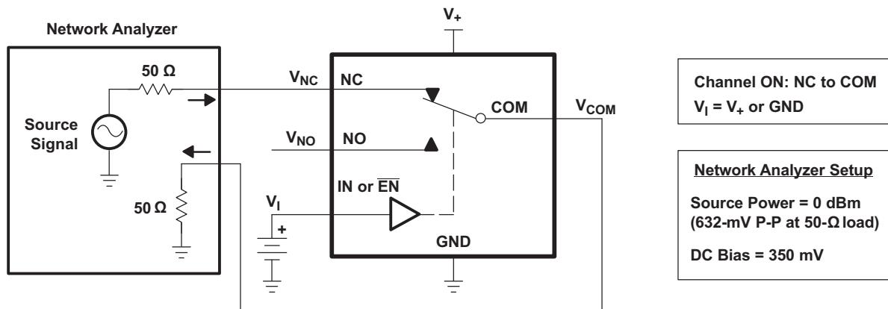

Figure 22: Bandwidth test circuit (description written from the drawing). Inside the Network Analyzer, the Source Signal drives the VNC terminal (NC pin) through a 50 Ω resistor; the VCOM terminal (COM) is wired back to the analyzer input, terminated by 50 Ω to ground. VNO (NO) is drawn open. A grounded DC source VI drives IN or EN (EN with an overbar) through a buffer; the internal switch is drawn connecting COM to NC. The boxes on the right read 'Channel ON: NC to COM, VI = V+ or GND' and 'Network Analyzer Setup: Source Power = 0 dBm (632-mV P-P at 50-Ω load), DC Bias = 350 mV'.

**Figure 22. Bandwidth (BW)**

{14}------------------------------------------------

### Parameter Measurement Information (continued)

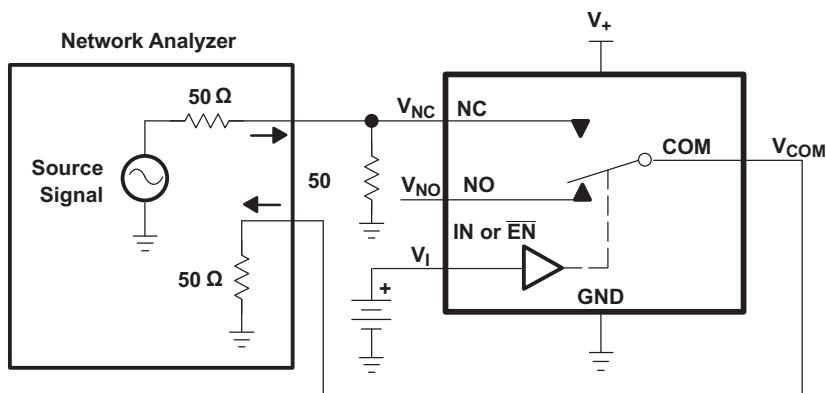

Figure 23: OFF Isolation (OISO) test circuit (description written from the drawing). Inside the Network Analyzer, the Source Signal drives the VNC terminal (NC pin) through a 50 Ω resistor; VNC is also terminated to ground by a resistor labeled '50' (no unit printed). The internal switch is drawn connecting COM to NO, so the NC channel is OFF; VNO (NO) is drawn open. The VCOM terminal (COM) is wired back to the analyzer input, terminated by 50 Ω to ground. A grounded DC source VI drives IN or EN (EN with an overbar) through a buffer. V+ at the top, GND at the bottom.

Channel OFF: NC to COM  
 $V_I = V_+ \text{ or GND}$

Network Analyzer Setup  
 Source Power = 0 dBm  
 (632-mV P-P at 50-Ω load)  
 DC Bias = 350 mV

**Figure 23. OFF Isolation ( $O_{ISO}$ )**

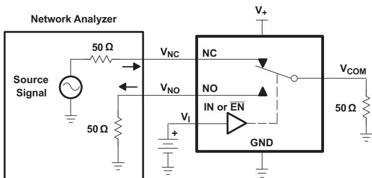

Figure 24: Crosstalk (XTALK) test circuit (description written from the drawing). Inside the Network Analyzer, the Source Signal drives the VNC terminal (NC pin) through a 50 Ω resistor, and the VNO terminal (NO pin) is wired to the analyzer input, terminated by 50 Ω to ground. The internal switch is drawn connecting COM to NC; the VCOM terminal (COM) is terminated by 50 Ω to ground. A grounded DC source VI drives IN or EN (EN with an overbar) through a buffer. V+ at the top, GND at the bottom.

Channel ON: NC to COM  
 Channel OFF: NO to COM  
 $V_I = V_+ \text{ or GND}$

Network Analyzer Setup  
 Source Power = 0 dBm  
 (632-mV P-P at 50-Ω load)  
 DC Bias = 350 mV

**Figure 24. Crosstalk ( $X_{TALK}$ )**

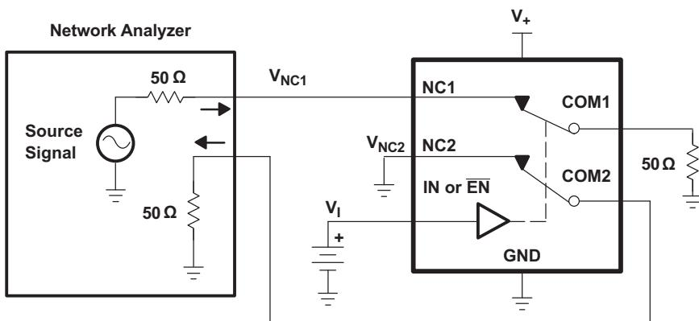

Figure 25: Crosstalk Adjacent test circuit (description written from the drawing). Inside the Network Analyzer, the Source Signal drives the VNC1 terminal (NC1 pin) through a 50 Ω resistor; the VNC2 terminal (NC2 pin) is grounded. Both internal switches are drawn connecting COM1 to NC1 and COM2 to NC2. COM1 is terminated by 50 Ω to ground and COM2 is wired back to the analyzer input, terminated by 50 Ω to ground. A grounded DC source VI drives IN or EN (EN with an overbar) through a buffer that controls both switches. V+ at the top, GND at the bottom.

Channel ON: NC to COM

Network Analyzer Setup  
 Source Power = 0 dBm  
 (632 mV P-P at 50 Ω load)  
 DC Bias = 350 mV

**Figure 25. Crosstalk Adjacent**

{15}------------------------------------------------

### Parameter Measurement Information (continued)

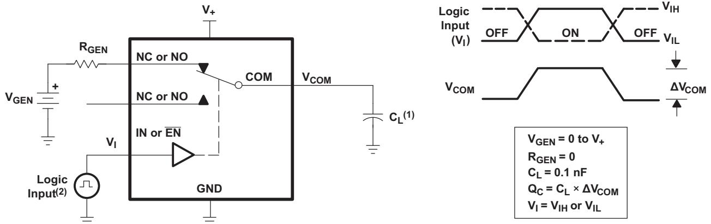

$V_{GEN} = 0 \text{ to } V_+$   
 $R_{GEN} = 0$   
 $C_L = 0.1 \text{ nF}$   
 $Q_C = C_L \times \Delta V_{COM}$   
 $V_I = V_{IH} \text{ or } V_{IL}$

Figure 26: Charge Injection (QC) test circuit and waveforms (description written from the drawing). A grounded source VGEN drives one NC or NO pin through RGEN; the other NC or NO pin is drawn with an unconnected lead. The internal switch is drawn connecting COM to the driven pin; the VCOM node is loaded by CL (1) to ground. A pulse generator (Logic Input (2)) supplies VI to IN or EN (EN with an overbar) through a buffer that controls the switch. V+ at the top, GND at the bottom. Waveforms: Logic Input (VI) goes OFF, ON, OFF between VIL and VIH (drawn solid and dashed for both polarities); VCOM steps up and back down, the step height being marked ΔVCOM.

- (1)  $C_L$  includes probe and jig capacitance.
- (2) All input pulses are supplied by generators having the following characteristics:  $PRR \leq 10 \text{ MHz}$ ,  $Z_O = 50 \Omega$ ,  $t_r < 5 \text{ ns}$ ,  $t_f < 5 \text{ ns}$ .

**Figure 26. Charge Injection ( $Q_C$ )**

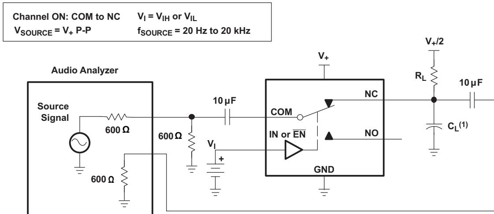

**Channel ON: COM to NC**      $V_I = V_{IH} \text{ or } V_{IL}$   
 $V_{SOURCE} = V_+ \text{ P-P}$       $f_{SOURCE} = 20 \text{ Hz to } 20 \text{ kHz}$

Figure 27: Total Harmonic Distortion (THD) test circuit (description written from the drawing). Inside the Audio Analyzer, the Source Signal drives a node through a 600 Ω resistor; the node is terminated by 600 Ω to ground and coupled through a 10 µF capacitor to COM. The internal switch is drawn connecting COM to NC; NO is drawn with an unconnected lead. The NC node is biased by RL to V+/2, loaded by CL (1) to ground and coupled through a second 10 µF capacitor back to the analyzer input, which is terminated by 600 Ω to ground. A grounded DC source VI drives IN or EN (EN with an overbar) through a buffer. V+ at the top, GND at the bottom.

- (1)  $C_L$  includes probe and jig capacitance.

**Figure 27. Total Harmonic Distortion (THD)**

{16}------------------------------------------------

## 8 Detailed Description

### 8.1 Overview

The TS3A5018 is a quad single-pole-double-throw (SPDT) solid-state analog switch. The TS3A5018, like all analog switches, is bidirectional. When powered on, each COM pin is connected to its respective NC pin. For this device, NC stands for *normally closed* and NO stands for *normally open*. The switch is enabled when  $\overline{\text{EN}}$  is low. If IN is also low, COM is connected to NC. If IN is high, COM is connected to NO.

The TS3A5018 is a break-before-make switch. This means that during switching, a connection is broken before a new connection is established. The NC and NO pins are never connected to each other.

### 8.2 Functional Block Diagram (Each Switch)

Functional block diagram of each switch (description written from the drawing; same drawing as the p1 Block Diagram). The EN input (printed with an overbar) goes through a buffer whose output enables two gate drivers. IN drives both: an inverting driver (output bubble) controls the gate of the switch between COM and NC, a non-inverting driver controls the gate of the switch between COM and NO. COM is connected to both switches; NC and NO are the two switched terminals.

### 8.3 Feature Description

The low ON-state resistance, ON-state resistance matching, and charge injection in the TS3A5018 make this switch an excellent choice for analog signals that require minimal distortion. In addition, the low THD allows audio signals to be preserved more clearly as they pass through the device.

The 1.8-V to 3.6-V operation allows compatibility with more logic levels, and the bidirectional I/Os can pass analog signals from 0 V to  $V_+$  with low distortion.

### 8.4 Device Functional Modes

**Table 1. Function Table**

| $\overline{\text{EN}}$ | IN | NO TO COM, COM TO NO | NC TO COM, COM TO NC |
|------------------------|----|-------------------------|-------------------------|
| L                      | L  | OFF                     | ON                      |
| L                      | H  | ON                      | OFF                     |
| H                      | X  | OFF                     | OFF                     |

{17}------------------------------------------------

## 9 Application and Implementation

#### NOTE

Information in the following applications sections is not part of the TI component specification, and TI does not warrant its accuracy or completeness. TI's customers are responsible for determining suitability of components for their purposes. Customers should validate and test their design implementation to confirm system functionality.

### 9.1 Application Information

The TS3A5018 can be used in a variety of customer systems. The TS3A5018 can be used anywhere multiple analog or digital signals must be selected to pass across a single line.

### 9.2 Typical Application

![Figure 28. System Schematic for TS3A5018 (description written from the drawing). A 1.8 V supply connects to V+ with a decoupling capacitor to ground; GND is grounded. A block labeled 'C or System Logic' (as printed) drives EN (with an overbar) and IN; each of these two lines has a pulldown resistor to ground. COM1 to COM4 are wired to the logic block (bidirectional arrow, dots for the channels in between). NO1/NC1 and NO4/NC4 (dots for the channels in between) are wired to the right, labeled 'To/From System' with bidirectional arrows.](img/124c6108c63173818afb8ed49521e22d_img.jpg)

Figure 28. System Schematic for TS3A5018 (description written from the drawing). A 1.8 V supply connects to V+ with a decoupling capacitor to ground; GND is grounded. A block labeled 'C or System Logic' (as printed) drives EN (with an overbar) and IN; each of these two lines has a pulldown resistor to ground. COM1 to COM4 are wired to the logic block (bidirectional arrow, dots for the channels in between). NO1/NC1 and NO4/NC4 (dots for the channels in between) are wired to the right, labeled 'To/From System' with bidirectional arrows.

**Figure 28. System Schematic for TS3A5018**

#### 9.2.1 Design Requirements

In this particular application,  $V_+$  was 1.8 V, although  $V_+$  is allowed to be any voltage specified in [Recommended Operating Conditions](#). A decoupling capacitor is recommended on the V+ pin. See [Power Supply Recommendations](#) for more details.

#### 9.2.2 Detailed Design Procedure

In this application,  $\overline{EN}$  and IN are, by default, pulled low to GND. Choose these resistor sizes based on the current driving strength of the GPIO, the desired power consumption, and the switching frequency (if applicable). If the GPIO is open-drain, use pullup resistors instead.

#### 9.2.3 Application Curve

Figure 29. Gain vs Frequency Bandwidth (V+ = 1.8 V). Gain - dB versus f - Frequency - MHz on a logarithmic axis from 1 to 1000, one black curve. The gain is flat slightly below 0 dB at low frequency, starts to roll off below 100 MHz, shows a shoulder, then falls steeply to a deep notch near the high-frequency end, with a partial recovery peak after it. Read values from the image/PDF.

**Figure 29. Gain vs Frequency Bandwidth ( $V_+ = 1.8\text{ V}$ )**

{18}------------------------------------------------

## 10 Power Supply Recommendations

The power supply can be any voltage between the minimum and maximum supply voltage rating located in the [Recommended Operating Conditions](#).

Each  $V_{CC}$  terminal should have a good bypass capacitor to prevent power disturbance. For devices with a single supply, a 0.1- $\mu$ F bypass capacitor is recommended. If there are multiple pins labeled  $V_{CC}$ , then a 0.01- $\mu$ F or 0.022- $\mu$ F capacitor is recommended for each  $V_{CC}$  because the VCC pins will be tied together internally. For devices with dual supply pins operating at different voltages, for example  $V_{CC}$  and  $V_{DD}$ , a 0.1- $\mu$ F bypass capacitor is recommended for each supply pin. It is acceptable to parallel multiple bypass capacitors to reject different frequencies of noise. 0.1- $\mu$ F and 1- $\mu$ F capacitors are commonly used in parallel. The bypass capacitor should be installed as close to the power terminal as possible for best results.

## 11 Layout

### 11.1 Layout Guidelines

Reflections and matching are closely related to loop antenna theory, but different enough to warrant their own discussion. When a PCB trace turns a corner at a 90° angle, a reflection can occur. This is primarily due to the change of width of the trace. At the apex of the turn, the trace width is increased to 1.414 times its width. This upsets the transmission line characteristics, especially the distributed capacitance and self–inductance of the trace — resulting in the reflection. It is a given that not all PCB traces can be straight, and so they will have to turn corners. [Figure 30](#) shows progressively better techniques of rounding corners. Only the last example maintains constant trace width and minimizes reflections.

Unused switch I/Os, such as NO, NC, and COM, can be left floating or tied to GND. However, the IN and  $\overline{EN}$  pins must be driven high or low. Due to partial transistor turnon when control inputs are at threshold levels, floating control inputs can cause increased  $I_{CC}$  or unknown switch selection states.

### 11.2 Layout Example

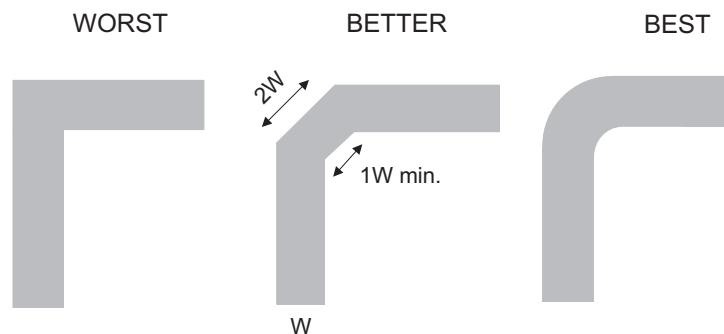

Figure 30: Trace Example (description written from the drawing). Three 90° trace corners labeled WORST, BETTER and BEST. WORST: a sharp right-angle corner. BETTER: the outer corner is cut at 45°; the trace width is marked W, the 45° cut 2W and the inner chamfer '1W min.'. BEST: a rounded corner that keeps the trace width constant.

**Figure 30. Trace Example**

{19}------------------------------------------------

## 12 Device and Documentation Support

### 12.1 Device Support

#### 12.1.1 Device Nomenclature

**Table 2. Parameter Description**

| SYMBOL           | DESCRIPTION                                                                                                                                                                                                                                                                                                                                                                                 |
|------------------|---------------------------------------------------------------------------------------------------------------------------------------------------------------------------------------------------------------------------------------------------------------------------------------------------------------------------------------------------------------------------------------------|
| $V_{COM}$        | Voltage at COM                                                                                                                                                                                                                                                                                                                                                                              |
| $V_{NC}$         | Voltage at NC                                                                                                                                                                                                                                                                                                                                                                               |
| $V_{NO}$         | Voltage at NO                                                                                                                                                                                                                                                                                                                                                                               |
| $r_{on}$         | Resistance between COM and NC or NO ports when the channel is ON                                                                                                                                                                                                                                                                                                                            |
| $\Delta r_{on}$  | Difference of $r_{on}$ between channels in a specific device                                                                                                                                                                                                                                                                                                                                |
| $r_{on(flat)}$   | Difference between the maximum and minimum value of $r_{on}$ in a channel over the specified range of conditions                                                                                                                                                                                                                                                                            |
| $I_{NC(OFF)}$    | Leakage current measured at the NC port, with the corresponding channel (NC to COM) in the OFF state                                                                                                                                                                                                                                                                                        |
| $I_{NC(ON)}$     | Leakage current measured at the NC port, with the corresponding channel (NC to COM) in the ON state and the output (COM) open                                                                                                                                                                                                                                                               |
| $I_{NO(OFF)}$    | Leakage current measured at the NO port, with the corresponding channel (NO to COM) in the OFF state                                                                                                                                                                                                                                                                                        |
| $I_{NO(ON)}$     | Leakage current measured at the NO port, with the corresponding channel (NO to COM) in the ON state and the output (COM) open                                                                                                                                                                                                                                                               |
| $I_{COM(OFF)}$   | Leakage current measured at the COM port, with the corresponding channel (COM to NC or NO) in the OFF state                                                                                                                                                                                                                                                                                 |
| $I_{COM(ON)}$    | Leakage current measured at the COM port, with the corresponding channel (COM to NC or NO) in the ON state and the output (NC or NO) open                                                                                                                                                                                                                                                   |
| $V_{IH}$         | Minimum input voltage for logic high for the control input (IN, $\overline{EN}$ )                                                                                                                                                                                                                                                                                                           |
| $V_{IL}$         | Maximum input voltage for logic low for the control input (IN, $\overline{EN}$ )                                                                                                                                                                                                                                                                                                            |
| $V_I$            | Voltage at the control input (IN, $\overline{EN}$ )                                                                                                                                                                                                                                                                                                                                         |
| $I_{IH}, I_{IL}$ | Leakage current measured at the control input (IN, $\overline{EN}$ )                                                                                                                                                                                                                                                                                                                        |
| $t_{ON}$         | Turnon time for the switch. This parameter is measured under the specified range of conditions and by the propagation delay between the digital control (IN) signal and analog output NC or NO) signal when the switch is turning ON.                                                                                                                                                       |
| $t_{OFF}$        | Turnoff time for the switch. This parameter is measured under the specified range of conditions and by the propagation delay between the digital control (IN) signal and analog output (NC or NO) signal when the switch is turning OFF.                                                                                                                                                    |
| $Q_C$            | Charge injection is a measurement of unwanted signal coupling from the control (IN) input to the analog (NC or NO) output. This is measured in coulomb (C) and measured by the total charge induced due to switching of the control input. Charge injection, $Q_C = C_L \times \Delta V_{COM}$ , $C_L$ is the load capacitance and $\Delta V_{COM}$ is the change in analog output voltage. |
| $C_{NC(OFF)}$    | Capacitance at the NC port when the corresponding channel (NC to COM) is OFF                                                                                                                                                                                                                                                                                                                |
| $C_{NC(ON)}$     | Capacitance at the NC port when the corresponding channel (NC to COM) is ON                                                                                                                                                                                                                                                                                                                 |
| $C_{NO(OFF)}$    | Capacitance at the NC port when the corresponding channel (NO to COM) is OFF                                                                                                                                                                                                                                                                                                                |
| $C_{NO(ON)}$     | Capacitance at the NC port when the corresponding channel (NO to COM) is ON                                                                                                                                                                                                                                                                                                                 |
| $C_{COM(OFF)}$   | Capacitance at the COM port when the corresponding channel (COM to NC) is OFF                                                                                                                                                                                                                                                                                                               |
| $C_{COM(ON)}$    | Capacitance at the COM port when the corresponding channel (COM to NC) is ON                                                                                                                                                                                                                                                                                                                |
| $C_I$            | Capacitance of control input (IN, $\overline{EN}$ )                                                                                                                                                                                                                                                                                                                                         |
| $O_{ISO}$        | OFF isolation of the switch is a measurement of OFF-state switch impedance. This is measured in dB in a specific frequency, with the corresponding channel (NC to COM) in the OFF state.                                                                                                                                                                                                    |
| $X_{TALK}$       | Crosstalk is a measurement of unwanted signal coupling from an ON channel to an OFF channel (NC1 to NO1). Adjacent crosstalk is a measure of unwanted signal coupling from an ON channel to an adjacent ON channel (NC1 to NC2) .This is measured in a specific frequency and in dB.                                                                                                        |
| BW               | Bandwidth of the switch. This is the frequency in which the gain of an ON channel is –3 dB below the DC gain.                                                                                                                                                                                                                                                                               |
| THD              | Total harmonic distortion describes the signal distortion caused by the analog switch. This is defined as the ratio of root mean square (RMS) value of the second, third, and higher harmonic to the absolute magnitude of the fundamental harmonic.                                                                                                                                        |
| $I_+$            | Static power-supply current with the control (IN) pin at $V_+$ or GND                                                                                                                                                                                                                                                                                                                       |

{20}------------------------------------------------

### 12.2 Documentation Support

#### 12.2.1 Related Documentation

For related documentation, see the following:

- *Implications of Slow or Floating CMOS Inputs*, [SCBA004](#)

### 12.3 Receiving Notification of Documentation Updates

To receive notification of documentation updates, navigate to the device product folder on ti.com. In the upper right corner, click on *Alert me* to register and receive a weekly digest of any product information that has changed. For change details, review the revision history included in any revised document.

### 12.4 Community Resources

The following links connect to TI community resources. Linked contents are provided "AS IS" by the respective contributors. They do not constitute TI specifications and do not necessarily reflect TI's views; see TI's [Terms of Use](#).

**TI E2E™ Online Community** *TI's Engineer-to-Engineer (E2E) Community.* Created to foster collaboration among engineers. At e2e.ti.com, you can ask questions, share knowledge, explore ideas and help solve problems with fellow engineers.

**Design Support** *TI's Design Support* Quickly find helpful E2E forums along with design support tools and contact information for technical support.

### 12.5 Trademarks

E2E is a trademark of Texas Instruments.

All other trademarks are the property of their respective owners.

### 12.6 Electrostatic Discharge Caution

Electrostatic Discharge Caution icon: a triangle with a hand inside, indicating a warning about ESD damage.

These devices have limited built-in ESD protection. The leads should be shorted together or the device placed in conductive foam during storage or handling to prevent electrostatic damage to the MOS gates.

### 12.7 Glossary

[SLYZ022](#) — *TI Glossary*.

This glossary lists and explains terms, acronyms, and definitions.

## 13 Mechanical, Packaging, and Orderable Information

The following pages include mechanical, packaging, and orderable information. This information is the most current data available for the designated devices. This data is subject to change without notice and revision of this document. For browser-based versions of this data sheet, refer to the left-hand navigation.

{21}------------------------------------------------

### PACKAGING INFORMATION

| Orderable part number        | Status (1) | Material type (2) | Package   Pins   | Package qty   Carrier | RoHS (3) | Lead finish/ Ball material (4) | MSL rating/ Peak reflow (5) | Op temp (°C) | Part marking (6) |
|------------------------------|---------------|----------------------|------------------|-----------------------|-------------|--------------------------------------|-----------------------------------|--------------|---------------------|
| <a href="#">TS3A5018D</a>    | Obsolete      | Production           | SOIC (D)   16    | -                     | -           | Call TI                              | Call TI                           | -40 to 85    | TS3A5018            |
| <a href="#">TS3A5018DBQR</a> | Active        | Production           | SSOP (DBQ)   16  | 2500   LARGE T&R      | Yes         | NIPDAU                               | Level-2-260C-1 YEAR               | -40 to 85    | YA018               |
| TS3A5018DBQR.B               | Active        | Production           | SSOP (DBQ)   16  | 2500   LARGE T&R      | Yes         | NIPDAU                               | Level-2-260C-1 YEAR               | -40 to 85    | YA018               |
| <a href="#">TS3A5018DGVR</a> | Active        | Production           | TVSOP (DGV)   16 | 2000   LARGE T&R      | Yes         | NIPDAU                               | Level-1-260C-UNLIM                | -40 to 85    | YA018               |
| TS3A5018DGVR.B               | Active        | Production           | TVSOP (DGV)   16 | 2000   LARGE T&R      | Yes         | NIPDAU                               | Level-1-260C-UNLIM                | -40 to 85    | YA018               |
| TS3A5018DGVRG4               | Active        | Production           | TVSOP (DGV)   16 | 2000   LARGE T&R      | Yes         | NIPDAU                               | Level-1-260C-UNLIM                | -40 to 85    | YA018               |
| TS3A5018DGVRG4.B             | Active        | Production           | TVSOP (DGV)   16 | 2000   LARGE T&R      | Yes         | NIPDAU                               | Level-1-260C-UNLIM                | -40 to 85    | YA018               |
| <a href="#">TS3A5018DR</a>   | Active        | Production           | SOIC (D)   16    | 2500   LARGE T&R      | Yes         | NIPDAU                               | Level-1-260C-UNLIM                | -40 to 85    | TS3A5018            |
| TS3A5018DR.B                 | Active        | Production           | SOIC (D)   16    | 2500   LARGE T&R      | Yes         | NIPDAU                               | Level-1-260C-UNLIM                | -40 to 85    | TS3A5018            |
| TS3A5018DRG4                 | Active        | Production           | SOIC (D)   16    | 2500   LARGE T&R      | Yes         | NIPDAU                               | Level-1-260C-UNLIM                | -40 to 85    | TS3A5018            |
| TS3A5018DRG4.B               | Active        | Production           | SOIC (D)   16    | 2500   LARGE T&R      | Yes         | NIPDAU                               | Level-1-260C-UNLIM                | -40 to 85    | TS3A5018            |
| <a href="#">TS3A5018PW</a>   | Obsolete      | Production           | TSSOP (PW)   16  | -                     | -           | Call TI                              | Call TI                           | -40 to 85    | YA018               |
| <a href="#">TS3A5018PWR</a>  | Active        | Production           | TSSOP (PW)   16  | 2000   LARGE T&R      | Yes         | NIPDAU   SN                          | Level-1-260C-UNLIM                | -40 to 85    | YA018               |
| TS3A5018PWR.B                | Active        | Production           | TSSOP (PW)   16  | 2000   LARGE T&R      | Yes         | NIPDAU                               | Level-1-260C-UNLIM                | -40 to 85    | YA018               |
| <a href="#">TS3A5018RGYR</a> | Active        | Production           | VQFN (RGY)   16  | 3000   LARGE T&R      | Yes         | NIPDAU                               | Level-2-260C-1 YEAR               | -40 to 85    | YA018               |
| TS3A5018RGYR.B               | Active        | Production           | VQFN (RGY)   16  | 3000   LARGE T&R      | Yes         | NIPDAU                               | Level-2-260C-1 YEAR               | -40 to 85    | YA018               |
| TS3A5018RGYRG4               | Active        | Production           | VQFN (RGY)   16  | 3000   LARGE T&R      | Yes         | NIPDAU                               | Level-2-260C-1 YEAR               | -40 to 85    | YA018               |
| TS3A5018RGYRG4.B             | Active        | Production           | VQFN (RGY)   16  | 3000   LARGE T&R      | Yes         | NIPDAU                               | Level-2-260C-1 YEAR               | -40 to 85    | YA018               |
| <a href="#">TS3A5018RSVR</a> | Active        | Production           | UQFN (RSV)   16  | 3000   LARGE T&R      | Yes         | NIPDAU   NIPDAUAG                    | Level-1-260C-UNLIM                | -40 to 85    | ZUN                 |
| TS3A5018RSVR.B               | Active        | Production           | UQFN (RSV)   16  | 3000   LARGE T&R      | Yes         | NIPDAU                               | Level-1-260C-UNLIM                | -40 to 85    | ZUN                 |

(1) **Status:** For more details on status, see our [product life cycle](#).

(2) **Material type:** When designated, preproduction parts are prototypes/experimental devices, and are not yet approved or released for full production. Testing and final process, including without limitation quality assurance, reliability performance testing, and/or process qualification, may not yet be complete, and this item is subject to further changes or possible discontinuation. If available for ordering, purchases will be subject to an additional waiver at checkout, and are intended for early internal evaluation purposes only. These items are sold without warranties of any kind.

(3) **RoHS values:** Yes, No, RoHS Exempt. See the [TI RoHS Statement](#) for additional information and value definition.

{22}------------------------------------------------

(4) **Lead finish/Ball material:** Parts may have multiple material finish options. Finish options are separated by a vertical ruled line. Lead finish/Ball material values may wrap to two lines if the finish value exceeds the maximum column width.

(5) **MSL rating/Peak reflow:** The moisture sensitivity level ratings and peak solder (reflow) temperatures. In the event that a part has multiple moisture sensitivity ratings, only the lowest level per JEDEC standards is shown. Refer to the shipping label for the actual reflow temperature that will be used to mount the part to the printed circuit board.

(6) **Part marking:** There may be an additional marking, which relates to the logo, the lot trace code information, or the environmental category of the part.

Multiple part markings will be inside parentheses. Only one part marking contained in parentheses and separated by a "~" will appear on a part. If a line is indented then it is a continuation of the previous line and the two combined represent the entire part marking for that device.

**Important Information and Disclaimer:** The information provided on this page represents TI's knowledge and belief as of the date that it is provided. TI bases its knowledge and belief on information provided by third parties, and makes no representation or warranty as to the accuracy of such information. Efforts are underway to better integrate information from third parties. TI has taken and continues to take reasonable steps to provide representative and accurate information but may not have conducted destructive testing or chemical analysis on incoming materials and chemicals. TI and TI suppliers consider certain information to be proprietary, and thus CAS numbers and other limited information may not be available for release.

In no event shall TI's liability arising out of such information exceed the total purchase price of the TI part(s) at issue in this document sold by TI to Customer on an annual basis.

{23}------------------------------------------------

### TAPE AND REEL INFORMATION

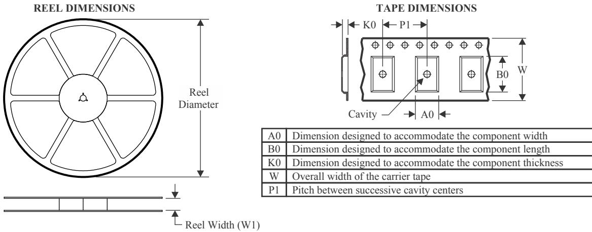

**REEL DIMENSIONS**

Reel Diameter

Reel Width (W1)

**TAPE DIMENSIONS**

K0, P1, A0, B0, W, Cavity

|    |                                                           |
|----|-----------------------------------------------------------|
| A0 | Dimension designed to accommodate the component width     |
| B0 | Dimension designed to accommodate the component length    |
| K0 | Dimension designed to accommodate the component thickness |
| W  | Overall width of the carrier tape                         |
| P1 | Pitch between successive cavity centers                   |

Diagrams of Reel and Tape Dimensions with a table of definitions.

#### QUADRANT ASSIGNMENTS FOR PIN 1 ORIENTATION IN TAPE

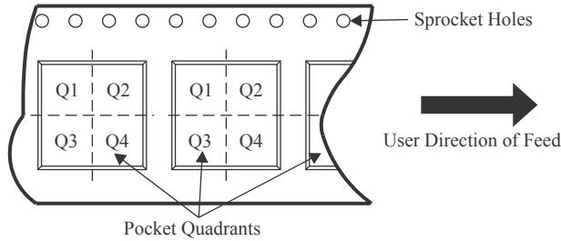

Sprocket Holes

Q1, Q2, Q3, Q4

Pocket Quadrants

User Direction of Feed

Diagram of pocket quadrants (Q1-Q4) and sprocket holes with user direction of feed arrow.

\*All dimensions are nominal

| Device         | Package Type | Package Drawing | Pins | SPQ  | Reel Diameter (mm) | Reel Width W1 (mm) | A0 (mm) | B0 (mm) | K0 (mm) | P1 (mm) | W (mm) | Pin1 Quadrant |
|----------------|--------------|-----------------|------|------|--------------------|--------------------|---------|---------|---------|---------|--------|---------------|
| TS3A5018DBQR   | SSOP         | DBQ             | 16   | 2500 | 330.0              | 12.5               | 6.4     | 5.2     | 2.1     | 8.0     | 12.0   | Q1            |
| TS3A5018DGVR   | TVSOP        | DGV             | 16   | 2000 | 330.0              | 12.4               | 6.8     | 4.0     | 1.6     | 8.0     | 12.0   | Q1            |
| TS3A5018DGVRG4 | TVSOP        | DGV             | 16   | 2000 | 330.0              | 12.4               | 6.8     | 4.0     | 1.6     | 8.0     | 12.0   | Q1            |
| TS3A5018DR     | SOIC         | D               | 16   | 2500 | 330.0              | 16.4               | 6.5     | 10.3    | 2.1     | 8.0     | 16.0   | Q1            |
| TS3A5018DRG4   | SOIC         | D               | 16   | 2500 | 330.0              | 16.4               | 6.5     | 10.3    | 2.1     | 8.0     | 16.0   | Q1            |
| TS3A5018PWR    | TSSOP        | PW              | 16   | 2000 | 330.0              | 12.4               | 6.9     | 5.6     | 1.6     | 8.0     | 12.0   | Q1            |
| TS3A5018PWR    | TSSOP        | PW              | 16   | 2000 | 330.0              | 12.4               | 6.9     | 5.6     | 1.6     | 8.0     | 12.0   | Q1            |
| TS3A5018RGYR   | VQFN         | RGY             | 16   | 3000 | 330.0              | 12.4               | 3.8     | 4.3     | 1.5     | 8.0     | 12.0   | Q1            |
| TS3A5018RGYRG4 | VQFN         | RGY             | 16   | 3000 | 330.0              | 12.4               | 3.8     | 4.3     | 1.5     | 8.0     | 12.0   | Q1            |
| TS3A5018RSVR   | UQFN         | RSV             | 16   | 3000 | 180.0              | 13.2               | 2.1     | 2.9     | 0.75    | 4.0     | 12.0   | Q1            |

{24}------------------------------------------------

#### TAPE AND REEL BOX DIMENSIONS

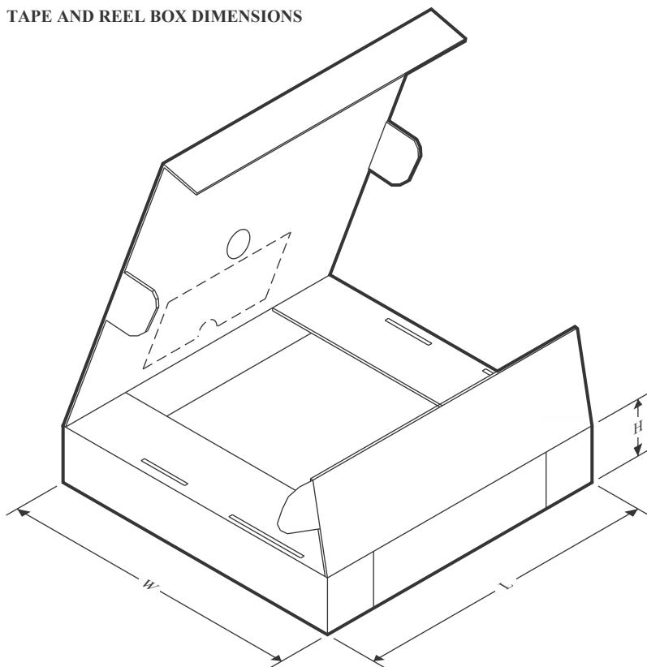

Isometric line drawing of an open tape and reel box. The box is rectangular with a hinged lid. Dimension lines indicate the length (L), width (W), and height (H) of the box.

\*All dimensions are nominal

| Device         | Package Type | Package Drawing | Pins | SPQ  | Length (mm) | Width (mm) | Height (mm) |
|----------------|--------------|-----------------|------|------|-------------|------------|-------------|
| TS3A5018DBQR   | SSOP         | DBQ             | 16   | 2500 | 353.0       | 353.0      | 32.0        |
| TS3A5018DGVR   | TVSOP        | DGV             | 16   | 2000 | 353.0       | 353.0      | 32.0        |
| TS3A5018DGVRG4 | TVSOP        | DGV             | 16   | 2000 | 353.0       | 353.0      | 32.0        |
| TS3A5018DR     | SOIC         | D               | 16   | 2500 | 353.0       | 353.0      | 32.0        |
| TS3A5018DRG4   | SOIC         | D               | 16   | 2500 | 353.0       | 353.0      | 32.0        |
| TS3A5018PWR    | TSSOP        | PW              | 16   | 2000 | 356.0       | 356.0      | 35.0        |
| TS3A5018PWR    | TSSOP        | PW              | 16   | 2000 | 353.0       | 353.0      | 32.0        |
| TS3A5018RGYR   | VQFN         | RGY             | 16   | 3000 | 353.0       | 353.0      | 32.0        |
| TS3A5018RGYRG4 | VQFN         | RGY             | 16   | 3000 | 353.0       | 353.0      | 32.0        |
| TS3A5018RSVR   | UQFN         | RSV             | 16   | 3000 | 184.0       | 184.0      | 19.0        |

{25}------------------------------------------------

D (R-PDSO-G16)

PLASTIC SMALL OUTLINE

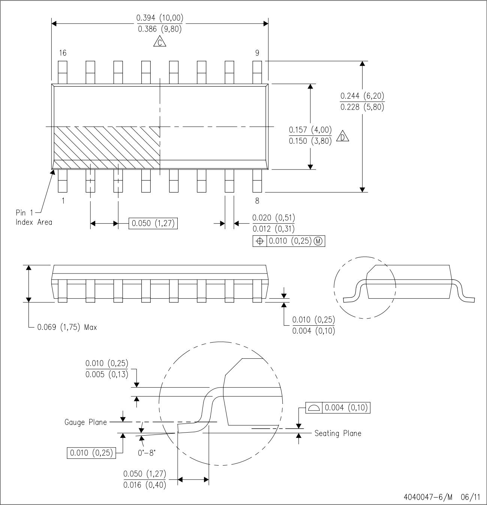

The figure shows the D (R-PDSO-G16) package outline (description written from the drawing; all dimensions in inches, millimeters in parentheses).

**Top View:** 16 leads, pins 1-8 along the bottom (pin 1 at the left, next to the Pin 1 Index Area) and 9-16 along the top (16 at the left). Body length 0.394 (10,00) / 0.386 (9,80), flagged with note C. Width across the leads 0.244 (6,20) / 0.228 (5,80). Body width 0.157 (4,00) / 0.150 (3,80), flagged with note D. Lead pitch 0.050 (1,27) (boxed basic dimension). Lead width 0.020 (0,51) / 0.012 (0,31), with a position tolerance frame 0.010 (0,25) at maximum material condition (M).

**Side View:** Package height 0.069 (1,75) Max; standoff 0.010 (0,25) / 0.004 (0,10).

**Detail View (circled lead):** Lead thickness 0.010 (0,25) / 0.005 (0,13). Gauge Plane 0.010 (0,25) (boxed) above the Seating Plane. Lead angle 0°–8°. Foot length 0.050 (1,27) / 0.016 (0,40). Coplanarity 0.004 (0,10) to the Seating Plane.

4040047-6/M 06/11

Mechanical drawing of a D (R-PDSO-G16) Plastic Small Outline package showing top, side, and detail views with dimensions in inches and millimeters.

- NOTES:
- A. All linear dimensions are in inches (millimeters).
- B. This drawing is subject to change without notice.
- C. Body length does not include mold flash, protrusions, or gate burrs. Mold flash, protrusions, or gate burrs shall not exceed 0.006 (0,15) each side.
- D. Body width does not include interlead flash. Interlead flash shall not exceed 0.017 (0,43) each side.
- E. Reference JEDEC MS-012 variation AC.

{26}------------------------------------------------

#### GENERIC PACKAGE VIEW

**RSV 16**

**UQFN - 0.55 mm max height**

1.8 x 2.6, 0.4 mm pitch

ULTRA THIN QUAD FLATPACK - NO LEAD

This image is a representation of the package family, actual package may vary.  
Refer to the product data sheet for package details.

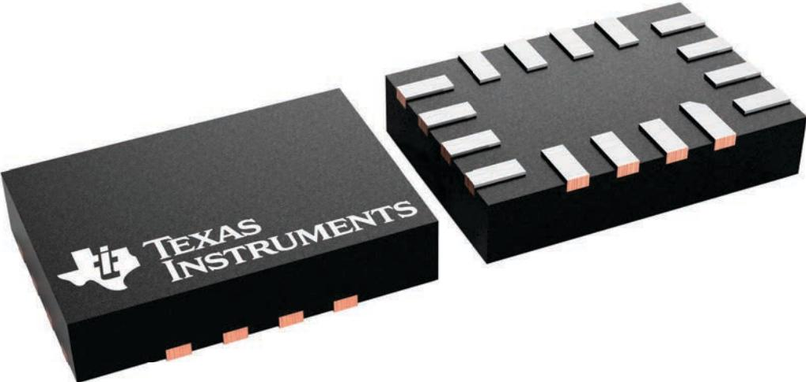

Rendered images of the RSV 16 UQFN package: on the left the top side, black with the Texas Instruments logo and name in white, small copper-colored lead ends visible along the edge; on the right the bottom side, showing the 16 silver-colored pads with copper-colored ends at the package edges, one corner pad having a chamfered end.

4231225/A

{27}------------------------------------------------

# RSV0016A

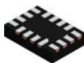

3D rendering of UQFN 16-pin package

#### PACKAGE OUTLINE

### UQFN - 0.55 mm max height

ULTRA THIN QUAD FLATPACK - NO LEAD

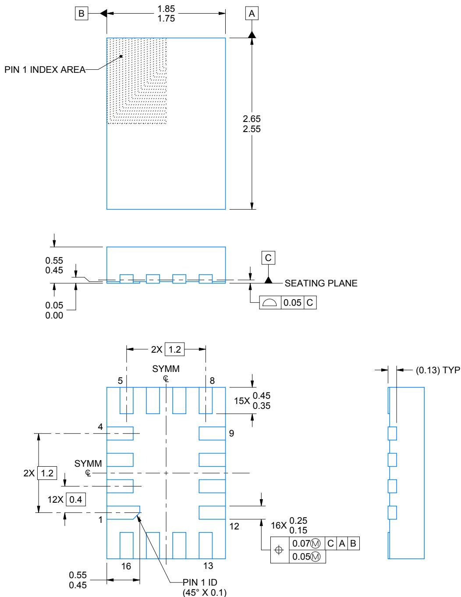

RSV0016A package outline (description written from the drawing; dimensions in mm). Top view: body 1.85 / 1.75 wide (datum B) and 2.65 / 2.55 long (datum A), PIN 1 INDEX AREA in the upper-left corner. Side view: height 0.55 / 0.45, standoff 0.05 / 0.00, coplanarity 0.05 C to the SEATING PLANE (datum C). Bottom view: pads 1-4 on the left side (1 at the bottom), 5-8 along the top, 9-12 on the right side, 13-16 along the bottom; SYMM centerlines in both directions. 2X 1.2 (boxed) between the outer pad centerlines on each side, 12X 0.4 (boxed) pitch. 15X 0.45 / 0.35 pad length, 0.55 / 0.45 for pad 1, which carries the PIN 1 ID (45° X 0.1) chamfer. 16X 0.25 / 0.15 pad width with position tolerances 0.07 Ⓜ C A B and 0.05 Ⓜ. Side profile at the right: (0.13) TYP.

4220314/C 02/2020

##### NOTES:

1. All linear dimensions are in millimeters. Any dimensions in parenthesis are for reference only. Dimensioning and tolerancing per ASME Y14.5M.
2. This drawing is subject to change without notice.

{28}------------------------------------------------

### EXAMPLE BOARD LAYOUT

RSV0016A

UQFN - 0.55 mm max height

ULTRA THIN QUAD FLATPACK - NO LEAD

![LAND PATTERN EXAMPLE for the RSV0016A UQFN (description written from the drawing; dimensions in mm, for reference). Sixteen rounded-rectangle pads around the edge, no center pad: pads 1-4 on the left (1 at the top), 5-8 along the bottom (5 at the left), 9-12 on the right (9 at the bottom) and 13-16 along the top (16 at the left). Pad 1 is longer, (0.7); the other pads are 15X (0.6) long; all are 16X (0.2) wide with (R0.05) TYP corners; pitch 12X (0.4). (1.6) between the left and right pad centerlines, (2.4) between the top and bottom pad centerlines. SYMM centerlines in both directions; 'SEE SOLDER MASK DETAIL' points to pad 13.](img/474a819357587e34949a3e110ff19b30_img.jpg)

LAND PATTERN EXAMPLE for the RSV0016A UQFN (description written from the drawing; dimensions in mm, for reference). Sixteen rounded-rectangle pads around the edge, no center pad: pads 1-4 on the left (1 at the top), 5-8 along the bottom (5 at the left), 9-12 on the right (9 at the bottom) and 13-16 along the top (16 at the left). Pad 1 is longer, (0.7); the other pads are 15X (0.6) long; all are 16X (0.2) wide with (R0.05) TYP corners; pitch 12X (0.4). (1.6) between the left and right pad centerlines, (2.4) between the top and bottom pad centerlines. SYMM centerlines in both directions; 'SEE SOLDER MASK DETAIL' points to pad 13.

LAND PATTERN EXAMPLE  
EXPOSED METAL SHOWN  
SCALE: 25X

SOLDER MASK DETAILS (description written from the drawing): two top views of a single pad. NON SOLDER MASK DEFINED (PREFERRED): the solder mask opening (outer outline) surrounds the metal pad with 0.05 MAX ALL AROUND; labels EXPOSED METAL, METAL EDGE, SOLDER MASK OPENING. SOLDER MASK DEFINED: the metal (dashed outline) extends under the mask beyond the solder mask opening by 0.05 MIN ALL AROUND; labels EXPOSED METAL, METAL UNDER SOLDER MASK, SOLDER MASK OPENING.

SOLDER MASK DETAILS

4220314/C 02/2020

NOTES: (continued)

3. For more information, see Texas Instruments literature number SLUA271 ([www.ti.com/lit/slua271](http://www.ti.com/lit/slua271)).

{29}------------------------------------------------

### EXAMPLE STENCIL DESIGN

RSV0016A

UQFN - 0.55 mm max height

ULTRA THIN QUAD FLATPACK - NO LEAD

![SOLDER PASTE EXAMPLE for the RSV0016A UQFN (description written from the drawing; dimensions in mm, for reference). Sixteen rounded-rectangle apertures, one per pad, in the same perimeter arrangement as the land pattern: 1-4 on the left (1 at the top), 5-8 along the bottom, 9-12 on the right, 13-16 along the top (16 at the left). Aperture 1 is (0.7) long, the others 15X (0.6); all 16X (0.2) wide with (R0.05) TYP corners; pitch 12X (0.4); (1.6) between the left and right aperture centerlines and (2.4) between the top and bottom aperture centerlines. SYMM centerlines in both directions.](img/744acfe8d4e31bcf03f95714c2f6e567_img.jpg)

SOLDER PASTE EXAMPLE for the RSV0016A UQFN (description written from the drawing; dimensions in mm, for reference). Sixteen rounded-rectangle apertures, one per pad, in the same perimeter arrangement as the land pattern: 1-4 on the left (1 at the top), 5-8 along the bottom, 9-12 on the right, 13-16 along the top (16 at the left). Aperture 1 is (0.7) long, the others 15X (0.6); all 16X (0.2) wide with (R0.05) TYP corners; pitch 12X (0.4); (1.6) between the left and right aperture centerlines and (2.4) between the top and bottom aperture centerlines. SYMM centerlines in both directions.

SOLDER PASTE EXAMPLE  
BASED ON 0.125 MM THICK STENCIL  
SCALE: 25X

4220314/C 02/2020

NOTES: (continued)

4. Laser cutting apertures with trapezoidal walls and rounded corners may offer better paste release. IPC-7525 may have alternate design recommendations.

{30}------------------------------------------------

#### DGV (R-PDSO-G\*\*)

24 PINS SHOWN

#### PLASTIC SMALL-OUTLINE

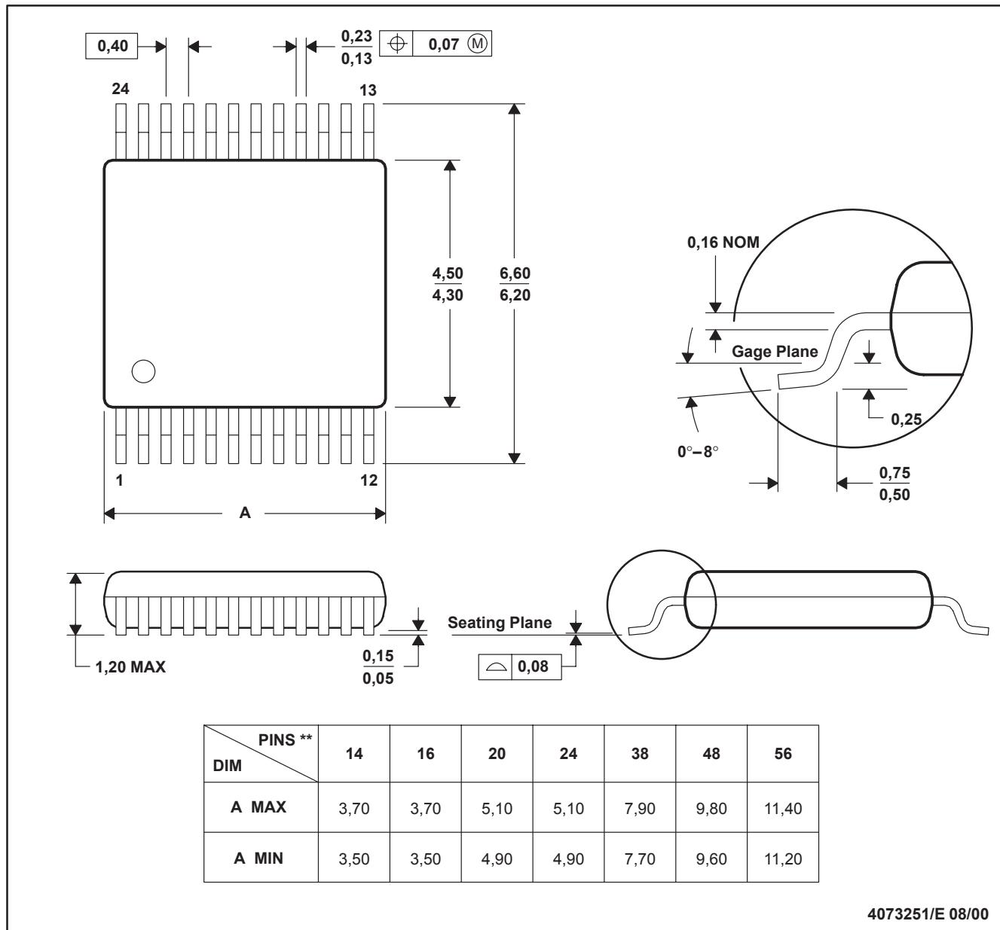

The figure shows the DGV (R-PDSO-G\*\*) package outline, 24 pins shown (description written from the drawing; dimensions in mm). Top view: pins 1-12 along the bottom (1 at the left) and 13-24 along the top (24 at the left), pin 1 marked by a circle on the body. Body length A along the pin rows (value per pin count in the table below). Body width 4,50 / 4,30, width across the leads 6,60 / 6,20. Lead pitch 0,40 (boxed), lead width 0,23 / 0,13 with a position tolerance 0,07 Ⓜ. Side view: height 1,20 MAX, standoff 0,15 / 0,05, coplanarity 0,08 to the Seating Plane. Lead detail: 0,16 NOM lead thickness, Gage Plane 0,25 above the seating plane, lead angle 0°–8°, foot length 0,75 / 0,50.

| PINS ** DIM | 14   | 16   | 20   | 24   | 38   | 48   | 56    |
|----------------|------|------|------|------|------|------|-------|
| A MAX          | 3,70 | 3,70 | 5,10 | 5,10 | 7,90 | 9,80 | 11,40 |
| A MIN          | 3,50 | 3,50 | 4,90 | 4,90 | 7,70 | 9,60 | 11,20 |

4073251/E 08/00

Mechanical drawing of the DGV (R-PDSO-G\*\*) package showing top, side, and detail views with dimensions and a pinout table.

- NOTES: A. All linear dimensions are in millimeters.  
 B. This drawing is subject to change without notice.  
 C. Body dimensions do not include mold flash or protrusion, not to exceed 0,15 per side.  
 D. Falls within JEDEC: 24/48 Pins – MO-153  
 14/16/20/56 Pins – MO-194

{31}------------------------------------------------

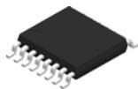

A 3D rendering of the black 16-pin TSSOP package with two rows of eight silver gull-wing leads along its long sides.

#### PACKAGE OUTLINE

# PW0016A

**TSSOP - 1.2 mm max height**

## SMALL OUTLINE PACKAGE

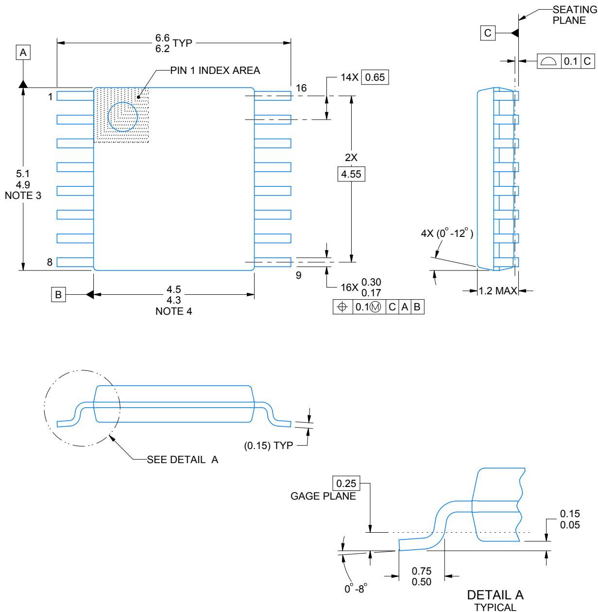

The drawing shows the PW0016A 16-pin TSSOP package outline (description written from the drawing; dimensions in mm):

- Top view: pins 1-8 on the left side (1 at the top) and 9-16 on the right side (16 at the top), PIN 1 INDEX AREA in the upper-left corner of the body. Width across the leads 6.6 / 6.2 TYP; body length 5.1 / 4.9 (NOTE 3, datum A); body width 4.5 / 4.3 (NOTE 4, datum B). Lead pitch 14X 0.65 (boxed), 2X 4.55 (boxed) between the pin 1 and pin 8 (and pin 9 and pin 16) centerlines. Lead width 16X 0.30 / 0.17 with position tolerance 0.1 Ⓜ C A B.
- End view: height 1.2 MAX, body draft 4X (0° -12° ), coplanarity 0.1 C to the SEATING PLANE (datum C).
- Side view: lead thickness (0.15) TYP; SEE DETAIL A.
- DETAIL A (TYPICAL, scale 20X): GAGE PLANE 0.25 (boxed), standoff 0.15 / 0.05, foot length 0.75 / 0.50, lead angle 0° -8°.

Technical drawing of a 16-pin TSSOP package PW0016A showing top view, side views, and Detail A lead profile with dimensions and tolerances.

4220204/B 12/2023

##### NOTES:

1. All linear dimensions are in millimeters. Any dimensions in parenthesis are for reference only. Dimensioning and tolerancing per ASME Y14.5M.
2. This drawing is subject to change without notice.
3. This dimension does not include mold flash, protrusions, or gate burrs. Mold flash, protrusions, or gate burrs shall not exceed 0.15 mm per side.
4. This dimension does not include interlead flash. Interlead flash shall not exceed 0.25 mm per side.
5. Reference JEDEC registration MO-153.

{32}------------------------------------------------

#### EXAMPLE BOARD LAYOUT

PW0016A

TSSOP - 1.2 mm max height

SMALL OUTLINE PACKAGE

LAND PATTERN EXAMPLE for the PW0016A TSSOP (description written from the drawing; dimensions in mm, for reference). Two columns of eight rounded-rectangle pads: 1-8 on the left (1 at the top), 9-16 on the right (16 at the top). Pads 16X (1.5) long and 16X (0.45) wide with (R0.05) TYP corners; pitch 14X (0.65); (5.8) between the left and right pad centerlines. SYMM centerlines in both directions.

LAND PATTERN EXAMPLE  
EXPOSED METAL SHOWN  
SCALE: 10X

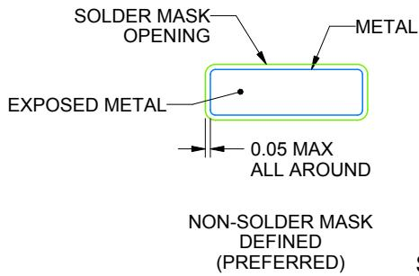

Solder mask detail 'NON-SOLDER MASK DEFINED (PREFERRED)' (description written from the drawing): top view of one pad; the SOLDER MASK OPENING (outer outline) surrounds the METAL pad with 0.05 MAX ALL AROUND, so the whole pad is EXPOSED METAL.

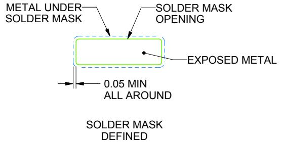

Solder mask detail 'SOLDER MASK DEFINED' (description written from the drawing): top view of one pad; the metal (dashed outline, METAL UNDER SOLDER MASK) extends 0.05 MIN ALL AROUND beyond the SOLDER MASK OPENING, which defines the EXPOSED METAL.

SOLDER MASK DETAILS

4220204/B 12/2023

NOTES: (continued)

6. Publication IPC-7351 may have alternate designs.

7. Solder mask tolerances between and around signal pads can vary based on board fabrication site.

{33}------------------------------------------------

#### EXAMPLE STENCIL DESIGN

PW0016A

TSSOP - 1.2 mm max height

SMALL OUTLINE PACKAGE

SOLDER PASTE EXAMPLE for the PW0016A TSSOP (description written from the drawing; dimensions in mm, for reference). Two columns of eight rounded-rectangle apertures, one per pad: 1-8 on the left (1 at the top), 9-16 on the right (16 at the top). Apertures 16X (1.5) long and 16X (0.45) wide with (R0.05) TYP corners; pitch 14X (0.65); (5.8) between the left and right aperture centerlines. SYMM centerlines in both directions.

SOLDER PASTE EXAMPLE  
BASED ON 0.125 mm THICK STENCIL  
SCALE: 10X

4220204/B 12/2023

NOTES: (continued)

8. Laser cutting apertures with trapezoidal walls and rounded corners may offer better paste release. IPC-7525 may have alternate design recommendations.
9. Board assembly site may have different recommendations for stencil design.

{34}------------------------------------------------

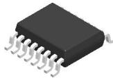

3D perspective view of the DBQ0016A SSOP package.

##### DBQ0016A

#### PACKAGE OUTLINE

SSOP - 1.75 mm max height

SHRINK SMALL-OUTLINE PACKAGE

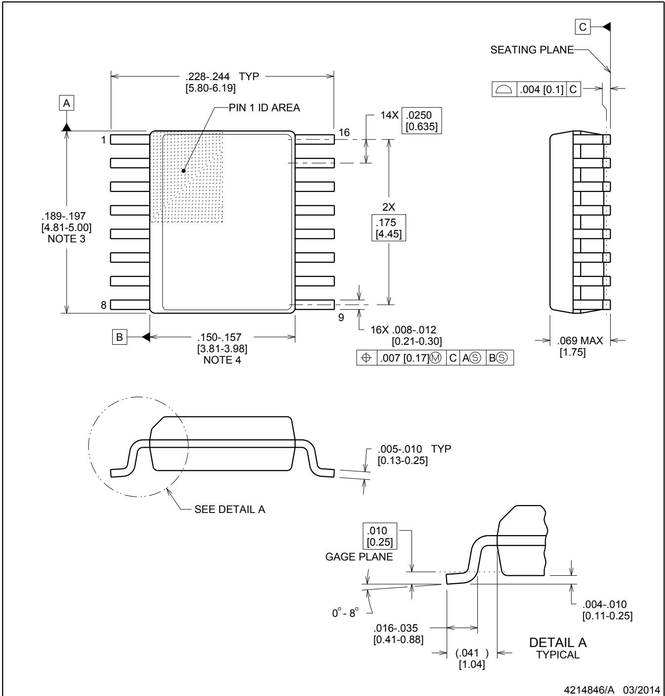

The figure shows the DBQ0016A SSOP package outline (description written from the drawing; dimensions in inches, millimeters in brackets). Top view: pins 1-8 on the left side (1 at the top) and 9-16 on the right side (16 at the top), PIN 1 ID AREA in the upper-left corner of the body. Width across the leads .228-.244 TYP [5.80-6.19]; body length .189-.197 [4.81-5.00] (NOTE 3, datum A); body width .150-.157 [3.81-3.98] (NOTE 4, datum B). Lead pitch 14X .0250 [0.635] (boxed), 2X .175 [4.45] (boxed) between the pin 1 and pin 8 (and pin 9 and pin 16) centerlines. Lead width 16X .008-.012 [0.21-0.30] with position tolerance .007 [0.17] Ⓜ C A Ⓢ B Ⓢ. End view: height .069 MAX [1.75], coplanarity .004 [0.1] C to the SEATING PLANE (datum C). Side view: lead thickness .005-.010 TYP [0.13-0.25]; SEE DETAIL A. DETAIL A (TYPICAL): GAGE PLANE .010 [0.25] (boxed), standoff .004-.010 [0.11-0.25], foot length .016-.035 [0.41-0.88], (.041) [1.04] lead length, lead angle 0° - 8°.

Technical drawing of the DBQ0016A SSOP package showing top, side, and detail views with dimensions and tolerances.

4214846/A 03/2014

##### NOTES:

1. Linear dimensions are in inches [millimeters]. Dimensions in parenthesis are for reference only. Controlling dimensions are in inches. Dimensioning and tolerancing per ASME Y14.5M.
2. This drawing is subject to change without notice.
3. This dimension does not include mold flash, protrusions, or gate burrs. Mold flash, protrusions, or gate burrs shall not exceed .006 inch, per side.
4. This dimension does not include interlead flash.
5. Reference JEDEC registration MO-137, variation AB.

{35}------------------------------------------------

#### EXAMPLE BOARD LAYOUT

DBQ0016A

SSOP - 1.75 mm max height

SHRINK SMALL-OUTLINE PACKAGE

![LAND PATTERN EXAMPLE for the DBQ0016A SSOP (description written from the drawing; dimensions in inches, millimeters in brackets, for reference). Two columns of eight rectangular pads: 1-8 on the left (1 at the top), 9-16 on the right (16 at the top). Pads 16X (.063) [1.6] long and 16X (.016) [0.41] wide; pitch 14X (.0250) [0.635]; (.213) [5.4] between the left and right pad centerlines. SYMM centerlines in both directions; 'SEE DETAILS' points to pad 16.](img/1cac1845cf99a3f64ae00cd2bb4f9ed7_img.jpg)

LAND PATTERN EXAMPLE for the DBQ0016A SSOP (description written from the drawing; dimensions in inches, millimeters in brackets, for reference). Two columns of eight rectangular pads: 1-8 on the left (1 at the top), 9-16 on the right (16 at the top). Pads 16X (.063) [1.6] long and 16X (.016) [0.41] wide; pitch 14X (.0250) [0.635]; (.213) [5.4] between the left and right pad centerlines. SYMM centerlines in both directions; 'SEE DETAILS' points to pad 16.

LAND PATTERN EXAMPLE  
SCALE:8X

![SOLDER MASK DETAILS (description written from the drawing): two top views of one pad. NON SOLDER MASK DEFINED: the SOLDER MASK OPENING (outer, green outline) surrounds the METAL pad (inner, red outline) with .002 MAX [0.05] ALL AROUND. SOLDER MASK DEFINED: the METAL (dashed red outline) extends .002 MIN [0.05] ALL AROUND beyond the SOLDER MASK OPENING (solid green outline).](img/ac31fdfebb9751f7f10416dfe33bc872_img.jpg)

SOLDER MASK DETAILS (description written from the drawing): two top views of one pad. NON SOLDER MASK DEFINED: the SOLDER MASK OPENING (outer, green outline) surrounds the METAL pad (inner, red outline) with .002 MAX [0.05] ALL AROUND. SOLDER MASK DEFINED: the METAL (dashed red outline) extends .002 MIN [0.05] ALL AROUND beyond the SOLDER MASK OPENING (solid green outline).

SOLDER MASK DETAILS

4214846/A 03/2014

NOTES: (continued)

6. Publication IPC-7351 may have alternate designs.

7. Solder mask tolerances between and around signal pads can vary based on board fabrication site.

{36}------------------------------------------------

#### EXAMPLE STENCIL DESIGN

DBQ0016A

SSOP - 1.75 mm max height

SHRINK SMALL-OUTLINE PACKAGE

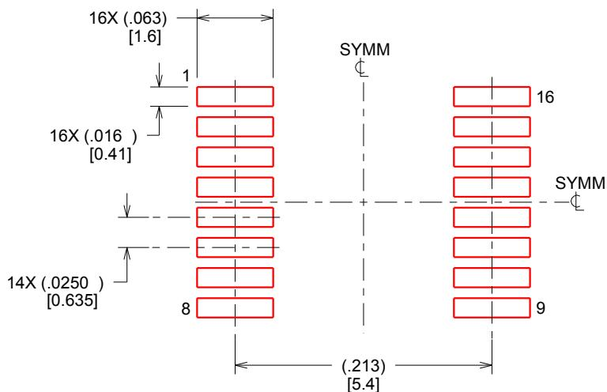

SOLDER PASTE EXAMPLE for the DBQ0016A SSOP (description written from the drawing; dimensions in inches, millimeters in brackets, for reference). Two columns of eight rectangular apertures, one per pad: 1-8 on the left (1 at the top), 9-16 on the right (16 at the top). Apertures 16X (.063) [1.6] long and 16X (.016) [0.41] wide; pitch 14X (.0250) [0.635]; (.213) [5.4] between the left and right aperture centerlines. SYMM centerlines in both directions.

Solder paste example diagram for an SSOP package.

SOLDER PASTE EXAMPLE  
BASED ON .005 INCH [0.127 MM] THICK STENCIL  
SCALE:8X

4214846/A 03/2014

NOTES: (continued)

8. Laser cutting apertures with trapezoidal walls and rounded corners may offer better paste release. IPC-7525 may have alternate design recommendations.
9. Board assembly site may have different recommendations for stencil design.

{37}------------------------------------------------

RGY (R-PVQFN-N16)

PLASTIC QUAD FLATPACK NO-LEAD

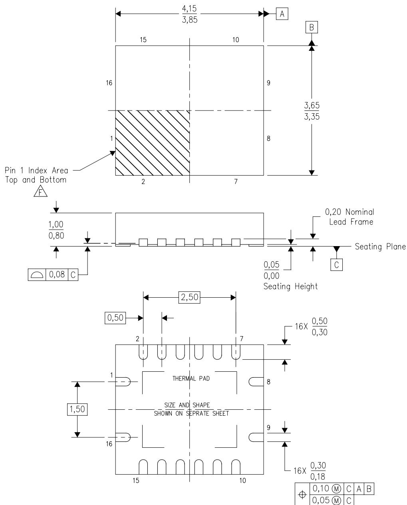

The figure shows the RGY (R-PVQFN-N16) package outline (description written from the drawing; dimensions in mm, decimal commas as printed).

**Top View:** Rectangular body 4,15 / 3,85 long (datum A) and 3,65 / 3,35 wide (datum B). Corner pin numbers 1 and 16 on the left side, 2 and 7 along the bottom, 8 and 9 on the right side, 15 and 10 along the top. The lower-left quarter is hatched: 'Pin 1 Index Area Top and Bottom', flagged with note F.

**Side View:** Height 1,00 / 0,80; 0,20 Nominal Lead Frame; Seating Height 0,05 / 0,00; coplanarity 0,08 C to the Seating Plane (datum C).

**Bottom View:** Pads 2-7 along the top edge, 8 and 9 on the right, 10-15 along the bottom and 16 and 1 on the left. Pitch 0,50 (boxed); 2,50 (boxed) between the pad 2 and pad 7 centerlines and 1,50 (boxed) between the pad 1 and pad 16 centerlines. Pad length 16X 0,50 / 0,30, pad width 16X 0,30 / 0,18, with position tolerances 0,10 Ⓜ C A B and 0,05 Ⓜ C. The THERMAL PAD in the center is labeled 'SIZE AND SHAPE SHOWN ON SEPRATE SHEET' (as printed).

Mechanical drawing of the RGY (R-PVQFN-N16) Plastic Quad Flatpack No-Lead package. The drawing includes a top view, a side view, and a bottom view with detailed dimensions and tolerances.

Bottom View

4203539-3/I 06/2011

- NOTES:
- A. All linear dimensions are in millimeters. Dimensioning and tolerancing per ASME Y14.5M-1994.
- B. This drawing is subject to change without notice.
- C. QFN (Quad Flatpack No-Lead) package configuration.
- D. The package thermal pad must be soldered to the board for thermal and mechanical performance.
- E. See the additional figure in the Product Data Sheet for details regarding the exposed thermal pad features and dimensions.
- F. Pin 1 identifiers are located on both top and bottom of the package and within the zone indicated. The Pin 1 identifiers are either a molded, marked, or metal feature.
- G. Package complies to JEDEC MO-241 variation BA.

{38}------------------------------------------------

RGY (R-PVQFN-N16)

PLASTIC QUAD FLATPACK NO-LEAD

### THERMAL INFORMATION

This package incorporates an exposed thermal pad that is designed to be attached directly to an external heatsink. The thermal pad must be soldered directly to the printed circuit board (PCB). After soldering, the PCB can be used as a heatsink. In addition, through the use of thermal vias, the thermal pad can be attached directly to the appropriate copper plane shown in the electrical schematic for the device, or alternatively, can be attached to a special heatsink structure designed into the PCB. This design optimizes the heat transfer from the integrated circuit (IC).

For information on the Quad Flatpack No-Lead (QFN) package and its advantages, refer to Application Report, QFN/SON PCB Attachment, Texas Instruments Literature No. SLUA271. This document is available at [www.ti.com](http://www.ti.com).

The exposed thermal pad dimensions for this package are shown in the following illustration.

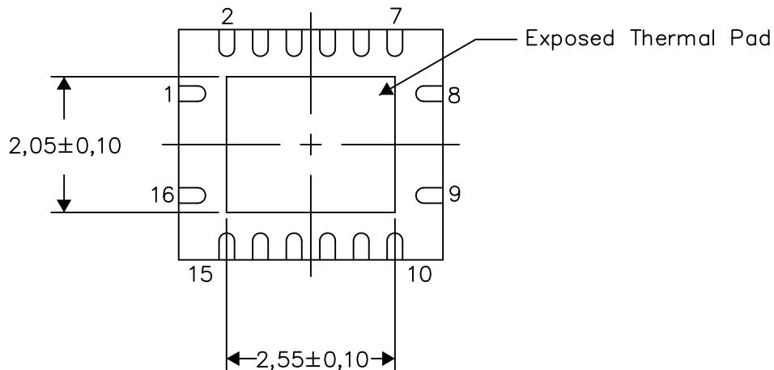

The diagram shows the bottom view of the RGY (R-PVQFN-N16) package (description written from the drawing): pads 2-7 along the top edge, 8 and 9 on the right, 10-15 along the bottom and 16 and 1 on the left. The rectangular Exposed Thermal Pad in the center is 2,55±0,10 wide and 2,05±0,10 high (mm); center lines are drawn through it.

Bottom view diagram of the RGY (R-PVQFN-N16) package showing the exposed thermal pad dimensions.

Bottom View

Exposed Thermal Pad Dimensions

4206353-3/P 03/14

NOTE: All linear dimensions are in millimeters

{39}------------------------------------------------

RGY (R-PVQFN-N16)

PLASTIC QUAD FLATPACK NO-LEAD

![Land pattern data for the RGY (R-PVQFN-N16) package (description written from the drawing; dimensions in mm, decimal commas as printed). Example Board Layout: six elongated pads along the top and bottom edges and two on each side, overall 4,80 by 4,30; 2,60 between the outer edges of the side pads, 1,50 between the side-pad centerlines; pads 0,85 X 16 PL. long and 0,28 X 16 PL. wide at a pitch of 10x0,50; center thermal pad 2,55 by 2,05 (Note D). Example Stencil Design, 0.125mm Stencil Thickness (Note E): overall 4,75 by 4,25, 2,65 and 1,50 for the side apertures, apertures 0,80 x 16 PL. long and 0,23 x 16 PL. wide at 10x0,50; the thermal pad is printed through four 1,07 by 0,82 apertures separated by 0,30 x 2 PL., '67% solder coverage by printed area on center thermal pad'. Non Solder Mask Defined Pad (circled detail): Example Pad Geometry (Note C) 0,85 long and 0,28 wide with R0,14 ends; Example Solder Mask Opening (Note F) 0,07 All Around the pad, 0,08 between openings. Example Via Layout Design may vary depending on constraints (Note D, F): vias labeled 6xØ0,3 on a 1,00 by 1,00 grid within the thermal pad (four vias are drawn).](img/cfc852835f2d91bea8dc074568937e22_img.jpg)

Land pattern data for the RGY (R-PVQFN-N16) package (description written from the drawing; dimensions in mm, decimal commas as printed). Example Board Layout: six elongated pads along the top and bottom edges and two on each side, overall 4,80 by 4,30; 2,60 between the outer edges of the side pads, 1,50 between the side-pad centerlines; pads 0,85 X 16 PL. long and 0,28 X 16 PL. wide at a pitch of 10x0,50; center thermal pad 2,55 by 2,05 (Note D). Example Stencil Design, 0.125mm Stencil Thickness (Note E): overall 4,75 by 4,25, 2,65 and 1,50 for the side apertures, apertures 0,80 x 16 PL. long and 0,23 x 16 PL. wide at 10x0,50; the thermal pad is printed through four 1,07 by 0,82 apertures separated by 0,30 x 2 PL., '67% solder coverage by printed area on center thermal pad'. Non Solder Mask Defined Pad (circled detail): Example Pad Geometry (Note C) 0,85 long and 0,28 wide with R0,14 ends; Example Solder Mask Opening (Note F) 0,07 All Around the pad, 0,08 between openings. Example Via Layout Design may vary depending on constraints (Note D, F): vias labeled 6xØ0,3 on a 1,00 by 1,00 grid within the thermal pad (four vias are drawn).

4208122-3/P 03/14

- NOTES:
- A. All linear dimensions are in millimeters.
- B. This drawing is subject to change without notice.
- C. Publication IPC-7351 is recommended for alternate designs.
- D. This package is designed to be soldered to a thermal pad on the board. Refer to Application Note, Quad Flat-Pack QFN/SON PCB Attachment, Texas Instruments Literature No. SLUA271, and also the Product Data Sheets for specific thermal information, via requirements, and recommended board layout. These documents are available at [www.ti.com](http://www.ti.com) <<http://www.ti.com>>.
- E. Laser cutting apertures with trapezoidal walls and also rounding corners will offer better paste release. Customers should contact their board assembly site for stencil design recommendations. Refer to IPC 7525 for stencil design considerations.
- F. Customers should contact their board fabrication site for minimum solder mask web tolerances between signal pads.

{40}------------------------------------------------

### **IMPORTANT NOTICE AND DISCLAIMER**

TI PROVIDES TECHNICAL AND RELIABILITY DATA (INCLUDING DATASHEETS), DESIGN RESOURCES (INCLUDING REFERENCE DESIGNS), APPLICATION OR OTHER DESIGN ADVICE, WEB TOOLS, SAFETY INFORMATION, AND OTHER RESOURCES "AS IS" AND WITH ALL FAULTS, AND DISCLAIMS ALL WARRANTIES, EXPRESS AND IMPLIED, INCLUDING WITHOUT LIMITATION ANY IMPLIED WARRANTIES OF MERCHANTABILITY, FITNESS FOR A PARTICULAR PURPOSE OR NON-INFRINGEMENT OF THIRD PARTY INTELLECTUAL PROPERTY RIGHTS.

These resources are intended for skilled developers designing with TI products. You are solely responsible for (1) selecting the appropriate TI products for your application, (2) designing, validating and testing your application, and (3) ensuring your application meets applicable standards, and any other safety, security, regulatory or other requirements.

These resources are subject to change without notice. TI grants you permission to use these resources only for development of an application that uses the TI products described in the resource. Other reproduction and display of these resources is prohibited. No license is granted to any other TI intellectual property right or to any third party intellectual property right. TI disclaims responsibility for, and you fully indemnify TI and its representatives against any claims, damages, costs, losses, and liabilities arising out of your use of these resources.

TI's products are provided subject to [TI's Terms of Sale](#), [TI's General Quality Guidelines](#), or other applicable terms available either on [ti.com](#) or provided in conjunction with such TI products. TI's provision of these resources does not expand or otherwise alter TI's applicable warranties or warranty disclaimers for TI products. Unless TI explicitly designates a product as custom or customer-specified, TI products are standard, catalog, general purpose devices.

TI objects to and rejects any additional or different terms you may propose.

Copyright © 2026, Texas Instruments Incorporated

Last updated 10/2025